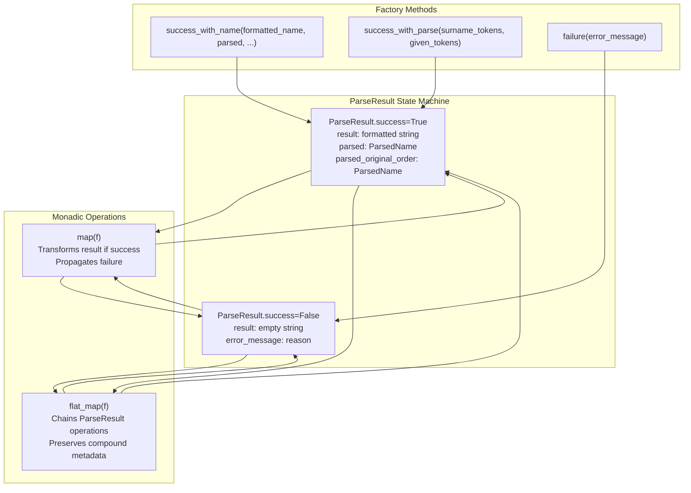
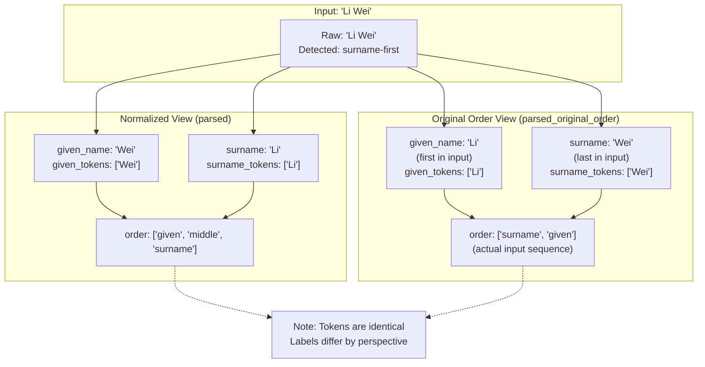
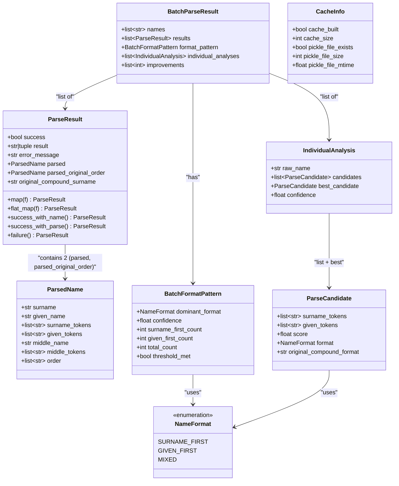
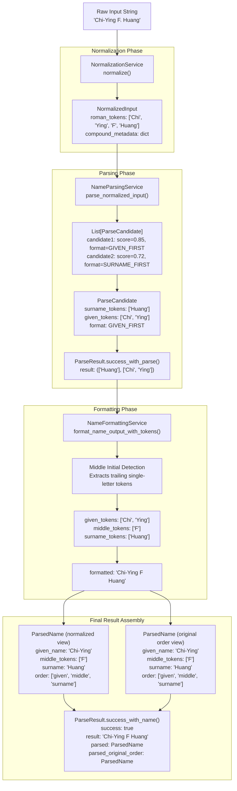
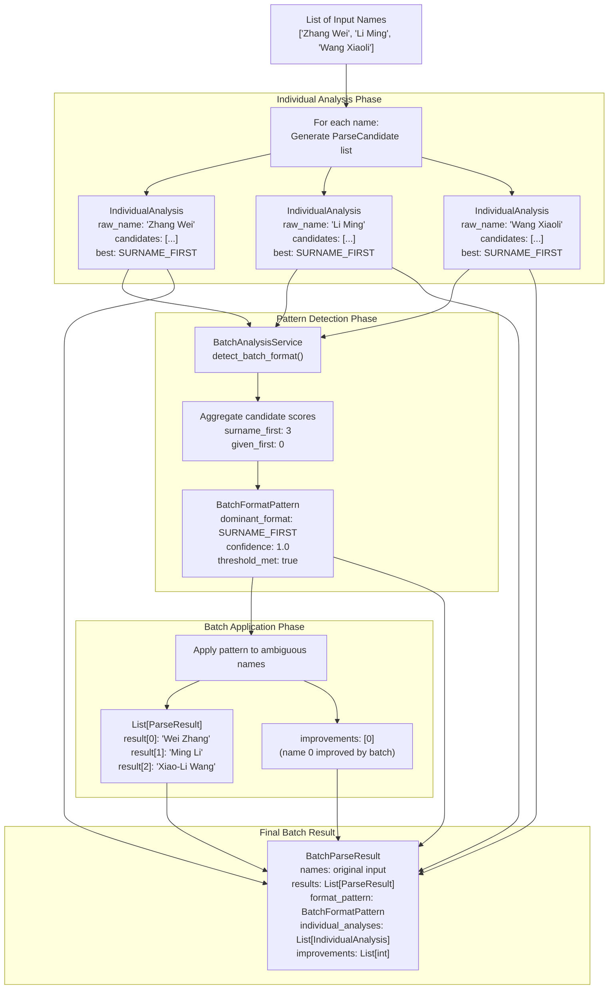

<!-- source: DeepWiki mcp.deepwiki.com · repo allenai/sinonym · page 4.2 Result Types and Data Classes · fetched 2026-10-26 -->

# Result Types and Data Classes

<details>
<summary>Relevant source files</summary>

The following files were used as context for generating this wiki page:

- [README.md](README.md)
- [scripts/profile_run.py](scripts/profile_run.py)
- [sinonym/coretypes/results.py](sinonym/coretypes/results.py)
- [sinonym/services/formatting.py](sinonym/services/formatting.py)
- [tests/test_batch.py](tests/test_batch.py)
- [tests/test_middle_names.py](tests/test_middle_names.py)

</details>


## Purpose and Scope

This page documents the immutable data structures and result types used throughout the sinonym codebase. These types implement a functional programming style with monadic operations, provide structured access to name components, and support both individual and batch processing workflows.

For information about the linguistic databases (surnames, given names, compound variants), see [Name Data Structures](#4.1). For configuration and threshold management, see [Configuration System](#4.3).

---

## Core Result Types

The system uses two primary result types: `ParseResult` for operation outcomes and `ParsedName` for structured name components. Both are immutable frozen dataclasses.

### ParseResult: Either-Like Monad

`ParseResult` [sinonym/coretypes/results.py:34-134]() implements a Scala-compatible Either monad pattern that encapsulates success or failure states. It provides functional composition through `map` and `flat_map` methods.

**Key Fields:**

| Field | Type | Purpose |
|-------|------|---------|
| `success` | `bool` | Indicates whether parsing succeeded |
| `result` | `str \| tuple[list[str], list[str]]` | Final formatted string (success) or empty (failure) |
| `error_message` | `str \| None` | Failure reason (e.g., "name not recognised as Chinese") |
| `parsed` | `ParsedName \| None` | Structured components in normalized output order |
| `parsed_original_order` | `ParsedName \| None` | Structured components in original input order |
| `original_compound_surname` | `str \| None` | Preserved compound surname format |

**Factory Methods:**

- `ParseResult.success_with_name(formatted_name, ...)` [sinonym/coretypes/results.py:47-67]() - Creates success result with final formatted output
- `ParseResult.success_with_parse(surname_tokens, given_tokens, ...)` [sinonym/coretypes/results.py:69-95]() - Creates intermediate result with raw token lists
- `ParseResult.failure(error_message)` [sinonym/coretypes/results.py:98-99]() - Creates failure result

**Monadic Operations:**

- `map(f)` [sinonym/coretypes/results.py:101-113]() - Transforms successful result, propagates failure
- `flat_map(f)` [sinonym/coretypes/results.py:115-133]() - Chains operations that return `ParseResult`, preserves compound surname



**Sources:** [sinonym/coretypes/results.py:34-134](), [README.md:236-272]()

### ParsedName: Structured Name Components

`ParsedName` [sinonym/coretypes/results.py:13-31]() provides structured access to name components with both string and token-level representations. It supports optional middle name components (single-letter initials) and includes an `order` field to describe component arrangement.

**Key Fields:**

| Field | Type | Purpose |
|-------|------|---------|
| `surname` | `str` | Formatted surname string (e.g., "Au-Yeung") |
| `given_name` | `str` | Formatted given name string (e.g., "Chi-Ying") |
| `surname_tokens` | `list[str]` | Individual surname tokens (e.g., ["Au", "Yeung"]) |
| `given_tokens` | `list[str]` | Individual given name tokens (e.g., ["Chi", "Ying"]) |
| `middle_name` | `str` | Formatted middle initials (e.g., "F K") |
| `middle_tokens` | `list[str]` | Individual middle initials (e.g., ["F", "K"]) |
| `order` | `list[str]` | Component order descriptor (e.g., ["given", "middle", "surname"]) |

The `order` field contains strings from the set `{"given", "middle", "surname"}` and indicates how components appear when combined. For normalized output this is typically `["given", "middle", "surname"]`, while for original input order it reflects the actual input sequence.

**Sources:** [sinonym/coretypes/results.py:13-31](), [README.md:236-272]()

---

## Dual View Pattern: Normalized vs Original Order

`ParseResult` provides two `ParsedName` instances representing different conceptual views of the same tokens:

### Normalized View: `parsed`

The `parsed` field uses **semantic labels** aligned with the output format (Given-Name Surname):
- `given_name` and `given_tokens` represent the semantic given name
- `surname` and `surname_tokens` represent the semantic surname
- `order` is typically `["given", "middle", "surname"]`

### Original Order View: `parsed_original_order`

The `parsed_original_order` field uses **positional labels** aligned with input order:
- `given_name` and `given_tokens` represent the **first component(s)** in the input
- `surname` and `surname_tokens` represent the **last component(s)** in the input
- `order` reflects the actual input sequence (e.g., `["surname", "given"]` for surname-first input)

**Key Insight:** The **tokens themselves are identical** in both views; only the conceptual mapping and `order` differ.



**Example with Middle Initials:**

Input: `"Chi-Ying F. Huang"`

**Normalized View (`parsed`):**
- `given_name`: `"Chi-Ying"`
- `given_tokens`: `["Chi", "Ying"]`
- `middle_tokens`: `["F"]`
- `surname`: `"Huang"`
- `order`: `["given", "middle", "surname"]`

**Original Order View (`parsed_original_order`):**
- `given_name`: `"Chi-Ying"` (first component)
- `given_tokens`: `["Chi", "Ying"]`
- `middle_tokens`: `["F"]`
- `surname`: `"Huang"` (last component)
- `order`: `["given", "middle", "surname"]` (matches input order in this case)

**Sources:** [README.md:236-272](), [sinonym/coretypes/results.py:34-95](), [tests/test_middle_names.py:356-378]()

---

## Batch Processing Types

Batch processing requires additional types to capture format patterns, candidate scoring, and improvement tracking.

### NameFormat Enumeration

`NameFormat` [sinonym/coretypes/results.py:147-152]() defines the three possible name ordering patterns:

| Value | Meaning | Example |
|-------|---------|---------|
| `SURNAME_FIRST` | Chinese style | "Zhang Wei" |
| `GIVEN_FIRST` | Western style | "Wei Zhang" |
| `MIXED` | No clear pattern | Mixed batch |

**Sources:** [sinonym/coretypes/results.py:147-152]()

### BatchFormatPattern

`BatchFormatPattern` [sinonym/coretypes/results.py:173-182]() captures the detected formatting pattern for an entire batch.

**Key Fields:**

| Field | Type | Purpose |
|-------|------|---------|
| `dominant_format` | `NameFormat` | Most common format in batch |
| `confidence` | `float` | Percentage of names following dominant format |
| `surname_first_count` | `int` | Number of surname-first preferences |
| `given_first_count` | `int` | Number of given-first preferences |
| `total_count` | `int` | Total Chinese names analyzed |
| `threshold_met` | `bool` | Whether confidence >= threshold (typically 67%) |

**Note:** `threshold_met` is informational only and does not gate processing. Batch results are always returned regardless of confidence.

**Sources:** [sinonym/coretypes/results.py:173-182](), [tests/test_batch.py:68-83]()

### ParseCandidate

`ParseCandidate` [sinonym/coretypes/results.py:155-162]() represents a single parsing possibility with scoring information.

**Key Fields:**

| Field | Type | Purpose |
|-------|------|---------|
| `surname_tokens` | `list[str]` | Candidate surname tokens |
| `given_tokens` | `list[str]` | Candidate given name tokens |
| `score` | `float` | Frequency-based score |
| `format` | `NameFormat` | Implied format (SURNAME_FIRST or GIVEN_FIRST) |
| `original_compound_format` | `str \| None` | Preserved compound surname format |

Multiple candidates are generated for ambiguous names (e.g., "Li Wei" can be surname-first or given-first). Scoring uses surname and given name frequency databases.

**Sources:** [sinonym/coretypes/results.py:155-162]()

### IndividualAnalysis

`IndividualAnalysis` [sinonym/coretypes/results.py:164-171]() provides detailed analysis of a single name within a batch context.

**Key Fields:**

| Field | Type | Purpose |
|-------|------|---------|
| `raw_name` | `str` | Original input name |
| `candidates` | `list[ParseCandidate]` | All parsing possibilities |
| `best_candidate` | `ParseCandidate \| None` | Highest-scoring candidate |
| `confidence` | `float` | Confidence in best candidate |

**Sources:** [sinonym/coretypes/results.py:164-171](), [tests/test_batch.py:489-500]()

### BatchParseResult

`BatchParseResult` [sinonym/coretypes/results.py:184-192]() aggregates all batch processing information.

**Key Fields:**

| Field | Type | Purpose |
|-------|------|---------|
| `names` | `list[str]` | Original input names |
| `results` | `list[ParseResult]` | Individual parsing results (matches input length) |
| `format_pattern` | `BatchFormatPattern` | Detected batch-level pattern |
| `individual_analyses` | `list[IndividualAnalysis]` | Detailed per-name analysis |
| `improvements` | `list[int]` | Indices of names improved by batch context |

The `improvements` list tracks which names benefited from batch format detection compared to individual processing.

**Sources:** [sinonym/coretypes/results.py:184-192](), [tests/test_batch.py:101-113]()

---

## Type Hierarchy and Relationships

The following diagram shows how result types relate to each other and flow through the system:



**Sources:** [sinonym/coretypes/results.py:1-192]()

---

## Data Flow Through Result Types

The following diagram illustrates how result types flow through the processing pipeline:



**Sources:** [sinonym/services/formatting.py:181-333](), [tests/test_middle_names.py:22-86]()

---

## Batch Processing Data Flow

Batch processing creates additional result structures that aggregate individual analyses:



**Sources:** [tests/test_batch.py:101-113](), [tests/test_batch.py:250-281](), [sinonym/coretypes/results.py:184-192]()

---

## Functional Composition Pattern

`ParseResult` implements functional programming patterns to enable clean error propagation and transformation chains.

### Map Operation

The `map` method [sinonym/coretypes/results.py:101-113]() transforms successful results while propagating failures:

```python
# Transform successful result
result.map(lambda name: name.upper())  # "WEI ZHANG" if success, unchanged if failure

# Chain operations safely
result.map(lambda name: name.split()[0])  # Extract first word, or propagate error
```

**Behavior:**
- Success: Applies function `f` to `result`, returns new `ParseResult` with transformed value
- Failure: Returns original failure unchanged
- Exception in `f`: Catches exception, returns `ParseResult.failure(str(e))`

### Flat Map Operation

The `flat_map` method [sinonym/coretypes/results.py:115-133]() chains operations that return `ParseResult`, enabling sequential processing:

```python
# Chain parsing operations
normalization_result.flat_map(lambda tokens: parsing_service.parse(tokens))
                    .flat_map(lambda parsed: formatting_service.format(parsed))
```

**Behavior:**
- Success: Applies function `f` to `result`, expects `ParseResult` return
- Preserves `original_compound_surname` across chain if not overwritten
- Failure: Returns original failure unchanged
- Exception in `f`: Catches exception, returns `ParseResult.failure(str(e))`

**Key Preservation:** `flat_map` automatically preserves the `original_compound_surname` field from the original result if the returned result doesn't provide its own value. This ensures compound surname formatting metadata flows through the entire pipeline.

**Sources:** [sinonym/coretypes/results.py:101-133]()

---

## Middle Name Handling in Result Types

Middle names (single-letter initials) require special handling in `ParsedName` and the formatting pipeline. The `middle_tokens` and `middle_name` fields separate these initials from the main given name components.

**Separation Rules:**

1. **Trailing Single-Letter Initials:** When a name ends with one or more single-letter tokens after multi-character tokens, these are extracted as middle initials
   - Input: `"Chi-Ying F. Huang"` → `given_tokens: ["Chi", "Ying"]`, `middle_tokens: ["F"]`
   - Input: `"Chi-Ying F. K. Huang"` → `given_tokens: ["Chi", "Ying"]`, `middle_tokens: ["F", "K"]`

2. **Leading Single-Letter Initials:** When a name starts with single-letter tokens followed by multi-character tokens, these may also be extracted
   - Input: `"Li A. Wei"` → `middle_tokens: ["A"]` positioned between given and surname

3. **Output Formatting:** Middle initials are rendered with space separators between given name and surname
   - `"Chi-Ying F Huang"` (single initial)
   - `"Chi-Ying F K Huang"` (multiple initials)

**Implementation:** The `NameFormattingService.format_name_output_with_tokens()` method [sinonym/services/formatting.py:252-333]() performs the separation logic, peeling off leading and trailing single-letter tokens based on the presence of multi-character tokens.

**Sources:** [tests/test_middle_names.py:22-86](), [sinonym/services/formatting.py:252-333](), [README.md:236-272]()

---

## CacheInfo Type

`CacheInfo` [sinonym/coretypes/results.py:136-145]() is an immutable structure for cache metadata, used by the Pinyin caching system.

**Key Fields:**

| Field | Type | Purpose |
|-------|------|---------|
| `cache_built` | `bool` | Whether cache is initialized |
| `cache_size` | `int` | Number of cached entries |
| `pickle_file_exists` | `bool` | Whether persistent cache file exists |
| `pickle_file_size` | `int \| None` | Size of pickle file in bytes |
| `pickle_file_mtime` | `float \| None` | Modification timestamp |

This type supports cache introspection and debugging.

**Sources:** [sinonym/coretypes/results.py:136-145]()

---

## Type System Design Principles

The result types in sinonym follow several key design principles:

### Immutability

All result types use `@dataclass(frozen=True)` [sinonym/coretypes/results.py:13,34,136,155,164,173,184]() to ensure immutability. This prevents accidental mutation and enables safe sharing across threads.

### Scala Compatibility

`ParseResult` provides `map` and `flat_map` methods [sinonym/coretypes/results.py:101-133]() for Scala interoperability, allowing the library to be used from Scala code with familiar monadic operations.

### Explicit Success/Failure States

`ParseResult.success` [sinonym/coretypes/results.py:37]() makes error states explicit rather than relying on exceptions. This forces callers to handle both success and failure cases.

### Structured Access

`ParsedName` [sinonym/coretypes/results.py:13-31]() provides both high-level component strings (`surname`, `given_name`) and low-level token lists (`surname_tokens`, `given_tokens`) to support different use cases.

### Dual Perspective

The `parsed` and `parsed_original_order` fields [sinonym/coretypes/results.py:43-45]() provide two views of the same data, enabling both normalized processing and input-aligned analysis without duplicating tokens.

**Sources:** [sinonym/coretypes/results.py:1-192]()

---

