<!-- source: DeepWiki mcp.deepwiki.com · repo allenai/sinonym · page 4.3 Configuration System · fetched 2026-10-26 -->

# Configuration System

<details>
<summary>Relevant source files</summary>

The following files were used as context for generating this wiki page:

- [pyproject.toml](pyproject.toml)
- [sinonym/detector.py](sinonym/detector.py)
- [sinonym/services/parsing.py](sinonym/services/parsing.py)
- [uv.lock](uv.lock)

</details>


**Purpose**: This page documents the configuration architecture of sinonym, covering both build-time configuration (project metadata, dependencies, tool settings) and runtime configuration (detection thresholds, linguistic patterns, scoring weights). For information about the data structures that use these configurations, see [Name Data Structures](#4.1). For how configuration flows through services, see [Service Components](#3).

---

## Configuration Layers

Sinonym employs a two-layer configuration architecture: **build-time configuration** for packaging and deployment, and **runtime configuration** for detection algorithms and linguistic rules.

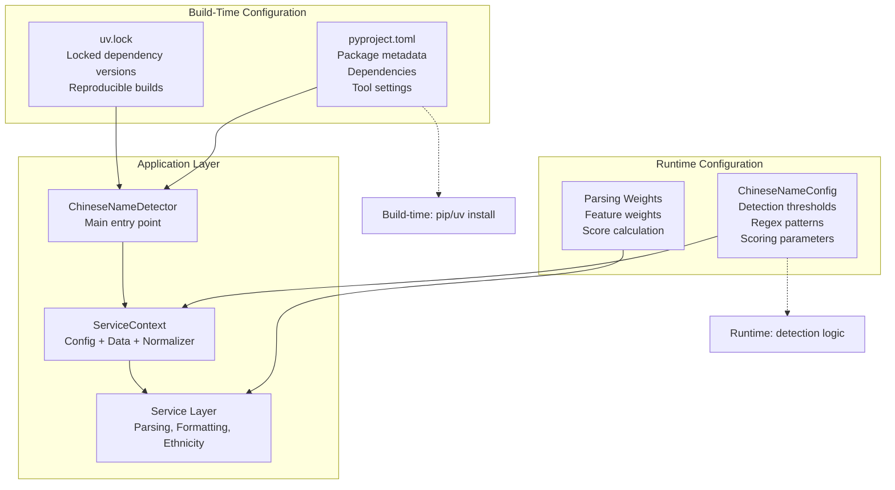

**Sources**: [pyproject.toml:1-104](), [sinonym/detector.py:193-209](), [sinonym/services/parsing.py:24-51]()

---

## Build-Time Configuration

Build-time configuration is defined in `pyproject.toml` and controls packaging, dependencies, and development tools.

### Package Metadata

The `[project]` section defines package identity and requirements:

| Field | Value | Purpose |
|-------|-------|---------|
| `name` | `"sinonym"` | PyPI package name |
| `version` | `"0.2.2"` | Semantic version for releases |
| `requires-python` | `">=3.10"` | Minimum Python version |
| `license` | `"MIT"` | Open source license |

**Sources**: [pyproject.toml:5-26]()

### Core Dependencies

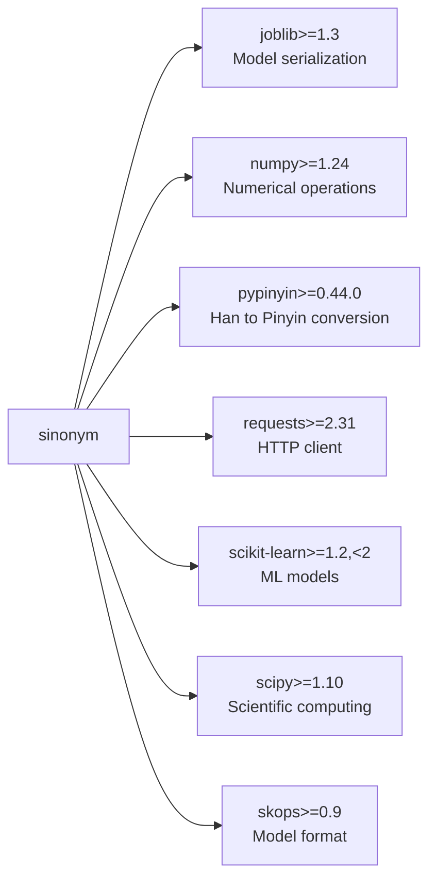

The dependency tree is locked in `uv.lock` for reproducibility, containing ~80 transitive dependencies with exact versions and hashes.

**Sources**: [pyproject.toml:27-35](), [uv.lock:1-364]()

### Tool Configuration

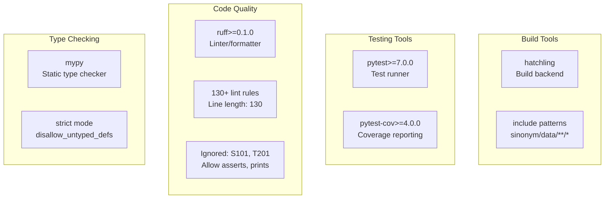

**Sources**: [pyproject.toml:53-98]()

---

## Runtime Configuration: ChineseNameConfig

The `ChineseNameConfig` class encapsulates all runtime detection parameters. It is created via a factory method and passed through the service layer.

### Configuration Creation and Flow

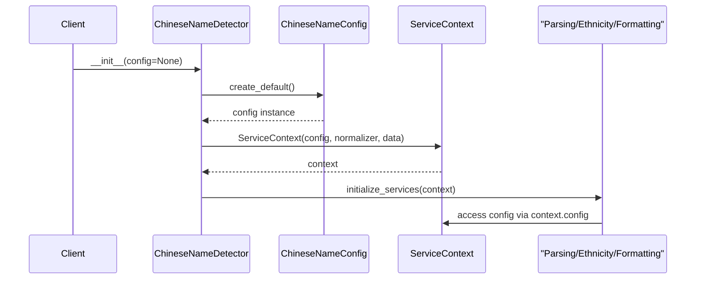

**Sources**: [sinonym/detector.py:193-233](), [sinonym/services/parsing.py:24-35]()

### Configuration Parameters

The configuration system provides three categories of parameters:

#### 1. Input Validation Parameters

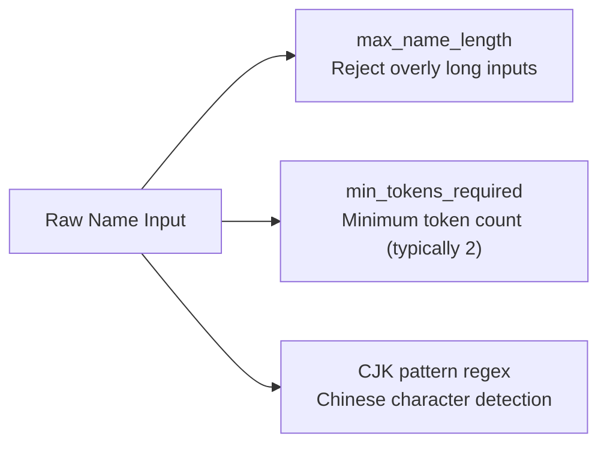

| Parameter | Type | Purpose | Usage Location |
|-----------|------|---------|----------------|
| `max_name_length` | `int` | Maximum allowed input length | [detector.py:258]() |
| `min_tokens_required` | `int` | Minimum tokens for valid name | [detector.py:273](), [parsing.py:139]() |
| `cjk_pattern` | `re.Pattern` | Regex for Chinese characters | [parsing.py:489,508]() |

**Sources**: [sinonym/detector.py:258-274](), [sinonym/services/parsing.py:139,489]()

#### 2. Scoring Thresholds

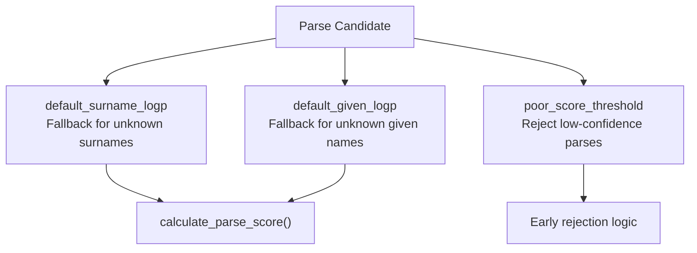

| Parameter | Type | Purpose | Usage Location |
|-----------|------|---------|----------------|
| `default_surname_logp` | `float` | Log-probability for unknown surnames | [parsing.py:359,366,370]() |
| `default_given_logp` | `float` | Log-probability for unknown given names | [parsing.py:375]() |
| `poor_score_threshold` | `float` | Minimum score to consider valid | [parsing.py:122,181]() |

**Sources**: [sinonym/services/parsing.py:122,181,359-378]()

#### 3. Pattern Recognition Configuration

The configuration includes compiled regex patterns for:
- **CJK character detection**: Identifies Chinese, Japanese, Korean characters
- **Script validation**: Rejects non-Chinese scripts early
- **Format detection**: Supports batch format pattern analysis

**Sources**: [sinonym/services/parsing.py:489,508](), [sinonym/detector.py:265-266]()

---

## Weight Configuration for Scoring

The parsing service accepts an optional `weights` parameter that controls how features are weighted in parse candidate scoring. This enables tuning the detection algorithm without modifying code.

### Weight Vector Structure

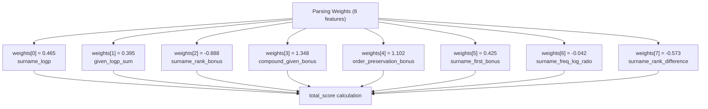

### Default Weights

The default weight configuration (when `weights=None`) is:

```
weights = [
    0.465,   # surname_logp: Frequency of surname
    0.395,   # given_logp_sum: Sum of given name frequencies
    -0.888,  # surname_rank_bonus: Percentile rank (negative weight)
    1.348,   # compound_given_bonus: Bonus for 2-char given names
    1.102,   # order_preservation_bonus: Prefer original order
    0.425,   # surname_first_bonus: Chinese surname-first pattern
    -0.042,  # surname_freq_log_ratio: Comparative frequency
    -0.573,  # surname_rank_difference: Comparative rank
]
```

### Weight Application in Scoring

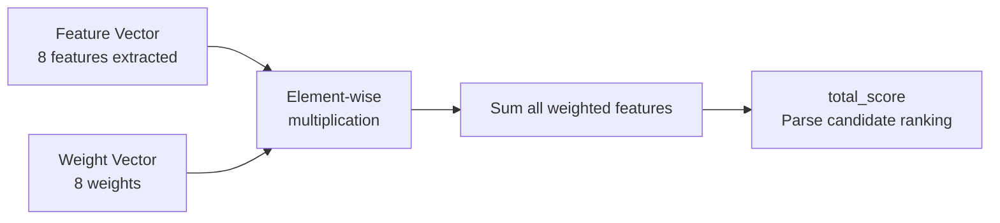

The scoring formula is:

```
total_score = sum(feature[i] * weight[i] for i in range(8))
```

**Sources**: [sinonym/services/parsing.py:38-51,434-443]()

### Weight Initialization Flow

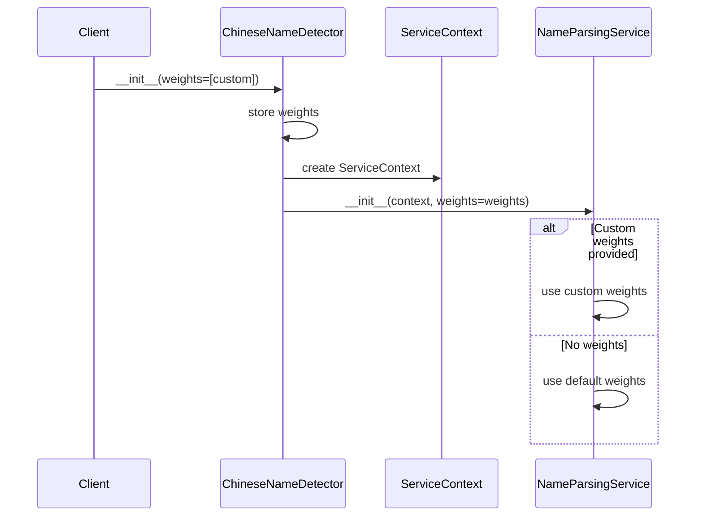

**Sources**: [sinonym/detector.py:193-228](), [sinonym/services/parsing.py:24-51]()

---

## Configuration Flow Through ServiceContext

The `ServiceContext` class bundles configuration with data structures and normalizer, simplifying dependency injection.

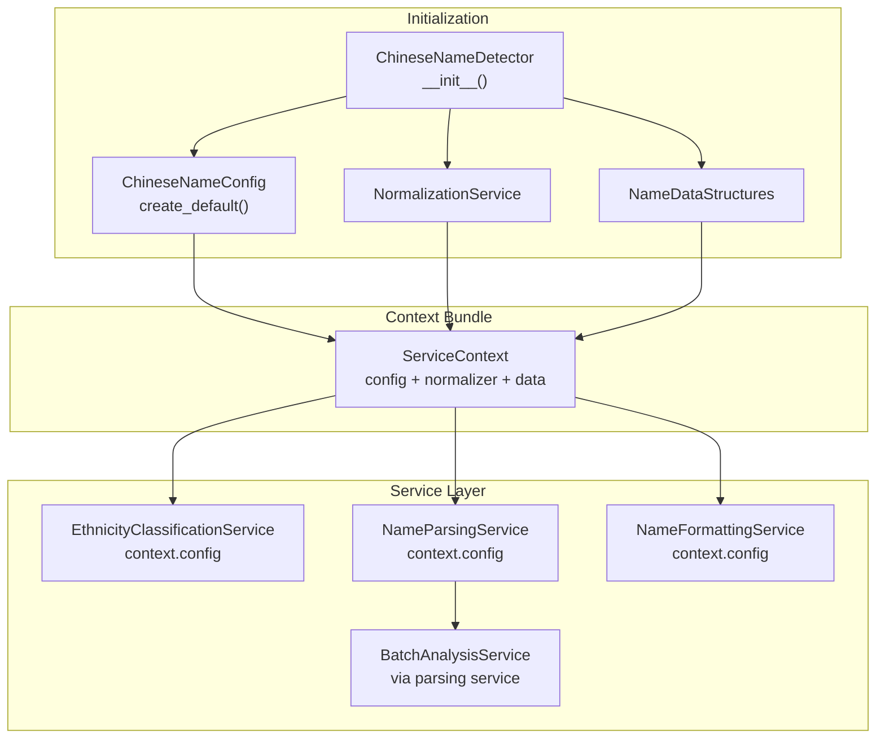

### Context Structure

The `ServiceContext` provides three attributes accessed by services:

| Attribute | Type | Accessed By | Purpose |
|-----------|------|-------------|---------|
| `context.config` | `ChineseNameConfig` | All services | Thresholds, patterns, limits |
| `context.normalizer` | `NormalizationService` | Parsing, Formatting | Token normalization |
| `context.data` | `NameDataStructures` | Parsing, Ethnicity | Surname/given name lookups |

**Sources**: [sinonym/services/parsing.py:26-35](), [sinonym/detector.py:224-233]()

### Configuration Access Pattern

Services access configuration through the context using the legacy fallback pattern:

```python
# In NameParsingService.__init__():
if hasattr(context_or_config, "config"):
    # New context interface
    self._config = context_or_config.config
    self._normalizer = context_or_config.normalizer
    self._data = context_or_config.data
else:
    # Legacy interface - maintain backwards compatibility
    self._config = context_or_config
    self._normalizer = normalizer
    self._data = data
```

This pattern enables gradual migration from direct dependency injection to context-based injection.

**Sources**: [sinonym/services/parsing.py:26-35]()

---

## Configuration Hierarchy

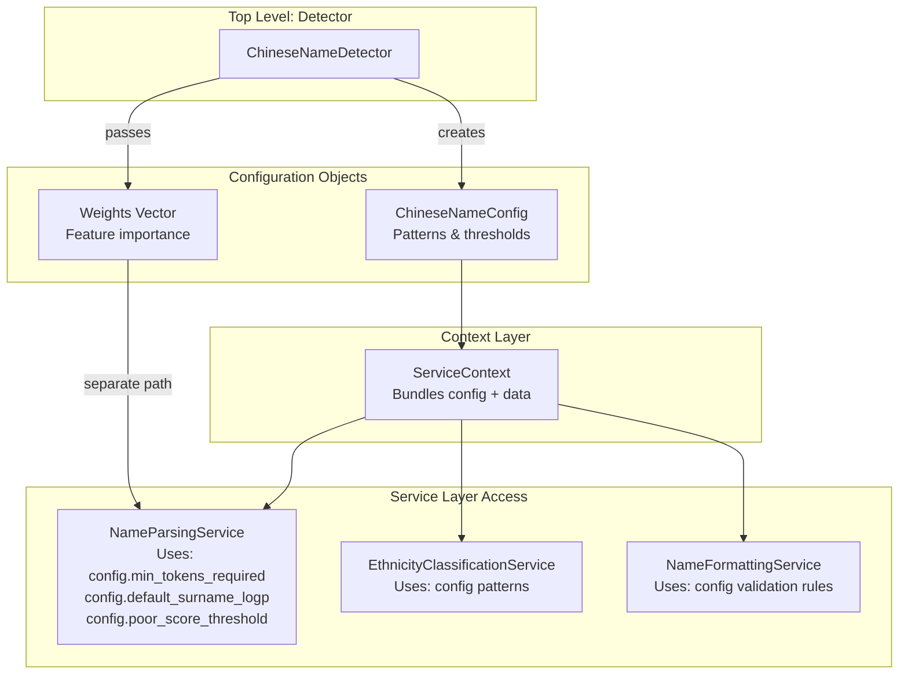

**Sources**: [sinonym/detector.py:193-233](), [sinonym/services/parsing.py:24-51]()

---

## Configuration Best Practices

### 1. Default Configuration

For most use cases, the default configuration is sufficient:

```python
detector = ChineseNameDetector()
# Uses ChineseNameConfig.create_default()
```

### 2. Custom Configuration

For specialized applications, create a custom config:

```python
custom_config = ChineseNameConfig.create_default()
# Modify thresholds or patterns
detector = ChineseNameDetector(config=custom_config)
```

### 3. Custom Scoring Weights

To tune detection accuracy for specific datasets:

```python
# Emphasize surname frequency more
custom_weights = [
    0.600,   # surname_logp (increased)
    0.300,   # given_logp_sum (decreased)
    -0.888,  # surname_rank_bonus
    1.348,   # compound_given_bonus
    1.102,   # order_preservation_bonus
    0.425,   # surname_first_bonus
    -0.042,  # surname_freq_log_ratio
    -0.573,  # surname_rank_difference
]
detector = ChineseNameDetector(weights=custom_weights)
```

**Sources**: [sinonym/detector.py:193-209](), [sinonym/services/parsing.py:38-51]()

---

## Summary

The configuration system provides clear separation between build-time and runtime configuration:

- **Build-time**: `pyproject.toml` and `uv.lock` control packaging, dependencies, and tooling
- **Runtime**: `ChineseNameConfig` controls detection thresholds and linguistic patterns
- **Scoring**: Optional `weights` parameter enables algorithm tuning
- **Distribution**: `ServiceContext` bundles configuration with data for clean injection

This architecture enables flexible deployment (via build config), tunable detection (via runtime config), and maintainable code (via context-based injection).

**Sources**: [pyproject.toml:1-104](), [sinonym/detector.py:193-233](), [sinonym/services/parsing.py:24-51,434-443]()

---

