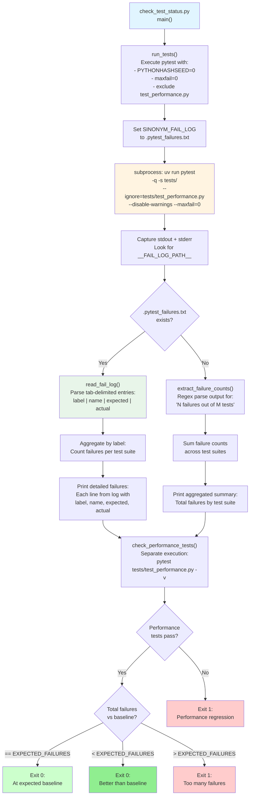
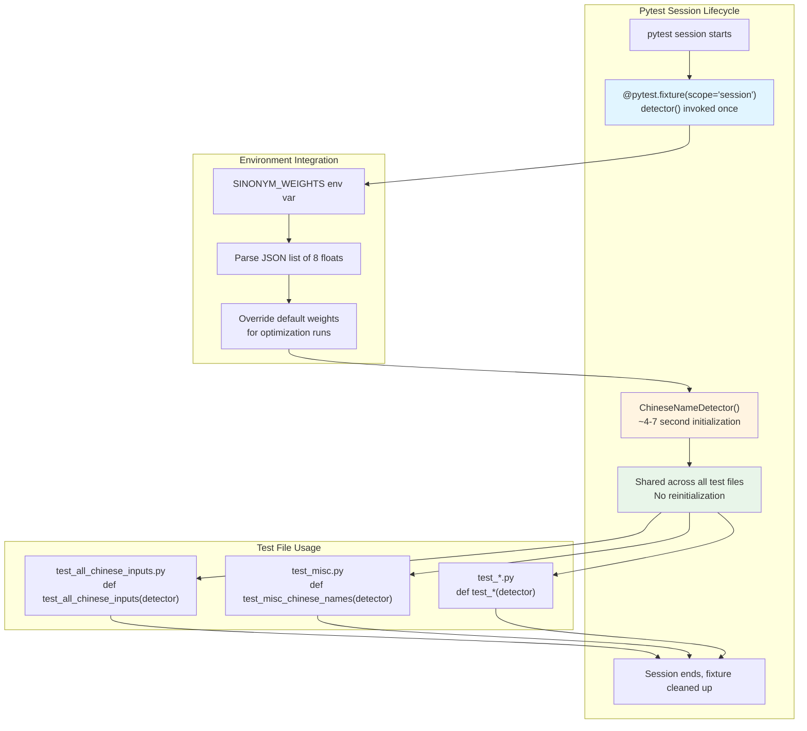
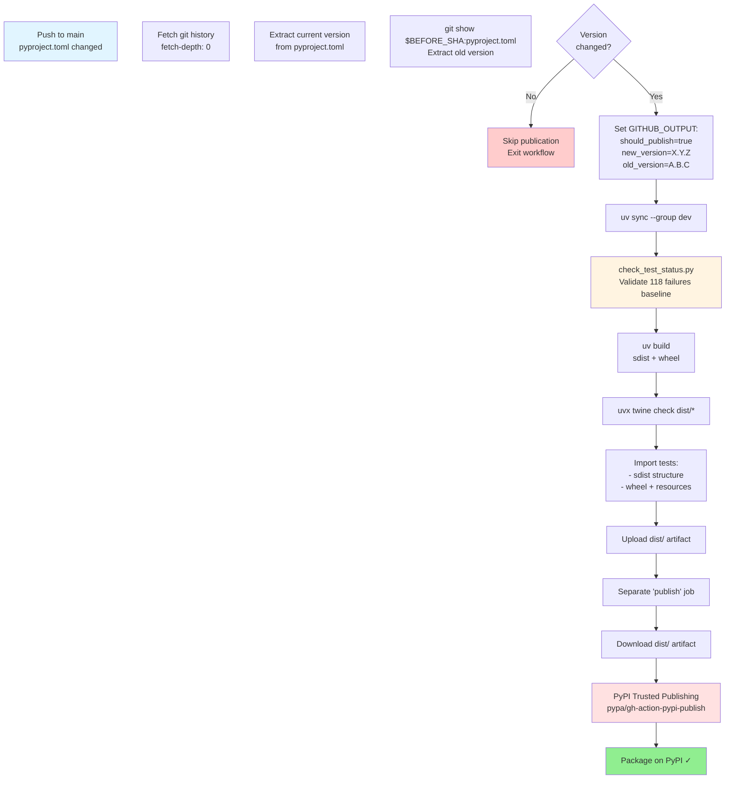

<!-- source: DeepWiki mcp.deepwiki.com · repo allenai/sinonym · page 5 Testing · fetched 2026-10-26 -->

# Testing

<details>
<summary>Relevant source files</summary>

The following files were used as context for generating this wiki page:

- [.github/workflows/ci.yml](.github/workflows/ci.yml)
- [.github/workflows/workflow.yaml](.github/workflows/workflow.yaml)
- [scripts/check_test_status.py](scripts/check_test_status.py)
- [tests/conftest.py](tests/conftest.py)
- [tests/test_all_chinese_inputs.py](tests/test_all_chinese_inputs.py)
- [tests/test_misc.py](tests/test_misc.py)

</details>


This document describes the testing infrastructure for sinonym, including the test execution framework, baseline management system, pytest configuration, and CI/CD integration. The testing system enforces quality gates through baseline validation, performance benchmarks, and comprehensive test coverage across multiple categories.

For specific test categories and their implementation, see:
- Chinese name test suites: [5.2](#5.2)
- Production and real-world test cases: [5.3](#5.3)
- Performance testing: [5.4](#5.4)
- Batch processing tests: [5.5](#5.5)

For detailed information about the test infrastructure implementation, see [5.1](#5.1).

## Testing Philosophy

The sinonym testing system follows a **regression-prevention baseline approach**. Rather than requiring all tests to pass, the system establishes a baseline of expected failures and treats any increase in failures as a regression. This approach acknowledges the inherent ambiguity in Chinese name parsing while preventing quality degradation.

The system separates concerns:
- **Functional correctness**: Validated through unit and integration tests with baseline tracking
- **Performance requirements**: Enforced through separate performance tests with strict thresholds
- **Production robustness**: Verified using real-world datasets and error cases

## Test Execution Framework

### Core Test Runner: check_test_status.py

The [scripts/check_test_status.py]() script serves as the primary test validation tool. It orchestrates test execution, counts individual test case failures, and validates against the expected baseline.

**Test Execution Flow**



**Sources**: [scripts/check_test_status.py:1-295]()

### Baseline Management

The baseline system tracks expected failures through the `EXPECTED_FAILURES` constant at [scripts/check_test_status.py:16](). The CI workflows reference this baseline:

| Configuration | Location | Expected Failures |
|---------------|----------|-------------------|
| check_test_status.py | [scripts/check_test_status.py:16]() | 54 |
| CI Workflow | [.github/workflows/ci.yml:49]() | 118 (comment) |
| Release Workflow | [.github/workflows/workflow.yaml:80]() | 118 (comment) |

The validation logic implements three outcomes:

```python
# From check_test_status.py:264-291
if failures == EXPECTED_FAILURES and perf_passed:
    # Exit 0: At baseline
elif failures < EXPECTED_FAILURES and perf_passed:
    # Exit 0: Improvement
elif failures > EXPECTED_FAILURES:
    # Exit 1: Regression
```

**Sources**: [scripts/check_test_status.py:16](), [scripts/check_test_status.py:264-291](), [.github/workflows/ci.yml:49](), [.github/workflows/workflow.yaml:80]()

### Failure Logging System

The failure logging mechanism provides detailed tracking of which specific test cases fail. Tests use the `log_failure()` helper to write failures to `.pytest_failures.txt`.

**Failure Log Format**

Each log entry is tab-delimited with six fields:

```
label	name_repr	expected_success	expected_output	actual_success	actual_output
```

**Example**:
```
All-Chinese input tests	'巩俐'	True	Li Gong	True	Gong Li
```

The script reads this log at [scripts/check_test_status.py:109-114]() and aggregates by label at [scripts/check_test_status.py:161-184]():

```python
for ln in logged:
    parts = ln.split("\t")
    label, name_repr, expected_success, expected_output, actual_success, actual_output = parts
    by_label[label] = by_label.get(label, 0) + 1
```

**Sources**: [scripts/check_test_status.py:28-36](), [scripts/check_test_status.py:109-114](), [scripts/check_test_status.py:161-184]()

## Test Infrastructure Components

### Pytest Configuration: conftest.py

The [tests/conftest.py]() module provides shared fixtures that optimize test performance by avoiding repeated initialization of expensive resources.

**Session-Scoped Detector Fixture**



**Sources**: [tests/conftest.py:19-45]()

The fixture implementation at [tests/conftest.py:19-45]() demonstrates the optimization pattern:

```python
@pytest.fixture(scope="session")
def detector():
    """
    Session-scoped ChineseNameDetector instance shared across all tests.
    
    This fixture creates a single detector instance that is reused for the entire
    test suite, eliminating the ~4-7 second initialization cost that would otherwise
    be repeated for each test file.
    """
    weights = None
    raw = os.getenv("SINONYM_WEIGHTS")
    if raw:
        try:
            parsed = json.loads(raw)
            if isinstance(parsed, list) and len(parsed) == 8:
                weights = [float(x) for x in parsed]
        except Exception:
            weights = None
    
    return ChineseNameDetector(weights=weights)
```

The `SINONYM_WEIGHTS` environment variable enables automated optimization by allowing external scripts to inject candidate weight vectors without modifying code.

**Sources**: [tests/conftest.py:19-45]()

### Test Failure Logging Helper

Test files import the `log_failure()` helper from `tests._fail_log` to record failures in a structured format. Examples from test files:

**All-Chinese Input Tests** ([tests/test_all_chinese_inputs.py:81]()):
```python
log_failure("All-Chinese input tests", input_name, expected_success, expected_name, result.success, actual)
```

**Miscellaneous Tests** ([tests/test_misc.py:129-136]()):
```python
log_failure(
    "Miscellaneous tests",
    test_input,
    True,
    expected_output,
    True,
    result.result,
)
```

**Sources**: [tests/test_all_chinese_inputs.py:81](), [tests/test_misc.py:129-136]()

## Test Execution Environment

### Environment Variables

The test system uses several environment variables to control behavior:

| Variable | Purpose | Set By | Value |
|----------|---------|--------|-------|
| `PYTHONHASHSEED` | Ensure deterministic test execution | check_test_status.py | "0" |
| `PYTHONIOENCODING` | Force UTF-8 encoding on all platforms | check_test_status.py | "utf-8" |
| `SINONYM_FAIL_LOG` | Path to failure log file | check_test_status.py | ".pytest_failures.txt" |
| `SINONYM_WEIGHTS` | Override candidate scoring weights | External (optional) | JSON list of 8 floats |

**Sources**: [scripts/check_test_status.py:22-36](), [tests/conftest.py:36-43]()

### Test Execution Configuration

The pytest invocation at [scripts/check_test_status.py:38-56]() uses these flags:

- `-q`: Quiet mode (reduce output verbosity)
- `-s`: Disable output capture (show print statements)
- `--ignore=tests/test_performance.py`: Exclude performance tests from main run
- `--disable-warnings`: Suppress pytest warnings
- `--maxfail=0`: Continue after failures (don't stop early)

Performance tests are executed separately at [scripts/check_test_status.py:120-143]() with `-v` (verbose) flag to capture timing information.

**Sources**: [scripts/check_test_status.py:38-56](), [scripts/check_test_status.py:120-143]()

## CI/CD Integration

### CI Workflow: Continuous Integration

The [.github/workflows/ci.yml]() workflow runs on every pull request and push to main, executing the full test suite as a quality gate.

**CI Pipeline Stages**

```mermaid
flowchart LR
    Trigger["Trigger:<br/>PR or push to main"]
    
    Checkout["actions/checkout@v4"]
    
    SetupPython["actions/setup-python@v5<br/>Python 3.11"]
    
    SetupUV["astral-sh/setup-uv@v6"]
    
    Cache["Cache uv dependencies<br/>Key: uv.lock + pyproject.toml"]
    
    Install["uv sync --group dev<br/>Install dependencies"]
    
    Build["uv build<br/>Build sdist + wheel"]
    
    Validate["uvx twine check dist/*<br/>Validate package metadata"]
    
    TestBaseline["uv run python<br/>scripts/check_test_status.py<br/>Expect 118 failures baseline"]
    
    SmokeSDist["Install sdist + import test<br/>Verify package structure"]
    
    SmokeWheel["Install wheel + import test<br/>Verify bundled resources"]
    
    Success["CI Pass ✓"]
    
    Trigger --> Checkout
    Checkout --> SetupPython
    SetupPython --> SetupUV
    SetupUV --> Cache
    Cache --> Install
    Install --> Build
    Build --> Validate
    Validate --> TestBaseline
    TestBaseline --> SmokeSDist
    SmokeSDist --> SmokeWheel
    SmokeWheel --> Success
    
    style Trigger fill:#e1f5ff
    style TestBaseline fill:#fff4e1
    style Success fill:#90EE90
```



**Sources**: [.github/workflows/ci.yml:1-75]()

### Release Workflow: Version-Gated Publication

The [.github/workflows/workflow.yaml]() workflow detects version changes and gates PyPI publication on test success.

**Version Detection and Gating**



**Sources**: [.github/workflows/workflow.yaml:1-142]()

The version detection logic at [.github/workflows/workflow.yaml:48-74]() uses Python's `tomllib` to parse `pyproject.toml` from both the current commit and the previous commit, comparing versions to determine if publication is needed.

**Sources**: [.github/workflows/workflow.yaml:48-74]()

## Test Suite Structure

The test suite is organized into multiple categories, each in separate test files:

| Test File Pattern | Purpose | Coverage |
|-------------------|---------|----------|
| `test_all_chinese_inputs.py` | All-Chinese character names | Surname-first ordering, frequency-based disambiguation, compound surnames |
| `test_misc.py` | Miscellaneous edge cases | Pypinyin aliases, CamelCase variations, Korean overlaps |
| `test_mixed_scripts.py` | Mixed script handling | Chinese + Latin combinations |
| `test_batch.py` | Batch processing | Format pattern detection, batch improvements |
| `test_performance.py` | Performance benchmarks | Sub-millisecond latency, throughput requirements |
| `test_mixed_production_cases.py` | Production errors | Real-world failure cases |
| `test_acl.py` | ACL 2025 dataset | Academic author names |

For detailed documentation of each test category, see the corresponding subsections: [5.2](#5.2), [5.3](#5.3), [5.4](#5.4), [5.5](#5.5).

**Sources**: [tests/test_all_chinese_inputs.py:1-91](), [tests/test_misc.py:1-174]()

## Test Case Format and Structure

### Test Case Definition Pattern

Test files define test cases as lists of tuples following this pattern:

```python
TEST_CASES = [
    ("input_name", (expected_success, "expected_output")),
    # ...
]
```

**Example from test_all_chinese_inputs.py** ([tests/test_all_chinese_inputs.py:18-59]()):
```python
ALL_CHINESE_INPUT_TEST_CASES = [
    ("巩俐", (True, "Li Gong")),
    ("李伟", (True, "Wei Li")),
    ("王明", (True, "Ming Wang")),
    # ... more cases
]
```

**Example from test_misc.py** ([tests/test_misc.py:14-104]()):
```python
MISC_TEST_CASES = [
    ("Zeng Wei", (True, "Wei Zeng")),
    ("Yuan Li", (True, "Yuan Li")),
    ("XiaoMing", (True, "Ming Xiao")),
    # ... more cases
]
```

**Sources**: [tests/test_all_chinese_inputs.py:18-59](), [tests/test_misc.py:14-104]()

### Test Function Pattern

Test functions follow a consistent pattern:

1. Receive `detector` fixture as parameter
2. Iterate through test cases
3. Call `detector.normalize_name(input_name)`
4. Compare result with expected output
5. Log failures using `log_failure()`
6. Assert final failure count

**Example from test_all_chinese_inputs.py** ([tests/test_all_chinese_inputs.py:61-86]()):
```python
def test_all_chinese_inputs(detector):
    """Test all-Chinese input processing with surname-first preference."""
    
    passed = 0
    failed = 0
    
    for input_name, expected in ALL_CHINESE_INPUT_TEST_CASES:
        result = detector.normalize_name(input_name)
        result_tuple = (result.success, result.result if result.success else result.error_message)
        
        if result_tuple == expected:
            passed += 1
        else:
            failed += 1
            expected_success, expected_name = expected
            actual = result.result if result.success else result.error_message
            print(f"FAILED: '{input_name}': expected ({expected_success}, '{expected_name}'), "
                  f"got ({result.success}, '{actual}')")
            log_failure("All-Chinese input tests", input_name, expected_success, 
                       expected_name, result.success, actual)
    
    assert failed == 0, f"All-Chinese input tests: {failed} failures out of {len(ALL_CHINESE_INPUT_TEST_CASES)} tests"
```

**Sources**: [tests/test_all_chinese_inputs.py:61-86]()

## Quality Gates and Exit Codes

The `check_test_status.py` script implements a three-tier exit code system:

| Exit Code | Condition | Interpretation |
|-----------|-----------|----------------|
| 0 | `failures == EXPECTED_FAILURES && perf_passed` | At expected baseline |
| 0 | `failures < EXPECTED_FAILURES && perf_passed` | Improvement detected |
| 1 | `failures > EXPECTED_FAILURES` | Regression - block merge/release |
| 1 | `!perf_passed` | Performance regression |

The logic at [scripts/check_test_status.py:264-291]() enforces these gates:

```python
if logged and len(logged) == EXPECTED_FAILURES and perf_passed:
    print("\n✓ Tests are at expected baseline (EXPECTED_FAILURES failures, performance OK)")
    sys.exit(0)
elif logged and len(logged) < EXPECTED_FAILURES and perf_passed:
    print(f"\n✓ IMPROVEMENT! Tests are better than baseline ({len(logged)} < EXPECTED_FAILURES failures, performance OK)")
    sys.exit(0)
elif logged and len(logged) > EXPECTED_FAILURES:
    print(f"\n✗ REGRESSION! Too many failures ({len(logged)} > EXPECTED_FAILURES)")
    sys.exit(1)
elif not perf_passed:
    print("\n✗ Performance tests failed!")
    sys.exit(1)
```

**Sources**: [scripts/check_test_status.py:264-291]()

## Test Output Format

The script generates structured output with multiple sections:

**Output Sections**
1. **Individual test case failures (aggregated counts)**: Groups failures by test suite label
2. **Detailed failures**: Lists every failing case with expected vs. actual output
3. **Performance test status**: Reports pass/fail and timing metrics
4. **Summary**: Total failures and performance status

Example output structure:
```
======================================================================
INDIVIDUAL TEST CASE FAILURES (aggregated counts):
======================================================================
  All-Chinese input tests: 12 failures
  Miscellaneous tests: 8 failures
  Mixed script tests: 15 failures
----------------------------------------------------------------------
TOTAL INDIVIDUAL TEST CASE FAILURES: 54
======================================================================

======================================================================
DETAILED FAILURES (from fail log):
======================================================================
   1. [All-Chinese input tests] 巩俐 | expected_success=True actual_success=True | expected=Li Gong | actual=Gong Li
   2. [Miscellaneous tests] Zeng Wei | expected_success=True actual_success=True | expected=Wei Zeng | actual=Zeng Wei
...
```

**Sources**: [scripts/check_test_status.py:186-212]()

---

