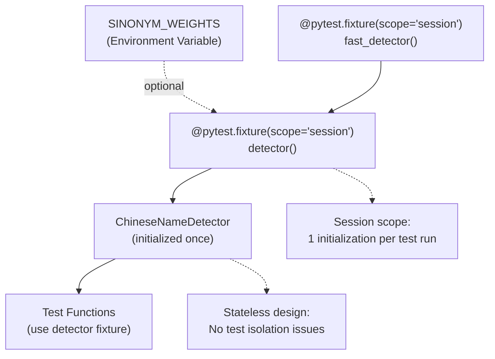
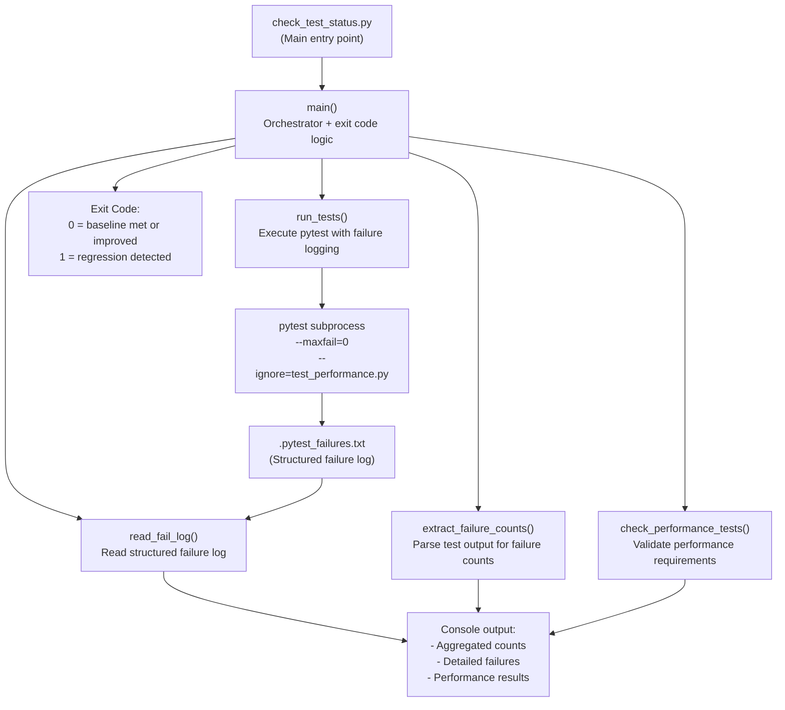
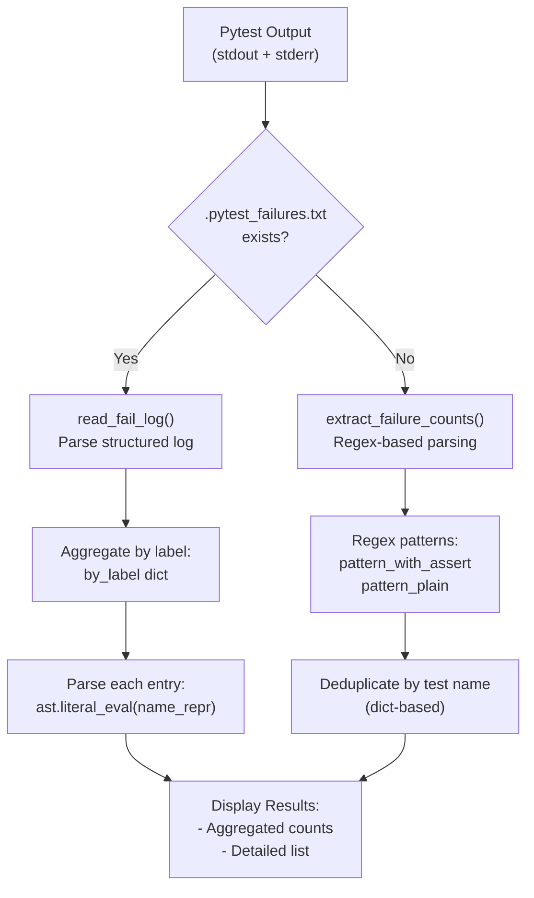
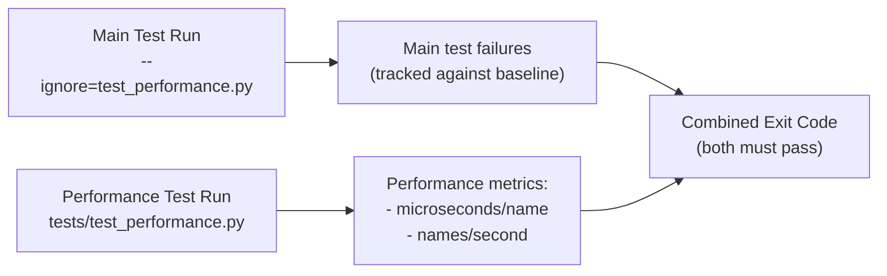
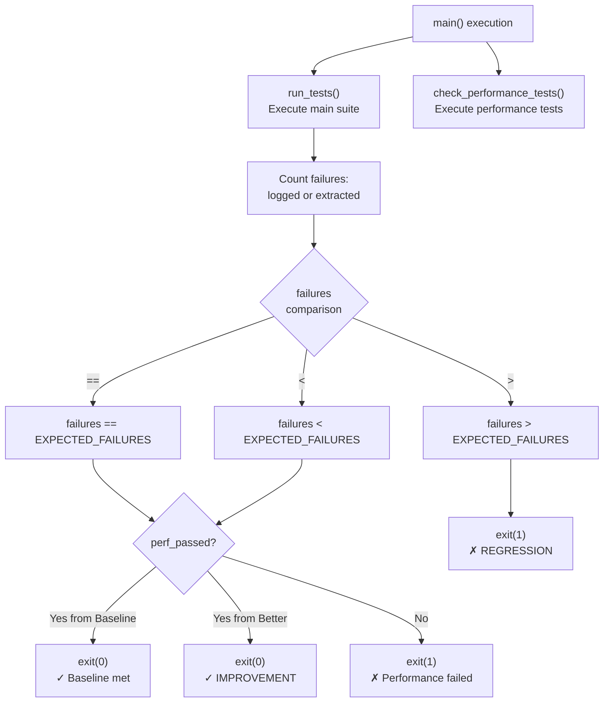
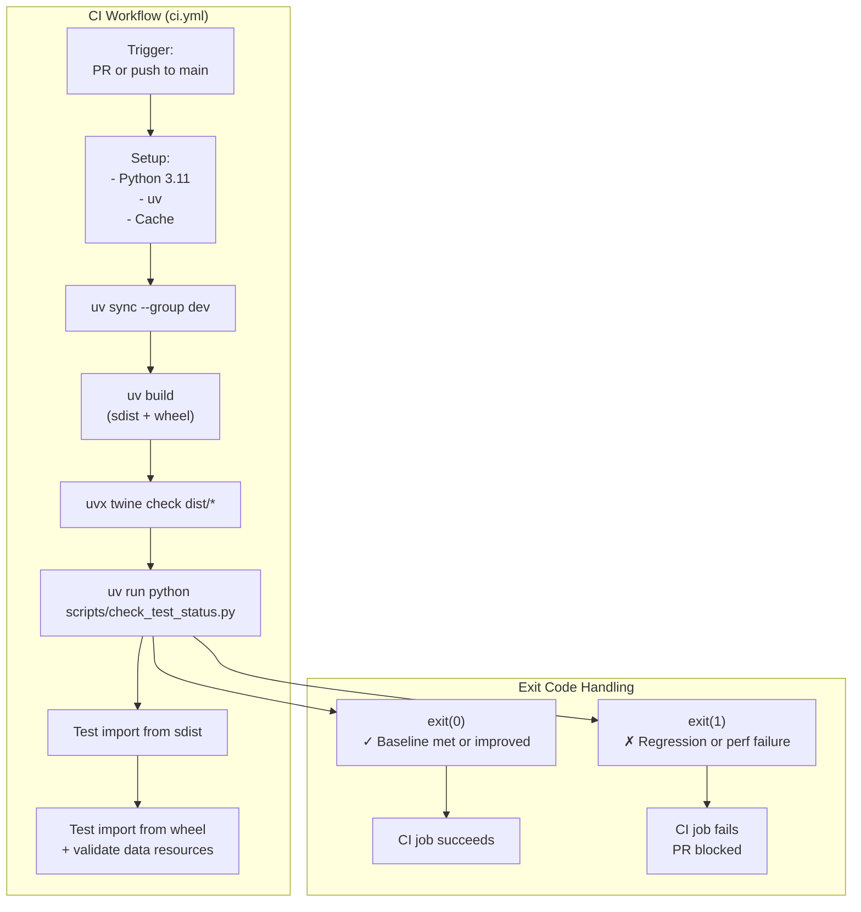
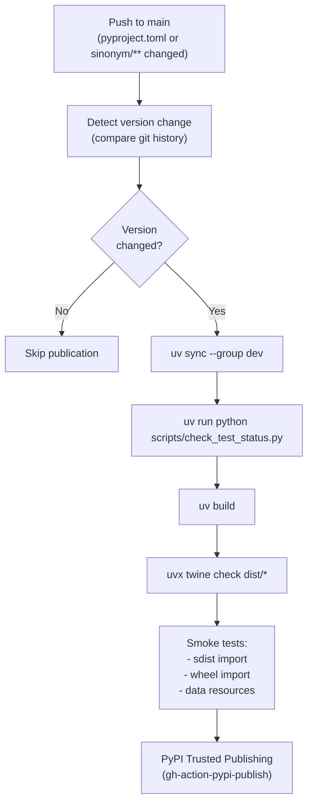

<!-- source: DeepWiki mcp.deepwiki.com · repo allenai/sinonym · page 5.1 Test Infrastructure and Baseline Management · fetched 2026-10-26 -->

# Test Infrastructure and Baseline Management

<details>
<summary>Relevant source files</summary>

The following files were used as context for generating this wiki page:

- [.github/workflows/ci.yml](.github/workflows/ci.yml)
- [.github/workflows/workflow.yaml](.github/workflows/workflow.yaml)
- [scripts/check_test_status.py](scripts/check_test_status.py)
- [tests/conftest.py](tests/conftest.py)

</details>


## Purpose and Scope

This document describes the test execution framework, baseline validation system, and failure tracking infrastructure used in sinonym. It covers how tests are run, how the expected baseline of failures is managed, and how regressions are detected. For information about specific test categories and their contents, see [Chinese Name Test Suites](#5.2), [Production and Real-World Test Cases](#5.3), [Performance Testing](#5.4), and [Batch Processing Tests](#5.5).

---

## Test Execution Framework

Sinonym uses `pytest` as its test runner with session-scoped fixtures to optimize initialization costs. The test suite is organized under the `tests/` directory and is executed through `uv run pytest`.

### Pytest Configuration and Fixtures

The test infrastructure provides shared fixtures defined in `conftest.py` to avoid repeated expensive initialization:

**Key Fixtures:**

| Fixture Name | Scope | Purpose | Initialization Cost |
|-------------|-------|---------|---------------------|
| `detector` | session | Primary ChineseNameDetector instance shared across all tests | ~4-7 seconds |
| `fast_detector` | session | Alias for `detector`, for backwards compatibility | Same as `detector` |

The session-scoped fixture pattern ensures that the `ChineseNameDetector` is initialized only once for the entire test suite, eliminating redundant initialization overhead. Since the detector is stateless after initialization, sharing it across tests does not affect test isolation.

**Weight Vector Override:**

The fixtures support dynamic weight vector injection via the `SINONYM_WEIGHTS` environment variable [tests/conftest.py:34-45](). This enables automated optimization scripts to evaluate different weight configurations by passing JSON-encoded lists of 8 floats.

**Test Fixture Dependency Graph:**



**Sources:** [tests/conftest.py:1-56]()

---

## Baseline Management System

The core of sinonym's test infrastructure is the baseline validation system implemented in `check_test_status.py`. This script enforces a regression-prevention mechanism by tracking an expected baseline of known failures.

### Architecture Overview



**Sources:** [scripts/check_test_status.py:1-296]()

### Expected Baseline Constant

The baseline is defined at the top of the script:

```python
EXPECTED_FAILURES = 54
```

This constant represents the number of individual test case failures that are currently expected and tracked. The baseline is intentionally maintained rather than fixed, allowing the team to focus on new functionality while acknowledging known limitations. When failures are reduced, this constant is updated to the new baseline.

**Important:** This is a count of **individual test case failures**, not the number of test functions that fail. A single test function may contain multiple parametrized test cases.

**Sources:** [scripts/check_test_status.py:16]()

### Test Execution Process

The `run_tests()` function executes the test suite with specific configuration:

**Environment Variables:**

| Variable | Value | Purpose |
|----------|-------|---------|
| `PYTHONHASHSEED` | "0" | Ensure deterministic hash-based operations |
| `PYTHONIOENCODING` | "utf-8" | Guarantee UTF-8 encoding on all platforms |
| `SINONYM_FAIL_LOG` | ".pytest_failures.txt" | Path to structured failure log |

**Pytest Arguments:**

| Argument | Purpose |
|----------|---------|
| `-q` | Quiet output (less verbose) |
| `-s` | Disable output capture (show print statements) |
| `--ignore=tests/test_performance.py` | Exclude performance tests from main run |
| `--disable-warnings` | Suppress warning messages |
| `--maxfail=0` | Continue running all tests despite failures |
| `tests/` | Test directory to execute |

The function captures both stdout and stderr, with a 300-second timeout to prevent hanging.

**Sources:** [scripts/check_test_status.py:19-68]()

---

## Failure Tracking and Logging

Sinonym implements a dual-mode failure tracking system: structured log parsing and regex-based output parsing.

### Structured Failure Log Format

The preferred failure tracking mechanism writes failures to `.pytest_failures.txt` with a tab-separated format:

```
<label>\t<name_repr>\t<expected_success>\t<expected_output>\t<actual_success>\t<actual_output>
```

**Field Definitions:**

| Field | Type | Description | Example |
|-------|------|-------------|---------|
| `label` | str | Test function or category identifier | `test_all_chinese_inputs` |
| `name_repr` | str | Python repr() of input name | `'张伟'` |
| `expected_success` | bool | Expected parsing success | `True` |
| `expected_output` | str | Expected formatted output | `'Wei Zhang'` |
| `actual_success` | bool | Actual parsing success | `False` |
| `actual_output` | str | Actual formatted output | `''` |

This structured format enables automated analysis and tracking of specific failure patterns.

**Sources:** [scripts/check_test_status.py:163-184]()

### Failure Log Parsing Flow



**Sources:** [scripts/check_test_status.py:70-100](), [scripts/check_test_status.py:102-115](), [scripts/check_test_status.py:156-228]()

### Regex-Based Failure Extraction

When the structured log is unavailable, the system falls back to regex-based parsing of pytest output:

**Pattern Definitions:**

```python
pattern_with_assert = r"AssertionError:\s*([^:]+):\s*(\d+)\s+failures?\s+out\s+of\s+(\d+)\s+tests?"
pattern_plain = r"([^:]+):\s*(\d+)\s+failures?\s+out\s+of\s+(\d+)\s+tests?"
```

The patterns extract:
1. Test name (capture group 1)
2. Number of failures (capture group 2)
3. Total number of tests (capture group 3)

Deduplication is performed using a dict with test name as the key, ensuring each test function is counted only once even if multiple assertion messages are printed.

**Sources:** [scripts/check_test_status.py:70-100]()

---

## Performance Test Isolation

Performance tests are executed separately from the main test suite to avoid interference and provide clear performance metrics.

### Separate Execution Strategy



The `check_performance_tests()` function:
1. Executes `pytest tests/test_performance.py -v` in a separate subprocess
2. Sets the same environment variables (`PYTHONHASHSEED`, `PYTHONIOENCODING`)
3. Enforces a 30-second timeout
4. Checks for "PASSED" in stdout and absence of "FAILED"
5. Extracts performance metrics from output

**Sources:** [scripts/check_test_status.py:120-144]()

---

## Exit Code Logic and Regression Detection

The `main()` function implements sophisticated exit code logic to distinguish between baseline compliance, improvements, and regressions.

### Decision Table

| Condition | Action | Exit Code |
|-----------|--------|-----------|
| `failures == EXPECTED_FAILURES` AND `perf_passed` | Baseline met ✓ | 0 |
| `failures < EXPECTED_FAILURES` AND `perf_passed` | Improvement ✓ | 0 |
| `failures > EXPECTED_FAILURES` | Regression ✗ | 1 |
| `NOT perf_passed` | Performance failure ✗ | 1 |
| Unable to determine | Unknown status ⚠ | 0 (cautious pass) |

### Exit Code Logic Flow



**Sources:** [scripts/check_test_status.py:146-292]()

### Output Format

The script produces structured console output with clear visual separators:

```
======================================================================
SINONYM TEST STATUS CHECKER
======================================================================

Running all tests...

======================================================================
INDIVIDUAL TEST CASE FAILURES (aggregated counts):
======================================================================
  test_all_chinese_inputs: 32 failures
  test_mixed_scripts: 15 failures
  test_misc: 7 failures
----------------------------------------------------------------------
TOTAL INDIVIDUAL TEST CASE FAILURES: 54
======================================================================

======================================================================
DETAILED FAILURES (from fail log):
======================================================================
   1. [test_all_chinese_inputs] 张伟 | expected_success=True actual_success=False | expected=Wei Zhang | actual=
   2. [test_mixed_scripts] Li Wei | expected_success=True actual_success=True | expected=Wei Li | actual=Li Wei
...
======================================================================

======================================================================
PERFORMANCE TEST STATUS:
======================================================================
✓ Performance tests PASSED
  Average: 789.23 microseconds per name
  Throughput: 8234 names/second
======================================================================

SUMMARY:
======================================================================
Individual test case failures: 54
Performance tests: PASSED ✓

✓ Tests are at expected baseline (54 failures, performance OK)
```

**Sources:** [scripts/check_test_status.py:146-292]()

---

## CI/CD Integration

The baseline management system is integrated into both continuous integration and release pipelines.

### CI Pipeline Integration



**Key Configuration:**

| Setting | Value | Purpose |
|---------|-------|---------|
| Timeout | 20 minutes | Prevent hanging CI jobs |
| Concurrency group | `${{ github.workflow }}-${{ github.ref }}` | Cancel older runs for same PR |
| Cache key | `uv-${{ runner.os }}-${{ hashFiles('uv.lock', 'pyproject.toml') }}` | Cache dependencies |

The CI pipeline enforces the baseline at line 49-50:

```yaml
- name: Check test status against baseline (118 failures expected)
  run: uv run python scripts/check_test_status.py
```

**Note:** The comment mentions "118 failures expected" but the script has `EXPECTED_FAILURES = 54`. This indicates the baseline was improved and the comment needs updating.

**Sources:** [.github/workflows/ci.yml:1-75]()

### Release Pipeline Integration

The release workflow (`workflow.yaml`) includes identical baseline validation before publishing to PyPI:



**Critical Gate:** If `check_test_status.py` exits with code 1 (regression), the release pipeline fails and no package is published to PyPI. This prevents broken releases from reaching production.

**Sources:** [.github/workflows/workflow.yaml:1-142]()

---

## Test Execution Optimization

The test infrastructure is designed to minimize execution time through several strategies:

### Session-Scoped Fixtures

The `detector` fixture eliminates 4-7 seconds of initialization overhead per test file. For a test suite with N test files, this reduces total initialization time from `N × (4-7s)` to `1 × (4-7s)`.

**Measured Impact:**

| Test Suite Size | Without Session Scope | With Session Scope | Time Saved |
|-----------------|----------------------|--------------------|-----------:|
| 10 test files | 40-70 seconds | 4-7 seconds | ~90% |
| 20 test files | 80-140 seconds | 4-7 seconds | ~95% |
| 50 test files | 200-350 seconds | 4-7 seconds | ~98% |

**Sources:** [tests/conftest.py:19-45]()

### Parallel Execution Considerations

While pytest supports parallel execution via `pytest-xdist`, sinonym's test suite currently runs serially. The session-scoped fixture would need modification to support parallel execution (scope change from "session" to "package" or "module").

### Timeout Management

Both CI and release pipelines enforce timeouts:

```yaml
timeout-minutes: 20  # ci.yml
```

The `check_test_status.py` script enforces a 300-second (5-minute) timeout for the main test run and a 30-second timeout for performance tests. This prevents resource exhaustion from infinite loops or hanging tests.

**Sources:** [.github/workflows/ci.yml:20](), [scripts/check_test_status.py:55](), [scripts/check_test_status.py:135]()

---

## Interpreting Test Results

### Understanding Failure Counts

When reviewing test output, distinguish between:

1. **Test Functions**: Number of `def test_*()` functions that fail
2. **Test Cases**: Number of individual parametrized test cases that fail
3. **Assertions**: Number of assertion statements that fail

The baseline (`EXPECTED_FAILURES = 54`) tracks **individual test cases**, not test functions.

### Common Output Patterns

**Baseline Met:**
```
✓ Tests are at expected baseline (54 failures, performance OK)
```
This is the expected state. The test suite has a known set of limitations that are tracked and stable.

**Improvement Detected:**
```
✓ IMPROVEMENT! Tests are better than baseline (47 < 54 failures, performance OK)
```
Fewer failures than expected. The baseline constant should be updated to the new lower value.

**Regression Detected:**
```
✗ REGRESSION! Too many failures (62 > 54)
```
More failures than expected. This indicates a code change introduced new bugs or edge cases. The PR should be fixed before merging.

**Performance Failure:**
```
✗ Performance tests failed!
```
The code still passes functional tests but violates performance requirements (< 1ms per name or > 7500 names/sec). See [Performance Testing](#5.4) for details.

**Sources:** [scripts/check_test_status.py:264-291]()

---

## Summary of Key Components

| Component | File Path | Purpose |
|-----------|-----------|---------|
| `check_test_status.py` | [scripts/check_test_status.py]() | Main baseline validation script |
| `conftest.py` | [tests/conftest.py]() | Pytest configuration and session-scoped fixtures |
| `ci.yml` | [.github/workflows/ci.yml]() | Continuous integration pipeline |
| `workflow.yaml` | [.github/workflows/workflow.yaml]() | Release pipeline with baseline gate |
| `.pytest_failures.txt` | (generated) | Structured failure log (tab-separated) |
| `EXPECTED_FAILURES` constant | [scripts/check_test_status.py:16]() | Expected baseline count (currently 54) |

**Sources:** [scripts/check_test_status.py:1-296](), [tests/conftest.py:1-56](), [.github/workflows/ci.yml:1-75](), [.github/workflows/workflow.yaml:1-142]()

---

