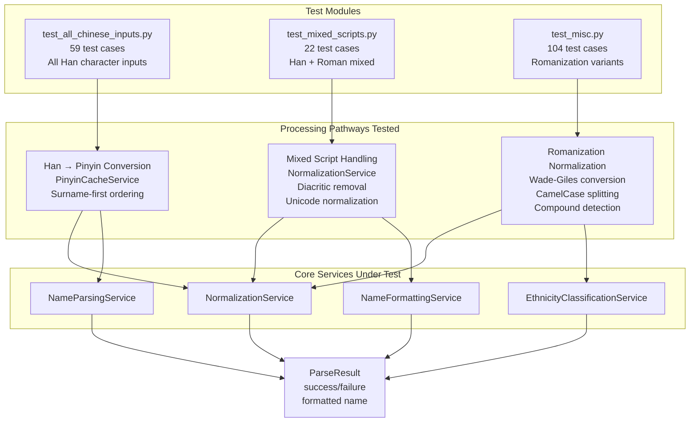
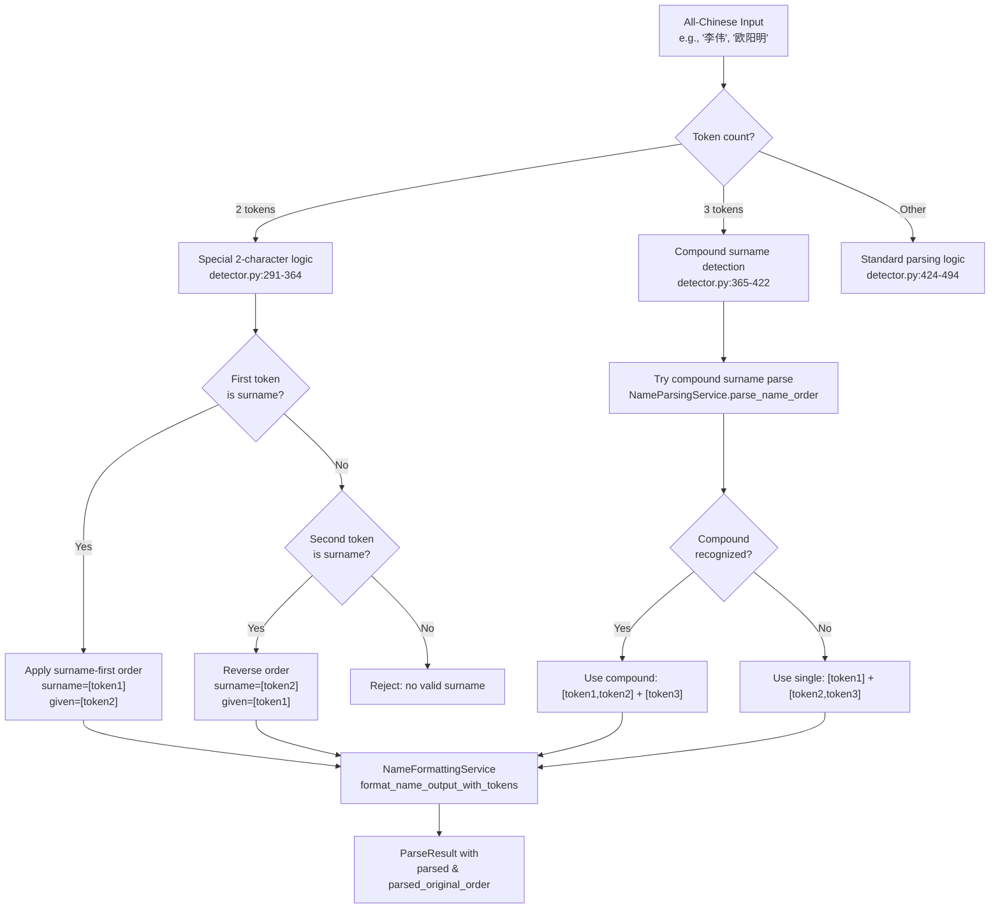
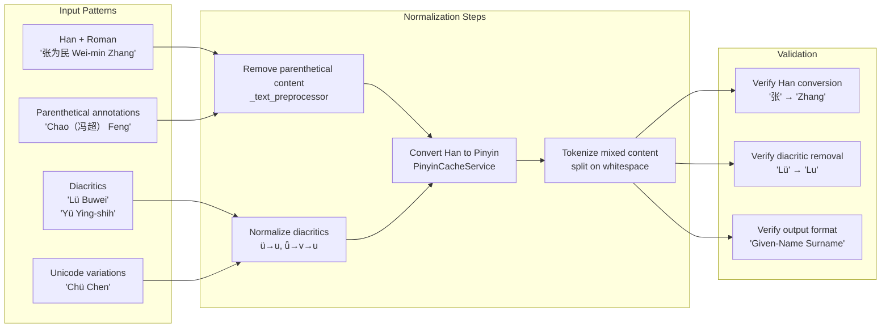
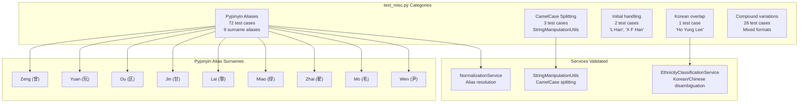
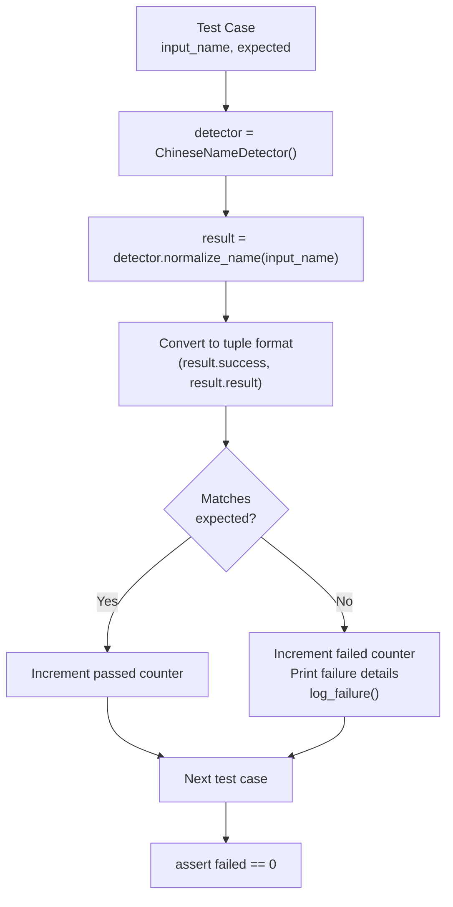

<!-- source: DeepWiki mcp.deepwiki.com · repo allenai/sinonym · page 5.2 Chinese Name Test Suites · fetched 2026-10-26 -->

# Chinese Name Test Suites

<details>
<summary>Relevant source files</summary>

The following files were used as context for generating this wiki page:

- [sinonym/detector.py](sinonym/detector.py)
- [tests/test_all_chinese_inputs.py](tests/test_all_chinese_inputs.py)
- [tests/test_misc.py](tests/test_misc.py)
- [tests/test_mixed_scripts.py](tests/test_mixed_scripts.py)

</details>


## Purpose and Scope

This document describes the test suites that validate Chinese name detection and normalization for various input formats. These tests cover all-Chinese character inputs, mixed scripts (Han + Roman), diacritics, and romanization system variations (Pinyin, Wade-Giles, Cantonese).

For tests using production data and real-world author datasets, see [Production and Real-World Test Cases](#5.3). For batch processing validation, see [Batch Processing Tests](#5.5). For baseline management and test infrastructure, see [Test Infrastructure and Baseline Management](#5.1).

---

## Test Suite Architecture

The Chinese name test suites are organized into three primary modules, each targeting distinct input characteristics and processing pathways:



**Sources:** [tests/test_all_chinese_inputs.py:1-91](), [tests/test_mixed_scripts.py:1-75](), [tests/test_misc.py:1-174]()

---

## All-Chinese Input Test Suite

### Overview

The `test_all_chinese_inputs.py` module validates processing of names composed entirely of Han characters. These tests exercise the surname-first ordering convention and frequency-based disambiguation logic implemented in [sinonym/detector.py:276-423]().

### Test Case Categories

| Category | Count | Description | Example |
|----------|-------|-------------|---------|
| Basic 2-character names | 8 | High-frequency surname/given combinations | `"李伟"` → `"Wei Li"` |
| Surname ambiguity | 3 | Both characters are valid surnames | `"李王"` → `"Wang Li"` |
| Historical names | 3 | Famous figures (Confucius, Mencius) | `"孔子"` → `"Zi Kong"` |
| Compound surnames | 3 | Multi-character surnames | `"欧阳明"` → `"Ming Ou Yang"` |
| Reduplicated names | 2 | Single character repeated | `"林林"` → `"Lin Lin"` |
| 3-character names | 2 | Compound given names | `"李明华"` → `"Ming-Hua Li"` |

### Processing Logic Tested



**Sources:** [sinonym/detector.py:276-423](), [tests/test_all_chinese_inputs.py:18-59]()

### Key Test Cases

```python
# Frequency-based disambiguation
("巩俐", (True, "Li Gong"))
# 巩(surname, freq:293) vs 俐(given)
# Li(surname, freq:63038) vs Gong(given, freq:159)
# Result: Li wins surname position due to frequency

# Surname-first convention
("李王", (True, "Wang Li"))
# Both are valid surnames
# Li appears first → surname
# Wang appears second → given name

# Compound surname recognition
("欧阳明", (True, "Ming Ou Yang"))
# "欧阳" recognized as compound surname
# "明" as given name
```

**Sources:** [tests/test_all_chinese_inputs.py:19-50]()

---

## Mixed Scripts Test Suite

### Overview

The `test_mixed_scripts.py` module validates handling of names containing both Han characters and Roman letters, along with diacritical marks and special characters. These tests exercise the preprocessing and normalization capabilities of `NormalizationService`.

### Input Patterns Tested



**Sources:** [tests/test_mixed_scripts.py:22-42](), [sinonym/services/normalization.py]()

### Diacritic Normalization

| Input | Diacritic | Normalized | Output |
|-------|-----------|------------|--------|
| `"Lü Buwei"` | `ü` | `u` | `"Bu-Wei Lu"` |
| `"Yü Li"` | `ü` | `u` | `"Yu Li"` |
| `"Chü Chen"` | `ü` | `u` | `"Chu Chen"` |
| `"Yü Ying-shih"` | `ü` | `u` | `"Ying-Shih Yu"` |

The normalization logic converts umlauts and other diacritics to their base forms before processing, ensuring consistent tokenization regardless of input encoding.

**Sources:** [tests/test_mixed_scripts.py:24-30]()

### Parenthetical Content Handling

```python
# Test cases with parenthetical annotations
("Chao（冯超） Feng", (True, "Chao Feng"))
("Zhou（Mary）Li", (True, "Li Zhou"))
("李（Peter）Chen", (True, "Li Chen"))
("陈（David）Liu", (True, "Chen Liu"))
```

The `TextPreprocessor` removes content within parentheses (both ASCII and full-width variants) before name analysis, preventing Western names in annotations from interfering with Chinese name detection.

**Sources:** [tests/test_mixed_scripts.py:23-37]()

---

## Miscellaneous Test Suite

### Overview

The `test_misc.py` module contains 104 test cases covering edge cases, romanization system variations, and pypinyin phonetic aliases. This suite validates the robustness of normalization and ethnicity classification.

### Test Categories



**Sources:** [tests/test_misc.py:14-104]()

### Pypinyin Alias Testing

The pypinyin library provides multiple romanizations for some Han characters. These test cases validate that all valid aliases are recognized:

| Surname | Aliases Tested | Test Cases |
|---------|---------------|------------|
| Zeng (曾) | `Zeng` | `"Zeng Wei"`, `"Wei Zeng"`, `"Zeng Ming-Li"` |
| Yuan (阮) | `Yuan` | `"Yuan Li"`, `"Li Yuan"`, `"Yuan Jian-Guo"` |
| Ou (区) | `Ou` | `"Ou Ming"`, `"Ming Ou"`, `"Ou Xiao-Li"` |
| Jin (甘) | `Jin` | `"Jin Hua"`, `"Hua Jin"`, `"Jin Li-Ming"` |
| Lai (黎) | `Lai` | `"Lai Bin"`, `"Bin Lai"`, `"Lai Wei-Jun"` |
| Miao (缪) | `Miao` | `"Miao Yu"`, `"Yu Miao"`, `"Miao Jian-Wei"` |
| Zhai (翟) | `Zhai` | `"Zhai Jun"`, `"Jun Zhai"`, `"Zhai Yu-Ming"` |
| Mo (毛) | `Mo` | `"Mo Wei"`, `"Wei Mo"`, `"Mo Li-Hua"` |
| Wen (尹) | `Wen` | `"Wen Jing"`, `"Jing Wen"`, `"Wen Xiao-Jun"` |

Each surname is tested in both surname-first and given-first orders, with both simple and compound given names, validating that the parser correctly identifies the surname regardless of position.

**Sources:** [tests/test_misc.py:15-83]()

### CamelCase Splitting

```python
# CamelCase variations tested
("XiaoMing", (True, "Ming Xiao"))
("ZhangWei", (True, "Wei Zhang"))
("XiaoMing Li", (True, "Xiao-Ming Li"))
```

These cases validate the `StringManipulationUtils.split_by_case_transition()` function, which detects and splits concatenated names without spaces. The logic identifies case transitions and applies Chinese syllable validation to prevent incorrect splitting of Western names.

**Sources:** [tests/test_misc.py:93-95]()

---

## Test Execution Flow

### Integration with ChineseNameDetector



**Sources:** [tests/test_all_chinese_inputs.py:61-86](), [tests/test_mixed_scripts.py:45-71](), [tests/test_misc.py:110-173]()

### Failure Logging

All three test suites use the shared `log_failure()` function to record test failures in a structured format:

```python
log_failure(
    "Test suite name",
    input_name,
    expected_success,
    expected_name,
    actual_success,
    actual_result
)
```

This function (defined in `tests/_fail_log.py`) appends failures to a centralized log file for baseline comparison by `check_test_status.py`.

**Sources:** [tests/test_all_chinese_inputs.py:81](), [tests/test_mixed_scripts.py:65](), [tests/test_misc.py:129]()

---

## Test Case Structure

All three test modules follow a consistent structure for defining test cases:

```python
# Format: (input_name, (expected_success, expected_output))
TEST_CASES = [
    ("Input Name", (True, "Expected Output")),
    ("Western Name", (False, "error message")),
    # ... more cases
]
```

This tuple-based format enables:
1. **Compact definition**: Each case is a single line
2. **Easy validation**: Direct tuple comparison
3. **Clear expectations**: Both success flag and output are explicit
4. **Error case coverage**: False expectations include error messages

**Sources:** [tests/test_all_chinese_inputs.py:18-59](), [tests/test_mixed_scripts.py:22-42](), [tests/test_misc.py:14-104]()

---

## Shared Test Fixture

All three test suites use a shared session-scoped detector fixture defined in `conftest.py`:

```python
@pytest.fixture(scope="session")
def detector():
    """Shared ChineseNameDetector instance for all tests."""
    return ChineseNameDetector()
```

This fixture:
- Initializes the detector once per test session
- Shares data structures across all tests
- Reduces test execution time by avoiding repeated initialization
- Ensures consistent configuration across test modules

The fixture is automatically injected into test functions by pytest's dependency injection mechanism.

**Sources:** [tests/conftest.py](), [tests/test_misc.py:107-110]()

---

## Coverage Summary

| Test Suite | Test Cases | Primary Focus | Services Exercised |
|------------|-----------|---------------|-------------------|
| `test_all_chinese_inputs.py` | 59 | Han character inputs, surname-first ordering | `PinyinCacheService`, `NameParsingService` |
| `test_mixed_scripts.py` | 22 | Mixed scripts, diacritics, Unicode | `NormalizationService`, `TextPreprocessor` |
| `test_misc.py` | 104 | Pypinyin aliases, CamelCase, edge cases | `NormalizationService`, `EthnicityClassificationService` |
| **Total** | **185** | **Core name processing** | **All services** |

These 185 test cases form the foundation of Chinese name validation, covering the full spectrum of input formats and romanization systems encountered in production use.

**Sources:** [tests/test_all_chinese_inputs.py:18-59](), [tests/test_mixed_scripts.py:22-42](), [tests/test_misc.py:14-104]()

---

