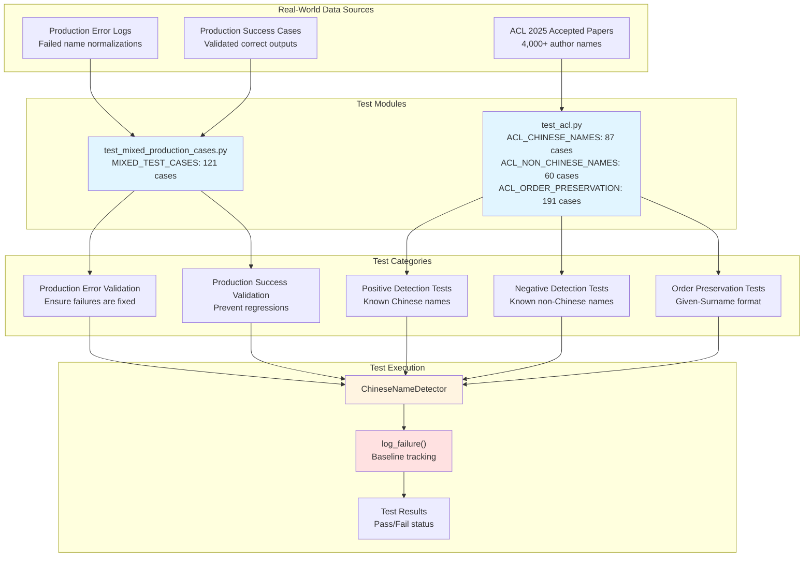
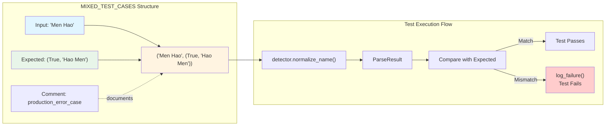
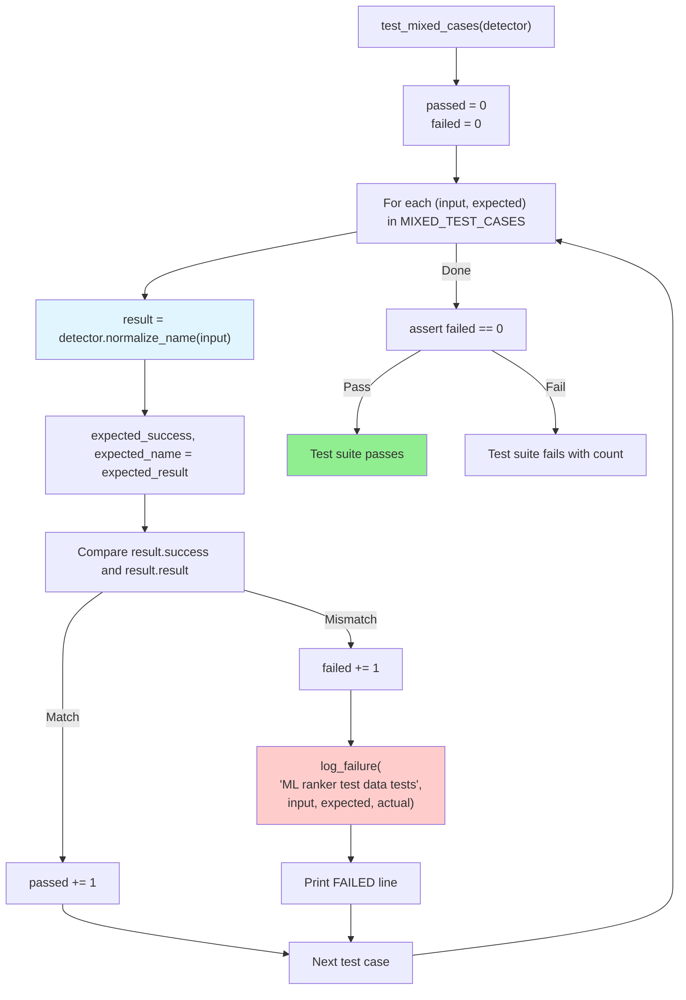
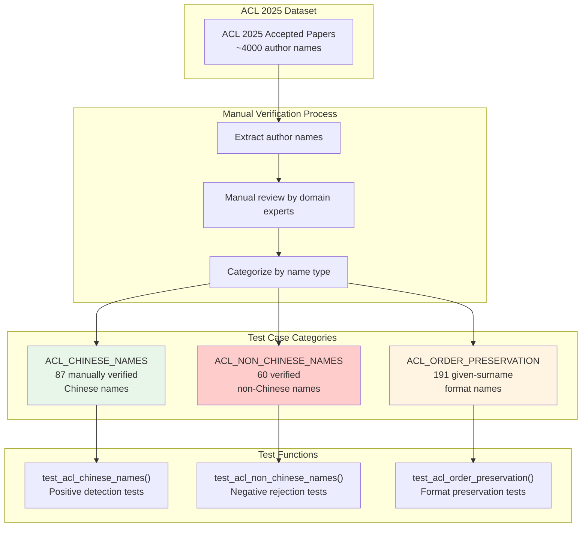
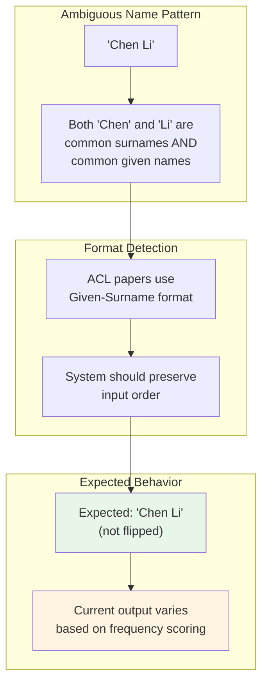
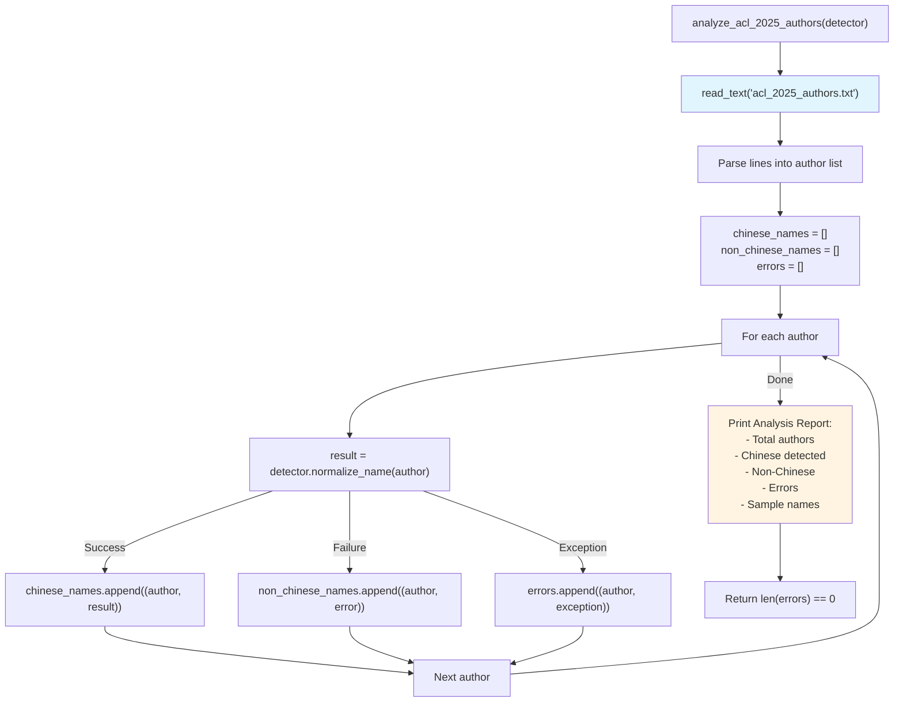
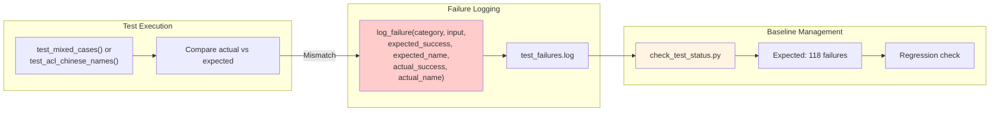

<!-- source: DeepWiki mcp.deepwiki.com · repo allenai/sinonym · page 5.3 Production and Real-World Test Cases · fetched 2026-10-26 -->

# Production and Real-World Test Cases

<details>
<summary>Relevant source files</summary>

The following files were used as context for generating this wiki page:

- [tests/test_acl.py](tests/test_acl.py)
- [tests/test_mixed_production_cases.py](tests/test_mixed_production_cases.py)

</details>


## Purpose and Scope

This page documents the production-derived and real-world test cases used to validate sinonym's accuracy against actual usage patterns. These tests complement the synthetic test suites (see [Chinese Name Test Suites](#5.2)) by capturing edge cases, production failures, and real academic author names from ACL 2025.

The test suites covered here include:
- Mixed production cases that blend known failures with successes to prevent regressions
- ACL 2025 author names providing ground truth for academic name processing
- Order preservation cases that validate the system's ability to respect given-surname format

For test infrastructure and baseline management, see [Test Infrastructure and Baseline Management](#5.1).

---

## Test Suite Architecture

The production and real-world test cases are organized into two primary test modules that validate different aspects of real-world name processing.



**Sources:** [tests/test_mixed_production_cases.py:1-294](), [tests/test_acl.py:1-435]()

---

## Mixed Production Test Cases

The `test_mixed_production_cases.py` module maintains a balanced collection of production cases, implementing a 50/50 mix strategy to validate both error fixes and continued correctness.

### Test Case Structure

Each test case in `MIXED_TEST_CASES` consists of:
- **Input name**: Romanized Chinese name as it appeared in production
- **Expected result**: Tuple of `(success: bool, normalized_name: str)`
- **Case type annotation**: Comment indicating `production_error_case` or `production_success_case`



**Sources:** [tests/test_mixed_production_cases.py:22-219]()

### Production Error Cases

Production error cases represent names that failed in earlier system versions. These cases validate that improvements fix known issues:

| Input Name | Expected Output | Token Count | Issue Type |
|------------|----------------|-------------|------------|
| `Men Hao` | `Hao Men` | 2 | 2-token parsing |
| `Gui Rui` | `Rui Gui` | 2 | 2-token parsing |
| `Shu Yao` | `Yao Shu` | 2 | 2-token parsing |
| `Zheng Chao Hui` | `Chao-Hui Zheng` | 3 | 3-token parsing |
| `Wang Qiu Yan` | `Qiu-Yan Wang` | 3 | Given name boundary |
| `Wang Xiu Lin` | `Xiu-Lin Wang` | 3 | Given name boundary |

**Sources:** [tests/test_mixed_production_cases.py:29-30](), [tests/test_mixed_production_cases.py:35-36](), [tests/test_mixed_production_cases.py:49-50](), [tests/test_mixed_production_cases.py:55-56](), [tests/test_mixed_production_cases.py:81-82](), [tests/test_mixed_production_cases.py:85-86]()

### Production Success Cases

Production success cases represent names that were correctly processed in production. These cases act as regression tests:

| Input Name | Expected Output | Token Count | Pattern |
|------------|----------------|-------------|---------|
| `Li Guan Long` | `Guan-Long Li` | 3 | Standard 3-token |
| `Zhang Chun Fan` | `Chun-Fan Zhang` | 3 | Standard 3-token |
| `An Yi` | `An Yi` | 2 | 2-token ambiguous |
| `Xu Qing` | `Qing Xu` | 2 | 2-token ambiguous |
| `Gao Te` | `Te Gao` | 2 | 2-token ambiguous |

**Sources:** [tests/test_mixed_production_cases.py:23-24](), [tests/test_mixed_production_cases.py:25-26](), [tests/test_mixed_production_cases.py:69-70](), [tests/test_mixed_production_cases.py:87-88](), [tests/test_mixed_production_cases.py:101-102]()

### Lowercase Production Cases

The test suite includes additional lowercase cases that validate case-insensitive processing:

```python
# Examples from MIXED_TEST_CASES
("bin han", (True, "Bin Han"))
("bing liu", (True, "Bing Liu"))
("li fei fei", (True, "Fei-Fei Li"))
("wang wei ping", (True, "Wei-Ping Wang"))
```

These cases ensure the normalization service correctly capitalizes output regardless of input case.

**Sources:** [tests/test_mixed_production_cases.py:222-252]()

### Test Execution Method

The `test_mixed_cases()` function executes all mixed production cases:



**Sources:** [tests/test_mixed_production_cases.py:255-288]()

---

## ACL 2025 Author Dataset

The `test_acl.py` module uses real author names from ACL 2025 accepted papers as ground truth for validation. This dataset provides diverse, manually verified test cases from actual academic usage.

### Test Suite Categories

The ACL test suite is organized into three distinct categories, each serving a different validation purpose:



**Sources:** [tests/test_acl.py:17-327]()

### Positive Detection Tests: ACL_CHINESE_NAMES

The `ACL_CHINESE_NAMES` list contains 87 manually verified Chinese author names with expected normalized outputs:

| Input Name | Expected Output | Pattern |
|------------|-----------------|---------|
| `Weiqi Wang` | `Wei-Qi Wang` | 2-token given name |
| `Xin Liu` | `Xin Liu` | Single-token given |
| `Yang Li` | `Yang Li` | Single-token given |
| `Yifan Gao` | `Yi-Fan Gao` | 2-token given name |
| `Wenqiang Lei` | `Wen-Qiang Lei` | 2-token given name |
| `Chenhao Tan` | `Chen-Hao Tan` | 2-token given name |
| `Baobao Chang` | `Bao-Bao Chang` | Reduplicative given |
| `Chengzhong LIU` | `Cheng-Zhong Liu` | All-caps input |
| `Po-Kai Chen` | `Po-Kai Chen` | Already hyphenated |
| `Maochuan Lu` | `Mao-Chuan Lu` | 2-token given name |

**Test Validation Logic:**
```python
def test_acl_chinese_names(detector):
    for input_name, expected_output in ACL_CHINESE_NAMES:
        result = detector.normalize_name(input_name)
        if not result.success or result.result != expected_output:
            log_failure("ACL Chinese name tests", input_name, 
                       True, expected_output, result.success, actual)
```

**Sources:** [tests/test_acl.py:18-105](), [tests/test_acl.py:330-344]()

### Negative Rejection Tests: ACL_NON_CHINESE_NAMES

The `ACL_NON_CHINESE_NAMES` list contains 60 verified non-Chinese names that should be rejected by the ethnicity classifier:

| Name Category | Examples | Reason for Rejection |
|---------------|----------|---------------------|
| Western names | `Aaron Mueller`, `Sebastian Ruder`, `Nathan Lambert` | English surnames |
| Japanese names | `Hiroaki Yamagiwa`, `Shinji Watanabe` | Japanese phonetics |
| Korean names | `Kangil Kim`, `YoungBin Kim`, `Minjun Park` | Korean surname patterns |
| Indian names | `Ankita Gupta`, `Anukriti Bhatnagar`, `Archiki Prasad` | Indian phonetics |
| Other | `Carlos Gómez-Rodríguez`, `Maria José Bocorny Finatto` | Spanish/Portuguese |

**Test Validation Logic:**
```python
def test_acl_non_chinese_names(detector):
    for name in ACL_NON_CHINESE_NAMES:
        result = detector.normalize_name(name)
        if result.success:  # Should have failed!
            log_failure("ACL non-Chinese rejection tests", name, 
                       False, "should_be_rejected", True, result.result)
```

**Sources:** [tests/test_acl.py:108-168](), [tests/test_acl.py:347-360]()

### Order Preservation Tests: ACL_ORDER_PRESERVATION_TEST_CASES

The `ACL_ORDER_PRESERVATION_TEST_CASES` list contains 191 ambiguous Chinese names where both tokens are valid as either surname or given name. These names appear in given-surname format in ACL papers and should not be flipped:



**Example Cases:**

| Input Name | Expected (Given-Surname) | Problematic Output | Ambiguity Type |
|------------|-------------------------|-------------------|----------------|
| `Chen Li` | `Chen Li` | `Li Chen` | Both common surnames |
| `Wei Tao` | `Wei Tao` | `Tao Wei` | Both common surnames |
| `Yang Xu` | `Yang Xu` | `Xu Yang` | Both common surnames |
| `Haoran Jin` | `Hao-Ran Jin` | `Jin Haoran` | Given name split issue |
| `Xinlei Chen` | `Xin-Lei Chen` | `Chen Xinlei` | Given name split issue |

**Sources:** [tests/test_acl.py:172-327](), [tests/test_acl.py:363-381]()

### Full Dataset Analysis Function

The `analyze_acl_2025_authors()` function processes all ACL 2025 author names from the bundled resource file:



**Analysis Output Structure:**
- **Total authors processed**: Number of unique author names in dataset
- **Chinese names detected**: Count of successfully normalized Chinese names
- **Non-Chinese names**: Count of rejected names (not Chinese)
- **Errors**: Count of unexpected exceptions
- **Sample detected names**: First 25 detected Chinese names with normalization

**Sources:** [tests/test_acl.py:384-428]()

---

## Integration with Test Infrastructure

Both production and ACL test suites integrate with the baseline management system through consistent failure logging patterns.

### Failure Logging Integration

All test functions use the `log_failure()` utility from the test infrastructure:



**Sources:** [tests/test_mixed_production_cases.py:276-283](), [tests/test_acl.py:342](), [tests/test_acl.py:358](), [tests/test_acl.py:377]()

### Test Categories and Baseline Expectations

The production and real-world tests contribute to the overall baseline of 118 expected failures:

| Test Category | Module | Baseline Contribution |
|--------------|--------|----------------------|
| Mixed production cases | `test_mixed_production_cases` | Varies (some expected failures) |
| ACL Chinese names | `test_acl` | Minimal expected failures |
| ACL non-Chinese rejection | `test_acl` | Zero expected failures |
| ACL order preservation | `test_acl` | High expected failures (order flip issue) |

The order preservation tests account for a significant portion of the baseline failures, as the current system struggles with ambiguous given-surname format names.

**Sources:** [tests/test_mixed_production_cases.py:255-288](), [tests/test_acl.py:330-381]()

---

## Test Execution Patterns

### Uniform Test Output Format

Both test modules follow a consistent failure reporting format to enable parsing by `check_test_status.py`:

```python
# Uniform failure line format
print(f"FAILED: '{input_name}': expected ({expected_success}, '{expected_output}'), "
      f"got ({result.success}, '{actual}')")
```

This format enables:
- **Automated parsing**: The test status checker can extract failure details
- **Baseline tracking**: Consistent format enables comparison across test runs
- **Debugging support**: Clear indication of expected vs actual results

**Sources:** [tests/test_mixed_production_cases.py:273-275](), [tests/test_acl.py:341](), [tests/test_acl.py:357](), [tests/test_acl.py:375-377]()

### Direct Module Execution

Both test modules support direct execution for rapid testing:

```python
if __name__ == "__main__":
    import pytest
    pytest.main([__file__, "-v"])
```

This enables developers to run production tests in isolation:
```bash
python tests/test_mixed_production_cases.py
python tests/test_acl.py
```

**Sources:** [tests/test_mixed_production_cases.py:290-293](), [tests/test_acl.py:430-434]()

---

## Real-World Data Characteristics

### Production Case Token Distribution

The mixed production cases cover various token count patterns:

| Token Count | Example Input | Count | Percentage |
|-------------|---------------|-------|------------|
| 2 tokens | `Men Hao`, `An Yi`, `Gao Te` | ~20 | ~16% |
| 3 tokens | `Li Guan Long`, `Zhang Chun Fan` | ~100 | ~83% |
| 4 tokens | `wang wei ping` | ~1 | ~1% |

**Key Insight**: Most production errors occur with 2-token names (ambiguous surname/given boundary) and 3-token names (given name splitting decisions).

**Sources:** [tests/test_mixed_production_cases.py:22-252]()

### ACL Name Format Diversity

The ACL dataset exhibits diverse input formats:

| Format Type | Examples | Count |
|-------------|----------|-------|
| Standard capitalization | `Weiqi Wang`, `Xin Liu` | Majority |
| All-caps surname | `Chengzhong LIU`, `Yuhao QING` | ~5 |
| Pre-hyphenated | `Chin-Jou Li`, `Po-Kai Chen` | ~10 |
| Concatenated given | `Haoran Jin`, `Xinlei Chen` | ~30 |
| Given-surname ambiguous | `Chen Li`, `Wei Tao` | 191 |

This diversity validates the system against real-world formatting variations encountered in academic publishing.

**Sources:** [tests/test_acl.py:18-105](), [tests/test_acl.py:172-327]()

---

## Validation Objectives

### Production Cases: Regression Prevention

The mixed production test suite serves two primary objectives:

1. **Error Fix Validation**: Confirm that known production errors are now handled correctly
2. **Success Preservation**: Ensure that improvements don't break previously working cases

The 50/50 mix strategy balances these objectives, creating a comprehensive regression test that validates both progress and stability.

### ACL Cases: Real-World Robustness

The ACL test suite validates three critical aspects:

1. **Positive Detection Accuracy**: Confirm Chinese names are correctly identified and normalized
2. **Negative Detection Precision**: Ensure non-Chinese names are properly rejected by ethnicity classification
3. **Format Awareness**: Test the system's ability to preserve given-surname format when appropriate

These objectives ensure the system performs correctly on real academic author names, which is a primary use case for sinonym.

**Sources:** [tests/test_mixed_production_cases.py:1-10](), [tests/test_acl.py:1-6]()

---

