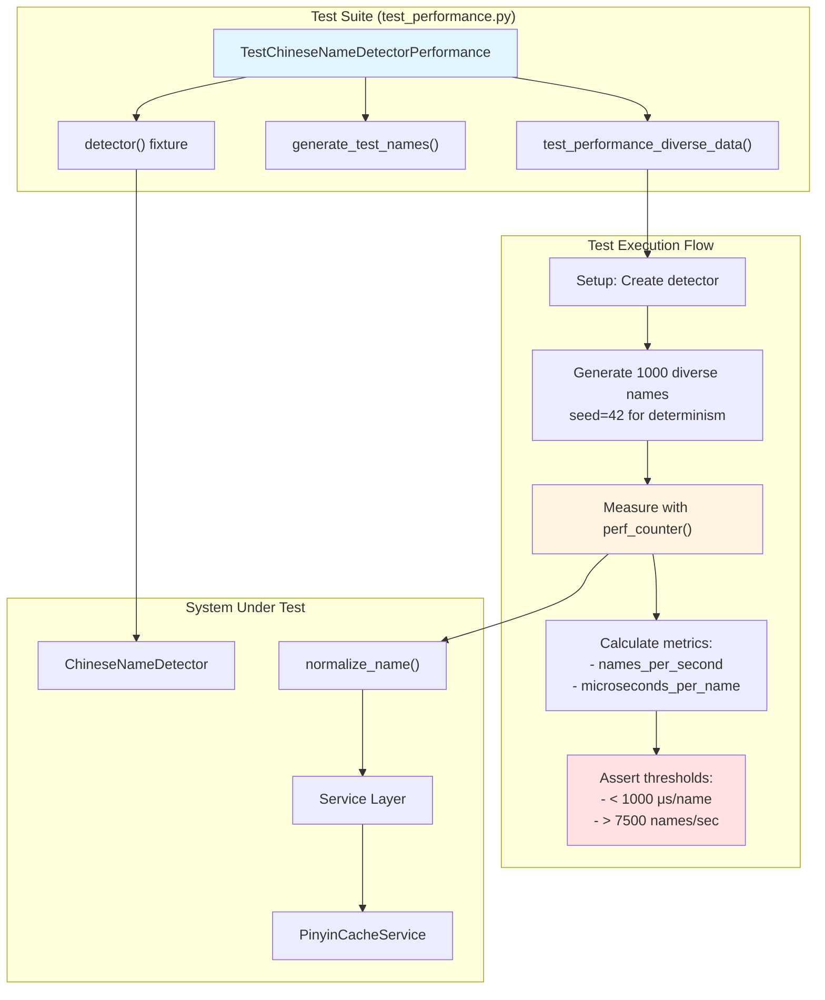
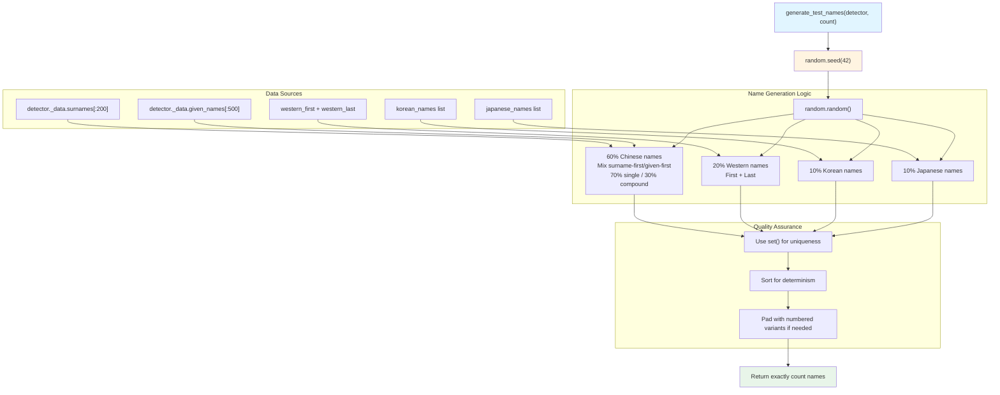
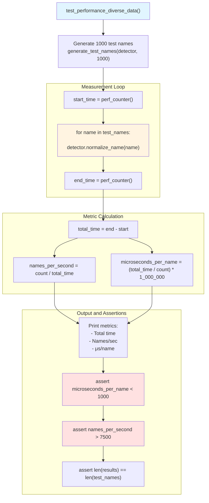
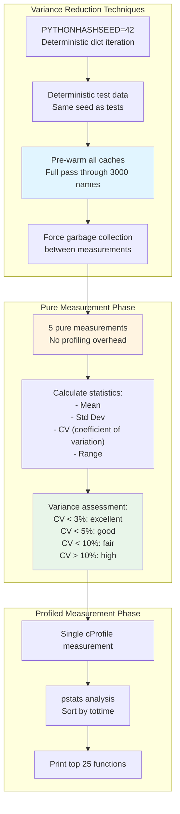

<!-- source: DeepWiki mcp.deepwiki.com · repo allenai/sinonym · page 5.4 Performance Testing · fetched 2026-10-26 -->

# Performance Testing

<details>
<summary>Relevant source files</summary>

The following files were used as context for generating this wiki page:

- [README.md](README.md)
- [pyproject.toml](pyproject.toml)
- [scripts/profile_run.py](scripts/profile_run.py)
- [tests/test_performance.py](tests/test_performance.py)
- [uv.lock](uv.lock)

</details>


## Purpose and Scope

This document describes the performance testing infrastructure for sinonym, including benchmark methodology, profiling tools, and performance requirements. Performance testing ensures the system maintains sub-millisecond average processing time and high throughput suitable for production use. For information about functional correctness testing, see [Chinese Name Test Suites](#5.2) and [Production and Real-World Test Cases](#5.3). For batch-specific performance characteristics, see [Batch Processing Tests](#5.5).

**Sources:** [tests/test_performance.py:1-14](), [README.md:111-114]()

---

## Performance Requirements

Sinonym enforces strict performance requirements validated through automated benchmarks:

| Requirement | Threshold | Rationale |
|------------|-----------|-----------|
| Average Processing Time | < 1000 microseconds (1ms) | Sub-millisecond requirement for production systems |
| Throughput (Diverse Data) | > 7,500 names/second | Realistic scenario with minimal cache benefit |
| Measurement Variance | CV < 5% preferred | Low-variance measurements ensure reliable benchmarks |

These thresholds are defined as constants in the test suite:
- `MAX_MICROSECONDS_PER_NAME = 1000` [tests/test_performance.py:29]()
- `MIN_DIVERSE_NAMES_PER_SECOND = 7500` [tests/test_performance.py:30]()

The diverse data requirement accounts for real-world scenarios where names vary significantly, minimizing cache hit rates. The README claims "over 10,000 diverse names per second," indicating the system exceeds minimum requirements [README.md:114]().

**Sources:** [tests/test_performance.py:28-30](), [README.md:111-114](), [tests/test_performance.py:1-14]()

---

## Performance Test Architecture



**Diagram: Performance Test Architecture and Execution Flow**

The performance test suite uses pytest fixtures and deterministic data generation to ensure reproducible benchmarks. The `TestChineseNameDetectorPerformance` class [tests/test_performance.py:33-34]() contains all performance tests, with a class-scoped fixture providing a shared `ChineseNameDetector` instance [tests/test_performance.py:36-39]().

**Sources:** [tests/test_performance.py:33-210]()

---

## Test Data Generation



**Diagram: Deterministic Test Data Generation Strategy**

The `generate_test_names()` method [tests/test_performance.py:41-168]() produces diverse, deterministic test data by:

1. **Setting a fixed random seed (42)** to ensure reproducibility across test runs [tests/test_performance.py:47]()
2. **Sourcing names from production data**: Uses top 200 surnames and top 500 given names from `detector._data` [tests/test_performance.py:50-51]()
3. **Creating realistic diversity**: 60% Chinese names, 20% Western, 10% Korean, 10% Japanese [tests/test_performance.py:130-155]()
4. **Ensuring uniqueness**: Uses a `set()` to avoid duplicate names, then sorts for deterministic ordering [tests/test_performance.py:122, 158]()

Chinese names include format variations:
- 60% surname-first, 40% given-first [tests/test_performance.py:140-143]()
- 70% single given names, 30% compound given names [tests/test_performance.py:132-137]()
- Mix of hyphenated and non-hyphenated compound names [tests/test_performance.py:137]()

This diversity minimizes cache hit rates, providing conservative performance estimates for real-world scenarios.

**Sources:** [tests/test_performance.py:41-168]()

---

## Performance Test Implementation

The main performance test validates both latency and throughput requirements:



**Diagram: Performance Test Execution and Validation Flow**

The `test_performance_diverse_data()` method [tests/test_performance.py:170-210]() implements the benchmark:

1. **Generates 1000 diverse names** using the deterministic generator [tests/test_performance.py:178]()
2. **Measures wall-clock time** using `time.perf_counter()` for high-resolution timing [tests/test_performance.py:183, 188]()
3. **Processes all names sequentially** through `detector.normalize_name()` [tests/test_performance.py:185-187]()
4. **Calculates three key metrics**:
   - Total elapsed time (seconds)
   - Processing rate (names/second) [tests/test_performance.py:192]()
   - Average latency (microseconds/name) [tests/test_performance.py:193]()
5. **Asserts performance thresholds**:
   - Average latency < 1000 μs [tests/test_performance.py:200-202]()
   - Throughput > 7500 names/sec [tests/test_performance.py:203-206]()
   - All names processed successfully [tests/test_performance.py:209]()

The test prints detailed metrics for monitoring performance trends over time [tests/test_performance.py:195-197]().

**Sources:** [tests/test_performance.py:170-210]()

---

## Low-Variance Profiling Infrastructure

The `profile_run.py` script provides detailed performance analysis with minimized measurement variance:



**Diagram: Low-Variance Profiling Workflow**

The profiling script [scripts/profile_run.py]() implements multiple strategies to minimize measurement variance:

### Variance Reduction Techniques

1. **Deterministic Hash Seed**: Sets `PYTHONHASHSEED=42` to ensure consistent dictionary iteration order [scripts/profile_run.py:21]()
2. **Reproducible Test Data**: Uses the same `generate_test_names()` method with seed 42 [scripts/profile_run.py:53]()
3. **Cache Pre-warming**: Processes all 3000 test names once before measurements to eliminate cold-start effects [scripts/profile_run.py:57-61]()
4. **Garbage Collection**: Forces `gc.collect()` between runs to prevent GC-related variance [scripts/profile_run.py:29]()

### Two-Phase Measurement

**Pure Measurement Phase** (no profiling overhead):
- Runs 5 measurements without `cProfile` enabled [scripts/profile_run.py:66-72]()
- Calculates mean, standard deviation, coefficient of variation (CV) [scripts/profile_run.py:75-77]()
- Assesses variance quality: CV < 3% (excellent), < 5% (good), < 10% (fair), > 10% (high) [scripts/profile_run.py:93-101]()

**Profiled Measurement Phase** (detailed analysis):
- Runs single measurement with `cProfile.Profile()` [scripts/profile_run.py:32-33, 106]()
- Generates `pstats.Stats` sorted by total time [scripts/profile_run.py:107]()
- Prints top 25 functions by cumulative time [scripts/profile_run.py:108]()

This two-phase approach separates clean performance measurements from profiling overhead, providing both accurate benchmarks and detailed bottleneck analysis.

**Sources:** [scripts/profile_run.py:1-113]()

---

## Performance Metrics and Calculations

The system calculates three primary performance metrics from raw timing data:

| Metric | Formula | Unit | Purpose |
|--------|---------|------|---------|
| Total Time | `end_time - start_time` | seconds | Overall benchmark duration |
| Throughput | `name_count / total_time` | names/second | Processing rate for batch workloads |
| Latency | `(total_time / name_count) * 1_000_000` | microseconds | Average per-name processing time |

### Throughput Calculation

```python
# From test_performance.py:192
names_per_second = len(test_names) / total_time
```

Throughput measures how many names the system can process per second. The 7,500 names/sec threshold [tests/test_performance.py:30]() represents realistic performance with diverse data and minimal cache benefit.

### Latency Calculation

```python
# From test_performance.py:193
microseconds_per_name = (total_time / len(test_names)) * 1_000_000
```

Latency measures average time per individual name. The 1000 μs (1ms) threshold [tests/test_performance.py:29]() ensures sub-millisecond performance suitable for interactive systems and high-throughput batch processing.

### Variance Assessment (Profiling Script)

```python
# From profile_run.py:77, 82
std_time = statistics.stdev(pure_times)
cv = (std_time / mean_time * 100)  # Coefficient of variation
```

Coefficient of variation (CV) quantifies measurement reliability:
- **CV < 3%**: Excellent - highly stable measurements
- **CV < 5%**: Good - acceptable variance
- **CV < 10%**: Fair - moderate variance
- **CV > 10%**: High - check system load

The profiling script reports CV to validate benchmark reliability [scripts/profile_run.py:93-101]().

**Sources:** [tests/test_performance.py:191-193](), [scripts/profile_run.py:75-82, 93-101](), [tests/test_performance.py:28-30]()

---

## Caching and Performance Impact

Sinonym employs caching strategies that significantly improve performance for repeated names:

### PinyinCacheService

The `PinyinCacheService` [sinonym/services/pinyin_cache_service.py]() caches Han-to-Pinyin conversions with:
- **Persistent storage**: Cached mappings saved across sessions
- **Thread-local caching**: Fast in-memory lookups during processing
- **Automatic warming**: Pre-loads common characters during initialization

### Performance Test Isolation

The performance tests intentionally use **diverse data** to minimize cache benefits:
- 1000 unique names with varied formats [tests/test_performance.py:178]()
- Mix of Chinese, Western, Korean, and Japanese names [tests/test_performance.py:130-155]()
- Different surname/given name combinations to avoid repeated conversions

This conservative approach ensures the 7,500 names/sec threshold represents realistic worst-case performance, not cache-optimized scenarios.

### Cache Pre-warming in Profiling

The profiling script takes the opposite approach, pre-warming caches to measure optimal performance:

```python
# From profile_run.py:57-61
print("Pre-warming caches...")
for name in names:  # Warm up with ALL names to fully load caches
    detector.normalize_name(name)
```

This eliminates cold-start effects and provides upper-bound performance measurements. The README's claim of "over 10,000 diverse names per second" [README.md:114]() likely reflects this warm-cache scenario.

**Sources:** [tests/test_performance.py:41-168, 178](), [scripts/profile_run.py:57-61](), [README.md:111-114]()

---

## Running Performance Tests

### Via Pytest

Run the performance test suite directly:

```bash
pytest tests/test_performance.py -v
```

This executes `test_performance_diverse_data()` with 1000 names and validates against thresholds.

### Via Profiling Script

Run detailed profiling with variance analysis:

```bash
python scripts/profile_run.py
```

This generates:
1. **Pure performance statistics** from 5 measurements (3000 names each)
2. **Variance assessment** with CV calculation
3. **Detailed cProfile output** showing top 25 functions by time

Example output format [scripts/profile_run.py:79-91]():
```
Pure Performance Statistics:
Mean:     0.3245s
Std Dev:  0.0087s
CV:       2.68%
Range:    0.3156s - 0.3334s

Performance Metrics:
Rate:     9245 names/second
Per name: 108.2 microseconds

✅ EXCELLENT: Very low variance (2.68%)
```

### Test Configuration

Performance test configuration is managed via constants:
- `MAX_MICROSECONDS_PER_NAME = 1000` [tests/test_performance.py:29]()
- `MIN_DIVERSE_NAMES_PER_SECOND = 7500` [tests/test_performance.py:30]()

Adjust these constants to modify performance requirements. The test prints detailed metrics regardless of pass/fail status for performance trend monitoring.

**Sources:** [tests/test_performance.py:28-30, 170-210](), [scripts/profile_run.py:46-112]()

---

## Performance Test Fixtures

The performance test class uses pytest fixtures for setup:

### Class-Scoped Detector Fixture

```python
# From test_performance.py:36-39
@pytest.fixture(scope="class")
def detector(self):
    """Create a detector instance for performance testing."""
    return ChineseNameDetector()
```

This fixture creates a single `ChineseNameDetector` instance shared across all tests in the class, avoiding repeated initialization overhead. The class scope ensures:
- Consistent baseline for performance measurements
- Shared cache state across test methods (if multiple tests existed)
- Reduced test execution time

### Detector Instance Contents

The fixture provides access to:
- `detector._data.surnames` - top 200 surnames used in test data generation [tests/test_performance.py:50]()
- `detector._data.given_names` - top 500 given names used in test data generation [tests/test_performance.py:51]()
- Full service layer and caching infrastructure for realistic benchmarks

**Sources:** [tests/test_performance.py:36-51]()

---

## Integration with CI/CD

Performance tests run as part of the standard test suite in CI, ensuring performance regressions are detected automatically. The pytest configuration [pyproject.toml:67-71]() includes performance tests in the default test path:

```toml
[tool.pytest.ini_options]
testpaths = ["tests"]
python_files = ["test_*.py"]
```

Performance test failures will block CI builds if:
- Average latency exceeds 1ms per name
- Throughput drops below 7,500 names/second
- Any names fail to process

The baseline management system [tests/scripts/check_test_status.py]() tracks performance test status but does not include it in the expected failure count, meaning performance regressions always cause CI failures.

**Sources:** [pyproject.toml:67-71](), [tests/test_performance.py:200-209]()

---

