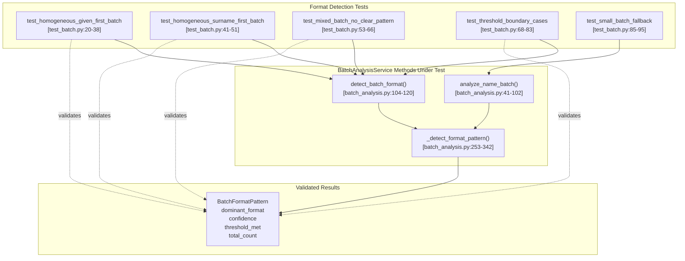
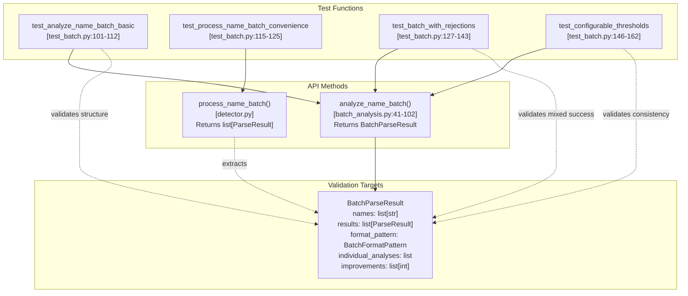
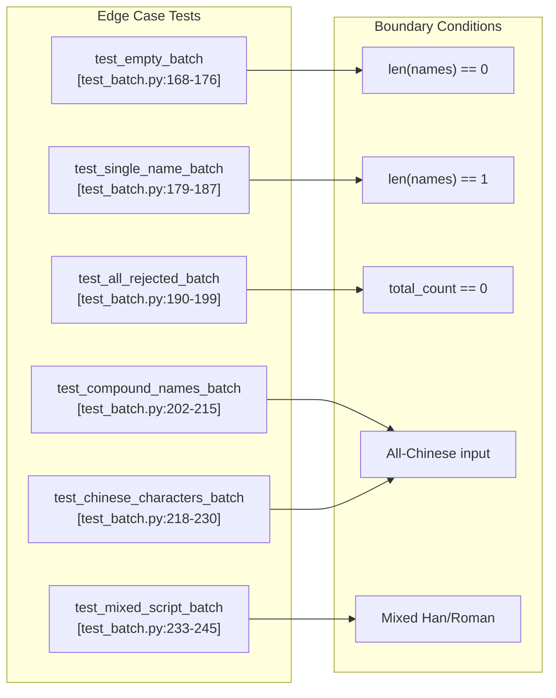
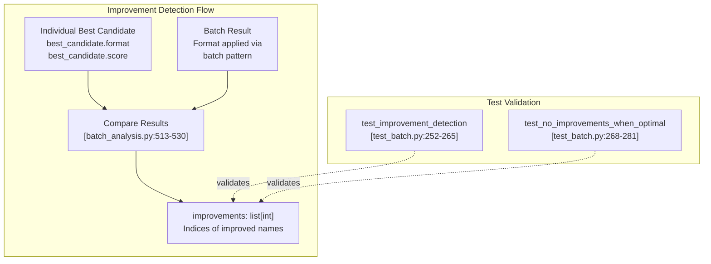
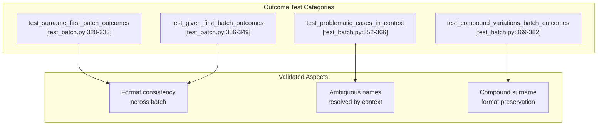
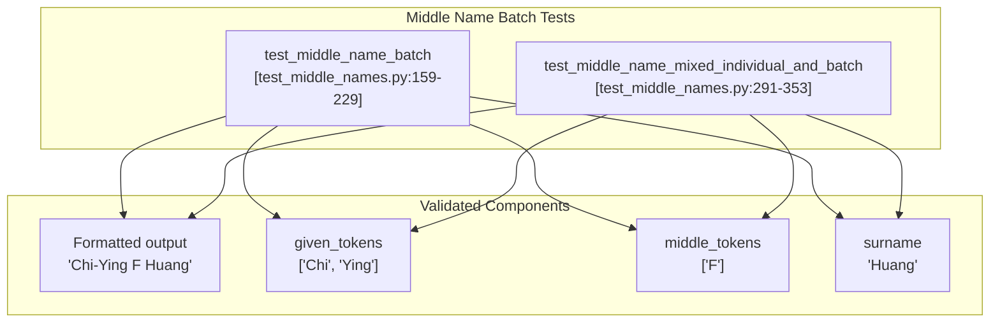

<!-- source: DeepWiki mcp.deepwiki.com · repo allenai/sinonym · page 5.5 Batch Processing Tests · fetched 2026-10-26 -->

# Batch Processing Tests

<details>
<summary>Relevant source files</summary>

The following files were used as context for generating this wiki page:

- [sinonym/services/batch_analysis.py](sinonym/services/batch_analysis.py)
- [tests/test_batch.py](tests/test_batch.py)
- [tests/test_middle_names.py](tests/test_middle_names.py)

</details>


## Purpose and Scope

This page documents the test suite that validates the batch processing functionality of sinonym. Batch processing allows multiple names to be analyzed together to detect consistent formatting patterns (surname-first vs. given-first), which improves parsing accuracy for ambiguous individual names. The tests verify that the `BatchAnalysisService` ([sinonym/services/batch_analysis.py:28-581]()) correctly detects format patterns, applies batch-level formatting, tracks improvements, and maintains consistency with individual processing.

For information about the batch processing system architecture itself, see [Batch Processing System](#2.3). For test infrastructure and baseline management, see [Test Infrastructure and Baseline Management](#5.1). For performance benchmarks including batch throughput, see [Performance Testing](#5.4).

**Sources:** [tests/test_batch.py:1-501](), [sinonym/services/batch_analysis.py:1-15]()

---

## Test File Organization

The batch processing test suite is organized into a single comprehensive test file with categorized test sections:

| Test Category | Line Range | Purpose |
|--------------|------------|---------|
| Batch Format Detection | [tests/test_batch.py:17-95]() | Validates `detect_batch_format` method |
| Batch Processing | [tests/test_batch.py:97-162]() | Validates `analyze_name_batch` core functionality |
| Edge Cases | [tests/test_batch.py:164-246]() | Tests empty batches, single names, rejections, compounds |
| Improvements | [tests/test_batch.py:248-281]() | Validates improvement tracking for ambiguous names |
| Performance | [tests/test_batch.py:283-315]() | Tests large batches and consistency |
| Batch Outcomes | [tests/test_batch.py:317-383]() | Tests surname-first/given-first dominant batches |
| Real Failing Cases | [tests/test_batch.py:385-422]() | Tests problematic names in batch context |
| ACL Real World | [tests/test_batch.py:424-501]() | Tests ACL author batch scenarios |

Middle name handling in batch context is tested in [tests/test_middle_names.py:159-229]() and [tests/test_middle_names.py:291-353]().

**Sources:** [tests/test_batch.py:1-501](), [tests/test_middle_names.py:1-379]()

---

## Test Infrastructure and Fixtures

### Session-Scoped Detector Fixture

All batch tests use a session-scoped `detector` fixture that provides a pre-initialized `ChineseNameDetector` instance. This fixture is defined in the test configuration and shared across all test functions for optimal performance.

```python
# Usage pattern throughout test_batch.py
def test_homogeneous_given_first_batch(detector):
    """Test detection with names that individual processing handles correctly."""
    names = ["Xin Liu", "Yang Li", "Chen Huang", "Wei Zhang", "Ming Wang"]
    pattern = detector.detect_batch_format(names)
    # ... assertions
```

**Sources:** [tests/test_batch.py:20-38]()

### Failure Logging Integration

Batch tests integrate with the shared failure logging system via `log_failure` from [tests/_fail_log.py](). This enables the baseline management system in [scripts/check_test_status.py]() to track and validate expected test outcomes.

**Sources:** [tests/test_middle_names.py:20](), [tests/test_middle_names.py:100]()

---

## Format Detection Test Suite

### Test Coverage Map



**Sources:** [tests/test_batch.py:17-95](), [sinonym/services/batch_analysis.py:104-120](), [sinonym/services/batch_analysis.py:253-342]()

### Homogeneous Batch Tests

**`test_homogeneous_given_first_batch`** ([tests/test_batch.py:20-38]()) validates detection of given-first format with names where individual processing already works correctly. The test uses common surnames (Liu, Li, Huang, Zhang, Wang) and common given names (Xin, Yang, Chen, Wei, Ming).

**`test_homogeneous_surname_first_batch`** ([tests/test_batch.py:41-51]()) validates detection of surname-first format (Chinese-style ordering). The test verifies that `pattern.total_count == 5` and that confidence is above zero.

**Key Assertions:**
- `pattern.total_count` matches the number of Chinese names in the batch
- `pattern.threshold_met` indicates whether confidence exceeds the threshold
- Batch processing produces the same results as individual processing

**Sources:** [tests/test_batch.py:20-51]()

### Mixed and Ambiguous Batch Tests

**`test_mixed_batch_no_clear_pattern`** ([tests/test_batch.py:53-66]()) tests batches with non-Chinese names that get rejected. The test verifies that non-Chinese names (e.g., "John Smith", "Mary Johnson") are excluded from `total_count`:

```python
names = [
    "John Smith",     # Non-Chinese (rejected)
    "Xin Liu",        # Chinese name
    "Mary Johnson",   # Non-Chinese (rejected)
]
pattern = detector.detect_batch_format(names)
assert pattern.total_count == 1  # Only counts Chinese names
```

**Sources:** [tests/test_batch.py:53-66]()

### Threshold Boundary Tests

**`test_threshold_boundary_cases`** ([tests/test_batch.py:68-83]()) validates format detection at threshold boundaries. The test uses a custom threshold (0.67 or 67%) and verifies that `threshold_met` correctly reflects whether confidence meets or exceeds this value.

The confidence calculation in `_detect_format_pattern` ([sinonym/services/batch_analysis.py:253-342]()) uses simple vote counting with confidence-weighted tie-breaking:

| Scenario | Confidence Calculation |
|----------|----------------------|
| Clear Winner | `winning_votes / total_preferences` |
| Exact Tie | Weighted confidence using score gaps |
| Still Tied | Heuristic tie-breaking with surname strength |

**Sources:** [tests/test_batch.py:68-83](), [sinonym/services/batch_analysis.py:303-331]()

### Small Batch Fallback Tests

**`test_small_batch_fallback`** ([tests/test_batch.py:85-95]()) verifies that batches smaller than `minimum_batch_size` fall back to individual processing. The fallback behavior is implemented in [sinonym/services/batch_analysis.py:61-63]():

```python
if len(names) < minimum_batch_size:
    # Too small for batch analysis - fall back to individual processing
    return self._process_individually(names, normalizer, data, formatting_service)
```

The test validates that:
- `format_pattern.threshold_met is False` (no batch pattern applied)
- `len(improvements) == 0` (no batch improvements)
- All names are still processed successfully

**Sources:** [tests/test_batch.py:85-95](), [sinonym/services/batch_analysis.py:61-63]()

---

## Batch Processing Functional Tests

### Core Batch Analysis Tests



**Sources:** [tests/test_batch.py:97-162](), [sinonym/services/batch_analysis.py:41-102]()

### Basic Functionality Tests

**`test_analyze_name_batch_basic`** ([tests/test_batch.py:101-112]()) validates the structure of `BatchParseResult`:

```python
result = detector.analyze_name_batch(names)
assert isinstance(result, BatchParseResult)
assert len(result.names) == 3
assert len(result.results) == 3
assert len(result.individual_analyses) == 3
assert isinstance(result.format_pattern, BatchFormatPattern)
assert isinstance(result.improvements, list)
```

**`test_process_name_batch_convenience`** ([tests/test_batch.py:115-125]()) tests the convenience method that returns just the list of `ParseResult` objects without the full batch analysis metadata.

**Sources:** [tests/test_batch.py:101-125]()

### Rejection Handling Tests

**`test_batch_with_rejections`** ([tests/test_batch.py:127-143]()) validates that batch processing correctly handles mixed Chinese and non-Chinese names:

```python
names = [
    "Xin Liu",        # Chinese - success
    "John Smith",     # Non-Chinese - rejected
    "Yang Li",        # Chinese - success
    "Mary Johnson",   # Non-Chinese - rejected
]
result = detector.analyze_name_batch(names)
assert result.results[0].success  # Xin Liu
assert not result.results[1].success  # John Smith
assert result.results[2].success  # Yang Li
assert not result.results[3].success  # Mary Johnson
```

The rejection logic mirrors individual processing through ethnicity classification ([sinonym/services/batch_analysis.py:187-195]()).

**Sources:** [tests/test_batch.py:127-143](), [sinonym/services/batch_analysis.py:187-195]()

### Configurable Threshold Tests

**`test_configurable_thresholds`** ([tests/test_batch.py:146-162]()) validates that different `format_threshold` values don't affect results for clear cases. The test compares results with threshold=0.3 vs. threshold=0.9 and verifies consistency.

**Sources:** [tests/test_batch.py:146-162]()

---

## Edge Case Test Suite

### Edge Case Coverage



**Sources:** [tests/test_batch.py:164-246]()

### Empty and Single-Name Tests

**`test_empty_batch`** ([tests/test_batch.py:168-176]()) validates that empty batches are handled gracefully:
- Returns empty `results` list
- Returns empty `names` list
- `format_pattern.total_count == 0`

**`test_single_name_batch`** ([tests/test_batch.py:179-187]()) validates single-name processing, which falls back to individual processing when below `minimum_batch_size`.

**Sources:** [tests/test_batch.py:168-187]()

### All-Rejected Batch Test

**`test_all_rejected_batch`** ([tests/test_batch.py:190-199]()) tests batches where all names are non-Chinese:

```python
names = ["John Smith", "Mary Johnson", "Bob Wilson"]
result = detector.analyze_name_batch(names)
assert len(result.results) == 3
for res in result.results:
    assert not res.success
assert result.format_pattern.total_count == 0  # No Chinese names
```

This validates that `_process_individually` ([sinonym/services/batch_analysis.py:122-175]()) correctly handles ethnicity classification and returns appropriate error messages.

**Sources:** [tests/test_batch.py:190-199](), [sinonym/services/batch_analysis.py:122-175]()

### Compound Surname Tests

**`test_compound_names_batch`** ([tests/test_batch.py:202-215]()) validates batch processing with compound surnames like "Ou-yang", "Szeto", "Au-yeung". The test verifies that compound surname metadata is preserved through the batch pipeline:

1. Normalization detects compounds ([sinonym/services/normalization.py]())
2. Compound metadata flows through `NormalizedInput.compound_metadata`
3. Formatting service applies compound formatting ([sinonym/services/formatting.py]())

**Sources:** [tests/test_batch.py:202-215]()

### Chinese Character and Mixed Script Tests

**`test_chinese_characters_batch`** ([tests/test_batch.py:218-230]()) validates all-Chinese character input (e.g., "李明", "王小红", "张三"). The test verifies that Han-to-Pinyin conversion works correctly in batch context.

**`test_mixed_script_batch`** ([tests/test_batch.py:233-245]()) validates mixed Chinese/Roman input:
- "李明 Li Ming" (mixed Chinese/Roman)
- "Xin Liu" (Roman only)
- "王小红" (Chinese only)

**Sources:** [tests/test_batch.py:218-245]()

---

## Improvement Tracking Tests

### Improvement Detection Mechanism

The improvement tracking system identifies when batch context improves parsing accuracy over individual processing. The `_find_improvements` method ([sinonym/services/batch_analysis.py:507-532]()) compares batch results against individual best candidates.



**Sources:** [tests/test_batch.py:248-281](), [sinonym/services/batch_analysis.py:507-532]()

### Improvement Test Cases

**`test_improvement_detection`** ([tests/test_batch.py:252-265]()) uses ambiguous names that could benefit from batch context:

```python
names = [
    "Liu Xin",    # Ambiguous - surname-first or given-first?
    "Li Yang",    # Ambiguous
    "Zhang Wei",  # Ambiguous
]
result = detector.analyze_name_batch(names)
assert isinstance(result.improvements, list)
# improvements contains indices of names improved by batch context
```

**`test_no_improvements_when_optimal`** ([tests/test_batch.py:268-281]()) validates that clear cases show no improvements:

```python
names = [
    "Xin Liu",     # Clear given-first
    "Yang Li",     # Clear given-first
    "Chen Huang",  # Clear given-first
]
result = detector.analyze_name_batch(names)
assert len(result.improvements) == 0  # Already optimal
```

The heuristic for detecting improvements ([sinonym/services/batch_analysis.py:518-530]()) checks if the batch applied a different format than individual processing would have chosen, indicating that batch context helped resolve ambiguity.

**Sources:** [tests/test_batch.py:252-281](), [sinonym/services/batch_analysis.py:518-530]()

---

## Performance and Consistency Tests

### Large Batch Processing

**`test_large_batch_processing`** ([tests/test_batch.py:287-297]()) validates performance with 50-name batches:

```python
base_names = ["Xin Liu", "Yang Li", "Chen Huang", "Wei Zhang", "Ming Wang"]
names = base_names * 10  # 50 names
result = detector.analyze_name_batch(names)
assert len(result.results) == 50
for res in result.results:
    assert res.success
```

This test ensures that batch processing scales correctly and maintains accuracy even with larger input sizes. For specific performance benchmarks and throughput measurements, see [Performance Testing](#5.4).

**Sources:** [tests/test_batch.py:287-297]()

### Batch vs. Individual Consistency

**`test_batch_vs_individual_consistency`** ([tests/test_batch.py:300-313]()) validates that batch processing produces consistent results with individual processing:

```python
names = ["Xin Liu", "Yang Li", "Chen Huang"]

# Process as batch
batch_result = detector.analyze_name_batch(names)

# Process individually
individual_results = [detector.normalize_name(name) for name in names]

# Results should be consistent
for batch_res, ind_res in zip(batch_result.results, individual_results):
    assert batch_res.success == ind_res.success
```

The test acknowledges that the exact format might differ due to batch logic, but success/failure outcomes should be consistent.

**Sources:** [tests/test_batch.py:300-313]()

---

## Batch Outcome Tests

### Format-Specific Outcome Tests



**Sources:** [tests/test_batch.py:317-383]()

### Surname-First and Given-First Batches

**`test_surname_first_batch_outcomes`** ([tests/test_batch.py:320-333]()) validates batches where all names follow surname-first pattern (Chinese-style ordering):

```python
names = [
    "Wang Xin",    # surname-first
    "Li Yang",     # surname-first
    "Zhang Wei",   # surname-first
    "Chen Ming",   # surname-first
]
```

**`test_given_first_batch_outcomes`** ([tests/test_batch.py:336-349]()) validates given-first dominant batches (Western-style ordering). Both tests verify that all results are successful.

**Sources:** [tests/test_batch.py:320-349]()

### Problematic Cases in Context

**`test_problematic_cases_in_context`** ([tests/test_batch.py:352-366]()) validates that batch context helps resolve individually ambiguous names:

```python
names = [
    "Li Jin",      # Problematic individual case - ambiguous
    "Wang Wei",    # Clear surname-first context
    "Zhang Ming",  # Clear surname-first context
    "Liu Yang",    # Clear surname-first context
]
```

The test verifies that the clear context names provide signal that helps resolve "Li Jin", which could be either surname-first or given-first when analyzed individually.

**Sources:** [tests/test_batch.py:352-366]()

### Compound Variation Tests

**`test_compound_variations_batch_outcomes`** ([tests/test_batch.py:369-382]()) validates that compound surnames in different formats are handled correctly in batches:

```python
names = [
    "Ou-yang Wei",     # Hyphenated
    "OuYang Ming",     # CamelCase
    "ou yang Li",      # Lowercase spaced
    "OUYANG Zhang",    # Uppercase
]
```

The test verifies that compound metadata is preserved for each format variant and that all names are processed successfully.

**Sources:** [tests/test_batch.py:369-382]()

---

## Real Failing Cases and ACL Tests

### Real Failing Cases in Batch Context

**`test_real_failing_cases_batch_context`** ([tests/test_batch.py:389-405]()) tests names that might fail individually but could benefit from batch context:

```python
names = [
    "Yu Bei",      # Real failing case - ambiguous
    "Li Chong",    # Real failing case - ambiguous
    "Wang Wei",    # Clear context name
    "Zhang Ming",  # Clear context name
    "Liu Yang",    # Clear context name
]
result = detector.analyze_name_batch(names)
# At minimum, the clear context names should succeed
context_successes = sum(1 for res in result.results[-3:] if res.success)
assert context_successes >= 3
```

This test validates that even if ambiguous names fail, the clear context names provide reliable signal.

**Sources:** [tests/test_batch.py:389-405]()

### Edge Case Name Tests

**`test_batch_edge_case_names`** ([tests/test_batch.py:408-421]()) tests unusual name patterns in batch context:

| Name | Edge Case |
|------|-----------|
| "A Li" | Single-letter given name |
| "Li A" | Single-letter surname |
| "Ma Ma" | Repeated syllable |
| "Wang Wei" | Normal context anchor |

**Sources:** [tests/test_batch.py:408-421]()

### ACL Author Batch Processing

**`test_acl_author_batch_processing`** ([tests/test_batch.py:428-447]()) validates batch processing on real ACL conference author names:

```python
names = [
    "Xin Liu", "Yang Li", "Chen Huang", "Wei Zhang", "Ming Wang",
    "Yifan Gao", "Zheng Zhang", "Liang Zhao",
]
result = detector.analyze_name_batch(names)
assert len(result.results) == 8
success_count = sum(1 for res in result.results if res.success)
assert success_count >= 6  # Most ACL names should succeed
```

This integration test validates that the system handles real-world academic author name batches with high accuracy.

**Sources:** [tests/test_batch.py:428-447]()

### Mixed Confidence and Format Consistency Tests

**`test_mixed_confidence_batch`** ([tests/test_batch.py:450-466]()) tests batches with varying confidence levels:

```python
names = [
    "Xin Liu",      # High confidence
    "Yang Li",      # High confidence
    "Bei Yu",       # Lower confidence, ambiguous
    "Li Jin",       # Lower confidence, ambiguous
    "Chen Wei",     # High confidence
]
```

**`test_batch_format_consistency`** ([tests/test_batch.py:469-486]()) validates that the system detects and applies consistent formatting across ambiguous names.

**Sources:** [tests/test_batch.py:450-486]()

### Individual Analysis Validation

**`test_batch_individual_analyses`** ([tests/test_batch.py:489-500]()) validates that `IndividualAnalysis` objects are correctly populated:

```python
result = detector.analyze_name_batch(names)
assert len(result.individual_analyses) == 3
for analysis in result.individual_analyses:
    assert hasattr(analysis, 'raw_name')
    assert hasattr(analysis, 'candidates')
    assert hasattr(analysis, 'best_candidate')
    assert hasattr(analysis, 'confidence')
```

The individual analyses are built by `_build_individual_analyses` ([sinonym/services/batch_analysis.py:534-581]()) using softmax over candidate scores to compute per-name confidence.

**Sources:** [tests/test_batch.py:489-500](), [sinonym/services/batch_analysis.py:534-581]()

---

## Middle Name Batch Tests

### Middle Name Test Coverage

The middle name test suite includes batch processing validation to ensure that middle initials are correctly handled in batch context. These tests are part of [tests/test_middle_names.py]() but validate batch-specific behavior.



**Sources:** [tests/test_middle_names.py:159-353]()

### Middle Name Batch Test Structure

**`test_middle_name_batch`** ([tests/test_middle_names.py:159-229]()) validates that middle initials are correctly separated in batch processing:

```python
names = [raw for raw, _ in MIDDLE_NAME_INDIVIDUAL_CASES]
batch = detector.analyze_name_batch(names)

for i, (raw, exp) in enumerate(MIDDLE_NAME_INDIVIDUAL_CASES):
    res = batch.results[i]
    assert res.result == exp["formatted"]  # "Chi-Ying F Huang"
    assert res.parsed.given_tokens == exp["given_tokens"]  # ["Chi", "Ying"]
    assert res.parsed.middle_tokens == exp["middle_tokens"]  # ["F"]
    assert res.parsed.surname == exp["surname"]  # "Huang"
```

**Test Cases Include:**
- Single middle initial: "Chi-Ying F. Huang"
- Double middle initials: "Chi-Ying F. K. Huang"
- Mixed script with middle initials: "李 伟 F."

**Sources:** [tests/test_middle_names.py:159-229](), [tests/test_middle_names.py:22-86]()

### Mixed Script Middle Name Tests

**`test_middle_name_mixed_individual_and_batch`** ([tests/test_middle_names.py:291-353]()) validates middle initial handling with Chinese character input:

```python
MIDDLE_NAME_MIXED_CASES = [
    ("李 伟 F.", {"formatted": "Wei F Li", ...}),
    ("李 小明 G.", {"formatted": "Xiao-Ming G Li", ...}),
    ("Zhang 伟 F.", {"formatted": "Zhang F Wei", ...}),
]
```

The test validates both individual and batch processing paths for these mixed-script cases.

**Sources:** [tests/test_middle_names.py:291-353](), [tests/test_middle_names.py:232-288]()

---

## Test Data Structures and Validation

### BatchParseResult Validation

The tests validate all fields of `BatchParseResult` ([sinonym/coretypes/__init__.py]()):

| Field | Type | Validation |
|-------|------|-----------|
| `names` | `list[str]` | Input name list |
| `results` | `list[ParseResult]` | Per-name results with success/failure |
| `format_pattern` | `BatchFormatPattern` | Detected format with confidence |
| `individual_analyses` | `list[IndividualAnalysis]` | Per-name candidates and confidence |
| `improvements` | `list[int]` | Indices of names improved by batch context |

**Sources:** [tests/test_batch.py:101-112](), [sinonym/coretypes/__init__.py]()

### BatchFormatPattern Fields

Tests validate `BatchFormatPattern` fields:

| Field | Type | Purpose | Validated By |
|-------|------|---------|--------------|
| `dominant_format` | `NameFormat` | SURNAME_FIRST, GIVEN_FIRST, or MIXED | Format detection tests |
| `confidence` | `float` | Vote-based confidence score | Threshold tests |
| `surname_first_count` | `int` | Count of surname-first names | Format detection tests |
| `given_first_count` | `int` | Count of given-first names | Format detection tests |
| `total_count` | `int` | Total Chinese names (excludes rejected) | All batch tests |
| `threshold_met` | `bool` | Whether confidence ≥ threshold | Threshold tests |

**Sources:** [tests/test_batch.py:17-95]()

### IndividualAnalysis Structure

Tests validate `IndividualAnalysis` objects ([tests/test_batch.py:489-500]()):

```python
for analysis in result.individual_analyses:
    assert hasattr(analysis, 'raw_name')        # Original input
    assert hasattr(analysis, 'candidates')      # All parse candidates
    assert hasattr(analysis, 'best_candidate')  # Top-scored candidate
    assert hasattr(analysis, 'confidence')      # Softmax confidence
```

The confidence is calculated using softmax over candidate scores ([sinonym/services/batch_analysis.py:544-570]()):

```python
if len(candidates) == 1:
    confidence = 1.0
else:
    max_score = max(c.score for c in candidates)
    exps = [math.exp(c.score - max_score) for c in candidates]
    denom = sum(exps) if exps else 1.0
    idx = candidates.index(best_candidate)
    confidence = exps[idx] / denom if denom > 0 else 0.0
```

**Sources:** [tests/test_batch.py:489-500](), [sinonym/services/batch_analysis.py:534-581]()

---

## Summary

The batch processing test suite provides comprehensive validation of the `BatchAnalysisService` through 30+ test functions covering:

1. **Format Detection:** Homogeneous, mixed, threshold boundaries, small batch fallback
2. **Core Functionality:** Basic batch analysis, convenience methods, rejections, configurable thresholds
3. **Edge Cases:** Empty batches, single names, all rejected, compounds, Chinese characters, mixed scripts
4. **Improvements:** Detection of batch context benefits, no-improvement validation
5. **Performance:** Large batch processing, consistency with individual processing
6. **Outcomes:** Surname-first, given-first, problematic cases, compound variations
7. **Real-World:** ACL author batches, mixed confidence, format consistency
8. **Middle Names:** Batch processing with middle initials in Roman and mixed scripts

The tests integrate with the baseline management system ([scripts/check_test_status.py]()) to track expected failures and ensure regression prevention.

**Sources:** [tests/test_batch.py:1-501](), [tests/test_middle_names.py:159-353](), [sinonym/services/batch_analysis.py:1-581]()

---

