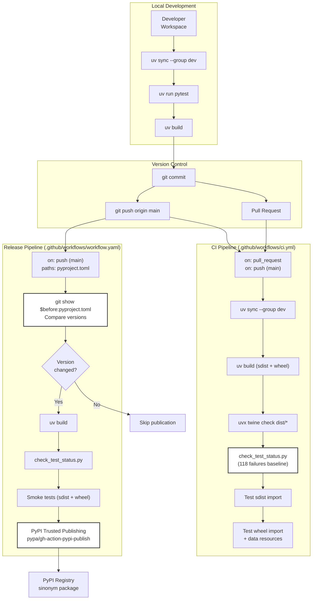
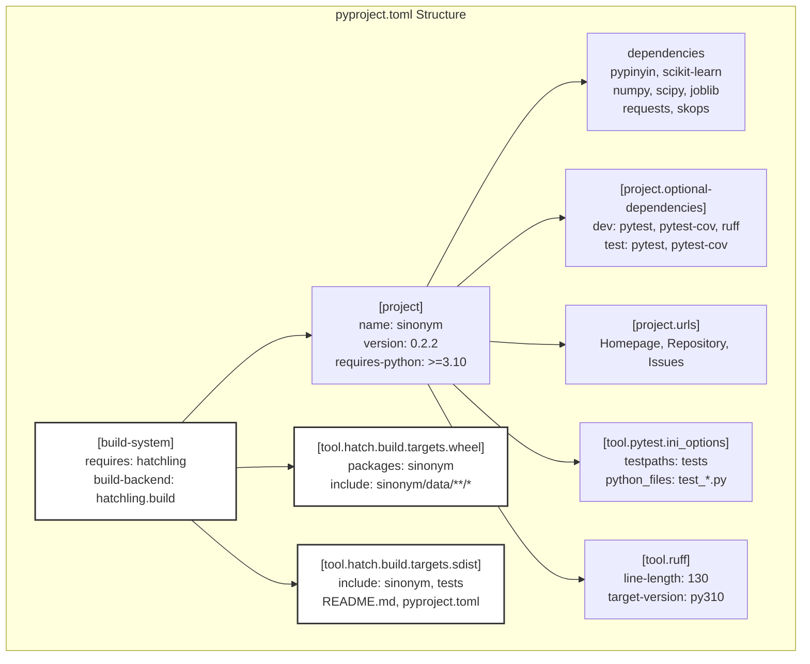
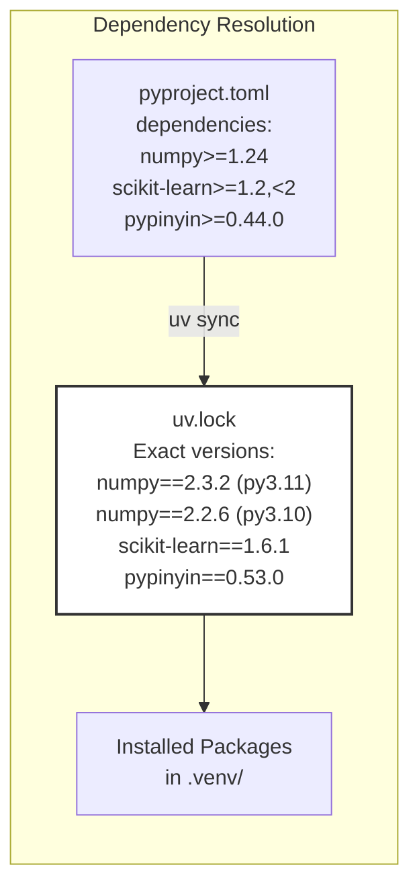
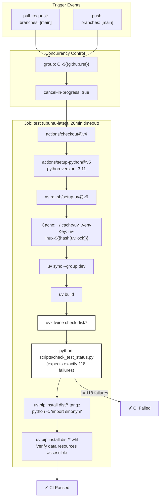
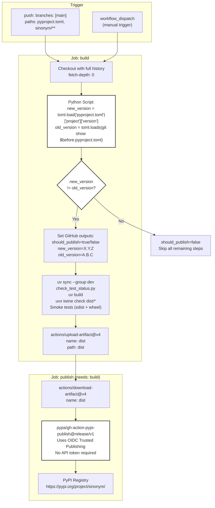
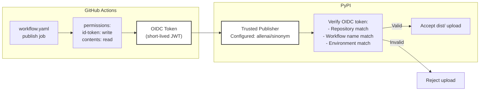
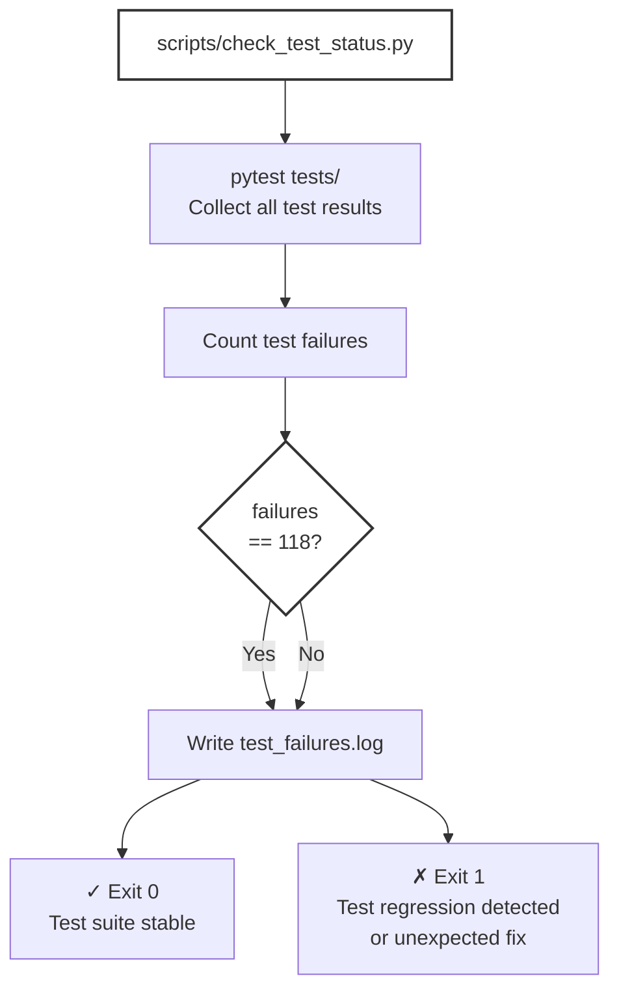
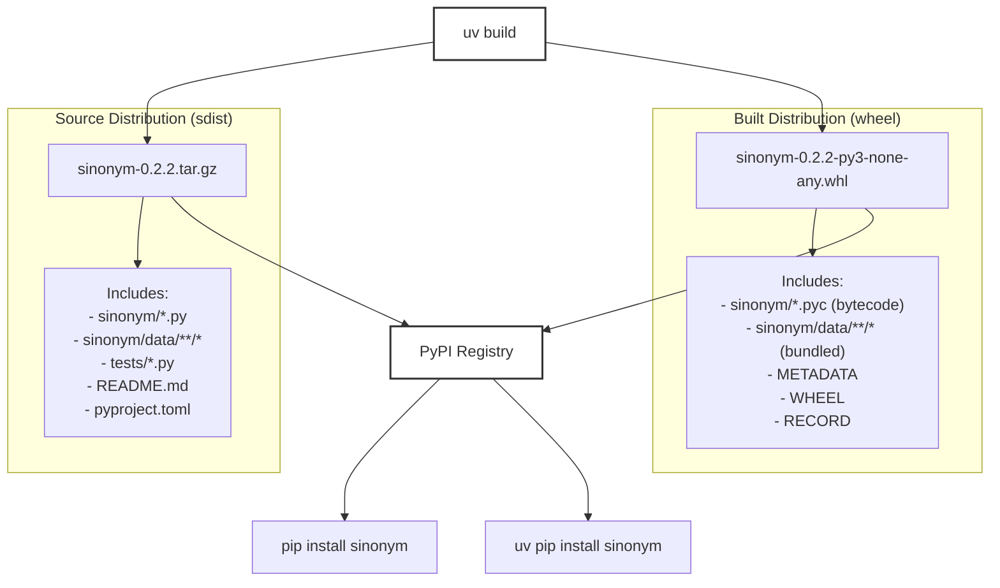

<!-- source: DeepWiki mcp.deepwiki.com · repo allenai/sinonym · page 6 Development and Deployment · fetched 2026-10-26 -->

# Development and Deployment

<details>
<summary>Relevant source files</summary>

The following files were used as context for generating this wiki page:

- [.github/workflows/ci.yml](.github/workflows/ci.yml)
- [.github/workflows/workflow.yaml](.github/workflows/workflow.yaml)
- [pyproject.toml](pyproject.toml)
- [uv.lock](uv.lock)

</details>


This page documents the development workflow, build tooling, dependency management, and automated deployment pipeline for sinonym. It covers the local development setup, continuous integration tests, and the release process from version bump to PyPI publication.

For details about the test suite structure and baseline management, see [Testing](#5). For specifics about build configuration and dependency specification, see [Build System and Dependencies](#6.1). For the CI/CD implementation details, see [CI/CD Pipeline](#6.2).

---

## Development Tooling Stack

Sinonym uses a modern Python toolchain optimized for reproducibility and fast iteration:

| Tool | Purpose | Configuration |
|------|---------|---------------|
| **uv** | Dependency resolution and virtual environment management | `uv.lock`, `pyproject.toml` |
| **hatchling** | Build backend (PEP 517) | `pyproject.toml[build-system]` |
| **pytest** | Test execution framework | `pyproject.toml[tool.pytest.ini_options]` |
| **ruff** | Linting and formatting | `pyproject.toml[tool.ruff]` |
| **GitHub Actions** | CI/CD automation | `.github/workflows/*.yml` |
| **PyPI Trusted Publishing** | Secure release deployment | Configured via OIDC |

**Sources:** [pyproject.toml:1-104](), [.github/workflows/ci.yml:1-75](), [.github/workflows/workflow.yaml:1-142]()

---

## Development Workflow: Local to Production



**Workflow Description:**

1. **Local Development**: Developers use `uv sync --group dev` to install dependencies (including test tools), run tests via `uv run pytest`, and build locally with `uv build`
2. **Version Control**: Changes are committed and pushed to GitHub, either directly to `main` or via pull request
3. **CI Pipeline**: Triggered on all PRs and main pushes. Validates build artifacts, checks test baseline (exactly 118 expected failures), and smoke-tests package imports
4. **Release Pipeline**: Triggered only on `main` pushes that modify `pyproject.toml`. Uses git history to detect version changes in `pyproject.toml[project.version]`. If version changed, runs full test suite and publishes to PyPI via Trusted Publishing (no API keys required)

**Sources:** [.github/workflows/ci.yml:1-75](), [.github/workflows/workflow.yaml:1-142](), [pyproject.toml:5-35]()

---

## Build Configuration Structure

### Package Metadata and Build System

The `pyproject.toml` file defines all build and packaging configuration:



**Key Configuration Elements:**

| Section | Lines | Purpose |
|---------|-------|---------|
| `[build-system]` | [pyproject.toml:1-3]() | Specifies hatchling as the PEP 517 build backend |
| `[project]` | [pyproject.toml:5-26]() | Package metadata: name, version, description, Python requirement, classifiers, keywords |
| `dependencies` | [pyproject.toml:27-35]() | Runtime dependencies with version constraints (e.g., `scikit-learn>=1.2,<2`) |
| `[project.optional-dependencies]` | [pyproject.toml:37-46]() | Dev tools (`pytest`, `ruff`) and test-only dependencies |
| `[tool.hatch.build.targets.wheel]` | [pyproject.toml:53-57]() | **Critical**: Includes `sinonym/data/**/*` to bundle ML models and linguistic databases |
| `[tool.hatch.build.targets.sdist]` | [pyproject.toml:59-65]() | Source distribution includes tests and documentation |
| `[tool.pytest.ini_options]` | [pyproject.toml:67-71]() | Test discovery configuration |
| `[tool.ruff]` | [pyproject.toml:73-82]() | Linter rules (130 char line length, allows assertions and print for tests) |

**Sources:** [pyproject.toml:1-104]()

---

## Dependency Management with uv

### Lock File and Version Pinning

The `uv.lock` file (14.86 KB) pins all transitive dependencies to exact versions, ensuring reproducible builds across environments:



**Resolution Markers**: `uv.lock` uses resolution markers to handle Python version-specific dependencies:

- `python_full_version >= '3.11'` → numpy 2.3.2
- `python_full_version < '3.11'` → numpy 2.2.6

This ensures compatibility across Python 3.10, 3.11, and 3.12 (as specified in `classifiers`).

**Key Locked Dependencies:**

| Package | Version | Purpose |
|---------|---------|---------|
| `numpy` | 2.3.2 / 2.2.6 | Numerical computing for ML models |
| `pypinyin` | (latest) | Han character to Pinyin conversion |
| `scikit-learn` | 1.x | ML models for Japanese detection |
| `scipy` | ≥1.10 | Scientific computing utilities |
| `joblib` | ≥1.3 | Model serialization (`.joblib` files) |
| `skops` | ≥0.9 | Secure model loading (`.skops` files) |
| `pytest` | ≥8.4.1 | Test execution (dev group) |
| `ruff` | ≥0.12.5 | Linting (dev group) |

**Cache Strategy**: CI workflows cache the uv environment to speed up builds:

```yaml
# .github/workflows/ci.yml:30-38
- name: Cache uv
  uses: actions/cache@v4
  with:
    path: |
      ~/.cache/uv
      .venv
    key: uv-${{ runner.os }}-${{ hashFiles('uv.lock', 'pyproject.toml') }}
```

**Sources:** [uv.lock:1-1000](), [pyproject.toml:27-35](), [.github/workflows/ci.yml:30-38]()

---

## CI Pipeline: Continuous Validation

### Trigger Conditions and Concurrency Control



**Pipeline Stages:**

1. **Setup** ([.github/workflows/ci.yml:22-41]()):
   - Checks out code with `actions/checkout@v4`
   - Installs Python 3.11 via `actions/setup-python@v5`
   - Installs uv via `astral-sh/setup-uv@v6`
   - Restores cached dependencies if available

2. **Dependency Installation** ([.github/workflows/ci.yml:40-41]()):
   - Runs `uv sync --group dev` to install runtime + dev dependencies
   - Creates `.venv/` with pinned versions from `uv.lock`

3. **Build Validation** ([.github/workflows/ci.yml:43-47]()):
   - Executes `uv build` to create source distribution (`.tar.gz`) and wheel (`.whl`)
   - Validates package metadata with `uvx twine check dist/*` (checks README rendering, metadata completeness)

4. **Test Baseline Check** ([.github/workflows/ci.yml:49-50]()):
   - Runs `scripts/check_test_status.py` which executes the full pytest suite
   - **Enforces exactly 118 expected failures** (regression detection mechanism)
   - Logs all failures to `test_failures.log` for debugging

5. **Smoke Tests** ([.github/workflows/ci.yml:52-74]()):
   - **SDist test**: Installs from `.tar.gz`, imports `sinonym` in `/tmp` (clean environment)
   - **Wheel test**: Installs from `.whl`, verifies:
     - `import sinonym` succeeds
     - `import pypinyin` succeeds (transitive dependency)
     - `sinonym.data` resources are accessible via `importlib.resources`
     - Prints first 8 data files to verify bundling

**Concurrency Control** ([.github/workflows/ci.yml:10-12]()):
- Groups runs by `${{ github.workflow }}-${{ github.ref }}` (e.g., `CI-refs/pull/123`)
- Cancels older runs when new commits pushed to the same PR/branch
- Saves CI minutes by avoiding redundant runs

**Sources:** [.github/workflows/ci.yml:1-75]()

---

## Release Pipeline: Automated Publishing

### Version Detection and Conditional Publishing



**Version Detection Logic** ([.github/workflows/workflow.yaml:48-74]()):

The release pipeline uses git history to detect version changes:

```python
# Simplified from workflow.yaml:54-74
import tomllib, subprocess

# Read current version
with open("pyproject.toml", "rb") as f:
    new_version = tomllib.load(f)["project"]["version"]

# Read version from previous commit
before_sha = github.event.before
blob = subprocess.check_output(["git", "show", f"{before_sha}:pyproject.toml"])
old_version = tomllib.loads(blob.decode())["project"]["version"]

# Publish only if version changed
should_publish = (new_version != old_version)
```

This approach:
- Avoids publishing duplicate versions
- Enables atomic deploys (version bump = automatic release)
- Prevents accidental publishes when only code changes

**Build Job Outputs** ([.github/workflows/workflow.yaml:23-26]()):

```yaml
outputs:
  should_publish: ${{ steps.decide.outputs.should_publish }}
  new_version: ${{ steps.decide.outputs.new_version }}
  old_version: ${{ steps.decide.outputs.old_version }}
```

These outputs control whether the `publish` job runs via `if: needs.build.outputs.should_publish == 'true'`.

**Sources:** [.github/workflows/workflow.yaml:1-142]()

---

## PyPI Trusted Publishing: Secure Deployment

### OIDC-Based Authentication

Sinonym uses **PyPI Trusted Publishing** to eliminate API tokens:



**Configuration** ([.github/workflows/workflow.yaml:16-18]()):

```yaml
permissions:
  contents: read
  id-token: write  # Required for OIDC token generation
```

**Publishing Action** ([.github/workflows/workflow.yaml:138-141]()):

```yaml
- name: Publish to PyPI (Trusted Publishing)
  uses: pypa/gh-action-pypi-publish@release/v1
  with:
    print-hash: true  # Print SHA256 hash of uploaded files
```

**Security Benefits:**

| Traditional API Tokens | Trusted Publishing |
|------------------------|-------------------|
| Long-lived credentials | Short-lived OIDC tokens (expires in minutes) |
| Stored as GitHub secrets | No secrets required |
| Risk of token leakage | Tokens scoped to specific workflow |
| Manual rotation required | Automatic rotation every run |

**Prerequisites** (configured on PyPI project settings):
1. Navigate to https://pypi.org/manage/project/sinonym/settings/publishing/
2. Add trusted publisher:
   - Owner: `allenai`
   - Repository: `sinonym`
   - Workflow: `workflow.yaml`
   - Environment: (none)

**Sources:** [.github/workflows/workflow.yaml:16-18](), [.github/workflows/workflow.yaml:138-141]()

---

## Smoke Tests: Package Validation

### Import and Resource Verification

Both CI and release pipelines execute identical smoke tests to validate built packages:

**SDist Smoke Test** ([.github/workflows/ci.yml:52-56]()):

```bash
# Install from source distribution
uv pip install --system dist/*.tar.gz --force-reinstall

# Test import from clean environment (avoids local .venv)
cd /tmp
python -c "import sinonym; print('✓ sdist import OK:', sinonym.__file__)"
```

**Wheel Smoke Test** ([.github/workflows/ci.yml:58-74]()):

```python
# Install from wheel
# uv pip install --system dist/*.whl --force-reinstall
# cd /tmp

import sys, sinonym, pypinyin

print("✓ Wheel import OK")
print("PY:", sys.executable)
print("sinonym from:", sinonym.__file__)
print("pypinyin OK:", pypinyin.__version__)

# Verify bundled data resources
import importlib.resources as ir
files = list((ir.files("sinonym.data")).iterdir())
print("✓ data files present:", [f.name for f in files][:8], "…")
```

**What Each Test Validates:**

| Test | Validates |
|------|-----------|
| SDist import | Package can be installed from source tarball |
| Wheel import | Package can be installed from pre-built wheel |
| `sinonym.__file__` | Module is discoverable by Python |
| `import pypinyin` | Transitive dependencies installed correctly |
| `importlib.resources` check | `sinonym/data/**/*` bundled in wheel (ML models, databases) |
| File count verification | Data directory contains expected resources |

**Why Both Formats:**
- **SDist** tests that `MANIFEST.in` and `pyproject.toml[tool.hatch.build.targets.sdist]` correctly specify source files
- **Wheel** tests that `pyproject.toml[tool.hatch.build.targets.wheel]` correctly bundles data files (critical for ML models)

**Sources:** [.github/workflows/ci.yml:52-74](), [.github/workflows/workflow.yaml:92-117]()

---

## Test Baseline Enforcement

### Regression Detection via Expected Failures

The CI and release pipelines use a strict baseline check to prevent test regressions:



**Baseline Philosophy:**

Sinonym uses a **known failures baseline** approach:
- 118 test failures are **expected** (edge cases, known limitations)
- Any change to this number (increase OR decrease) fails CI
- Forces developers to:
  - Investigate new failures immediately
  - Update baseline when intentionally fixing bugs
  - Document why baseline changed

**CI Integration** ([.github/workflows/ci.yml:49-50]()):

```yaml
- name: Check test status against baseline (118 failures expected)
  run: uv run python scripts/check_test_status.py
```

The script outputs:
- `test_failures.log`: List of all failing test names for debugging
- Exit code 0 if exactly 118 failures, exit code 1 otherwise

For detailed test suite structure, see [Testing](#5). For baseline management implementation, see [Test Infrastructure and Baseline Management](#5.1).

**Sources:** [.github/workflows/ci.yml:49-50](), [.github/workflows/workflow.yaml:80-82]()

---

## Package Build Artifacts

### Distribution Formats

Running `uv build` generates two distribution formats:



**SDist (Source Distribution)** - `sinonym-0.2.2.tar.gz`:
- Configured via `[tool.hatch.build.targets.sdist]` ([pyproject.toml:59-65]())
- Contains uncompiled source code
- Includes test suite (`tests/`)
- Requires build step during installation
- Used when:
  - Pre-built wheel unavailable for platform
  - User needs to inspect source
  - Building from git repository

**Wheel (Built Distribution)** - `sinonym-0.2.2-py3-none-any.whl`:
- Configured via `[tool.hatch.build.targets.wheel]` ([pyproject.toml:53-57]())
- Contains pre-compiled bytecode (`.pyc` files)
- **Critical**: Bundles `sinonym/data/**/*` via `include = ["sinonym/data/**/*"]`
- Platform-independent (`py3-none-any` tag):
  - `py3`: Python 3 compatible
  - `none`: No ABI requirements
  - `any`: Platform-independent
- Installation is fast (no build required)
- Preferred by `pip` when available

**Data Bundling** ([pyproject.toml:53-57]()):

```toml
[tool.hatch.build.targets.wheel]
packages = ["sinonym"]
include = [
    "sinonym/data/**/*"
]
```

This ensures ML models (`.skops`, `.joblib`) and linguistic databases are included in the wheel. Without this, installed package would fail at runtime when trying to load resources.

**Sources:** [pyproject.toml:53-65]()

---

## Version Management Strategy

### Semantic Versioning and Release Triggers

Sinonym follows **semantic versioning** (SemVer) with automated release on version bump:

| Version Component | Meaning | Example Change |
|-------------------|---------|----------------|
| **Major** (X.0.0) | Breaking API changes | Removing `normalize_name()` |
| **Minor** (0.X.0) | New features, backward-compatible | Adding batch processing |
| **Patch** (0.0.X) | Bug fixes, no API changes | Fixing surname detection |

**Current Version**: `0.2.2` ([pyproject.toml:7]())
- Major version `0` indicates pre-1.0 API (not yet stable)
- Minor version `2` reflects batch processing features
- Patch version `2` includes bug fixes since `0.2.0`

**Release Process:**

1. Developer updates `version = "0.2.3"` in [pyproject.toml:7]()
2. Commits and pushes to `main`
3. Release workflow detects version change ([.github/workflows/workflow.yaml:48-74]())
4. Runs full test suite and smoke tests
5. Publishes to PyPI automatically

**No Manual Releases**: 
- No git tags required
- No manual `twine upload`
- Version in `pyproject.toml` is single source of truth

**Sources:** [pyproject.toml:7](), [.github/workflows/workflow.yaml:48-74]()

---

