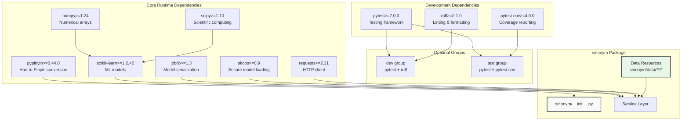
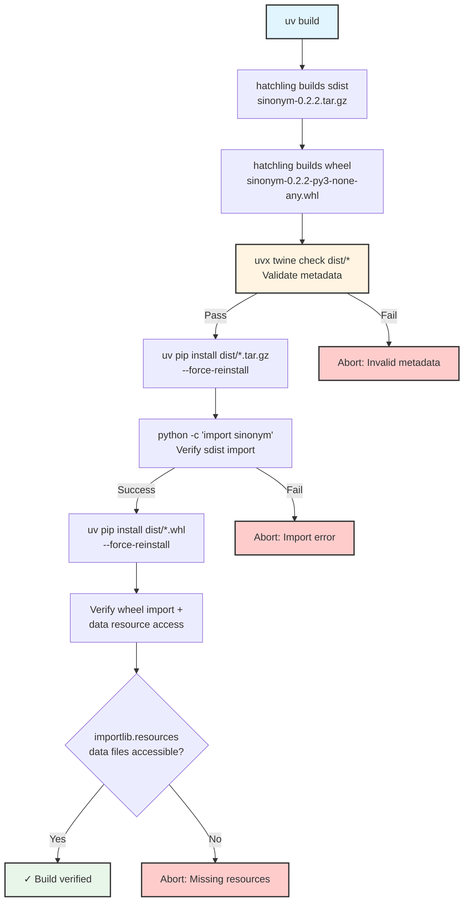
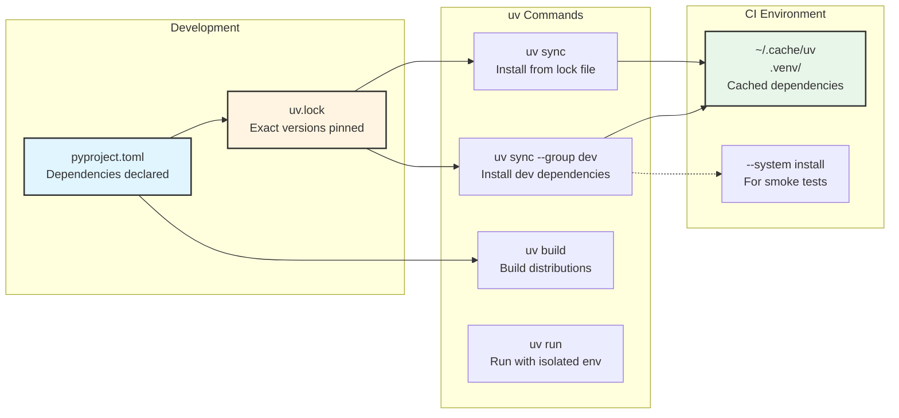

<!-- source: DeepWiki mcp.deepwiki.com · repo allenai/sinonym · page 6.1 Build System and Dependencies · fetched 2026-10-26 -->

# Build System and Dependencies

<details>
<summary>Relevant source files</summary>

The following files were used as context for generating this wiki page:

- [.github/workflows/ci.yml](.github/workflows/ci.yml)
- [.github/workflows/workflow.yaml](.github/workflows/workflow.yaml)
- [pyproject.toml](pyproject.toml)
- [uv.lock](uv.lock)

</details>


This page documents the build system configuration, dependency management strategy, and package distribution setup for sinonym. It covers the pyproject.toml configuration, uv-based dependency management, resource bundling, and package build processes. For CI/CD pipeline configuration and release automation, see [CI/CD Pipeline](#6.2).

## Build System Overview

Sinonym uses **hatchling** as its PEP 517 build backend, with **uv** as the dependency manager. The build system produces two distribution formats: source distributions (sdist) and binary wheels, both configured to bundle linguistic data resources required for offline operation.

**Build Backend Configuration**

```toml
[build-system]
requires = ["hatchling"]
build-backend = "hatchling.build"
```

The [pyproject.toml:1-3]() declaration specifies hatchling as the build backend. Hatchling is a modern, standards-compliant build system that supports customizable file inclusion patterns and metadata generation.

**Sources:** [pyproject.toml:1-3]()

### Package Metadata

| Field | Value |
|-------|-------|
| Package Name | `sinonym` |
| Current Version | `0.2.2` |
| Python Requirement | `>=3.10` |
| License | MIT |
| Classifier | Development Status: Alpha |

The package metadata [pyproject.toml:5-26]() defines the public interface and compatibility requirements. The version number [pyproject.toml:7]() serves as the canonical source for release detection in the CI/CD pipeline (see [CI/CD Pipeline](#6.2)).

**Sources:** [pyproject.toml:5-26]()

## Dependency Architecture



**Dependency Resolution Strategy**

The [pyproject.toml:27-35]() block defines pinned lower bounds with conservative upper bounds. The scikit-learn constraint `>=1.2,<2` [pyproject.toml:32]() prevents major version upgrades that could break ML model compatibility. NumPy and scipy versions are constrained to maintain numerical stability for ethnicity classification models.

**Sources:** [pyproject.toml:27-35](), [pyproject.toml:37-46]()

### Dependency Lock File

The [uv.lock]() file pins exact versions of all transitive dependencies, including platform-specific wheels. This ensures reproducible builds across development, CI, and production environments.

**Lock File Structure:**

| Section | Purpose |
|---------|---------|
| `[[package]]` blocks | Pinned package versions with source URLs |
| `resolution-markers` | Python version-specific resolutions |
| Wheel URLs | Platform-specific binary distributions |
| `sdist` URLs | Source distribution fallbacks |

Key locked dependencies from [uv.lock:209-280]():

```toml
[[package]]
name = "numpy"
version = "2.2.6"
# Platform-specific wheels with SHA256 hashes
wheels = [
    { url = "...-cp310-cp310-macosx_10_9_x86_64.whl", hash = "sha256:..." },
    { url = "...-cp311-cp311-manylinux_2_17_x86_64.whl", hash = "sha256:..." },
    ...
]
```

**Sources:** [uv.lock:1-280]()

## Package Structure and Resource Bundling

```mermaid
graph TB
    subgraph "Source Distribution (sdist)"
        sdist_root["sinonym-0.2.2.tar.gz"]
        sdist_pkg["sinonym/<br/>Source code"]
        sdist_tests["tests/<br/>Test suite"]
        sdist_data["sinonym/data/**/*<br/>Linguistic resources"]
        sdist_meta["README.md<br/>pyproject.toml"]
    end
    
    subgraph "Binary Wheel (wheel)"
        wheel_root["sinonym-0.2.2-py3-none-any.whl"]
        wheel_pkg["sinonym/<br/>Python modules"]
        wheel_data["sinonym/data/**/*<br/>ML models + databases"]
        wheel_meta["METADATA<br/>entry_points.txt"]
    end
    
    subgraph "Critical Data Resources"
        surnames["surname_frequencies.json"]
        given["given_name_probabilities.json"]
        compounds["compound_surname_variants.json"]
        ml_jp["japanese_classifier.skops"]
        ml_common["common_names.joblib"]
        ethnicity["ethnicity_markers.json"]
    end
    
    sdist_root --> sdist_pkg
    sdist_root --> sdist_tests
    sdist_root --> sdist_data
    sdist_root --> sdist_meta
    
    wheel_root --> wheel_pkg
    wheel_root --> wheel_data
    wheel_root --> wheel_meta
    
    sdist_data --> surnames
    sdist_data --> given
    sdist_data --> compounds
    sdist_data --> ml_jp
    sdist_data --> ml_common
    sdist_data --> ethnicity
    
    wheel_data --> surnames
    wheel_data --> given
    wheel_data --> compounds
    wheel_data --> ml_jp
    wheel_data --> ml_common
    wheel_data --> ethnicity
    
    style sdist_data fill:#e1f5ff,stroke:#333,stroke-width:2px
    style wheel_data fill:#e1f5ff,stroke:#333,stroke-width:2px
    style ml_jp fill:#fff4e1,stroke:#333,stroke-width:2px
    style ml_common fill:#fff4e1,stroke:#333,stroke-width:2px
```



**Wheel Configuration**

The [pyproject.toml:53-57]() section defines wheel packaging:

```toml
[tool.hatch.build.targets.wheel]
packages = ["sinonym"]
include = [
    "sinonym/data/**/*"
]
```

This configuration ensures that:
- The `sinonym/` package directory is included
- All files under `sinonym/data/` are bundled (ML models, frequency databases, ethnicity markers)
- Tests are excluded from wheels (included only in sdist)

**Source Distribution Configuration**

The [pyproject.toml:59-65]() section defines sdist packaging:

```toml
[tool.hatch.build.targets.sdist]
include = [
    "sinonym",
    "tests",
    "README.md",
    "pyproject.toml",
]
```

Source distributions include the complete test suite for downstream development and verification.

**Sources:** [pyproject.toml:53-65]()

## Tool Configuration

### Testing Framework (pytest)

```toml
[tool.pytest.ini_options]
testpaths = ["tests"]
python_files = ["test_*.py"]
python_classes = ["Test*"]
python_functions = ["test_*"]
```

The [pyproject.toml:67-71]() configuration defines test discovery patterns. The `testpaths` directive limits discovery to the `tests/` directory, excluding inline test code in source files.

**Sources:** [pyproject.toml:67-71]()

### Linting and Formatting (ruff)

| Configuration | Value |
|---------------|-------|
| Line Length | 130 characters |
| Target Version | Python 3.10 |
| Selected Rules | 70+ rule categories (E, F, W, C90, I, N, UP, ...) |
| Global Ignores | `S101` (assert), `T201` (print) |

The [pyproject.toml:73-83]() configuration enables comprehensive linting while allowing assert statements (required for testing) and print statements (used for debugging).

**Per-File Overrides:**

```toml
[tool.ruff.lint.per-file-ignores]
"tests/*" = ["S101", "T201", "ARG", "FBT"]
```

Test files [pyproject.toml:82]() disable additional rules for function arguments and boolean traps, which are common in test fixtures.

**Sources:** [pyproject.toml:73-83]()

### Type Checking (mypy)

The [pyproject.toml:84-98]() configuration enforces strict type checking:

```toml
[tool.mypy]
python_version = "3.10"
disallow_untyped_defs = true
disallow_incomplete_defs = true
check_untyped_defs = true
warn_return_any = true
strict_equality = true
```

These settings require type annotations on all function definitions and enable strict equality checks for type safety.

**Sources:** [pyproject.toml:84-98]()

## Build and Verification Workflow



**Build Command Execution**

The [.github/workflows/ci.yml:43-44]() workflow executes:

```bash
uv build
```

This command invokes hatchling to produce both distribution formats in the `dist/` directory.

**Metadata Validation**

The [.github/workflows/ci.yml:46-47]() step verifies package metadata:

```bash
uvx twine check dist/*
```

Twine validates:
- README rendering (Markdown → PyPI HTML)
- Metadata completeness (author, license, classifiers)
- Version string format
- File integrity (checksums)

**Smoke Tests**

The CI pipeline [.github/workflows/ci.yml:52-74]() performs two import tests:

**1. Source Distribution Test:**

```python
# Install sdist
uv pip install --system dist/*.tar.gz --force-reinstall
cd /tmp
python -c "import sinonym; print('✓ sdist import OK:', sinonym.__file__)"
```

**2. Wheel Resource Test:**

```python
# Install wheel
uv pip install --system dist/*.whl --force-reinstall
cd /tmp
import importlib.resources as ir
files = list((ir.files("sinonym.data")).iterdir())
print("✓ data files:", [f.name for f in files][:8], "…")
```

This verifies that ML models and linguistic databases are correctly bundled and accessible via `importlib.resources`.

**Sources:** [.github/workflows/ci.yml:43-74]()

## Dependency Management with uv



**Dependency Installation**

The [.github/workflows/ci.yml:40-41]() workflow installs dependencies:

```bash
uv sync --group dev
```

This command:
1. Reads `uv.lock` for exact versions
2. Installs runtime dependencies from [pyproject.toml:27-35]()
3. Installs dev dependencies from [pyproject.toml:100-103]()
4. Creates/updates `.venv/` virtual environment

**Caching Strategy**

The [.github/workflows/ci.yml:30-38]() configuration caches:

```yaml
path: |
  ~/.cache/uv
  .venv
key: uv-${{ runner.os }}-${{ hashFiles('uv.lock', 'pyproject.toml') }}
```

Cache invalidation occurs when either `uv.lock` or `pyproject.toml` changes, ensuring fresh installs after dependency updates.

**Sources:** [.github/workflows/ci.yml:30-41](), [pyproject.toml:99-103]()

## Version Management and Release Gating

The version number in [pyproject.toml:7]() serves as the canonical trigger for PyPI releases. The release workflow [.github/workflows/workflow.yaml:48-74]() implements version change detection:

```python
# Detect version change
with open("pyproject.toml", "rb") as f:
    new_version = tomllib.load(f)["project"]["version"]

# Compare to previous commit
blob = subprocess.check_output(["git", "show", f"{before}:pyproject.toml"])
old_version = tomllib.loads(blob.decode())["project"]["version"]

should_publish = (new_version and new_version != old_version)
```

**Version Change Decision Logic:**

| Condition | Action |
|-----------|--------|
| `new_version != old_version` | Build, test, and publish to PyPI |
| `new_version == old_version` | Skip publication |
| Version bump + test failure | Abort before PyPI publication |

This ensures that only successful builds with version bumps are published, preventing accidental re-releases or broken packages.

**Sources:** [.github/workflows/workflow.yaml:48-74](), [pyproject.toml:7]()

## Platform Support Matrix

| Python Version | Supported | Tested in CI |
|----------------|-----------|--------------|
| 3.10 | ✓ | ✓ |
| 3.11 | ✓ | ✓ (primary) |
| 3.12 | ✓ | ✓ |
| < 3.10 | ✗ | ✗ |

The [pyproject.toml:10]() requirement `requires-python = ">=3.10"` prevents installation on older Python versions. The CI pipeline [.github/workflows/ci.yml:26]() tests against Python 3.11 as the reference implementation.

**Wheel Compatibility:**

The pure-Python wheel `sinonym-0.2.2-py3-none-any.whl` is platform-independent, supporting:
- All operating systems (Linux, macOS, Windows)
- All Python implementations (CPython, PyPy)
- All CPU architectures

Platform-specific binary dependencies (NumPy, scikit-learn) are resolved at install time via wheel selection in [uv.lock]().

**Sources:** [pyproject.toml:10](), [pyproject.toml:19-22](), [.github/workflows/ci.yml:26]()

## Build Artifacts

**Output Directory Structure:**

```
dist/
├── sinonym-0.2.2.tar.gz          # Source distribution (820 KB typical)
└── sinonym-0.2.2-py3-none-any.whl # Binary wheel (615 KB typical)
```

**Artifact Contents Comparison:**

| Component | sdist | wheel |
|-----------|-------|-------|
| Python source code | ✓ | ✓ |
| sinonym/data/**/* | ✓ | ✓ |
| tests/ directory | ✓ | ✗ |
| README.md | ✓ | ✗ |
| pyproject.toml | ✓ | ✗ |
| METADATA file | ✗ | ✓ |

The release workflow [.github/workflows/workflow.yaml:119-123]() uploads these artifacts for PyPI publication.

**Sources:** [.github/workflows/workflow.yaml:119-123](), [pyproject.toml:53-65]()

---

