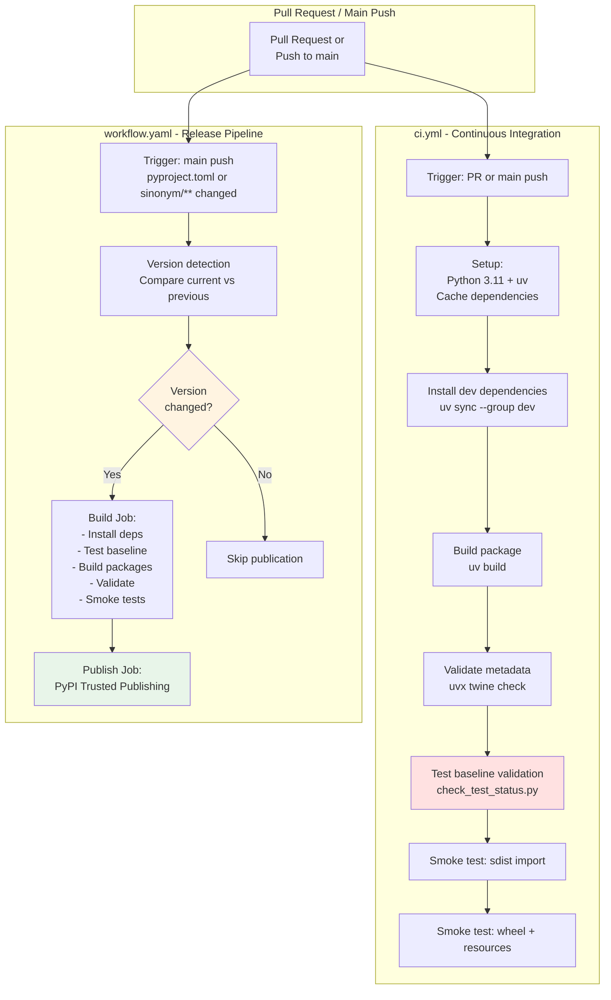
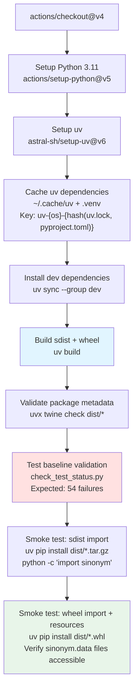
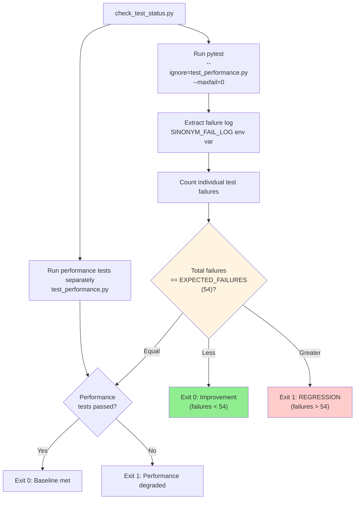
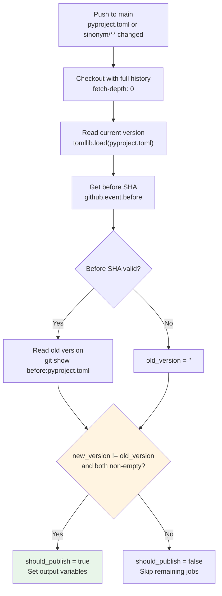
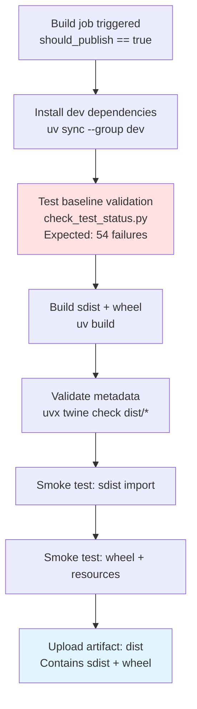
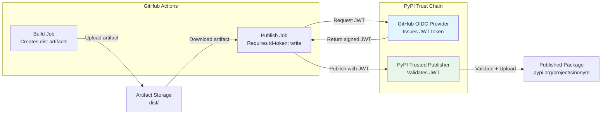
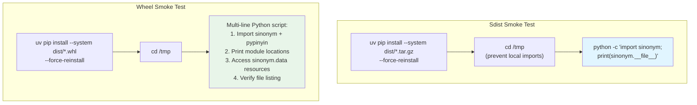

<!-- source: DeepWiki mcp.deepwiki.com · repo allenai/sinonym · page 6.2 CI/CD Pipeline · fetched 2026-10-26 -->

# CI/CD Pipeline

<details>
<summary>Relevant source files</summary>

The following files were used as context for generating this wiki page:

- [.github/workflows/ci.yml](.github/workflows/ci.yml)
- [.github/workflows/workflow.yaml](.github/workflows/workflow.yaml)
- [pyproject.toml](pyproject.toml)
- [scripts/check_test_status.py](scripts/check_test_status.py)
- [tests/conftest.py](tests/conftest.py)
- [uv.lock](uv.lock)

</details>


## Purpose and Scope

This page documents the continuous integration and deployment pipeline for sinonym. It covers the automated workflows that validate code quality, run tests, build packages, and publish releases to PyPI. For information about the test suite structure and test categories, see [Testing](#5). For build system configuration and dependency management, see [Build System and Dependencies](#6.1).

---

## Workflow Architecture

The CI/CD pipeline consists of two GitHub Actions workflows that serve distinct purposes: continuous validation (`ci.yml`) and automated release management (`workflow.yaml`).

### High-Level Pipeline Flow



**Sources:** [.github/workflows/ci.yml:1-75](), [.github/workflows/workflow.yaml:1-142]()

---

## Continuous Integration Workflow (ci.yml)

The CI workflow runs on every pull request and main branch push, providing rapid feedback on code quality and test status.

### Trigger Configuration

```yaml
on:
  pull_request:
    branches: [main]
  push:
    branches: [main]

concurrency:
  group: ${{ github.workflow }}-${{ github.ref }}
  cancel-in-progress: true
```

The `concurrency` configuration cancels older in-flight runs for the same PR/branch to conserve CI minutes.

**Sources:** [.github/workflows/ci.yml:3-12]()

### CI Job Steps



**Sources:** [.github/workflows/ci.yml:21-75]()

### Dependency Caching Strategy

The workflow uses GitHub Actions cache to avoid re-downloading dependencies on every run:

| Cache Path | Cache Key | Purpose |
|------------|-----------|---------|
| `~/.cache/uv` | `uv-{os}-{hash(uv.lock, pyproject.toml)}` | uv's package cache |
| `.venv` | Same key | Virtual environment |

The cache is invalidated when `uv.lock` or `pyproject.toml` changes, ensuring fresh dependencies after updates.

**Sources:** [.github/workflows/ci.yml:30-38]()

### Package Validation Steps

The CI workflow performs three levels of package validation:

1. **Metadata Validation** ([.github/workflows/ci.yml:46-47]()): Uses `twine check` to verify that package metadata conforms to PyPI standards (README rendering, classifiers, etc.)

2. **Import Test (sdist)** ([.github/workflows/ci.yml:52-56]()): Installs the source distribution and verifies that the package imports correctly

3. **Import Test + Resource Access (wheel)** ([.github/workflows/ci.yml:58-74]()): Installs the wheel and verifies:
   - Package imports successfully
   - Bundled data files (`sinonym/data/**/*`) are accessible via `importlib.resources`
   - External dependency (`pypinyin`) resolves correctly

**Sources:** [.github/workflows/ci.yml:43-75]()

---

## Test Baseline Validation System

The CI pipeline enforces a test baseline using `check_test_status.py`, which tracks expected test failures to prevent regressions while maintaining visibility into known issues.

### Baseline Enforcement Mechanism



**Sources:** [scripts/check_test_status.py:1-296]()

### Baseline Tracking

The baseline system tracks exactly **54 expected failures** ([scripts/check_test_status.py:16]()):

```python
EXPECTED_FAILURES = 54
```

This baseline represents known edge cases and ambiguous name formats that are documented but not yet resolved. The system:

1. **Prevents regressions**: Fails CI if failure count exceeds 54
2. **Celebrates improvements**: Passes CI if failure count drops below 54
3. **Maintains stability**: Passes CI if failure count exactly equals 54

**Sources:** [scripts/check_test_status.py:16-291]()

### Failure Logging and Analysis

The test baseline system uses a detailed failure log (`SINONYM_FAIL_LOG`) to track individual test case failures:

| Log Field | Description |
|-----------|-------------|
| `label` | Test case identifier |
| `name_repr` | Input name (Python repr) |
| `expected_success` | Expected parsing success (bool) |
| `expected_output` | Expected formatted name |
| `actual_success` | Actual parsing success (bool) |
| `actual_output` | Actual formatted name |

The log enables:
- Aggregation by test label to identify problem categories
- Detailed failure inspection for debugging
- Comparison of expected vs. actual outputs

**Sources:** [scripts/check_test_status.py:156-212]()

### Performance Test Isolation

Performance tests (`test_performance.py`) run separately from the main test suite to avoid interference:

```python
# In check_test_status.py
result = subprocess.run([
    "uv", "run", "pytest", "-q", "-s",
    "tests/",
    "--ignore=tests/test_performance.py",  # Excluded from baseline
    ...
])
```

Performance tests must pass independently, enforcing sub-millisecond latency and high throughput requirements (see [Performance Testing](#5.4)).

**Sources:** [scripts/check_test_status.py:46](), [scripts/check_test_status.py:120-144]()

---

## Release Workflow (workflow.yaml)

The release workflow automates package publication to PyPI when version numbers change in `pyproject.toml`.

### Version Detection Algorithm



**Sources:** [.github/workflows/workflow.yaml:48-74]()

### Version Detection Implementation

The version detection uses Python's `tomllib` to parse `pyproject.toml` and Git to retrieve the previous version:

```python
# Embedded in workflow.yaml
with open("pyproject.toml","rb") as f:
    new_version = tomllib.load(f)["project"]["version"]

# Retrieve old version via Git
blob = subprocess.check_output(["git","show",f"{before}:pyproject.toml"])
old_version = tomllib.loads(blob.decode())["project"]["version"]

should = str(bool(new_version and new_version != old_version)).lower()
```

This approach avoids external dependencies and leverages Git history to detect meaningful version changes.

**Sources:** [.github/workflows/workflow.yaml:54-74]()

### Build Job with Quality Gates

When version changes are detected, the build job executes the same validation steps as the CI workflow:



**Sources:** [.github/workflows/workflow.yaml:76-123]()

---

## PyPI Trusted Publishing

The release workflow uses PyPI's Trusted Publishing feature, which eliminates the need for API tokens by leveraging GitHub's OIDC identity provider.

### Trusted Publishing Configuration



### Permissions Configuration

The workflow declares explicit permissions to enable Trusted Publishing:

| Permission | Scope | Purpose |
|------------|-------|---------|
| `contents: read` | Both jobs | Checkout code |
| `id-token: write` | Publish job only | Request OIDC JWT token |

**Sources:** [.github/workflows/workflow.yaml:16-18](), [.github/workflows/workflow.yaml:129-131]()

### Publishing Action

The publish job uses the official PyPI action with minimal configuration:

```yaml
- name: Publish to PyPI (Trusted Publishing)
  uses: pypa/gh-action-pypi-publish@release/v1
  with:
    print-hash: true
```

The action automatically:
1. Discovers the `dist/` directory
2. Requests a JWT token from GitHub OIDC
3. Exchanges the JWT for PyPI upload credentials
4. Uploads the package with hash verification

**Sources:** [.github/workflows/workflow.yaml:138-141]()

---

## Smoke Test Implementation

Both workflows include smoke tests to validate package installability and resource bundling. These tests catch common packaging errors before release.

### Smoke Test Flow



**Sources:** [.github/workflows/ci.yml:52-74](), [.github/workflows/workflow.yaml:92-117]()

### Resource Access Validation

The wheel smoke test specifically validates that bundled data files are accessible:

```python
import importlib.resources as ir
files = list((ir.files("sinonym.data")).iterdir())
print("✓ data files present:", [f.name for f in files][:8], "…")
```

This ensures that:
- The `[tool.hatch.build.targets.wheel]` configuration in `pyproject.toml` correctly includes `sinonym/data/**/*`
- `importlib.resources` can locate the bundled files
- Runtime data access patterns work correctly

**Sources:** [.github/workflows/ci.yml:62-74](), [pyproject.toml:53-57]()

---

## Workflow Optimization

### Concurrency Control

Both workflows use concurrency groups to prevent duplicate runs:

```yaml
concurrency:
  group: ${{ github.workflow }}-${{ github.ref }}
  cancel-in-progress: true
```

This configuration:
- Groups runs by workflow name and Git ref (branch/PR)
- Cancels older runs when new commits arrive
- Conserves CI minutes for rapidly updated PRs

**Sources:** [.github/workflows/ci.yml:10-12](), [.github/workflows/workflow.yaml:12-14]()

### Conditional Job Execution

The release workflow uses job conditionals to skip unnecessary work:

| Condition | Job | Effect |
|-----------|-----|--------|
| `should_publish == 'true'` | Build steps | Only run when version changes |
| `needs.build.outputs.should_publish == 'true'` | Publish job | Only run if build job detected version change |

This prevents wasted CI time on commits that don't modify `pyproject.toml` or `sinonym/**`.

**Sources:** [.github/workflows/workflow.yaml:77-82](), [.github/workflows/workflow.yaml:126-127]()

### Timeout Configuration

The CI workflow sets a 20-minute timeout to prevent hung jobs from consuming resources:

```yaml
jobs:
  test:
    timeout-minutes: 20
```

This is conservative given typical run times of 2-5 minutes, providing buffer for CI infrastructure variance.

**Sources:** [.github/workflows/ci.yml:20]()

---

## Integration with Build System

The CI/CD pipeline integrates closely with the uv-based build system (see [Build System and Dependencies](#6.1)):

| Build Tool | Purpose | Usage in CI/CD |
|------------|---------|----------------|
| `uv sync` | Install dependencies | `uv sync --group dev` installs test dependencies |
| `uv build` | Build sdist + wheel | Creates `dist/*.tar.gz` and `dist/*.whl` |
| `uv pip install` | Install packages | Used in smoke tests with `--system` flag |
| `uv run` | Execute with dependencies | Runs `pytest` and `check_test_status.py` |
| `uvx` | Execute one-off tools | Runs `twine check` without permanent install |

**Sources:** [.github/workflows/ci.yml:41-50](), [.github/workflows/workflow.yaml:78-90]()

---

## Session-Scoped Test Fixtures

The test suite uses session-scoped fixtures to optimize CI performance by avoiding repeated detector initialization:

```python
@pytest.fixture(scope="session")
def detector():
    """
    Session-scoped ChineseNameDetector instance shared across all tests.
    
    This fixture creates a single detector instance that is reused for the entire
    test suite, eliminating the ~4-7 second initialization cost that would otherwise
    be repeated for each test file.
    """
    return ChineseNameDetector(weights=weights)
```

This optimization reduces total test time from ~30 minutes to ~2-3 minutes, making CI feedback loops practical.

**Sources:** [tests/conftest.py:19-45]()

---

## Summary

The sinonym CI/CD pipeline implements a multi-stage quality gate:

1. **Pull Request Validation**: Full test suite + baseline validation on every PR
2. **Version Detection**: Automated detection of version bumps in `pyproject.toml`
3. **Release Gating**: Build and test validation before PyPI publication
4. **Trusted Publishing**: Secure, token-free deployment via OIDC

This architecture ensures that only tested, versioned releases reach PyPI while maintaining rapid feedback loops for development.

**Sources:** [.github/workflows/ci.yml:1-75](), [.github/workflows/workflow.yaml:1-142](), [scripts/check_test_status.py:1-296]()