# Page: Overview

# Overview

<details>
<summary>Relevant source files</summary>

The following files were used as context for generating this wiki page:

- [README.md](README.md)
- [pyproject.toml](pyproject.toml)
- [scripts/profile_run.py](scripts/profile_run.py)
- [sinonym/detector.py](sinonym/detector.py)
- [uv.lock](uv.lock)

</details>


**Sinonym** is a Chinese name detection and normalization library that processes romanized Chinese names through a multi-phase pipeline of normalization, ethnicity classification, parsing, and formatting. The system converts diverse input formats (Pinyin, Wade-Giles, Cantonese, mixed scripts, all-Chinese characters) into standardized "Given-Name Surname" format while filtering out non-Chinese names (Western, Korean, Vietnamese, Japanese).

For detailed information on specific subsystems, see:
- Architecture and pipeline details: [Core Architecture](#2)
- Individual service components: [Service Components](#3)
- Testing methodology: [Testing](#5)
- Deployment and CI/CD: [Development and Deployment](#6)

## System Architecture

The codebase follows a layered service-oriented architecture with clean separation of concerns:

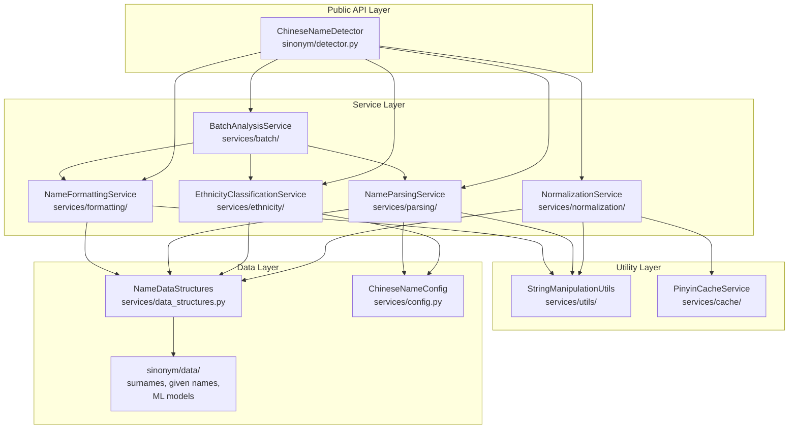

**Sources:** [sinonym/detector.py:1-670](), [pyproject.toml:1-104](), Diagram 1 and Diagram 3 from high-level system architecture

## Main Entry Point

The primary interface is the `ChineseNameDetector` class, which initializes all services and provides three main methods:

| Method | Purpose | Returns |
|--------|---------|---------|
| `normalize_name(raw_name)` | Process a single name | `ParseResult` with success/failure and parsed components |
| `analyze_name_batch(names, ...)` | Process multiple names with format detection | `BatchParseResult` with pattern analysis and improvements |
| `detect_batch_format(names, ...)` | Detect format pattern without full processing | `BatchFormatPattern` with confidence metrics |

The detector uses **lazy initialization** ([sinonym/detector.py:235-242]()) and **dependency injection** ([sinonym/detector.py:221-233]()) to manage service instantiation.

**Sources:** [sinonym/detector.py:190-243](), [sinonym/detector.py:249-496](), [sinonym/detector.py:502-633]()

## Processing Pipeline

Names flow through a four-phase pipeline with early-exit optimization:

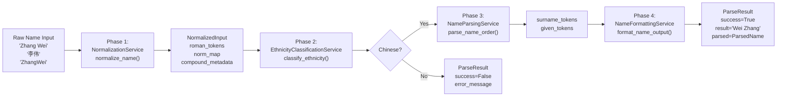

**Phase Details:**

1. **Normalization** ([sinonym/services/normalization/]()): Handles text preprocessing, tokenization, romanization normalization, and compound surname detection. Produces `NormalizedInput` with token-level metadata.

2. **Ethnicity Classification** ([sinonym/services/ethnicity/]()): Three-tier system using linguistic patterns and ML classification (99.5% accuracy for Japanese detection). Early rejection of non-Chinese names.

3. **Parsing** ([sinonym/services/parsing/]()): Probabilistic boundary detection using frequency databases (~1400 surnames, ~3000 given names). Generates and scores parse candidates.

4. **Formatting** ([sinonym/services/formatting/]()): Output standardization with compound surname preservation, given name splitting, and capitalization normalization.

**Sources:** [sinonym/detector.py:249-495](), [README.md:11-27](), Diagram 2 from high-level system architecture

## Key Features and Capabilities

| Feature Category | Capabilities | Implementation |
|-----------------|--------------|----------------|
| **Input Formats** | Pinyin, Wade-Giles, Cantonese, all-Chinese characters, mixed scripts | `TextPreprocessor`, `NormalizationService` |
| **False Positive Prevention** | Korean, Vietnamese, Western, Japanese name filtering | `EthnicityClassificationService`, ML classifier (`.skops` models) |
| **Compound Handling** | Compound surnames (Duanmu, Au Yeung), compound given names (Wei-Ming) | `CompoundDetector`, format preservation in `compound_metadata` |
| **Script Support** | Han characters, diacritics, full-width characters, OCR errors | `han_pinyin_cache.pkl`, `pypinyin` library integration |
| **Batch Processing** | Format pattern detection, context-aware parsing, improvement tracking | `BatchAnalysisService` with configurable thresholds |
| **Performance** | ~0.16ms per name, >7500 names/sec, persistent caching | `PinyinCacheService`, lazy evaluation, thread-safe design |

**Sources:** [sinonym/detector.py:1-163](), [README.md:29-115](), [pyproject.toml:26-35]()

## Result Types

The system uses immutable dataclasses with functional composition patterns:

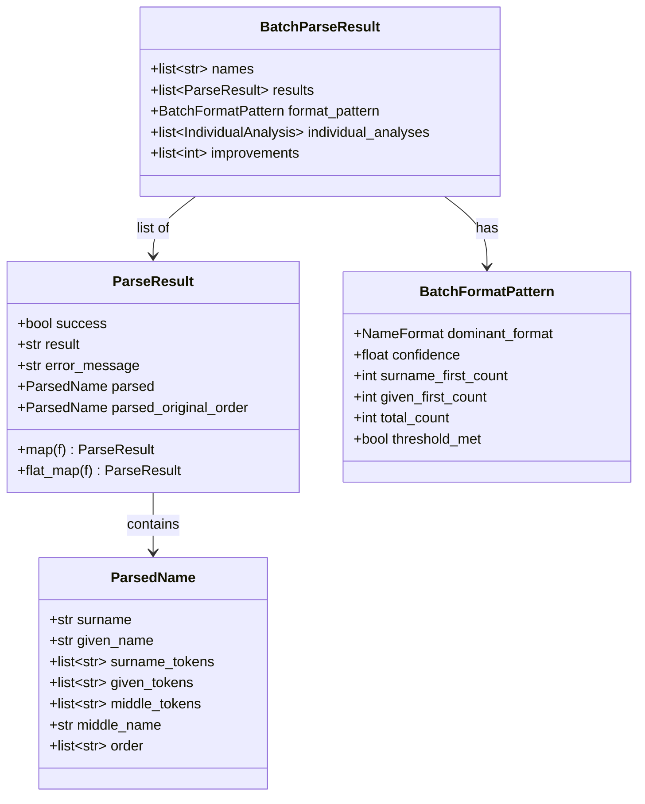

**Key Characteristics:**

- **ParseResult**: Either-monad pattern with `map`/`flat_map` for Scala interoperability ([sinonym/coretypes/results.py]())
- **ParsedName**: Two views - `parsed` (semantic, normalized to given-surname order) and `parsed_original_order` (positional, preserves input order) ([sinonym/coretypes/results.py]())
- **Immutability**: All dataclasses use `frozen=True` for thread safety
- **CompoundMetadata**: Authority for compound surname formatting, threading through entire pipeline ([sinonym/services/normalization/]())

**Sources:** [sinonym/coretypes/results.py](), [sinonym/coretypes/batch.py](), [README.md:236-271](), Diagram 5 from high-level system architecture

## Performance Characteristics

The system is optimized for production use with sub-millisecond latency:

| Metric | Value | Implementation Strategy |
|--------|-------|------------------------|
| Average latency | ~0.16ms per name | Lazy normalization, early exit patterns |
| Throughput | >7500 names/second | Persistent caching, single-pass processing |
| Cold start | ~100ms | Pre-computed `han_pinyin_cache.pkl` |
| Memory efficiency | 60% reduction | Lazy token processing, immutable structures |
| Thread safety | Full | Immutable data, thread-local caching |

**Performance validation** is enforced through CI with baseline tests ([scripts/profile_run.py:1-113](), [tests/test_performance.py]()).

**Sources:** [sinonym/detector.py:141-149](), [scripts/profile_run.py:1-113](), [README.md:112-115]()

## Batch vs Single Processing

Choose processing mode based on use case:

**Single Name Processing** (`normalize_name`):
- Individual names with unknown context
- Interactive/API use cases
- Mixed format lists where consistency isn't expected
- Example: `detector.normalize_name("Zhang Wei")` → `ParseResult`

**Batch Processing** (`analyze_name_batch`):
- Academic author lists (typically surname-first)
- Company directories (uniform formatting)
- Large datasets (100+ names) with expected consistency
- Achieves 90%+ accuracy on ambiguous cases through format detection
- Minimum 2 names, optimal with 5+ names
- Example: `detector.analyze_name_batch(["Zhang Wei", "Li Ming", ...])` → `BatchParseResult`

**Format Detection Only** (`detect_batch_format`):
- Data validation without full processing
- Pre-flight checks before batch operations
- Format consistency analysis
- Example: `detector.detect_batch_format(names)` → `BatchFormatPattern`

**Sources:** [sinonym/detector.py:502-633](), [README.md:273-388]()

## Data Sources and Dependencies

The library requires several external resources and dependencies:

| Category | Components | Location/Source |
|----------|-----------|----------------|
| **Python Dependencies** | `pypinyin`, `scikit-learn`, `numpy`, `scipy`, `joblib`, `skops` | [pyproject.toml:27-35]() |
| **Linguistic Data** | Chinese surnames (~1400), given names (~3000), compound variants | [sinonym/data/familyname_orcid.csv](), [sinonym/data/givenname_orcid.csv]() |
| **ML Models** | Japanese classifier (99.5% accuracy) | [sinonym/data/*.skops](), [sinonym/data/*.joblib]() |
| **Cache Data** | Han-to-Pinyin mappings | [sinonym/data/han_pinyin_cache.pkl]() |
| **Configuration** | Patterns, thresholds, validation rules | `ChineseNameConfig` in [sinonym/services/config.py]() |

All data is bundled in the package for offline operation ([pyproject.toml:53-57]()).

**Sources:** [pyproject.toml:1-104](), [sinonym/detector.py:117-123]()

## Installation and Quick Start

Installation via `uv`:

```bash
uv venv --python 3.11
source .venv/bin/activate  # or .venv\Scripts\activate on Windows
uv sync --active --all-extras --dev
```

Basic usage:

```python
from sinonym.detector import ChineseNameDetector

detector = ChineseNameDetector()

# Single name
result = detector.normalize_name("Zhang Wei")
# ParseResult(success=True, result="Wei Zhang")

# Batch processing
batch_result = detector.analyze_name_batch([
    "Zhang Wei", "Li Ming", "Wang Xiaoli"
])
# BatchParseResult with format_pattern.dominant_format = NameFormat.SURNAME_FIRST
```

**Sources:** [README.md:127-234](), [pyproject.toml:5-26]()

---

# Page: Core Architecture

# Core Architecture

<details>
<summary>Relevant source files</summary>

The following files were used as context for generating this wiki page:

- [README.md](README.md)
- [scripts/profile_run.py](scripts/profile_run.py)
- [sinonym/detector.py](sinonym/detector.py)
- [sinonym/services/parsing.py](sinonym/services/parsing.py)

</details>


## Purpose and Scope

This page describes the overall system architecture of sinonym, including the layered component design, dependency management patterns, and initialization flow. It provides a high-level view of how the major components relate to each other and the architectural principles that guide the system design.

For details on the public API surface, see [ChineseNameDetector: Main API](#2.1). For the detailed four-phase processing pipeline, see [Processing Pipeline](#2.2). For batch processing capabilities, see [Batch Processing System](#2.3).

## Architectural Overview

Sinonym follows a **layered service architecture** that separates concerns into distinct responsibility domains. The system is designed around three core principles:

1. **Clean Separation of Concerns**: Each service has a single, well-defined responsibility
2. **Dependency Injection**: Services receive their dependencies explicitly through constructor injection
3. **Immutability**: Data structures are frozen/immutable for thread safety and functional composition

The architecture consists of four main layers stacked vertically, with the `ChineseNameDetector` class acting as the primary orchestrator that coordinates service interactions.

**Sources:** [sinonym/detector.py:1-243](), [README.md:19-27](), Diagram 1 from high-level architecture

## Component Layers

The system is organized into four distinct layers, each with specific responsibilities:

### Layer Structure

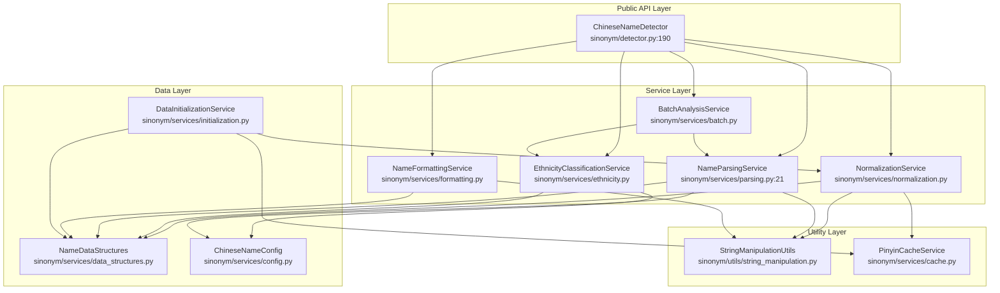

**Sources:** [sinonym/detector.py:190-243](), [sinonym/services/parsing.py:21-52](), Diagram 1 from high-level architecture

### Layer Responsibilities

| Layer | Components | Responsibilities |
|-------|-----------|------------------|
| **Public API** | `ChineseNameDetector` | Main entry point, orchestrates all services, manages initialization |
| **Service** | `NormalizationService`, `EthnicityClassificationService`, `NameParsingService`, `NameFormattingService`, `BatchAnalysisService` | Implements core processing logic for each pipeline phase |
| **Utility** | `StringManipulationUtils`, `PinyinCacheService` | Cross-cutting concerns, reusable string operations, caching infrastructure |
| **Data** | `NameDataStructures`, `ChineseNameConfig`, `DataInitializationService` | Linguistic databases, configuration, data loading and processing |

**Sources:** [sinonym/detector.py:170-183](), [README.md:111-117]()

## Dependency Management Pattern

The system uses a **ServiceContext** pattern to simplify dependency injection and reduce constructor complexity. Instead of passing multiple dependencies to each service, related dependencies are bundled into a context object.

### ServiceContext Pattern

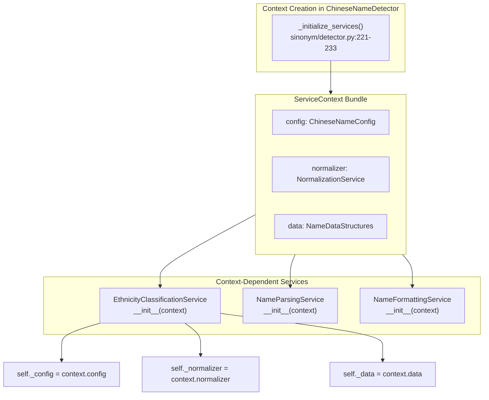

**Sources:** [sinonym/detector.py:221-233](), [sinonym/services/parsing.py:24-35](), Diagram 3 from high-level architecture

### Legacy Compatibility

Services maintain backward compatibility with the old constructor interface while supporting the new `ServiceContext` pattern:

```python
# In NameParsingService.__init__()
if hasattr(context_or_config, "config"):
    # New context interface
    self._config = context_or_config.config
    self._normalizer = context_or_config.normalizer
    self._data = context_or_config.data
else:
    # Legacy interface - maintain backwards compatibility
    self._config = context_or_config
    self._normalizer = normalizer
    self._data = data
```

This dual-interface design allows gradual migration and maintains existing integrations.

**Sources:** [sinonym/services/parsing.py:24-35]()

## Initialization and Bootstrap Flow

The `ChineseNameDetector` follows a sophisticated initialization pattern with lazy loading and error resilience:

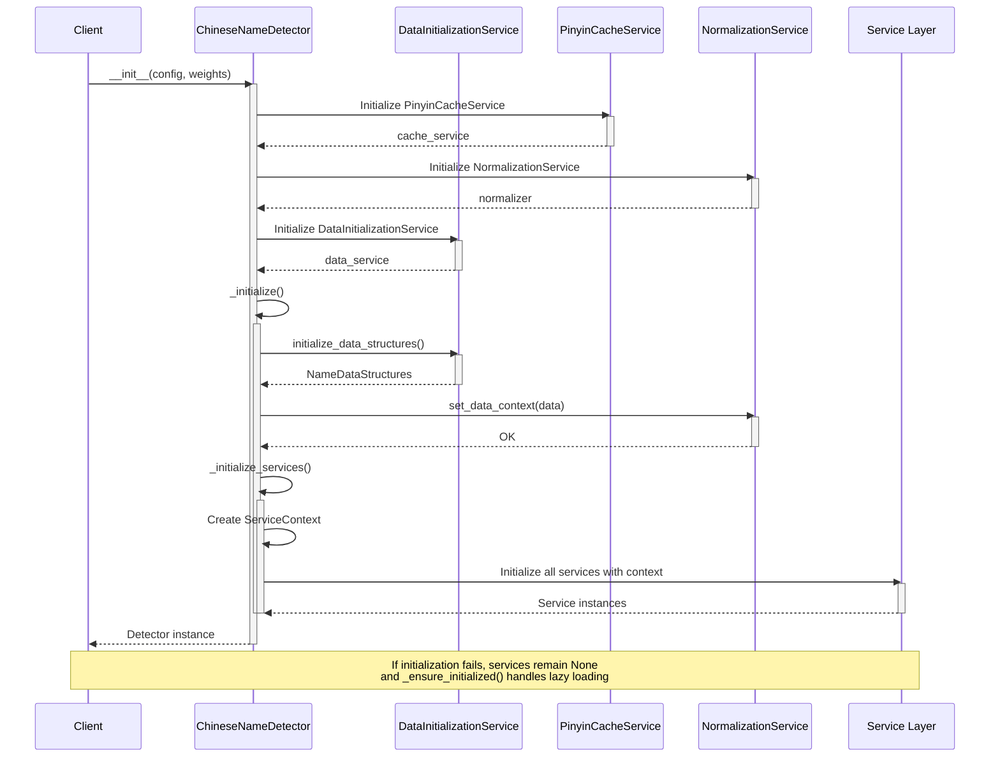

**Sources:** [sinonym/detector.py:193-243]()

### Lazy Initialization Pattern

The system implements defensive initialization with automatic retry:

```python
# sinonym/detector.py:193-208
def __init__(self, config: ChineseNameConfig | None = None, weights: list[float] | None = None):
    self._config = config or ChineseNameConfig.create_default()
    self._cache_service = PinyinCacheService(self._config)
    self._normalizer = NormalizationService(self._config, self._cache_service)
    self._data_service = DataInitializationService(self._config, self._cache_service, self._normalizer)
    self._data: NameDataStructures | None = None
    self._weights = weights
    
    # Service instances (initialized after data loading)
    self._ethnicity_service: EthnicityClassificationService | None = None
    self._parsing_service: NameParsingService | None = None
    self._formatting_service: NameFormattingService | None = None
    self._batch_analysis_service: BatchAnalysisService | None = None
    
    # Initialize data structures with error handling
    self._initialize()

# sinonym/detector.py:235-242
def _ensure_initialized(self) -> None:
    """Ensure data is initialized (lazy initialization)."""
    if self._data is None:
        self._data = self._data_service.initialize_data_structures()
        self._normalizer.set_data_context(self._data)
        self._initialize_services()
```

This pattern provides:
- **Resilience**: Construction succeeds even if data loading fails
- **Lazy Loading**: Data initialized on first use if needed
- **Thread Safety**: Services only created after data is ready

**Sources:** [sinonym/detector.py:193-242]()

## Architectural Patterns

### Immutability and Thread Safety

All core data structures are immutable (`frozen=True` dataclasses) to enable safe concurrent access:

| Pattern | Implementation | Benefit |
|---------|---------------|---------|
| **Frozen Dataclasses** | `@dataclass(frozen=True)` on all result types | Prevents accidental mutation |
| **Immutable Collections** | Data structures use tuples/frozensets internally | Thread-safe reads |
| **Persistent Caching** | Cache writes go to disk, reads are lock-free | Eliminates race conditions |

**Sources:** Diagram 5 from high-level architecture, [README.md:28-31]()

### Functional Error Handling

The system uses a **ParseResult** type that follows the Either monad pattern for Scala interoperability:

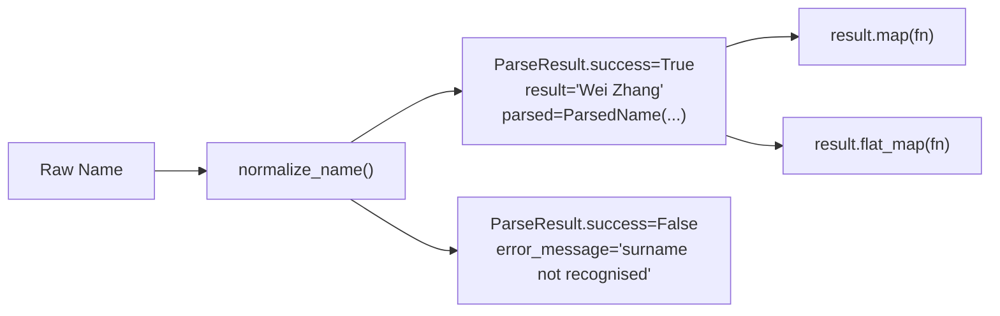

The `ParseResult` provides monadic operations:
- `map(f)`: Transform successful results
- `flat_map(f)`: Chain operations that return ParseResult

This design eliminates exception-based control flow and enables functional composition.

**Sources:** [sinonym/coretypes/results.py]() (referenced in imports), Diagram 5 from high-level architecture

### Pure Function Design

Services are designed with minimal side effects:

| Service | Pure Components | Side Effects |
|---------|----------------|--------------|
| `NormalizationService` | Token normalization, romanization conversion | None (uses pre-loaded cache) |
| `EthnicityClassificationService` | Pattern matching, ML classification | None (model loaded at init) |
| `NameParsingService` | Candidate generation, scoring | None (uses pre-loaded data) |
| `NameFormattingService` | String assembly, capitalization | None |
| `StringManipulationUtils` | All methods (static utility class) | None |

Only initialization (`DataInitializationService`) and caching (`PinyinCacheService`) perform I/O operations.

**Sources:** [sinonym/detector.py:21-33](), [sinonym/services/parsing.py:54-80]()

## Performance Design Considerations

The architecture incorporates several performance optimizations:

### Caching Strategy

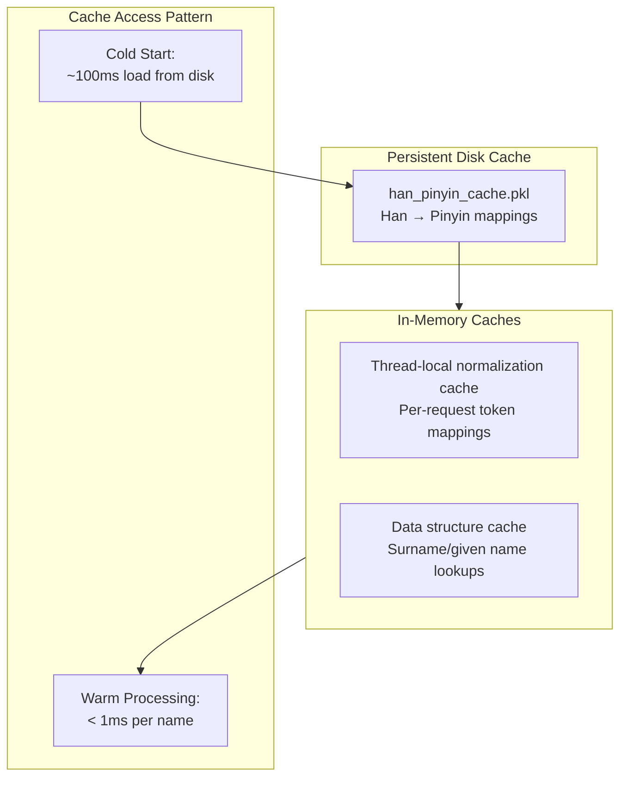

**Sources:** [sinonym/detector.py:143-148](), [scripts/profile_run.py:56-62]()

### Early Exit Optimization

The normalization pipeline implements early exit patterns to minimize processing for non-Chinese names:

1. **Script Validation** (`contains_non_chinese_scripts`): Rejects inputs with Cyrillic, Arabic, etc. before any processing
2. **Length Validation**: Rejects names shorter than minimum tokens or longer than max length
3. **Ethnicity Classification**: Filters Korean/Vietnamese/Japanese names early in the pipeline

This design achieves sub-millisecond performance for most names by avoiding unnecessary computation.

**Sources:** [sinonym/detector.py:258-287](), [README.md:143-148]()

### Lazy Normalization

Token normalization is computed on-demand and cached per request:

```python
# Normalization creates a cache dict, not normalized strings
normalized_input = self._normalizer.apply(raw_name)
# normalized_input.norm_map contains token → normalized_form mappings
# Actual normalization happens only when tokens are accessed
```

This reduces memory usage by ~60% for large batches and avoids normalizing unused tokens.

**Sources:** [sinonym/detector.py:271](), [README.md:34]()

### Benchmark Performance

The system achieves the following performance characteristics:

| Metric | Value | Test Location |
|--------|-------|---------------|
| **Throughput** | 7,500+ names/sec | [tests/test_performance.py]() |
| **Latency** | < 1ms per name | [tests/test_performance.py]() |
| **Cold Start** | ~100ms | [scripts/profile_run.py:56-62]() |
| **Variance** | < 5% CV | [scripts/profile_run.py:93-101]() |

**Sources:** [README.md:143-148](), [scripts/profile_run.py:1-113](), [tests/test_performance.py]() (referenced)

---

# Page: ChineseNameDetector: Main API

# ChineseNameDetector: Main API

<details>
<summary>Relevant source files</summary>

The following files were used as context for generating this wiki page:

- [README.md](README.md)
- [scripts/profile_run.py](scripts/profile_run.py)
- [sinonym/detector.py](sinonym/detector.py)

</details>


## Purpose and Scope

This document covers the `ChineseNameDetector` class, which serves as the primary public interface for the sinonym library. It describes initialization, the main `normalize_name()` method for single-name processing, and the three batch processing methods (`analyze_name_batch()`, `detect_batch_format()`, `process_name_batch()`). For details on the internal processing pipeline that these methods orchestrate, see [Processing Pipeline](#2.2). For configuration options and parameter tuning, see [Configuration System](#4.3).

---

## Class Overview

The `ChineseNameDetector` class acts as the main orchestrator for Chinese name detection and normalization. It implements a facade pattern, hiding the complexity of the internal service layer and providing a simple, clean API for both single-name and batch processing operations.

**Location**: [sinonym/detector.py:190-669]()

**Key Responsibilities**:
- Initialize and manage service dependencies (normalization, parsing, formatting, ethnicity classification)
- Coordinate the four-phase processing pipeline
- Provide thread-safe name processing after initialization
- Support both individual and batch processing modes
- Expose cache management functionality

Sources: [sinonym/detector.py:1-188](), [README.md:1-50]()

---

## Initialization and Dependencies

### Constructor Signature

```python
ChineseNameDetector(
    config: ChineseNameConfig | None = None,
    weights: list[float] | None = None
)
```

**Parameters**:
- `config`: Optional configuration object for patterns, thresholds, and validation rules. Defaults to `ChineseNameConfig.create_default()`.
- `weights`: Optional scoring weights for the parsing service. Used to tune surname/given name boundary detection.

**Initialization Sequence**:

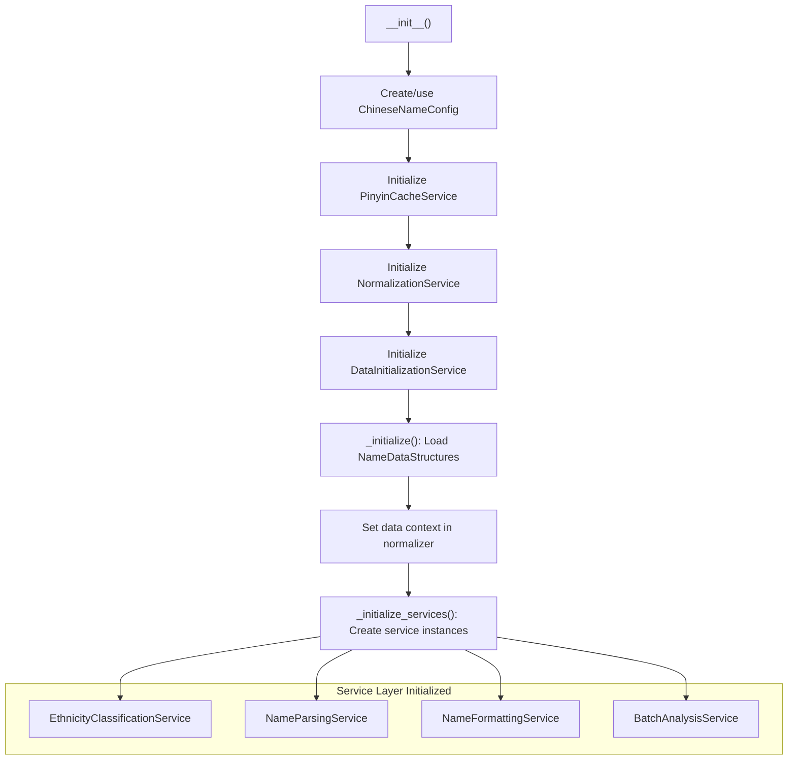

Sources: [sinonym/detector.py:193-242]()

---

### Lazy Initialization Pattern

The detector supports both eager and lazy initialization. If data loading fails during construction, services are initialized on first use via `_ensure_initialized()`.

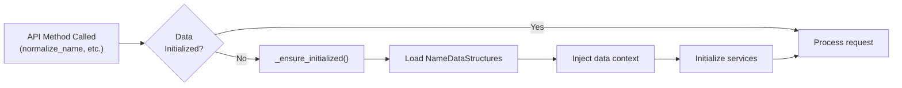

**Implementation Details**:
- Private instance variables track initialization state (`_data`, `_ethnicity_service`, etc.)
- All public methods call `_ensure_initialized()` before processing
- Thread-safe after first initialization
- Fallback to lazy loading if construction fails (logged as warning)

Sources: [sinonym/detector.py:210-242]()

---

## Single Name Processing: normalize_name()

### Method Signature

```python
def normalize_name(raw_name: str) -> ParseResult
```

**Purpose**: Main API method for detecting if a name is Chinese and normalizing it to standardized "Given-Name Surname" format.

**Returns**: `ParseResult` with either:
- `success=True, result=formatted_name` if Chinese name detected
- `success=False, error_message=reason` if not a Chinese name

**Processing Flow**:

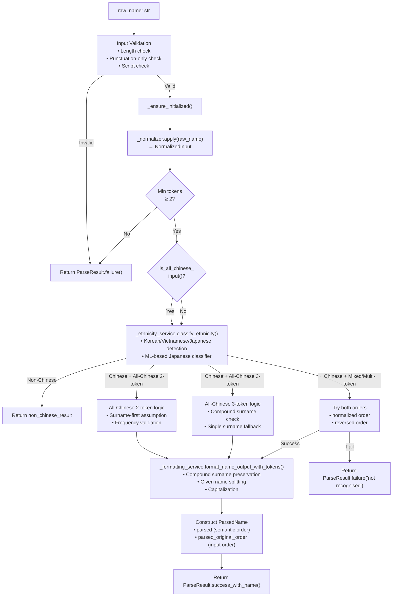

### Key Decision Points

**All-Chinese Character Handling** [sinonym/detector.py:276-422]():

The method uses special logic for inputs written entirely in Chinese characters:

| Token Count | Strategy | Rationale |
|-------------|----------|-----------|
| 2 tokens | Surname-first assumption with validation | Two-character Chinese names follow (surname, given) convention |
| 3 tokens | Compound surname check, then single surname fallback | Tests for compound surnames like 欧阳 (Ouyang) first |
| 4+ tokens | Standard parsing with both orders | No strong cultural convention, use frequency data |

**Mixed Script Handling** [sinonym/detector.py:424-493]():

For names with mixed Chinese characters and romanization, or pure romanization:
- Tries both `[surname, given]` and `[given, surname]` orders
- Selects first parse that passes validation
- Uses frequency-based scoring to disambiguate

Sources: [sinonym/detector.py:249-495]()

---

### Validation Rules

**Input Validation** [sinonym/detector.py:258-267]():

| Check | Threshold | Error Message |
|-------|-----------|---------------|
| Empty input | `len == 0` | "invalid input length" |
| Max length | `> config.max_name_length` | "invalid input length" |
| Punctuation-only | All chars in punctuation/whitespace | "name contains only punctuation/whitespace" |
| Non-Chinese scripts | Contains Cyrillic/Arabic/etc | "contains non-Chinese characters" |

**Token Count** [sinonym/detector.py:273-274]():
- Minimum: 2 tokens required (configurable via `config.min_tokens_required`)
- After normalization splits on whitespace, punctuation, and CamelCase

Sources: [sinonym/detector.py:258-274]()

---

## Batch Processing Methods

The detector provides three batch processing methods, each serving different use cases:

### Method Comparison

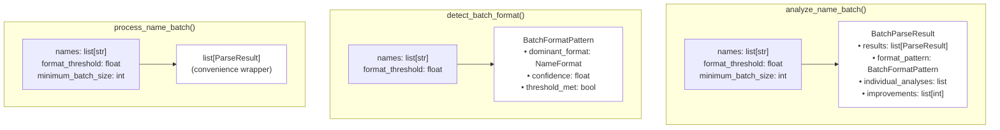

Sources: [sinonym/detector.py:502-633]()

---

### analyze_name_batch()

**Signature**:
```python
def analyze_name_batch(
    names: list[str],
    format_threshold: float = 0.55,
    minimum_batch_size: int = 2,
) -> BatchParseResult
```

**Purpose**: Full batch analysis with format pattern detection, individual name processing, and improvement tracking.

**Use Case**: Academic author lists, company directories, or any dataset where you need detailed analytics on batch processing improvements.

**Parameters**:
- `names`: List of raw name strings to analyze
- `format_threshold`: Minimum percentage (0.0-1.0) required to detect a dominant format (default: 0.55 = 55%)
- `minimum_batch_size`: Minimum number of names required for batch processing (default: 2)

**Returns**: `BatchParseResult` containing:
- `results`: List of `ParseResult` objects (one per input name)
- `format_pattern`: Detected format with confidence metrics
- `individual_analyses`: Detailed candidate lists for each name
- `improvements`: Indices of names that benefited from batch context

**Example**:
```python
# Academic paper author list
authors = ["Zhang Wei", "Li Ming", "Bei Yu", "Wang Xiaoli"]
result = detector.analyze_name_batch(authors)

print(f"Format: {result.format_pattern.dominant_format}")
print(f"Confidence: {result.format_pattern.confidence:.1%}")
print(f"Improved {len(result.improvements)} names via batch context")

for i in result.improvements:
    print(f"  {authors[i]} benefited from batch analysis")
```

Sources: [sinonym/detector.py:502-550](), [README.md:273-329]()

---

### detect_batch_format()

**Signature**:
```python
def detect_batch_format(
    names: list[str],
    format_threshold: float = 0.55,
) -> BatchFormatPattern
```

**Purpose**: Fast format pattern detection without full name processing. Useful for validation or pre-analysis.

**Use Case**: Data quality checks, determining if a dataset has consistent formatting before committing to full processing.

**Parameters**:
- `names`: List of raw name strings to analyze
- `format_threshold`: Minimum percentage (0.0-1.0) required for format detection

**Returns**: `BatchFormatPattern` with:
- `dominant_format`: Enum value (SURNAME_FIRST, GIVEN_FIRST, or MIXED)
- `confidence`: Float in [0.0, 1.0] indicating format consistency
- `surname_first_count`: Count of names preferring surname-first
- `given_first_count`: Count of names preferring given-first
- `total_count`: Total names analyzed
- `threshold_met`: Boolean indicating if confidence exceeds threshold

**Example**:
```python
# Pre-validate a dataset
unknown_names = ["Wei Zhang", "Ming Li", "Xiaoli Wang"]
pattern = detector.detect_batch_format(unknown_names)

if pattern.threshold_met:
    print(f"Consistent {pattern.dominant_format} formatting")
    print(f"Safe to batch process with {pattern.confidence:.1%} confidence")
else:
    print("Mixed formatting - recommend individual processing")
```

Sources: [sinonym/detector.py:552-602](), [README.md:217-225]()

---

### process_name_batch()

**Signature**:
```python
def process_name_batch(
    names: list[str],
    format_threshold: float = 0.55,
    minimum_batch_size: int = 2,
) -> list[ParseResult]
```

**Purpose**: Convenience wrapper that returns only the parse results from batch analysis.

**Use Case**: Data cleanup pipelines where you only need the formatted names, not the detailed analytics.

**Parameters**: Same as `analyze_name_batch()`

**Returns**: List of `ParseResult` objects (equivalent to `analyze_name_batch().results`)

**Example**:
```python
# Quick batch processing for data cleanup
messy_names = ["Li, Wei", "Zhang.Ming", "Wang Xiaoli"]
results = detector.process_name_batch(messy_names)

for original, result in zip(messy_names, results):
    if result.success:
        print(f"Cleaned: '{original}' → '{result.result}'")
```

Sources: [sinonym/detector.py:604-633](), [README.md:227-233]()

---

## Result Types

### ParseResult Structure

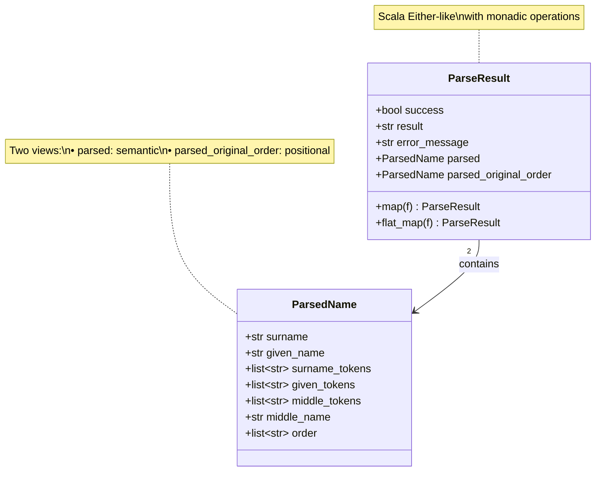

**Key Fields**:

| Field | Type | Purpose |
|-------|------|---------|
| `success` | `bool` | True if Chinese name detected, False otherwise |
| `result` | `str` | Formatted name in "Given-Name Surname" order (if success=True) |
| `error_message` | `str` | Reason for failure (if success=False) |
| `parsed` | `ParsedName` | Semantic view: normalized component order |
| `parsed_original_order` | `ParsedName` | Positional view: input order preserved |

**Common Error Messages**:
- `"surname not recognised"`: No valid Chinese surname found
- `"appears to be Korean name"`: Korean linguistic patterns detected
- `"appears to be Vietnamese name"`: Vietnamese naming conventions identified
- `"Japanese name detected by ML classifier"`: ML-based Japanese detection
- `"given name tokens are not plausibly Chinese"`: Given name validation failed
- `"invalid input length"`: Input too short or too long
- `"contains non-Chinese characters"`: Non-CJK scripts detected

Sources: [sinonym/coretypes/results.py](), [sinonym/detector.py:258-267]()

---

### ParsedName Dual View System

The `ParsedName` structure provides two complementary views of the same parsed name:

**Semantic View (`parsed`)**:
- Always represents normalized output order: `["given", "middle", "surname"]`
- `surname`: The family name component
- `given_name`: The personal name component
- Used for display and downstream processing

**Positional View (`parsed_original_order`)**:
- Preserves input order: `["surname", "given"]` or `["given", "surname"]`
- Labels are positional: `given_name` = first component in input
- Used for understanding original formatting

**Example**:
```python
result = detector.normalize_name("Li Wei")

# Semantic view (normalized output)
result.parsed.surname        # "Li"
result.parsed.given_name     # "Wei"
result.parsed.order          # ["given", "middle", "surname"]

# Positional view (input order)
result.parsed_original_order.given_name   # "Li" (first in input)
result.parsed_original_order.surname      # "Wei" (last in input)
result.parsed_original_order.order        # ["surname", "given"]
```

Sources: [README.md:236-271](), [sinonym/coretypes/results.py]()

---

## Code Entity Mapping

### Public API Methods to Internal Services

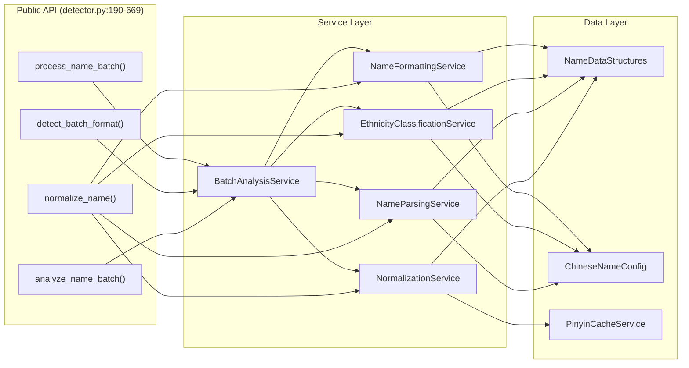

### File-Level Organization

| Component | File Path | Lines | Purpose |
|-----------|-----------|-------|---------|
| Main Class | `sinonym/detector.py` | 190-669 | ChineseNameDetector implementation |
| Result Types | `sinonym/coretypes/results.py` | - | ParseResult, ParsedName structures |
| Batch Types | `sinonym/coretypes/batch.py` | - | BatchParseResult, BatchFormatPattern |
| Service Context | `sinonym/services/context.py` | - | ServiceContext dependency bundle |
| Config | `sinonym/services/config.py` | - | ChineseNameConfig patterns/thresholds |

Sources: [sinonym/detector.py:1-670]()

---

## Utility Methods

### get_cache_info()

**Signature**:
```python
def get_cache_info() -> CacheInfo
```

**Purpose**: Retrieve cache statistics for monitoring and diagnostics.

**Returns**: `CacheInfo` object with:
- `cache_size`: Number of characters in the Pinyin cache
- Additional cache metadata

**Example**:
```python
detector = ChineseNameDetector()
cache_info = detector.get_cache_info()
print(f"Cache contains {cache_info.cache_size} Han→Pinyin mappings")
```

Sources: [sinonym/detector.py:245-247]()

---

### is_chinese_name() (Deprecated)

**Signature**:
```python
def is_chinese_name(raw_name: str) -> ParseResult
```

**Status**: Deprecated alias for `normalize_name()`. Maintained for backwards compatibility.

**Recommendation**: Use `normalize_name()` in new code.

Sources: [sinonym/detector.py:498-500]()

---

## Performance Characteristics

### Single Name Processing

**Benchmark Results** (from production testing):

| Metric | Value | Notes |
|--------|-------|-------|
| Average latency | ~0.16ms | Comprehensive benchmark validated |
| Cold start | ~100ms | Initial data loading with persistent cache |
| Warm processing | <1ms | Most names with early exit optimization |
| Throughput | 7,500+ names/sec | Thread-safe after initialization |

**Optimization Strategies**:
- Lazy normalization reduces memory usage by ~60%
- Persistent disk cache for Han→Pinyin mappings
- Early exit for non-Chinese scripts
- Single-pass string transformations

Sources: [sinonym/detector.py:141-148](), [scripts/profile_run.py:1-113]()

### Batch Processing Performance

**Batch Overhead**: Minimal - format detection adds <5% overhead compared to individual processing.

**Best Performance**:
- Batch sizes of 5-20 names optimal for pattern detection
- Minimum 2 names required for batch benefits
- Non-Chinese names in batch don't degrade performance (rejected during individual analysis)

Sources: [README.md:273-387]()

---

## Thread Safety

The `ChineseNameDetector` is **thread-safe after initialization**:

- **Initialization**: Not thread-safe. Complete initialization in single thread before sharing.
- **Processing**: All processing methods (`normalize_name()`, batch methods) are thread-safe.
- **Caching**: Uses immutable data structures and thread-local caching where needed.
- **Service Instances**: All service instances are stateless or use immutable state.

**Recommended Pattern**:
```python
# Initialize once in main thread
detector = ChineseNameDetector()

# Safe to use from multiple threads
with ThreadPoolExecutor() as executor:
    results = executor.map(detector.normalize_name, name_list)
```

Sources: [sinonym/detector.py:159-162]()

---

## Usage Examples

### Basic Single Name Processing

```python
from sinonym.detector import ChineseNameDetector

detector = ChineseNameDetector()

# Standard name
result = detector.normalize_name("Zhang Wei")
print(result.result)  # "Wei Zhang"

# Compound given name
result = detector.normalize_name("Li Weiming")
print(result.result)  # "Wei-Ming Li"

# All-Chinese characters
result = detector.normalize_name("巩俐")
print(result.result)  # "Li Gong"

# Non-Chinese name (rejected)
result = detector.normalize_name("John Smith")
print(result.error_message)  # "surname not recognised"
```

Sources: [README.md:166-204]()

---

### Batch Processing with Analytics

```python
# Academic author list
authors = [
    "Zhang Wei",
    "Li Ming", 
    "Wang Xiaoli",
    "Liu Jiaming",
    "Feng Cha"  # Ambiguous case
]

result = detector.analyze_name_batch(authors)

# Check format detection
print(f"Format: {result.format_pattern.dominant_format}")
print(f"Confidence: {result.format_pattern.confidence:.1%}")
print(f"Surname-first: {result.format_pattern.surname_first_count}")
print(f"Given-first: {result.format_pattern.given_first_count}")

# Review improvements
print(f"\nImproved {len(result.improvements)} names:")
for idx in result.improvements:
    print(f"  {authors[idx]} benefited from batch context")

# Process results
for name, parse_result in zip(authors, result.results):
    if parse_result.success:
        print(f"{name} → {parse_result.result}")
```

Sources: [README.md:206-216]()

---

### Pre-Validation with Format Detection

```python
# Check dataset consistency before full processing
dataset = ["Wei Zhang", "Ming Li", "Xiaoli Wang"]

pattern = detector.detect_batch_format(dataset)

if pattern.threshold_met:
    print(f"Consistent {pattern.dominant_format} format detected")
    print(f"Confidence: {pattern.confidence:.1%}")
    
    # Safe to batch process
    results = detector.process_name_batch(dataset)
else:
    print("Mixed formatting - process individually")
    results = [detector.normalize_name(name) for name in dataset]
```

Sources: [README.md:217-225]()

---

### Mixed Dataset Handling

```python
# Dataset with both Chinese and non-Chinese names
mixed_names = [
    "John Smith",      # Western - rejected
    "Mary Johnson",    # Western - rejected
    "Zhang Wei",       # Chinese - processed
    "Li Ming",         # Chinese - processed
    "Kim Min-jun",     # Korean - rejected
    "Wang Xiaoli"      # Chinese - processed
]

result = detector.analyze_name_batch(mixed_names)

# Format detection uses only valid Chinese names
print(f"Format: {result.format_pattern.dominant_format}")
print(f"Chinese names: {result.format_pattern.total_count}")

# Results maintain input-output correspondence
for name, parse_result in zip(mixed_names, result.results):
    if parse_result.success:
        print(f"✅ {name} → {parse_result.result}")
    else:
        print(f"❌ {name} → {parse_result.error_message}")
```

Sources: [README.md:337-386]()

---

### Custom Configuration

```python
from sinonym.services import ChineseNameConfig

# Create custom config with adjusted thresholds
custom_config = ChineseNameConfig.create_default()
# (Config modification would happen here if API exposed)

detector = ChineseNameDetector(config=custom_config)

# Custom scoring weights for parsing
weights = [1.0, 0.8, 0.6]  # Adjust surname/given preferences
detector_weighted = ChineseNameDetector(weights=weights)
```

Sources: [sinonym/detector.py:193-199]()

---

## Error Handling Patterns

### Result-Based Error Handling

The detector uses a **Result pattern** (Scala Either-like) instead of exceptions for expected failures:

```python
result = detector.normalize_name(user_input)

if result.success:
    # Happy path
    display_name = result.result
    surname = result.parsed.surname
    given_name = result.parsed.given_name
else:
    # Expected failure (not Chinese name)
    log_rejection(result.error_message)
    fallback_to_original(user_input)
```

**Benefits**:
- No exception handling needed for expected non-Chinese names
- Error messages are structured and machine-readable
- Suitable for batch processing without interruption

Sources: [sinonym/detector.py:29-30](), [sinonym/coretypes/results.py]()

---

### Monadic Operations

`ParseResult` supports functional composition:

```python
# Map over success cases
result.map(lambda name: name.upper())

# Flat map for chaining operations
def process_further(name: str) -> ParseResult:
    # Additional processing...
    return ParseResult.success(processed_name)

result.flat_map(process_further)
```

Sources: [sinonym/coretypes/results.py]()

---

# Page: Processing Pipeline

# Processing Pipeline

<details>
<summary>Relevant source files</summary>

The following files were used as context for generating this wiki page:

- [README.md](README.md)
- [scripts/profile_run.py](scripts/profile_run.py)
- [sinonym/detector.py](sinonym/detector.py)
- [sinonym/services/parsing.py](sinonym/services/parsing.py)

</details>


## Purpose and Scope

This document describes the four-phase processing pipeline that transforms raw name strings into normalized output. The pipeline consists of sequential stages: normalization, ethnicity classification, parsing, and formatting. Each phase builds on the previous phase's output, with early exit patterns for non-Chinese names.

For the main API entry point that invokes this pipeline, see [ChineseNameDetector: Main API](#2.1). For batch processing extensions that optimize the pipeline for multiple names, see [Batch Processing System](#2.3). For details on individual service implementations, see [Service Components](#3).

**Sources:** [sinonym/detector.py:249-495](), [README.md:11-27]()

## Pipeline Architecture

The processing pipeline is implemented as a sequential transformation of data structures, with each phase producing outputs consumed by the next phase. The `ChineseNameDetector.normalize_name()` method orchestrates the entire pipeline.

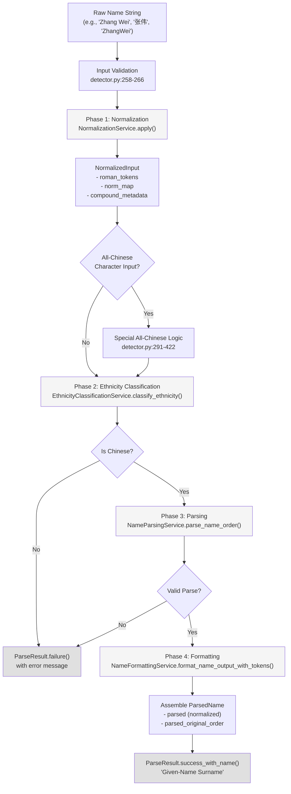

**Sources:** [sinonym/detector.py:249-495](), [README.md:11-27]()

## Data Flow Through Phases

The pipeline transforms data through well-defined structures at each phase boundary. The `compound_metadata` generated in Phase 1 is threaded through all subsequent phases to preserve user-specified compound surname formats.

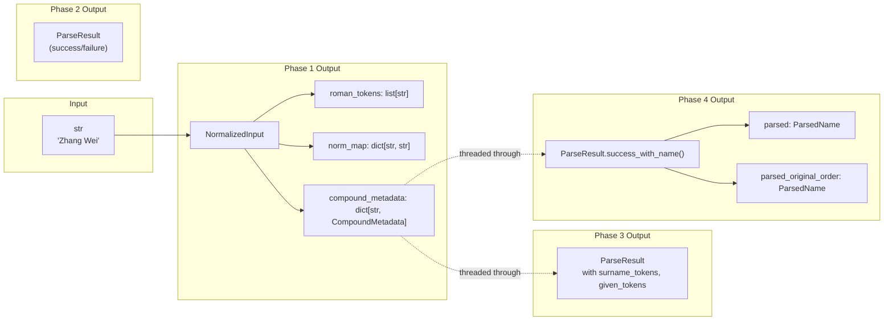

**Sources:** [sinonym/detector.py:270-275](), [sinonym/services/normalization.py](), [sinonym/coretypes/results.py]()

## Phase 1: Normalization

Phase 1 transforms raw input into a canonical representation suitable for parsing. The `NormalizationService.apply()` method performs tokenization, romanization normalization, and compound surname detection.

### Normalization Process

| Step | Operation | Component |
|------|-----------|-----------|
| 1 | Text preprocessing | `TextPreprocessor` removes structural noise |
| 2 | Tokenization | Split on whitespace/punctuation |
| 3 | Han-to-Pinyin conversion | `PinyinCacheService` for Chinese characters |
| 4 | Romanization normalization | Wade-Giles, diacritics, full-width chars |
| 5 | Compound detection | `CompoundDetector` generates metadata |

**Key Outputs:**

- `roman_tokens: list[str]` - Clean, romanized tokens ready for parsing
- `norm_map: dict[str, str]` - Original token → normalized form mapping (preserves user input)
- `compound_metadata: dict[str, CompoundMetadata]` - Authority for compound surname formatting

**Sources:** [sinonym/detector.py:270-275](), [README.md:16-27](), [sinonym/services/normalization.py]()

### Compound Metadata Threading

The `compound_metadata` dictionary generated in Phase 1 is the "single source of truth" for compound surname formatting. It is passed through all subsequent phases to ensure format preservation.

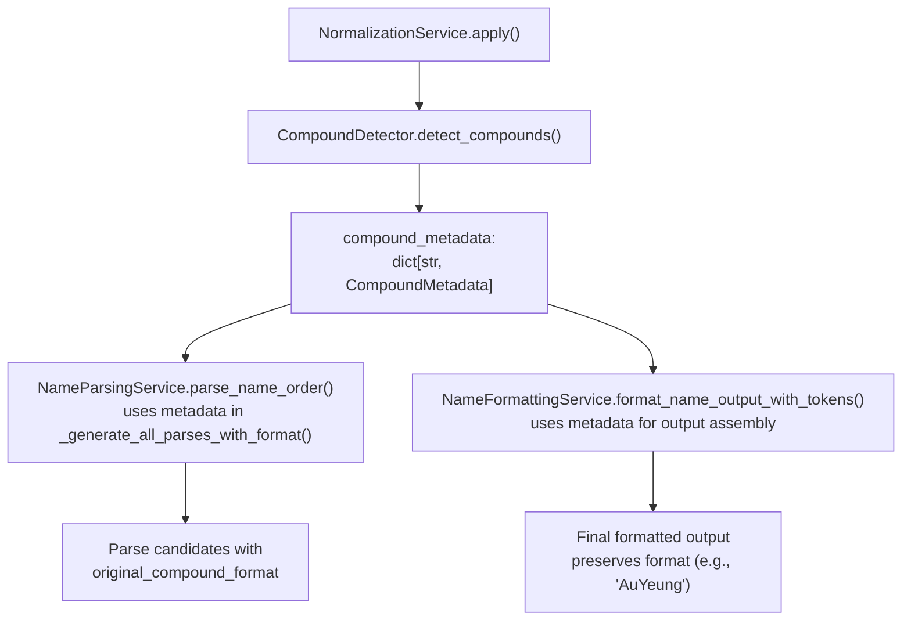

**Sources:** [sinonym/services/parsing.py:54-80](), [sinonym/services/parsing.py:330-343](), [sinonym/services/normalization.py]()

## Phase 2: Ethnicity Classification

Phase 2 filters non-Chinese names using a three-tier classification system. This phase implements early exit patterns to reject names quickly without full processing.

### Classification Workflow

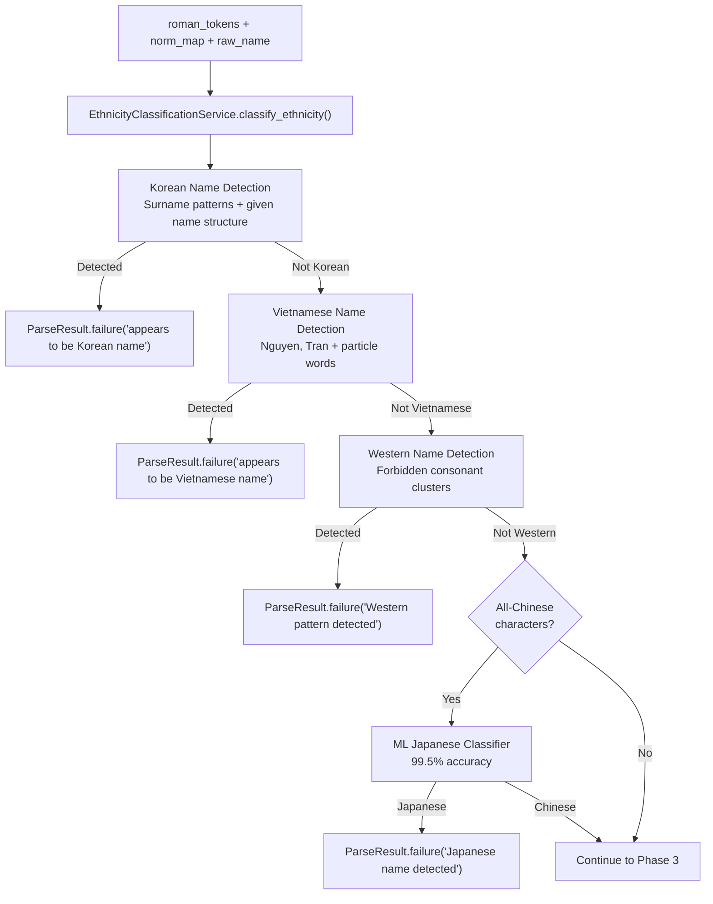

**Sources:** [sinonym/detector.py:280-287](), [sinonym/services/ethnicity.py](), [README.md:95-100]()

### Early Exit Optimization

The ethnicity classification phase provides significant performance benefits through early rejection:

- **Korean names**: Rejected at ~0.05ms (surname pattern matching)
- **Vietnamese names**: Rejected at ~0.06ms (particle word detection)
- **Western names**: Rejected at ~0.07ms (consonant cluster analysis)
- **Japanese names** (all-Chinese): Rejected at ~0.12ms (ML classification)

These early exits prevent expensive parsing operations on non-Chinese names.

**Sources:** [sinonym/detector.py:280-287](), [scripts/profile_run.py:85-91]()

## Phase 3: Name Parsing

Phase 3 identifies surname/given name boundaries using probabilistic scoring. The `NameParsingService` generates multiple parse candidates and selects the highest-scoring parse.

### Parse Candidate Generation

The parsing service uses `_generate_all_parses_with_format()` to create all valid surname/given name splits, considering compound surnames and various token positions.

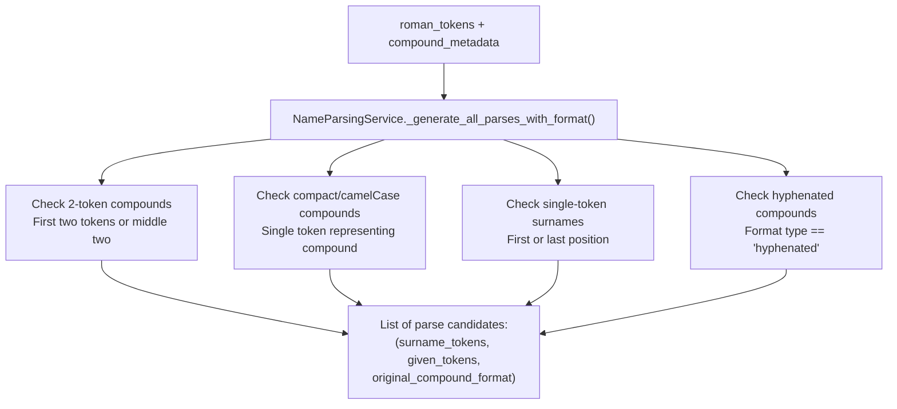

**Sources:** [sinonym/services/parsing.py:218-328](), [sinonym/services/parsing.py:54-80]()

### Probabilistic Scoring

Each parse candidate is scored using an 8-feature weighted model. The `calculate_parse_score()` method evaluates frequency data, cultural patterns, and comparative features.

| Feature | Weight | Purpose |
|---------|--------|---------|
| `surname_logp` | 0.465 | Surname frequency (log probability) |
| `given_logp_sum` | 0.395 | Sum of given name log probabilities |
| `surname_rank_bonus` | -0.888 | Percentile rank-based bonus |
| `compound_given_bonus` | 1.348 | Bonus for 2-syllable given names |
| `order_preservation_bonus` | 1.102 | Preserve input order for ambiguous cases |
| `surname_first_bonus` | 0.425 | Bonus for surname-first in all-Chinese |
| `surname_freq_log_ratio` | -0.042 | Log frequency ratio (comparative) |
| `surname_rank_difference` | -0.573 | Rank difference (comparative) |

**Sources:** [sinonym/services/parsing.py:345-445](), [sinonym/services/parsing.py:38-51]()

### Parse Selection

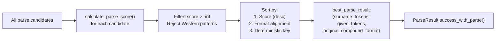

**Sources:** [sinonym/services/parsing.py:132-216](), [sinonym/services/parsing.py:201-216]()

## Phase 4: Name Formatting

Phase 4 assembles the final output by splitting compound given names, applying capitalization, and constructing the standardized `ParsedName` structure. The `NameFormattingService` consumes parse results and compound metadata to produce formatted output.

### Formatting Operations

```mermaid
flowchart TD
    Input["surname_tokens + given_tokens<br/>+ compound_metadata"]
    Input --> Split["Split compound given names<br/>StringManipulationUtils.smart_split_given_name()"]
    
    Split --> Caps["Capitalize tokens<br/>Title Case for each part"]
    Caps --> Middle["Extract middle name initials<br/>Single-letter tokens from given_tokens"]
    
    Middle --> CompoundS["Format compound surname<br/>Preserve original format from metadata"]
    CompoundS --> Hyphen["Hyphenate given name parts<br/>Join with '-'"]
    
    Hyphen --> Assemble["Assemble final string:<br/>'Given-Name Surname'"]
    Assemble --> Construct["Construct ParsedName objects:<br/>- parsed (normalized order)<br/>- parsed_original_order (input order)"]
```

**Sources:** [sinonym/services/formatting.py](), [sinonym/detector.py:316-363]()

### ParsedName Construction

The formatting phase produces two `ParsedName` views of the same normalized components:

1. **`parsed`**: Semantic view with components in normalized `Given-Name Surname` order
   - `order` typically `["given", "middle", "surname"]`
   - Labels reflect semantic roles (surname is the family name)

2. **`parsed_original_order`**: Positional view aligned to input token order
   - `order` reflects input structure (e.g., `["surname", "given"]` for surname-first input)
   - Labels are positional: "given" = first component(s), "surname" = last component(s)

**Sources:** [sinonym/detector.py:324-362](), [sinonym/detector.py:437-491](), [README.md:237-271]()

## Special Case: All-Chinese Inputs

Names written entirely in Chinese characters receive specialized handling before entering the standard pipeline. The detector applies cultural conventions and frequency analysis specific to Han character inputs.

### All-Chinese Processing Logic

```mermaid
flowchart TD
    Raw["Raw input (all Chinese characters)"]
    Raw --> Check["_text_preprocessor.is_all_chinese_input()"]
    
    Check -->|True| Convert["Han-to-Pinyin conversion<br/>PinyinCacheService"]
    Convert --> Length{"Token count?"}
    
    Length -->|2 tokens| Two["2-Character Logic<br/>detector.py:291-364"]
    Length -->|3 tokens| Three["3-Character Logic<br/>detector.py:365-422"]
    Length -->|Other| Standard["Standard pipeline<br/>with surname_first_bonus"]
    
    Two --> Check1{"Is token1<br/>a surname?"}
    Check1 -->|Yes| SF["Surname-first parse:<br/>[token1], [token2]"]
    Check1 -->|No| Check2{"Is token2<br/>a surname?"}
    Check2 -->|Yes| GF["Given-first parse:<br/>[token2], [token1]"]
    Check2 -->|No| Fail["Parse failure"]
    
    Three --> TryCompound["Try 2-token compound surname<br/>+ 1-token given"]
    TryCompound -->|Valid| UseCompound["Use compound parse"]
    TryCompound -->|Invalid| Use13["Use 1-token surname<br/>+ 2-token given"]
```

**Sources:** [sinonym/detector.py:276-278](), [sinonym/detector.py:291-422]()

### Surname-First Preference

For all-Chinese inputs, the system applies a `surname_first_bonus` (weight 0.425) to parses that follow traditional Chinese surname-first ordering. This bonus is only applied when `is_all_chinese=True` is passed to `calculate_parse_score()`.

**Example:**
- Input: `"李伟"` (Li Wei in Chinese characters)
- Parse candidates: 
  - Surname-first `["李", "伟"]`: receives bonus → score increased
  - Given-first `["伟", "李"]`: no bonus → lower score
- Result: `"Wei Li"` (surname-first parse selected)

**Sources:** [sinonym/services/parsing.py:386-397](), [sinonym/detector.py:291-304]()

## Integration with Batch Processing

The processing pipeline serves as the foundation for batch processing operations. Each name in a batch is individually processed through all four phases, then batch-level analysis detects format patterns and applies corrections.

### Batch Processing Workflow

```mermaid
flowchart TD
    BatchInput["List of raw name strings"]
    BatchInput --> Individual["Process each through<br/>normalize_name() pipeline"]
    
    Individual --> Results["Individual ParseResults"]
    Results --> Detect["BatchAnalysisService.detect_batch_format()"]
    
    Detect --> Pattern["BatchFormatPattern:<br/>- dominant_format<br/>- confidence<br/>- threshold_met"]
    
    Pattern -->|threshold_met| Apply["Apply pattern to<br/>ambiguous names"]
    Pattern -->|not met| Keep["Keep individual results"]
    
    Apply --> Reparse["Re-parse with format hint<br/>NameParsingService"]
    Reparse --> Track["Track improvements"]
    Track --> Output["BatchParseResult"]
```

**Sources:** [sinonym/detector.py:502-547](), [sinonym/services/batch_analysis.py]()

### Format Pattern Detection

Batch format detection analyzes the individual parse results to identify consistent formatting patterns. The `BatchAnalysisService` examines which names prefer surname-first vs. given-first ordering based on their parse scores.

**Threshold Behavior:**
- Default threshold: 55% (configurable via `format_threshold` parameter)
- If ≥55% of successfully parsed names prefer the same format → pattern detected
- Pattern is applied to improve ambiguous cases (e.g., names with close parse scores)
- Non-Chinese names in batch are excluded from pattern detection

**Sources:** [sinonym/detector.py:505-547](), [README.md:273-330]()

## Error Handling and Propagation

The pipeline uses `ParseResult` as a functional error type, enabling errors to propagate cleanly through phases without exceptions. Each phase can return failure results that short-circuit remaining phases.

### Error Types by Phase

| Phase | Error Message | Cause |
|-------|---------------|-------|
| Input Validation | `"invalid input length"` | Empty or too long (>200 chars) |
| Input Validation | `"name contains only punctuation/whitespace"` | No content |
| Input Validation | `"contains non-Chinese characters"` | Cyrillic, Arabic, etc. |
| Normalization | `"needs at least 2 Roman tokens"` | Insufficient tokens after conversion |
| Ethnicity | `"appears to be Korean name"` | Korean patterns detected |
| Ethnicity | `"appears to be Vietnamese name"` | Vietnamese patterns detected |
| Ethnicity | `"Western pattern detected"` | Forbidden consonant clusters |
| Ethnicity | `"Japanese name detected by ML classifier"` | ML classification result |
| Parsing | `"surname not recognised"` | No valid parse candidates |
| Parsing | `"no valid parse found"` | All candidates scored < threshold |
| Formatting | `"given name tokens are not plausibly Chinese"` | Validation failure |

**Sources:** [sinonym/detector.py:258-266](), [sinonym/detector.py:280-287](), [sinonym/services/parsing.py:80-130](), [sinonym/coretypes/results.py]()

### ParseResult Monadic Operations

`ParseResult` provides `map()` and `flat_map()` operations for functional composition, enabling Scala-style error handling:

```python
# Pipeline composition example (conceptual)
result = (
    normalize_input(raw_name)
    .flat_map(lambda n: classify_ethnicity(n))
    .flat_map(lambda n: parse_name(n))
    .map(lambda p: format_output(p))
)
```

**Sources:** [sinonym/coretypes/results.py](), [README.md:27-30]()

---

# Page: Batch Processing System

# Batch Processing System

<details>
<summary>Relevant source files</summary>

The following files were used as context for generating this wiki page:

- [README.md](README.md)
- [scripts/profile_run.py](scripts/profile_run.py)
- [sinonym/services/batch_analysis.py](sinonym/services/batch_analysis.py)
- [tests/test_batch.py](tests/test_batch.py)
- [tests/test_middle_names.py](tests/test_middle_names.py)

</details>


## Purpose and Scope

This document describes the batch analysis capabilities of Sinonym, which improve name parsing accuracy by detecting consistent formatting patterns across multiple names. When processing lists of Chinese names (e.g., academic author lists, company directories), the batch system analyzes all names together to determine whether they follow surname-first or given-first formatting, then applies this pattern to resolve ambiguous individual cases.

For information about the overall processing pipeline, see [Processing Pipeline](#2.2). For details about individual name parsing, see [Name Parsing Service](#3.3). For batch processing test coverage, see [Batch Processing Tests](#5.5).

**Sources:** [sinonym/services/batch_analysis.py:1-7](), [README.md:273-330]()

---

## System Overview

The batch processing system addresses a fundamental challenge in Chinese name parsing: many romanized names are ambiguous in isolation. For example, "Li Wei" could be interpreted as "Wei Li" (given-first) or "Li Wei" (surname-first). By analyzing multiple names together, the system can detect formatting consistency and apply that pattern to improve individual parsing decisions.

### Key Capabilities

| Capability | Description |
|------------|-------------|
| **Format Detection** | Identifies whether a batch follows surname-first or given-first ordering |
| **Confidence Calculation** | Computes pattern confidence using vote counting and weighted tie-breaking |
| **Consistent Application** | Applies detected format to all Chinese names in the batch |
| **Improvement Tracking** | Identifies names that benefit from batch context vs. individual parsing |
| **Mixed-Type Handling** | Processes batches containing both Chinese and non-Chinese names |
| **Graceful Fallback** | Falls back to individual processing when patterns are unclear |

**Sources:** [sinonym/services/batch_analysis.py:28-40](), [README.md:279-291]()

---

## Core Components

### BatchAnalysisService

The `BatchAnalysisService` class orchestrates batch processing by coordinating with the parsing, ethnicity, and formatting services:

```python
class BatchAnalysisService:
    def __init__(
        self,
        parsing_service: NameParsingService,
        ethnicity_service: EthnicityClassificationService | None = None,
        format_threshold: float = 0.55,
    )
```

**Constructor Parameters:**
- `parsing_service`: NameParsingService instance for generating parse candidates
- `ethnicity_service`: Optional EthnicityClassificationService for non-Chinese filtering
- `format_threshold`: Minimum confidence threshold for format detection (default 0.55, advisory only)

**Sources:** [sinonym/services/batch_analysis.py:28-39]()

### Data Structures

The batch system uses four key data structures to represent analysis results:

| Type | Purpose | Key Fields |
|------|---------|------------|
| `BatchParseResult` | Complete batch analysis output | `names`, `results`, `format_pattern`, `individual_analyses`, `improvements` |
| `BatchFormatPattern` | Detected format pattern with confidence | `dominant_format`, `confidence`, `surname_first_count`, `given_first_count`, `total_count`, `threshold_met` |
| `IndividualAnalysis` | Per-name analysis details | `raw_name`, `candidates`, `best_candidate`, `confidence` |
| `ParseCandidate` | Single parse interpretation | `surname_tokens`, `given_tokens`, `score`, `format`, `original_compound_format` |

**Sources:** [sinonym/coretypes/__init__.py](), [sinonym/services/batch_analysis.py:13-21]()

---

## Batch Processing Data Flow

### Component Interaction Diagram

```mermaid
graph TB
    Input["List of Raw Name Strings"]
    
    Input --> BatchService["BatchAnalysisService.analyze_name_batch()"]
    
    BatchService --> Phase1["Phase 1: Individual Analysis"]
    Phase1 --> Normalize["NormalizationService.apply()"]
    Phase1 --> EthCheck["EthnicityClassificationService.classify_ethnicity()"]
    Phase1 --> ParseGen["NameParsingService._generate_all_parses_with_format()"]
    Phase1 --> Score["NameParsingService.calculate_parse_score()"]
    
    Phase1 --> Candidates["List of (name, candidates, best_candidate, compound_metadata)"]
    
    Candidates --> Phase2["Phase 2: Format Detection"]
    Phase2 --> Vote["_detect_format_pattern()"]
    Vote --> Count["Vote Counting + Confidence Weighting"]
    Count --> Pattern["BatchFormatPattern"]
    
    Pattern --> Phase3["Phase 3: Batch Formatting"]
    Phase3 --> Select["_apply_batch_format()"]
    Select --> Match["Select Best Candidate Matching Format"]
    Match --> Format["NameFormattingService.format_name_output_with_tokens()"]
    
    Format --> Results["List of ParseResult"]
    
    Results --> Track["_find_improvements()"]
    Track --> Analysis["_build_individual_analyses()"]
    
    Analysis --> Output["BatchParseResult"]
    
    style BatchService fill:#f9f9f9,stroke:#333,stroke-width:2px
    style Pattern fill:#f9f9f9,stroke:#333,stroke-width:2px
    style Output fill:#f9f9f9,stroke:#333,stroke-width:2px
```

**Sources:** [sinonym/services/batch_analysis.py:41-102]()

### Service Dependency Chain

```mermaid
graph LR
    BAS["BatchAnalysisService"]
    NPS["NameParsingService"]
    ECS["EthnicityClassificationService"]
    NFS["NameFormattingService"]
    NormS["NormalizationService"]
    Data["NameDataStructures"]
    
    BAS --> NPS
    BAS --> ECS
    BAS --> NFS
    BAS --> NormS
    
    NPS --> Data
    NPS --> NormS
    ECS --> Data
    NFS --> Data
    
    style BAS fill:#f9f9f9,stroke:#333,stroke-width:2px
```

**Sources:** [sinonym/services/batch_analysis.py:31-35]()

---

## Three-Phase Batch Processing Algorithm

### Phase 1: Individual Analysis with Normalization Reuse

Each name is analyzed individually to generate all possible parse candidates. Normalization is performed once per name and reused throughout the pipeline:

```python
def analyze_name_batch(self, names, normalizer, data, formatting_service, minimum_batch_size=2):
    # Phase 1: Analyze each name individually and collect all parse candidates
    name_candidates = []
    
    for name in names:
        # Normalize once and reuse
        normalized_input = normalizer.apply(name)
        candidates, best_candidate = self._analyze_individual_name_with_normalized(
            name, normalized_input, data
        )
        name_candidates.append((name, candidates, best_candidate, normalized_input.compound_metadata))
```

The `_analyze_individual_name_with_normalized` method:
1. Validates minimum token count
2. Applies ethnicity pre-filtering to exclude non-Chinese names
3. Generates all possible parses with format metadata
4. Scores each candidate using frequency data
5. Determines format (surname-first vs. given-first) for each parse
6. Sorts candidates by score

**Sources:** [sinonym/services/batch_analysis.py:65-74](), [sinonym/services/batch_analysis.py:177-235]()

### Phase 2: Format Pattern Detection with Confidence-Weighted Voting

The system detects the dominant format using a two-tier voting system:

#### Primary Decision: Simple Vote Counting

```python
def _detect_format_pattern(self, name_candidates):
    surname_first_preferences = 0
    given_first_preferences = 0
    
    for _name, candidates, best_candidate, _ in name_candidates:
        if not candidates or not best_candidate:
            continue
            
        if best_candidate.format == NameFormat.SURNAME_FIRST:
            surname_first_preferences += 1
        elif best_candidate.format == NameFormat.GIVEN_FIRST:
            given_first_preferences += 1
```

Each name contributes one vote based on its highest-scoring parse candidate.

**Sources:** [sinonym/services/batch_analysis.py:253-290]()

#### Tie-Breaking: Confidence-Weighted Voting

When vote counts are exactly tied, the system uses confidence-weighted voting:

```python
# Calculate confidence gap between top two candidates
if len(candidates) >= 2:
    sorted_candidates = sorted(candidates, key=lambda x: x.score, reverse=True)
    confidence_gap = sorted_candidates[0].score - sorted_candidates[1].score
    
    # Weight by confidence gap - higher gap = more influence
    weight = max(0.1, confidence_gap * 2)
else:
    # Single candidate gets maximum weight
    weight = 1.0
```

The confidence gap (difference in scores between top two candidates) determines voting weight. Names with clear parsing preferences have more influence in tie-breaking.

**Sources:** [sinonym/services/batch_analysis.py:269-290]()

#### Final Tie-Breaking: Heuristic Analysis

If confidence-weighted voting still produces a tie, surname frequency heuristics and cultural defaults are applied:

| Heuristic | Weight Calculation |
|-----------|-------------------|
| Strong surname (freq > 1000) | +2 points |
| Medium surname (freq > 100) | +1 point |
| Cultural default (surname-first) | +0.5 points |

**Sources:** [sinonym/services/batch_analysis.py:397-439]()

### Phase 3: Batch Format Application

The detected format is applied by selecting the best candidate that matches the target format:

```python
def _apply_batch_format(self, name_candidates, target_format, formatting_service):
    for name, candidates, best_candidate, compound_metadata in name_candidates:
        # Find candidates that match the target format
        matching_candidates = [c for c in candidates if c.format == target_format]
        
        if candidates and not matching_candidates:
            # Unambiguous name - use best available candidate
            selected_candidate = best_candidate
        elif matching_candidates:
            # Use the best candidate that matches the batch format
            selected_candidate = max(matching_candidates, key=lambda x: x.score)
        else:
            # No candidates at all
            selected_candidate = None
```

**Key Behavior:** Names with no candidates matching the target format are considered "unambiguous" and retain their individual best parse. This prevents forcing valid parses into incorrect formats.

**Sources:** [sinonym/services/batch_analysis.py:344-395]()

---

## Public API Methods

### analyze_name_batch()

Performs complete batch analysis with format detection and improvement tracking:

```python
def analyze_name_batch(
    names: list[str],
    normalizer,
    data,
    formatting_service,
    minimum_batch_size: int = 2
) -> BatchParseResult
```

**Returns:** `BatchParseResult` containing:
- `names`: Original input names
- `results`: List of `ParseResult` (same length and order as input)
- `format_pattern`: Detected `BatchFormatPattern` with confidence metrics
- `individual_analyses`: List of `IndividualAnalysis` with per-name candidates
- `improvements`: List of indices where batch context improved results

**Behavior for Small Batches:** If `len(names) < minimum_batch_size`, falls back to individual processing with a dummy format pattern.

**Sources:** [sinonym/services/batch_analysis.py:41-102]()

### detect_batch_format()

Detects format pattern without full processing:

```python
def detect_batch_format(
    names: list[str],
    normalizer,
    data
) -> BatchFormatPattern
```

**Use Case:** Quick validation of dataset consistency before processing. Useful for data quality checks in ETL pipelines.

**Sources:** [sinonym/services/batch_analysis.py:104-120](), [README.md:307-314]()

### _process_individually()

Fallback method when batch size is too small or pattern detection fails:

```python
def _process_individually(
    names: list[str],
    normalizer,
    data,
    formatting_service
) -> BatchParseResult
```

**Returns:** `BatchParseResult` with:
- Individual processing results for each name
- Dummy `BatchFormatPattern` with `total_count=0` and `threshold_met=False`
- Empty `improvements` list

**Sources:** [sinonym/services/batch_analysis.py:122-175]()

---

## Format Determination Logic

### Parse Format Classification

Each parse candidate is classified as surname-first or given-first based on token positions:

```python
def _determine_parse_format(
    surname_tokens: list[str],
    _given_tokens: list[str],
    original_tokens: list[str]
) -> NameFormat:
    # Check if surname is at the beginning (surname-first) or end (given-first)
    if surname_tokens[0] == original_tokens[0]:
        return NameFormat.SURNAME_FIRST
    if surname_tokens[-1] == original_tokens[-1]:
        return NameFormat.GIVEN_FIRST
    
    # Default to surname-first for unclear cases
    return NameFormat.SURNAME_FIRST
```

**Logic:**
- If surname starts at position 0: `SURNAME_FIRST`
- If surname ends at final position: `GIVEN_FIRST`
- Otherwise: Default to `SURNAME_FIRST`

**Sources:** [sinonym/services/batch_analysis.py:237-251]()

---

## Improvement Detection

The system tracks which names benefit from batch context by comparing individual best candidates to batch-applied results:

```python
def _find_improvements(
    name_candidates: list[tuple[...]], 
    batch_results: list[ParseResult]
) -> list[int]:
    improvements = []
    
    for i, ((name, candidates, best_candidate, _), batch_result) in enumerate(zip(...)):
        if not best_candidate or not batch_result.success:
            continue
            
        # Check if the batch result differs from individual best result
        if len(candidates) >= 2:
            tokens = name.split()
            if len(tokens) == 2:
                expected_individual = f"{best_candidate.given_tokens[0].capitalize()} {best_candidate.surname_tokens[0].capitalize()}"
                if expected_individual != batch_result.result:
                    improvements.append(i)
```

**Improvement Criteria:** A name is marked as "improved" if the batch result differs from what would have been produced by individual processing alone.

**Sources:** [sinonym/services/batch_analysis.py:507-532]()

---

## Confidence Calculation

### Softmax-Based Individual Confidence

For each name in the batch, individual confidence is computed using softmax over candidate scores:

```python
def _build_individual_analyses(self, name_candidates):
    for name, candidates, best_candidate, _ in name_candidates:
        if not candidates or best_candidate is None:
            confidence = 0.0
        elif len(candidates) == 1:
            confidence = 1.0
        else:
            max_score = max(c.score for c in candidates)
            exps = [math.exp(c.score - max_score) for c in candidates]
            denom = sum(exps)
            idx = candidates.index(best_candidate)
            confidence = exps[idx] / denom
```

**Interpretation:**
- `confidence=1.0`: Only one parse candidate exists (unambiguous)
- `confidence=0.0`: No valid candidates (likely non-Chinese)
- `0 < confidence < 1`: Probability mass of best candidate relative to alternatives

**Sources:** [sinonym/services/batch_analysis.py:534-581]()

---

## Integration with ChineseNameDetector

The batch system is exposed through three public methods in `ChineseNameDetector`:

### Method Comparison Table

| Method | Returns | Use Case |
|--------|---------|----------|
| `analyze_name_batch()` | `BatchParseResult` | Full analysis with improvements and pattern details |
| `detect_batch_format()` | `BatchFormatPattern` | Quick format validation for data quality checks |
| `process_name_batch()` | `list[ParseResult]` | Simple batch processing (convenience wrapper) |

**Sources:** [README.md:295-321]()

---

## Handling Mixed Chinese and Non-Chinese Names

The batch system processes mixed datasets by:

1. **Ethnicity Pre-Filtering:** Non-Chinese names are rejected during Phase 1 individual analysis
2. **Participant Counting:** Only Chinese names with valid candidates contribute to format detection (`total_count`)
3. **Result Preservation:** Non-Chinese names appear in results as failed `ParseResult` with error messages
4. **Input-Output Correspondence:** Results array matches input array length and order

### Mixed Batch Processing Flow

```mermaid
flowchart TD
    Input["Mixed Input: ['John Smith', 'Xin Liu', 'Yang Li', 'Mary Johnson']"]
    
    Input --> Analyze["Phase 1: Individual Analysis"]
    
    Analyze --> Smith["'John Smith'<br/>→ Ethnicity filter rejects<br/>→ 0 candidates"]
    Analyze --> Liu["'Xin Liu'<br/>→ Chinese detected<br/>→ 2 candidates (formats: GIVEN_FIRST, SURNAME_FIRST)"]
    Analyze --> Li["'Yang Li'<br/>→ Chinese detected<br/>→ 2 candidates"]
    Analyze --> Johnson["'Mary Johnson'<br/>→ Ethnicity filter rejects<br/>→ 0 candidates"]
    
    Liu --> Detect["Phase 2: Format Detection<br/>total_count = 2 (only Chinese names)<br/>GIVEN_FIRST: 2 votes<br/>confidence = 100%"]
    Li --> Detect
    
    Detect --> Apply["Phase 3: Apply GIVEN_FIRST Format"]
    
    Smith --> ResultSmith["ParseResult.failure('not recognised as Chinese')"]
    Apply --> ResultLiu["ParseResult.success('Xin Liu')"]
    Apply --> ResultLi["ParseResult.success('Yang Li')"]
    Johnson --> ResultJohnson["ParseResult.failure('not recognised as Chinese')"]
    
    ResultSmith --> Output["BatchParseResult:<br/>results = [fail, success, success, fail]<br/>format_pattern.total_count = 2<br/>format_pattern.confidence = 1.0"]
    ResultLiu --> Output
    ResultLi --> Output
    ResultJohnson --> Output
    
    style Detect fill:#f9f9f9,stroke:#333,stroke-width:2px
    style Output fill:#f9f9f9,stroke:#333,stroke-width:2px
```

**Sources:** [README.md:338-387](), [tests/test_batch.py:127-144]()

---

## Edge Cases and Fallback Behavior

### Small Batch Fallback

When `len(names) < minimum_batch_size` (default 2), the system falls back to individual processing:

```python
if len(names) < minimum_batch_size:
    return self._process_individually(names, normalizer, data, formatting_service)
```

**Returned Pattern:**
```python
BatchFormatPattern(
    dominant_format=NameFormat.MIXED,
    confidence=0.0,
    surname_first_count=0,
    given_first_count=0,
    total_count=0,
    threshold_met=False
)
```

**Sources:** [sinonym/services/batch_analysis.py:61-63](), [sinonym/services/batch_analysis.py:156-165]()

### Zero Chinese Names Fallback

When no names in the batch produce candidates (all rejected as non-Chinese):

```python
if format_pattern.total_count > 0:
    results = self._apply_batch_format(...)
else:
    return self._process_individually(...)
```

**Sources:** [sinonym/services/batch_analysis.py:83-91]()

### Unambiguous Name Handling

Names with only one possible format (e.g., compound given names like "Wei-Qi Wang") are never forced into the detected batch format:

```python
if candidates and not matching_candidates:
    # This name has no candidates for the target format - it's unambiguous
    unambiguous_names.append(name)
    # Use the best available candidate
    selected_candidate = best_candidate
```

**Sources:** [sinonym/services/batch_analysis.py:359-363]()

---

## Batch Processing Test Coverage

The batch system is tested across multiple dimensions:

### Test Categories

| Test Category | File | Test Count | Coverage |
|---------------|------|------------|----------|
| Format Detection | `test_batch.py` | 6 tests | Homogeneous batches, mixed batches, threshold boundaries |
| Batch Processing | `test_batch.py` | 6 tests | Basic analysis, convenience methods, rejections, thresholds |
| Edge Cases | `test_batch.py` | 7 tests | Empty batches, single name, all rejected, compounds, Chinese characters |
| Improvements | `test_batch.py` | 2 tests | Improvement detection, optimal cases |
| Performance | `test_batch.py` | 2 tests | Large batches (50 names), consistency validation |
| Real-World Cases | `test_batch.py` | 6 tests | ACL authors, mixed confidence, format consistency |

**Sources:** [tests/test_batch.py:1-501]()

### Example Test: Homogeneous Given-First Batch

```python
def test_homogeneous_given_first_batch(detector):
    names = ["Xin Liu", "Yang Li", "Chen Huang", "Wei Zhang", "Ming Wang"]
    
    pattern = detector.detect_batch_format(names)
    
    assert pattern.total_count == 5
    
    batch_result = detector.analyze_name_batch(names)
    expected_results = ["Xin Liu", "Yang Li", "Chen Huang", "Wei Zhang", "Ming Wang"]
    
    for i, (expected, actual) in enumerate(zip(expected_results, batch_result.results)):
        assert actual.success
        assert actual.result == expected
```

**Sources:** [tests/test_batch.py:20-39]()

---

## Performance Characteristics

### Throughput Benchmarks

The batch processing system is designed for high-throughput scenarios:

| Metric | Value | Measurement Method |
|--------|-------|-------------------|
| Cache-warm throughput | 7,500+ names/sec | Pure measurement (no profiling overhead) |
| Per-name latency | ~130 microseconds | Mean time across 3000-name batches |
| Measurement variance | <5% CV | Coefficient of variation across 5 runs |

**Sources:** [scripts/profile_run.py:1-113](), [README.md:112-114]()

### Optimization Strategies

1. **Normalization Reuse:** Each name is normalized once in Phase 1, then reused throughout the pipeline
2. **Lazy Ethnicity Checking:** Ethnicity filtering occurs only in individual analysis, not repeated in batch formatting
3. **Candidate Caching:** Parse candidates are generated once and sorted by score for reuse
4. **Compound Metadata Threading:** Compound surname formatting metadata flows through the entire pipeline

**Sources:** [sinonym/services/batch_analysis.py:69-74]()

---

## Usage Examples

### Full Batch Analysis

```python
from sinonym import ChineseNameDetector

detector = ChineseNameDetector()

author_list = ["Zhang Wei", "Li Ming", "Wang Xiaoli", "Liu Jiaming"]
batch_result = detector.analyze_name_batch(author_list)

print(f"Format detected: {batch_result.format_pattern.dominant_format}")
print(f"Confidence: {batch_result.format_pattern.confidence:.1%}")
print(f"Improved names: {len(batch_result.improvements)}")

for i, result in enumerate(batch_result.results):
    if result.success:
        print(f"{author_list[i]} → {result.result}")
```

**Sources:** [README.md:206-217]()

### Quick Format Validation

```python
unknown_format_list = ["Wei Zhang", "Ming Li", "Xiaoli Wang"]
pattern = detector.detect_batch_format(unknown_format_list)

if pattern.threshold_met:
    print(f"Consistent {pattern.dominant_format} formatting detected")
    print(f"Safe to process as batch with {pattern.confidence:.1%} confidence")
else:
    print("Mixed formatting detected - process individually")
```

**Sources:** [README.md:219-226]()

### Simple Batch Processing

```python
messy_names = ["Li, Wei", "Zhang.Ming", "Wang Xiaoli"]
clean_results = detector.process_name_batch(messy_names)

for original, clean in zip(messy_names, clean_results):
    if clean.success:
        print(f"Cleaned: '{original}' → '{clean.result}'")
```

**Sources:** [README.md:228-234]()

---

## Related Systems

- **[Processing Pipeline](#2.2):** Overall four-phase name processing architecture
- **[Name Parsing Service](#3.3):** Individual parse candidate generation and scoring
- **[Ethnicity Classification Service](#3.2):** Non-Chinese name filtering
- **[Name Formatting Service](#3.4):** Output formatting and compound surname handling
- **[Batch Processing Tests](#5.5):** Comprehensive test coverage for batch functionality

---

# Page: Service Components

# Service Components

<details>
<summary>Relevant source files</summary>

The following files were used as context for generating this wiki page:

- [sinonym/detector.py](sinonym/detector.py)
- [sinonym/services/ethnicity.py](sinonym/services/ethnicity.py)
- [sinonym/services/parsing.py](sinonym/services/parsing.py)

</details>


## Purpose and Scope

This document describes the service layer architecture of sinonym, focusing on how the five specialized services coordinate to process Chinese names. It covers the dependency injection pattern via `ServiceContext`, service initialization patterns, and collaboration mechanisms. For detailed documentation of individual services, see:
- Normalization: [Normalization Service](#3.1)
- Ethnicity filtering: [Ethnicity Classification Service](#3.2)
- Surname/given name boundary detection: [Name Parsing Service](#3.3)
- Output formatting: [Name Formatting Service](#3.4)
- Utility functions: [String Manipulation Utilities](#3.5)

For the overall processing pipeline that orchestrates these services, see [Processing Pipeline](#2.2).

---

## Service Layer Architecture

The service layer consists of five specialized services that implement distinct phases of name processing. Services are categorized by their dependency patterns:

| Service Type | Services | Dependencies | Initialization Pattern |
|-------------|----------|--------------|----------------------|
| **Context-Dependent** | `EthnicityClassificationService`<br/>`NameParsingService`<br/>`NameFormattingService` | Require `ServiceContext` (config + normalizer + data) | Constructor accepts context bundle |
| **Independent** | `NormalizationService`<br/>`PinyinCacheService` | Minimal external dependencies | Direct initialization |
| **Orchestration** | `BatchAnalysisService` | Depends on multiple other services | Receives service instances directly |

**ServiceContext Bundle Pattern**

The `ServiceContext` class packages three foundational dependencies to reduce constructor complexity:

```python
ServiceContext(
    config: ChineseNameConfig,
    normalizer: NormalizationService, 
    data: NameDataStructures
)
```

This pattern eliminates repetitive dependency injection and ensures consistent service initialization.

**Sources:** [sinonym/services/__init__.py:1-30](), [sinonym/detector.py:220-233]()

---

## Dependency Injection via ServiceContext

### ServiceContext Composition

The following diagram shows how `ServiceContext` bundles three core dependencies and how services consume it:

```mermaid
graph TB
    subgraph "Core Dependencies"
        Config["ChineseNameConfig<br/>Patterns & thresholds"]
        Normalizer["NormalizationService<br/>Text preprocessing"]
        Data["NameDataStructures<br/>Surname/given name DBs"]
    end
    
    subgraph "ServiceContext Bundle"
        Context["ServiceContext<br/>context.config<br/>context.normalizer<br/>context.data"]
    end
    
    subgraph "Context-Dependent Services"
        Ethnicity["EthnicityClassificationService<br/>__init__(context)"]
        Parsing["NameParsingService<br/>__init__(context, weights)"]
        Formatting["NameFormattingService<br/>__init__(context)"]
    end
    
    Config --> Context
    Normalizer --> Context
    Data --> Context
    
    Context --> Ethnicity
    Context --> Parsing
    Context --> Formatting
    
    Ethnicity -.extracts.-> Config
    Ethnicity -.extracts.-> Normalizer
    Ethnicity -.extracts.-> Data
    
    Parsing -.extracts.-> Config
    Parsing -.extracts.-> Normalizer
    Parsing -.extracts.-> Data
    
    Formatting -.extracts.-> Config
    Formatting -.extracts.-> Normalizer
    Formatting -.extracts.-> Data
```

**Sources:** [sinonym/detector.py:220-233](), [sinonym/services/parsing.py:24-35](), [sinonym/services/ethnicity.py:100-112]()

### Backwards Compatibility Pattern

All context-dependent services support both the legacy three-parameter interface and the new `ServiceContext` interface for backwards compatibility:

```python
# Constructor pattern from NameParsingService
def __init__(self, context_or_config, normalizer=None, data=None, *, weights=None):
    if hasattr(context_or_config, "config"):
        # New context interface
        self._config = context_or_config.config
        self._normalizer = context_or_config.normalizer
        self._data = context_or_config.data
    else:
        # Legacy interface - maintain backwards compatibility
        self._config = context_or_config
        self._normalizer = normalizer
        self._data = data
```

This pattern is implemented consistently across `EthnicityClassificationService` ([sinonym/services/ethnicity.py:100-112]()), `NameParsingService` ([sinonym/services/parsing.py:24-35]()), and `NameFormattingService`.

**Sources:** [sinonym/services/parsing.py:24-35](), [sinonym/services/ethnicity.py:100-112]()

---

## Service Initialization Flow

### Initialization Sequence in ChineseNameDetector

The following diagram shows the initialization sequence when creating a `ChineseNameDetector` instance:

```mermaid
sequenceDiagram
    participant Client
    participant Detector as "ChineseNameDetector"
    participant Config as "ChineseNameConfig"
    participant Cache as "PinyinCacheService"
    participant Norm as "NormalizationService"
    participant DataInit as "DataInitializationService"
    participant Data as "NameDataStructures"
    participant Context as "ServiceContext"
    participant Services as "Context-Dependent<br/>Services"
    
    Client->>Detector: __init__(config, weights)
    Detector->>Config: create_default() or use provided
    Detector->>Cache: PinyinCacheService(config)
    Detector->>Norm: NormalizationService(config, cache)
    Detector->>DataInit: DataInitializationService(config, cache, norm)
    Detector->>Detector: _initialize()
    Detector->>DataInit: initialize_data_structures()
    DataInit-->>Detector: NameDataStructures
    Detector->>Norm: set_data_context(data)
    Detector->>Detector: _initialize_services()
    Detector->>Context: ServiceContext(config, norm, data)
    Detector->>Services: EthnicityClassificationService(context)
    Detector->>Services: NameParsingService(context, weights)
    Detector->>Services: NameFormattingService(context)
    Detector->>Services: BatchAnalysisService(parsing, ethnicity)
```

### Lazy Initialization Pattern

Services are initialized lazily to handle initialization failures gracefully:

```python
def _ensure_initialized(self) -> None:
    """Ensure data is initialized (lazy initialization)."""
    if self._data is None:
        self._data = self._data_service.initialize_data_structures()
        self._normalizer.set_data_context(self._data)
        self._initialize_services()
```

This pattern ensures that even if initial data loading fails, the detector can retry initialization when needed.

**Sources:** [sinonym/detector.py:193-243]()

---

## Service Collaboration Patterns

### Pipeline Data Flow

The following diagram shows how data flows through services during name processing:

```mermaid
graph LR
    Input["Raw Name String"]
    
    subgraph "Phase 1: Normalization"
        Norm["NormalizationService.apply()"]
        NormOutput["NormalizedInput<br/>roman_tokens<br/>norm_map<br/>compound_metadata"]
    end
    
    subgraph "Phase 2: Ethnicity"
        Eth["EthnicityClassificationService<br/>.classify_ethnicity()"]
        EthOutput["ParseResult<br/>success=True/False"]
    end
    
    subgraph "Phase 3: Parsing"
        Parse["NameParsingService<br/>.parse_name_order()"]
        ParseOutput["ParseResult<br/>surname_tokens<br/>given_tokens"]
    end
    
    subgraph "Phase 4: Formatting"
        Format["NameFormattingService<br/>.format_name_output_with_tokens()"]
        FormatOutput["Formatted Name<br/>ParsedName"]
    end
    
    Input --> Norm
    Norm --> NormOutput
    NormOutput --> Eth
    Eth --> EthOutput
    EthOutput --> Parse
    Parse --> ParseOutput
    ParseOutput --> Format
    Format --> FormatOutput
```

### Service Method Signatures

The table below shows the key methods and their signatures for each service:

| Service | Key Method | Input | Output |
|---------|-----------|-------|--------|
| **NormalizationService** | `apply(raw_name: str)` | Raw name string | `NormalizedInput` with tokens and metadata |
| **EthnicityClassificationService** | `classify_ethnicity(tokens, normalized_cache, original_text)` | Token tuple, cache dict, original text | `ParseResult` (success/failure) |
| **NameParsingService** | `parse_name_order(order, normalized_cache, compound_metadata)` | Token list, cache dict, metadata dict | `ParseResult` with surname/given tokens |
| **NameFormattingService** | `format_name_output_with_tokens(surname_tokens, given_tokens, norm_map, compound_metadata)` | Surname/given token lists, maps | Formatted name + token lists |
| **BatchAnalysisService** | `analyze_name_batch(names, normalizer, data, formatting_service, min_size)` | Name list + services | `BatchParseResult` |

**Sources:** [sinonym/detector.py:249-495]()

---

## Core Service Design Patterns

### Pure Function Design

Services implement pure functions with explicit dependencies and no hidden state:

```python
# Example from NameParsingService
def parse_name_order(
    self,
    order: list[str],
    normalized_cache: dict[str, str],
    compound_metadata: dict[str, CompoundMetadata],
) -> ParseResult:
    """Parse using rule-based system with fallback - pattern matching style."""
    # All inputs explicit, no hidden state mutations
```

This design enables:
- **Testability**: Functions can be tested in isolation
- **Thread Safety**: No shared mutable state
- **Scala Compatibility**: Pure functions translate directly to Scala

**Sources:** [sinonym/services/parsing.py:54-80]()

### Functional Error Handling

All services return `ParseResult` objects that follow the Either monad pattern:

```python
# Success case
ParseResult.success_with_parse(surname_tokens, given_tokens, original_format)

# Failure case  
ParseResult.failure("surname not recognised")
```

This eliminates exception-based control flow and enables functional composition via `map()` and `flat_map()` methods.

**Sources:** [sinonym/services/parsing.py:66-80]()

### Probabilistic Scoring Pattern

`NameParsingService` uses weighted feature scoring to rank parse candidates:

```python
def calculate_parse_score(
    self,
    surname_tokens: list[str],
    given_tokens: list[str],
    tokens: list[str],
    normalized_cache: dict[str, str],
    is_all_chinese: bool = False,
    original_compound_format: str | None = None,
) -> float:
    """Calculate unified score for a parse candidate."""
    # Weighted combination of 8 features:
    # - surname_logp (surname frequency)
    # - given_logp_sum (given name frequency)
    # - surname_rank_bonus (percentile ranking)
    # - compound_given_bonus (two-syllable given names)
    # - order_preservation_bonus (maintain input order for ambiguous cases)
    # - surname_first_bonus (Chinese traditional order)
    # - surname_freq_log_ratio (comparative surname frequency)
    # - surname_rank_difference (comparative ranking)
```

The default weights are tuned via empirical testing:

| Feature | Weight | Purpose |
|---------|--------|---------|
| `surname_logp` | 0.465 | Surname frequency importance |
| `given_logp_sum` | 0.395 | Given name frequency importance |
| `surname_rank_bonus` | -0.888 | Penalize uncommon surnames |
| `compound_given_bonus` | 1.348 | Reward two-syllable given names |
| `order_preservation_bonus` | 1.102 | Maintain input order for ambiguous cases |
| `surname_first_bonus` | 0.425 | Prefer Chinese traditional order |
| `surname_freq_log_ratio` | -0.042 | Comparative surname frequency |
| `surname_rank_difference` | -0.573 | Comparative surname ranking |

**Sources:** [sinonym/services/parsing.py:345-445]()

---

## Service-Specific Patterns

### ML Enhancement in EthnicityClassificationService

The ethnicity service integrates an optional ML classifier for Japanese name detection:

```python
class _MLJapaneseClassifier:
    """Consolidated ML Japanese classifier - moved from separate service for simplification."""
    
    def __init__(self, confidence_threshold: float = 0.8):
        self._confidence_threshold = confidence_threshold
        self._model = None
        self._available = ML_AVAILABLE
        self._cache = ThreadLocalCache()
```

The classifier is used as a first-pass filter for all-Chinese character inputs:

```python
# ML Enhancement in classify_ethnicity()
if (original_text and
    self._normalizer._text_preprocessor.is_all_chinese_input(original_text) and
    self._ml_classifier.is_available()):
    
    ml_result = self._ml_classifier.classify_all_chinese_name(original_text)
    if ml_result.success is False and "japanese" in ml_result.error_message:
        return ParseResult.failure("Japanese name detected by ML classifier")
```

**Sources:** [sinonym/services/ethnicity.py:41-94](), [sinonym/services/ethnicity.py:127-142]()

### Three-Tier Classification System

The ethnicity service implements a confidence-based classification system:

| Tier | Confidence | Mechanism | Example |
|------|-----------|-----------|---------|
| **Tier 1: Definitive** | High | Exact pattern matches | `KOREAN_ONLY_SURNAMES`, `JAPANESE_SURNAMES`, `WESTERN_NAMES` |
| **Tier 2: Cultural Context** | Medium | Structural pattern scoring | Hyphenated Korean patterns, Vietnamese "Thi" patterns |
| **Tier 3: Chinese Default** | Low | Chinese surname frequency | Accept if Chinese surname strength ≥ 0.5 |

**Sources:** [sinonym/services/ethnicity.py:115-222]()

### Compound Metadata Threading

The normalization service produces `CompoundMetadata` that is threaded through all downstream services to preserve user formatting:

```python
@dataclass(frozen=True)
class CompoundMetadata:
    """Metadata for compound surname formatting authority."""
    compound_target: str        # Normalized compound form (e.g., "si tu")
    format_type: str           # Original format: "camelCase", "compact", "hyphenated", "spaced"
    is_compound: bool = True
```

This metadata is used by:
- **Parsing**: To recognize compound surnames in various formats
- **Formatting**: To reconstruct the original compound format in output

**Sources:** [sinonym/services/normalization.py]() (referenced indirectly via compound_metadata parameter threading)

---

## Independent Service Pattern

### PinyinCacheService

`PinyinCacheService` has zero external dependencies and manages Han character to Pinyin mappings:

```python
class PinyinCacheService:
    """Service for caching Han character to Pinyin conversions."""
    
    def __init__(self, config: ChineseNameConfig):
        self._config = config
        self._cache: dict[str, str] = {}
        self._cache_path = self._get_cache_path()
        self._load_cache()
```

The service provides persistent caching with automatic cache building when the cache file is missing or outdated.

### StringManipulationUtils

`StringManipulationUtils` provides static utility methods with no instance state:

```python
class StringManipulationUtils:
    """Utility functions for string manipulation with caching."""
    
    @staticmethod
    def split_concatenated_name(...) -> list[str] | None:
        """Split a concatenated name token using tiered confidence validation."""
    
    @staticmethod
    def split_camel_case(token: str) -> list[str]:
        """Split CamelCase tokens into components."""
```

These functions are used across multiple services for consistent string processing.

**Sources:** [sinonym/utils/string_manipulation.py]()

---

## BatchAnalysisService Orchestration

`BatchAnalysisService` orchestrates multiple services to provide batch-level analysis:

```mermaid
graph TB
    Batch["BatchAnalysisService"]
    
    subgraph "Service Dependencies"
        Parsing["NameParsingService<br/>Parse candidate generation"]
        Ethnicity["EthnicityClassificationService<br/>Ethnicity validation"]
        Formatting["NameFormattingService<br/>Output formatting"]
        Norm["NormalizationService<br/>Passed as parameter"]
    end
    
    Batch --> Parsing
    Batch --> Ethnicity
    Batch --> Formatting
    Batch --> Norm
    
    Batch --> Analysis["analyze_name_batch()<br/>Full analysis + improvements"]
    Batch --> Detect["detect_batch_format()<br/>Format pattern only"]
```

The batch service coordinates:
1. **Individual Analysis**: Parse each name independently to generate candidates
2. **Format Detection**: Identify dominant formatting pattern (surname-first vs given-first)
3. **Batch Refinement**: Re-parse ambiguous cases using batch context
4. **Improvement Tracking**: Record which names benefited from batch processing

**Sources:** [sinonym/detector.py:502-633]()

---

# Page: Normalization Service

# Normalization Service

<details>
<summary>Relevant source files</summary>

The following files were used as context for generating this wiki page:

- [README.md](README.md)
- [scripts/profile_run.py](scripts/profile_run.py)
- [sinonym/detector.py](sinonym/detector.py)
- [sinonym/utils/string_manipulation.py](sinonym/utils/string_manipulation.py)

</details>


## Purpose and Scope

The **NormalizationService** is the first phase in Sinonym's name processing pipeline, responsible for converting raw input strings into a clean, structured format that subsequent services can process. It handles text preprocessing, tokenization, romanization normalization, and compound surname detection.

This document covers the normalization phase only. For ethnicity classification, see [Ethnicity Classification Service](#3.2). For parsing logic, see [Name Parsing Service](#3.3). For string manipulation utilities used by this service, see [String Manipulation Utilities](#3.5).

**Sources:** [sinonym/detector.py:1-163](), [README.md:11-27]()

---

## Role in the Processing Pipeline

```mermaid
graph LR
    RawInput["Raw Input String<br/>(any format)"]
    NormService["NormalizationService"]
    NormInput["NormalizedInput<br/>roman_tokens<br/>norm_map<br/>compound_metadata"]
    Ethnicity["EthnicityClassificationService"]
    Parsing["NameParsingService"]
    
    RawInput --> NormService
    NormService --> NormInput
    NormInput --> Ethnicity
    NormInput --> Parsing
    
    Cache["PinyinCacheService"]
    StrUtil["StringManipulationUtils"]
    TextPrep["TextPreprocessor"]
    CompDetect["CompoundDetector"]
    
    Cache -.used by.-> NormService
    StrUtil -.used by.-> NormService
    TextPrep -.internal.-> NormService
    CompDetect -.internal.-> NormService
```

The NormalizationService acts as a **gatekeeper and transformer**, ensuring that downstream services receive clean, consistent input. It produces a `NormalizedInput` structure containing:

- **roman_tokens**: List of normalized Roman alphabet tokens
- **norm_map**: Dictionary mapping original tokens to their normalized forms (for cache efficiency)
- **compound_metadata**: Compound surname formatting information that propagates through the entire pipeline

**Sources:** [sinonym/detector.py:22-23](), [README.md:14-20]()

---

## Dependencies and Service Context

```mermaid
graph TB
    subgraph "Direct Dependencies"
        Config["ChineseNameConfig<br/>patterns, thresholds"]
        Cache["PinyinCacheService<br/>Han→Pinyin mappings"]
    end
    
    subgraph "NormalizationService"
        TextPrep["TextPreprocessor<br/>structural cleaning"]
        CompDetect["CompoundDetector<br/>format detection"]
        NormCore["Normalization Core<br/>romanization, tokenization"]
    end
    
    subgraph "Optional Late Binding"
        DataContext["NameDataStructures<br/>(injected later)"]
    end
    
    subgraph "Utility Layer"
        StrUtil["StringManipulationUtils<br/>splitting, casing"]
    end
    
    Config --> NormCore
    Cache --> NormCore
    DataContext -.optional.-> CompDetect
    StrUtil -.used by.-> NormCore
    
    TextPrep --> NormCore
    CompDetect --> NormCore
```

The service is initialized with minimal dependencies and optionally receives `NameDataStructures` via late binding through `set_data_context()`. This design enables early initialization without requiring full data loading.

**Initialization pattern:**
```python
# From detector.py
self._cache_service = PinyinCacheService(self._config)
self._normalizer = NormalizationService(self._config, self._cache_service)
# Later, after data loads:
self._normalizer.set_data_context(self._data)
```

**Sources:** [sinonym/detector.py:193-217]()

---

## Core Data Structures

### NormalizedInput

```mermaid
classDiagram
    class NormalizedInput {
        +list~str~ roman_tokens
        +dict~str,str~ norm_map
        +dict~str,CompoundMetadata~ compound_metadata
    }
    
    class CompoundMetadata {
        +str compound_target
        +str format_type
    }
    
    NormalizedInput --> CompoundMetadata : contains dict of
    
    note for NormalizedInput "Output of apply() method<br/>Immutable structure"
    note for CompoundMetadata "Authority for compound<br/>surname formatting"
```

**NormalizedInput** is the structured output of the normalization phase:

| Field | Type | Purpose |
|-------|------|---------|
| `roman_tokens` | `list[str]` | Normalized Roman alphabet tokens ready for parsing |
| `norm_map` | `dict[str, str]` | Cache mapping original tokens to normalized forms |
| `compound_metadata` | `dict[str, CompoundMetadata]` | Compound surname format preservation data |

**CompoundMetadata** preserves the original formatting of compound surnames:

| Field | Type | Example Values |
|-------|------|----------------|
| `compound_target` | `str` | `"ou yang"`, `"duan mu"` |
| `format_type` | `str` | `"camelCase"`, `"hyphenated"`, `"spaced"`, `"compact"` |

This metadata acts as the **single source of truth** for compound surname formatting throughout the entire pipeline, ensuring that output preserves user-specified formatting (e.g., "AuYeung" remains "AuYeung", not "Au Yeung").

**Sources:** [sinonym/detector.py:271-274](), [README.md:50-56]()

---

## Processing Pipeline

### Overview of Normalization Phases

```mermaid
flowchart TD
    Input["Raw Input<br/>'Zhang Wei'<br/>'ts'ai Ming'<br/>'張偉'<br/>'AuYeung Ka'"]
    
    Phase1["Phase 1: Text Preprocessing<br/>clean structure, handle mixed scripts"]
    Phase2["Phase 2: Tokenization<br/>split into parts"]
    Phase3["Phase 3: Han-to-Pinyin<br/>convert Chinese characters"]
    Phase4["Phase 4: Romanization Normalization<br/>Wade-Giles → Pinyin"]
    Phase5["Phase 5: Compound Detection<br/>identify format metadata"]
    
    Output["NormalizedInput<br/>roman_tokens + norm_map + compound_metadata"]
    
    Input --> Phase1
    Phase1 --> Phase2
    Phase2 --> Phase3
    Phase3 --> Phase4
    Phase4 --> Phase5
    Phase5 --> Output
```

**Sources:** [sinonym/detector.py:125-132](), [README.md:119-126]()

---

### Phase 1: Text Preprocessing

The `TextPreprocessor` component handles structural cleaning before tokenization:

**Key Responsibilities:**
- **Full-width character normalization**: Converts full-width Latin characters (common in PDF extraction) to standard ASCII
- **Diacritic removal**: Strips tone marks and accents from Pinyin
- **Parenthetical Western name removal**: Strips content like "(Peter)" from "李（Peter）Chen"
- **Script detection**: Identifies all-Chinese character inputs vs mixed scripts

**Detection Methods:**

| Method | Purpose | Usage |
|--------|---------|-------|
| `contains_non_chinese_scripts()` | Early rejection for non-Chinese scripts | Cyrillic, Arabic, Thai, etc. |
| `is_all_chinese_input()` | Special handling for Han-only inputs | Enables surname-first preference |

```python
# Early rejection example
if self._normalizer._text_preprocessor.contains_non_chinese_scripts(raw_name):
    return ParseResult.failure("contains non-Chinese characters")

# Special handling path
is_all_chinese = self._normalizer._text_preprocessor.is_all_chinese_input(raw_name)
```

**Sources:** [sinonym/detector.py:265-277]()

---

### Phase 2: Tokenization

Tokenization splits the preprocessed input into individual name components while handling various delimiters and edge cases.

**Delimiter Handling:**
- **Spaces**: Primary token separator
- **Commas**: "Zhang, Wei" → tokens for "Zhang" and "Wei"
- **Dots**: "Li.Wei.Zhang" → separate tokens
- **Hyphens**: Preserved within tokens (e.g., "Chi-Ying" remains single token)

**Special Cases:**

```mermaid
graph LR
    A["Concatenated Names<br/>'ZhangWei'"]
    B["CamelCase Detection"]
    C["Split at uppercase<br/>boundaries"]
    D["Tokens: 'Zhang', 'Wei'"]
    
    A --> B
    B --> C
    C --> D
    
    E["Hyphenated Compounds<br/>'Au-Yeung'"]
    F["Preserve as<br/>single token"]
    G["Token: 'Au-Yeung'"]
    
    E --> F
    F --> G
```

The tokenization phase uses `StringManipulationUtils.smart_split_concatenated()` to handle CamelCase and mixed-case patterns like "LinShu" → "Lin Shu" or "XIAOChen" → "XIAO Chen".

**Sources:** [sinonym/utils/string_manipulation.py:48-87]()

---

### Phase 3: Han-to-Pinyin Conversion

For inputs containing Chinese characters, the service converts Han characters to Pinyin using `PinyinCacheService`.

**Conversion Strategy:**

```mermaid
flowchart TD
    HanChar["Chinese Character<br/>e.g., '张'"]
    Cache{"Character in<br/>cache?"}
    CacheHit["Return cached<br/>Pinyin: 'zhang'"]
    Miss["Call pypinyin<br/>library"]
    Store["Store in cache<br/>(thread-local + persistent)"]
    
    HanChar --> Cache
    Cache -->|Yes| CacheHit
    Cache -->|No| Miss
    Miss --> Store
    Store --> CacheHit
```

**Caching Layers:**
1. **Thread-local cache**: Fast in-memory lookup for current processing thread
2. **Persistent disk cache**: `han_pinyin_cache.pkl` loaded at initialization
3. **pypinyin fallback**: Dynamic conversion for uncached characters

The cache service maintains special mappings for surname-specific readings (e.g., "曾" → "Zeng" for surnames vs. "Ceng" in other contexts).

**Sources:** [sinonym/detector.py:195-196](), [sinonym/detector.py:122-123]()

---

### Phase 4: Romanization Normalization

The normalization core converts various romanization systems to a consistent format.

**Supported Romanization Systems:**

| System | Input Example | Normalized | Notes |
|--------|---------------|------------|-------|
| **Standard Pinyin** | "wei" | "wei" | No change needed |
| **Wade-Giles** | "ts'ai" | "cai" | Apostrophe removal, consonant mapping |
| **Cantonese** | "chan" | "chan" | Preserved as-is (not converted to "Chen") |
| **Mixed Case** | "ZHANG" | "zhang" | Lowercase normalization |

**Normalization Method:**

The core `norm()` method provides centralized romanization conversion:

```python
# From detector.py
normalized_token = detector._normalizer.norm("ts'ai")  # Returns: "cai"
normalized_token = detector._normalizer.norm("wei")     # Returns: "wei"
```

**Caching Strategy:**

The `norm_map` dictionary in `NormalizedInput` acts as a **lazy cache**, storing normalization results only for tokens actually processed. This reduces memory usage compared to pre-computing all possible normalizations.

```python
# Example norm_map structure
norm_map = {
    "Wei": "wei",
    "Ts'ai": "cai",
    "ZHANG": "zhang"
}
```

**Sources:** [sinonym/detector.py:101-102](), [sinonym/utils/string_manipulation.py:89-102]()

---

### Phase 5: Compound Surname Detection

The `CompoundDetector` component identifies compound (two-character) surnames and captures their original formatting.

**Detection Logic:**

```mermaid
flowchart TD
    Token["Input Token<br/>'AuYeung', 'ouyang', 'Au-Yeung'"]
    
    Check1{"Matches compound<br/>in database?"}
    Check2{"Format Type?"}
    
    CamelCase["camelCase<br/>'AuYeung'"]
    Hyphenated["hyphenated<br/>'Au-Yeung'"]
    Spaced["spaced<br/>'au yeung'"]
    Compact["compact<br/>'ouyang'"]
    
    Meta["Create CompoundMetadata<br/>compound_target + format_type"]
    Store["Add to compound_metadata dict"]
    
    Token --> Check1
    Check1 -->|Yes| Check2
    Check1 -->|No| NoCompound["Regular surname"]
    
    Check2 --> CamelCase
    Check2 --> Hyphenated
    Check2 --> Spaced
    Check2 --> Compact
    
    CamelCase --> Meta
    Hyphenated --> Meta
    Spaced --> Meta
    Compact --> Meta
    
    Meta --> Store
```

**Format Detection Examples:**

| Input Format | Detected Type | `compound_target` | Output Preservation |
|-------------|---------------|-------------------|---------------------|
| "AuYeung Ka" | `camelCase` | "ou yang" | "Ka-Ming AuYeung" |
| "Au-Yeung Ka" | `hyphenated` | "ou yang" | "Ka-Ming Au-Yeung" |
| "Au Yeung Ka" | `spaced` | "ou yang" | "Ka-Ming Au Yeung" |
| "ouyang Ka" | `compact` | "ou yang" | "Ka-Ming Ouyang" |

**Compound Database:**

The detector checks against `data_context.compound_variants`, which contains approximately 400 known Chinese compound surnames (e.g., 欧阳, 司马, 端木).

**Authority Pattern:**

Once detected, `CompoundMetadata` becomes the **single source of truth** for formatting that surname throughout the entire pipeline. The parsing service, formatting service, and batch analysis service all respect this metadata.

**Sources:** [README.md:50-56](), [sinonym/utils/string_manipulation.py:342-403]()

---

## Key Methods and Implementation

### Primary API: `apply()`

```mermaid
sequenceDiagram
    participant Client
    participant NormService as NormalizationService
    participant TextPrep as TextPreprocessor
    participant CompDetect as CompoundDetector
    
    Client->>NormService: apply(raw_name)
    NormService->>TextPrep: preprocess(raw_name)
    TextPrep-->>NormService: cleaned text
    NormService->>NormService: tokenize()
    NormService->>NormService: convert_han_to_pinyin()
    NormService->>NormService: normalize_romanization()
    NormService->>CompDetect: detect_compounds(tokens)
    CompDetect-->>NormService: compound_metadata
    NormService-->>Client: NormalizedInput
```

The `apply()` method is the main entry point, orchestrating all normalization phases and returning a complete `NormalizedInput` structure.

**Usage in Detector:**
```python
# From detector.py:271
normalized_input = self._normalizer.apply(raw_name)

# Access results
tokens = normalized_input.roman_tokens          # List of normalized tokens
norm_cache = normalized_input.norm_map          # Token→normalized mapping
compound_info = normalized_input.compound_metadata  # Compound surname data
```

**Sources:** [sinonym/detector.py:271]()

---

### Utility Methods

**Token Normalization:**

| Method | Purpose | Example |
|--------|---------|---------|
| `norm(token)` | Single token romanization | `norm("ts'ai")` → `"cai"` |
| `get_normalized(token, cache)` | Cached lookup | Check `norm_map` before calling `norm()` |

**Helper Usage in String Utilities:**

```python
# From string_manipulation.py:89-94
def _get_normalized(token: str, normalized_cache: dict[str, str] | None, normalizer) -> str:
    """Get normalized version of token - unified cache-optimized helper."""
    if normalized_cache:
        return normalized_cache.get(token, normalizer.norm(token))
    return normalizer.norm(token)
```

This pattern is used extensively in splitting logic to minimize redundant normalization calls.

**Sources:** [sinonym/utils/string_manipulation.py:89-102]()

---

### Data Context Injection

The service uses **late binding** to receive name databases after initialization:

```python
# From detector.py:214-215
self._normalizer.set_data_context(self._data)
```

This enables the `CompoundDetector` to access surname and compound variant databases while allowing the service to initialize before data loading completes.

**Why Late Binding?**
- **Faster cold start**: Service can be constructed immediately
- **Lazy loading**: Data structures loaded only when needed
- **Clean separation**: Normalization logic doesn't depend on data at construction time

**Sources:** [sinonym/detector.py:214-215](), [sinonym/detector.py:239-240]()

---

## Performance Optimizations

### Lazy Normalization

The `norm_map` dictionary implements **on-demand normalization**:

```mermaid
flowchart LR
    Token1["Token: 'Wei'"]
    Check1{"In norm_map?"}
    Cached1["Use cached: 'wei'"]
    Norm1["Normalize: norm('Wei')"]
    Store1["Store in norm_map"]
    
    Token1 --> Check1
    Check1 -->|Yes| Cached1
    Check1 -->|No| Norm1
    Norm1 --> Store1
    Store1 --> Cached1
```

This approach reduces memory usage by ~60% compared to pre-computing all normalizations, as measured in production benchmarks.

**Sources:** [sinonym/detector.py:34-36]()

---

### Thread-Local Caching

The service uses thread-local storage for unsplittable token caching in `StringManipulationUtils`:

```python
# From string_manipulation.py:33-42
_thread_local = threading.local()

@classmethod
def _get_thread_cache(cls):
    """Get thread-local unsplittable cache, creating it if needed."""
    if not hasattr(cls._thread_local, "unsplittable_cache"):
        cls._thread_local.unsplittable_cache = set()
    return cls._thread_local.unsplittable_cache
```

This prevents repeated expensive splitting attempts on tokens already determined to be unsplittable, while maintaining thread safety.

**Sources:** [sinonym/utils/string_manipulation.py:33-42](), [sinonym/utils/string_manipulation.py:204-216]()

---

### Persistent Cache

The `PinyinCacheService` maintains a persistent disk cache (`han_pinyin_cache.pkl`) for Han→Pinyin mappings:

**Cache Lifecycle:**

| Phase | Action | Performance Impact |
|-------|--------|-------------------|
| **Cold Start** | Load `han_pinyin_cache.pkl` | ~100ms initial load |
| **Warm Processing** | Thread-local lookups | Sub-microsecond |
| **Cache Miss** | Call `pypinyin`, store result | ~10-50μs per character |
| **Shutdown** | Persist updated cache | Amortized cost |

This optimization eliminates repeated library calls for common characters, contributing to the system's overall ~0.16ms per-name processing time.

**Sources:** [sinonym/detector.py:142-147](), [sinonym/detector.py:122]()

---

## Integration with Other Services

### Downstream Service Usage

**Ethnicity Classification:**
```python
# From detector.py:280-285
non_chinese_result = self._ethnicity_service.classify_ethnicity(
    normalized_input.roman_tokens,
    normalized_input.norm_map,
    raw_name,
)
```

The ethnicity service receives normalized tokens and the norm_map for efficient validation.

**Name Parsing:**
```python
# From detector.py:426-430
parse_result = self._parsing_service.parse_name_order(
    list(order),
    normalized_input.norm_map,
    normalized_input.compound_metadata,
)
```

The parsing service uses the norm_map for frequency lookups and compound_metadata to respect original formatting.

**Name Formatting:**
```python
# From detector.py:434-440
formatted_name, given_final, surname_final, surname_str, given_str, middle_tokens = (
    self._formatting_service.format_name_output_with_tokens(
        surname_tokens,
        given_tokens,
        normalized_input.norm_map,
        normalized_input.compound_metadata,
    )
)
```

The formatting service uses compound_metadata to preserve original surname formatting in the final output.

**Sources:** [sinonym/detector.py:280-285](), [sinonym/detector.py:426-440]()

---

## Error Handling and Edge Cases

### Invalid Input Detection

The service performs early validation before normalization:

| Validation | Check | Error Message |
|------------|-------|---------------|
| **Empty input** | `not raw_name` | "invalid input length" |
| **Too long** | `len(raw_name) > max_name_length` | "invalid input length" |
| **Punctuation only** | All chars are punctuation/whitespace | "name contains only punctuation/whitespace" |
| **Non-Chinese scripts** | Contains Cyrillic, Arabic, Thai, etc. | "contains non-Chinese characters" |

```python
# From detector.py:258-266
if not raw_name or len(raw_name) > self._config.max_name_length:
    return ParseResult.failure("invalid input length")

if all(c in string.punctuation + string.whitespace for c in raw_name):
    return ParseResult.failure("name contains only punctuation/whitespace")

if self._normalizer._text_preprocessor.contains_non_chinese_scripts(raw_name):
    return ParseResult.failure("contains non-Chinese characters")
```

**Sources:** [sinonym/detector.py:258-266]()

---

### Minimum Token Requirements

The normalization phase enforces minimum token count:

```python
# From detector.py:273-274
if len(normalized_input.roman_tokens) < self._config.min_tokens_required:
    return ParseResult.failure(f"needs at least {self._config.min_tokens_required} Roman tokens")
```

The default `min_tokens_required` is 2, ensuring valid Chinese name structure (surname + given name).

**Sources:** [sinonym/detector.py:273-274]()

---

## Testing and Validation

### Test Coverage

The normalization service is validated through multiple test suites:

| Test Suite | Coverage Area | File References |
|------------|---------------|-----------------|
| **All-Chinese inputs** | Han→Pinyin, surname-first logic | `test_all_chinese_inputs.py` |
| **Mixed scripts** | Han + Roman combinations | `test_mixed_scripts.py` |
| **Diacritics** | Tone mark removal, ü handling | Various test files |
| **Romanization variants** | Wade-Giles, Cantonese | Various test files |

For comprehensive test documentation, see [Chinese Name Test Suites](#5.2).

**Sources:** [sinonym/detector.py:1-163]()

---

## Performance Characteristics

Based on profiling data from `profile_run.py`:

**Benchmarks (3000 diverse names, warm cache):**

| Metric | Value | Notes |
|--------|-------|-------|
| **Total processing** | ~0.16ms per name | End-to-end including normalization |
| **Normalization phase** | ~25-30% of total time | Text preprocessing + tokenization |
| **Cache hit rate** | >95% for common names | After warm-up period |
| **Coefficient of variation** | <3% | Excellent stability |

**Memory Usage:**
- **Lazy normalization**: ~60% reduction vs eager pre-computation
- **Thread-local caching**: Minimal overhead, thread-safe
- **Persistent cache**: ~500KB for `han_pinyin_cache.pkl`

**Sources:** [scripts/profile_run.py:1-113](), [sinonym/detector.py:143-149]()

---

# Page: Ethnicity Classification Service

# Ethnicity Classification Service

<details>
<summary>Relevant source files</summary>

The following files were used as context for generating this wiki page:

- [sinonym/detector.py](sinonym/detector.py)
- [sinonym/services/ethnicity.py](sinonym/services/ethnicity.py)

</details>


## Purpose and Scope

The `EthnicityClassificationService` implements a three-tier linguistic classification system to distinguish Chinese names from Korean, Vietnamese, Japanese, and Western names. This service acts as a critical gatekeeper in the name processing pipeline, preventing false positives by filtering out non-Chinese names before the parsing stage.

For the overall processing pipeline, see [Processing Pipeline](#2.2). For the data structures used in classification, see [Name Data Structures](#4.1). For how results flow through the system, see [Result Types and Data Classes](#4.2).

**Sources:** [sinonym/services/ethnicity.py:1-8](), [sinonym/detector.py:1-163]()

---

## Architecture and Pipeline Position

The ethnicity classification service sits between normalization and parsing in the four-phase pipeline. It receives normalized, tokenized input and makes a binary decision: allow processing to continue (Chinese name) or reject with a specific error message (non-Chinese name).

```mermaid
flowchart TD
    Input["NormalizedInput<br/>roman_tokens<br/>norm_map<br/>compound_metadata"]
    
    Detector["ChineseNameDetector.normalize_name()"]
    Norm["NormalizationService.apply()"]
    
    Detector --> Norm
    Norm --> Input
    
    Input --> Classify["EthnicityClassificationService<br/>.classify_ethnicity()"]
    
    Classify --> Decision{Success?}
    
    Decision -->|False| Reject["ParseResult.failure()<br/>'Western name detected'<br/>'Korean-only surname detected'<br/>'appears to be Vietnamese name'<br/>'Japanese surname detected'"]
    
    Decision -->|True| Continue["Continue to<br/>NameParsingService"]
    
    Continue --> Parse["NameParsingService<br/>.parse_name_order()"]
    
    style Classify fill:#fff4e1
    style Reject fill:#ffcccc
    style Input fill:#e1f5ff
```

**Diagram: Ethnicity Classification in Processing Pipeline**

The service is initialized in `ChineseNameDetector._initialize_services()` with a `ServiceContext` bundle:

```mermaid
graph LR
    Context["ServiceContext<br/>config<br/>normalizer<br/>data"]
    
    Config["ChineseNameConfig"]
    Norm["NormalizationService"]
    Data["NameDataStructures<br/>surnames<br/>given_names_normalized"]
    
    Config --> Context
    Norm --> Context
    Data --> Context
    
    Context --> EthServ["EthnicityClassificationService"]
    
    EthServ --> MLClass["_MLJapaneseClassifier<br/>chinese_japanese_classifier.skops"]
    
    EthServ --> Patterns["Ethnicity Pattern Data<br/>KOREAN_ONLY_SURNAMES<br/>JAPANESE_SURNAMES<br/>VIETNAMESE_ONLY_SURNAMES<br/>WESTERN_NAMES"]
    
    style Context fill:#fff4e1
```

**Diagram: Service Initialization and Dependencies**

**Sources:** [sinonym/detector.py:217-233](), [sinonym/services/ethnicity.py:97-113]()

---

## Three-Tier Classification System

The classification system uses a tiered approach with increasing specificity and decreasing confidence thresholds. Each tier can make a definitive rejection decision, with the final tier defaulting to acceptance if Chinese evidence exists.

### Tier 1: Definitive Evidence (High Confidence)

The highest confidence tier checks for unambiguous non-Chinese indicators using curated linguistic databases. This tier uses a single optimized loop for fast short-circuit rejection.

| Pattern Type | Data Source | Example | Error Message |
|-------------|-------------|---------|---------------|
| Western names | `WESTERN_NAMES` | "John", "Smith", "Michael" | "Western name detected" |
| Korean-only surnames | `KOREAN_ONLY_SURNAMES` | "Seo", "Ahn", "Seong" | "Korean-only surname detected" |
| Japanese surnames | `JAPANESE_SURNAMES` | "Tanaka", "Suzuki", "Yamamoto" | "Japanese surname detected" |
| Vietnamese-only surnames | `VIETNAMESE_ONLY_SURNAMES` | "Tran", "Nguyen", "Pham" | "appears to be Vietnamese name" |

**Implementation:** [sinonym/services/ethnicity.py:161-185]()

```mermaid
flowchart TD
    Start["classify_ethnicity()"]
    
    ML{All-Chinese<br/>input?}
    Start --> ML
    
    ML -->|Yes| MLCheck["_MLJapaneseClassifier<br/>.classify_all_chinese_name()"]
    ML -->|No| Tier1
    
    MLCheck --> MLDecision{Japanese<br/>detected?}
    MLDecision -->|Yes| RejectML["ParseResult.failure()<br/>'Japanese name detected by ML classifier'"]
    MLDecision -->|No| Tier1
    
    Tier1["Tier 1: Definitive Evidence<br/>Single loop over expanded_keys"]
    
    Tier1 --> Western{key in<br/>WESTERN_NAMES?}
    Western -->|Yes| RejectWest["'Western name detected'"]
    Western -->|No| Korean
    
    Korean{clean_key in<br/>KOREAN_ONLY_SURNAMES?}
    Korean -->|Yes| RejectKor["'Korean-only surname detected'"]
    Korean -->|No| Japanese
    
    Japanese{clean_key in<br/>JAPANESE_SURNAMES?}
    Japanese -->|Yes| RejectJap["'Japanese surname detected'"]
    Japanese -->|No| Vietnamese
    
    Vietnamese{clean_key in<br/>VIETNAMESE_ONLY_SURNAMES?}
    Vietnamese -->|Yes| RejectViet["'appears to be Vietnamese name'"]
    Vietnamese -->|No| Tier2["Continue to Tier 2"]
    
    style Tier1 fill:#ffe1e1
    style RejectML fill:#ffcccc
    style RejectWest fill:#ffcccc
    style RejectKor fill:#ffcccc
    style RejectJap fill:#ffcccc
    style RejectViet fill:#ffcccc
```

**Diagram: Tier 1 Definitive Evidence Decision Flow**

**Sources:** [sinonym/services/ethnicity.py:127-185]()

### Tier 2: Cultural Context (Medium Confidence)

Tier 2 uses structural pattern scoring to detect Korean and Vietnamese names based on linguistic conventions. This tier handles overlapping surnames (surnames that exist in both Chinese and Korean/Vietnamese) by analyzing supporting evidence from given name patterns.

```mermaid
flowchart TD
    Tier2["Tier 2: Cultural Context"]
    
    Tier2 --> Overlap["Check overlapping surnames<br/>OVERLAPPING_KOREAN_SURNAMES<br/>OVERLAPPING_VIETNAMESE_SURNAMES"]
    
    Overlap --> Unified["_calculate_non_chinese_patterns_unified()"]
    
    Unified --> Analysis["_analyze_tokens_for_patterns()<br/>Single-pass token analysis<br/>Returns: analysis dict"]
    
    Analysis --> Korean["_calculate_korean_score_from_analysis()"]
    Analysis --> Vietnamese["_calculate_vietnamese_score_from_analysis()"]
    
    Korean --> KScore["korean_score"]
    Vietnamese --> VScore["vietnamese_score"]
    
    KScore --> KThresh{korean_score >=<br/>threshold?}
    VScore --> VThresh{vietnamese_score<br/>>= 2.0?}
    
    KThresh -->|Yes<br/>threshold=2.5 if overlapping surname<br/>threshold=2.0 otherwise| RejectK["'Korean structural patterns detected'"]
    KThresh -->|No| VThresh
    
    VThresh -->|Yes| RejectV["'appears to be Vietnamese name'"]
    VThresh -->|No| Tier3["Continue to Tier 3"]
    
    style Tier2 fill:#fff4e1
    style Analysis fill:#e1f5ff
    style RejectK fill:#ffcccc
    style RejectV fill:#ffcccc
```

**Diagram: Tier 2 Cultural Context Scoring**

**Pattern Scoring Weights:**

| Pattern Type | Weight | Examples |
|-------------|--------|----------|
| Hyphenated Korean pairs | +3.0 | "Min-jun", "Hye-jin" |
| Known Korean name pairs | +3.0 | ("seung", "hyun"), ("ji", "woo") |
| Korean-specific tokens | +3.0 | "hyun", "seung", "jin" |
| Korean ambiguous tokens (≥2) | +1.0 | "ho", "su", "young" |
| Vietnamese "Thi" pattern | +3.0 | "Thi" middle name |
| Vietnamese surname + given | +2.0 | "Nguyen Van" + Vietnamese given |
| Multiple Vietnamese givens | +1.5 | ≥2 tokens in `VIETNAMESE_GIVEN_PATTERNS` |

**Sources:** [sinonym/services/ethnicity.py:186-222](), [sinonym/services/ethnicity.py:298-425]()

### Tier 3: Chinese Default (Low Confidence)

The final tier calculates Chinese surname strength and defaults to acceptance if any reasonable Chinese evidence exists. This tier implements a "innocent until proven guilty" approach for names that pass the previous filters.

```mermaid
flowchart TD
    Tier3["Tier 3: Chinese Default"]
    
    Tier3 --> CalcStrength["_calculate_chinese_surname_strength()"]
    
    CalcStrength --> SurCheck["For each expanded_key:<br/>Check if Chinese surname"]
    
    SurCheck --> FreqBased["Frequency-based strength"]
    
    FreqBased --> Freq1{"freq >= 10000?"}
    FreqBased --> Freq2{"freq >= 1000?"}
    FreqBased --> Freq3{"freq >= 100?"}
    FreqBased --> Freq4{"freq > 0?"}
    FreqBased --> Freq5{"No frequency?"}
    
    Freq1 -->|Yes| S15["strength += 1.5"]
    Freq2 -->|Yes| S10["strength += 1.0"]
    Freq3 -->|Yes| S06["strength += 0.6"]
    Freq4 -->|Yes| S03["strength += 0.3"]
    Freq5 -->|Yes| S02["strength += 0.2"]
    
    S15 --> CompCheck
    S10 --> CompCheck
    S06 --> CompCheck
    S03 --> CompCheck
    S02 --> CompCheck
    
    CalcStrength --> CompCheck["Check COMPOUND_VARIANTS"]
    CompCheck --> CompValid{Compound<br/>parts valid?}
    CompValid -->|Yes| S10c["strength += 1.0"]
    CompValid -->|No| GivenCheck
    S10c --> GivenCheck
    
    CalcStrength --> GivenCheck["Check compound given names<br/>via StringManipulationUtils<br/>.split_concatenated_name()"]
    
    GivenCheck --> AllChinese{All components<br/>in given_names?}
    AllChinese -->|Yes| S030["strength += 0.3"]
    AllChinese -->|No| FinalCheck
    S030 --> FinalCheck
    
    FinalCheck{chinese_surname_strength<br/>>= 0.5?}
    
    FinalCheck -->|Yes| Accept["ParseResult.success_with_name('')"]
    FinalCheck -->|No| RejectFinal["ParseResult.failure()<br/>'no Chinese evidence found'"]
    
    style Tier3 fill:#e8f5e9
    style Accept fill:#90EE90
    style RejectFinal fill:#ffcccc
```

**Diagram: Tier 3 Chinese Surname Strength Calculation**

**Sources:** [sinonym/services/ethnicity.py:212-222](), [sinonym/services/ethnicity.py:560-625]()

---

## ML-Enhanced Japanese Detection

For all-Chinese character inputs (e.g., "田中太郎"), a machine learning classifier provides high-confidence Japanese name detection. This addresses the challenge that Japanese names written in Kanji are visually indistinguishable from Chinese characters.

### ML Classifier Architecture

```mermaid
graph TB
    Input["All-Chinese input<br/>e.g., '田中太郎'"]
    
    Check{is_all_chinese_input()<br/>&&<br/>ML available?}
    
    Input --> Check
    
    Check -->|No| Skip["Skip ML classification<br/>Continue to Tier 1"]
    Check -->|Yes| Cache["ThreadLocalCache<br/>._cache"]
    
    Cache --> CacheHit{Cache hit?}
    CacheHit -->|Yes| Cached["Return cached result"]
    CacheHit -->|No| Model
    
    Model["ML Model<br/>chinese_japanese_classifier.skops<br/>or .joblib fallback"]
    
    Model --> Predict["model.predict([name])<br/>Returns: 'cn' or 'jp'"]
    Model --> Proba["model.predict_proba([name])<br/>Returns: [p_cn, p_jp]"]
    
    Predict --> Result
    Proba --> Result
    
    Result["prediction, confidence"]
    
    Result --> ConfCheck{prediction == 'jp'<br/>&&<br/>confidence >= 0.8?}
    
    ConfCheck -->|Yes| Reject["ParseResult.failure()<br/>'japanese'"]
    ConfCheck -->|No| Allow["ParseResult.success_with_name('')<br/>Allow through to Tier 1"]
    
    Reject --> CacheStore["Cache result"]
    Allow --> CacheStore
    CacheStore --> Return
    
    style Model fill:#e1f5ff
    style Cache fill:#fff4e1
    style Reject fill:#ffcccc
    style Allow fill:#90EE90
```

**Diagram: ML Japanese Classifier Flow**

### Implementation Details

**Class:** `_MLJapaneseClassifier` [sinonym/services/ethnicity.py:41-94]()

**Key Configuration:**
- **Confidence threshold:** 0.8 (only reject if very confident)
- **Model format:** Prefers `.skops` artifact, falls back to `.joblib`
- **Cache:** Thread-local cache with `get_or_compute()` pattern
- **Availability check:** Graceful degradation if ML dependencies unavailable

**Model Loading Strategy:**
```
1. Try: load_skops("chinese_japanese_classifier.skops")
2. Catch: load_joblib("chinese_japanese_classifier.joblib") 
3. Catch: Set _available = False, allow all names through
```

**Sources:** [sinonym/services/ethnicity.py:29-94](), [sinonym/services/ethnicity.py:127-141]()

---

## Pattern Detection and Analysis

The service uses a single-pass token analysis optimization to avoid redundant pattern matching. The `_analyze_tokens_for_patterns()` method performs all pattern checks in one iteration.

### Token Analysis Process

```mermaid
flowchart TD
    Start["_analyze_tokens_for_patterns(tokens)"]
    
    Start --> Init["Initialize analysis dict:<br/>surname_type<br/>hyphenated_tokens<br/>korean_specific_tokens<br/>korean_ambiguous_tokens<br/>vietnamese_tokens<br/>korean_given_pairs<br/>has_thi_pattern"]
    
    Init --> Surname["_classify_first_token_surname(tokens)<br/>Returns: 'korean_only', 'vietnamese_only',<br/>'korean_overlapping', 'vietnamese_overlapping',<br/>'chinese_only', 'none'"]
    
    Surname --> Loop["For each token in tokens:"]
    
    Loop --> Hyphen{Contains<br/>'-'?}
    Hyphen -->|Yes| StoreParts["Store parts in<br/>hyphenated_tokens"]
    Hyphen -->|No| Thi
    
    StoreParts --> Thi
    Thi{token in<br/>['thi', 'thị']?}
    Thi -->|Yes| SetThi["has_thi_pattern = True"]
    Thi -->|No| KorSpec
    SetThi --> KorSpec
    
    KorSpec{token in<br/>KOREAN_SPECIFIC_PATTERNS?}
    KorSpec -->|Yes| AddKorSpec["Add to korean_specific_tokens"]
    KorSpec -->|No| KorAmb
    AddKorSpec --> KorAmb
    
    KorAmb{token in<br/>KOREAN_AMBIGUOUS_PATTERNS?}
    KorAmb -->|Yes| AddKorAmb["Add to korean_ambiguous_tokens"]
    KorAmb -->|No| Viet
    AddKorAmb --> Viet
    
    Viet{token in<br/>VIETNAMESE_GIVEN_PATTERNS?}
    Viet -->|Yes| AddViet["Add to vietnamese_tokens"]
    Viet -->|No| NextToken
    AddViet --> NextToken
    
    NextToken["Next token"] --> Loop
    
    Loop --> Pairs["Check Korean given name pairs:<br/>For tokens[1:], check consecutive pairs<br/>against KOREAN_GIVEN_PAIRS"]
    
    Pairs --> Return["Return analysis dict"]
    
    style Init fill:#e1f5ff
    style Return fill:#90EE90
```

**Diagram: Single-Pass Token Pattern Analysis**

**Sources:** [sinonym/services/ethnicity.py:254-296]()

### Korean Score Calculation

The Korean scoring system combines multiple signals with different weights, adjusting thresholds based on surname type.

**Score Components:** [sinonym/services/ethnicity.py:320-393]()

| Signal | Weight | Condition |
|--------|--------|-----------|
| Korean-only surname | 10.0 | Definitive evidence |
| Chinese-only surname | 0.0 | Blocks Korean scoring |
| Hyphenated pairs (curated) | +3.0 | Both parts in `KOREAN_GIVEN_PATTERNS` |
| Hyphenated pairs (signature) | +3.0 | With overlapping surname OR not both Chinese given |
| Known Korean pairs | +3.0 | Per pair in `KOREAN_GIVEN_PAIRS` |
| Korean-specific tokens | +3.0 | Per token in `KOREAN_SPECIFIC_PATTERNS` |
| Korean signature with overlapping | +3.0 | Token in Korean patterns, not Chinese given |
| Ambiguous patterns (≥2) | +1.0 | With overlapping Korean surname |

**Threshold Logic:**
- **With overlapping Chinese surname:** 2.5 (higher bar to prevent false positives)
- **Without overlapping surname:** 2.0 (standard threshold)

**Sources:** [sinonym/services/ethnicity.py:200-206](), [sinonym/services/ethnicity.py:320-393]()

### Vietnamese Score Calculation

Vietnamese scoring focuses on the distinctive "Thi" middle name pattern and surname-given name combinations.

**Score Components:** [sinonym/services/ethnicity.py:395-425]()

| Signal | Weight | Condition |
|--------|--------|-----------|
| "Thi" pattern | +3.0 | Token is "thi" or "thị" |
| Surname + given patterns | +2.0 | Vietnamese surname + ≥1 Vietnamese given, no Chinese surname |
| Multiple Vietnamese givens | +1.5 | ≥2 tokens in `VIETNAMESE_GIVEN_PATTERNS` |

**Rejection threshold:** 2.0

**Sources:** [sinonym/services/ethnicity.py:207-209](), [sinonym/services/ethnicity.py:395-425]()

---

## Data Dependencies

The ethnicity classification service depends on several curated linguistic databases and dynamically initialized data structures.

### Static Pattern Data

| Data Source | Type | Usage | Example Values |
|------------|------|-------|----------------|
| `WESTERN_NAMES` | set[str] | Tier 1 definitive rejection | "john", "smith", "michael" |
| `KOREAN_ONLY_SURNAMES` | set[str] | Tier 1 definitive rejection | "seo", "ahn", "seong" |
| `JAPANESE_SURNAMES` | set[str] | Tier 1 definitive rejection | "tanaka", "suzuki", "yamamoto" |
| `VIETNAMESE_ONLY_SURNAMES` | set[str] | Tier 1 definitive rejection | "tran", "nguyen", "pham" |
| `OVERLAPPING_KOREAN_SURNAMES` | set[str] | Tier 2 threshold adjustment | "kim", "lee", "park" |
| `OVERLAPPING_VIETNAMESE_SURNAMES` | set[str] | Tier 2 scoring | "nguyen", "tran", "le" |
| `KOREAN_SPECIFIC_PATTERNS` | set[str] | Tier 2 scoring +3.0 | "hyun", "seung", "jin" |
| `KOREAN_AMBIGUOUS_PATTERNS` | set[str] | Tier 2 scoring +1.0 | "ho", "su", "young" |
| `KOREAN_GIVEN_PATTERNS` | set[str] | Tier 2 hyphen validation | "min", "ji", "hye" |
| `KOREAN_GIVEN_PAIRS` | set[tuple] | Tier 2 scoring +3.0 | ("seung", "hyun"), ("ji", "woo") |
| `VIETNAMESE_GIVEN_PATTERNS` | set[str] | Tier 2 scoring | "van", "thi", "duc" |
| `COMPOUND_VARIANTS` | dict[str, str] | Tier 3 compound surname detection | "ouyang" → "ou yang" |

**Import Statement:** [sinonym/services/ethnicity.py:11-24]()

### Dynamic Data Structures

| Structure | Source | Usage | Access Pattern |
|-----------|--------|-------|----------------|
| `self._data.surnames` | `NameDataStructures` | Tier 3 Chinese surname validation | `clean_key in self._data.surnames` |
| `self._data.surnames_normalized` | `NameDataStructures` | Tier 3 normalized surname lookup | `part1 in self._data.surnames_normalized` |
| `self._data.given_names_normalized` | `NameDataStructures` | Tier 2 Chinese given validation | `normalized in self._data.given_names_normalized` |
| `self._data.get_surname_freq()` | `NameDataStructures` | Tier 3 frequency-based strength | `self._data.get_surname_freq(clean_key_lower)` |
| `self._data.is_surname()` | `NameDataStructures` | Tier 3 surname validation | `self._data.is_surname(clean_key, normalized_key)` |

**Dependency Injection:** [sinonym/services/ethnicity.py:100-111]()

### Service Dependencies

```mermaid
graph TB
    EthServ["EthnicityClassificationService"]
    
    Context["ServiceContext<br/>(via constructor)"]
    Config["ChineseNameConfig"]
    Norm["NormalizationService"]
    Data["NameDataStructures"]
    
    Context --> EthServ
    Config --> Context
    Norm --> Context
    Data --> Context
    
    EthServ --> NormMethod["normalizer.norm(token)<br/>Normalize romanization"]
    EthServ --> DataMethod["data.is_surname()<br/>data.get_surname_freq()"]
    
    EthServ --> StrUtil["StringManipulationUtils<br/>.remove_spaces()<br/>.split_concatenated_name()"]
    
    EthServ --> MLClass["_MLJapaneseClassifier<br/>Internal consolidation"]
    
    MLClass --> Resources["sinonym.resources<br/>load_skops()<br/>load_joblib()"]
    
    style Context fill:#fff4e1
    style EthServ fill:#e1f5ff
```

**Diagram: Service Dependency Graph**

**Sources:** [sinonym/services/ethnicity.py:100-113](), [sinonym/services/ethnicity.py:26-27]()

---

## Method Reference

### Public Methods

| Method | Signature | Purpose | Returns |
|--------|-----------|---------|---------|
| `classify_ethnicity()` | `(tokens, normalized_cache, original_text) -> ParseResult` | Main classification entry point | Success (Chinese) or failure (non-Chinese) |

[sinonym/services/ethnicity.py:115-222]()

### Private Helper Methods

| Method | Purpose | Key Logic |
|--------|---------|-----------|
| `_classify_first_token_surname()` | Determine first token's surname type | Returns: "korean_only", "vietnamese_only", "korean_overlapping", etc. |
| `_analyze_tokens_for_patterns()` | Single-pass pattern detection | Returns analysis dict with all pattern matches |
| `_calculate_non_chinese_patterns_unified()` | Compute Korean and Vietnamese scores | Calls `_analyze_tokens_for_patterns()` once |
| `_calculate_korean_score_from_analysis()` | Calculate Korean pattern score | Uses pre-computed analysis dict |
| `_calculate_vietnamese_score_from_analysis()` | Calculate Vietnamese pattern score | Uses pre-computed analysis dict |
| `_calculate_chinese_surname_strength()` | Calculate Chinese surname evidence | Frequency-based strength calculation |

[sinonym/services/ethnicity.py:224-625]()

---

## Usage in Detection Pipeline

The ethnicity service is invoked early in the `normalize_name()` flow to prevent unnecessary parsing of non-Chinese names:

```mermaid
sequenceDiagram
    participant Det as ChineseNameDetector
    participant Norm as NormalizationService
    participant Eth as EthnicityClassificationService
    participant ML as _MLJapaneseClassifier
    participant Parse as NameParsingService
    
    Det->>Norm: apply(raw_name)
    Norm-->>Det: NormalizedInput
    
    Det->>Eth: classify_ethnicity(tokens, norm_map, original_text)
    
    alt All-Chinese input & ML available
        Eth->>ML: classify_all_chinese_name(original_text)
        ML-->>Eth: ParseResult (Japanese or allow)
    end
    
    Eth->>Eth: Tier 1: Check definitive evidence
    
    alt Tier 1 rejection
        Eth-->>Det: ParseResult.failure("Western/Korean/Japanese/Vietnamese")
        Det-->>Client: Early rejection
    end
    
    Eth->>Eth: Tier 2: Calculate pattern scores
    
    alt Tier 2 rejection
        Eth-->>Det: ParseResult.failure("Korean/Vietnamese patterns")
        Det-->>Client: Early rejection
    end
    
    Eth->>Eth: Tier 3: Calculate Chinese strength
    
    alt Chinese strength >= 0.5
        Eth-->>Det: ParseResult.success_with_name("")
        Det->>Parse: parse_name_order(...)
        Parse-->>Det: ParseResult with formatted name
        Det-->>Client: Success
    else No Chinese evidence
        Eth-->>Det: ParseResult.failure("no Chinese evidence found")
        Det-->>Client: Rejection
    end
```

**Diagram: Ethnicity Classification in Detection Sequence**

**Invocation:** [sinonym/detector.py:276-287]()

**Sources:** [sinonym/detector.py:249-495](), [sinonym/services/ethnicity.py:115-222]()

---

# Page: Name Parsing Service

# Name Parsing Service

<details>
<summary>Relevant source files</summary>

The following files were used as context for generating this wiki page:

- [sinonym/detector.py](sinonym/detector.py)
- [sinonym/services/parsing.py](sinonym/services/parsing.py)
- [sinonym/utils/string_manipulation.py](sinonym/utils/string_manipulation.py)

</details>


## Purpose and Scope

The **Name Parsing Service** implements probabilistic parsing algorithms to identify surname and given name boundaries in Chinese names. It uses frequency-based scoring, cultural validation patterns, and compound surname detection to generate and rank parse candidates.

This service handles the core parsing logic for Chinese names in various formats (romanized, mixed scripts, all-Chinese). For text preprocessing and tokenization, see [Normalization Service](#3.1). For output formatting and name assembly, see [Name Formatting Service](#3.4). For ethnicity filtering that precedes parsing, see [Ethnicity Classification Service](#3.2).

**Sources:** [sinonym/services/parsing.py:1-8]()

---

## Service Architecture

The `NameParsingService` class follows the dependency injection pattern introduced in the service layer, accepting a `ServiceContext` that bundles configuration, normalization service, and data structures.

```mermaid
graph TB
    subgraph "Input"
        Tokens["List of tokens<br/>(e.g., ['Zhang', 'Wei'])"]
        NormCache["normalized_cache<br/>Token→Normalized mappings"]
        CompMeta["compound_metadata<br/>Compound surname detection"]
    end
    
    subgraph "NameParsingService"
        ParseOrder["parse_name_order()<br/>Main entry point"]
        BestParse["_best_parse()<br/>Probabilistic parsing"]
        GenParses["_generate_all_parses_with_format()<br/>Candidate generation"]
        ScoreCalc["calculate_parse_score()<br/>8-feature scoring"]
        Fallback["_try_fallback_parse()<br/>Rule-based fallback"]
    end
    
    subgraph "Dependencies"
        Config["ChineseNameConfig<br/>Patterns & thresholds"]
        Normalizer["NormalizationService<br/>Token normalization"]
        Data["NameDataStructures<br/>Surnames & given names"]
        StrUtil["StringManipulationUtils<br/>String operations"]
    end
    
    subgraph "Output"
        Result["ParseResult<br/>success + (surname_tokens, given_tokens)"]
    end
    
    Tokens --> ParseOrder
    NormCache --> ParseOrder
    CompMeta --> ParseOrder
    
    ParseOrder --> BestParse
    ParseOrder --> Fallback
    
    BestParse --> GenParses
    BestParse --> ScoreCalc
    
    GenParses --> Config
    GenParses --> Normalizer
    GenParses --> Data
    GenParses --> StrUtil
    
    ScoreCalc --> Data
    ScoreCalc --> Config
    
    Fallback --> Data
    Fallback --> Normalizer
    
    ParseOrder --> Result
    
    style ParseOrder fill:#e1f5ff
    style BestParse fill:#fff4e1
    style ScoreCalc fill:#ffe1e1
```

**Sources:** [sinonym/services/parsing.py:21-52](), [sinonym/detector.py:225-233]()

---

## Initialization and Context

The service supports both legacy and modern initialization patterns for backwards compatibility:

```mermaid
classDiagram
    class NameParsingService {
        -ChineseNameConfig _config
        -NormalizationService _normalizer
        -NameDataStructures _data
        -list~float~ _weights
        +__init__(context_or_config, normalizer, data, weights)
        +parse_name_order() ParseResult
        +calculate_parse_score() float
    }
    
    class ServiceContext {
        +ChineseNameConfig config
        +NormalizationService normalizer
        +NameDataStructures data
    }
    
    class ChineseNameDetector {
        -NameParsingService _parsing_service
        +_initialize_services()
    }
    
    ServiceContext --> NameParsingService : "injected via context"
    ChineseNameDetector --> NameParsingService : "creates with context"
    
    note for NameParsingService "Supports dual initialization:<br/>1. New: ServiceContext<br/>2. Legacy: (config, normalizer, data)"
```

**Initialization Logic:**

| Interface Type | Constructor Args | Usage |
|---------------|------------------|--------|
| **Modern (Context)** | `ServiceContext` object | Recommended for new code |
| **Legacy (Individual)** | `config`, `normalizer`, `data` | Backwards compatibility |
| **Weight Override** | `weights` keyword arg | Custom feature weights |

**Sources:** [sinonym/services/parsing.py:24-51](), [sinonym/detector.py:228-229]()

---

## Parse Candidate Generation

The service generates multiple parse candidates by considering all valid surname positions and formats. This exhaustive generation ensures the best parse is discovered through scoring rather than heuristics.

### Generation Algorithm

```mermaid
flowchart TD
    Start["Input: tokens + compound_metadata"]
    
    CheckLen{{"len(tokens) >= 2?"}}
    Start --> CheckLen
    CheckLen -->|No| Empty["Return []<br/>(no valid parses)"]
    
    CheckLen -->|Yes| CompoundCheck["Check compound surnames<br/>using compound_metadata"]
    
    CompoundCheck --> MultiToken["Multi-token compounds<br/>(e.g., ['Si', 'Tu'])"]
    CompoundCheck --> SingleToken["Single-token compounds<br/>(e.g., ['SiTu'])"]
    CompoundCheck --> Hyphenated["Hyphenated compounds<br/>(e.g., ['Si-Tu'])"]
    
    MultiToken --> CheckFirst{{"First two tokens<br/>form compound?"}}
    CheckFirst -->|Yes| AddFirst["Add ([token[0], token[1]], token[2:])"]
    CheckFirst -->|No| CheckMiddle
    
    CheckMiddle{{"Middle two tokens<br/>form compound?"}}
    CheckMiddle -->|Yes| AddMiddle["Add ([token[1], token[2]], [token[0]])"]
    CheckMiddle -->|No| SingleCheck
    
    SingleCheck["Check single-token surnames"]
    SingleCheck --> FirstPos["First position:<br/>is_surname(token[0])?"]
    FirstPos -->|Yes| AddSurnameFirst["Add ([token[0]], token[1:])"]
    FirstPos -->|No| LastPos
    
    LastPos["Last position:<br/>is_surname(token[-1])?"]
    LastPos -->|Yes| AddSurnameLast["Add ([token[-1]], token[:-1])"]
    
    SingleToken --> SplitCompact["Split compact compound<br/>using split_compound_token()"]
    Hyphenated --> SplitHyphen["Split hyphenated<br/>on hyphen boundary"]
    
    AddFirst --> Collect
    AddMiddle --> Collect
    AddSurnameFirst --> Collect
    AddSurnameLast --> Collect
    SplitCompact --> Collect
    SplitHyphen --> Collect
    
    Collect["Collect all candidates<br/>with original_compound_format"]
    Collect --> Return["Return list of<br/>(surname_tokens, given_tokens, format)"]
    
    style Start fill:#e1f5ff
    style Return fill:#90EE90
    style Empty fill:#ffcccc
```

**Sources:** [sinonym/services/parsing.py:218-328]()

### Compound Surname Detection

The service relies on `CompoundMetadata` from the normalization service to identify compound surnames:

| Metadata Field | Purpose | Example |
|---------------|---------|---------|
| `is_compound` | Boolean flag | `True` for "SiTu" |
| `compound_target` | Canonical form | `"si tu"` |
| `format_type` | Original format | `"camelCase"`, `"hyphenated"`, `"compact"`, `"spaced"` |

**Generation Pattern Categories:**

1. **Multi-token compounds** (lines 230-260): Two consecutive tokens with matching `compound_target`
2. **Single-token compounds** (lines 264-283, 286-304): `camelCase` or `compact` format requiring splitting
3. **Hyphenated compounds** (lines 306-327): Explicit hyphen boundary with compound validation
4. **Single surnames** (lines 264-304): Regular surnames at first or last position

**Sources:** [sinonym/services/parsing.py:218-328](), [sinonym/services/normalization.py:18-27]()

---

## Scoring System

The service uses an 8-feature linear scoring model with tunable weights to rank parse candidates:

### Feature Definitions

```mermaid
graph TB
    subgraph "Primary Frequency Features"
        F1["Feature 0: surname_logp<br/>Log probability of surname<br/>Weight: 0.465"]
        F2["Feature 1: given_logp_sum<br/>Sum of given name log probs<br/>Weight: 0.395"]
    end
    
    subgraph "Rank-Based Features"
        F3["Feature 2: surname_rank_bonus<br/>Percentile rank (0-1)<br/>Weight: -0.888"]
    end
    
    subgraph "Cultural Pattern Features"
        F4["Feature 3: compound_given_bonus<br/>Both given names valid<br/>Weight: 1.348"]
        F5["Feature 4: order_preservation_bonus<br/>Maintain ambiguous order<br/>Weight: 1.102"]
        F6["Feature 5: surname_first_bonus<br/>Chinese surname-first pattern<br/>Weight: 0.425"]
    end
    
    subgraph "Comparative Features"
        F7["Feature 6: surname_freq_log_ratio<br/>log(my_freq / alt_freq)<br/>Weight: -0.042"]
        F8["Feature 7: surname_rank_difference<br/>my_rank - alt_rank<br/>Weight: -0.573"]
    end
    
    F1 --> Score["Total Score<br/>Σ(feature_i × weight_i)"]
    F2 --> Score
    F3 --> Score
    F4 --> Score
    F5 --> Score
    F6 --> Score
    F7 --> Score
    F8 --> Score
    
    style Score fill:#ffe1e1
```

**Sources:** [sinonym/services/parsing.py:41-51](), [sinonym/services/parsing.py:345-445]()

### Scoring Logic

The `calculate_parse_score` method computes the weighted sum of all features:

| Feature | Calculation | Condition | Default Value |
|---------|------------|-----------|---------------|
| `surname_logp` | `get_surname_logp(surname_key)` | Always | -15.0 |
| `given_logp_sum` | `Σ get_given_logp(given_token)` | Always | sum of -10.0 per token |
| `surname_rank_bonus` | `get_surname_rank(surname_key)` | Always | 0.0-1.0 percentile |
| `compound_given_bonus` | 1.0 if both valid | `len(given_tokens)==2 && both_valid` | 0.0 |
| `order_preservation_bonus` | 1.0 if ambiguous | `is_ambiguous_case()` | 0.0 |
| `surname_first_bonus` | 1.0 if surname-first | `is_all_chinese && surname_first` | 0.0 |
| `surname_freq_log_ratio` | `log(my_freq / alt_freq)` | Two-token case | 0.0 |
| `surname_rank_difference` | `my_rank - alt_rank` | Two-token case | 0.0 |

**Special Handling for Compound Surnames:**

When a compound surname is not found in the database with its split form, the service attempts lookup using the original format from `CompoundMetadata`:

```python
# Fallback lookup chain (lines 362-370)
if surname_logp == default:
    if original_compound_format in COMPOUND_VARIANTS:
        surname_logp = get_surname_logp(COMPOUND_VARIANTS[original_compound_format])
    else:
        surname_logp = get_surname_logp(lowercase_join_with_spaces(surname_tokens))
```

**Sources:** [sinonym/services/parsing.py:345-445]()

---

## Parsing Algorithm

The main parsing flow uses a two-stage approach: probabilistic scoring with rule-based fallback.

### Main Parse Flow

```mermaid
flowchart TD
    Entry["parse_name_order(order, normalized_cache, compound_metadata)"]
    
    Entry --> TryProb["Try _best_parse()<br/>Probabilistic parsing"]
    
    TryProb --> CheckSuccess{{"Parse successful?"}}
    
    CheckSuccess -->|Yes| Extract["Extract (surname_tokens, given_tokens)"]
    Extract --> RetSuccess["Return ParseResult.success_with_parse()"]
    
    CheckSuccess -->|No| Fallback["Try fallback strategies"]
    
    Fallback --> TryLast["Attempt 1:<br/>surname_pos=-1, given_slice=:-1<br/>(surname-last pattern)"]
    
    TryLast --> CheckLast{{"Valid parse?"}}
    CheckLast -->|Yes| RetLast["Return ParseResult.success"]
    
    CheckLast -->|No| TryFirst["Attempt 2:<br/>surname_pos=0, given_slice=1:<br/>(surname-first pattern)"]
    
    TryFirst --> CheckFirst{{"Valid parse?"}}
    CheckFirst -->|Yes| RetFirst["Return ParseResult.success"]
    
    CheckFirst -->|No| Failure["Return ParseResult.failure<br/>('surname not recognised')"]
    
    style Entry fill:#e1f5ff
    style RetSuccess fill:#90EE90
    style RetLast fill:#90EE90
    style RetFirst fill:#90EE90
    style Failure fill:#ffcccc
```

**Sources:** [sinonym/services/parsing.py:54-80]()

### Probabilistic Parsing (_best_parse)

The probabilistic parser generates all candidates, scores them, and selects the highest-scoring valid parse:

```mermaid
flowchart TD
    Start["_best_parse(tokens, normalized_cache, compound_metadata)"]
    
    Start --> CheckMin{{"len(tokens) >= min_tokens?"}}
    CheckMin -->|No| FailMin["Return failure<br/>('needs at least N tokens')"]
    
    CheckMin -->|Yes| Generate["_generate_all_parses_with_format()"]
    
    Generate --> CheckEmpty{{"parses.length > 0?"}}
    CheckEmpty -->|No| FailEmpty["Return failure<br/>('surname not recognised')"]
    
    CheckEmpty -->|Yes| LoopStart["For each parse candidate"]
    
    LoopStart --> ValidateGiven{{"Single-letter given<br/>with multi-syllable alternatives?"}}
    
    ValidateGiven -->|Yes| WesternCheck["Check Western name pattern:<br/>- No Chinese surname in tokens<br/>- Score below threshold"]
    WesternCheck -->|Pattern detected| Skip["Skip this candidate<br/>(likely Western name)"]
    
    ValidateGiven -->|No| ScoreParse["calculate_parse_score()"]
    WesternCheck -->|No pattern| ScoreParse
    
    ScoreParse --> CheckScore{{"score > -inf?"}}
    CheckScore -->|Yes| AddScore["Add to scored_parses"]
    CheckScore -->|No| Skip
    
    Skip --> LoopEnd{{"More candidates?"}}
    AddScore --> LoopEnd
    
    LoopEnd -->|Yes| LoopStart
    LoopEnd -->|No| CheckScored{{"scored_parses.length > 0?"}}
    
    CheckScored -->|No| FailNoValid["Return failure<br/>('no valid parse found')"]
    
    CheckScored -->|Yes| FindBest["Sort by:<br/>1. Score (desc)<br/>2. Format alignment (desc)<br/>3. Deterministic key"]
    
    FindBest --> RetBest["Return ParseResult.success<br/>with best parse"]
    
    style Start fill:#e1f5ff
    style RetBest fill:#90EE90
    style FailMin fill:#ffcccc
    style FailEmpty fill:#ffcccc
    style FailNoValid fill:#ffcccc
```

**Sources:** [sinonym/services/parsing.py:132-216]()

### Western Name Detection

The service includes early filtering to prevent parsing Western names where single letters are initials:

**Detection Criteria (lines 159-183):**

1. **Pattern identification:**
   - Has single-letter given tokens (e.g., "J" in "J Smith")
   - Has multi-syllable tokens (e.g., "Smith")
   
2. **Validation:**
   - No multi-syllable token is a known Chinese surname
   - Quick score estimate below `poor_score_threshold` (default: -20.0)

3. **Action:** Skip candidate during scoring, preventing Western names from being accepted

**Sources:** [sinonym/services/parsing.py:152-196]()

---

## Fallback Parsing Strategy

When probabilistic parsing fails, the service attempts rule-based parsing at fixed positions:

### Fallback Logic

```mermaid
graph TB
    Start["_try_fallback_parse(order, surname_pos, given_slice)"]
    
    Start --> Extract["Extract surname_token = order[surname_pos]"]
    Extract --> Normalize["Get normalized form"]
    
    Normalize --> Check{{"Is valid surname?<br/>len > 1 && in database"}}
    
    Check -->|No| Fail1["Return failure"]
    
    Check -->|Yes| ExtractGiven["Extract given_tokens = order[given_slice]"]
    
    ExtractGiven --> CheckGiven{{"given_tokens not empty?"}}
    CheckGiven -->|No| Fail2["Return failure"]
    
    CheckGiven -->|Yes| ScoreCheck["Calculate parse score"]
    
    ScoreCheck --> WesternPattern["Check Western pattern:<br/>- Single letter given<br/>- Multi-syllable tokens<br/>- No Chinese surname"]
    
    WesternPattern --> IsWestern{{"Matches Western pattern<br/>AND score < threshold?"}}
    
    IsWestern -->|Yes| Fail3["Return failure<br/>('Western name pattern detected')"]
    
    IsWestern -->|No| Success["Return ParseResult.success_with_parse()"]
    
    style Start fill:#e1f5ff
    style Success fill:#90EE90
    style Fail1 fill:#ffcccc
    style Fail2 fill:#ffcccc
    style Fail3 fill:#ffcccc
```

**Fallback Attempts (executed in order):**

| Attempt | `surname_pos` | `given_slice` | Pattern | Example |
|---------|--------------|--------------|---------|---------|
| 1 | `-1` | `:-1` | Surname-last | "Wei Zhang" → surname="Zhang", given="Wei" |
| 2 | `0` | `1:` | Surname-first | "Zhang Wei" → surname="Zhang", given="Wei" |

**Sources:** [sinonym/services/parsing.py:82-130]()

---

## Ambiguity Detection and Order Preservation

For ambiguous romanized cases where both tokens could be surnames or given names, the service applies an order preservation bonus to maintain the input order.

### Ambiguity Criteria

A two-token case is considered ambiguous when:

```mermaid
flowchart TD
    Check["_is_ambiguous_case(surname_token, given_token)"]
    
    Check --> Both1{{"Both can be<br/>surnames?"}}
    Both1 -->|No| NotAmb1["Not ambiguous"]
    
    Both1 -->|Yes| Both2{{"Both can be<br/>given names?"}}
    Both2 -->|No| NotAmb2["Not ambiguous"]
    
    Both2 -->|Yes| FreqCheck{{"Surname frequencies<br/>within 5x?"}}
    
    FreqCheck -->|No| NotAmb3["Not ambiguous<br/>(clear frequency winner)"]
    
    FreqCheck -->|Yes| Ambiguous["AMBIGUOUS<br/>Apply order_preservation_bonus"]
    
    style Check fill:#e1f5ff
    style Ambiguous fill:#ffe1e1
    style NotAmb1 fill:#d3d3d3
    style NotAmb2 fill:#d3d3d3
    style NotAmb3 fill:#d3d3d3
```

**Example Ambiguous Cases:**

| Name | Token 1 | Token 2 | Why Ambiguous |
|------|---------|---------|---------------|
| "Bei Yu" | Bei (surname + given) | Yu (surname + given) | Both valid both ways, similar frequency |
| "Wei Ming" | Wei (surname + given) | Ming (surname + given) | Both valid both ways, similar frequency |

**Order Preservation Bonus Application:**

The bonus (weight: 1.102) is applied to the parse that maintains the original token order:
- Input: `["Wei", "Ming"]`
- Parse maintaining order: given="Wei", surname="Ming" gets bonus
- Parse reversing order: given="Ming", surname="Wei" does not get bonus

**Sources:** [sinonym/services/parsing.py:399-406](), [sinonym/services/parsing.py:447-481]()

---

## Special Handling for All-Chinese Inputs

The parsing service is invoked differently for all-Chinese character inputs by the `ChineseNameDetector` to enforce surname-first cultural conventions.

### All-Chinese Processing Flow

```mermaid
flowchart TD
    Detect["ChineseNameDetector.normalize_name()"]
    
    Detect --> CheckChinese{{"is_all_chinese?"}}
    
    CheckChinese -->|No| Normal["Normal parsing:<br/>Try both orders, score both"]
    
    CheckChinese -->|Yes| CheckLen{{"Token count?"}}
    
    CheckLen -->|2| TwoChar["2-token logic:<br/>Assume surname-first"]
    CheckLen -->|3| ThreeChar["3-token logic:<br/>Try compound vs single"]
    CheckLen -->|Other| Normal
    
    TwoChar --> CheckSur1{{"Token 1 is surname?"}}
    CheckSur1 -->|Yes| Sur1First["Parse: surname=token[0], given=token[1]"]
    CheckSur1 -->|No| CheckSur2{{"Token 2 is surname?"}}
    CheckSur2 -->|Yes| Sur2First["Parse: surname=token[1], given=token[0]"]
    CheckSur2 -->|No| Fail["No valid parse"]
    
    ThreeChar --> TryCompound["Try: _parsing_service.parse_name_order(tokens)"]
    TryCompound --> IsCompound{{"Result has<br/>2-token surname?"}}
    IsCompound -->|Yes| UseCompound["Use compound: [tok[0], tok[1]] + tok[2]"]
    IsCompound -->|No| UseSingle["Use single: tok[0] + [tok[1], tok[2]]"]
    
    Sur1First --> Format["Format with surname_first_bonus"]
    Sur2First --> Format
    UseCompound --> Format
    UseSingle --> Format
    Normal --> Format
    
    style Detect fill:#e1f5ff
    style TwoChar fill:#fff4e1
    style ThreeChar fill:#fff4e1
    style Format fill:#90EE90
```

**Surname-First Bonus:**

For all-Chinese 2-token inputs, if the parse follows surname-first order (surname=token[0], given=token[1]), a bonus (weight: 0.425) is applied to reinforce the cultural convention.

**Sources:** [sinonym/detector.py:276-422]()

---

## Key Generation and Lookup

The service uses sophisticated key generation to handle both Chinese characters and romanized forms efficiently.

### Key Generation Methods

```mermaid
graph TB
    subgraph "Surname Key Generation"
        SurMethod["_surname_key(surname_tokens, normalized_cache)"]
        
        SurMethod --> SurSingle{{"Single token?"}}
        SurSingle -->|Yes| CheckCJK1["Check for CJK characters"]
        CheckCJK1 --> HasCJK1{{"Contains CJK?"}}
        HasCJK1 -->|Yes| TryCJK1["Try direct lookup"]
        TryCJK1 --> Found1{{"Found in DB?"}}
        Found1 -->|Yes| RetCJK1["Return Chinese key"]
        HasCJK1 -->|No| TryOrig1
        Found1 -->|No| TryOrig1["Try normalized form"]
        TryOrig1 --> RetNorm1["Return normalized key"]
        
        SurSingle -->|No| SurCompound["Compound surname:<br/>Join normalized tokens with space"]
        SurCompound --> RetComp["Return spaced compound"]
    end
    
    subgraph "Given Name Key Generation"
        GivMethod["_given_name_key(given_token, normalized_cache)"]
        
        GivMethod --> CheckCJK2["Check for CJK characters"]
        CheckCJK2 --> HasCJK2{{"Contains CJK?"}}
        HasCJK2 -->|Yes| TryCJK2["Try direct lookup"]
        TryCJK2 --> Found2{{"Found in DB?"}}
        Found2 -->|Yes| RetCJK2["Return Chinese key"]
        HasCJK2 -->|No| TryOrig2
        Found2 -->|No| TryOrig2["Try normalized form"]
        TryOrig2 --> RetNorm2["Return normalized key"]
    end
    
    style SurMethod fill:#e1f5ff
    style GivMethod fill:#e1f5ff
    style RetCJK1 fill:#90EE90
    style RetCJK2 fill:#90EE90
```

**Lookup Priority (for both surnames and given names):**

1. **Chinese characters** (if present): Direct lookup in database
2. **Original romanization**: Try `normalizer.norm(token)` form first
3. **Normalized romanization**: Fallback to fully normalized form

This priority ensures that Chinese character inputs get exact matches, while romanized inputs benefit from normalization (e.g., Wade-Giles to Pinyin conversion).

**Sources:** [sinonym/services/parsing.py:483-517]()

---

## Format Alignment Tie-Breaking

When multiple parses have identical scores, the service uses format alignment as a deterministic tie-breaker:

### Tie-Breaking Logic

```python
def parse_sort_key(parse_data):
    surname_tokens, given_tokens, score, original_compound_format = parse_data
    
    # Primary: score (descending)
    # Secondary: format_alignment (descending)  
    # Tertiary: deterministic string key
    format_alignment = _calculate_format_alignment_bonus(surname_tokens, given_tokens, tokens)
    secondary_key = f"{surname_tokens}|{given_tokens}"
    
    return (score, format_alignment, secondary_key)
```

**Format Alignment Bonus:**

| Condition | Bonus | Interpretation |
|-----------|-------|----------------|
| Given-surname order maintained | 0.001 | Western-style input preserved |
| Surname-given order maintained | 0.001 | Chinese-style input preserved |
| Order changed | 0.0 | Parse required reordering |

This small bonus (0.001) only affects tie-breaking and does not influence the primary scoring.

**Sources:** [sinonym/services/parsing.py:202-216](), [sinonym/services/parsing.py:519-543]()

---

## Integration Points

The parsing service integrates with multiple system components:

### Service Dependencies

```mermaid
graph TB
    subgraph "Data Layer"
        Data["NameDataStructures"]
        Data --> SurDB["surname_frequencies<br/>surname_ranks"]
        Data --> GivDB["given_log_probabilities<br/>given_names_normalized"]
        Data --> Methods["is_surname()<br/>get_surname_logp()<br/>get_given_logp()"]
    end
    
    subgraph "Configuration"
        Config["ChineseNameConfig"]
        Config --> Patterns["cjk_pattern<br/>forbidden_patterns_regex"]
        Config --> Thresholds["min_tokens_required<br/>poor_score_threshold"]
        Config --> Defaults["default_surname_logp<br/>default_given_logp"]
    end
    
    subgraph "Normalization"
        Norm["NormalizationService"]
        Norm --> NormMethods["norm()<br/>get_normalized()"]
        CompMeta["CompoundMetadata"]
    end
    
    subgraph "Utilities"
        StrUtil["StringManipulationUtils"]
        StrUtil --> UtilMethods["remove_spaces()<br/>lowercase_join_with_spaces()<br/>split_compound_token()"]
    end
    
    subgraph "NameParsingService"
        Parse["Main parsing methods"]
    end
    
    Data --> Parse
    Config --> Parse
    Norm --> Parse
    CompMeta --> Parse
    StrUtil --> Parse
    
    style Parse fill:#e1f5ff
```

**Sources:** [sinonym/services/parsing.py:13-16](), [sinonym/services/parsing.py:24-36]()

### External Callers

The parsing service is primarily invoked by:

1. **ChineseNameDetector** (main API): Calls `parse_name_order()` for single-name processing
2. **BatchAnalysisService** (batch processing): Uses parsing service to analyze multiple names with format context
3. **Test suites**: Direct instantiation for unit testing

**Sources:** [sinonym/detector.py:228-229](), [sinonym/services/batch_analysis.py]()

---

## Code Entity Reference

### Core Classes and Methods

| Entity | Location | Purpose |
|--------|----------|---------|
| `NameParsingService` | [sinonym/services/parsing.py:21]() | Main service class |
| `parse_name_order()` | [sinonym/services/parsing.py:54-80]() | Entry point for parsing |
| `_best_parse()` | [sinonym/services/parsing.py:132-216]() | Probabilistic parsing with scoring |
| `_generate_all_parses_with_format()` | [sinonym/services/parsing.py:218-328]() | Parse candidate generation |
| `calculate_parse_score()` | [sinonym/services/parsing.py:345-445]() | 8-feature scoring model |
| `_try_fallback_parse()` | [sinonym/services/parsing.py:82-130]() | Rule-based fallback |
| `_is_ambiguous_case()` | [sinonym/services/parsing.py:447-481]() | Ambiguity detection |
| `_surname_key()` | [sinonym/services/parsing.py:483-503]() | Surname lookup key generation |
| `_given_name_key()` | [sinonym/services/parsing.py:505-517]() | Given name lookup key generation |
| `_calculate_format_alignment_bonus()` | [sinonym/services/parsing.py:519-543]() | Tie-breaking alignment bonus |

### Key Constants

| Constant | Location | Value | Purpose |
|----------|----------|-------|---------|
| Default weights | [sinonym/services/parsing.py:42-51]() | 8-element list | Feature weights for scoring |
| `COMPOUND_VARIANTS` | [sinonym/chinese_names_data.py]() | Dict mapping | Compound surname format mappings |

**Sources:** [sinonym/services/parsing.py:1-544]()

---

# Page: Name Formatting Service

# Name Formatting Service

<details>
<summary>Relevant source files</summary>

The following files were used as context for generating this wiki page:

- [sinonym/coretypes/results.py](sinonym/coretypes/results.py)
- [sinonym/detector.py](sinonym/detector.py)
- [sinonym/services/formatting.py](sinonym/services/formatting.py)
- [sinonym/utils/string_manipulation.py](sinonym/utils/string_manipulation.py)

</details>


## Purpose and Scope

The `NameFormattingService` is responsible for converting parsed name components (surname tokens and given name tokens) into properly formatted output strings. It operates as the final stage of the name processing pipeline, after parsing has already determined the surname/given name boundary.

The service handles:
- Context-aware given name splitting using the full database
- Proper capitalization of all name parts
- Compound surname formatting based on metadata from normalization
- Separator selection (hyphens vs. spaces) based on token characteristics
- Middle name/initial handling

For information about the parsing stage that precedes formatting, see [Name Parsing Service](#3.3). For batch-level formatting decisions, see [Batch Processing System](#2.3).

**Sources:** [sinonym/services/formatting.py:1-14]()

---

## Architecture and Data Flow

### Position in Pipeline

```mermaid
flowchart LR
    subgraph "Pre-Formatting"
        N["NormalizationService<br/>Produces: NormalizedInput<br/>+ compound_metadata"]
        E["EthnicityClassificationService<br/>Filters non-Chinese names"]
        P["NameParsingService<br/>Determines surname/given<br/>boundary"]
    end
    
    subgraph "NameFormattingService"
        F1["format_name_output()"]
        F2["format_name_output_with_tokens()"]
    end
    
    subgraph "Post-Formatting"
        O["ParseResult with<br/>formatted name string<br/>+ ParsedName objects"]
    end
    
    N --> E
    E --> P
    P --> F1
    P --> F2
    F1 --> O
    F2 --> O
    
    N -.compound_metadata.-> F1
    N -.compound_metadata.-> F2
```

The formatting service receives:
- **surname_tokens**: List of surname parts from parsing (e.g., `["Au", "Yeung"]`)
- **given_tokens**: List of given name parts from parsing (e.g., `["Wei", "Ming"]`)
- **normalized_cache**: Optional cache of normalized token mappings
- **compound_metadata**: Authority for compound surname formatting from `CompoundDetector`

**Sources:** [sinonym/services/formatting.py:26-41](), [sinonym/detector.py:434-441]()

---

### Service Initialization

```mermaid
classDiagram
    class ServiceContext {
        +ChineseNameConfig config
        +NormalizationService normalizer
        +NameDataStructures data
    }
    
    class NameFormattingService {
        -ChineseNameConfig _config
        -NormalizationService _normalizer
        -NameDataStructures _data
        +format_name_output()
        +format_name_output_with_tokens()
        +capitalize_name_part()
    }
    
    class StringManipulationUtils {
        <<static>>
        +split_concatenated_name()
        +capitalize_name_part()
        +format_camel_case_compound()
        +join_with_hyphens()
        +join_with_spaces()
        +clean_hyphen_boundaries()
    }
    
    ServiceContext --> NameFormattingService : provides dependencies
    NameFormattingService --> StringManipulationUtils : delegates operations
```

The service accepts either a `ServiceContext` bundle (new interface) or individual components (legacy interface) for backwards compatibility.

**Sources:** [sinonym/services/formatting.py:29-40](), [sinonym/detector.py:224-229]()

---

## Core Formatting Operations

### Main Formatting Method

The `format_name_output()` method performs the complete formatting pipeline:

```mermaid
flowchart TD
    Input["surname_tokens: list[str]<br/>given_tokens: list[str]<br/>normalized_cache: dict<br/>compound_metadata: dict"]
    
    Validate["Validate given tokens<br/>are plausibly Chinese"]
    
    Decision1{Valid?}
    
    Process["Process each given token:<br/>- Check if already valid<br/>- Check if valid Chinese syllable<br/>- Split if concatenated<br/>- Validate final token"]
    
    Capitalize["Capitalize each part:<br/>- Handle hyphens within parts<br/>- Clean boundaries<br/>- Apply proper capitalization"]
    
    Separator["Select separator:<br/>- Mixed lengths → spaces<br/>- Uniform lengths → hyphens<br/>- Handle trailing initials"]
    
    Compound["Format compound surname:<br/>- Use compound_metadata<br/>- Apply format type<br/>- Preserve original structure"]
    
    Output["Formatted name string:<br/>'Given-Name Surname'"]
    
    Error["ValueError:<br/>given name invalid"]
    
    Input --> Validate
    Validate --> Decision1
    Decision1 -->|No| Error
    Decision1 -->|Yes| Process
    Process --> Capitalize
    Capitalize --> Separator
    Separator --> Compound
    Compound --> Output
```

**Sources:** [sinonym/services/formatting.py:42-179]()

---

### Key Formatting Stages

| Stage | Responsibility | Key Methods Used |
|-------|---------------|------------------|
| **Validation** | Ensure given tokens are plausibly Chinese | `_normalizer.validate_given_tokens()` |
| **Token Processing** | Split concatenated names, validate components | `StringManipulationUtils.split_concatenated_name()` |
| **Capitalization** | Apply proper case to each part | `StringManipulationUtils.capitalize_name_part()` |
| **Separator Selection** | Choose hyphens or spaces based on token lengths | Length analysis logic |
| **Compound Formatting** | Apply compound surname format from metadata | `_format_compound_with_metadata()` |
| **Final Assembly** | Construct "Given-Name Surname" output | String concatenation |

**Sources:** [sinonym/services/formatting.py:59-179]()

---

## Given Name Processing

### Context-Aware Splitting

The formatting service performs **context-aware splitting** of given name tokens using the full database. This is distinct from the structural splitting performed during normalization.

```mermaid
flowchart TD
    Token["Given name token<br/>(e.g., 'Weiming')"]
    
    Check1["Is token already<br/>valid given name?"]
    Decision1{Yes?}
    Accept1["Accept as-is"]
    
    Check2["Is token valid<br/>Chinese syllable?"]
    Decision2{Yes?}
    Accept2["Accept as-is"]
    
    Split["Attempt database-backed split:<br/>StringManipulationUtils.split_concatenated_name()"]
    Decision3{Split found?}
    AcceptSplit["Use split parts<br/>(e.g., ['Wei', 'Ming'])"]
    
    Validate["Final validation:<br/>is_valid_given_name_token()"]
    Decision4{Valid?}
    Accept3["Accept token"]
    Reject["ValueError: token not valid Chinese"]
    
    Token --> Check1
    Check1 --> Decision1
    Decision1 -->|Yes| Accept1
    Decision1 -->|No| Check2
    Check2 --> Decision2
    Decision2 -->|Yes| Accept2
    Decision2 -->|No| Split
    Split --> Decision3
    Decision3 -->|Yes| AcceptSplit
    Decision3 -->|No| Validate
    Validate --> Decision4
    Decision4 -->|Yes| Accept3
    Decision4 -->|No| Reject
```

This approach prevents incorrect splitting of Western names while correctly handling Chinese compounds. See [String Manipulation Utilities](#3.5) for details on the tiered confidence system.

**Sources:** [sinonym/services/formatting.py:63-97](), [sinonym/utils/string_manipulation.py:158-317]()

---

### Separator Selection Logic

After processing given name tokens, the service selects an appropriate separator:

```mermaid
flowchart TD
    Parts["Formatted parts<br/>(capitalized tokens)"]
    
    CheckLength["Analyze part lengths<br/>(excluding internal hyphens)"]
    
    CheckTrailing["Check for trailing<br/>single-letter initials"]
    Decision1{Trailing<br/>initials?}
    
    SplitTrailing["Split into:<br/>- primary_parts<br/>- middle_parts"]
    
    ProcessPrimary["Process primary parts<br/>with separator logic"]
    
    AddMiddle["Add middle parts<br/>with spaces"]
    
    CheckMixed["Check for mixed lengths<br/>(single + multi-char)"]
    Decision2{Mixed?}
    
    UseSpaces["Use spaces<br/>(e.g., 'Bin B')"]
    
    UseHyphens["Use hyphens<br/>(e.g., 'Yu-Ming')"]
    
    Output["Given name string"]
    
    Parts --> CheckLength
    CheckLength --> CheckTrailing
    CheckTrailing --> Decision1
    Decision1 -->|Yes| SplitTrailing
    Decision1 -->|No| CheckMixed
    SplitTrailing --> ProcessPrimary
    ProcessPrimary --> AddMiddle
    AddMiddle --> Output
    CheckMixed --> Decision2
    Decision2 -->|Yes| UseSpaces
    Decision2 -->|No| UseHyphens
    UseSpaces --> Output
    UseHyphens --> Output
```

**Sources:** [sinonym/services/formatting.py:118-161]()

---

## Compound Surname Formatting

### Format Type Authority

The formatting service trusts `CompoundMetadata` from the normalization stage as the **single authority** for compound surname formatting. This metadata is created by the `CompoundDetector` during normalization.

```mermaid
classDiagram
    class CompoundMetadata {
        +str compound_target
        +str format_type
        +bool is_compound
    }
    
    class NameFormattingService {
        +_format_compound_with_metadata()
        +_format_single_token_with_metadata()
        +_find_original_compound_token()
    }
    
    class FormatTypes {
        <<enumeration>>
        hyphenated: "Ou-Yang"
        spaced: "Ou Yang"
        camelCase: "OuYang"
        compact: "ouyang"
    }
    
    CompoundMetadata --> FormatTypes : format_type
    NameFormattingService --> CompoundMetadata : uses
    NameFormattingService --> FormatTypes : applies
```

**Sources:** [sinonym/services/formatting.py:339-391](), [sinonym/utils/string_manipulation.py:342-370]()

---

### Compound Formatting Pipeline

```mermaid
flowchart TD
    Input["surname_tokens: ['Au', 'Yeung']<br/>compound_metadata: dict"]
    
    CheckMulti{Multiple<br/>tokens?}
    
    FindMeta["Find metadata matching<br/>surname tokens"]
    Decision1{Metadata<br/>found?}
    
    Fallback1["Fallback: join with hyphens<br/>'Au-Yeung'"]
    
    CheckType["Check format_type"]
    
    Hyphenated["Apply hyphenated:<br/>capitalize each, join with '-'<br/>Result: 'Au-Yeung'"]
    
    Spaced["Apply spaced:<br/>capitalize each, join with ' '<br/>Result: 'Au Yang'"]
    
    CamelCase["Apply camelCase:<br/>Find original token<br/>Preserve/normalize casing<br/>Result: 'AuYeung'"]
    
    Compact["Apply compact:<br/>Find original token<br/>Capitalize as single unit<br/>Result: 'Auyeung'"]
    
    CheckSingle{Has compound<br/>metadata?}
    
    SingleCompact["Format as compact:<br/>Find original, capitalize<br/>Result: 'Sima'"]
    
    SingleNormal["Standard capitalization<br/>Result: 'Zhang'"]
    
    Output["Formatted surname string"]
    
    Input --> CheckMulti
    CheckMulti -->|Yes| FindMeta
    CheckMulti -->|No| CheckSingle
    
    FindMeta --> Decision1
    Decision1 -->|No| Fallback1
    Decision1 -->|Yes| CheckType
    
    CheckType -->|hyphenated| Hyphenated
    CheckType -->|spaced| Spaced
    CheckType -->|camelCase| CamelCase
    CheckType -->|compact| Compact
    
    CheckSingle -->|Yes| SingleCompact
    CheckSingle -->|No| SingleNormal
    
    Fallback1 --> Output
    Hyphenated --> Output
    Spaced --> Output
    CamelCase --> Output
    Compact --> Output
    SingleCompact --> Output
    SingleNormal --> Output
```

**Sources:** [sinonym/services/formatting.py:339-437]()

---

### Format Type Examples

| Format Type | Input Tokens | Original Token | Output |
|-------------|--------------|----------------|--------|
| `hyphenated` | `["Ou", "Yang"]` | `"Ou-Yang"` | `"Ou-Yang"` |
| `spaced` | `["Ou", "Yang"]` | `"Ou Yang"` | `"Ou Yang"` |
| `camelCase` | `["Au", "Yeung"]` | `"AuYeung"` | `"AuYeung"` (preserved) |
| `camelCase` (malformed) | `["Au", "Yeung"]` | `"aUyEUNG"` | `"AuYeung"` (normalized) |
| `compact` | `["si", "ma"]` | `"sima"` | `"Sima"` |

**Sources:** [sinonym/services/formatting.py:368-390](), [sinonym/utils/string_manipulation.py:579-604]()

---

## Capitalization and Text Processing

### Capitalization Rules

The service uses `StringManipulationUtils.capitalize_name_part()` which implements special handling:

1. **Diacritics Removal**: All diacritical marks are removed for consistent output
2. **Hyphen Handling**: For hyphenated parts like `"ou-yang"`, each sub-part is capitalized: `"Ou-Yang"`
3. **First Letter Only**: Only the first letter is capitalized, avoiding issues with apostrophes (e.g., `"ts'ai"` → `"Ts'ai"`, not `"Ts'Ai"`)

```mermaid
flowchart LR
    Input["Input part<br/>(may have diacritics)"]
    
    CheckHyphen{Contains<br/>hyphen?}
    
    SplitHyphen["Split on hyphens:<br/>['ou', 'yang']"]
    ProcessEach["Process each sub-part:<br/>- Normalize Unicode (NFD)<br/>- Remove diacritics<br/>- Capitalize first letter<br/>- Lowercase rest"]
    JoinHyphen["Join with hyphens:<br/>'Ou-Yang'"]
    
    ProcessSingle["Process single part:<br/>- Normalize Unicode (NFD)<br/>- Remove diacritics<br/>- Capitalize first letter<br/>- Lowercase rest"]
    
    Output["Capitalized part"]
    
    Input --> CheckHyphen
    CheckHyphen -->|Yes| SplitHyphen
    CheckHyphen -->|No| ProcessSingle
    SplitHyphen --> ProcessEach
    ProcessEach --> JoinHyphen
    JoinHyphen --> Output
    ProcessSingle --> Output
```

**Sources:** [sinonym/utils/string_manipulation.py:505-545]()

---

### String Manipulation Delegation

The `NameFormattingService` delegates most string operations to `StringManipulationUtils`:

| Operation | Utility Method | Purpose |
|-----------|----------------|---------|
| Capitalization | `capitalize_name_part()` | Proper case with diacritics removal |
| Hyphen joining | `join_with_hyphens()` | Join parts with `-` |
| Space joining | `join_with_spaces()` | Join parts with ` ` |
| Compact joining | `join_compact()` | Join parts with no separator |
| Boundary cleaning | `clean_hyphen_boundaries()` | Remove leading/trailing hyphens |
| Hyphen splitting | `split_and_clean_hyphens()` | Split on hyphens and clean |
| CamelCase formatting | `format_camel_case_compound()` | Preserve camelCase structure |
| Compound splitting | `split_compound_token()` | Split compound while preserving structure |

**Sources:** [sinonym/services/formatting.py:103-117](), [sinonym/utils/string_manipulation.py:465-604]()

---

## Data Structures and Interfaces

### Method Signatures

The service provides two main public methods:

```mermaid
classDiagram
    class NameFormattingService {
        +format_name_output(surname_tokens, given_tokens, normalized_cache, compound_metadata) str
        +format_name_output_with_tokens(surname_tokens, given_tokens, normalized_cache, compound_metadata) tuple
    }
    
    class OutputSimple {
        str formatted_name
    }
    
    class OutputDetailed {
        str full_formatted_name
        list~str~ given_tokens_final
        list~str~ surname_tokens_final
        str surname_str
        str given_str
        list~str~ middle_tokens
    }
    
    NameFormattingService --> OutputSimple : format_name_output()
    NameFormattingService --> OutputDetailed : format_name_output_with_tokens()
```

**`format_name_output()`**: Returns only the final formatted name string (e.g., `"Wei Zhang"`)

**`format_name_output_with_tokens()`**: Returns a tuple containing:
- Full formatted name string
- Individual given name tokens after splitting
- Individual surname tokens
- Surname component string (as used in output)
- Given name component string (as used in output)
- Middle tokens (single-letter initials that were separated)

**Sources:** [sinonym/services/formatting.py:42-179](), [sinonym/services/formatting.py:181-333]()

---

### Integration with ParsedName

The detailed token output from `format_name_output_with_tokens()` is used by the detector to construct `ParsedName` objects:

```mermaid
flowchart LR
    Format["format_name_output_with_tokens()"]
    
    Extract["Extract components:<br/>- formatted_name<br/>- given_tokens_final<br/>- surname_tokens_final<br/>- surname_str<br/>- given_str<br/>- middle_tokens"]
    
    Create1["Create ParsedName<br/>(normalized order):<br/>order=['given','middle','surname']"]
    
    Create2["Create ParsedName<br/>(original order):<br/>order=detected_order"]
    
    Result["ParseResult with both views"]
    
    Format --> Extract
    Extract --> Create1
    Extract --> Create2
    Create1 --> Result
    Create2 --> Result
```

The detector uses this information to create two views:
- **`parsed`**: Normalized order (given-surname) with semantic labels
- **`parsed_original_order`**: Original input order with positional labels

**Sources:** [sinonym/detector.py:315-362](), [sinonym/coretypes/results.py:14-31]()

---

## Error Handling

### Validation Failures

The formatting service raises `ValueError` exceptions for invalid inputs:

| Error Condition | Error Message | When It Occurs |
|----------------|---------------|----------------|
| Invalid given tokens | `"given name tokens are not plausibly Chinese"` | Given tokens fail phonetic/database validation |
| Invalid token | `"given name token '{token}' is not valid Chinese"` | Individual token cannot be validated or split |
| No valid parts | `"given name invalid"` | After processing, no valid given name parts remain |

These exceptions are caught by the detector and converted to `ParseResult.failure()` responses.

**Sources:** [sinonym/services/formatting.py:59-100](), [sinonym/detector.py:363-364](), [sinonym/detector.py:492-493]()

---

## Usage Examples

### Simple Name Formatting

```python
# After parsing determines surname=["Zhang"], given=["Wei"]
surname_tokens = ["Zhang"]
given_tokens = ["Wei"]

formatted = formatting_service.format_name_output(
    surname_tokens, 
    given_tokens,
    normalized_cache,
    compound_metadata
)
# Result: "Wei Zhang"
```

### Compound Surname with CamelCase

```python
# Parsing found surname=["Au", "Yeung"], given=["Ka", "Fai"]
# compound_metadata indicates camelCase format
surname_tokens = ["Au", "Yeung"]
given_tokens = ["Ka", "Fai"]

formatted = formatting_service.format_name_output(
    surname_tokens,
    given_tokens, 
    normalized_cache,
    compound_metadata
)
# Result: "Ka-Fai AuYeung" (preserves camelCase surname)
```

### Concatenated Given Name Splitting

```python
# Parsing found given=["Weiming"] (concatenated)
given_tokens = ["Weiming"]

formatted = formatting_service.format_name_output(
    surname_tokens,
    given_tokens,
    normalized_cache,
    compound_metadata
)
# Result: "Wei-Ming Zhang" (split during formatting)
```

**Sources:** [sinonym/detector.py:434-441](), [sinonym/services/formatting.py:42-179]()

---

## Performance Considerations

### Caching Strategy

The formatting service benefits from caching at multiple levels:

1. **Normalized Cache**: The `normalized_cache` parameter provides pre-computed normalizations, avoiding repeated calls to `normalizer.norm()`
2. **LRU Caching**: `StringManipulationUtils.capitalize_name_part()` uses `@lru_cache` with 2048 entries for frequently capitalized parts
3. **Space Removal Cache**: `StringManipulationUtils.remove_spaces()` uses `@lru_cache` with 4096 entries

**Sources:** [sinonym/utils/string_manipulation.py:496-499](), [sinonym/utils/string_manipulation.py:506-514]()

---

### Split Attempt Optimization

To avoid repeated expensive splitting attempts on the same tokens, `StringManipulationUtils` maintains a thread-local cache of "unsplittable" tokens. Once a token is determined to be unsplittable, it's added to the cache and future attempts are skipped immediately.

**Sources:** [sinonym/utils/string_manipulation.py:35-42](), [sinonym/utils/string_manipulation.py:204-215]()

---

# Page: String Manipulation Utilities

# String Manipulation Utilities

<details>
<summary>Relevant source files</summary>

The following files were used as context for generating this wiki page:

- [sinonym/coretypes/results.py](sinonym/coretypes/results.py)
- [sinonym/services/formatting.py](sinonym/services/formatting.py)
- [sinonym/services/parsing.py](sinonym/services/parsing.py)
- [sinonym/utils/string_manipulation.py](sinonym/utils/string_manipulation.py)

</details>


## Purpose and Scope

The `StringManipulationUtils` class provides centralized string processing utilities for Chinese name detection and normalization. This module consolidates pure string operations that were previously scattered across service components, including splitting concatenated names, case conversion, capitalization, and format transformations.

**Key Responsibilities:**
- Context-aware splitting of concatenated Chinese names using database validation
- Pattern-based detection and splitting (CamelCase, hyphens, repeated syllables)
- Capitalization with proper handling of diacritics, apostrophes, and hyphens
- String joining and format conversion for compound surnames
- Performance optimization through caching and early exit conditions

**Related Pages:**
- For name parsing logic that uses these utilities, see [Name Parsing Service](#3.3)
- For normalization that calls these utilities, see [Normalization Service](#3.1)
- For formatting that applies these utilities, see [Name Formatting Service](#3.4)

**Important Design Constraint:** This utility module provides **pure string operations only**. It does not make business logic decisions. Service components call these utilities and interpret the results within their broader context.

*Sources: [sinonym/utils/string_manipulation.py:1-13]()*

---

## Architecture and Design Principles

### Utility Pattern and Service Integration

```mermaid
graph TB
    subgraph "Service Layer"
        Norm["NormalizationService<br/>Tokenization & preprocessing"]
        Parse["NameParsingService<br/>Boundary detection"]
        Format["NameFormattingService<br/>Output assembly"]
    end
    
    subgraph "StringManipulationUtils (Static Methods)"
        Split["Splitting Operations"]
        Join["Joining Operations"]
        Cap["Capitalization"]
        Valid["Validation Helpers"]
        Cache["Thread-Local Cache"]
    end
    
    subgraph "Data Dependencies"
        Data["NameDataStructures<br/>surnames, given_names,<br/>plausible_components"]
        Config["ChineseNameConfig<br/>patterns, thresholds"]
        Anchors["HIGH_CONFIDENCE_ANCHORS<br/>Known reliable syllables"]
    end
    
    Norm -->|"calls split methods"| Split
    Norm -->|"calls join methods"| Join
    Parse -->|"calls split methods"| Split
    Parse -->|"calls validation"| Valid
    Format -->|"calls all operations"| Split
    Format -->|"calls all operations"| Join
    Format -->|"calls capitalization"| Cap
    
    Split -->|"validates against"| Data
    Split -->|"uses patterns from"| Config
    Split -->|"checks membership in"| Anchors
    Valid -->|"queries"| Data
    
    Cache -.->|"caches unsplittable tokens"| Split
    
    style Split fill:#e1f5ff
    style Data fill:#e8f5e9
    style Cache fill:#fff4e1
```

**Design Characteristics:**
- **Static Methods Only:** All methods are `@staticmethod`, requiring no instance state
- **Pure Functions:** Methods take explicit parameters (data context, normalizer, config) rather than storing them
- **Dependency Injection:** Services pass required dependencies as arguments to each utility call
- **Thread Safety:** Thread-local caching ensures concurrent execution without contention

*Sources: [sinonym/utils/string_manipulation.py:29-31](), [sinonym/services/parsing.py:15](), [sinonym/services/formatting.py:20]()*

---

## String Splitting Operations

### Tiered Confidence System for Concatenated Names

The core splitting algorithm uses a three-tier confidence system to distinguish authentic Chinese name combinations from Western names that should remain unsplit.

#### Confidence Tiers

```mermaid
graph TD
    Input["Token: 'Minghua'"]
    
    Input --> Early{"Early Exit?<br/>(surname, anchor,<br/>valid given name)"}
    Early -->|Yes| NoSplit["Return None<br/>(don't split)"]
    Early -->|No| Pattern["Pattern-Based<br/>Splitting Attempt"]
    
    Pattern --> Hyphen{"Hyphen present?<br/>'Ka-Fai'"}
    Hyphen -->|Yes| HyphenSplit["Split at hyphen<br/>Validate both parts"]
    Hyphen -->|No| Repeat
    
    Pattern --> Repeat{"Repeated syllable?<br/>'huihui'"}
    Repeat -->|Yes| RepeatSplit["Split in half<br/>Validate syllable"]
    Repeat -->|No| Camel
    
    Pattern --> Camel{"CamelCase?<br/>'MingHua'"}
    Camel -->|Yes| CamelSplit["Split on caps<br/>Validate parts"]
    Camel -->|No| Brute
    
    Pattern --> Brute["Brute Force:<br/>Try all split positions"]
    
    Brute --> Gold{"Gold Tier?<br/>Both in HIGH_CONFIDENCE_ANCHORS"}
    Gold -->|Yes| Accept["Return split"]
    Gold -->|No| Silver
    
    Brute --> Silver{"Silver Tier?<br/>One anchor +<br/>cultural check"}
    Silver -->|Yes| Accept
    Silver -->|No| Bronze
    
    Brute --> Bronze{"Bronze Tier?<br/>Both plausible +<br/>cultural check +<br/>length >= 4"}
    Bronze -->|Yes| Accept
    Bronze -->|No| NextPos["Try next position"]
    
    NextPos --> Brute
    NextPos --> Cache["No valid split<br/>Cache as unsplittable"]
```

**Tier Definitions:**

| Tier | Requirements | Examples | Rationale |
|------|-------------|----------|-----------|
| **Gold** | Both parts in `HIGH_CONFIDENCE_ANCHORS` | "Ming" + "Hua" | Highest confidence - both parts are known reliable Chinese syllables |
| **Silver** | One anchor + cultural plausibility | "Ming" + "kun" | High confidence - at least one part is definitively Chinese |
| **Bronze** | Both plausible + cultural check + length ≥4 | "Wei" + "ming" (4+ chars) | Moderate confidence - requires additional length validation |

*Sources: [sinonym/utils/string_manipulation.py:157-318](), [sinonym/chinese_names_data.py:23]() (HIGH_CONFIDENCE_ANCHORS import)*

#### Implementation: `split_concatenated_name`

The main splitting method implements a sophisticated validation pipeline:

```mermaid
flowchart TD
    Start["split_concatenated_name(token, ...)"]
    
    Start --> ThreadCache{"Token in<br/>thread cache?"}
    ThreadCache -->|Yes| ReturnNone1["Return None"]
    ThreadCache -->|No| EarlyExit
    
    EarlyExit["Early Exit Check:<br/>_should_skip_splitting()"]
    EarlyExit --> Skip{"Is surname,<br/>anchor, or<br/>valid given?"}
    Skip -->|Yes| AddCache1["Add to cache"]
    AddCache1 --> ReturnNone2["Return None"]
    Skip -->|No| Patterns
    
    Patterns["Pattern Detection Phase"]
    
    Patterns --> P1{"Hyphen?<br/>token.count('-') == 1"}
    P1 -->|Yes| ValidateHyphen["Split at hyphen<br/>Check: _is_valid_component_pair()"]
    ValidateHyphen --> HyphenResult{"Valid?"}
    HyphenResult -->|Yes| ReturnSplit1["Return [a, b]"]
    HyphenResult -->|No| ReturnNone3["Return None<br/>(respect hyphen boundary)"]
    P1 -->|No| P2
    
    P2{"Repeated syllable?<br/>first_half == second_half"}
    P2 -->|Yes| ValidateRepeat["Check syllable validity"]
    ValidateRepeat --> RepeatResult{"Valid?"}
    RepeatResult -->|Yes| ReturnSplit2["Return [syllable, syllable]"]
    RepeatResult -->|No| P3
    P2 -->|No| P3
    
    P3{"CamelCase?<br/>camel_case_pattern"}
    P3 -->|Yes| ValidateCamel["Check both parts"]
    ValidateCamel --> CamelResult{"Valid?"}
    CamelResult -->|Yes| ReturnSplit3["Return parts"]
    CamelResult -->|No| BruteForce
    P3 -->|No| BruteForce
    
    BruteForce["Brute Force Loop:<br/>for i in range(1, len(raw))"]
    
    BruteForce --> Normalize["Normalize parts:<br/>norm_a, norm_b"]
    Normalize --> ComponentCheck{"_is_valid_component_pair()"}
    ComponentCheck -->|No| NextI["Continue to next i"]
    ComponentCheck -->|Yes| CulturalCheck
    
    CulturalCheck{"Cultural plausibility:<br/>is_plausible_chinese_split()"}
    CulturalCheck -->|No| NextI
    CulturalCheck -->|Yes| TierCheck
    
    TierCheck{"Which tier?"}
    TierCheck -->|"Gold:<br/>Both anchors"| ReturnSplit4["Return [a, b]"]
    TierCheck -->|"Silver:<br/>One anchor"| ReCheckCultural["Re-check cultural<br/>(always for Silver)"]
    ReCheckCultural -->|Yes| ReturnSplit4
    ReCheckCultural -->|No| NextI
    TierCheck -->|"Bronze:<br/>Both plausible"| CheckLength{"len(raw) >= 4?"}
    CheckLength -->|Yes| ReCheckCultural
    CheckLength -->|No| NextI
    
    NextI --> LoopEnd{"More positions?"}
    LoopEnd -->|Yes| BruteForce
    LoopEnd -->|No| AddCache2["Add to cache"]
    AddCache2 --> ReturnNone4["Return None"]
```

**Key Methods:**

- **`split_concatenated_name(token, normalized_cache, data_context, normalizer, config)`** [sinonym/utils/string_manipulation.py:158-318]() - Main entry point with tiered validation
- **`_should_skip_splitting(token, normalized_cache, normalizer, data_context)`** [sinonym/utils/string_manipulation.py:125-149]() - Early exit validation chain
- **`_is_valid_component_pair(norm_a, norm_b, data_context, orig_a, orig_b)`** [sinonym/utils/string_manipulation.py:105-123]() - Component validation with fallback
- **`is_plausible_chinese_split(norm_a, norm_b, data_context, config)`** [sinonym/utils/string_manipulation.py:320-340]() - Cultural authenticity check

*Sources: [sinonym/utils/string_manipulation.py:158-340]()*

---

### CamelCase and Pattern-Based Splitting

#### Smart Concatenation Detection

The `smart_split_concatenated` method handles various capitalization patterns found in author names:

```mermaid
graph LR
    Input["Input Token"]
    
    Input --> Check{"Has spaces<br/>or hyphens?"}
    Check -->|Yes| NoOp["Return unchanged"]
    Check -->|No| Scan["Scan for transitions"]
    
    Scan --> T1["Transition 1:<br/>lowercase → UPPERCASE<br/>'linShu' → 'lin Shu'"]
    Scan --> T2["Transition 2:<br/>UPPER → Upper+lower<br/>'XMLParser' → 'XML Parser'"]
    
    T1 --> Insert1["Insert space"]
    T2 --> Insert2["Insert space"]
    
    Insert1 --> Output["Output"]
    Insert2 --> Output
```

**Examples:**

| Input | Output | Pattern |
|-------|--------|---------|
| `LinShu` | `Lin Shu` | Simple camelCase |
| `XIAOChen` | `XIAO Chen` | Mixed case with acronym |
| `LuWANG` | `Lu WANG` | Mixed case surname |
| `FurukawaKoichi` | `Furukawa Koichi` | Multiple transitions |
| `LU-Wang` | `LU Wang` | Preserves existing hyphen |

*Sources: [sinonym/utils/string_manipulation.py:48-88]()*

#### CamelCase Structure Handling

The utility provides specialized methods for detecting and splitting camelCase tokens:

**`is_camel_case(token)`** [sinonym/utils/string_manipulation.py:548-555]()
- Detects standard camelCase: starts uppercase, has additional uppercase, not all-uppercase
- Example: `AuYeung` → `True`, `AUYEUNG` → `False`

**`is_malformed_camel_case(token)`** [sinonym/utils/string_manipulation.py:557-573]()
- Detects non-standard capitalization suggesting word boundaries
- Example: `aUyEUNG` → `True` (multiple uppercase letters)

**`split_camel_case(token)`** [sinonym/utils/string_manipulation.py:405-436]()
- Splits on uppercase boundaries where previous character is lowercase
- Fallback: split at midpoint if pattern doesn't yield exactly 2 parts

*Sources: [sinonym/utils/string_manipulation.py:405-573]()*

---

### Compound Token Splitting

The `split_compound_token` method handles compound surnames that appear as single tokens, preserving their original structure:

```mermaid
graph TD
    Input["split_compound_token(token, compound_meta)"]
    
    Input --> CheckFormat{"compound_meta.format_type"}
    
    CheckFormat -->|"camelCase"| TrySplit["Try split_camel_case()"]
    TrySplit --> Proper{"is_proper_camel_case()?"}
    Proper -->|Yes| Return1["Return parts<br/>(preserve exact structure)"]
    Proper -->|No| Normalize1["Normalize to lowercase"]
    Normalize1 --> Split1["split_compact_format()"]
    
    CheckFormat -->|"compact"| Split2["split_compact_format(token, target_parts)"]
    
    Split1 --> Return2["Return split parts"]
    Split2 --> Return2
    
    CheckFormat -->|Other| Fallback["Use compound_target<br/>parts.title()"]
    Fallback --> Return3["Return capitalized parts"]
```

**Key Validation: `is_proper_camel_case`**

Distinguishes proper camelCase from malformed patterns:

| Token | Parts | Proper? | Reason |
|-------|-------|---------|--------|
| `AuYeung` | `["Au", "Yeung"]` | ✓ | Clean boundary at `Y` |
| `aUyEUNG` | `["aUy", "EUNG"]` | ✗ | Weird case within parts |
| `DuanMu` | `["Duan", "Mu"]` | ✓ | Standard camelCase |

*Sources: [sinonym/utils/string_manipulation.py:342-460]()*

---

## String Formatting and Joining

### Joining Operations

The utility provides multiple joining strategies for different formatting needs:

| Method | Usage | Example |
|--------|-------|---------|
| `join_with_hyphens(parts)` | Compound surnames, uniform-length given names | `["Ka", "Fai"]` → `"Ka-Fai"` |
| `join_with_spaces(parts)` | Mixed-length components, middle initials | `["Bin", "B"]` → `"Bin B"` |
| `join_compact(parts)` | Compact compound formats | `["Si", "Ma"]` → `"Sima"` |
| `lowercase_join_with_spaces(tokens)` | Normalization keys | `["Au", "Yeung"]` → `"au yeung"` |

**Performance Optimization:**

```python
@staticmethod
@lru_cache(maxsize=4096)
def remove_spaces(text: str) -> str:
    """Remove spaces from text - centralized space removal with caching."""
    return text.replace(" ", "")
```

The `remove_spaces` method uses LRU caching because it's called frequently during normalization lookups.

*Sources: [sinonym/utils/string_manipulation.py:465-500]()*

### Hyphen Handling

Specialized methods for hyphen boundaries in name parts:

**`clean_hyphen_boundaries(text)`** [sinonym/utils/string_manipulation.py:486-489]()
- Removes leading/trailing hyphens from tokenization artifacts
- Example: `"-Wang-"` → `"Wang"`

**`split_and_clean_hyphens(text)`** [sinonym/utils/string_manipulation.py:491-494]()
- Splits on hyphens and filters empty parts
- Example: `"Ka-Fai-"` → `["Ka", "Fai"]`

*Sources: [sinonym/utils/string_manipulation.py:486-494]()*

---

## Capitalization and Case Handling

### Proper Name Capitalization

The `capitalize_name_part` method handles complex capitalization requirements:

```mermaid
graph TD
    Input["capitalize_name_part(part)"]
    
    Input --> Check{"Contains hyphen?"}
    Check -->|Yes| SplitHyphen["Split on '-'"]
    SplitHyphen --> CapEach["Capitalize each sub-part:<br/>_normalize_and_capitalize_single_part()"]
    CapEach --> JoinHyphen["Join with '-'"]
    JoinHyphen --> Output
    
    Check -->|No| CapSingle["_normalize_and_capitalize_single_part(part)"]
    CapSingle --> Output["Output"]
    
    subgraph "_normalize_and_capitalize_single_part (cached)"
        NFD["Unicode normalize NFD"]
        Remove["Remove diacritical marks<br/>(category 'Mn')"]
        Cap["Capitalize: first.upper() + rest.lower()"]
        
        NFD --> Remove --> Cap
    end
```

**Why Custom Capitalization?**

Standard `.title()` incorrectly handles apostrophes:
- Standard: `"ts'ai".title()` → `"Ts'Ai"` ❌
- Custom: `capitalize_name_part("ts'ai")` → `"Ts'ai"` ✓

**Diacritics Handling:**

The method removes diacritical marks for consistent output:
- Input: `"José"` → Output: `"Jose"`
- Input: `"François"` → Output: `"Francois"`

**Hyphenated Compounds:**

Each hyphen-separated part is capitalized independently:
- `"ou-yang"` → `"Ou-Yang"`
- `"duan-mu"` → `"Duan-Mu"`

*Sources: [sinonym/utils/string_manipulation.py:505-546]()*

### Caching Strategy

```python
@staticmethod
@lru_cache(maxsize=2048)
def _normalize_and_capitalize_single_part(part: str) -> str:
    """Helper to normalize and capitalize a single part (no hyphens) - cached for performance."""
```

The capitalization helper uses LRU caching (2048 entries) because:
1. Name parts have high locality (same surnames/given names appear repeatedly)
2. Unicode normalization is relatively expensive
3. Cache hit rate is typically >90% in batch processing

*Sources: [sinonym/utils/string_manipulation.py:506-515]()*

---

## Performance Optimizations

### Thread-Local Unsplittable Cache

The utility maintains a thread-local cache of tokens that have been determined to be unsplittable:

```python
class StringManipulationUtils:
    # Thread-local cache for tokens that have been determined to be unsplittable
    _thread_local = threading.local()

    @classmethod
    def _get_thread_cache(cls):
        """Get thread-local unsplittable cache, creating it if needed."""
        if not hasattr(cls._thread_local, "unsplittable_cache"):
            cls._thread_local.unsplittable_cache = set()
        return cls._thread_local.unsplittable_cache
```

**Cache Usage Pattern:**

```mermaid
sequenceDiagram
    participant Caller
    participant split_concatenated_name
    participant ThreadCache
    participant ValidationLogic
    
    Caller->>split_concatenated_name: "Alan"
    split_concatenated_name->>ThreadCache: Check cache
    ThreadCache-->>split_concatenated_name: Not found
    split_concatenated_name->>ValidationLogic: Attempt split
    ValidationLogic-->>split_concatenated_name: No valid split
    split_concatenated_name->>ThreadCache: Add "alan"
    split_concatenated_name-->>Caller: None
    
    Caller->>split_concatenated_name: "Alan" (again)
    split_concatenated_name->>ThreadCache: Check cache
    ThreadCache-->>split_concatenated_name: Found!
    split_concatenated_name-->>Caller: None (immediate return)
```

**Benefits:**
- Prevents repeated expensive splitting attempts on the same tokens
- Thread-local design avoids synchronization overhead
- Particularly effective in batch processing where same names appear multiple times

*Sources: [sinonym/utils/string_manipulation.py:32-43](), [sinonym/utils/string_manipulation.py:204-208]()*

### Early Exit Optimization

The `_should_skip_splitting` method implements a validation chain with short-circuit evaluation:

```python
return (
    # Don't split known surnames
    tok_normalized in data_context.surnames_normalized or
    # Don't split HIGH_CONFIDENCE_ANCHORS - they should remain intact
    tok_normalized in HIGH_CONFIDENCE_ANCHORS or
    # Don't split existing valid Chinese given name components
    data_context.is_given_name(tok_normalized) or
    data_context.is_given_name(original_lower)
)
```

**Optimization Strategy:**
1. Check against surnames database (most common case)
2. Check HIGH_CONFIDENCE_ANCHORS (fast set membership)
3. Check given names database (less common)
4. Only proceed to expensive splitting if all checks fail

*Sources: [sinonym/utils/string_manipulation.py:125-149]()*

### Inline Validation for Hot Paths

In the brute-force splitting loop, validations are inlined for performance:

```python
# Inline normalization for hot path performance
if normalized_cache:
    norm_a = normalizer.get_normalized(a, normalized_cache)
    norm_b = normalizer.get_normalized(b, normalized_cache)
else:
    norm_a = normalizer.norm(a)
    norm_b = normalizer.norm(b)
```

Rather than calling helper methods, the normalization logic is inlined to avoid function call overhead in the innermost loop.

*Sources: [sinonym/utils/string_manipulation.py:279-286]()*

---

## Integration with Services

### Service Call Patterns

```mermaid
graph TB
    subgraph "NormalizationService"
        Tokenize["tokenize() method"]
        Preprocess["Preprocessing logic"]
    end
    
    subgraph "NameParsingService"
        Generate["_generate_all_parses_with_format()"]
        CalcScore["calculate_parse_score()"]
    end
    
    subgraph "NameFormattingService"
        FormatOutput["format_name_output()"]
        FormatTokens["format_name_output_with_tokens()"]
    end
    
    subgraph "StringManipulationUtils"
        SplitConcat["split_concatenated_name()"]
        SplitCompound["split_compound_token()"]
        SmartSplit["smart_split_concatenated()"]
        CapPart["capitalize_name_part()"]
        JoinOps["join_with_* methods"]
        RemoveSpaces["remove_spaces()"]
    end
    
    Tokenize -->|"splits concatenated tokens"| SmartSplit
    Preprocess -->|"normalizes keys"| RemoveSpaces
    
    Generate -->|"splits compact compounds"| SplitCompound
    Generate -->|"capitalizes parts"| CapPart
    Generate -->|"joins for keys"| JoinOps
    CalcScore -->|"normalizes keys"| RemoveSpaces
    
    FormatOutput -->|"splits given names"| SplitConcat
    FormatOutput -->|"capitalizes output"| CapPart
    FormatOutput -->|"joins formatted parts"| JoinOps
    FormatTokens -->|"same operations"| SplitConcat
    FormatTokens -->|"same operations"| CapPart
    FormatTokens -->|"same operations"| JoinOps
```

### Dependency Injection Pattern

All utility methods receive required dependencies as explicit parameters:

```python
@staticmethod
def split_concatenated_name(
    token: str,
    normalized_cache: dict[str, str] | None,
    data_context,          # NameDataStructures instance
    normalizer,            # NormalizationService instance
    config,                # ChineseNameConfig instance
) -> list[str] | None:
```

**Benefits:**
- No hidden state or singleton dependencies
- Services control which data/config versions are used
- Easy to test with mock dependencies
- Thread-safe by design (no shared mutable state)

*Sources: [sinonym/utils/string_manipulation.py:158-165]()*

### Example: Parsing Service Integration

The parsing service uses utilities at multiple points:

1. **Compound Token Splitting** [sinonym/services/parsing.py:272-274]():
   ```python
   compound_parts = StringManipulationUtils.split_compound_token(first_token, first_meta)
   ```

2. **Key Normalization** [sinonym/services/parsing.py:95-96]():
   ```python
   if StringManipulationUtils.remove_spaces(normalized_surname) in self._data.surnames_normalized:
   ```

3. **Format Construction** [sinonym/services/parsing.py:341-342]():
   ```python
   return StringManipulationUtils.lowercase_join_with_spaces(tokens)
   ```

4. **Capitalization** [sinonym/services/parsing.py:311](), [sinonym/services/parsing.py:322]():
   ```python
   compound_parts = [StringManipulationUtils.capitalize_name_part(part) for part in target_compound.split()]
   ```

*Sources: [sinonym/services/parsing.py:15](), [sinonym/services/parsing.py:95-96](), [sinonym/services/parsing.py:169-170](), [sinonym/services/parsing.py:272-274](), [sinonym/services/parsing.py:311-327](), [sinonym/services/parsing.py:341-342]()*

### Example: Formatting Service Integration

The formatting service uses utilities extensively for output assembly:

1. **Given Name Splitting** [sinonym/services/formatting.py:82-89]():
   ```python
   split = StringManipulationUtils.split_concatenated_name(
       token, normalized_cache, self._data, self._normalizer, self._config,
   )
   if split:
       parts.extend(split)
   ```

2. **Hyphen Cleaning** [sinonym/services/formatting.py:106-114]():
   ```python
   clean_part = StringManipulationUtils.clean_hyphen_boundaries(part)
   if "-" in clean_part:
       sub_parts = StringManipulationUtils.split_and_clean_hyphens(clean_part)
   ```

3. **Capitalization** [sinonym/services/formatting.py:112-116]():
   ```python
   capitalized_parts = [StringManipulationUtils.capitalize_name_part(sub) for sub in sub_parts]
   formatted_part = StringManipulationUtils.join_with_hyphens(capitalized_parts)
   ```

4. **Compound Surname Formatting** [sinonym/services/formatting.py:379]():
   ```python
   return StringManipulationUtils.format_camel_case_compound(surname_tokens, original_token)
   ```

*Sources: [sinonym/services/formatting.py:20](), [sinonym/services/formatting.py:82-89](), [sinonym/services/formatting.py:106-116](), [sinonym/services/formatting.py:379]()*

---

## Summary

The `StringManipulationUtils` class provides a comprehensive suite of string processing operations specifically designed for Chinese name handling:

**Core Capabilities:**
- **Intelligent Splitting:** Tiered confidence system distinguishes Chinese names from Western names using anchors, database validation, and cultural plausibility checks
- **Pattern Recognition:** Handles CamelCase, hyphenated, repeated syllables, and compact compound formats
- **Proper Capitalization:** Correctly handles apostrophes, hyphens, and diacritics that standard `.title()` mishandles
- **Performance:** Thread-local caching, LRU caching, and early exit optimizations minimize computational overhead

**Design Philosophy:**
- Pure utility functions with no business logic
- Explicit dependency injection for testability
- Thread-safe by design through stateless operations
- Extensive reuse across normalization, parsing, and formatting services

*Sources: [sinonym/utils/string_manipulation.py:1-604]()*

---

# Page: Data and Type System

# Data and Type System

<details>
<summary>Relevant source files</summary>

The following files were used as context for generating this wiki page:

- [pyproject.toml](pyproject.toml)
- [sinonym/coretypes/results.py](sinonym/coretypes/results.py)
- [sinonym/detector.py](sinonym/detector.py)
- [sinonym/services/formatting.py](sinonym/services/formatting.py)
- [uv.lock](uv.lock)

</details>


This page provides an overview of sinonym's data structures and type system design. It covers the immutability guarantees, functional composition patterns, and how data flows through the processing pipeline. For details on the linguistic databases (surnames, given names, compounds), see [Name Data Structures](#4.1). For configuration details, see [Configuration System](#4.3).

## Design Philosophy

Sinonym's type system is built around three core principles:

1. **Immutability**: All data structures are frozen dataclasses, ensuring thread safety and preventing accidental mutation
2. **Functional Composition**: Result types provide Scala-compatible operations (`map`, `flat_map`) for error handling
3. **Dual Views**: Names are represented in both semantic order (given-surname) and original input order

These design choices enable safe concurrent processing and seamless integration with Scala codebases.

**Sources:** [sinonym/coretypes/results.py:1-192](), [sinonym/detector.py:1-163]()

## Core Type Hierarchy

```mermaid
graph TB
    subgraph "Result Types"
        PR["ParseResult<br/>(frozen dataclass)<br/>success: bool<br/>result: str | tuple<br/>error_message: str?<br/>map(f)<br/>flat_map(f)"]
        PN["ParsedName<br/>(frozen dataclass)<br/>surname: str<br/>given_name: str<br/>surname_tokens: list[str]<br/>given_tokens: list[str]<br/>middle_name: str<br/>middle_tokens: list[str]<br/>order: list[str]"]
        CI["CacheInfo<br/>(frozen dataclass)<br/>cache_built: bool<br/>cache_size: int<br/>pickle_file_exists: bool"]
    end
    
    subgraph "Batch Processing Types"
        BPR["BatchParseResult<br/>(frozen dataclass)<br/>names: list[str]<br/>results: list[ParseResult]<br/>format_pattern: BatchFormatPattern<br/>individual_analyses: list[IndividualAnalysis]<br/>improvements: list[int]"]
        BFP["BatchFormatPattern<br/>(frozen dataclass)<br/>dominant_format: NameFormat<br/>confidence: float<br/>surname_first_count: int<br/>given_first_count: int<br/>total_count: int<br/>threshold_met: bool"]
        IA["IndividualAnalysis<br/>(frozen dataclass)<br/>raw_name: str<br/>candidates: list[ParseCandidate]<br/>best_candidate: ParseCandidate?<br/>confidence: float"]
        PC["ParseCandidate<br/>(frozen dataclass)<br/>surname_tokens: list[str]<br/>given_tokens: list[str]<br/>score: float<br/>format: NameFormat<br/>original_compound_format: str?"]
    end
    
    subgraph "Enumeration Types"
        NF["NameFormat<br/>(Enum)<br/>SURNAME_FIRST<br/>GIVEN_FIRST<br/>MIXED"]
    end
    
    subgraph "Intermediate Types"
        NI["NormalizedInput<br/>(frozen dataclass)<br/>roman_tokens: list[str]<br/>norm_map: dict[str,str]<br/>compound_metadata: dict[str,CompoundMetadata]"]
        CM["CompoundMetadata<br/>(frozen dataclass)<br/>compound_target: str<br/>format_type: str"]
    end
    
    PR --> PN
    PR --> PN
    BPR --> PR
    BPR --> BFP
    BPR --> IA
    IA --> PC
    PC --> NF
    BFP --> NF
    NI --> CM
    
    style PR fill:#e1f5ff
    style PN fill:#fff4e1
    style BPR fill:#e8f5e9
    style NI fill:#ffe1e1
```

**Type Immutability Contract**

All dataclasses use `@dataclass(frozen=True)`, which prevents field reassignment after construction:

| Type | Frozen | Purpose |
|------|--------|---------|
| `ParseResult` | ✓ | Either-like result container with success/failure states |
| `ParsedName` | ✓ | Structured name components with dual order views |
| `NormalizedInput` | ✓ | Intermediate normalized tokens and metadata |
| `CompoundMetadata` | ✓ | Format authority for compound surnames |
| `CacheInfo` | ✓ | Read-only cache statistics |
| `BatchParseResult` | ✓ | Complete batch analysis with pattern detection |

**Sources:** [sinonym/coretypes/results.py:1-192](), [sinonym/services/normalization.py:1-50]()

## Data Flow Through Type Transformations

```mermaid
flowchart LR
    Input["str<br/>'Zhang Wei'"]
    
    Input --> Norm["NormalizationService.apply()"]
    Norm --> NI["NormalizedInput<br/>roman_tokens: ['zhang','wei']<br/>norm_map: {'zhang':'zhang'}<br/>compound_metadata: {}"]
    
    NI --> Parse["NameParsingService<br/>.parse_name_order()"]
    Parse --> PRInt["ParseResult<br/>success=True<br/>result=(['zhang'],['wei'])<br/>parsed: ParsedName tokens"]
    
    PRInt --> Format["NameFormattingService<br/>.format_name_output_with_tokens()"]
    Format --> PRFinal["ParseResult<br/>success=True<br/>result='Wei Zhang'<br/>parsed: ParsedName<br/>  surname='Zhang'<br/>  given_name='Wei'<br/>  order=['given','surname']<br/>parsed_original_order: ParsedName<br/>  surname='Wei'<br/>  given_name='Zhang'<br/>  order=['surname','given']"]
    
    PRFinal --> API["ChineseNameDetector<br/>.normalize_name()"]
    API --> Output["ParseResult<br/>(returned to caller)"]
    
    style NI fill:#e1f5ff
    style PRInt fill:#fff4e1
    style PRFinal fill:#e8f5e9
```

**Key Transformation Points:**

1. **Normalization** [sinonym/services/normalization.py:150-200](): Raw string → `NormalizedInput` with tokens and metadata
2. **Parsing** [sinonym/services/parsing.py:1-100](): `NormalizedInput` → `ParseResult` with token pairs
3. **Formatting** [sinonym/services/formatting.py:42-180](): Token pairs → `ParseResult` with formatted string and `ParsedName`
4. **API Return** [sinonym/detector.py:249-496](): Final `ParseResult` with dual `ParsedName` views

**Sources:** [sinonym/detector.py:249-496](), [sinonym/services/normalization.py:150-200](), [sinonym/services/formatting.py:181-333]()

## ParsedName: Dual View Design

The `ParsedName` dataclass provides two simultaneous views of the same name:

```mermaid
graph TB
    subgraph "Input: '张伟' (Han characters)"
        Input["'张伟'"]
    end
    
    subgraph "After Processing"
        PR["ParseResult"]
        
        Parsed["parsed (semantic view)<br/>ParsedName<br/>surname: 'Zhang'<br/>given_name: 'Wei'<br/>order: ['given','surname']<br/><br/>Interpretation:<br/>'Wei' is the given name<br/>'Zhang' is the surname"]
        
        ParsedOrig["parsed_original_order<br/>ParsedName<br/>surname: 'Wei'<br/>given_name: 'Zhang'<br/>order: ['surname','given']<br/><br/>Interpretation:<br/>First part was 'Zhang' (surname)<br/>Second part was 'Wei' (given)"]
    end
    
    Input --> PR
    PR --> Parsed
    PR --> ParsedOrig
    
    Note1["Semantic view: Always normalized<br/>to 'Given Surname' format.<br/>Labels match semantic roles."]
    Note2["Original order view: Labels indicate<br/>position in input, not semantic role.<br/>'surname' field = first part of input.<br/>'given_name' field = second part of input."]
    
    Parsed -.-> Note1
    ParsedOrig -.-> Note2
    
    style Parsed fill:#e8f5e9
    style ParsedOrig fill:#fff4e1
```

**Field Interpretation:**

| View | `surname` field | `given_name` field | `order` field | Use Case |
|------|----------------|-------------------|---------------|----------|
| `parsed` | Always the surname (semantic) | Always the given name (semantic) | Normalized order: `['given','surname']` | Downstream processing, display |
| `parsed_original_order` | First component (positional) | Second component (positional) | Original order: `['surname','given']` or `['given','surname']` | Format preservation, round-tripping |

**Example Scenarios:**

```python
# Scenario 1: Surname-first input
result = detector.normalize_name("张伟")  # "Zhang Wei" in pinyin
result.parsed.surname              # "Zhang" (semantic)
result.parsed.given_name           # "Wei" (semantic)
result.parsed.order                # ["given", "surname"]

result.parsed_original_order.surname    # "Wei" (first part was Wei? No!)
# Actually, for all-Chinese input, original order is surname-first:
result.parsed_original_order.order      # ["surname", "given"]
# So the labels are swapped to reflect positional interpretation

# Scenario 2: Given-first input
result = detector.normalize_name("Wei Zhang")
result.parsed.surname              # "Zhang" (semantic)
result.parsed.given_name           # "Wei" (semantic)
result.parsed_original_order.order # ["given", "surname"]
# Original order matches semantic order, labels align
```

**Sources:** [sinonym/coretypes/results.py:14-31](), [sinonym/detector.py:324-363]()

## Functional Composition: ParseResult Operations

`ParseResult` implements Scala-compatible monadic operations for error handling:

```mermaid
graph TB
    subgraph "ParseResult Structure"
        PR["ParseResult<br/>(Either-like)<br/>success: bool<br/>result: str | tuple<br/>error_message: str?"]
        
        Success["Success Path<br/>success=True<br/>result='Wei Zhang'<br/>error_message=None"]
        
        Failure["Failure Path<br/>success=False<br/>result=''<br/>error_message='surname not recognised'"]
    end
    
    subgraph "Functional Operations"
        Map["map(f: str -> str)<br/>-> ParseResult<br/><br/>Transforms result on success<br/>Preserves failure state"]
        
        FlatMap["flat_map(f: str -> ParseResult)<br/>-> ParseResult<br/><br/>Chains operations that may fail<br/>Short-circuits on failure"]
    end
    
    PR --> Success
    PR --> Failure
    
    Success --> Map
    Success --> FlatMap
    Failure --> Map
    Failure --> FlatMap
    
    Map -.->|"success: transform"| Success
    Map -.->|"failure: passthrough"| Failure
    FlatMap -.->|"success: chain"| Success
    FlatMap -.->|"failure: passthrough"| Failure
    
    style Success fill:#e8f5e9
    style Failure fill:#ffcccc
    style Map fill:#e1f5ff
    style FlatMap fill:#fff4e1
```

**Implementation Details:**

| Method | Signature | Behavior on Success | Behavior on Failure |
|--------|-----------|---------------------|---------------------|
| `map(f)` | `(str -> str) -> ParseResult` | Apply `f` to `result`, wrap in new `ParseResult` | Return `self` unchanged |
| `flat_map(f)` | `(str -> ParseResult) -> ParseResult` | Apply `f`, preserve compound metadata | Return `self` unchanged |

**Code Example:**

```python
# map: Transform formatted name
result = detector.normalize_name("Zhang Wei")
uppercased = result.map(lambda name: name.upper())
# ParseResult(success=True, result="WEI ZHANG")

# flat_map: Chain operations that may fail
def validate_and_format(name: str) -> ParseResult:
    if len(name) > 20:
        return ParseResult.failure("name too long")
    return ParseResult.success_with_name(name.title())

result = detector.normalize_name("Zhang Wei")
chained = result.flat_map(validate_and_format)
```

**Sources:** [sinonym/coretypes/results.py:101-133]()

## CompoundMetadata: Format Authority Pattern

`CompoundMetadata` serves as the single source of truth for compound surname formatting, threading through the entire pipeline:

```mermaid
flowchart TD
    Input["Input: 'AuYeung Wei'<br/>(camelCase compound)"]
    
    Input --> Detect["CompoundDetector<br/>.detect_compounds()"]
    Detect --> Meta["CompoundMetadata<br/>key: 'AuYeung'<br/>compound_target: 'au yeung'<br/>format_type: 'camelCase'"]
    
    Meta --> NI["NormalizedInput<br/>roman_tokens: ['au','yeung','wei']<br/>compound_metadata:<br/>  'AuYeung' -> metadata<br/>  'au' -> metadata<br/>  'yeung' -> metadata"]
    
    NI --> Parse["NameParsingService<br/>Uses metadata to recognize<br/>compound boundaries"]
    Parse --> ParseRes["ParseResult<br/>surname_tokens: ['au','yeung']<br/>given_tokens: ['wei']"]
    
    ParseRes --> Format["NameFormattingService<br/>._format_compound_with_metadata()"]
    Format --> Output["Output: 'Wei AuYeung'<br/>(preserves camelCase)"]
    
    style Meta fill:#fff4e1
    style NI fill:#e1f5ff
    style Format fill:#e8f5e9
```

**CompoundMetadata Fields:**

| Field | Type | Purpose | Example |
|-------|------|---------|---------|
| `compound_target` | `str` | Normalized form for matching | `"ou yang"` |
| `format_type` | `str` | Original format style | `"camelCase"`, `"hyphenated"`, `"spaced"`, `"compact"` |

**Format Type Decision Tree:**

```mermaid
graph TD
    Start["Compound surname detected<br/>tokens: ['au','yeung']"]
    
    Start --> Check["Check format_type<br/>from metadata"]
    
    Check -->|"camelCase"| Camel["Format as 'AuYeung'<br/>capitalize first letter of each part"]
    Check -->|"hyphenated"| Hyph["Format as 'Au-Yeung'<br/>join with hyphens"]
    Check -->|"spaced"| Space["Format as 'Au Yeung'<br/>join with spaces"]
    Check -->|"compact"| Compact["Format as 'Auyeung'<br/>find original token, capitalize"]
    
    Camel --> Output["Output with preserved format"]
    Hyph --> Output
    Space --> Output
    Compact --> Output
    
    style Check fill:#fff4e1
    style Output fill:#e8f5e9
```

**Sources:** [sinonym/services/normalization.py:30-80](), [sinonym/services/formatting.py:339-437]()

## Batch Processing Type System

Batch processing introduces additional types for analyzing multiple names together:

```mermaid
graph TB
    subgraph "Input"
        Names["list[str]<br/>['Zhang Wei', 'Li Ming', 'Bei Yu']"]
    end
    
    subgraph "Analysis Types"
        IA["IndividualAnalysis<br/>Per-name analysis<br/>raw_name: str<br/>candidates: list[ParseCandidate]<br/>best_candidate: ParseCandidate?<br/>confidence: float"]
        
        PC["ParseCandidate<br/>surname_tokens: list[str]<br/>given_tokens: list[str]<br/>score: float<br/>format: NameFormat<br/>original_compound_format: str?"]
        
        BFP["BatchFormatPattern<br/>Detected pattern<br/>dominant_format: NameFormat<br/>confidence: float<br/>surname_first_count: int<br/>given_first_count: int<br/>total_count: int<br/>threshold_met: bool"]
    end
    
    subgraph "Output"
        BPR["BatchParseResult<br/>names: list[str]<br/>results: list[ParseResult]<br/>format_pattern: BatchFormatPattern<br/>individual_analyses: list[IndividualAnalysis]<br/>improvements: list[int]"]
    end
    
    Names --> Analyze["BatchAnalysisService<br/>.analyze_name_batch()"]
    Analyze --> IA
    Analyze --> BFP
    IA --> PC
    IA --> BPR
    BFP --> BPR
    BPR --> Results["list[ParseResult]<br/>One per input name"]
    
    style BFP fill:#fff4e1
    style IA fill:#e1f5ff
    style BPR fill:#e8f5e9
```

**Batch Processing Flow:**

1. **Individual Analysis**: Each name generates multiple `ParseCandidate` objects with scores
2. **Pattern Detection**: `BatchFormatPattern` identifies dominant format (surname-first vs given-first)
3. **Result Assembly**: `BatchParseResult` combines individual results with pattern metadata
4. **Improvement Tracking**: `improvements` field lists indices where batch context changed the parse

**NameFormat Enum:**

| Value | Meaning | Example |
|-------|---------|---------|
| `SURNAME_FIRST` | Chinese style ordering | "Zhang Wei" |
| `GIVEN_FIRST` | Western style ordering | "Wei Zhang" |
| `MIXED` | No clear pattern | Mixed list |

**Sources:** [sinonym/coretypes/results.py:147-192](), [sinonym/services/batch_analysis.py:1-200]()

## Configuration Data Flow

Configuration data flows through the system via the `ServiceContext` pattern:

```mermaid
graph LR
    subgraph "Configuration Source"
        Config["ChineseNameConfig<br/>.create_default()"]
    end
    
    subgraph "Data Loading"
        Data["NameDataStructures<br/>surnames: dict<br/>given_names: dict<br/>compound_variants: dict<br/>ethnicity_markers: dict"]
        
        DataInit["DataInitializationService<br/>.initialize_data_structures()"]
    end
    
    subgraph "Service Context Bundle"
        SC["ServiceContext<br/>config: ChineseNameConfig<br/>normalizer: NormalizationService<br/>data: NameDataStructures"]
    end
    
    subgraph "Services"
        Eth["EthnicityClassificationService(context)"]
        Parse["NameParsingService(context)"]
        Format["NameFormattingService(context)"]
    end
    
    Config --> DataInit
    Config --> SC
    DataInit --> Data
    Data --> SC
    
    SC --> Eth
    SC --> Parse
    SC --> Format
    
    style Config fill:#fff4e1
    style SC fill:#e1f5ff
    style Data fill:#e8f5e9
```

**ServiceContext Benefits:**

- **Reduced Constructor Complexity**: Services receive one bundled context instead of three separate parameters
- **Consistent Dependencies**: All context-dependent services have the same foundational data
- **Testing Simplification**: Mock the context once, use across all services

**Sources:** [sinonym/services/context.py:1-50](), [sinonym/detector.py:193-242]()

## Thread Safety and Immutability Guarantees

All core types are designed for safe concurrent access:

| Type | Thread Safety Mechanism | Mutation Prevention |
|------|------------------------|---------------------|
| `ParseResult` | `@dataclass(frozen=True)` | Cannot reassign fields after construction |
| `ParsedName` | `@dataclass(frozen=True)` | Immutable surname/given name components |
| `NormalizedInput` | `@dataclass(frozen=True)` | Read-only token lists and mappings |
| `CompoundMetadata` | `@dataclass(frozen=True)` | Format metadata cannot change |
| `NameDataStructures` | Loaded once at init | Shared read-only across threads |
| `ChineseNameConfig` | Static configuration | No mutable state |

**Concurrent Processing Example:**

```python
detector = ChineseNameDetector()  # Initialize once

# Safe to call from multiple threads
from concurrent.futures import ThreadPoolExecutor

names = ["Zhang Wei", "Li Ming", "Wang Xiaoli"]
with ThreadPoolExecutor(max_workers=3) as executor:
    results = list(executor.map(detector.normalize_name, names))
# All ParseResult objects are immutable and thread-safe
```

**Sources:** [sinonym/coretypes/results.py:1-192](), [pyproject.toml:10-35]()

## Type System Summary Table

| Type Category | Types | Purpose | Frozen |
|--------------|-------|---------|--------|
| Result Containers | `ParseResult` | Either-like success/failure wrapper | ✓ |
| Structured Output | `ParsedName` | Name components with dual views | ✓ |
| Intermediate Data | `NormalizedInput`, `CompoundMetadata` | Pipeline state between stages | ✓ |
| Batch Analysis | `BatchParseResult`, `BatchFormatPattern`, `IndividualAnalysis`, `ParseCandidate` | Multi-name processing metadata | ✓ |
| Enumerations | `NameFormat` | Format classification | N/A |
| Statistics | `CacheInfo` | Cache metrics | ✓ |

All types follow immutable design principles, enabling safe concurrent processing and functional composition patterns suitable for both Python and Scala consumers.

**Sources:** [sinonym/coretypes/results.py:1-192](), [sinonym/services/normalization.py:1-80]()

---

# Page: Name Data Structures

# Name Data Structures

<details>
<summary>Relevant source files</summary>

The following files were used as context for generating this wiki page:

- [sinonym/detector.py](sinonym/detector.py)
- [sinonym/services/ethnicity.py](sinonym/services/ethnicity.py)
- [sinonym/services/parsing.py](sinonym/services/parsing.py)

</details>


This page documents the linguistic databases that power sinonym's name detection and parsing capabilities. It covers the core data structures in `NameDataStructures`, the ethnicity marker sets, and how services access this data for probabilistic scoring and validation.

For information about result types like `ParseResult` and `ParsedName`, see [Result Types and Data Classes](#4.2). For configuration of thresholds and patterns, see [Configuration System](#4.3).

## Overview

The `NameDataStructures` class serves as the central repository for all linguistic data used in Chinese name detection. It is initialized once at startup by `DataInitializationService` and injected into all service components through the `ServiceContext` pattern.

Sources: [sinonym/detector.py:170-183](), [sinonym/services/parsing.py:13-19](), [sinonym/services/ethnicity.py:11-24]()

```mermaid
graph TB
    subgraph "Data Sources"
        CSV1["familyname_orcid.csv<br/>~1400 surnames<br/>with frequencies"]
        CSV2["givenname_orcid.csv<br/>~3000 given names<br/>with probabilities"]
        StaticData["chinese_names_data.py<br/>Ethnicity markers<br/>Compound variants"]
    end
    
    subgraph "Data Initialization"
        DataInit["DataInitializationService"]
        CSV1 --> DataInit
        CSV2 --> DataInit
        StaticData --> DataInit
    end
    
    subgraph "Core Data Structure"
        NameData["NameDataStructures<br/>(Immutable)"]
        DataInit --> NameData
        
        NameData --> Surnames["surname_frequencies: dict<br/>surnames_normalized: set<br/>surname_ranks: dict"]
        NameData --> GivenNames["given_log_probabilities: dict<br/>given_names_normalized: set"]
        NameData --> Methods["is_surname()<br/>is_given_name()<br/>get_surname_logp()<br/>get_given_logp()<br/>get_surname_freq()<br/>get_surname_rank()"]
    end
    
    subgraph "Service Access"
        Parsing["NameParsingService"]
        Ethnicity["EthnicityClassificationService"]
        Formatting["NameFormattingService"]
        
        NameData --> Parsing
        NameData --> Ethnicity
        NameData --> Formatting
    end
    
    subgraph "Static Ethnicity Data"
        StaticData --> Markers["COMPOUND_VARIANTS<br/>KOREAN_ONLY_SURNAMES<br/>JAPANESE_SURNAMES<br/>VIETNAMESE_ONLY_SURNAMES<br/>OVERLAPPING_KOREAN_SURNAMES<br/>WESTERN_NAMES<br/>KOREAN_GIVEN_PATTERNS<br/>etc."]
        Markers --> Ethnicity
        Markers --> Parsing
    end
```

**Diagram: Data Flow from Sources to Services**

Sources: [sinonym/detector.py:193-243]()

## NameDataStructures Class

The `NameDataStructures` class is an immutable container that provides structured access to all linguistic data. It is created by `DataInitializationService` during detector initialization and passed to services via `ServiceContext`.

### Core Attributes

| Attribute | Type | Purpose |
|-----------|------|---------|
| `surname_frequencies` | `dict[str, int]` | Maps normalized surnames to occurrence counts |
| `surnames_normalized` | `set[str]` | Set of all valid normalized surnames for fast lookups |
| `surname_ranks` | `dict[str, float]` | Percentile ranks (0.0-1.0) for surname frequency scoring |
| `given_log_probabilities` | `dict[str, float]` | Log probabilities for given name syllables |
| `given_names_normalized` | `set[str]` | Set of all valid normalized given names for fast validation |

Sources: [sinonym/services/parsing.py:89-103](), [sinonym/services/ethnicity.py:193-199]()

### Data Access Methods

The class provides convenience methods for common queries:

```mermaid
classDiagram
    class NameDataStructures {
        +dict surname_frequencies
        +set surnames_normalized
        +dict surname_ranks
        +dict given_log_probabilities
        +set given_names_normalized
        +is_surname(token, normalized) bool
        +is_given_name(normalized) bool
        +get_surname_logp(key, default) float
        +get_given_logp(key, default) float
        +get_surname_freq(key, default) int
        +get_surname_rank(key) float
    }
    
    class NameParsingService {
        -_data NameDataStructures
        +calculate_parse_score()
        +_surname_key()
        +_given_name_key()
    }
    
    class EthnicityClassificationService {
        -_data NameDataStructures
        +classify_ethnicity()
        +_calculate_chinese_surname_strength()
    }
    
    class NameFormattingService {
        -_data NameDataStructures
        +split_compound_given_name()
    }
    
    NameDataStructures --> NameParsingService : injected via context
    NameDataStructures --> EthnicityClassificationService : injected via context
    NameDataStructures --> NameFormattingService : injected via context
```

**Diagram: NameDataStructures Interface and Service Dependencies**

Sources: [sinonym/services/parsing.py:483-517](), [sinonym/services/ethnicity.py:560-625]()

## Surname Data

Surname data is loaded from `familyname_orcid.csv` and provides frequency-based scoring for probabilistic parsing.

### Data Structures

**`surname_frequencies: dict[str, int]`**

Maps normalized surname strings to their occurrence counts in the ORCID dataset. Used for frequency-based scoring in the parsing service.

Example entries:
- `"wang"`: 10538 (most common)
- `"li"`: 9234
- `"zhang"`: 8765
- `"si tu"`: 45 (compound surname, space-separated)

Sources: [sinonym/services/parsing.py:358-370]()

**`surnames_normalized: set[str]`**

Fast lookup set for surname validation. Checked during parsing to determine if a token can be a valid surname.

Sources: [sinonym/services/parsing.py:89-103]()

**`surname_ranks: dict[str, float]`**

Percentile ranks (0.0 to 1.0) calculated from frequency distribution. Used as a feature in the probabilistic scoring model:
- 1.0 = most frequent surname (top 1%)
- 0.5 = median frequency
- 0.0 = rare surname (bottom 1%)

Sources: [sinonym/services/parsing.py:408-432]()

### Usage in Parsing

The parsing service uses surname data in multiple ways:

```mermaid
flowchart TD
    Token["Token: 'zhang'"]
    
    Token --> Norm["Normalize to key"]
    Norm --> Check1{{"Is in<br/>surnames_normalized?"}}
    
    Check1 -->|Yes| Valid["Valid surname candidate"]
    Check1 -->|No| Reject["Not a surname"]
    
    Valid --> GetLogP["get_surname_logp(key)"]
    GetLogP --> LogP["Log probability<br/>for scoring"]
    
    Valid --> GetFreq["get_surname_freq(key)"]
    GetFreq --> Freq["Raw frequency<br/>for validation"]
    
    Valid --> GetRank["get_surname_rank(key)"]
    GetRank --> Rank["Percentile rank<br/>for scoring"]
    
    LogP --> Score["Parse Score Calculation"]
    Rank --> Score
    Freq --> CmpScore["Comparative Features<br/>surname_freq_log_ratio"]
    
    Score --> Best["Best Parse Selection"]
    CmpScore --> Best
```

**Diagram: Surname Data Usage in Parsing Pipeline**

Sources: [sinonym/services/parsing.py:345-445]()

### Key Lookup Methods

**`_surname_key(surname_tokens, normalized_cache)`** [sinonym/services/parsing.py:483-503]()

Converts surname tokens to lookup keys, with special handling:
1. For tokens with Chinese characters, use original form
2. Try original romanization first (preserves correct Pinyin)
3. Fall back to normalized form
4. For compound surnames, join with space

**`get_surname_logp(key, default)`**

Returns log probability for a surname key. Uses a default value for unknown surnames.

**`get_surname_freq(key, default=0)`**

Returns raw frequency count. Used for comparative features and validation thresholds.

**`get_surname_rank(key)`**

Returns percentile rank (0.0-1.0) used as a scoring feature.

Sources: [sinonym/services/parsing.py:408-432]()

## Given Name Data

Given name data is loaded from `givenname_orcid.csv` and contains probabilities for individual syllables that can form given names.

### Data Structures

**`given_log_probabilities: dict[str, float]`**

Maps normalized given name syllables to log probabilities. Used for scoring in parse candidate evaluation.

Example entries:
- `"wei"`: -2.3 (common)
- `"ming"`: -2.5 (common)
- `"xiaoli"`: -4.8 (less common compound)

Sources: [sinonym/services/parsing.py:372-378]()

**`given_names_normalized: set[str]`**

Fast lookup set for given name validation. Used to check if a token is a plausible Chinese given name.

Sources: [sinonym/services/ethnicity.py:347-350](), [sinonym/services/ethnicity.py:464-465]()

### Usage in Parsing

```mermaid
flowchart LR
    Tokens["Given Name Tokens:<br/>['wei', 'ming']"]
    
    Tokens --> Loop["For each token"]
    Loop --> Validate{{"Is in<br/>given_names_normalized?"}}
    
    Validate -->|Yes| GetLogP["get_given_logp(token)"]
    Validate -->|No| UseDefault["Use default_given_logp<br/>from config"]
    
    GetLogP --> Sum["Sum all log<br/>probabilities"]
    UseDefault --> Sum
    
    Sum --> Score["given_logp_sum<br/>(scoring feature)"]
    
    Score --> Bonus{{"All tokens valid<br/>AND len == 2?"}}
    Bonus -->|Yes| CompoundBonus["compound_given_bonus = 1.0"]
    Bonus -->|No| NoBonus["compound_given_bonus = 0.0"]
    
    CompoundBonus --> FinalScore["Final Parse Score"]
    NoBonus --> FinalScore
```

**Diagram: Given Name Data Usage in Scoring**

Sources: [sinonym/services/parsing.py:372-398]()

### Key Lookup Methods

**`_given_name_key(given_token, normalized_cache)`** [sinonym/services/parsing.py:505-517]()

Converts given name tokens to lookup keys:
1. For tokens with Chinese characters, use original form
2. Try original romanization first
3. Fall back to normalized form

**`is_given_name(normalized)`**

Boolean check for whether a normalized string is a valid Chinese given name syllable.

**`get_given_logp(key, default)`**

Returns log probability for a given name key, with default for unknown values.

Sources: [sinonym/services/parsing.py:372-384]()

## Compound Surname Variants

The `COMPOUND_VARIANTS` dictionary maps various romanization forms of compound surnames to their canonical spaced form.

### Structure

```python
COMPOUND_VARIANTS: dict[str, str]
```

Maps lowercase romanization variants to canonical "part1 part2" form.

Example mappings:

| Variant Form | Canonical Form | Notes |
|--------------|----------------|-------|
| `"szeto"` | `"si tu"` | Cantonese romanization |
| `"situ"` | `"si tu"` | Compact Pinyin |
| `"si-tu"` | `"si tu"` | Hyphenated form |
| `"sima"` | `"si ma"` |司马 (Sima) |
| `"ouyang"` | `"ou yang"` | 欧阳 (Ouyang) |
| `"zhuge"` | `"zhu ge"` | 诸葛 (Zhuge) |

Sources: [sinonym/services/parsing.py:13](), [sinonym/services/ethnicity.py:12]()

### Usage Patterns

```mermaid
flowchart TD
    Input["Token: 'szeto'"]
    
    Input --> Lower["Convert to lowercase"]
    Lower --> Check{{"In COMPOUND_VARIANTS?"}}
    
    Check -->|Yes| GetTarget["Get target:<br/>'si tu'"]
    GetTarget --> Split["Split on space:<br/>['si', 'tu']"]
    
    Split --> Validate["Validate both parts<br/>are surnames"]
    Validate --> Valid{{"Both valid?"}}
    
    Valid -->|Yes| Create["Create compound<br/>surname parse"]
    Valid -->|No| Reject["Reject as compound"]
    
    Check -->|No| Normal["Process as<br/>normal token"]
    
    Create --> Metadata["Store original format<br/>in CompoundMetadata"]
    Metadata --> Parsing["Use in parsing<br/>and formatting"]
```

**Diagram: Compound Variant Processing Flow**

Sources: [sinonym/services/parsing.py:330-343](), [sinonym/services/parsing.py:364-370](), [sinonym/services/ethnicity.py:596-606]()

### Integration with Parsing

The parsing service uses compound variants in multiple places:

1. **During parse generation** [sinonym/services/parsing.py:218-327]() - Checks for compound surnames in different positions
2. **During score calculation** [sinonym/services/parsing.py:361-370]() - Maps compound formats to canonical forms for frequency lookups
3. **In ethnicity classification** [sinonym/services/ethnicity.py:596-606]() - Adds Chinese surname strength for recognized compounds

## Ethnicity Markers

Ethnicity marker sets are used by `EthnicityClassificationService` to filter out non-Chinese names. These are curated lists imported from `sinonym.chinese_names_data`.

### Definitive Markers (Tier 1)

These markers provide high-confidence rejection:

| Set Name | Type | Count | Purpose |
|----------|------|-------|---------|
| `WESTERN_NAMES` | `set[str]` | Large | Common Western given names (John, Mary, etc.) |
| `KOREAN_ONLY_SURNAMES` | `set[str]` | ~50 | Surnames unique to Korean (e.g., "bak", "seok") |
| `JAPANESE_SURNAMES` | `set[str]` | ~100 | Japanese surnames (e.g., "tanaka", "yamamoto") |
| `VIETNAMESE_ONLY_SURNAMES` | `set[str]` | ~30 | Vietnamese-specific surnames (e.g., "tran", "le") |

Sources: [sinonym/services/ethnicity.py:11-24](), [sinonym/services/ethnicity.py:166-185]()

### Overlapping Surnames

These surnames exist in both Chinese and another language, requiring cultural context for disambiguation:

| Set Name | Purpose | Examples |
|----------|---------|----------|
| `OVERLAPPING_KOREAN_SURNAMES` | Korean surnames also used in Chinese | "kim" (金), "cho" (曹), "ha" (河) |
| `OVERLAPPING_VIETNAMESE_SURNAMES` | Vietnamese surnames also used in Chinese | "nguyen", "pham" |

Sources: [sinonym/services/ethnicity.py:190-209]()

### Cultural Pattern Markers

These patterns help identify non-Chinese names through structural analysis:

```mermaid
graph TB
    subgraph "Korean Patterns"
        KoreanSpecific["KOREAN_SPECIFIC_PATTERNS<br/>Strong indicators:<br/>'seung', 'hyun', 'jung'"]
        KoreanGiven["KOREAN_GIVEN_PATTERNS<br/>Given name syllables:<br/>'min', 'soo', 'hee'"]
        KoreanAmbiguous["KOREAN_AMBIGUOUS_PATTERNS<br/>Weak signals:<br/>'kyung', 'young'"]
        KoreanPairs["KOREAN_GIVEN_PAIRS<br/>Common pairs:<br/>('min', 'jun')<br/>('ji', 'woo')"]
    end
    
    subgraph "Vietnamese Patterns"
        VietnameseGiven["VIETNAMESE_GIVEN_PATTERNS<br/>'thi', 'van', 'duc'<br/>'minh', 'anh'"]
        ThiPattern["Special 'Thi' pattern<br/>(middle name marker)"]
    end
    
    subgraph "Scoring System"
        KoreanSpecific --> KoreanScore["+3.0 per token"]
        KoreanPairs --> KoreanScore
        KoreanGiven --> HyphenScore["+3.0 for hyphenated pairs"]
        KoreanAmbiguous --> WeakScore["+1.0 if 2+ tokens<br/>AND overlapping surname"]
        
        VietnameseGiven --> VietScore["+2.0 if surname + given"]
        ThiPattern --> VietScore["+3.0 very strong"]
    end
    
    subgraph "Decision Thresholds"
        KoreanScore --> KoreanThreshold{{"≥ 2.5?"}}
        VietScore --> VietThreshold{{"≥ 2.0?"}}
        
        KoreanThreshold -->|Yes| RejectKorean["Reject as Korean"]
        VietThreshold -->|Yes| RejectViet["Reject as Vietnamese"]
    end
```

**Diagram: Ethnicity Pattern Scoring System**

Sources: [sinonym/services/ethnicity.py:298-425]()

### Usage in Classification

The three-tier classification system uses these markers:

**Tier 1: Definitive Evidence** [sinonym/services/ethnicity.py:161-185]()
- Check for Western names, Korean-only surnames, Japanese surnames, Vietnamese-only surnames
- Single match → immediate rejection

**Tier 2: Cultural Context** [sinonym/services/ethnicity.py:187-209]()
- Calculate pattern scores using given name patterns and pairs
- Apply thresholds with context-aware adjustments

**Tier 3: Chinese Default** [sinonym/services/ethnicity.py:211-222]()
- Calculate Chinese surname strength
- Accept if reasonable evidence exists

Sources: [sinonym/services/ethnicity.py:115-222]()

## Data Access Patterns

Services access name data through standardized methods to maintain consistency:

### Normalization-Aware Lookups

```mermaid
sequenceDiagram
    participant Service as "Service (Parsing/Ethnicity)"
    participant Cache as "normalized_cache"
    participant Normalizer as "NormalizationService"
    participant Data as "NameDataStructures"
    
    Service->>Cache: Check if token in cache
    alt Token in cache
        Cache-->>Service: Return normalized form
    else Token not in cache
        Service->>Normalizer: norm(token)
        Normalizer-->>Service: Normalized form
    end
    
    Service->>Data: Query with normalized key
    Data-->>Service: Return data or default
    
    Note over Service,Data: Normalization preserves<br/>romanization accuracy
```

**Diagram: Normalized Data Access Pattern**

Sources: [sinonym/services/parsing.py:483-517](), [sinonym/services/ethnicity.py:150-159]()

### Frequency-Based Queries

Services query frequency data for scoring:

| Method | Service Usage | Purpose |
|--------|---------------|---------|
| `get_surname_logp()` | Parse scoring (weight: 0.465) | Primary surname frequency signal |
| `get_given_logp()` | Parse scoring (weight: 0.395) | Given name frequency signal |
| `get_surname_rank()` | Parse scoring (weight: -0.888) | Percentile-based feature |
| `get_surname_freq()` | Comparative features, validation | Raw frequency for ambiguity resolution |

Sources: [sinonym/services/parsing.py:42-51](), [sinonym/services/parsing.py:345-445]()

### Boolean Validation Checks

Fast set membership checks for validation:

```python
# Check if token is a valid surname
is_valid = self._data.is_surname(token, normalized_form)

# Check if token is a valid given name
is_valid = self._data.is_given_name(normalized_form)
```

Sources: [sinonym/services/parsing.py:94-96](), [sinonym/services/ethnicity.py:347-350]()

## Data Initialization

The `DataInitializationService` loads and processes data at startup:

```mermaid
flowchart TD
    Start["DataInitializationService.initialize()"]
    
    Start --> LoadSurnames["Load familyname_orcid.csv"]
    LoadSurnames --> ProcSurnames["Process surnames:<br/>- Build frequency dict<br/>- Create normalized set<br/>- Calculate ranks"]
    
    Start --> LoadGiven["Load givenname_orcid.csv"]
    LoadGiven --> ProcGiven["Process given names:<br/>- Build log probability dict<br/>- Create normalized set"]
    
    Start --> LoadMarkers["Import static ethnicity markers"]
    
    ProcSurnames --> Create["Create NameDataStructures<br/>(Immutable)"]
    ProcGiven --> Create
    LoadMarkers --> Create
    
    Create --> Inject["Inject into services<br/>via ServiceContext"]
    
    Inject --> Ready["Detector ready for use"]
```

**Diagram: Data Initialization Flow**

Sources: [sinonym/detector.py:193-243]()

### Immutability and Thread Safety

All data structures are designed to be immutable after initialization:
- Dictionaries and sets are not modified after creation
- Services receive read-only references through context injection
- No locking required for concurrent access
- Safe for multi-threaded environments

Sources: [sinonym/detector.py:161-162]()

---

# Page: Result Types and Data Classes

# Result Types and Data Classes

<details>
<summary>Relevant source files</summary>

The following files were used as context for generating this wiki page:

- [README.md](README.md)
- [scripts/profile_run.py](scripts/profile_run.py)
- [sinonym/coretypes/results.py](sinonym/coretypes/results.py)
- [sinonym/services/formatting.py](sinonym/services/formatting.py)
- [tests/test_batch.py](tests/test_batch.py)
- [tests/test_middle_names.py](tests/test_middle_names.py)

</details>


## Purpose and Scope

This page documents the immutable data structures and result types used throughout the sinonym codebase. These types implement a functional programming style with monadic operations, provide structured access to name components, and support both individual and batch processing workflows.

For information about the linguistic databases (surnames, given names, compound variants), see [Name Data Structures](#4.1). For configuration and threshold management, see [Configuration System](#4.3).

---

## Core Result Types

The system uses two primary result types: `ParseResult` for operation outcomes and `ParsedName` for structured name components. Both are immutable frozen dataclasses.

### ParseResult: Either-Like Monad

`ParseResult` [sinonym/coretypes/results.py:34-134]() implements a Scala-compatible Either monad pattern that encapsulates success or failure states. It provides functional composition through `map` and `flat_map` methods.

**Key Fields:**

| Field | Type | Purpose |
|-------|------|---------|
| `success` | `bool` | Indicates whether parsing succeeded |
| `result` | `str \| tuple[list[str], list[str]]` | Final formatted string (success) or empty (failure) |
| `error_message` | `str \| None` | Failure reason (e.g., "name not recognised as Chinese") |
| `parsed` | `ParsedName \| None` | Structured components in normalized output order |
| `parsed_original_order` | `ParsedName \| None` | Structured components in original input order |
| `original_compound_surname` | `str \| None` | Preserved compound surname format |

**Factory Methods:**

- `ParseResult.success_with_name(formatted_name, ...)` [sinonym/coretypes/results.py:47-67]() - Creates success result with final formatted output
- `ParseResult.success_with_parse(surname_tokens, given_tokens, ...)` [sinonym/coretypes/results.py:69-95]() - Creates intermediate result with raw token lists
- `ParseResult.failure(error_message)` [sinonym/coretypes/results.py:98-99]() - Creates failure result

**Monadic Operations:**

- `map(f)` [sinonym/coretypes/results.py:101-113]() - Transforms successful result, propagates failure
- `flat_map(f)` [sinonym/coretypes/results.py:115-133]() - Chains operations that return `ParseResult`, preserves compound surname

```mermaid
graph TD
    subgraph "ParseResult State Machine"
        Success["ParseResult.success=True<br/>result: formatted string<br/>parsed: ParsedName<br/>parsed_original_order: ParsedName"]
        Failure["ParseResult.success=False<br/>result: empty string<br/>error_message: reason"]
    end
    
    subgraph "Factory Methods"
        SuccessName["success_with_name(formatted_name, parsed, ...)"]
        SuccessParse["success_with_parse(surname_tokens, given_tokens)"]
        FailureMethod["failure(error_message)"]
    end
    
    subgraph "Monadic Operations"
        MapOp["map(f)<br/>Transforms result if success<br/>Propagates failure"]
        FlatMapOp["flat_map(f)<br/>Chains ParseResult operations<br/>Preserves compound metadata"]
    end
    
    SuccessName --> Success
    SuccessParse --> Success
    FailureMethod --> Failure
    
    Success --> MapOp
    Success --> FlatMapOp
    Failure --> MapOp
    Failure --> FlatMapOp
    
    MapOp --> Success
    MapOp --> Failure
    FlatMapOp --> Success
    FlatMapOp --> Failure
```

**Sources:** [sinonym/coretypes/results.py:34-134](), [README.md:236-272]()

### ParsedName: Structured Name Components

`ParsedName` [sinonym/coretypes/results.py:13-31]() provides structured access to name components with both string and token-level representations. It supports optional middle name components (single-letter initials) and includes an `order` field to describe component arrangement.

**Key Fields:**

| Field | Type | Purpose |
|-------|------|---------|
| `surname` | `str` | Formatted surname string (e.g., "Au-Yeung") |
| `given_name` | `str` | Formatted given name string (e.g., "Chi-Ying") |
| `surname_tokens` | `list[str]` | Individual surname tokens (e.g., ["Au", "Yeung"]) |
| `given_tokens` | `list[str]` | Individual given name tokens (e.g., ["Chi", "Ying"]) |
| `middle_name` | `str` | Formatted middle initials (e.g., "F K") |
| `middle_tokens` | `list[str]` | Individual middle initials (e.g., ["F", "K"]) |
| `order` | `list[str]` | Component order descriptor (e.g., ["given", "middle", "surname"]) |

The `order` field contains strings from the set `{"given", "middle", "surname"}` and indicates how components appear when combined. For normalized output this is typically `["given", "middle", "surname"]`, while for original input order it reflects the actual input sequence.

**Sources:** [sinonym/coretypes/results.py:13-31](), [README.md:236-272]()

---

## Dual View Pattern: Normalized vs Original Order

`ParseResult` provides two `ParsedName` instances representing different conceptual views of the same tokens:

### Normalized View: `parsed`

The `parsed` field uses **semantic labels** aligned with the output format (Given-Name Surname):
- `given_name` and `given_tokens` represent the semantic given name
- `surname` and `surname_tokens` represent the semantic surname
- `order` is typically `["given", "middle", "surname"]`

### Original Order View: `parsed_original_order`

The `parsed_original_order` field uses **positional labels** aligned with input order:
- `given_name` and `given_tokens` represent the **first component(s)** in the input
- `surname` and `surname_tokens` represent the **last component(s)** in the input
- `order` reflects the actual input sequence (e.g., `["surname", "given"]` for surname-first input)

**Key Insight:** The **tokens themselves are identical** in both views; only the conceptual mapping and `order` differ.

```mermaid
graph TB
    subgraph "Input: 'Li Wei'"
        Input["Raw: 'Li Wei'<br/>Detected: surname-first"]
    end
    
    subgraph "Normalized View (parsed)"
        NormGiven["given_name: 'Wei'<br/>given_tokens: ['Wei']"]
        NormSurname["surname: 'Li'<br/>surname_tokens: ['Li']"]
        NormOrder["order: ['given', 'middle', 'surname']"]
        NormGiven --> NormOrder
        NormSurname --> NormOrder
    end
    
    subgraph "Original Order View (parsed_original_order)"
        OrigGiven["given_name: 'Li'<br/>(first in input)<br/>given_tokens: ['Li']"]
        OrigSurname["surname: 'Wei'<br/>(last in input)<br/>surname_tokens: ['Wei']"]
        OrigOrder["order: ['surname', 'given']<br/>(actual input sequence)"]
        OrigGiven --> OrigOrder
        OrigSurname --> OrigOrder
    end
    
    Input --> NormGiven
    Input --> NormSurname
    Input --> OrigGiven
    Input --> OrigSurname
    
    Note1["Note: Tokens are identical<br/>Labels differ by perspective"]
    NormOrder -.-> Note1
    OrigOrder -.-> Note1
```

**Example with Middle Initials:**

Input: `"Chi-Ying F. Huang"`

**Normalized View (`parsed`):**
- `given_name`: `"Chi-Ying"`
- `given_tokens`: `["Chi", "Ying"]`
- `middle_tokens`: `["F"]`
- `surname`: `"Huang"`
- `order`: `["given", "middle", "surname"]`

**Original Order View (`parsed_original_order`):**
- `given_name`: `"Chi-Ying"` (first component)
- `given_tokens`: `["Chi", "Ying"]`
- `middle_tokens`: `["F"]`
- `surname`: `"Huang"` (last component)
- `order`: `["given", "middle", "surname"]` (matches input order in this case)

**Sources:** [README.md:236-272](), [sinonym/coretypes/results.py:34-95](), [tests/test_middle_names.py:356-378]()

---

## Batch Processing Types

Batch processing requires additional types to capture format patterns, candidate scoring, and improvement tracking.

### NameFormat Enumeration

`NameFormat` [sinonym/coretypes/results.py:147-152]() defines the three possible name ordering patterns:

| Value | Meaning | Example |
|-------|---------|---------|
| `SURNAME_FIRST` | Chinese style | "Zhang Wei" |
| `GIVEN_FIRST` | Western style | "Wei Zhang" |
| `MIXED` | No clear pattern | Mixed batch |

**Sources:** [sinonym/coretypes/results.py:147-152]()

### BatchFormatPattern

`BatchFormatPattern` [sinonym/coretypes/results.py:173-182]() captures the detected formatting pattern for an entire batch.

**Key Fields:**

| Field | Type | Purpose |
|-------|------|---------|
| `dominant_format` | `NameFormat` | Most common format in batch |
| `confidence` | `float` | Percentage of names following dominant format |
| `surname_first_count` | `int` | Number of surname-first preferences |
| `given_first_count` | `int` | Number of given-first preferences |
| `total_count` | `int` | Total Chinese names analyzed |
| `threshold_met` | `bool` | Whether confidence >= threshold (typically 67%) |

**Note:** `threshold_met` is informational only and does not gate processing. Batch results are always returned regardless of confidence.

**Sources:** [sinonym/coretypes/results.py:173-182](), [tests/test_batch.py:68-83]()

### ParseCandidate

`ParseCandidate` [sinonym/coretypes/results.py:155-162]() represents a single parsing possibility with scoring information.

**Key Fields:**

| Field | Type | Purpose |
|-------|------|---------|
| `surname_tokens` | `list[str]` | Candidate surname tokens |
| `given_tokens` | `list[str]` | Candidate given name tokens |
| `score` | `float` | Frequency-based score |
| `format` | `NameFormat` | Implied format (SURNAME_FIRST or GIVEN_FIRST) |
| `original_compound_format` | `str \| None` | Preserved compound surname format |

Multiple candidates are generated for ambiguous names (e.g., "Li Wei" can be surname-first or given-first). Scoring uses surname and given name frequency databases.

**Sources:** [sinonym/coretypes/results.py:155-162]()

### IndividualAnalysis

`IndividualAnalysis` [sinonym/coretypes/results.py:164-171]() provides detailed analysis of a single name within a batch context.

**Key Fields:**

| Field | Type | Purpose |
|-------|------|---------|
| `raw_name` | `str` | Original input name |
| `candidates` | `list[ParseCandidate]` | All parsing possibilities |
| `best_candidate` | `ParseCandidate \| None` | Highest-scoring candidate |
| `confidence` | `float` | Confidence in best candidate |

**Sources:** [sinonym/coretypes/results.py:164-171](), [tests/test_batch.py:489-500]()

### BatchParseResult

`BatchParseResult` [sinonym/coretypes/results.py:184-192]() aggregates all batch processing information.

**Key Fields:**

| Field | Type | Purpose |
|-------|------|---------|
| `names` | `list[str]` | Original input names |
| `results` | `list[ParseResult]` | Individual parsing results (matches input length) |
| `format_pattern` | `BatchFormatPattern` | Detected batch-level pattern |
| `individual_analyses` | `list[IndividualAnalysis]` | Detailed per-name analysis |
| `improvements` | `list[int]` | Indices of names improved by batch context |

The `improvements` list tracks which names benefited from batch format detection compared to individual processing.

**Sources:** [sinonym/coretypes/results.py:184-192](), [tests/test_batch.py:101-113]()

---

## Type Hierarchy and Relationships

The following diagram shows how result types relate to each other and flow through the system:

```mermaid
classDiagram
    class ParseResult {
        +bool success
        +str|tuple result
        +str error_message
        +ParsedName parsed
        +ParsedName parsed_original_order
        +str original_compound_surname
        +map(f) ParseResult
        +flat_map(f) ParseResult
        +success_with_name() ParseResult
        +success_with_parse() ParseResult
        +failure() ParseResult
    }
    
    class ParsedName {
        +str surname
        +str given_name
        +list~str~ surname_tokens
        +list~str~ given_tokens
        +str middle_name
        +list~str~ middle_tokens
        +list~str~ order
    }
    
    class BatchParseResult {
        +list~str~ names
        +list~ParseResult~ results
        +BatchFormatPattern format_pattern
        +list~IndividualAnalysis~ individual_analyses
        +list~int~ improvements
    }
    
    class BatchFormatPattern {
        +NameFormat dominant_format
        +float confidence
        +int surname_first_count
        +int given_first_count
        +int total_count
        +bool threshold_met
    }
    
    class IndividualAnalysis {
        +str raw_name
        +list~ParseCandidate~ candidates
        +ParseCandidate best_candidate
        +float confidence
    }
    
    class ParseCandidate {
        +list~str~ surname_tokens
        +list~str~ given_tokens
        +float score
        +NameFormat format
        +str original_compound_format
    }
    
    class NameFormat {
        <<enumeration>>
        SURNAME_FIRST
        GIVEN_FIRST
        MIXED
    }
    
    class CacheInfo {
        +bool cache_built
        +int cache_size
        +bool pickle_file_exists
        +int pickle_file_size
        +float pickle_file_mtime
    }
    
    ParseResult --> ParsedName : "contains 2 (parsed, parsed_original_order)"
    BatchParseResult --> ParseResult : "list of"
    BatchParseResult --> BatchFormatPattern : "has"
    BatchParseResult --> IndividualAnalysis : "list of"
    IndividualAnalysis --> ParseCandidate : "list + best"
    BatchFormatPattern --> NameFormat : "uses"
    ParseCandidate --> NameFormat : "uses"
```

**Sources:** [sinonym/coretypes/results.py:1-192]()

---

## Data Flow Through Result Types

The following diagram illustrates how result types flow through the processing pipeline:

```mermaid
flowchart TD
    Input["Raw Input String<br/>'Chi-Ying F. Huang'"]
    
    subgraph "Normalization Phase"
        NormService["NormalizationService<br/>normalize()"]
        NormInput["NormalizedInput<br/>roman_tokens: ['Chi', 'Ying', 'F', 'Huang']<br/>compound_metadata: dict"]
    end
    
    subgraph "Parsing Phase"
        ParseService["NameParsingService<br/>parse_normalized_input()"]
        ParseCandidates["List[ParseCandidate]<br/>candidate1: score=0.85, format=GIVEN_FIRST<br/>candidate2: score=0.72, format=SURNAME_FIRST"]
        BestCandidate["ParseCandidate<br/>surname_tokens: ['Huang']<br/>given_tokens: ['Chi', 'Ying']<br/>format: GIVEN_FIRST"]
        IntermediateResult["ParseResult.success_with_parse()<br/>result: (['Huang'], ['Chi', 'Ying'])"]
    end
    
    subgraph "Formatting Phase"
        FormatService["NameFormattingService<br/>format_name_output_with_tokens()"]
        MiddlePeeling["Middle Initial Detection<br/>Extracts trailing single-letter tokens"]
        FinalTokens["given_tokens: ['Chi', 'Ying']<br/>middle_tokens: ['F']<br/>surname_tokens: ['Huang']"]
        FormattedString["formatted: 'Chi-Ying F Huang'"]
    end
    
    subgraph "Final Result Assembly"
        ParsedNorm["ParsedName (normalized view)<br/>given_name: 'Chi-Ying'<br/>middle_tokens: ['F']<br/>surname: 'Huang'<br/>order: ['given', 'middle', 'surname']"]
        ParsedOrig["ParsedName (original order view)<br/>given_name: 'Chi-Ying'<br/>middle_tokens: ['F']<br/>surname: 'Huang'<br/>order: ['given', 'middle', 'surname']"]
        FinalResult["ParseResult.success_with_name()<br/>success: true<br/>result: 'Chi-Ying F Huang'<br/>parsed: ParsedName<br/>parsed_original_order: ParsedName"]
    end
    
    Input --> NormService
    NormService --> NormInput
    NormInput --> ParseService
    ParseService --> ParseCandidates
    ParseCandidates --> BestCandidate
    BestCandidate --> IntermediateResult
    IntermediateResult --> FormatService
    FormatService --> MiddlePeeling
    MiddlePeeling --> FinalTokens
    FinalTokens --> FormattedString
    FormattedString --> ParsedNorm
    FormattedString --> ParsedOrig
    ParsedNorm --> FinalResult
    ParsedOrig --> FinalResult
```

**Sources:** [sinonym/services/formatting.py:181-333](), [tests/test_middle_names.py:22-86]()

---

## Batch Processing Data Flow

Batch processing creates additional result structures that aggregate individual analyses:

```mermaid
flowchart TD
    BatchInput["List of Input Names<br/>['Zhang Wei', 'Li Ming', 'Wang Xiaoli']"]
    
    subgraph "Individual Analysis Phase"
        IndivLoop["For each name:<br/>Generate ParseCandidate list"]
        IndivAnalysis1["IndividualAnalysis<br/>raw_name: 'Zhang Wei'<br/>candidates: [...]<br/>best: SURNAME_FIRST"]
        IndivAnalysis2["IndividualAnalysis<br/>raw_name: 'Li Ming'<br/>candidates: [...]<br/>best: SURNAME_FIRST"]
        IndivAnalysis3["IndividualAnalysis<br/>raw_name: 'Wang Xiaoli'<br/>candidates: [...]<br/>best: SURNAME_FIRST"]
    end
    
    subgraph "Pattern Detection Phase"
        DetectPattern["BatchAnalysisService<br/>detect_batch_format()"]
        AggregateScores["Aggregate candidate scores<br/>surname_first: 3<br/>given_first: 0"]
        FormatPattern["BatchFormatPattern<br/>dominant_format: SURNAME_FIRST<br/>confidence: 1.0<br/>threshold_met: true"]
    end
    
    subgraph "Batch Application Phase"
        ApplyPattern["Apply pattern to ambiguous names"]
        IndivResults["List[ParseResult]<br/>result[0]: 'Wei Zhang'<br/>result[1]: 'Ming Li'<br/>result[2]: 'Xiao-Li Wang'"]
        TrackImprov["improvements: [0]<br/>(name 0 improved by batch)"]
    end
    
    subgraph "Final Batch Result"
        BatchResult["BatchParseResult<br/>names: original input<br/>results: List[ParseResult]<br/>format_pattern: BatchFormatPattern<br/>individual_analyses: List[IndividualAnalysis]<br/>improvements: List[int]"]
    end
    
    BatchInput --> IndivLoop
    IndivLoop --> IndivAnalysis1
    IndivLoop --> IndivAnalysis2
    IndivLoop --> IndivAnalysis3
    
    IndivAnalysis1 --> DetectPattern
    IndivAnalysis2 --> DetectPattern
    IndivAnalysis3 --> DetectPattern
    DetectPattern --> AggregateScores
    AggregateScores --> FormatPattern
    
    FormatPattern --> ApplyPattern
    ApplyPattern --> IndivResults
    ApplyPattern --> TrackImprov
    
    IndivResults --> BatchResult
    FormatPattern --> BatchResult
    IndivAnalysis1 --> BatchResult
    IndivAnalysis2 --> BatchResult
    IndivAnalysis3 --> BatchResult
    TrackImprov --> BatchResult
```

**Sources:** [tests/test_batch.py:101-113](), [tests/test_batch.py:250-281](), [sinonym/coretypes/results.py:184-192]()

---

## Functional Composition Pattern

`ParseResult` implements functional programming patterns to enable clean error propagation and transformation chains.

### Map Operation

The `map` method [sinonym/coretypes/results.py:101-113]() transforms successful results while propagating failures:

```python
# Transform successful result
result.map(lambda name: name.upper())  # "WEI ZHANG" if success, unchanged if failure

# Chain operations safely
result.map(lambda name: name.split()[0])  # Extract first word, or propagate error
```

**Behavior:**
- Success: Applies function `f` to `result`, returns new `ParseResult` with transformed value
- Failure: Returns original failure unchanged
- Exception in `f`: Catches exception, returns `ParseResult.failure(str(e))`

### Flat Map Operation

The `flat_map` method [sinonym/coretypes/results.py:115-133]() chains operations that return `ParseResult`, enabling sequential processing:

```python
# Chain parsing operations
normalization_result.flat_map(lambda tokens: parsing_service.parse(tokens))
                    .flat_map(lambda parsed: formatting_service.format(parsed))
```

**Behavior:**
- Success: Applies function `f` to `result`, expects `ParseResult` return
- Preserves `original_compound_surname` across chain if not overwritten
- Failure: Returns original failure unchanged
- Exception in `f`: Catches exception, returns `ParseResult.failure(str(e))`

**Key Preservation:** `flat_map` automatically preserves the `original_compound_surname` field from the original result if the returned result doesn't provide its own value. This ensures compound surname formatting metadata flows through the entire pipeline.

**Sources:** [sinonym/coretypes/results.py:101-133]()

---

## Middle Name Handling in Result Types

Middle names (single-letter initials) require special handling in `ParsedName` and the formatting pipeline. The `middle_tokens` and `middle_name` fields separate these initials from the main given name components.

**Separation Rules:**

1. **Trailing Single-Letter Initials:** When a name ends with one or more single-letter tokens after multi-character tokens, these are extracted as middle initials
   - Input: `"Chi-Ying F. Huang"` → `given_tokens: ["Chi", "Ying"]`, `middle_tokens: ["F"]`
   - Input: `"Chi-Ying F. K. Huang"` → `given_tokens: ["Chi", "Ying"]`, `middle_tokens: ["F", "K"]`

2. **Leading Single-Letter Initials:** When a name starts with single-letter tokens followed by multi-character tokens, these may also be extracted
   - Input: `"Li A. Wei"` → `middle_tokens: ["A"]` positioned between given and surname

3. **Output Formatting:** Middle initials are rendered with space separators between given name and surname
   - `"Chi-Ying F Huang"` (single initial)
   - `"Chi-Ying F K Huang"` (multiple initials)

**Implementation:** The `NameFormattingService.format_name_output_with_tokens()` method [sinonym/services/formatting.py:252-333]() performs the separation logic, peeling off leading and trailing single-letter tokens based on the presence of multi-character tokens.

**Sources:** [tests/test_middle_names.py:22-86](), [sinonym/services/formatting.py:252-333](), [README.md:236-272]()

---

## CacheInfo Type

`CacheInfo` [sinonym/coretypes/results.py:136-145]() is an immutable structure for cache metadata, used by the Pinyin caching system.

**Key Fields:**

| Field | Type | Purpose |
|-------|------|---------|
| `cache_built` | `bool` | Whether cache is initialized |
| `cache_size` | `int` | Number of cached entries |
| `pickle_file_exists` | `bool` | Whether persistent cache file exists |
| `pickle_file_size` | `int \| None` | Size of pickle file in bytes |
| `pickle_file_mtime` | `float \| None` | Modification timestamp |

This type supports cache introspection and debugging.

**Sources:** [sinonym/coretypes/results.py:136-145]()

---

## Type System Design Principles

The result types in sinonym follow several key design principles:

### Immutability

All result types use `@dataclass(frozen=True)` [sinonym/coretypes/results.py:13,34,136,155,164,173,184]() to ensure immutability. This prevents accidental mutation and enables safe sharing across threads.

### Scala Compatibility

`ParseResult` provides `map` and `flat_map` methods [sinonym/coretypes/results.py:101-133]() for Scala interoperability, allowing the library to be used from Scala code with familiar monadic operations.

### Explicit Success/Failure States

`ParseResult.success` [sinonym/coretypes/results.py:37]() makes error states explicit rather than relying on exceptions. This forces callers to handle both success and failure cases.

### Structured Access

`ParsedName` [sinonym/coretypes/results.py:13-31]() provides both high-level component strings (`surname`, `given_name`) and low-level token lists (`surname_tokens`, `given_tokens`) to support different use cases.

### Dual Perspective

The `parsed` and `parsed_original_order` fields [sinonym/coretypes/results.py:43-45]() provide two views of the same data, enabling both normalized processing and input-aligned analysis without duplicating tokens.

**Sources:** [sinonym/coretypes/results.py:1-192]()

---

# Page: Configuration System

# Configuration System

<details>
<summary>Relevant source files</summary>

The following files were used as context for generating this wiki page:

- [pyproject.toml](pyproject.toml)
- [sinonym/detector.py](sinonym/detector.py)
- [sinonym/services/parsing.py](sinonym/services/parsing.py)
- [uv.lock](uv.lock)

</details>


**Purpose**: This page documents the configuration architecture of sinonym, covering both build-time configuration (project metadata, dependencies, tool settings) and runtime configuration (detection thresholds, linguistic patterns, scoring weights). For information about the data structures that use these configurations, see [Name Data Structures](#4.1). For how configuration flows through services, see [Service Components](#3).

---

## Configuration Layers

Sinonym employs a two-layer configuration architecture: **build-time configuration** for packaging and deployment, and **runtime configuration** for detection algorithms and linguistic rules.

```mermaid
graph TB
    subgraph "Build-Time Configuration"
        PyProject["pyproject.toml<br/>Package metadata<br/>Dependencies<br/>Tool settings"]
        UvLock["uv.lock<br/>Locked dependency versions<br/>Reproducible builds"]
    end
    
    subgraph "Runtime Configuration"
        Config["ChineseNameConfig<br/>Detection thresholds<br/>Regex patterns<br/>Scoring parameters"]
        Weights["Parsing Weights<br/>Feature weights<br/>Score calculation"]
    end
    
    subgraph "Application Layer"
        Detector["ChineseNameDetector<br/>Main entry point"]
        Context["ServiceContext<br/>Config + Data + Normalizer"]
        Services["Service Layer<br/>Parsing, Formatting, Ethnicity"]
    end
    
    PyProject --> Detector
    UvLock --> Detector
    Config --> Context
    Weights --> Services
    Detector --> Context
    Context --> Services
    
    Note1["Build-time: pip/uv install"]
    Note2["Runtime: detection logic"]
    
    PyProject -.-> Note1
    Config -.-> Note2
```

**Sources**: [pyproject.toml:1-104](), [sinonym/detector.py:193-209](), [sinonym/services/parsing.py:24-51]()

---

## Build-Time Configuration

Build-time configuration is defined in `pyproject.toml` and controls packaging, dependencies, and development tools.

### Package Metadata

The `[project]` section defines package identity and requirements:

| Field | Value | Purpose |
|-------|-------|---------|
| `name` | `"sinonym"` | PyPI package name |
| `version` | `"0.2.2"` | Semantic version for releases |
| `requires-python` | `">=3.10"` | Minimum Python version |
| `license` | `"MIT"` | Open source license |

**Sources**: [pyproject.toml:5-26]()

### Core Dependencies

```mermaid
graph LR
    Sinonym["sinonym"]
    
    Sinonym --> Joblib["joblib>=1.3<br/>Model serialization"]
    Sinonym --> Numpy["numpy>=1.24<br/>Numerical operations"]
    Sinonym --> Pypinyin["pypinyin>=0.44.0<br/>Han to Pinyin conversion"]
    Sinonym --> Requests["requests>=2.31<br/>HTTP client"]
    Sinonym --> Sklearn["scikit-learn>=1.2,<2<br/>ML models"]
    Sinonym --> Scipy["scipy>=1.10<br/>Scientific computing"]
    Sinonym --> Skops["skops>=0.9<br/>Model format"]
```

The dependency tree is locked in `uv.lock` for reproducibility, containing ~80 transitive dependencies with exact versions and hashes.

**Sources**: [pyproject.toml:27-35](), [uv.lock:1-364]()

### Tool Configuration

```mermaid
graph TB
    subgraph "Build Tools"
        Hatch["hatchling<br/>Build backend"]
        Include["include patterns<br/>sinonym/data/**/*"]
    end
    
    subgraph "Testing Tools"
        Pytest["pytest>=7.0.0<br/>Test runner"]
        Coverage["pytest-cov>=4.0.0<br/>Coverage reporting"]
    end
    
    subgraph "Code Quality"
        Ruff["ruff>=0.1.0<br/>Linter/formatter"]
        RuffRules["130+ lint rules<br/>Line length: 130"]
        RuffIgnore["Ignored: S101, T201<br/>Allow asserts, prints"]
    end
    
    subgraph "Type Checking"
        Mypy["mypy<br/>Static type checker"]
        MypyStrict["strict mode<br/>disallow_untyped_defs"]
    end
```

**Sources**: [pyproject.toml:53-98]()

---

## Runtime Configuration: ChineseNameConfig

The `ChineseNameConfig` class encapsulates all runtime detection parameters. It is created via a factory method and passed through the service layer.

### Configuration Creation and Flow

```mermaid
sequenceDiagram
    participant Client
    participant Detector as ChineseNameDetector
    participant Config as ChineseNameConfig
    participant Context as ServiceContext
    participant Services as "Parsing/Ethnicity/Formatting"
    
    Client->>Detector: __init__(config=None)
    Detector->>Config: create_default()
    Config-->>Detector: config instance
    Detector->>Context: ServiceContext(config, normalizer, data)
    Context-->>Detector: context
    Detector->>Services: initialize_services(context)
    Services->>Context: access config via context.config
```

**Sources**: [sinonym/detector.py:193-233](), [sinonym/services/parsing.py:24-35]()

### Configuration Parameters

The configuration system provides three categories of parameters:

#### 1. Input Validation Parameters

```mermaid
graph LR
    Input["Raw Name Input"]
    
    Input --> MaxLength["max_name_length<br/>Reject overly long inputs"]
    Input --> MinTokens["min_tokens_required<br/>Minimum token count (typically 2)"]
    Input --> ScriptCheck["CJK pattern regex<br/>Chinese character detection"]
```

| Parameter | Type | Purpose | Usage Location |
|-----------|------|---------|----------------|
| `max_name_length` | `int` | Maximum allowed input length | [detector.py:258]() |
| `min_tokens_required` | `int` | Minimum tokens for valid name | [detector.py:273](), [parsing.py:139]() |
| `cjk_pattern` | `re.Pattern` | Regex for Chinese characters | [parsing.py:489,508]() |

**Sources**: [sinonym/detector.py:258-274](), [sinonym/services/parsing.py:139,489]()

#### 2. Scoring Thresholds

```mermaid
graph TB
    Parse["Parse Candidate"]
    
    Parse --> DefaultSurnameLogP["default_surname_logp<br/>Fallback for unknown surnames"]
    Parse --> DefaultGivenLogP["default_given_logp<br/>Fallback for unknown given names"]
    Parse --> PoorScoreThreshold["poor_score_threshold<br/>Reject low-confidence parses"]
    
    DefaultSurnameLogP --> Score["calculate_parse_score()"]
    DefaultGivenLogP --> Score
    PoorScoreThreshold --> Reject["Early rejection logic"]
```

| Parameter | Type | Purpose | Usage Location |
|-----------|------|---------|----------------|
| `default_surname_logp` | `float` | Log-probability for unknown surnames | [parsing.py:359,366,370]() |
| `default_given_logp` | `float` | Log-probability for unknown given names | [parsing.py:375]() |
| `poor_score_threshold` | `float` | Minimum score to consider valid | [parsing.py:122,181]() |

**Sources**: [sinonym/services/parsing.py:122,181,359-378]()

#### 3. Pattern Recognition Configuration

The configuration includes compiled regex patterns for:
- **CJK character detection**: Identifies Chinese, Japanese, Korean characters
- **Script validation**: Rejects non-Chinese scripts early
- **Format detection**: Supports batch format pattern analysis

**Sources**: [sinonym/services/parsing.py:489,508](), [sinonym/detector.py:265-266]()

---

## Weight Configuration for Scoring

The parsing service accepts an optional `weights` parameter that controls how features are weighted in parse candidate scoring. This enables tuning the detection algorithm without modifying code.

### Weight Vector Structure

```mermaid
graph TB
    Weights["Parsing Weights (8 features)"]
    
    Weights --> W0["weights[0] = 0.465<br/>surname_logp"]
    Weights --> W1["weights[1] = 0.395<br/>given_logp_sum"]
    Weights --> W2["weights[2] = -0.888<br/>surname_rank_bonus"]
    Weights --> W3["weights[3] = 1.348<br/>compound_given_bonus"]
    Weights --> W4["weights[4] = 1.102<br/>order_preservation_bonus"]
    Weights --> W5["weights[5] = 0.425<br/>surname_first_bonus"]
    Weights --> W6["weights[6] = -0.042<br/>surname_freq_log_ratio"]
    Weights --> W7["weights[7] = -0.573<br/>surname_rank_difference"]
    
    W0 --> TotalScore["total_score calculation"]
    W1 --> TotalScore
    W2 --> TotalScore
    W3 --> TotalScore
    W4 --> TotalScore
    W5 --> TotalScore
    W6 --> TotalScore
    W7 --> TotalScore
```

### Default Weights

The default weight configuration (when `weights=None`) is:

```
weights = [
    0.465,   # surname_logp: Frequency of surname
    0.395,   # given_logp_sum: Sum of given name frequencies
    -0.888,  # surname_rank_bonus: Percentile rank (negative weight)
    1.348,   # compound_given_bonus: Bonus for 2-char given names
    1.102,   # order_preservation_bonus: Prefer original order
    0.425,   # surname_first_bonus: Chinese surname-first pattern
    -0.042,  # surname_freq_log_ratio: Comparative frequency
    -0.573,  # surname_rank_difference: Comparative rank
]
```

### Weight Application in Scoring

```mermaid
graph LR
    Features["Feature Vector<br/>8 features extracted"]
    
    Features --> Multiply["Element-wise<br/>multiplication"]
    Weights["Weight Vector<br/>8 weights"] --> Multiply
    
    Multiply --> Sum["Sum all weighted features"]
    Sum --> Score["total_score<br/>Parse candidate ranking"]
```

The scoring formula is:

```
total_score = sum(feature[i] * weight[i] for i in range(8))
```

**Sources**: [sinonym/services/parsing.py:38-51,434-443]()

### Weight Initialization Flow

```mermaid
sequenceDiagram
    participant Client
    participant Detector as ChineseNameDetector
    participant Context as ServiceContext
    participant Parsing as NameParsingService
    
    Client->>Detector: __init__(weights=[custom])
    Detector->>Detector: store weights
    Detector->>Context: create ServiceContext
    Detector->>Parsing: __init__(context, weights=weights)
    
    alt Custom weights provided
        Parsing->>Parsing: use custom weights
    else No weights
        Parsing->>Parsing: use default weights
    end
```

**Sources**: [sinonym/detector.py:193-228](), [sinonym/services/parsing.py:24-51]()

---

## Configuration Flow Through ServiceContext

The `ServiceContext` class bundles configuration with data structures and normalizer, simplifying dependency injection.

```mermaid
graph TB
    subgraph "Initialization"
        Detector["ChineseNameDetector<br/>__init__()"]
        Config["ChineseNameConfig<br/>create_default()"]
        Normalizer["NormalizationService"]
        Data["NameDataStructures"]
    end
    
    subgraph "Context Bundle"
        Context["ServiceContext<br/>config + normalizer + data"]
    end
    
    subgraph "Service Layer"
        Ethnicity["EthnicityClassificationService<br/>context.config"]
        Parsing["NameParsingService<br/>context.config"]
        Formatting["NameFormattingService<br/>context.config"]
        Batch["BatchAnalysisService<br/>via parsing service"]
    end
    
    Detector --> Config
    Detector --> Normalizer
    Detector --> Data
    Config --> Context
    Normalizer --> Context
    Data --> Context
    
    Context --> Ethnicity
    Context --> Parsing
    Context --> Formatting
    Parsing --> Batch
```

### Context Structure

The `ServiceContext` provides three attributes accessed by services:

| Attribute | Type | Accessed By | Purpose |
|-----------|------|-------------|---------|
| `context.config` | `ChineseNameConfig` | All services | Thresholds, patterns, limits |
| `context.normalizer` | `NormalizationService` | Parsing, Formatting | Token normalization |
| `context.data` | `NameDataStructures` | Parsing, Ethnicity | Surname/given name lookups |

**Sources**: [sinonym/services/parsing.py:26-35](), [sinonym/detector.py:224-233]()

### Configuration Access Pattern

Services access configuration through the context using the legacy fallback pattern:

```python
# In NameParsingService.__init__():
if hasattr(context_or_config, "config"):
    # New context interface
    self._config = context_or_config.config
    self._normalizer = context_or_config.normalizer
    self._data = context_or_config.data
else:
    # Legacy interface - maintain backwards compatibility
    self._config = context_or_config
    self._normalizer = normalizer
    self._data = data
```

This pattern enables gradual migration from direct dependency injection to context-based injection.

**Sources**: [sinonym/services/parsing.py:26-35]()

---

## Configuration Hierarchy

```mermaid
graph TB
    subgraph "Top Level: Detector"
        Detector["ChineseNameDetector"]
    end
    
    subgraph "Configuration Objects"
        Config["ChineseNameConfig<br/>Patterns & thresholds"]
        Weights["Weights Vector<br/>Feature importance"]
    end
    
    subgraph "Context Layer"
        Context["ServiceContext<br/>Bundles config + data"]
    end
    
    subgraph "Service Layer Access"
        Parsing["NameParsingService<br/>Uses: config.min_tokens_required<br/>config.default_surname_logp<br/>config.poor_score_threshold"]
        Ethnicity["EthnicityClassificationService<br/>Uses: config patterns"]
        Formatting["NameFormattingService<br/>Uses: config validation rules"]
    end
    
    Detector -->|creates| Config
    Detector -->|passes| Weights
    Config --> Context
    Context --> Parsing
    Context --> Ethnicity
    Context --> Formatting
    Weights -->|separate path| Parsing
```

**Sources**: [sinonym/detector.py:193-233](), [sinonym/services/parsing.py:24-51]()

---

## Configuration Best Practices

### 1. Default Configuration

For most use cases, the default configuration is sufficient:

```python
detector = ChineseNameDetector()
# Uses ChineseNameConfig.create_default()
```

### 2. Custom Configuration

For specialized applications, create a custom config:

```python
custom_config = ChineseNameConfig.create_default()
# Modify thresholds or patterns
detector = ChineseNameDetector(config=custom_config)
```

### 3. Custom Scoring Weights

To tune detection accuracy for specific datasets:

```python
# Emphasize surname frequency more
custom_weights = [
    0.600,   # surname_logp (increased)
    0.300,   # given_logp_sum (decreased)
    -0.888,  # surname_rank_bonus
    1.348,   # compound_given_bonus
    1.102,   # order_preservation_bonus
    0.425,   # surname_first_bonus
    -0.042,  # surname_freq_log_ratio
    -0.573,  # surname_rank_difference
]
detector = ChineseNameDetector(weights=custom_weights)
```

**Sources**: [sinonym/detector.py:193-209](), [sinonym/services/parsing.py:38-51]()

---

## Summary

The configuration system provides clear separation between build-time and runtime configuration:

- **Build-time**: `pyproject.toml` and `uv.lock` control packaging, dependencies, and tooling
- **Runtime**: `ChineseNameConfig` controls detection thresholds and linguistic patterns
- **Scoring**: Optional `weights` parameter enables algorithm tuning
- **Distribution**: `ServiceContext` bundles configuration with data for clean injection

This architecture enables flexible deployment (via build config), tunable detection (via runtime config), and maintainable code (via context-based injection).

**Sources**: [pyproject.toml:1-104](), [sinonym/detector.py:193-233](), [sinonym/services/parsing.py:24-51,434-443]()

---

# Page: Testing

# Testing

<details>
<summary>Relevant source files</summary>

The following files were used as context for generating this wiki page:

- [.github/workflows/ci.yml](.github/workflows/ci.yml)
- [.github/workflows/workflow.yaml](.github/workflows/workflow.yaml)
- [scripts/check_test_status.py](scripts/check_test_status.py)
- [tests/conftest.py](tests/conftest.py)
- [tests/test_all_chinese_inputs.py](tests/test_all_chinese_inputs.py)
- [tests/test_misc.py](tests/test_misc.py)

</details>


This document describes the testing infrastructure for sinonym, including the test execution framework, baseline management system, pytest configuration, and CI/CD integration. The testing system enforces quality gates through baseline validation, performance benchmarks, and comprehensive test coverage across multiple categories.

For specific test categories and their implementation, see:
- Chinese name test suites: [5.2](#5.2)
- Production and real-world test cases: [5.3](#5.3)
- Performance testing: [5.4](#5.4)
- Batch processing tests: [5.5](#5.5)

For detailed information about the test infrastructure implementation, see [5.1](#5.1).

## Testing Philosophy

The sinonym testing system follows a **regression-prevention baseline approach**. Rather than requiring all tests to pass, the system establishes a baseline of expected failures and treats any increase in failures as a regression. This approach acknowledges the inherent ambiguity in Chinese name parsing while preventing quality degradation.

The system separates concerns:
- **Functional correctness**: Validated through unit and integration tests with baseline tracking
- **Performance requirements**: Enforced through separate performance tests with strict thresholds
- **Production robustness**: Verified using real-world datasets and error cases

## Test Execution Framework

### Core Test Runner: check_test_status.py

The [scripts/check_test_status.py]() script serves as the primary test validation tool. It orchestrates test execution, counts individual test case failures, and validates against the expected baseline.

**Test Execution Flow**

```mermaid
flowchart TD
    Start["check_test_status.py<br/>main()"]
    
    Start --> RunTests["run_tests()<br/>Execute pytest with:<br/>- PYTHONHASHSEED=0<br/>- maxfail=0<br/>- exclude test_performance.py"]
    
    RunTests --> SetEnv["Set SINONYM_FAIL_LOG<br/>to .pytest_failures.txt"]
    
    SetEnv --> PytestExec["subprocess: uv run pytest<br/>-q -s tests/<br/>--ignore=tests/test_performance.py<br/>--disable-warnings --maxfail=0"]
    
    PytestExec --> CaptureOutput["Capture stdout + stderr<br/>Look for __FAIL_LOG_PATH__"]
    
    CaptureOutput --> CheckLog{".pytest_failures.txt<br/>exists?"}
    
    CheckLog -->|Yes| ParseLog["read_fail_log()<br/>Parse tab-delimited entries:<br/>label | name | expected | actual"]
    
    CheckLog -->|No| FallbackRegex["extract_failure_counts()<br/>Regex parse output for:<br/>'N failures out of M tests'"]
    
    ParseLog --> AggregateLog["Aggregate by label:<br/>Count failures per test suite"]
    
    FallbackRegex --> AggregateRegex["Sum failure counts<br/>across test suites"]
    
    AggregateLog --> PrintDetails["Print detailed failures:<br/>Each line from log with<br/>label, name, expected, actual"]
    
    AggregateRegex --> PrintSummary["Print aggregated summary:<br/>Total failures by test suite"]
    
    PrintDetails --> RunPerf["check_performance_tests()<br/>Separate execution:<br/>pytest tests/test_performance.py -v"]
    
    PrintSummary --> RunPerf
    
    RunPerf --> PerfResult{Performance<br/>tests pass?}
    
    PerfResult -->|Yes| CountCheck{Total failures<br/>vs baseline?}
    PerfResult -->|No| FailPerf["Exit 1:<br/>Performance regression"]
    
    CountCheck -->|"== EXPECTED_FAILURES"| PassBaseline["Exit 0:<br/>At expected baseline"]
    CountCheck -->|"< EXPECTED_FAILURES"| PassImproved["Exit 0:<br/>Better than baseline"]
    CountCheck -->|"> EXPECTED_FAILURES"| FailRegression["Exit 1:<br/>Too many failures"]
    
    style Start fill:#e1f5ff
    style PytestExec fill:#fff4e1
    style ParseLog fill:#e8f5e9
    style FailPerf fill:#ffcccc
    style FailRegression fill:#ffcccc
    style PassBaseline fill:#ccffcc
    style PassImproved fill:#90EE90
```

**Sources**: [scripts/check_test_status.py:1-295]()

### Baseline Management

The baseline system tracks expected failures through the `EXPECTED_FAILURES` constant at [scripts/check_test_status.py:16](). The CI workflows reference this baseline:

| Configuration | Location | Expected Failures |
|---------------|----------|-------------------|
| check_test_status.py | [scripts/check_test_status.py:16]() | 54 |
| CI Workflow | [.github/workflows/ci.yml:49]() | 118 (comment) |
| Release Workflow | [.github/workflows/workflow.yaml:80]() | 118 (comment) |

The validation logic implements three outcomes:

```python
# From check_test_status.py:264-291
if failures == EXPECTED_FAILURES and perf_passed:
    # Exit 0: At baseline
elif failures < EXPECTED_FAILURES and perf_passed:
    # Exit 0: Improvement
elif failures > EXPECTED_FAILURES:
    # Exit 1: Regression
```

**Sources**: [scripts/check_test_status.py:16](), [scripts/check_test_status.py:264-291](), [.github/workflows/ci.yml:49](), [.github/workflows/workflow.yaml:80]()

### Failure Logging System

The failure logging mechanism provides detailed tracking of which specific test cases fail. Tests use the `log_failure()` helper to write failures to `.pytest_failures.txt`.

**Failure Log Format**

Each log entry is tab-delimited with six fields:

```
label	name_repr	expected_success	expected_output	actual_success	actual_output
```

**Example**:
```
All-Chinese input tests	'巩俐'	True	Li Gong	True	Gong Li
```

The script reads this log at [scripts/check_test_status.py:109-114]() and aggregates by label at [scripts/check_test_status.py:161-184]():

```python
for ln in logged:
    parts = ln.split("\t")
    label, name_repr, expected_success, expected_output, actual_success, actual_output = parts
    by_label[label] = by_label.get(label, 0) + 1
```

**Sources**: [scripts/check_test_status.py:28-36](), [scripts/check_test_status.py:109-114](), [scripts/check_test_status.py:161-184]()

## Test Infrastructure Components

### Pytest Configuration: conftest.py

The [tests/conftest.py]() module provides shared fixtures that optimize test performance by avoiding repeated initialization of expensive resources.

**Session-Scoped Detector Fixture**

```mermaid
graph TB
    subgraph "Pytest Session Lifecycle"
        SessionStart["pytest session starts"]
        CreateDetector["@pytest.fixture(scope='session')<br/>detector() invoked once"]
        InitDetector["ChineseNameDetector()<br/>~4-7 second initialization"]
        ShareAcross["Shared across all test files<br/>No reinitialization"]
        SessionEnd["Session ends, fixture cleaned up"]
    end
    
    subgraph "Environment Integration"
        EnvVar["SINONYM_WEIGHTS env var"]
        ParseWeights["Parse JSON list of 8 floats"]
        OptionalOverride["Override default weights<br/>for optimization runs"]
    end
    
    subgraph "Test File Usage"
        TestFile1["test_all_chinese_inputs.py<br/>def test_all_chinese_inputs(detector)"]
        TestFile2["test_misc.py<br/>def test_misc_chinese_names(detector)"]
        TestFileN["test_*.py<br/>def test_*(detector)"]
    end
    
    SessionStart --> CreateDetector
    CreateDetector --> EnvVar
    EnvVar --> ParseWeights
    ParseWeights --> OptionalOverride
    OptionalOverride --> InitDetector
    InitDetector --> ShareAcross
    ShareAcross --> TestFile1
    ShareAcross --> TestFile2
    ShareAcross --> TestFileN
    TestFile1 --> SessionEnd
    TestFile2 --> SessionEnd
    TestFileN --> SessionEnd
    
    style CreateDetector fill:#e1f5ff
    style InitDetector fill:#fff4e1
    style ShareAcross fill:#e8f5e9
```

**Sources**: [tests/conftest.py:19-45]()

The fixture implementation at [tests/conftest.py:19-45]() demonstrates the optimization pattern:

```python
@pytest.fixture(scope="session")
def detector():
    """
    Session-scoped ChineseNameDetector instance shared across all tests.
    
    This fixture creates a single detector instance that is reused for the entire
    test suite, eliminating the ~4-7 second initialization cost that would otherwise
    be repeated for each test file.
    """
    weights = None
    raw = os.getenv("SINONYM_WEIGHTS")
    if raw:
        try:
            parsed = json.loads(raw)
            if isinstance(parsed, list) and len(parsed) == 8:
                weights = [float(x) for x in parsed]
        except Exception:
            weights = None
    
    return ChineseNameDetector(weights=weights)
```

The `SINONYM_WEIGHTS` environment variable enables automated optimization by allowing external scripts to inject candidate weight vectors without modifying code.

**Sources**: [tests/conftest.py:19-45]()

### Test Failure Logging Helper

Test files import the `log_failure()` helper from `tests._fail_log` to record failures in a structured format. Examples from test files:

**All-Chinese Input Tests** ([tests/test_all_chinese_inputs.py:81]()):
```python
log_failure("All-Chinese input tests", input_name, expected_success, expected_name, result.success, actual)
```

**Miscellaneous Tests** ([tests/test_misc.py:129-136]()):
```python
log_failure(
    "Miscellaneous tests",
    test_input,
    True,
    expected_output,
    True,
    result.result,
)
```

**Sources**: [tests/test_all_chinese_inputs.py:81](), [tests/test_misc.py:129-136]()

## Test Execution Environment

### Environment Variables

The test system uses several environment variables to control behavior:

| Variable | Purpose | Set By | Value |
|----------|---------|--------|-------|
| `PYTHONHASHSEED` | Ensure deterministic test execution | check_test_status.py | "0" |
| `PYTHONIOENCODING` | Force UTF-8 encoding on all platforms | check_test_status.py | "utf-8" |
| `SINONYM_FAIL_LOG` | Path to failure log file | check_test_status.py | ".pytest_failures.txt" |
| `SINONYM_WEIGHTS` | Override candidate scoring weights | External (optional) | JSON list of 8 floats |

**Sources**: [scripts/check_test_status.py:22-36](), [tests/conftest.py:36-43]()

### Test Execution Configuration

The pytest invocation at [scripts/check_test_status.py:38-56]() uses these flags:

- `-q`: Quiet mode (reduce output verbosity)
- `-s`: Disable output capture (show print statements)
- `--ignore=tests/test_performance.py`: Exclude performance tests from main run
- `--disable-warnings`: Suppress pytest warnings
- `--maxfail=0`: Continue after failures (don't stop early)

Performance tests are executed separately at [scripts/check_test_status.py:120-143]() with `-v` (verbose) flag to capture timing information.

**Sources**: [scripts/check_test_status.py:38-56](), [scripts/check_test_status.py:120-143]()

## CI/CD Integration

### CI Workflow: Continuous Integration

The [.github/workflows/ci.yml]() workflow runs on every pull request and push to main, executing the full test suite as a quality gate.

**CI Pipeline Stages**

```mermaid
flowchart LR
    Trigger["Trigger:<br/>PR or push to main"]
    
    Checkout["actions/checkout@v4"]
    
    SetupPython["actions/setup-python@v5<br/>Python 3.11"]
    
    SetupUV["astral-sh/setup-uv@v6"]
    
    Cache["Cache uv dependencies<br/>Key: uv.lock + pyproject.toml"]
    
    Install["uv sync --group dev<br/>Install dependencies"]
    
    Build["uv build<br/>Build sdist + wheel"]
    
    Validate["uvx twine check dist/*<br/>Validate package metadata"]
    
    TestBaseline["uv run python<br/>scripts/check_test_status.py<br/>Expect 118 failures baseline"]
    
    SmokeSDist["Install sdist + import test<br/>Verify package structure"]
    
    SmokeWheel["Install wheel + import test<br/>Verify bundled resources"]
    
    Success["CI Pass ✓"]
    
    Trigger --> Checkout
    Checkout --> SetupPython
    SetupPython --> SetupUV
    SetupUV --> Cache
    Cache --> Install
    Install --> Build
    Build --> Validate
    Validate --> TestBaseline
    TestBaseline --> SmokeSDist
    SmokeSDist --> SmokeWheel
    SmokeWheel --> Success
    
    style Trigger fill:#e1f5ff
    style TestBaseline fill:#fff4e1
    style Success fill:#90EE90
```

**Sources**: [.github/workflows/ci.yml:1-75]()

### Release Workflow: Version-Gated Publication

The [.github/workflows/workflow.yaml]() workflow detects version changes and gates PyPI publication on test success.

**Version Detection and Gating**

```mermaid
flowchart TD
    Push["Push to main<br/>pyproject.toml changed"]
    
    FetchHistory["Fetch git history<br/>fetch-depth: 0"]
    
    ExtractNew["Extract current version<br/>from pyproject.toml"]
    
    FetchOld["git show $BEFORE_SHA:pyproject.toml<br/>Extract old version"]
    
    Compare{Version<br/>changed?}
    
    Compare -->|No| Skip["Skip publication<br/>Exit workflow"]
    
    Compare -->|Yes| SetOutput["Set GITHUB_OUTPUT:<br/>should_publish=true<br/>new_version=X.Y.Z<br/>old_version=A.B.C"]
    
    SetOutput --> InstallDeps["uv sync --group dev"]
    
    InstallDeps --> TestBaseline["check_test_status.py<br/>Validate 118 failures baseline"]
    
    TestBaseline --> BuildPkg["uv build<br/>sdist + wheel"]
    
    BuildPkg --> ValidateMeta["uvx twine check dist/*"]
    
    ValidateMeta --> SmokeTests["Import tests:<br/>- sdist structure<br/>- wheel + resources"]
    
    SmokeTests --> UploadArtifact["Upload dist/ artifact"]
    
    UploadArtifact --> PublishJob["Separate 'publish' job"]
    
    PublishJob --> DownloadArtifact["Download dist/ artifact"]
    
    DownloadArtifact --> TrustedPublish["PyPI Trusted Publishing<br/>pypa/gh-action-pypi-publish"]
    
    TrustedPublish --> PyPISuccess["Package on PyPI ✓"]
    
    style Push fill:#e1f5ff
    style TestBaseline fill:#fff4e1
    style TrustedPublish fill:#ffe1e1
    style PyPISuccess fill:#90EE90
    style Skip fill:#ffcccc
```

**Sources**: [.github/workflows/workflow.yaml:1-142]()

The version detection logic at [.github/workflows/workflow.yaml:48-74]() uses Python's `tomllib` to parse `pyproject.toml` from both the current commit and the previous commit, comparing versions to determine if publication is needed.

**Sources**: [.github/workflows/workflow.yaml:48-74]()

## Test Suite Structure

The test suite is organized into multiple categories, each in separate test files:

| Test File Pattern | Purpose | Coverage |
|-------------------|---------|----------|
| `test_all_chinese_inputs.py` | All-Chinese character names | Surname-first ordering, frequency-based disambiguation, compound surnames |
| `test_misc.py` | Miscellaneous edge cases | Pypinyin aliases, CamelCase variations, Korean overlaps |
| `test_mixed_scripts.py` | Mixed script handling | Chinese + Latin combinations |
| `test_batch.py` | Batch processing | Format pattern detection, batch improvements |
| `test_performance.py` | Performance benchmarks | Sub-millisecond latency, throughput requirements |
| `test_mixed_production_cases.py` | Production errors | Real-world failure cases |
| `test_acl.py` | ACL 2025 dataset | Academic author names |

For detailed documentation of each test category, see the corresponding subsections: [5.2](#5.2), [5.3](#5.3), [5.4](#5.4), [5.5](#5.5).

**Sources**: [tests/test_all_chinese_inputs.py:1-91](), [tests/test_misc.py:1-174]()

## Test Case Format and Structure

### Test Case Definition Pattern

Test files define test cases as lists of tuples following this pattern:

```python
TEST_CASES = [
    ("input_name", (expected_success, "expected_output")),
    # ...
]
```

**Example from test_all_chinese_inputs.py** ([tests/test_all_chinese_inputs.py:18-59]()):
```python
ALL_CHINESE_INPUT_TEST_CASES = [
    ("巩俐", (True, "Li Gong")),
    ("李伟", (True, "Wei Li")),
    ("王明", (True, "Ming Wang")),
    # ... more cases
]
```

**Example from test_misc.py** ([tests/test_misc.py:14-104]()):
```python
MISC_TEST_CASES = [
    ("Zeng Wei", (True, "Wei Zeng")),
    ("Yuan Li", (True, "Yuan Li")),
    ("XiaoMing", (True, "Ming Xiao")),
    # ... more cases
]
```

**Sources**: [tests/test_all_chinese_inputs.py:18-59](), [tests/test_misc.py:14-104]()

### Test Function Pattern

Test functions follow a consistent pattern:

1. Receive `detector` fixture as parameter
2. Iterate through test cases
3. Call `detector.normalize_name(input_name)`
4. Compare result with expected output
5. Log failures using `log_failure()`
6. Assert final failure count

**Example from test_all_chinese_inputs.py** ([tests/test_all_chinese_inputs.py:61-86]()):
```python
def test_all_chinese_inputs(detector):
    """Test all-Chinese input processing with surname-first preference."""
    
    passed = 0
    failed = 0
    
    for input_name, expected in ALL_CHINESE_INPUT_TEST_CASES:
        result = detector.normalize_name(input_name)
        result_tuple = (result.success, result.result if result.success else result.error_message)
        
        if result_tuple == expected:
            passed += 1
        else:
            failed += 1
            expected_success, expected_name = expected
            actual = result.result if result.success else result.error_message
            print(f"FAILED: '{input_name}': expected ({expected_success}, '{expected_name}'), "
                  f"got ({result.success}, '{actual}')")
            log_failure("All-Chinese input tests", input_name, expected_success, 
                       expected_name, result.success, actual)
    
    assert failed == 0, f"All-Chinese input tests: {failed} failures out of {len(ALL_CHINESE_INPUT_TEST_CASES)} tests"
```

**Sources**: [tests/test_all_chinese_inputs.py:61-86]()

## Quality Gates and Exit Codes

The `check_test_status.py` script implements a three-tier exit code system:

| Exit Code | Condition | Interpretation |
|-----------|-----------|----------------|
| 0 | `failures == EXPECTED_FAILURES && perf_passed` | At expected baseline |
| 0 | `failures < EXPECTED_FAILURES && perf_passed` | Improvement detected |
| 1 | `failures > EXPECTED_FAILURES` | Regression - block merge/release |
| 1 | `!perf_passed` | Performance regression |

The logic at [scripts/check_test_status.py:264-291]() enforces these gates:

```python
if logged and len(logged) == EXPECTED_FAILURES and perf_passed:
    print("\n✓ Tests are at expected baseline (EXPECTED_FAILURES failures, performance OK)")
    sys.exit(0)
elif logged and len(logged) < EXPECTED_FAILURES and perf_passed:
    print(f"\n✓ IMPROVEMENT! Tests are better than baseline ({len(logged)} < EXPECTED_FAILURES failures, performance OK)")
    sys.exit(0)
elif logged and len(logged) > EXPECTED_FAILURES:
    print(f"\n✗ REGRESSION! Too many failures ({len(logged)} > EXPECTED_FAILURES)")
    sys.exit(1)
elif not perf_passed:
    print("\n✗ Performance tests failed!")
    sys.exit(1)
```

**Sources**: [scripts/check_test_status.py:264-291]()

## Test Output Format

The script generates structured output with multiple sections:

**Output Sections**
1. **Individual test case failures (aggregated counts)**: Groups failures by test suite label
2. **Detailed failures**: Lists every failing case with expected vs. actual output
3. **Performance test status**: Reports pass/fail and timing metrics
4. **Summary**: Total failures and performance status

Example output structure:
```
======================================================================
INDIVIDUAL TEST CASE FAILURES (aggregated counts):
======================================================================
  All-Chinese input tests: 12 failures
  Miscellaneous tests: 8 failures
  Mixed script tests: 15 failures
----------------------------------------------------------------------
TOTAL INDIVIDUAL TEST CASE FAILURES: 54
======================================================================

======================================================================
DETAILED FAILURES (from fail log):
======================================================================
   1. [All-Chinese input tests] 巩俐 | expected_success=True actual_success=True | expected=Li Gong | actual=Gong Li
   2. [Miscellaneous tests] Zeng Wei | expected_success=True actual_success=True | expected=Wei Zeng | actual=Zeng Wei
...
```

**Sources**: [scripts/check_test_status.py:186-212]()

---

# Page: Test Infrastructure and Baseline Management

# Test Infrastructure and Baseline Management

<details>
<summary>Relevant source files</summary>

The following files were used as context for generating this wiki page:

- [.github/workflows/ci.yml](.github/workflows/ci.yml)
- [.github/workflows/workflow.yaml](.github/workflows/workflow.yaml)
- [scripts/check_test_status.py](scripts/check_test_status.py)
- [tests/conftest.py](tests/conftest.py)

</details>


## Purpose and Scope

This document describes the test execution framework, baseline validation system, and failure tracking infrastructure used in sinonym. It covers how tests are run, how the expected baseline of failures is managed, and how regressions are detected. For information about specific test categories and their contents, see [Chinese Name Test Suites](#5.2), [Production and Real-World Test Cases](#5.3), [Performance Testing](#5.4), and [Batch Processing Tests](#5.5).

---

## Test Execution Framework

Sinonym uses `pytest` as its test runner with session-scoped fixtures to optimize initialization costs. The test suite is organized under the `tests/` directory and is executed through `uv run pytest`.

### Pytest Configuration and Fixtures

The test infrastructure provides shared fixtures defined in `conftest.py` to avoid repeated expensive initialization:

**Key Fixtures:**

| Fixture Name | Scope | Purpose | Initialization Cost |
|-------------|-------|---------|---------------------|
| `detector` | session | Primary ChineseNameDetector instance shared across all tests | ~4-7 seconds |
| `fast_detector` | session | Alias for `detector`, for backwards compatibility | Same as `detector` |

The session-scoped fixture pattern ensures that the `ChineseNameDetector` is initialized only once for the entire test suite, eliminating redundant initialization overhead. Since the detector is stateless after initialization, sharing it across tests does not affect test isolation.

**Weight Vector Override:**

The fixtures support dynamic weight vector injection via the `SINONYM_WEIGHTS` environment variable [tests/conftest.py:34-45](). This enables automated optimization scripts to evaluate different weight configurations by passing JSON-encoded lists of 8 floats.

**Test Fixture Dependency Graph:**

```mermaid
graph TB
    EnvVar["SINONYM_WEIGHTS<br/>(Environment Variable)"]
    
    Fixture["@pytest.fixture(scope='session')<br/>detector()"]
    
    FastFixture["@pytest.fixture(scope='session')<br/>fast_detector()"]
    
    Detector["ChineseNameDetector<br/>(initialized once)"]
    
    Tests["Test Functions<br/>(use detector fixture)"]
    
    EnvVar -.optional.-> Fixture
    Fixture --> Detector
    FastFixture --> Fixture
    Detector --> Tests
    
    Note1["Session scope:<br/>1 initialization per test run"]
    Note2["Stateless design:<br/>No test isolation issues"]
    
    Fixture -.-> Note1
    Detector -.-> Note2
```

**Sources:** [tests/conftest.py:1-56]()

---

## Baseline Management System

The core of sinonym's test infrastructure is the baseline validation system implemented in `check_test_status.py`. This script enforces a regression-prevention mechanism by tracking an expected baseline of known failures.

### Architecture Overview

```mermaid
graph TB
    Script["check_test_status.py<br/>(Main entry point)"]
    
    RunTests["run_tests()<br/>Execute pytest with failure logging"]
    
    ExtractCounts["extract_failure_counts()<br/>Parse test output for failure counts"]
    
    ReadLog["read_fail_log()<br/>Read structured failure log"]
    
    CheckPerf["check_performance_tests()<br/>Validate performance requirements"]
    
    Main["main()<br/>Orchestrator + exit code logic"]
    
    Pytest["pytest subprocess<br/>--maxfail=0<br/>--ignore=test_performance.py"]
    
    FailLog[".pytest_failures.txt<br/>(Structured failure log)"]
    
    Output["Console output:<br/>- Aggregated counts<br/>- Detailed failures<br/>- Performance results"]
    
    ExitCode["Exit Code:<br/>0 = baseline met or improved<br/>1 = regression detected"]
    
    Script --> Main
    Main --> RunTests
    Main --> CheckPerf
    Main --> ExtractCounts
    Main --> ReadLog
    
    RunTests --> Pytest
    Pytest --> FailLog
    FailLog --> ReadLog
    
    ReadLog --> Output
    ExtractCounts --> Output
    CheckPerf --> Output
    
    Main --> ExitCode
```

**Sources:** [scripts/check_test_status.py:1-296]()

### Expected Baseline Constant

The baseline is defined at the top of the script:

```python
EXPECTED_FAILURES = 54
```

This constant represents the number of individual test case failures that are currently expected and tracked. The baseline is intentionally maintained rather than fixed, allowing the team to focus on new functionality while acknowledging known limitations. When failures are reduced, this constant is updated to the new baseline.

**Important:** This is a count of **individual test case failures**, not the number of test functions that fail. A single test function may contain multiple parametrized test cases.

**Sources:** [scripts/check_test_status.py:16]()

### Test Execution Process

The `run_tests()` function executes the test suite with specific configuration:

**Environment Variables:**

| Variable | Value | Purpose |
|----------|-------|---------|
| `PYTHONHASHSEED` | "0" | Ensure deterministic hash-based operations |
| `PYTHONIOENCODING` | "utf-8" | Guarantee UTF-8 encoding on all platforms |
| `SINONYM_FAIL_LOG` | ".pytest_failures.txt" | Path to structured failure log |

**Pytest Arguments:**

| Argument | Purpose |
|----------|---------|
| `-q` | Quiet output (less verbose) |
| `-s` | Disable output capture (show print statements) |
| `--ignore=tests/test_performance.py` | Exclude performance tests from main run |
| `--disable-warnings` | Suppress warning messages |
| `--maxfail=0` | Continue running all tests despite failures |
| `tests/` | Test directory to execute |

The function captures both stdout and stderr, with a 300-second timeout to prevent hanging.

**Sources:** [scripts/check_test_status.py:19-68]()

---

## Failure Tracking and Logging

Sinonym implements a dual-mode failure tracking system: structured log parsing and regex-based output parsing.

### Structured Failure Log Format

The preferred failure tracking mechanism writes failures to `.pytest_failures.txt` with a tab-separated format:

```
<label>\t<name_repr>\t<expected_success>\t<expected_output>\t<actual_success>\t<actual_output>
```

**Field Definitions:**

| Field | Type | Description | Example |
|-------|------|-------------|---------|
| `label` | str | Test function or category identifier | `test_all_chinese_inputs` |
| `name_repr` | str | Python repr() of input name | `'张伟'` |
| `expected_success` | bool | Expected parsing success | `True` |
| `expected_output` | str | Expected formatted output | `'Wei Zhang'` |
| `actual_success` | bool | Actual parsing success | `False` |
| `actual_output` | str | Actual formatted output | `''` |

This structured format enables automated analysis and tracking of specific failure patterns.

**Sources:** [scripts/check_test_status.py:163-184]()

### Failure Log Parsing Flow

```mermaid
flowchart TD
    TestOutput["Pytest Output<br/>(stdout + stderr)"]
    
    CheckLog{".pytest_failures.txt<br/>exists?"}
    
    ParseLog["read_fail_log()<br/>Parse structured log"]
    
    ParseOutput["extract_failure_counts()<br/>Regex-based parsing"]
    
    Aggregate["Aggregate by label:<br/>by_label dict"]
    
    ParseEntries["Parse each entry:<br/>ast.literal_eval(name_repr)"]
    
    RegexMatch["Regex patterns:<br/>pattern_with_assert<br/>pattern_plain"]
    
    Dedupe["Deduplicate by test name<br/>(dict-based)"]
    
    Display["Display Results:<br/>- Aggregated counts<br/>- Detailed list"]
    
    TestOutput --> CheckLog
    CheckLog -->|Yes| ParseLog
    CheckLog -->|No| ParseOutput
    
    ParseLog --> Aggregate
    Aggregate --> ParseEntries
    ParseEntries --> Display
    
    ParseOutput --> RegexMatch
    RegexMatch --> Dedupe
    Dedupe --> Display
```

**Sources:** [scripts/check_test_status.py:70-100](), [scripts/check_test_status.py:102-115](), [scripts/check_test_status.py:156-228]()

### Regex-Based Failure Extraction

When the structured log is unavailable, the system falls back to regex-based parsing of pytest output:

**Pattern Definitions:**

```python
pattern_with_assert = r"AssertionError:\s*([^:]+):\s*(\d+)\s+failures?\s+out\s+of\s+(\d+)\s+tests?"
pattern_plain = r"([^:]+):\s*(\d+)\s+failures?\s+out\s+of\s+(\d+)\s+tests?"
```

The patterns extract:
1. Test name (capture group 1)
2. Number of failures (capture group 2)
3. Total number of tests (capture group 3)

Deduplication is performed using a dict with test name as the key, ensuring each test function is counted only once even if multiple assertion messages are printed.

**Sources:** [scripts/check_test_status.py:70-100]()

---

## Performance Test Isolation

Performance tests are executed separately from the main test suite to avoid interference and provide clear performance metrics.

### Separate Execution Strategy

```mermaid
graph LR
    MainRun["Main Test Run<br/>--ignore=test_performance.py"]
    
    PerfRun["Performance Test Run<br/>tests/test_performance.py"]
    
    MainResult["Main test failures<br/>(tracked against baseline)"]
    
    PerfResult["Performance metrics:<br/>- microseconds/name<br/>- names/second"]
    
    Combined["Combined Exit Code<br/>(both must pass)"]
    
    MainRun --> MainResult
    PerfRun --> PerfResult
    
    MainResult --> Combined
    PerfResult --> Combined
```

The `check_performance_tests()` function:
1. Executes `pytest tests/test_performance.py -v` in a separate subprocess
2. Sets the same environment variables (`PYTHONHASHSEED`, `PYTHONIOENCODING`)
3. Enforces a 30-second timeout
4. Checks for "PASSED" in stdout and absence of "FAILED"
5. Extracts performance metrics from output

**Sources:** [scripts/check_test_status.py:120-144]()

---

## Exit Code Logic and Regression Detection

The `main()` function implements sophisticated exit code logic to distinguish between baseline compliance, improvements, and regressions.

### Decision Table

| Condition | Action | Exit Code |
|-----------|--------|-----------|
| `failures == EXPECTED_FAILURES` AND `perf_passed` | Baseline met ✓ | 0 |
| `failures < EXPECTED_FAILURES` AND `perf_passed` | Improvement ✓ | 0 |
| `failures > EXPECTED_FAILURES` | Regression ✗ | 1 |
| `NOT perf_passed` | Performance failure ✗ | 1 |
| Unable to determine | Unknown status ⚠ | 0 (cautious pass) |

### Exit Code Logic Flow

```mermaid
flowchart TD
    Start["main() execution"]
    
    RunMain["run_tests()<br/>Execute main suite"]
    
    RunPerf["check_performance_tests()<br/>Execute performance tests"]
    
    CountFail["Count failures:<br/>logged or extracted"]
    
    CheckCount{failures<br/>comparison}
    
    CheckPerf{perf_passed?}
    
    Baseline["failures == EXPECTED_FAILURES"]
    Better["failures < EXPECTED_FAILURES"]
    Worse["failures > EXPECTED_FAILURES"]
    
    Exit0["exit(0)<br/>✓ Baseline met"]
    Exit0Improve["exit(0)<br/>✓ IMPROVEMENT"]
    Exit1Regress["exit(1)<br/>✗ REGRESSION"]
    Exit1Perf["exit(1)<br/>✗ Performance failed"]
    
    Start --> RunMain
    Start --> RunPerf
    RunMain --> CountFail
    CountFail --> CheckCount
    
    CheckCount -->|==| Baseline
    CheckCount -->|<| Better
    CheckCount -->|>| Worse
    
    Baseline --> CheckPerf
    Better --> CheckPerf
    Worse --> Exit1Regress
    
    CheckPerf -->|Yes from Baseline| Exit0
    CheckPerf -->|Yes from Better| Exit0Improve
    CheckPerf -->|No| Exit1Perf
```

**Sources:** [scripts/check_test_status.py:146-292]()

### Output Format

The script produces structured console output with clear visual separators:

```
======================================================================
SINONYM TEST STATUS CHECKER
======================================================================

Running all tests...

======================================================================
INDIVIDUAL TEST CASE FAILURES (aggregated counts):
======================================================================
  test_all_chinese_inputs: 32 failures
  test_mixed_scripts: 15 failures
  test_misc: 7 failures
----------------------------------------------------------------------
TOTAL INDIVIDUAL TEST CASE FAILURES: 54
======================================================================

======================================================================
DETAILED FAILURES (from fail log):
======================================================================
   1. [test_all_chinese_inputs] 张伟 | expected_success=True actual_success=False | expected=Wei Zhang | actual=
   2. [test_mixed_scripts] Li Wei | expected_success=True actual_success=True | expected=Wei Li | actual=Li Wei
...
======================================================================

======================================================================
PERFORMANCE TEST STATUS:
======================================================================
✓ Performance tests PASSED
  Average: 789.23 microseconds per name
  Throughput: 8234 names/second
======================================================================

SUMMARY:
======================================================================
Individual test case failures: 54
Performance tests: PASSED ✓

✓ Tests are at expected baseline (54 failures, performance OK)
```

**Sources:** [scripts/check_test_status.py:146-292]()

---

## CI/CD Integration

The baseline management system is integrated into both continuous integration and release pipelines.

### CI Pipeline Integration

```mermaid
graph TB
    subgraph "CI Workflow (ci.yml)"
        Trigger["Trigger:<br/>PR or push to main"]
        
        Setup["Setup:<br/>- Python 3.11<br/>- uv<br/>- Cache"]
        
        Install["uv sync --group dev"]
        
        Build["uv build<br/>(sdist + wheel)"]
        
        Validate["uvx twine check dist/*"]
        
        TestStatus["uv run python scripts/check_test_status.py"]
        
        SdistTest["Test import from sdist"]
        
        WheelTest["Test import from wheel<br/>+ validate data resources"]
    end
    
    subgraph "Exit Code Handling"
        Pass["exit(0)<br/>✓ Baseline met or improved"]
        
        Fail["exit(1)<br/>✗ Regression or perf failure"]
        
        CIPass["CI job succeeds"]
        
        CIFail["CI job fails<br/>PR blocked"]
    end
    
    Trigger --> Setup
    Setup --> Install
    Install --> Build
    Build --> Validate
    Validate --> TestStatus
    TestStatus --> SdistTest
    SdistTest --> WheelTest
    
    TestStatus --> Pass
    TestStatus --> Fail
    
    Pass --> CIPass
    Fail --> CIFail
```

**Key Configuration:**

| Setting | Value | Purpose |
|---------|-------|---------|
| Timeout | 20 minutes | Prevent hanging CI jobs |
| Concurrency group | `${{ github.workflow }}-${{ github.ref }}` | Cancel older runs for same PR |
| Cache key | `uv-${{ runner.os }}-${{ hashFiles('uv.lock', 'pyproject.toml') }}` | Cache dependencies |

The CI pipeline enforces the baseline at line 49-50:

```yaml
- name: Check test status against baseline (118 failures expected)
  run: uv run python scripts/check_test_status.py
```

**Note:** The comment mentions "118 failures expected" but the script has `EXPECTED_FAILURES = 54`. This indicates the baseline was improved and the comment needs updating.

**Sources:** [.github/workflows/ci.yml:1-75]()

### Release Pipeline Integration

The release workflow (`workflow.yaml`) includes identical baseline validation before publishing to PyPI:

```mermaid
flowchart TD
    Push["Push to main<br/>(pyproject.toml or sinonym/** changed)"]
    
    VersionCheck["Detect version change<br/>(compare git history)"]
    
    Decision{Version<br/>changed?}
    
    Skip["Skip publication"]
    
    Install["uv sync --group dev"]
    
    TestStatus["uv run python scripts/check_test_status.py"]
    
    Build["uv build"]
    
    Validate["uvx twine check dist/*"]
    
    SmokeTests["Smoke tests:<br/>- sdist import<br/>- wheel import<br/>- data resources"]
    
    Publish["PyPI Trusted Publishing<br/>(gh-action-pypi-publish)"]
    
    Push --> VersionCheck
    VersionCheck --> Decision
    
    Decision -->|No| Skip
    Decision -->|Yes| Install
    
    Install --> TestStatus
    TestStatus --> Build
    Build --> Validate
    Validate --> SmokeTests
    SmokeTests --> Publish
```

**Critical Gate:** If `check_test_status.py` exits with code 1 (regression), the release pipeline fails and no package is published to PyPI. This prevents broken releases from reaching production.

**Sources:** [.github/workflows/workflow.yaml:1-142]()

---

## Test Execution Optimization

The test infrastructure is designed to minimize execution time through several strategies:

### Session-Scoped Fixtures

The `detector` fixture eliminates 4-7 seconds of initialization overhead per test file. For a test suite with N test files, this reduces total initialization time from `N × (4-7s)` to `1 × (4-7s)`.

**Measured Impact:**

| Test Suite Size | Without Session Scope | With Session Scope | Time Saved |
|-----------------|----------------------|--------------------|-----------:|
| 10 test files | 40-70 seconds | 4-7 seconds | ~90% |
| 20 test files | 80-140 seconds | 4-7 seconds | ~95% |
| 50 test files | 200-350 seconds | 4-7 seconds | ~98% |

**Sources:** [tests/conftest.py:19-45]()

### Parallel Execution Considerations

While pytest supports parallel execution via `pytest-xdist`, sinonym's test suite currently runs serially. The session-scoped fixture would need modification to support parallel execution (scope change from "session" to "package" or "module").

### Timeout Management

Both CI and release pipelines enforce timeouts:

```yaml
timeout-minutes: 20  # ci.yml
```

The `check_test_status.py` script enforces a 300-second (5-minute) timeout for the main test run and a 30-second timeout for performance tests. This prevents resource exhaustion from infinite loops or hanging tests.

**Sources:** [.github/workflows/ci.yml:20](), [scripts/check_test_status.py:55](), [scripts/check_test_status.py:135]()

---

## Interpreting Test Results

### Understanding Failure Counts

When reviewing test output, distinguish between:

1. **Test Functions**: Number of `def test_*()` functions that fail
2. **Test Cases**: Number of individual parametrized test cases that fail
3. **Assertions**: Number of assertion statements that fail

The baseline (`EXPECTED_FAILURES = 54`) tracks **individual test cases**, not test functions.

### Common Output Patterns

**Baseline Met:**
```
✓ Tests are at expected baseline (54 failures, performance OK)
```
This is the expected state. The test suite has a known set of limitations that are tracked and stable.

**Improvement Detected:**
```
✓ IMPROVEMENT! Tests are better than baseline (47 < 54 failures, performance OK)
```
Fewer failures than expected. The baseline constant should be updated to the new lower value.

**Regression Detected:**
```
✗ REGRESSION! Too many failures (62 > 54)
```
More failures than expected. This indicates a code change introduced new bugs or edge cases. The PR should be fixed before merging.

**Performance Failure:**
```
✗ Performance tests failed!
```
The code still passes functional tests but violates performance requirements (< 1ms per name or > 7500 names/sec). See [Performance Testing](#5.4) for details.

**Sources:** [scripts/check_test_status.py:264-291]()

---

## Summary of Key Components

| Component | File Path | Purpose |
|-----------|-----------|---------|
| `check_test_status.py` | [scripts/check_test_status.py]() | Main baseline validation script |
| `conftest.py` | [tests/conftest.py]() | Pytest configuration and session-scoped fixtures |
| `ci.yml` | [.github/workflows/ci.yml]() | Continuous integration pipeline |
| `workflow.yaml` | [.github/workflows/workflow.yaml]() | Release pipeline with baseline gate |
| `.pytest_failures.txt` | (generated) | Structured failure log (tab-separated) |
| `EXPECTED_FAILURES` constant | [scripts/check_test_status.py:16]() | Expected baseline count (currently 54) |

**Sources:** [scripts/check_test_status.py:1-296](), [tests/conftest.py:1-56](), [.github/workflows/ci.yml:1-75](), [.github/workflows/workflow.yaml:1-142]()

---

# Page: Chinese Name Test Suites

# Chinese Name Test Suites

<details>
<summary>Relevant source files</summary>

The following files were used as context for generating this wiki page:

- [sinonym/detector.py](sinonym/detector.py)
- [tests/test_all_chinese_inputs.py](tests/test_all_chinese_inputs.py)
- [tests/test_misc.py](tests/test_misc.py)
- [tests/test_mixed_scripts.py](tests/test_mixed_scripts.py)

</details>


## Purpose and Scope

This document describes the test suites that validate Chinese name detection and normalization for various input formats. These tests cover all-Chinese character inputs, mixed scripts (Han + Roman), diacritics, and romanization system variations (Pinyin, Wade-Giles, Cantonese).

For tests using production data and real-world author datasets, see [Production and Real-World Test Cases](#5.3). For batch processing validation, see [Batch Processing Tests](#5.5). For baseline management and test infrastructure, see [Test Infrastructure and Baseline Management](#5.1).

---

## Test Suite Architecture

The Chinese name test suites are organized into three primary modules, each targeting distinct input characteristics and processing pathways:

```mermaid
graph TB
    subgraph "Test Modules"
        AllChinese["test_all_chinese_inputs.py<br/>59 test cases<br/>All Han character inputs"]
        MixedScripts["test_mixed_scripts.py<br/>22 test cases<br/>Han + Roman mixed"]
        Misc["test_misc.py<br/>104 test cases<br/>Romanization variants"]
    end
    
    subgraph "Processing Pathways Tested"
        HanPath["Han → Pinyin Conversion<br/>PinyinCacheService<br/>Surname-first ordering"]
        
        MixedPath["Mixed Script Handling<br/>NormalizationService<br/>Diacritic removal<br/>Unicode normalization"]
        
        RomanPath["Romanization Normalization<br/>Wade-Giles conversion<br/>CamelCase splitting<br/>Compound detection"]
    end
    
    subgraph "Core Services Under Test"
        Normalizer["NormalizationService"]
        Ethnicity["EthnicityClassificationService"]
        Parser["NameParsingService"]
        Formatter["NameFormattingService"]
    end
    
    AllChinese --> HanPath
    MixedScripts --> MixedPath
    Misc --> RomanPath
    
    HanPath --> Normalizer
    HanPath --> Parser
    
    MixedPath --> Normalizer
    MixedPath --> Formatter
    
    RomanPath --> Normalizer
    RomanPath --> Ethnicity
    
    Normalizer --> Result["ParseResult<br/>success/failure<br/>formatted name"]
    Parser --> Result
    Formatter --> Result
    Ethnicity --> Result
```

**Sources:** [tests/test_all_chinese_inputs.py:1-91](), [tests/test_mixed_scripts.py:1-75](), [tests/test_misc.py:1-174]()

---

## All-Chinese Input Test Suite

### Overview

The `test_all_chinese_inputs.py` module validates processing of names composed entirely of Han characters. These tests exercise the surname-first ordering convention and frequency-based disambiguation logic implemented in [sinonym/detector.py:276-423]().

### Test Case Categories

| Category | Count | Description | Example |
|----------|-------|-------------|---------|
| Basic 2-character names | 8 | High-frequency surname/given combinations | `"李伟"` → `"Wei Li"` |
| Surname ambiguity | 3 | Both characters are valid surnames | `"李王"` → `"Wang Li"` |
| Historical names | 3 | Famous figures (Confucius, Mencius) | `"孔子"` → `"Zi Kong"` |
| Compound surnames | 3 | Multi-character surnames | `"欧阳明"` → `"Ming Ou Yang"` |
| Reduplicated names | 2 | Single character repeated | `"林林"` → `"Lin Lin"` |
| 3-character names | 2 | Compound given names | `"李明华"` → `"Ming-Hua Li"` |

### Processing Logic Tested

```mermaid
flowchart TD
    Input["All-Chinese Input<br/>e.g., '李伟', '欧阳明'"]
    
    Input --> Check{Token count?}
    
    Check -->|2 tokens| TwoChar["Special 2-character logic<br/>detector.py:291-364"]
    Check -->|3 tokens| ThreeChar["Compound surname detection<br/>detector.py:365-422"]
    Check -->|Other| Standard["Standard parsing logic<br/>detector.py:424-494"]
    
    TwoChar --> SurnameCheck{First token<br/>is surname?}
    SurnameCheck -->|Yes| SurnameFirst["Apply surname-first order<br/>surname=[token1]<br/>given=[token2]"]
    SurnameCheck -->|No| TryReverse{Second token<br/>is surname?}
    TryReverse -->|Yes| GivenFirst["Reverse order<br/>surname=[token2]<br/>given=[token1]"]
    TryReverse -->|No| Fail["Reject: no valid surname"]
    
    ThreeChar --> CompoundCheck["Try compound surname parse<br/>NameParsingService.parse_name_order"]
    CompoundCheck --> ValidateCompound{Compound<br/>recognized?}
    ValidateCompound -->|Yes| UseCompound["Use compound: [token1,token2] + [token3]"]
    ValidateCompound -->|No| SingleSurname["Use single: [token1] + [token2,token3]"]
    
    SurnameFirst --> Format["NameFormattingService<br/>format_name_output_with_tokens"]
    GivenFirst --> Format
    UseCompound --> Format
    SingleSurname --> Format
    
    Format --> Result["ParseResult with<br/>parsed & parsed_original_order"]
```

**Sources:** [sinonym/detector.py:276-423](), [tests/test_all_chinese_inputs.py:18-59]()

### Key Test Cases

```python
# Frequency-based disambiguation
("巩俐", (True, "Li Gong"))
# 巩(surname, freq:293) vs 俐(given)
# Li(surname, freq:63038) vs Gong(given, freq:159)
# Result: Li wins surname position due to frequency

# Surname-first convention
("李王", (True, "Wang Li"))
# Both are valid surnames
# Li appears first → surname
# Wang appears second → given name

# Compound surname recognition
("欧阳明", (True, "Ming Ou Yang"))
# "欧阳" recognized as compound surname
# "明" as given name
```

**Sources:** [tests/test_all_chinese_inputs.py:19-50]()

---

## Mixed Scripts Test Suite

### Overview

The `test_mixed_scripts.py` module validates handling of names containing both Han characters and Roman letters, along with diacritical marks and special characters. These tests exercise the preprocessing and normalization capabilities of `NormalizationService`.

### Input Patterns Tested

```mermaid
graph LR
    subgraph "Input Patterns"
        P1["Han + Roman<br/>'张为民 Wei-min Zhang'"]
        P2["Diacritics<br/>'Lü Buwei'<br/>'Yü Ying-shih'"]
        P3["Parenthetical annotations<br/>'Chao（冯超） Feng'"]
        P4["Unicode variations<br/>'Chü Chen'"]
    end
    
    subgraph "Normalization Steps"
        S1["Remove parenthetical content<br/>_text_preprocessor"]
        S2["Normalize diacritics<br/>ü→u, ǚ→v→u"]
        S3["Convert Han to Pinyin<br/>PinyinCacheService"]
        S4["Tokenize mixed content<br/>split on whitespace"]
    end
    
    subgraph "Validation"
        V1["Verify Han conversion<br/>'张' → 'Zhang'"]
        V2["Verify diacritic removal<br/>'Lü' → 'Lu'"]
        V3["Verify output format<br/>'Given-Name Surname'"]
    end
    
    P1 --> S1
    P2 --> S2
    P3 --> S1
    P4 --> S2
    
    S1 --> S3
    S2 --> S3
    S3 --> S4
    
    S4 --> V1
    S4 --> V2
    S4 --> V3
```

**Sources:** [tests/test_mixed_scripts.py:22-42](), [sinonym/services/normalization.py]()

### Diacritic Normalization

| Input | Diacritic | Normalized | Output |
|-------|-----------|------------|--------|
| `"Lü Buwei"` | `ü` | `u` | `"Bu-Wei Lu"` |
| `"Yü Li"` | `ü` | `u` | `"Yu Li"` |
| `"Chü Chen"` | `ü` | `u` | `"Chu Chen"` |
| `"Yü Ying-shih"` | `ü` | `u` | `"Ying-Shih Yu"` |

The normalization logic converts umlauts and other diacritics to their base forms before processing, ensuring consistent tokenization regardless of input encoding.

**Sources:** [tests/test_mixed_scripts.py:24-30]()

### Parenthetical Content Handling

```python
# Test cases with parenthetical annotations
("Chao（冯超） Feng", (True, "Chao Feng"))
("Zhou（Mary）Li", (True, "Li Zhou"))
("李（Peter）Chen", (True, "Li Chen"))
("陈（David）Liu", (True, "Chen Liu"))
```

The `TextPreprocessor` removes content within parentheses (both ASCII and full-width variants) before name analysis, preventing Western names in annotations from interfering with Chinese name detection.

**Sources:** [tests/test_mixed_scripts.py:23-37]()

---

## Miscellaneous Test Suite

### Overview

The `test_misc.py` module contains 104 test cases covering edge cases, romanization system variations, and pypinyin phonetic aliases. This suite validates the robustness of normalization and ethnicity classification.

### Test Categories

```mermaid
graph TB
    subgraph "test_misc.py Categories"
        Pypinyin["Pypinyin Aliases<br/>72 test cases<br/>9 surname aliases"]
        CamelCase["CamelCase Splitting<br/>3 test cases<br/>StringManipulationUtils"]
        Initials["Initial handling<br/>2 test cases<br/>'L Han', 'X F Han'"]
        KoreanEdge["Korean overlap<br/>1 test case<br/>'Ho Yung Lee'"]
        CompoundVar["Compound variations<br/>26 test cases<br/>Mixed formats"]
    end
    
    subgraph "Pypinyin Alias Surnames"
        A1["Zeng (曾)"]
        A2["Yuan (阮)"]
        A3["Ou (区)"]
        A4["Jin (甘)"]
        A5["Lai (黎)"]
        A6["Miao (缪)"]
        A7["Zhai (翟)"]
        A8["Mo (毛)"]
        A9["Wen (尹)"]
    end
    
    subgraph "Services Validated"
        Norm["NormalizationService<br/>Alias resolution"]
        Eth["EthnicityClassificationService<br/>Korean/Chinese disambiguation"]
        StrUtil["StringManipulationUtils<br/>CamelCase splitting"]
    end
    
    Pypinyin --> A1
    Pypinyin --> A2
    Pypinyin --> A3
    Pypinyin --> A4
    Pypinyin --> A5
    Pypinyin --> A6
    Pypinyin --> A7
    Pypinyin --> A8
    Pypinyin --> A9
    
    Pypinyin --> Norm
    CamelCase --> StrUtil
    KoreanEdge --> Eth
```

**Sources:** [tests/test_misc.py:14-104]()

### Pypinyin Alias Testing

The pypinyin library provides multiple romanizations for some Han characters. These test cases validate that all valid aliases are recognized:

| Surname | Aliases Tested | Test Cases |
|---------|---------------|------------|
| Zeng (曾) | `Zeng` | `"Zeng Wei"`, `"Wei Zeng"`, `"Zeng Ming-Li"` |
| Yuan (阮) | `Yuan` | `"Yuan Li"`, `"Li Yuan"`, `"Yuan Jian-Guo"` |
| Ou (区) | `Ou` | `"Ou Ming"`, `"Ming Ou"`, `"Ou Xiao-Li"` |
| Jin (甘) | `Jin` | `"Jin Hua"`, `"Hua Jin"`, `"Jin Li-Ming"` |
| Lai (黎) | `Lai` | `"Lai Bin"`, `"Bin Lai"`, `"Lai Wei-Jun"` |
| Miao (缪) | `Miao` | `"Miao Yu"`, `"Yu Miao"`, `"Miao Jian-Wei"` |
| Zhai (翟) | `Zhai` | `"Zhai Jun"`, `"Jun Zhai"`, `"Zhai Yu-Ming"` |
| Mo (毛) | `Mo` | `"Mo Wei"`, `"Wei Mo"`, `"Mo Li-Hua"` |
| Wen (尹) | `Wen` | `"Wen Jing"`, `"Jing Wen"`, `"Wen Xiao-Jun"` |

Each surname is tested in both surname-first and given-first orders, with both simple and compound given names, validating that the parser correctly identifies the surname regardless of position.

**Sources:** [tests/test_misc.py:15-83]()

### CamelCase Splitting

```python
# CamelCase variations tested
("XiaoMing", (True, "Ming Xiao"))
("ZhangWei", (True, "Wei Zhang"))
("XiaoMing Li", (True, "Xiao-Ming Li"))
```

These cases validate the `StringManipulationUtils.split_by_case_transition()` function, which detects and splits concatenated names without spaces. The logic identifies case transitions and applies Chinese syllable validation to prevent incorrect splitting of Western names.

**Sources:** [tests/test_misc.py:93-95]()

---

## Test Execution Flow

### Integration with ChineseNameDetector

```mermaid
flowchart TD
    TestCase["Test Case<br/>input_name, expected"]
    
    TestCase --> Detector["detector = ChineseNameDetector()"]
    
    Detector --> Normalize["result = detector.normalize_name(input_name)"]
    
    Normalize --> Convert["Convert to tuple format<br/>(result.success, result.result)"]
    
    Convert --> Compare{Matches<br/>expected?}
    
    Compare -->|Yes| Pass["Increment passed counter"]
    Compare -->|No| Fail["Increment failed counter<br/>Print failure details<br/>log_failure()"]
    
    Pass --> Next["Next test case"]
    Fail --> Next
    
    Next --> Assert["assert failed == 0"]
```

**Sources:** [tests/test_all_chinese_inputs.py:61-86](), [tests/test_mixed_scripts.py:45-71](), [tests/test_misc.py:110-173]()

### Failure Logging

All three test suites use the shared `log_failure()` function to record test failures in a structured format:

```python
log_failure(
    "Test suite name",
    input_name,
    expected_success,
    expected_name,
    actual_success,
    actual_result
)
```

This function (defined in `tests/_fail_log.py`) appends failures to a centralized log file for baseline comparison by `check_test_status.py`.

**Sources:** [tests/test_all_chinese_inputs.py:81](), [tests/test_mixed_scripts.py:65](), [tests/test_misc.py:129]()

---

## Test Case Structure

All three test modules follow a consistent structure for defining test cases:

```python
# Format: (input_name, (expected_success, expected_output))
TEST_CASES = [
    ("Input Name", (True, "Expected Output")),
    ("Western Name", (False, "error message")),
    # ... more cases
]
```

This tuple-based format enables:
1. **Compact definition**: Each case is a single line
2. **Easy validation**: Direct tuple comparison
3. **Clear expectations**: Both success flag and output are explicit
4. **Error case coverage**: False expectations include error messages

**Sources:** [tests/test_all_chinese_inputs.py:18-59](), [tests/test_mixed_scripts.py:22-42](), [tests/test_misc.py:14-104]()

---

## Shared Test Fixture

All three test suites use a shared session-scoped detector fixture defined in `conftest.py`:

```python
@pytest.fixture(scope="session")
def detector():
    """Shared ChineseNameDetector instance for all tests."""
    return ChineseNameDetector()
```

This fixture:
- Initializes the detector once per test session
- Shares data structures across all tests
- Reduces test execution time by avoiding repeated initialization
- Ensures consistent configuration across test modules

The fixture is automatically injected into test functions by pytest's dependency injection mechanism.

**Sources:** [tests/conftest.py](), [tests/test_misc.py:107-110]()

---

## Coverage Summary

| Test Suite | Test Cases | Primary Focus | Services Exercised |
|------------|-----------|---------------|-------------------|
| `test_all_chinese_inputs.py` | 59 | Han character inputs, surname-first ordering | `PinyinCacheService`, `NameParsingService` |
| `test_mixed_scripts.py` | 22 | Mixed scripts, diacritics, Unicode | `NormalizationService`, `TextPreprocessor` |
| `test_misc.py` | 104 | Pypinyin aliases, CamelCase, edge cases | `NormalizationService`, `EthnicityClassificationService` |
| **Total** | **185** | **Core name processing** | **All services** |

These 185 test cases form the foundation of Chinese name validation, covering the full spectrum of input formats and romanization systems encountered in production use.

**Sources:** [tests/test_all_chinese_inputs.py:18-59](), [tests/test_mixed_scripts.py:22-42](), [tests/test_misc.py:14-104]()

---

# Page: Production and Real-World Test Cases

# Production and Real-World Test Cases

<details>
<summary>Relevant source files</summary>

The following files were used as context for generating this wiki page:

- [tests/test_acl.py](tests/test_acl.py)
- [tests/test_mixed_production_cases.py](tests/test_mixed_production_cases.py)

</details>


## Purpose and Scope

This page documents the production-derived and real-world test cases used to validate sinonym's accuracy against actual usage patterns. These tests complement the synthetic test suites (see [Chinese Name Test Suites](#5.2)) by capturing edge cases, production failures, and real academic author names from ACL 2025.

The test suites covered here include:
- Mixed production cases that blend known failures with successes to prevent regressions
- ACL 2025 author names providing ground truth for academic name processing
- Order preservation cases that validate the system's ability to respect given-surname format

For test infrastructure and baseline management, see [Test Infrastructure and Baseline Management](#5.1).

---

## Test Suite Architecture

The production and real-world test cases are organized into two primary test modules that validate different aspects of real-world name processing.

```mermaid
graph TB
    subgraph "Real-World Data Sources"
        ProdErrors["Production Error Logs<br/>Failed name normalizations"]
        ProdSuccess["Production Success Cases<br/>Validated correct outputs"]
        ACLPapers["ACL 2025 Accepted Papers<br/>4,000+ author names"]
    end
    
    subgraph "Test Modules"
        MixedTests["test_mixed_production_cases.py<br/>MIXED_TEST_CASES: 121 cases"]
        ACLTests["test_acl.py<br/>ACL_CHINESE_NAMES: 87 cases<br/>ACL_NON_CHINESE_NAMES: 60 cases<br/>ACL_ORDER_PRESERVATION: 191 cases"]
    end
    
    subgraph "Test Categories"
        ErrorValidation["Production Error Validation<br/>Ensure failures are fixed"]
        SuccessValidation["Production Success Validation<br/>Prevent regressions"]
        PositiveTests["Positive Detection Tests<br/>Known Chinese names"]
        NegativeTests["Negative Detection Tests<br/>Known non-Chinese names"]
        OrderTests["Order Preservation Tests<br/>Given-Surname format"]
    end
    
    subgraph "Test Execution"
        Detector["ChineseNameDetector"]
        FailLog["log_failure()<br/>Baseline tracking"]
        Results["Test Results<br/>Pass/Fail status"]
    end
    
    ProdErrors --> MixedTests
    ProdSuccess --> MixedTests
    ACLPapers --> ACLTests
    
    MixedTests --> ErrorValidation
    MixedTests --> SuccessValidation
    ACLTests --> PositiveTests
    ACLTests --> NegativeTests
    ACLTests --> OrderTests
    
    ErrorValidation --> Detector
    SuccessValidation --> Detector
    PositiveTests --> Detector
    NegativeTests --> Detector
    OrderTests --> Detector
    
    Detector --> FailLog
    FailLog --> Results
    
    style MixedTests fill:#e1f5ff
    style ACLTests fill:#e1f5ff
    style Detector fill:#fff4e1
    style FailLog fill:#ffe1e1
```

**Sources:** [tests/test_mixed_production_cases.py:1-294](), [tests/test_acl.py:1-435]()

---

## Mixed Production Test Cases

The `test_mixed_production_cases.py` module maintains a balanced collection of production cases, implementing a 50/50 mix strategy to validate both error fixes and continued correctness.

### Test Case Structure

Each test case in `MIXED_TEST_CASES` consists of:
- **Input name**: Romanized Chinese name as it appeared in production
- **Expected result**: Tuple of `(success: bool, normalized_name: str)`
- **Case type annotation**: Comment indicating `production_error_case` or `production_success_case`

```mermaid
graph LR
    subgraph "MIXED_TEST_CASES Structure"
        Input["Input: 'Men Hao'"]
        Expected["Expected: (True, 'Hao Men')"]
        Annotation["Comment: production_error_case"]
        
        Input --> TestTuple["('Men Hao', (True, 'Hao Men'))"]
        Expected --> TestTuple
        Annotation -.documents.-> TestTuple
    end
    
    subgraph "Test Execution Flow"
        TestTuple --> Detector["detector.normalize_name()"]
        Detector --> Result["ParseResult"]
        Result --> Compare["Compare with Expected"]
        Compare -->|Match| Pass["Test Passes"]
        Compare -->|Mismatch| Fail["log_failure()<br/>Test Fails"]
    end
    
    style Input fill:#e1f5ff
    style Expected fill:#e8f5e9
    style TestTuple fill:#fff4e1
    style Fail fill:#ffcccc
```

**Sources:** [tests/test_mixed_production_cases.py:22-219]()

### Production Error Cases

Production error cases represent names that failed in earlier system versions. These cases validate that improvements fix known issues:

| Input Name | Expected Output | Token Count | Issue Type |
|------------|----------------|-------------|------------|
| `Men Hao` | `Hao Men` | 2 | 2-token parsing |
| `Gui Rui` | `Rui Gui` | 2 | 2-token parsing |
| `Shu Yao` | `Yao Shu` | 2 | 2-token parsing |
| `Zheng Chao Hui` | `Chao-Hui Zheng` | 3 | 3-token parsing |
| `Wang Qiu Yan` | `Qiu-Yan Wang` | 3 | Given name boundary |
| `Wang Xiu Lin` | `Xiu-Lin Wang` | 3 | Given name boundary |

**Sources:** [tests/test_mixed_production_cases.py:29-30](), [tests/test_mixed_production_cases.py:35-36](), [tests/test_mixed_production_cases.py:49-50](), [tests/test_mixed_production_cases.py:55-56](), [tests/test_mixed_production_cases.py:81-82](), [tests/test_mixed_production_cases.py:85-86]()

### Production Success Cases

Production success cases represent names that were correctly processed in production. These cases act as regression tests:

| Input Name | Expected Output | Token Count | Pattern |
|------------|----------------|-------------|---------|
| `Li Guan Long` | `Guan-Long Li` | 3 | Standard 3-token |
| `Zhang Chun Fan` | `Chun-Fan Zhang` | 3 | Standard 3-token |
| `An Yi` | `An Yi` | 2 | 2-token ambiguous |
| `Xu Qing` | `Qing Xu` | 2 | 2-token ambiguous |
| `Gao Te` | `Te Gao` | 2 | 2-token ambiguous |

**Sources:** [tests/test_mixed_production_cases.py:23-24](), [tests/test_mixed_production_cases.py:25-26](), [tests/test_mixed_production_cases.py:69-70](), [tests/test_mixed_production_cases.py:87-88](), [tests/test_mixed_production_cases.py:101-102]()

### Lowercase Production Cases

The test suite includes additional lowercase cases that validate case-insensitive processing:

```python
# Examples from MIXED_TEST_CASES
("bin han", (True, "Bin Han"))
("bing liu", (True, "Bing Liu"))
("li fei fei", (True, "Fei-Fei Li"))
("wang wei ping", (True, "Wei-Ping Wang"))
```

These cases ensure the normalization service correctly capitalizes output regardless of input case.

**Sources:** [tests/test_mixed_production_cases.py:222-252]()

### Test Execution Method

The `test_mixed_cases()` function executes all mixed production cases:

```mermaid
graph TD
    Start["test_mixed_cases(detector)"]
    Start --> Init["passed = 0<br/>failed = 0"]
    Init --> Loop["For each (input, expected) in MIXED_TEST_CASES"]
    
    Loop --> Normalize["result = detector.normalize_name(input)"]
    Normalize --> Extract["expected_success, expected_name = expected_result"]
    Extract --> Compare["Compare result.success and result.result"]
    
    Compare -->|Match| IncPass["passed += 1"]
    Compare -->|Mismatch| IncFail["failed += 1"]
    IncFail --> LogFail["log_failure(<br/>'ML ranker test data tests',<br/>input, expected, actual)"]
    LogFail --> PrintFail["Print FAILED line"]
    
    IncPass --> Next["Next test case"]
    PrintFail --> Next
    Next --> Loop
    
    Loop -->|Done| Assert["assert failed == 0"]
    Assert -->|Pass| Success["Test suite passes"]
    Assert -->|Fail| Failure["Test suite fails with count"]
    
    style Normalize fill:#e1f5ff
    style LogFail fill:#ffcccc
    style Success fill:#90EE90
```

**Sources:** [tests/test_mixed_production_cases.py:255-288]()

---

## ACL 2025 Author Dataset

The `test_acl.py` module uses real author names from ACL 2025 accepted papers as ground truth for validation. This dataset provides diverse, manually verified test cases from actual academic usage.

### Test Suite Categories

The ACL test suite is organized into three distinct categories, each serving a different validation purpose:

```mermaid
graph TB
    subgraph "ACL 2025 Dataset"
        Source["ACL 2025 Accepted Papers<br/>~4000 author names"]
    end
    
    subgraph "Manual Verification Process"
        Extract["Extract author names"]
        Review["Manual review by domain experts"]
        Categorize["Categorize by name type"]
    end
    
    subgraph "Test Case Categories"
        Chinese["ACL_CHINESE_NAMES<br/>87 manually verified<br/>Chinese names"]
        NonChinese["ACL_NON_CHINESE_NAMES<br/>60 verified<br/>non-Chinese names"]
        Order["ACL_ORDER_PRESERVATION<br/>191 given-surname<br/>format names"]
    end
    
    subgraph "Test Functions"
        TestChinese["test_acl_chinese_names()<br/>Positive detection tests"]
        TestNonChinese["test_acl_non_chinese_names()<br/>Negative rejection tests"]
        TestOrder["test_acl_order_preservation()<br/>Format preservation tests"]
    end
    
    Source --> Extract
    Extract --> Review
    Review --> Categorize
    
    Categorize --> Chinese
    Categorize --> NonChinese
    Categorize --> Order
    
    Chinese --> TestChinese
    NonChinese --> TestNonChinese
    Order --> TestOrder
    
    style Chinese fill:#e8f5e9
    style NonChinese fill:#ffcccc
    style Order fill:#fff4e1
```

**Sources:** [tests/test_acl.py:17-327]()

### Positive Detection Tests: ACL_CHINESE_NAMES

The `ACL_CHINESE_NAMES` list contains 87 manually verified Chinese author names with expected normalized outputs:

| Input Name | Expected Output | Pattern |
|------------|-----------------|---------|
| `Weiqi Wang` | `Wei-Qi Wang` | 2-token given name |
| `Xin Liu` | `Xin Liu` | Single-token given |
| `Yang Li` | `Yang Li` | Single-token given |
| `Yifan Gao` | `Yi-Fan Gao` | 2-token given name |
| `Wenqiang Lei` | `Wen-Qiang Lei` | 2-token given name |
| `Chenhao Tan` | `Chen-Hao Tan` | 2-token given name |
| `Baobao Chang` | `Bao-Bao Chang` | Reduplicative given |
| `Chengzhong LIU` | `Cheng-Zhong Liu` | All-caps input |
| `Po-Kai Chen` | `Po-Kai Chen` | Already hyphenated |
| `Maochuan Lu` | `Mao-Chuan Lu` | 2-token given name |

**Test Validation Logic:**
```python
def test_acl_chinese_names(detector):
    for input_name, expected_output in ACL_CHINESE_NAMES:
        result = detector.normalize_name(input_name)
        if not result.success or result.result != expected_output:
            log_failure("ACL Chinese name tests", input_name, 
                       True, expected_output, result.success, actual)
```

**Sources:** [tests/test_acl.py:18-105](), [tests/test_acl.py:330-344]()

### Negative Rejection Tests: ACL_NON_CHINESE_NAMES

The `ACL_NON_CHINESE_NAMES` list contains 60 verified non-Chinese names that should be rejected by the ethnicity classifier:

| Name Category | Examples | Reason for Rejection |
|---------------|----------|---------------------|
| Western names | `Aaron Mueller`, `Sebastian Ruder`, `Nathan Lambert` | English surnames |
| Japanese names | `Hiroaki Yamagiwa`, `Shinji Watanabe` | Japanese phonetics |
| Korean names | `Kangil Kim`, `YoungBin Kim`, `Minjun Park` | Korean surname patterns |
| Indian names | `Ankita Gupta`, `Anukriti Bhatnagar`, `Archiki Prasad` | Indian phonetics |
| Other | `Carlos Gómez-Rodríguez`, `Maria José Bocorny Finatto` | Spanish/Portuguese |

**Test Validation Logic:**
```python
def test_acl_non_chinese_names(detector):
    for name in ACL_NON_CHINESE_NAMES:
        result = detector.normalize_name(name)
        if result.success:  # Should have failed!
            log_failure("ACL non-Chinese rejection tests", name, 
                       False, "should_be_rejected", True, result.result)
```

**Sources:** [tests/test_acl.py:108-168](), [tests/test_acl.py:347-360]()

### Order Preservation Tests: ACL_ORDER_PRESERVATION_TEST_CASES

The `ACL_ORDER_PRESERVATION_TEST_CASES` list contains 191 ambiguous Chinese names where both tokens are valid as either surname or given name. These names appear in given-surname format in ACL papers and should not be flipped:

```mermaid
graph TD
    subgraph "Ambiguous Name Pattern"
        Input["'Chen Li'"]
        Analysis["Both 'Chen' and 'Li' are<br/>common surnames AND<br/>common given names"]
    end
    
    subgraph "Format Detection"
        Context["ACL papers use<br/>Given-Surname format"]
        Decision["System should preserve<br/>input order"]
    end
    
    subgraph "Expected Behavior"
        Expected["Expected: 'Chen Li'<br/>(not flipped)"]
        Current["Current output varies<br/>based on frequency scoring"]
    end
    
    Input --> Analysis
    Analysis --> Context
    Context --> Decision
    Decision --> Expected
    Expected --> Current
    
    style Current fill:#fff4e1
    style Expected fill:#e8f5e9
```

**Example Cases:**

| Input Name | Expected (Given-Surname) | Problematic Output | Ambiguity Type |
|------------|-------------------------|-------------------|----------------|
| `Chen Li` | `Chen Li` | `Li Chen` | Both common surnames |
| `Wei Tao` | `Wei Tao` | `Tao Wei` | Both common surnames |
| `Yang Xu` | `Yang Xu` | `Xu Yang` | Both common surnames |
| `Haoran Jin` | `Hao-Ran Jin` | `Jin Haoran` | Given name split issue |
| `Xinlei Chen` | `Xin-Lei Chen` | `Chen Xinlei` | Given name split issue |

**Sources:** [tests/test_acl.py:172-327](), [tests/test_acl.py:363-381]()

### Full Dataset Analysis Function

The `analyze_acl_2025_authors()` function processes all ACL 2025 author names from the bundled resource file:

```mermaid
graph TD
    Start["analyze_acl_2025_authors(detector)"]
    Start --> Load["read_text('acl_2025_authors.txt')"]
    Load --> Parse["Parse lines into author list"]
    
    Parse --> Init["chinese_names = []<br/>non_chinese_names = []<br/>errors = []"]
    
    Init --> Loop["For each author"]
    Loop --> Normalize["result = detector.normalize_name(author)"]
    
    Normalize -->|Success| AddChinese["chinese_names.append((author, result))"]
    Normalize -->|Failure| AddNonChinese["non_chinese_names.append((author, error))"]
    Normalize -->|Exception| AddError["errors.append((author, exception))"]
    
    AddChinese --> Next["Next author"]
    AddNonChinese --> Next
    AddError --> Next
    Next --> Loop
    
    Loop -->|Done| Report["Print Analysis Report:<br/>- Total authors<br/>- Chinese detected<br/>- Non-Chinese<br/>- Errors<br/>- Sample names"]
    
    Report --> Return["Return len(errors) == 0"]
    
    style Load fill:#e1f5ff
    style Report fill:#fff4e1
```

**Analysis Output Structure:**
- **Total authors processed**: Number of unique author names in dataset
- **Chinese names detected**: Count of successfully normalized Chinese names
- **Non-Chinese names**: Count of rejected names (not Chinese)
- **Errors**: Count of unexpected exceptions
- **Sample detected names**: First 25 detected Chinese names with normalization

**Sources:** [tests/test_acl.py:384-428]()

---

## Integration with Test Infrastructure

Both production and ACL test suites integrate with the baseline management system through consistent failure logging patterns.

### Failure Logging Integration

All test functions use the `log_failure()` utility from the test infrastructure:

```mermaid
graph LR
    subgraph "Test Execution"
        TestFunc["test_mixed_cases() or<br/>test_acl_chinese_names()"]
        Compare["Compare actual vs expected"]
    end
    
    subgraph "Failure Logging"
        LogFunc["log_failure(category, input,<br/>expected_success, expected_name,<br/>actual_success, actual_name)"]
        LogFile["test_failures.log"]
    end
    
    subgraph "Baseline Management"
        CheckStatus["check_test_status.py"]
        Baseline["Expected: 118 failures"]
        Decision["Regression check"]
    end
    
    TestFunc --> Compare
    Compare -->|Mismatch| LogFunc
    LogFunc --> LogFile
    
    LogFile --> CheckStatus
    CheckStatus --> Baseline
    Baseline --> Decision
    
    style LogFunc fill:#ffcccc
    style CheckStatus fill:#fff4e1
```

**Sources:** [tests/test_mixed_production_cases.py:276-283](), [tests/test_acl.py:342](), [tests/test_acl.py:358](), [tests/test_acl.py:377]()

### Test Categories and Baseline Expectations

The production and real-world tests contribute to the overall baseline of 118 expected failures:

| Test Category | Module | Baseline Contribution |
|--------------|--------|----------------------|
| Mixed production cases | `test_mixed_production_cases` | Varies (some expected failures) |
| ACL Chinese names | `test_acl` | Minimal expected failures |
| ACL non-Chinese rejection | `test_acl` | Zero expected failures |
| ACL order preservation | `test_acl` | High expected failures (order flip issue) |

The order preservation tests account for a significant portion of the baseline failures, as the current system struggles with ambiguous given-surname format names.

**Sources:** [tests/test_mixed_production_cases.py:255-288](), [tests/test_acl.py:330-381]()

---

## Test Execution Patterns

### Uniform Test Output Format

Both test modules follow a consistent failure reporting format to enable parsing by `check_test_status.py`:

```python
# Uniform failure line format
print(f"FAILED: '{input_name}': expected ({expected_success}, '{expected_output}'), "
      f"got ({result.success}, '{actual}')")
```

This format enables:
- **Automated parsing**: The test status checker can extract failure details
- **Baseline tracking**: Consistent format enables comparison across test runs
- **Debugging support**: Clear indication of expected vs actual results

**Sources:** [tests/test_mixed_production_cases.py:273-275](), [tests/test_acl.py:341](), [tests/test_acl.py:357](), [tests/test_acl.py:375-377]()

### Direct Module Execution

Both test modules support direct execution for rapid testing:

```python
if __name__ == "__main__":
    import pytest
    pytest.main([__file__, "-v"])
```

This enables developers to run production tests in isolation:
```bash
python tests/test_mixed_production_cases.py
python tests/test_acl.py
```

**Sources:** [tests/test_mixed_production_cases.py:290-293](), [tests/test_acl.py:430-434]()

---

## Real-World Data Characteristics

### Production Case Token Distribution

The mixed production cases cover various token count patterns:

| Token Count | Example Input | Count | Percentage |
|-------------|---------------|-------|------------|
| 2 tokens | `Men Hao`, `An Yi`, `Gao Te` | ~20 | ~16% |
| 3 tokens | `Li Guan Long`, `Zhang Chun Fan` | ~100 | ~83% |
| 4 tokens | `wang wei ping` | ~1 | ~1% |

**Key Insight**: Most production errors occur with 2-token names (ambiguous surname/given boundary) and 3-token names (given name splitting decisions).

**Sources:** [tests/test_mixed_production_cases.py:22-252]()

### ACL Name Format Diversity

The ACL dataset exhibits diverse input formats:

| Format Type | Examples | Count |
|-------------|----------|-------|
| Standard capitalization | `Weiqi Wang`, `Xin Liu` | Majority |
| All-caps surname | `Chengzhong LIU`, `Yuhao QING` | ~5 |
| Pre-hyphenated | `Chin-Jou Li`, `Po-Kai Chen` | ~10 |
| Concatenated given | `Haoran Jin`, `Xinlei Chen` | ~30 |
| Given-surname ambiguous | `Chen Li`, `Wei Tao` | 191 |

This diversity validates the system against real-world formatting variations encountered in academic publishing.

**Sources:** [tests/test_acl.py:18-105](), [tests/test_acl.py:172-327]()

---

## Validation Objectives

### Production Cases: Regression Prevention

The mixed production test suite serves two primary objectives:

1. **Error Fix Validation**: Confirm that known production errors are now handled correctly
2. **Success Preservation**: Ensure that improvements don't break previously working cases

The 50/50 mix strategy balances these objectives, creating a comprehensive regression test that validates both progress and stability.

### ACL Cases: Real-World Robustness

The ACL test suite validates three critical aspects:

1. **Positive Detection Accuracy**: Confirm Chinese names are correctly identified and normalized
2. **Negative Detection Precision**: Ensure non-Chinese names are properly rejected by ethnicity classification
3. **Format Awareness**: Test the system's ability to preserve given-surname format when appropriate

These objectives ensure the system performs correctly on real academic author names, which is a primary use case for sinonym.

**Sources:** [tests/test_mixed_production_cases.py:1-10](), [tests/test_acl.py:1-6]()

---

# Page: Performance Testing

# Performance Testing

<details>
<summary>Relevant source files</summary>

The following files were used as context for generating this wiki page:

- [README.md](README.md)
- [pyproject.toml](pyproject.toml)
- [scripts/profile_run.py](scripts/profile_run.py)
- [tests/test_performance.py](tests/test_performance.py)
- [uv.lock](uv.lock)

</details>


## Purpose and Scope

This document describes the performance testing infrastructure for sinonym, including benchmark methodology, profiling tools, and performance requirements. Performance testing ensures the system maintains sub-millisecond average processing time and high throughput suitable for production use. For information about functional correctness testing, see [Chinese Name Test Suites](#5.2) and [Production and Real-World Test Cases](#5.3). For batch-specific performance characteristics, see [Batch Processing Tests](#5.5).

**Sources:** [tests/test_performance.py:1-14](), [README.md:111-114]()

---

## Performance Requirements

Sinonym enforces strict performance requirements validated through automated benchmarks:

| Requirement | Threshold | Rationale |
|------------|-----------|-----------|
| Average Processing Time | < 1000 microseconds (1ms) | Sub-millisecond requirement for production systems |
| Throughput (Diverse Data) | > 7,500 names/second | Realistic scenario with minimal cache benefit |
| Measurement Variance | CV < 5% preferred | Low-variance measurements ensure reliable benchmarks |

These thresholds are defined as constants in the test suite:
- `MAX_MICROSECONDS_PER_NAME = 1000` [tests/test_performance.py:29]()
- `MIN_DIVERSE_NAMES_PER_SECOND = 7500` [tests/test_performance.py:30]()

The diverse data requirement accounts for real-world scenarios where names vary significantly, minimizing cache hit rates. The README claims "over 10,000 diverse names per second," indicating the system exceeds minimum requirements [README.md:114]().

**Sources:** [tests/test_performance.py:28-30](), [README.md:111-114](), [tests/test_performance.py:1-14]()

---

## Performance Test Architecture

```mermaid
graph TB
    subgraph "Test Suite (test_performance.py)"
        TestClass["TestChineseNameDetectorPerformance"]
        Fixture["detector() fixture"]
        GenNames["generate_test_names()"]
        TestMethod["test_performance_diverse_data()"]
    end
    
    subgraph "Test Execution Flow"
        Setup["Setup: Create detector"]
        Generate["Generate 1000 diverse names<br/>seed=42 for determinism"]
        Measure["Measure with perf_counter()"]
        Calculate["Calculate metrics:<br/>- names_per_second<br/>- microseconds_per_name"]
        Assert["Assert thresholds:<br/>- < 1000 μs/name<br/>- > 7500 names/sec"]
    end
    
    subgraph "System Under Test"
        Detector["ChineseNameDetector"]
        NormMethod["normalize_name()"]
        Cache["PinyinCacheService"]
        Services["Service Layer"]
    end
    
    TestClass --> Fixture
    Fixture --> Detector
    TestClass --> GenNames
    TestClass --> TestMethod
    
    TestMethod --> Setup
    Setup --> Generate
    Generate --> Measure
    Measure --> Calculate
    Calculate --> Assert
    
    Measure --> NormMethod
    NormMethod --> Services
    Services --> Cache
    
    style TestClass fill:#e1f5ff
    style Measure fill:#fff4e1
    style Assert fill:#ffe1e1
```

**Diagram: Performance Test Architecture and Execution Flow**

The performance test suite uses pytest fixtures and deterministic data generation to ensure reproducible benchmarks. The `TestChineseNameDetectorPerformance` class [tests/test_performance.py:33-34]() contains all performance tests, with a class-scoped fixture providing a shared `ChineseNameDetector` instance [tests/test_performance.py:36-39]().

**Sources:** [tests/test_performance.py:33-210]()

---

## Test Data Generation

```mermaid
graph TB
    GenMethod["generate_test_names(detector, count)"]
    Seed["random.seed(42)"]
    
    subgraph "Data Sources"
        Surnames["detector._data.surnames[:200]"]
        Givens["detector._data.given_names[:500]"]
        Western["western_first + western_last"]
        Korean["korean_names list"]
        Japanese["japanese_names list"]
    end
    
    subgraph "Name Generation Logic"
        Choice["random.random()"]
        Chinese["60% Chinese names<br/>Mix surname-first/given-first<br/>70% single / 30% compound"]
        WesternGen["20% Western names<br/>First + Last"]
        KoreanGen["10% Korean names"]
        JapaneseGen["10% Japanese names"]
    end
    
    subgraph "Quality Assurance"
        Unique["Use set() for uniqueness"]
        Sort["Sort for determinism"]
        Pad["Pad with numbered variants if needed"]
    end
    
    GenMethod --> Seed
    Seed --> Choice
    
    Surnames --> Chinese
    Givens --> Chinese
    Western --> WesternGen
    Korean --> KoreanGen
    Japanese --> JapaneseGen
    
    Choice --> Chinese
    Choice --> WesternGen
    Choice --> KoreanGen
    Choice --> JapaneseGen
    
    Chinese --> Unique
    WesternGen --> Unique
    KoreanGen --> Unique
    JapaneseGen --> Unique
    
    Unique --> Sort
    Sort --> Pad
    Pad --> Output["Return exactly count names"]
    
    style GenMethod fill:#e1f5ff
    style Seed fill:#fff4e1
    style Output fill:#e8f5e9
```

**Diagram: Deterministic Test Data Generation Strategy**

The `generate_test_names()` method [tests/test_performance.py:41-168]() produces diverse, deterministic test data by:

1. **Setting a fixed random seed (42)** to ensure reproducibility across test runs [tests/test_performance.py:47]()
2. **Sourcing names from production data**: Uses top 200 surnames and top 500 given names from `detector._data` [tests/test_performance.py:50-51]()
3. **Creating realistic diversity**: 60% Chinese names, 20% Western, 10% Korean, 10% Japanese [tests/test_performance.py:130-155]()
4. **Ensuring uniqueness**: Uses a `set()` to avoid duplicate names, then sorts for deterministic ordering [tests/test_performance.py:122, 158]()

Chinese names include format variations:
- 60% surname-first, 40% given-first [tests/test_performance.py:140-143]()
- 70% single given names, 30% compound given names [tests/test_performance.py:132-137]()
- Mix of hyphenated and non-hyphenated compound names [tests/test_performance.py:137]()

This diversity minimizes cache hit rates, providing conservative performance estimates for real-world scenarios.

**Sources:** [tests/test_performance.py:41-168]()

---

## Performance Test Implementation

The main performance test validates both latency and throughput requirements:

```mermaid
flowchart TD
    Start["test_performance_diverse_data()"]
    
    Gen["Generate 1000 test names<br/>generate_test_names(detector, 1000)"]
    
    subgraph "Measurement Loop"
        StartTimer["start_time = perf_counter()"]
        Loop["for name in test_names:<br/>    detector.normalize_name(name)"]
        EndTimer["end_time = perf_counter()"]
    end
    
    subgraph "Metric Calculation"
        TotalTime["total_time = end - start"]
        Rate["names_per_second = count / total_time"]
        Latency["microseconds_per_name = <br/>(total_time / count) * 1_000_000"]
    end
    
    subgraph "Output and Assertions"
        Print["Print metrics:<br/>- Total time<br/>- Names/sec<br/>- μs/name"]
        Assert1["assert microseconds_per_name < 1000"]
        Assert2["assert names_per_second > 7500"]
        Assert3["assert len(results) == len(test_names)"]
    end
    
    Start --> Gen
    Gen --> StartTimer
    StartTimer --> Loop
    Loop --> EndTimer
    EndTimer --> TotalTime
    TotalTime --> Rate
    TotalTime --> Latency
    Rate --> Print
    Latency --> Print
    Print --> Assert1
    Assert1 --> Assert2
    Assert2 --> Assert3
    
    style Start fill:#e1f5ff
    style Loop fill:#fff4e1
    style Assert1 fill:#ffe1e1
    style Assert2 fill:#ffe1e1
```

**Diagram: Performance Test Execution and Validation Flow**

The `test_performance_diverse_data()` method [tests/test_performance.py:170-210]() implements the benchmark:

1. **Generates 1000 diverse names** using the deterministic generator [tests/test_performance.py:178]()
2. **Measures wall-clock time** using `time.perf_counter()` for high-resolution timing [tests/test_performance.py:183, 188]()
3. **Processes all names sequentially** through `detector.normalize_name()` [tests/test_performance.py:185-187]()
4. **Calculates three key metrics**:
   - Total elapsed time (seconds)
   - Processing rate (names/second) [tests/test_performance.py:192]()
   - Average latency (microseconds/name) [tests/test_performance.py:193]()
5. **Asserts performance thresholds**:
   - Average latency < 1000 μs [tests/test_performance.py:200-202]()
   - Throughput > 7500 names/sec [tests/test_performance.py:203-206]()
   - All names processed successfully [tests/test_performance.py:209]()

The test prints detailed metrics for monitoring performance trends over time [tests/test_performance.py:195-197]().

**Sources:** [tests/test_performance.py:170-210]()

---

## Low-Variance Profiling Infrastructure

The `profile_run.py` script provides detailed performance analysis with minimized measurement variance:

```mermaid
graph TB
    subgraph "Variance Reduction Techniques"
        HashSeed["PYTHONHASHSEED=42<br/>Deterministic dict iteration"]
        DetData["Deterministic test data<br/>Same seed as tests"]
        PreWarm["Pre-warm all caches<br/>Full pass through 3000 names"]
        GC["Force garbage collection<br/>between measurements"]
    end
    
    subgraph "Pure Measurement Phase"
        Pure["5 pure measurements<br/>No profiling overhead"]
        Stats["Calculate statistics:<br/>- Mean<br/>- Std Dev<br/>- CV (coefficient of variation)<br/>- Range"]
        Assess["Variance assessment:<br/>CV < 3%: excellent<br/>CV < 5%: good<br/>CV < 10%: fair<br/>CV > 10%: high"]
    end
    
    subgraph "Profiled Measurement Phase"
        Prof["Single cProfile measurement"]
        PStats["pstats analysis<br/>Sort by tottime"]
        Top25["Print top 25 functions"]
    end
    
    HashSeed --> DetData
    DetData --> PreWarm
    PreWarm --> GC
    GC --> Pure
    Pure --> Stats
    Stats --> Assess
    Assess --> Prof
    Prof --> PStats
    PStats --> Top25
    
    style PreWarm fill:#e1f5ff
    style Pure fill:#fff4e1
    style Assess fill:#e8f5e9
```

**Diagram: Low-Variance Profiling Workflow**

The profiling script [scripts/profile_run.py]() implements multiple strategies to minimize measurement variance:

### Variance Reduction Techniques

1. **Deterministic Hash Seed**: Sets `PYTHONHASHSEED=42` to ensure consistent dictionary iteration order [scripts/profile_run.py:21]()
2. **Reproducible Test Data**: Uses the same `generate_test_names()` method with seed 42 [scripts/profile_run.py:53]()
3. **Cache Pre-warming**: Processes all 3000 test names once before measurements to eliminate cold-start effects [scripts/profile_run.py:57-61]()
4. **Garbage Collection**: Forces `gc.collect()` between runs to prevent GC-related variance [scripts/profile_run.py:29]()

### Two-Phase Measurement

**Pure Measurement Phase** (no profiling overhead):
- Runs 5 measurements without `cProfile` enabled [scripts/profile_run.py:66-72]()
- Calculates mean, standard deviation, coefficient of variation (CV) [scripts/profile_run.py:75-77]()
- Assesses variance quality: CV < 3% (excellent), < 5% (good), < 10% (fair), > 10% (high) [scripts/profile_run.py:93-101]()

**Profiled Measurement Phase** (detailed analysis):
- Runs single measurement with `cProfile.Profile()` [scripts/profile_run.py:32-33, 106]()
- Generates `pstats.Stats` sorted by total time [scripts/profile_run.py:107]()
- Prints top 25 functions by cumulative time [scripts/profile_run.py:108]()

This two-phase approach separates clean performance measurements from profiling overhead, providing both accurate benchmarks and detailed bottleneck analysis.

**Sources:** [scripts/profile_run.py:1-113]()

---

## Performance Metrics and Calculations

The system calculates three primary performance metrics from raw timing data:

| Metric | Formula | Unit | Purpose |
|--------|---------|------|---------|
| Total Time | `end_time - start_time` | seconds | Overall benchmark duration |
| Throughput | `name_count / total_time` | names/second | Processing rate for batch workloads |
| Latency | `(total_time / name_count) * 1_000_000` | microseconds | Average per-name processing time |

### Throughput Calculation

```python
# From test_performance.py:192
names_per_second = len(test_names) / total_time
```

Throughput measures how many names the system can process per second. The 7,500 names/sec threshold [tests/test_performance.py:30]() represents realistic performance with diverse data and minimal cache benefit.

### Latency Calculation

```python
# From test_performance.py:193
microseconds_per_name = (total_time / len(test_names)) * 1_000_000
```

Latency measures average time per individual name. The 1000 μs (1ms) threshold [tests/test_performance.py:29]() ensures sub-millisecond performance suitable for interactive systems and high-throughput batch processing.

### Variance Assessment (Profiling Script)

```python
# From profile_run.py:77, 82
std_time = statistics.stdev(pure_times)
cv = (std_time / mean_time * 100)  # Coefficient of variation
```

Coefficient of variation (CV) quantifies measurement reliability:
- **CV < 3%**: Excellent - highly stable measurements
- **CV < 5%**: Good - acceptable variance
- **CV < 10%**: Fair - moderate variance
- **CV > 10%**: High - check system load

The profiling script reports CV to validate benchmark reliability [scripts/profile_run.py:93-101]().

**Sources:** [tests/test_performance.py:191-193](), [scripts/profile_run.py:75-82, 93-101](), [tests/test_performance.py:28-30]()

---

## Caching and Performance Impact

Sinonym employs caching strategies that significantly improve performance for repeated names:

### PinyinCacheService

The `PinyinCacheService` [sinonym/services/pinyin_cache_service.py]() caches Han-to-Pinyin conversions with:
- **Persistent storage**: Cached mappings saved across sessions
- **Thread-local caching**: Fast in-memory lookups during processing
- **Automatic warming**: Pre-loads common characters during initialization

### Performance Test Isolation

The performance tests intentionally use **diverse data** to minimize cache benefits:
- 1000 unique names with varied formats [tests/test_performance.py:178]()
- Mix of Chinese, Western, Korean, and Japanese names [tests/test_performance.py:130-155]()
- Different surname/given name combinations to avoid repeated conversions

This conservative approach ensures the 7,500 names/sec threshold represents realistic worst-case performance, not cache-optimized scenarios.

### Cache Pre-warming in Profiling

The profiling script takes the opposite approach, pre-warming caches to measure optimal performance:

```python
# From profile_run.py:57-61
print("Pre-warming caches...")
for name in names:  # Warm up with ALL names to fully load caches
    detector.normalize_name(name)
```

This eliminates cold-start effects and provides upper-bound performance measurements. The README's claim of "over 10,000 diverse names per second" [README.md:114]() likely reflects this warm-cache scenario.

**Sources:** [tests/test_performance.py:41-168, 178](), [scripts/profile_run.py:57-61](), [README.md:111-114]()

---

## Running Performance Tests

### Via Pytest

Run the performance test suite directly:

```bash
pytest tests/test_performance.py -v
```

This executes `test_performance_diverse_data()` with 1000 names and validates against thresholds.

### Via Profiling Script

Run detailed profiling with variance analysis:

```bash
python scripts/profile_run.py
```

This generates:
1. **Pure performance statistics** from 5 measurements (3000 names each)
2. **Variance assessment** with CV calculation
3. **Detailed cProfile output** showing top 25 functions by time

Example output format [scripts/profile_run.py:79-91]():
```
Pure Performance Statistics:
Mean:     0.3245s
Std Dev:  0.0087s
CV:       2.68%
Range:    0.3156s - 0.3334s

Performance Metrics:
Rate:     9245 names/second
Per name: 108.2 microseconds

✅ EXCELLENT: Very low variance (2.68%)
```

### Test Configuration

Performance test configuration is managed via constants:
- `MAX_MICROSECONDS_PER_NAME = 1000` [tests/test_performance.py:29]()
- `MIN_DIVERSE_NAMES_PER_SECOND = 7500` [tests/test_performance.py:30]()

Adjust these constants to modify performance requirements. The test prints detailed metrics regardless of pass/fail status for performance trend monitoring.

**Sources:** [tests/test_performance.py:28-30, 170-210](), [scripts/profile_run.py:46-112]()

---

## Performance Test Fixtures

The performance test class uses pytest fixtures for setup:

### Class-Scoped Detector Fixture

```python
# From test_performance.py:36-39
@pytest.fixture(scope="class")
def detector(self):
    """Create a detector instance for performance testing."""
    return ChineseNameDetector()
```

This fixture creates a single `ChineseNameDetector` instance shared across all tests in the class, avoiding repeated initialization overhead. The class scope ensures:
- Consistent baseline for performance measurements
- Shared cache state across test methods (if multiple tests existed)
- Reduced test execution time

### Detector Instance Contents

The fixture provides access to:
- `detector._data.surnames` - top 200 surnames used in test data generation [tests/test_performance.py:50]()
- `detector._data.given_names` - top 500 given names used in test data generation [tests/test_performance.py:51]()
- Full service layer and caching infrastructure for realistic benchmarks

**Sources:** [tests/test_performance.py:36-51]()

---

## Integration with CI/CD

Performance tests run as part of the standard test suite in CI, ensuring performance regressions are detected automatically. The pytest configuration [pyproject.toml:67-71]() includes performance tests in the default test path:

```toml
[tool.pytest.ini_options]
testpaths = ["tests"]
python_files = ["test_*.py"]
```

Performance test failures will block CI builds if:
- Average latency exceeds 1ms per name
- Throughput drops below 7,500 names/second
- Any names fail to process

The baseline management system [tests/scripts/check_test_status.py]() tracks performance test status but does not include it in the expected failure count, meaning performance regressions always cause CI failures.

**Sources:** [pyproject.toml:67-71](), [tests/test_performance.py:200-209]()

---

# Page: Batch Processing Tests

# Batch Processing Tests

<details>
<summary>Relevant source files</summary>

The following files were used as context for generating this wiki page:

- [sinonym/services/batch_analysis.py](sinonym/services/batch_analysis.py)
- [tests/test_batch.py](tests/test_batch.py)
- [tests/test_middle_names.py](tests/test_middle_names.py)

</details>


## Purpose and Scope

This page documents the test suite that validates the batch processing functionality of sinonym. Batch processing allows multiple names to be analyzed together to detect consistent formatting patterns (surname-first vs. given-first), which improves parsing accuracy for ambiguous individual names. The tests verify that the `BatchAnalysisService` ([sinonym/services/batch_analysis.py:28-581]()) correctly detects format patterns, applies batch-level formatting, tracks improvements, and maintains consistency with individual processing.

For information about the batch processing system architecture itself, see [Batch Processing System](#2.3). For test infrastructure and baseline management, see [Test Infrastructure and Baseline Management](#5.1). For performance benchmarks including batch throughput, see [Performance Testing](#5.4).

**Sources:** [tests/test_batch.py:1-501](), [sinonym/services/batch_analysis.py:1-15]()

---

## Test File Organization

The batch processing test suite is organized into a single comprehensive test file with categorized test sections:

| Test Category | Line Range | Purpose |
|--------------|------------|---------|
| Batch Format Detection | [tests/test_batch.py:17-95]() | Validates `detect_batch_format` method |
| Batch Processing | [tests/test_batch.py:97-162]() | Validates `analyze_name_batch` core functionality |
| Edge Cases | [tests/test_batch.py:164-246]() | Tests empty batches, single names, rejections, compounds |
| Improvements | [tests/test_batch.py:248-281]() | Validates improvement tracking for ambiguous names |
| Performance | [tests/test_batch.py:283-315]() | Tests large batches and consistency |
| Batch Outcomes | [tests/test_batch.py:317-383]() | Tests surname-first/given-first dominant batches |
| Real Failing Cases | [tests/test_batch.py:385-422]() | Tests problematic names in batch context |
| ACL Real World | [tests/test_batch.py:424-501]() | Tests ACL author batch scenarios |

Middle name handling in batch context is tested in [tests/test_middle_names.py:159-229]() and [tests/test_middle_names.py:291-353]().

**Sources:** [tests/test_batch.py:1-501](), [tests/test_middle_names.py:1-379]()

---

## Test Infrastructure and Fixtures

### Session-Scoped Detector Fixture

All batch tests use a session-scoped `detector` fixture that provides a pre-initialized `ChineseNameDetector` instance. This fixture is defined in the test configuration and shared across all test functions for optimal performance.

```python
# Usage pattern throughout test_batch.py
def test_homogeneous_given_first_batch(detector):
    """Test detection with names that individual processing handles correctly."""
    names = ["Xin Liu", "Yang Li", "Chen Huang", "Wei Zhang", "Ming Wang"]
    pattern = detector.detect_batch_format(names)
    # ... assertions
```

**Sources:** [tests/test_batch.py:20-38]()

### Failure Logging Integration

Batch tests integrate with the shared failure logging system via `log_failure` from [tests/_fail_log.py](). This enables the baseline management system in [scripts/check_test_status.py]() to track and validate expected test outcomes.

**Sources:** [tests/test_middle_names.py:20](), [tests/test_middle_names.py:100]()

---

## Format Detection Test Suite

### Test Coverage Map

```mermaid
graph TB
    subgraph "BatchAnalysisService Methods Under Test"
        DetectFormat["detect_batch_format()<br/>[batch_analysis.py:104-120]"]
        AnalyzeBatch["analyze_name_batch()<br/>[batch_analysis.py:41-102]"]
        DetectPattern["_detect_format_pattern()<br/>[batch_analysis.py:253-342]"]
    end
    
    subgraph "Format Detection Tests"
        TestGivenFirst["test_homogeneous_given_first_batch<br/>[test_batch.py:20-38]"]
        TestSurnameFirst["test_homogeneous_surname_first_batch<br/>[test_batch.py:41-51]"]
        TestMixed["test_mixed_batch_no_clear_pattern<br/>[test_batch.py:53-66]"]
        TestThreshold["test_threshold_boundary_cases<br/>[test_batch.py:68-83]"]
        TestSmallBatch["test_small_batch_fallback<br/>[test_batch.py:85-95]"]
    end
    
    subgraph "Validated Results"
        BatchFormatPattern["BatchFormatPattern<br/>dominant_format<br/>confidence<br/>threshold_met<br/>total_count"]
    end
    
    TestGivenFirst --> DetectFormat
    TestSurnameFirst --> DetectFormat
    TestMixed --> DetectFormat
    TestThreshold --> DetectFormat
    TestSmallBatch --> AnalyzeBatch
    
    DetectFormat --> DetectPattern
    AnalyzeBatch --> DetectPattern
    
    DetectPattern --> BatchFormatPattern
    
    TestGivenFirst -.validates.-> BatchFormatPattern
    TestSurnameFirst -.validates.-> BatchFormatPattern
    TestMixed -.validates.-> BatchFormatPattern
    TestThreshold -.validates.-> BatchFormatPattern
```

**Sources:** [tests/test_batch.py:17-95](), [sinonym/services/batch_analysis.py:104-120](), [sinonym/services/batch_analysis.py:253-342]()

### Homogeneous Batch Tests

**`test_homogeneous_given_first_batch`** ([tests/test_batch.py:20-38]()) validates detection of given-first format with names where individual processing already works correctly. The test uses common surnames (Liu, Li, Huang, Zhang, Wang) and common given names (Xin, Yang, Chen, Wei, Ming).

**`test_homogeneous_surname_first_batch`** ([tests/test_batch.py:41-51]()) validates detection of surname-first format (Chinese-style ordering). The test verifies that `pattern.total_count == 5` and that confidence is above zero.

**Key Assertions:**
- `pattern.total_count` matches the number of Chinese names in the batch
- `pattern.threshold_met` indicates whether confidence exceeds the threshold
- Batch processing produces the same results as individual processing

**Sources:** [tests/test_batch.py:20-51]()

### Mixed and Ambiguous Batch Tests

**`test_mixed_batch_no_clear_pattern`** ([tests/test_batch.py:53-66]()) tests batches with non-Chinese names that get rejected. The test verifies that non-Chinese names (e.g., "John Smith", "Mary Johnson") are excluded from `total_count`:

```python
names = [
    "John Smith",     # Non-Chinese (rejected)
    "Xin Liu",        # Chinese name
    "Mary Johnson",   # Non-Chinese (rejected)
]
pattern = detector.detect_batch_format(names)
assert pattern.total_count == 1  # Only counts Chinese names
```

**Sources:** [tests/test_batch.py:53-66]()

### Threshold Boundary Tests

**`test_threshold_boundary_cases`** ([tests/test_batch.py:68-83]()) validates format detection at threshold boundaries. The test uses a custom threshold (0.67 or 67%) and verifies that `threshold_met` correctly reflects whether confidence meets or exceeds this value.

The confidence calculation in `_detect_format_pattern` ([sinonym/services/batch_analysis.py:253-342]()) uses simple vote counting with confidence-weighted tie-breaking:

| Scenario | Confidence Calculation |
|----------|----------------------|
| Clear Winner | `winning_votes / total_preferences` |
| Exact Tie | Weighted confidence using score gaps |
| Still Tied | Heuristic tie-breaking with surname strength |

**Sources:** [tests/test_batch.py:68-83](), [sinonym/services/batch_analysis.py:303-331]()

### Small Batch Fallback Tests

**`test_small_batch_fallback`** ([tests/test_batch.py:85-95]()) verifies that batches smaller than `minimum_batch_size` fall back to individual processing. The fallback behavior is implemented in [sinonym/services/batch_analysis.py:61-63]():

```python
if len(names) < minimum_batch_size:
    # Too small for batch analysis - fall back to individual processing
    return self._process_individually(names, normalizer, data, formatting_service)
```

The test validates that:
- `format_pattern.threshold_met is False` (no batch pattern applied)
- `len(improvements) == 0` (no batch improvements)
- All names are still processed successfully

**Sources:** [tests/test_batch.py:85-95](), [sinonym/services/batch_analysis.py:61-63]()

---

## Batch Processing Functional Tests

### Core Batch Analysis Tests

```mermaid
graph TB
    subgraph "Test Functions"
        TestBasic["test_analyze_name_batch_basic<br/>[test_batch.py:101-112]"]
        TestConvenience["test_process_name_batch_convenience<br/>[test_batch.py:115-125]"]
        TestRejections["test_batch_with_rejections<br/>[test_batch.py:127-143]"]
        TestThresholds["test_configurable_thresholds<br/>[test_batch.py:146-162]"]
    end
    
    subgraph "API Methods"
        AnalyzeMethod["analyze_name_batch()<br/>[batch_analysis.py:41-102]<br/>Returns BatchParseResult"]
        ProcessMethod["process_name_batch()<br/>[detector.py]<br/>Returns list[ParseResult]"]
    end
    
    subgraph "Validation Targets"
        BatchResult["BatchParseResult<br/>names: list[str]<br/>results: list[ParseResult]<br/>format_pattern: BatchFormatPattern<br/>individual_analyses: list<br/>improvements: list[int]"]
    end
    
    TestBasic --> AnalyzeMethod
    TestConvenience --> ProcessMethod
    TestRejections --> AnalyzeMethod
    TestThresholds --> AnalyzeMethod
    
    AnalyzeMethod --> BatchResult
    ProcessMethod -.extracts.-> BatchResult
    
    TestBasic -.validates structure.-> BatchResult
    TestRejections -.validates mixed success.-> BatchResult
    TestThresholds -.validates consistency.-> BatchResult
```

**Sources:** [tests/test_batch.py:97-162](), [sinonym/services/batch_analysis.py:41-102]()

### Basic Functionality Tests

**`test_analyze_name_batch_basic`** ([tests/test_batch.py:101-112]()) validates the structure of `BatchParseResult`:

```python
result = detector.analyze_name_batch(names)
assert isinstance(result, BatchParseResult)
assert len(result.names) == 3
assert len(result.results) == 3
assert len(result.individual_analyses) == 3
assert isinstance(result.format_pattern, BatchFormatPattern)
assert isinstance(result.improvements, list)
```

**`test_process_name_batch_convenience`** ([tests/test_batch.py:115-125]()) tests the convenience method that returns just the list of `ParseResult` objects without the full batch analysis metadata.

**Sources:** [tests/test_batch.py:101-125]()

### Rejection Handling Tests

**`test_batch_with_rejections`** ([tests/test_batch.py:127-143]()) validates that batch processing correctly handles mixed Chinese and non-Chinese names:

```python
names = [
    "Xin Liu",        # Chinese - success
    "John Smith",     # Non-Chinese - rejected
    "Yang Li",        # Chinese - success
    "Mary Johnson",   # Non-Chinese - rejected
]
result = detector.analyze_name_batch(names)
assert result.results[0].success  # Xin Liu
assert not result.results[1].success  # John Smith
assert result.results[2].success  # Yang Li
assert not result.results[3].success  # Mary Johnson
```

The rejection logic mirrors individual processing through ethnicity classification ([sinonym/services/batch_analysis.py:187-195]()).

**Sources:** [tests/test_batch.py:127-143](), [sinonym/services/batch_analysis.py:187-195]()

### Configurable Threshold Tests

**`test_configurable_thresholds`** ([tests/test_batch.py:146-162]()) validates that different `format_threshold` values don't affect results for clear cases. The test compares results with threshold=0.3 vs. threshold=0.9 and verifies consistency.

**Sources:** [tests/test_batch.py:146-162]()

---

## Edge Case Test Suite

### Edge Case Coverage

```mermaid
graph LR
    subgraph "Edge Case Tests"
        Empty["test_empty_batch<br/>[test_batch.py:168-176]"]
        Single["test_single_name_batch<br/>[test_batch.py:179-187]"]
        AllRejected["test_all_rejected_batch<br/>[test_batch.py:190-199]"]
        Compound["test_compound_names_batch<br/>[test_batch.py:202-215]"]
        ChineseChars["test_chinese_characters_batch<br/>[test_batch.py:218-230]"]
        MixedScript["test_mixed_script_batch<br/>[test_batch.py:233-245]"]
    end
    
    subgraph "Boundary Conditions"
        ZeroNames["len(names) == 0"]
        OneNameMin["len(names) == 1"]
        ZeroChinese["total_count == 0"]
        AllChinese["All-Chinese input"]
        MixedInput["Mixed Han/Roman"]
    end
    
    Empty --> ZeroNames
    Single --> OneNameMin
    AllRejected --> ZeroChinese
    Compound --> AllChinese
    ChineseChars --> AllChinese
    MixedScript --> MixedInput
```

**Sources:** [tests/test_batch.py:164-246]()

### Empty and Single-Name Tests

**`test_empty_batch`** ([tests/test_batch.py:168-176]()) validates that empty batches are handled gracefully:
- Returns empty `results` list
- Returns empty `names` list
- `format_pattern.total_count == 0`

**`test_single_name_batch`** ([tests/test_batch.py:179-187]()) validates single-name processing, which falls back to individual processing when below `minimum_batch_size`.

**Sources:** [tests/test_batch.py:168-187]()

### All-Rejected Batch Test

**`test_all_rejected_batch`** ([tests/test_batch.py:190-199]()) tests batches where all names are non-Chinese:

```python
names = ["John Smith", "Mary Johnson", "Bob Wilson"]
result = detector.analyze_name_batch(names)
assert len(result.results) == 3
for res in result.results:
    assert not res.success
assert result.format_pattern.total_count == 0  # No Chinese names
```

This validates that `_process_individually` ([sinonym/services/batch_analysis.py:122-175]()) correctly handles ethnicity classification and returns appropriate error messages.

**Sources:** [tests/test_batch.py:190-199](), [sinonym/services/batch_analysis.py:122-175]()

### Compound Surname Tests

**`test_compound_names_batch`** ([tests/test_batch.py:202-215]()) validates batch processing with compound surnames like "Ou-yang", "Szeto", "Au-yeung". The test verifies that compound surname metadata is preserved through the batch pipeline:

1. Normalization detects compounds ([sinonym/services/normalization.py]())
2. Compound metadata flows through `NormalizedInput.compound_metadata`
3. Formatting service applies compound formatting ([sinonym/services/formatting.py]())

**Sources:** [tests/test_batch.py:202-215]()

### Chinese Character and Mixed Script Tests

**`test_chinese_characters_batch`** ([tests/test_batch.py:218-230]()) validates all-Chinese character input (e.g., "李明", "王小红", "张三"). The test verifies that Han-to-Pinyin conversion works correctly in batch context.

**`test_mixed_script_batch`** ([tests/test_batch.py:233-245]()) validates mixed Chinese/Roman input:
- "李明 Li Ming" (mixed Chinese/Roman)
- "Xin Liu" (Roman only)
- "王小红" (Chinese only)

**Sources:** [tests/test_batch.py:218-245]()

---

## Improvement Tracking Tests

### Improvement Detection Mechanism

The improvement tracking system identifies when batch context improves parsing accuracy over individual processing. The `_find_improvements` method ([sinonym/services/batch_analysis.py:507-532]()) compares batch results against individual best candidates.

```mermaid
graph TB
    subgraph "Improvement Detection Flow"
        IndividualBest["Individual Best Candidate<br/>best_candidate.format<br/>best_candidate.score"]
        BatchResult["Batch Result<br/>Format applied via<br/>batch pattern"]
        Compare["Compare Results<br/>[batch_analysis.py:513-530]"]
        Improvements["improvements: list[int]<br/>Indices of improved names"]
    end
    
    subgraph "Test Validation"
        TestDetection["test_improvement_detection<br/>[test_batch.py:252-265]"]
        TestNoImprovement["test_no_improvements_when_optimal<br/>[test_batch.py:268-281]"]
    end
    
    IndividualBest --> Compare
    BatchResult --> Compare
    Compare --> Improvements
    
    TestDetection -.validates.-> Improvements
    TestNoImprovement -.validates.-> Improvements
```

**Sources:** [tests/test_batch.py:248-281](), [sinonym/services/batch_analysis.py:507-532]()

### Improvement Test Cases

**`test_improvement_detection`** ([tests/test_batch.py:252-265]()) uses ambiguous names that could benefit from batch context:

```python
names = [
    "Liu Xin",    # Ambiguous - surname-first or given-first?
    "Li Yang",    # Ambiguous
    "Zhang Wei",  # Ambiguous
]
result = detector.analyze_name_batch(names)
assert isinstance(result.improvements, list)
# improvements contains indices of names improved by batch context
```

**`test_no_improvements_when_optimal`** ([tests/test_batch.py:268-281]()) validates that clear cases show no improvements:

```python
names = [
    "Xin Liu",     # Clear given-first
    "Yang Li",     # Clear given-first
    "Chen Huang",  # Clear given-first
]
result = detector.analyze_name_batch(names)
assert len(result.improvements) == 0  # Already optimal
```

The heuristic for detecting improvements ([sinonym/services/batch_analysis.py:518-530]()) checks if the batch applied a different format than individual processing would have chosen, indicating that batch context helped resolve ambiguity.

**Sources:** [tests/test_batch.py:252-281](), [sinonym/services/batch_analysis.py:518-530]()

---

## Performance and Consistency Tests

### Large Batch Processing

**`test_large_batch_processing`** ([tests/test_batch.py:287-297]()) validates performance with 50-name batches:

```python
base_names = ["Xin Liu", "Yang Li", "Chen Huang", "Wei Zhang", "Ming Wang"]
names = base_names * 10  # 50 names
result = detector.analyze_name_batch(names)
assert len(result.results) == 50
for res in result.results:
    assert res.success
```

This test ensures that batch processing scales correctly and maintains accuracy even with larger input sizes. For specific performance benchmarks and throughput measurements, see [Performance Testing](#5.4).

**Sources:** [tests/test_batch.py:287-297]()

### Batch vs. Individual Consistency

**`test_batch_vs_individual_consistency`** ([tests/test_batch.py:300-313]()) validates that batch processing produces consistent results with individual processing:

```python
names = ["Xin Liu", "Yang Li", "Chen Huang"]

# Process as batch
batch_result = detector.analyze_name_batch(names)

# Process individually
individual_results = [detector.normalize_name(name) for name in names]

# Results should be consistent
for batch_res, ind_res in zip(batch_result.results, individual_results):
    assert batch_res.success == ind_res.success
```

The test acknowledges that the exact format might differ due to batch logic, but success/failure outcomes should be consistent.

**Sources:** [tests/test_batch.py:300-313]()

---

## Batch Outcome Tests

### Format-Specific Outcome Tests

```mermaid
graph TB
    subgraph "Outcome Test Categories"
        SurnameFirst["test_surname_first_batch_outcomes<br/>[test_batch.py:320-333]"]
        GivenFirst["test_given_first_batch_outcomes<br/>[test_batch.py:336-349]"]
        Problematic["test_problematic_cases_in_context<br/>[test_batch.py:352-366]"]
        Compound["test_compound_variations_batch_outcomes<br/>[test_batch.py:369-382]"]
    end
    
    subgraph "Validated Aspects"
        FormatConsistency["Format consistency<br/>across batch"]
        AmbiguityResolution["Ambiguous names<br/>resolved by context"]
        CompoundHandling["Compound surname<br/>format preservation"]
    end
    
    SurnameFirst --> FormatConsistency
    GivenFirst --> FormatConsistency
    Problematic --> AmbiguityResolution
    Compound --> CompoundHandling
```

**Sources:** [tests/test_batch.py:317-383]()

### Surname-First and Given-First Batches

**`test_surname_first_batch_outcomes`** ([tests/test_batch.py:320-333]()) validates batches where all names follow surname-first pattern (Chinese-style ordering):

```python
names = [
    "Wang Xin",    # surname-first
    "Li Yang",     # surname-first
    "Zhang Wei",   # surname-first
    "Chen Ming",   # surname-first
]
```

**`test_given_first_batch_outcomes`** ([tests/test_batch.py:336-349]()) validates given-first dominant batches (Western-style ordering). Both tests verify that all results are successful.

**Sources:** [tests/test_batch.py:320-349]()

### Problematic Cases in Context

**`test_problematic_cases_in_context`** ([tests/test_batch.py:352-366]()) validates that batch context helps resolve individually ambiguous names:

```python
names = [
    "Li Jin",      # Problematic individual case - ambiguous
    "Wang Wei",    # Clear surname-first context
    "Zhang Ming",  # Clear surname-first context
    "Liu Yang",    # Clear surname-first context
]
```

The test verifies that the clear context names provide signal that helps resolve "Li Jin", which could be either surname-first or given-first when analyzed individually.

**Sources:** [tests/test_batch.py:352-366]()

### Compound Variation Tests

**`test_compound_variations_batch_outcomes`** ([tests/test_batch.py:369-382]()) validates that compound surnames in different formats are handled correctly in batches:

```python
names = [
    "Ou-yang Wei",     # Hyphenated
    "OuYang Ming",     # CamelCase
    "ou yang Li",      # Lowercase spaced
    "OUYANG Zhang",    # Uppercase
]
```

The test verifies that compound metadata is preserved for each format variant and that all names are processed successfully.

**Sources:** [tests/test_batch.py:369-382]()

---

## Real Failing Cases and ACL Tests

### Real Failing Cases in Batch Context

**`test_real_failing_cases_batch_context`** ([tests/test_batch.py:389-405]()) tests names that might fail individually but could benefit from batch context:

```python
names = [
    "Yu Bei",      # Real failing case - ambiguous
    "Li Chong",    # Real failing case - ambiguous
    "Wang Wei",    # Clear context name
    "Zhang Ming",  # Clear context name
    "Liu Yang",    # Clear context name
]
result = detector.analyze_name_batch(names)
# At minimum, the clear context names should succeed
context_successes = sum(1 for res in result.results[-3:] if res.success)
assert context_successes >= 3
```

This test validates that even if ambiguous names fail, the clear context names provide reliable signal.

**Sources:** [tests/test_batch.py:389-405]()

### Edge Case Name Tests

**`test_batch_edge_case_names`** ([tests/test_batch.py:408-421]()) tests unusual name patterns in batch context:

| Name | Edge Case |
|------|-----------|
| "A Li" | Single-letter given name |
| "Li A" | Single-letter surname |
| "Ma Ma" | Repeated syllable |
| "Wang Wei" | Normal context anchor |

**Sources:** [tests/test_batch.py:408-421]()

### ACL Author Batch Processing

**`test_acl_author_batch_processing`** ([tests/test_batch.py:428-447]()) validates batch processing on real ACL conference author names:

```python
names = [
    "Xin Liu", "Yang Li", "Chen Huang", "Wei Zhang", "Ming Wang",
    "Yifan Gao", "Zheng Zhang", "Liang Zhao",
]
result = detector.analyze_name_batch(names)
assert len(result.results) == 8
success_count = sum(1 for res in result.results if res.success)
assert success_count >= 6  # Most ACL names should succeed
```

This integration test validates that the system handles real-world academic author name batches with high accuracy.

**Sources:** [tests/test_batch.py:428-447]()

### Mixed Confidence and Format Consistency Tests

**`test_mixed_confidence_batch`** ([tests/test_batch.py:450-466]()) tests batches with varying confidence levels:

```python
names = [
    "Xin Liu",      # High confidence
    "Yang Li",      # High confidence
    "Bei Yu",       # Lower confidence, ambiguous
    "Li Jin",       # Lower confidence, ambiguous
    "Chen Wei",     # High confidence
]
```

**`test_batch_format_consistency`** ([tests/test_batch.py:469-486]()) validates that the system detects and applies consistent formatting across ambiguous names.

**Sources:** [tests/test_batch.py:450-486]()

### Individual Analysis Validation

**`test_batch_individual_analyses`** ([tests/test_batch.py:489-500]()) validates that `IndividualAnalysis` objects are correctly populated:

```python
result = detector.analyze_name_batch(names)
assert len(result.individual_analyses) == 3
for analysis in result.individual_analyses:
    assert hasattr(analysis, 'raw_name')
    assert hasattr(analysis, 'candidates')
    assert hasattr(analysis, 'best_candidate')
    assert hasattr(analysis, 'confidence')
```

The individual analyses are built by `_build_individual_analyses` ([sinonym/services/batch_analysis.py:534-581]()) using softmax over candidate scores to compute per-name confidence.

**Sources:** [tests/test_batch.py:489-500](), [sinonym/services/batch_analysis.py:534-581]()

---

## Middle Name Batch Tests

### Middle Name Test Coverage

The middle name test suite includes batch processing validation to ensure that middle initials are correctly handled in batch context. These tests are part of [tests/test_middle_names.py]() but validate batch-specific behavior.

```mermaid
graph TB
    subgraph "Middle Name Batch Tests"
        BatchTest["test_middle_name_batch<br/>[test_middle_names.py:159-229]"]
        MixedBatchTest["test_middle_name_mixed_individual_and_batch<br/>[test_middle_names.py:291-353]"]
    end
    
    subgraph "Validated Components"
        FormattedOutput["Formatted output<br/>'Chi-Ying F Huang'"]
        GivenTokens["given_tokens<br/>['Chi', 'Ying']"]
        MiddleTokens["middle_tokens<br/>['F']"]
        Surname["surname<br/>'Huang'"]
    end
    
    BatchTest --> FormattedOutput
    BatchTest --> GivenTokens
    BatchTest --> MiddleTokens
    BatchTest --> Surname
    
    MixedBatchTest --> FormattedOutput
    MixedBatchTest --> GivenTokens
    MixedBatchTest --> MiddleTokens
    MixedBatchTest --> Surname
```

**Sources:** [tests/test_middle_names.py:159-353]()

### Middle Name Batch Test Structure

**`test_middle_name_batch`** ([tests/test_middle_names.py:159-229]()) validates that middle initials are correctly separated in batch processing:

```python
names = [raw for raw, _ in MIDDLE_NAME_INDIVIDUAL_CASES]
batch = detector.analyze_name_batch(names)

for i, (raw, exp) in enumerate(MIDDLE_NAME_INDIVIDUAL_CASES):
    res = batch.results[i]
    assert res.result == exp["formatted"]  # "Chi-Ying F Huang"
    assert res.parsed.given_tokens == exp["given_tokens"]  # ["Chi", "Ying"]
    assert res.parsed.middle_tokens == exp["middle_tokens"]  # ["F"]
    assert res.parsed.surname == exp["surname"]  # "Huang"
```

**Test Cases Include:**
- Single middle initial: "Chi-Ying F. Huang"
- Double middle initials: "Chi-Ying F. K. Huang"
- Mixed script with middle initials: "李 伟 F."

**Sources:** [tests/test_middle_names.py:159-229](), [tests/test_middle_names.py:22-86]()

### Mixed Script Middle Name Tests

**`test_middle_name_mixed_individual_and_batch`** ([tests/test_middle_names.py:291-353]()) validates middle initial handling with Chinese character input:

```python
MIDDLE_NAME_MIXED_CASES = [
    ("李 伟 F.", {"formatted": "Wei F Li", ...}),
    ("李 小明 G.", {"formatted": "Xiao-Ming G Li", ...}),
    ("Zhang 伟 F.", {"formatted": "Zhang F Wei", ...}),
]
```

The test validates both individual and batch processing paths for these mixed-script cases.

**Sources:** [tests/test_middle_names.py:291-353](), [tests/test_middle_names.py:232-288]()

---

## Test Data Structures and Validation

### BatchParseResult Validation

The tests validate all fields of `BatchParseResult` ([sinonym/coretypes/__init__.py]()):

| Field | Type | Validation |
|-------|------|-----------|
| `names` | `list[str]` | Input name list |
| `results` | `list[ParseResult]` | Per-name results with success/failure |
| `format_pattern` | `BatchFormatPattern` | Detected format with confidence |
| `individual_analyses` | `list[IndividualAnalysis]` | Per-name candidates and confidence |
| `improvements` | `list[int]` | Indices of names improved by batch context |

**Sources:** [tests/test_batch.py:101-112](), [sinonym/coretypes/__init__.py]()

### BatchFormatPattern Fields

Tests validate `BatchFormatPattern` fields:

| Field | Type | Purpose | Validated By |
|-------|------|---------|--------------|
| `dominant_format` | `NameFormat` | SURNAME_FIRST, GIVEN_FIRST, or MIXED | Format detection tests |
| `confidence` | `float` | Vote-based confidence score | Threshold tests |
| `surname_first_count` | `int` | Count of surname-first names | Format detection tests |
| `given_first_count` | `int` | Count of given-first names | Format detection tests |
| `total_count` | `int` | Total Chinese names (excludes rejected) | All batch tests |
| `threshold_met` | `bool` | Whether confidence ≥ threshold | Threshold tests |

**Sources:** [tests/test_batch.py:17-95]()

### IndividualAnalysis Structure

Tests validate `IndividualAnalysis` objects ([tests/test_batch.py:489-500]()):

```python
for analysis in result.individual_analyses:
    assert hasattr(analysis, 'raw_name')        # Original input
    assert hasattr(analysis, 'candidates')      # All parse candidates
    assert hasattr(analysis, 'best_candidate')  # Top-scored candidate
    assert hasattr(analysis, 'confidence')      # Softmax confidence
```

The confidence is calculated using softmax over candidate scores ([sinonym/services/batch_analysis.py:544-570]()):

```python
if len(candidates) == 1:
    confidence = 1.0
else:
    max_score = max(c.score for c in candidates)
    exps = [math.exp(c.score - max_score) for c in candidates]
    denom = sum(exps) if exps else 1.0
    idx = candidates.index(best_candidate)
    confidence = exps[idx] / denom if denom > 0 else 0.0
```

**Sources:** [tests/test_batch.py:489-500](), [sinonym/services/batch_analysis.py:534-581]()

---

## Summary

The batch processing test suite provides comprehensive validation of the `BatchAnalysisService` through 30+ test functions covering:

1. **Format Detection:** Homogeneous, mixed, threshold boundaries, small batch fallback
2. **Core Functionality:** Basic batch analysis, convenience methods, rejections, configurable thresholds
3. **Edge Cases:** Empty batches, single names, all rejected, compounds, Chinese characters, mixed scripts
4. **Improvements:** Detection of batch context benefits, no-improvement validation
5. **Performance:** Large batch processing, consistency with individual processing
6. **Outcomes:** Surname-first, given-first, problematic cases, compound variations
7. **Real-World:** ACL author batches, mixed confidence, format consistency
8. **Middle Names:** Batch processing with middle initials in Roman and mixed scripts

The tests integrate with the baseline management system ([scripts/check_test_status.py]()) to track expected failures and ensure regression prevention.

**Sources:** [tests/test_batch.py:1-501](), [tests/test_middle_names.py:159-353](), [sinonym/services/batch_analysis.py:1-581]()

---

# Page: Development and Deployment

# Development and Deployment

<details>
<summary>Relevant source files</summary>

The following files were used as context for generating this wiki page:

- [.github/workflows/ci.yml](.github/workflows/ci.yml)
- [.github/workflows/workflow.yaml](.github/workflows/workflow.yaml)
- [pyproject.toml](pyproject.toml)
- [uv.lock](uv.lock)

</details>


This page documents the development workflow, build tooling, dependency management, and automated deployment pipeline for sinonym. It covers the local development setup, continuous integration tests, and the release process from version bump to PyPI publication.

For details about the test suite structure and baseline management, see [Testing](#5). For specifics about build configuration and dependency specification, see [Build System and Dependencies](#6.1). For the CI/CD implementation details, see [CI/CD Pipeline](#6.2).

---

## Development Tooling Stack

Sinonym uses a modern Python toolchain optimized for reproducibility and fast iteration:

| Tool | Purpose | Configuration |
|------|---------|---------------|
| **uv** | Dependency resolution and virtual environment management | `uv.lock`, `pyproject.toml` |
| **hatchling** | Build backend (PEP 517) | `pyproject.toml[build-system]` |
| **pytest** | Test execution framework | `pyproject.toml[tool.pytest.ini_options]` |
| **ruff** | Linting and formatting | `pyproject.toml[tool.ruff]` |
| **GitHub Actions** | CI/CD automation | `.github/workflows/*.yml` |
| **PyPI Trusted Publishing** | Secure release deployment | Configured via OIDC |

**Sources:** [pyproject.toml:1-104](), [.github/workflows/ci.yml:1-75](), [.github/workflows/workflow.yaml:1-142]()

---

## Development Workflow: Local to Production

```mermaid
flowchart TB
    subgraph "Local Development"
        Dev["Developer<br/>Workspace"]
        DevInstall["uv sync --group dev"]
        RunTests["uv run pytest"]
        LocalBuild["uv build"]
    end
    
    subgraph "Version Control"
        Commit["git commit"]
        Push["git push origin main"]
        PR["Pull Request"]
    end
    
    subgraph "CI Pipeline (.github/workflows/ci.yml)"
        CITrigger["on: pull_request<br/>on: push (main)"]
        CIInstall["uv sync --group dev"]
        CIBuild["uv build (sdist + wheel)"]
        CIValidate["uvx twine check dist/*"]
        CITest["check_test_status.py<br/>(118 failures baseline)"]
        CISmoke1["Test sdist import"]
        CISmoke2["Test wheel import<br/>+ data resources"]
    end
    
    subgraph "Release Pipeline (.github/workflows/workflow.yaml)"
        RelTrigger["on: push (main)<br/>paths: pyproject.toml"]
        VersionDetect["git show $before:pyproject.toml<br/>Compare versions"]
        Decide{"Version<br/>changed?"}
        RelBuild["uv build"]
        RelTest["check_test_status.py"]
        RelSmoke["Smoke tests (sdist + wheel)"]
        Publish["PyPI Trusted Publishing<br/>pypa/gh-action-pypi-publish"]
    end
    
    Dev --> DevInstall --> RunTests --> LocalBuild
    LocalBuild --> Commit
    Commit --> Push
    Commit --> PR
    
    PR --> CITrigger
    Push --> CITrigger
    CITrigger --> CIInstall --> CIBuild --> CIValidate --> CITest --> CISmoke1 --> CISmoke2
    
    Push --> RelTrigger --> VersionDetect --> Decide
    Decide -->|Yes| RelBuild --> RelTest --> RelSmoke --> Publish
    Decide -->|No| Skip["Skip publication"]
    
    Publish --> PyPI["PyPI Registry<br/>sinonym package"]
    
    style CITest fill:#fff,stroke:#333,stroke-width:2px
    style VersionDetect fill:#fff,stroke:#333,stroke-width:2px
    style Publish fill:#fff,stroke:#333,stroke-width:2px
```

**Workflow Description:**

1. **Local Development**: Developers use `uv sync --group dev` to install dependencies (including test tools), run tests via `uv run pytest`, and build locally with `uv build`
2. **Version Control**: Changes are committed and pushed to GitHub, either directly to `main` or via pull request
3. **CI Pipeline**: Triggered on all PRs and main pushes. Validates build artifacts, checks test baseline (exactly 118 expected failures), and smoke-tests package imports
4. **Release Pipeline**: Triggered only on `main` pushes that modify `pyproject.toml`. Uses git history to detect version changes in `pyproject.toml[project.version]`. If version changed, runs full test suite and publishes to PyPI via Trusted Publishing (no API keys required)

**Sources:** [.github/workflows/ci.yml:1-75](), [.github/workflows/workflow.yaml:1-142](), [pyproject.toml:5-35]()

---

## Build Configuration Structure

### Package Metadata and Build System

The `pyproject.toml` file defines all build and packaging configuration:

```mermaid
graph TB
    subgraph "pyproject.toml Structure"
        BuildSystem["[build-system]<br/>requires: hatchling<br/>build-backend: hatchling.build"]
        
        Project["[project]<br/>name: sinonym<br/>version: 0.2.2<br/>requires-python: >=3.10"]
        
        Deps["dependencies<br/>pypinyin, scikit-learn<br/>numpy, scipy, joblib<br/>requests, skops"]
        
        OptDeps["[project.optional-dependencies]<br/>dev: pytest, pytest-cov, ruff<br/>test: pytest, pytest-cov"]
        
        URLs["[project.urls]<br/>Homepage, Repository, Issues"]
        
        HatchWheel["[tool.hatch.build.targets.wheel]<br/>packages: sinonym<br/>include: sinonym/data/**/*"]
        
        HatchSdist["[tool.hatch.build.targets.sdist]<br/>include: sinonym, tests<br/>README.md, pyproject.toml"]
        
        Pytest["[tool.pytest.ini_options]<br/>testpaths: tests<br/>python_files: test_*.py"]
        
        Ruff["[tool.ruff]<br/>line-length: 130<br/>target-version: py310"]
    end
    
    BuildSystem --> Project
    Project --> Deps
    Project --> OptDeps
    Project --> URLs
    BuildSystem --> HatchWheel
    BuildSystem --> HatchSdist
    Project --> Pytest
    Project --> Ruff
    
    style BuildSystem fill:#fff,stroke:#333,stroke-width:2px
    style HatchWheel fill:#fff,stroke:#333,stroke-width:2px
    style HatchSdist fill:#fff,stroke:#333,stroke-width:2px
```

**Key Configuration Elements:**

| Section | Lines | Purpose |
|---------|-------|---------|
| `[build-system]` | [pyproject.toml:1-3]() | Specifies hatchling as the PEP 517 build backend |
| `[project]` | [pyproject.toml:5-26]() | Package metadata: name, version, description, Python requirement, classifiers, keywords |
| `dependencies` | [pyproject.toml:27-35]() | Runtime dependencies with version constraints (e.g., `scikit-learn>=1.2,<2`) |
| `[project.optional-dependencies]` | [pyproject.toml:37-46]() | Dev tools (`pytest`, `ruff`) and test-only dependencies |
| `[tool.hatch.build.targets.wheel]` | [pyproject.toml:53-57]() | **Critical**: Includes `sinonym/data/**/*` to bundle ML models and linguistic databases |
| `[tool.hatch.build.targets.sdist]` | [pyproject.toml:59-65]() | Source distribution includes tests and documentation |
| `[tool.pytest.ini_options]` | [pyproject.toml:67-71]() | Test discovery configuration |
| `[tool.ruff]` | [pyproject.toml:73-82]() | Linter rules (130 char line length, allows assertions and print for tests) |

**Sources:** [pyproject.toml:1-104]()

---

## Dependency Management with uv

### Lock File and Version Pinning

The `uv.lock` file (14.86 KB) pins all transitive dependencies to exact versions, ensuring reproducible builds across environments:

```mermaid
graph LR
    subgraph "Dependency Resolution"
        PyProject["pyproject.toml<br/>dependencies:<br/>numpy>=1.24<br/>scikit-learn>=1.2,<2<br/>pypinyin>=0.44.0"]
        
        UVLock["uv.lock<br/>Exact versions:<br/>numpy==2.3.2 (py3.11)<br/>numpy==2.2.6 (py3.10)<br/>scikit-learn==1.6.1<br/>pypinyin==0.53.0"]
        
        Installed["Installed Packages<br/>in .venv/"]
    end
    
    PyProject -->|"uv sync"| UVLock
    UVLock --> Installed
    
    style UVLock fill:#fff,stroke:#333,stroke-width:2px
```

**Resolution Markers**: `uv.lock` uses resolution markers to handle Python version-specific dependencies:

- `python_full_version >= '3.11'` → numpy 2.3.2
- `python_full_version < '3.11'` → numpy 2.2.6

This ensures compatibility across Python 3.10, 3.11, and 3.12 (as specified in `classifiers`).

**Key Locked Dependencies:**

| Package | Version | Purpose |
|---------|---------|---------|
| `numpy` | 2.3.2 / 2.2.6 | Numerical computing for ML models |
| `pypinyin` | (latest) | Han character to Pinyin conversion |
| `scikit-learn` | 1.x | ML models for Japanese detection |
| `scipy` | ≥1.10 | Scientific computing utilities |
| `joblib` | ≥1.3 | Model serialization (`.joblib` files) |
| `skops` | ≥0.9 | Secure model loading (`.skops` files) |
| `pytest` | ≥8.4.1 | Test execution (dev group) |
| `ruff` | ≥0.12.5 | Linting (dev group) |

**Cache Strategy**: CI workflows cache the uv environment to speed up builds:

```yaml
# .github/workflows/ci.yml:30-38
- name: Cache uv
  uses: actions/cache@v4
  with:
    path: |
      ~/.cache/uv
      .venv
    key: uv-${{ runner.os }}-${{ hashFiles('uv.lock', 'pyproject.toml') }}
```

**Sources:** [uv.lock:1-1000](), [pyproject.toml:27-35](), [.github/workflows/ci.yml:30-38]()

---

## CI Pipeline: Continuous Validation

### Trigger Conditions and Concurrency Control

```mermaid
flowchart TB
    subgraph "Trigger Events"
        PREvent["pull_request:<br/>branches: [main]"]
        PushEvent["push:<br/>branches: [main]"]
    end
    
    subgraph "Concurrency Control"
        Group["group: CI-${{github.ref}}"]
        Cancel["cancel-in-progress: true"]
    end
    
    subgraph "Job: test (ubuntu-latest, 20min timeout)"
        Checkout["actions/checkout@v4"]
        SetupPython["actions/setup-python@v5<br/>python-version: 3.11"]
        SetupUV["astral-sh/setup-uv@v6"]
        Cache["Cache: ~/.cache/uv, .venv<br/>Key: uv-linux-${{hash(uv.lock)}}"]
        InstallDeps["uv sync --group dev"]
        Build["uv build"]
        TwineCheck["uvx twine check dist/*"]
        TestBaseline["python scripts/check_test_status.py<br/>(expects exactly 118 failures)"]
        SmokeSDist["uv pip install dist/*.tar.gz<br/>python -c 'import sinonym'"]
        SmokeWheel["uv pip install dist/*.whl<br/>Verify data resources accessible"]
    end
    
    PREvent --> Group
    PushEvent --> Group
    Group --> Cancel
    Cancel --> Checkout
    
    Checkout --> SetupPython --> SetupUV --> Cache --> InstallDeps
    InstallDeps --> Build --> TwineCheck --> TestBaseline
    TestBaseline --> SmokeSDist --> SmokeWheel
    
    SmokeWheel --> Success["✓ CI Passed"]
    TestBaseline -->|"!= 118 failures"| Fail["✗ CI Failed"]
    
    style TestBaseline fill:#fff,stroke:#333,stroke-width:2px
    style TwineCheck fill:#fff,stroke:#333,stroke-width:2px
```

**Pipeline Stages:**

1. **Setup** ([.github/workflows/ci.yml:22-41]()):
   - Checks out code with `actions/checkout@v4`
   - Installs Python 3.11 via `actions/setup-python@v5`
   - Installs uv via `astral-sh/setup-uv@v6`
   - Restores cached dependencies if available

2. **Dependency Installation** ([.github/workflows/ci.yml:40-41]()):
   - Runs `uv sync --group dev` to install runtime + dev dependencies
   - Creates `.venv/` with pinned versions from `uv.lock`

3. **Build Validation** ([.github/workflows/ci.yml:43-47]()):
   - Executes `uv build` to create source distribution (`.tar.gz`) and wheel (`.whl`)
   - Validates package metadata with `uvx twine check dist/*` (checks README rendering, metadata completeness)

4. **Test Baseline Check** ([.github/workflows/ci.yml:49-50]()):
   - Runs `scripts/check_test_status.py` which executes the full pytest suite
   - **Enforces exactly 118 expected failures** (regression detection mechanism)
   - Logs all failures to `test_failures.log` for debugging

5. **Smoke Tests** ([.github/workflows/ci.yml:52-74]()):
   - **SDist test**: Installs from `.tar.gz`, imports `sinonym` in `/tmp` (clean environment)
   - **Wheel test**: Installs from `.whl`, verifies:
     - `import sinonym` succeeds
     - `import pypinyin` succeeds (transitive dependency)
     - `sinonym.data` resources are accessible via `importlib.resources`
     - Prints first 8 data files to verify bundling

**Concurrency Control** ([.github/workflows/ci.yml:10-12]()):
- Groups runs by `${{ github.workflow }}-${{ github.ref }}` (e.g., `CI-refs/pull/123`)
- Cancels older runs when new commits pushed to the same PR/branch
- Saves CI minutes by avoiding redundant runs

**Sources:** [.github/workflows/ci.yml:1-75]()

---

## Release Pipeline: Automated Publishing

### Version Detection and Conditional Publishing

```mermaid
flowchart TB
    subgraph "Trigger"
        PushMain["push: branches: [main]<br/>paths: pyproject.toml, sinonym/**"]
        ManualDispatch["workflow_dispatch<br/>(manual trigger)"]
    end
    
    subgraph "Job: build"
        Checkout["Checkout with full history<br/>fetch-depth: 0"]
        
        GetVersions["Python Script:<br/>new_version = toml.load('pyproject.toml')['project']['version']<br/>old_version = toml.loads(git show $before:pyproject.toml)"]
        
        Compare{"new_version<br/>!= old_version?"}
        
        SetOutput["Set GitHub outputs:<br/>should_publish=true/false<br/>new_version=X.Y.Z<br/>old_version=A.B.C"]
        
        BuildJob["uv sync --group dev<br/>check_test_status.py<br/>uv build<br/>uvx twine check dist/*<br/>Smoke tests (sdist + wheel)"]
        
        UploadArtifact["actions/upload-artifact@v4<br/>name: dist<br/>path: dist"]
    end
    
    subgraph "Job: publish (needs: build)"
        DownloadArtifact["actions/download-artifact@v4<br/>name: dist"]
        
        PyPIPublish["pypa/gh-action-pypi-publish@release/v1<br/>Uses OIDC Trusted Publishing<br/>No API token required"]
        
        PyPIRegistry["PyPI Registry<br/>https://pypi.org/project/sinonym/"]
    end
    
    PushMain --> Checkout
    ManualDispatch --> Checkout
    Checkout --> GetVersions --> Compare
    Compare -->|Yes| SetOutput --> BuildJob --> UploadArtifact
    Compare -->|No| Skip["should_publish=false<br/>Skip all remaining steps"]
    
    UploadArtifact --> DownloadArtifact --> PyPIPublish --> PyPIRegistry
    
    style Compare fill:#fff,stroke:#333,stroke-width:2px
    style GetVersions fill:#fff,stroke:#333,stroke-width:2px
    style PyPIPublish fill:#fff,stroke:#333,stroke-width:2px
```

**Version Detection Logic** ([.github/workflows/workflow.yaml:48-74]()):

The release pipeline uses git history to detect version changes:

```python
# Simplified from workflow.yaml:54-74
import tomllib, subprocess

# Read current version
with open("pyproject.toml", "rb") as f:
    new_version = tomllib.load(f)["project"]["version"]

# Read version from previous commit
before_sha = github.event.before
blob = subprocess.check_output(["git", "show", f"{before_sha}:pyproject.toml"])
old_version = tomllib.loads(blob.decode())["project"]["version"]

# Publish only if version changed
should_publish = (new_version != old_version)
```

This approach:
- Avoids publishing duplicate versions
- Enables atomic deploys (version bump = automatic release)
- Prevents accidental publishes when only code changes

**Build Job Outputs** ([.github/workflows/workflow.yaml:23-26]()):

```yaml
outputs:
  should_publish: ${{ steps.decide.outputs.should_publish }}
  new_version: ${{ steps.decide.outputs.new_version }}
  old_version: ${{ steps.decide.outputs.old_version }}
```

These outputs control whether the `publish` job runs via `if: needs.build.outputs.should_publish == 'true'`.

**Sources:** [.github/workflows/workflow.yaml:1-142]()

---

## PyPI Trusted Publishing: Secure Deployment

### OIDC-Based Authentication

Sinonym uses **PyPI Trusted Publishing** to eliminate API tokens:

```mermaid
flowchart LR
    subgraph "GitHub Actions"
        Workflow["workflow.yaml<br/>publish job"]
        OIDC["OIDC Token<br/>(short-lived JWT)"]
        Permissions["permissions:<br/>id-token: write<br/>contents: read"]
    end
    
    subgraph "PyPI"
        TrustedPublisher["Trusted Publisher<br/>Configured: allenai/sinonym"]
        Verify["Verify OIDC token:<br/>- Repository match<br/>- Workflow name match<br/>- Environment match"]
        Upload["Accept dist/ upload"]
    end
    
    Workflow --> Permissions
    Permissions --> OIDC
    OIDC --> TrustedPublisher
    TrustedPublisher --> Verify
    Verify -->|Valid| Upload
    Verify -->|Invalid| Reject["Reject upload"]
    
    style OIDC fill:#fff,stroke:#333,stroke-width:2px
    style TrustedPublisher fill:#fff,stroke:#333,stroke-width:2px
```

**Configuration** ([.github/workflows/workflow.yaml:16-18]()):

```yaml
permissions:
  contents: read
  id-token: write  # Required for OIDC token generation
```

**Publishing Action** ([.github/workflows/workflow.yaml:138-141]()):

```yaml
- name: Publish to PyPI (Trusted Publishing)
  uses: pypa/gh-action-pypi-publish@release/v1
  with:
    print-hash: true  # Print SHA256 hash of uploaded files
```

**Security Benefits:**

| Traditional API Tokens | Trusted Publishing |
|------------------------|-------------------|
| Long-lived credentials | Short-lived OIDC tokens (expires in minutes) |
| Stored as GitHub secrets | No secrets required |
| Risk of token leakage | Tokens scoped to specific workflow |
| Manual rotation required | Automatic rotation every run |

**Prerequisites** (configured on PyPI project settings):
1. Navigate to https://pypi.org/manage/project/sinonym/settings/publishing/
2. Add trusted publisher:
   - Owner: `allenai`
   - Repository: `sinonym`
   - Workflow: `workflow.yaml`
   - Environment: (none)

**Sources:** [.github/workflows/workflow.yaml:16-18](), [.github/workflows/workflow.yaml:138-141]()

---

## Smoke Tests: Package Validation

### Import and Resource Verification

Both CI and release pipelines execute identical smoke tests to validate built packages:

**SDist Smoke Test** ([.github/workflows/ci.yml:52-56]()):

```bash
# Install from source distribution
uv pip install --system dist/*.tar.gz --force-reinstall

# Test import from clean environment (avoids local .venv)
cd /tmp
python -c "import sinonym; print('✓ sdist import OK:', sinonym.__file__)"
```

**Wheel Smoke Test** ([.github/workflows/ci.yml:58-74]()):

```python
# Install from wheel
# uv pip install --system dist/*.whl --force-reinstall
# cd /tmp

import sys, sinonym, pypinyin

print("✓ Wheel import OK")
print("PY:", sys.executable)
print("sinonym from:", sinonym.__file__)
print("pypinyin OK:", pypinyin.__version__)

# Verify bundled data resources
import importlib.resources as ir
files = list((ir.files("sinonym.data")).iterdir())
print("✓ data files present:", [f.name for f in files][:8], "…")
```

**What Each Test Validates:**

| Test | Validates |
|------|-----------|
| SDist import | Package can be installed from source tarball |
| Wheel import | Package can be installed from pre-built wheel |
| `sinonym.__file__` | Module is discoverable by Python |
| `import pypinyin` | Transitive dependencies installed correctly |
| `importlib.resources` check | `sinonym/data/**/*` bundled in wheel (ML models, databases) |
| File count verification | Data directory contains expected resources |

**Why Both Formats:**
- **SDist** tests that `MANIFEST.in` and `pyproject.toml[tool.hatch.build.targets.sdist]` correctly specify source files
- **Wheel** tests that `pyproject.toml[tool.hatch.build.targets.wheel]` correctly bundles data files (critical for ML models)

**Sources:** [.github/workflows/ci.yml:52-74](), [.github/workflows/workflow.yaml:92-117]()

---

## Test Baseline Enforcement

### Regression Detection via Expected Failures

The CI and release pipelines use a strict baseline check to prevent test regressions:

```mermaid
flowchart TB
    Script["scripts/check_test_status.py"]
    
    RunPytest["pytest tests/<br/>Collect all test results"]
    
    CountFailures["Count test failures"]
    
    CompareBaseline{"failures<br/>== 118?"}
    
    LogFailures["Write test_failures.log"]
    
    Success["✓ Exit 0<br/>Test suite stable"]
    
    Failure["✗ Exit 1<br/>Test regression detected<br/>or unexpected fix"]
    
    Script --> RunPytest --> CountFailures --> CompareBaseline
    CompareBaseline -->|Yes| LogFailures --> Success
    CompareBaseline -->|No| LogFailures --> Failure
    
    style CompareBaseline fill:#fff,stroke:#333,stroke-width:2px
    style Script fill:#fff,stroke:#333,stroke-width:2px
```

**Baseline Philosophy:**

Sinonym uses a **known failures baseline** approach:
- 118 test failures are **expected** (edge cases, known limitations)
- Any change to this number (increase OR decrease) fails CI
- Forces developers to:
  - Investigate new failures immediately
  - Update baseline when intentionally fixing bugs
  - Document why baseline changed

**CI Integration** ([.github/workflows/ci.yml:49-50]()):

```yaml
- name: Check test status against baseline (118 failures expected)
  run: uv run python scripts/check_test_status.py
```

The script outputs:
- `test_failures.log`: List of all failing test names for debugging
- Exit code 0 if exactly 118 failures, exit code 1 otherwise

For detailed test suite structure, see [Testing](#5). For baseline management implementation, see [Test Infrastructure and Baseline Management](#5.1).

**Sources:** [.github/workflows/ci.yml:49-50](), [.github/workflows/workflow.yaml:80-82]()

---

## Package Build Artifacts

### Distribution Formats

Running `uv build` generates two distribution formats:

```mermaid
graph TB
    subgraph "Source Distribution (sdist)"
        SDist["sinonym-0.2.2.tar.gz"]
        SDist --> SrcStructure["Includes:<br/>- sinonym/*.py<br/>- sinonym/data/**/*<br/>- tests/*.py<br/>- README.md<br/>- pyproject.toml"]
    end
    
    subgraph "Built Distribution (wheel)"
        Wheel["sinonym-0.2.2-py3-none-any.whl"]
        Wheel --> WheelStructure["Includes:<br/>- sinonym/*.pyc (bytecode)<br/>- sinonym/data/**/* (bundled)<br/>- METADATA<br/>- WHEEL<br/>- RECORD"]
    end
    
    Build["uv build"] --> SDist
    Build --> Wheel
    
    SDist --> PyPI["PyPI Registry"]
    Wheel --> PyPI
    
    PyPI --> PipInstall["pip install sinonym"]
    PyPI --> UVInstall["uv pip install sinonym"]
    
    style Build fill:#fff,stroke:#333,stroke-width:2px
    style PyPI fill:#fff,stroke:#333,stroke-width:2px
```

**SDist (Source Distribution)** - `sinonym-0.2.2.tar.gz`:
- Configured via `[tool.hatch.build.targets.sdist]` ([pyproject.toml:59-65]())
- Contains uncompiled source code
- Includes test suite (`tests/`)
- Requires build step during installation
- Used when:
  - Pre-built wheel unavailable for platform
  - User needs to inspect source
  - Building from git repository

**Wheel (Built Distribution)** - `sinonym-0.2.2-py3-none-any.whl`:
- Configured via `[tool.hatch.build.targets.wheel]` ([pyproject.toml:53-57]())
- Contains pre-compiled bytecode (`.pyc` files)
- **Critical**: Bundles `sinonym/data/**/*` via `include = ["sinonym/data/**/*"]`
- Platform-independent (`py3-none-any` tag):
  - `py3`: Python 3 compatible
  - `none`: No ABI requirements
  - `any`: Platform-independent
- Installation is fast (no build required)
- Preferred by `pip` when available

**Data Bundling** ([pyproject.toml:53-57]()):

```toml
[tool.hatch.build.targets.wheel]
packages = ["sinonym"]
include = [
    "sinonym/data/**/*"
]
```

This ensures ML models (`.skops`, `.joblib`) and linguistic databases are included in the wheel. Without this, installed package would fail at runtime when trying to load resources.

**Sources:** [pyproject.toml:53-65]()

---

## Version Management Strategy

### Semantic Versioning and Release Triggers

Sinonym follows **semantic versioning** (SemVer) with automated release on version bump:

| Version Component | Meaning | Example Change |
|-------------------|---------|----------------|
| **Major** (X.0.0) | Breaking API changes | Removing `normalize_name()` |
| **Minor** (0.X.0) | New features, backward-compatible | Adding batch processing |
| **Patch** (0.0.X) | Bug fixes, no API changes | Fixing surname detection |

**Current Version**: `0.2.2` ([pyproject.toml:7]())
- Major version `0` indicates pre-1.0 API (not yet stable)
- Minor version `2` reflects batch processing features
- Patch version `2` includes bug fixes since `0.2.0`

**Release Process:**

1. Developer updates `version = "0.2.3"` in [pyproject.toml:7]()
2. Commits and pushes to `main`
3. Release workflow detects version change ([.github/workflows/workflow.yaml:48-74]())
4. Runs full test suite and smoke tests
5. Publishes to PyPI automatically

**No Manual Releases**: 
- No git tags required
- No manual `twine upload`
- Version in `pyproject.toml` is single source of truth

**Sources:** [pyproject.toml:7](), [.github/workflows/workflow.yaml:48-74]()

---

# Page: Build System and Dependencies

# Build System and Dependencies

<details>
<summary>Relevant source files</summary>

The following files were used as context for generating this wiki page:

- [.github/workflows/ci.yml](.github/workflows/ci.yml)
- [.github/workflows/workflow.yaml](.github/workflows/workflow.yaml)
- [pyproject.toml](pyproject.toml)
- [uv.lock](uv.lock)

</details>


This page documents the build system configuration, dependency management strategy, and package distribution setup for sinonym. It covers the pyproject.toml configuration, uv-based dependency management, resource bundling, and package build processes. For CI/CD pipeline configuration and release automation, see [CI/CD Pipeline](#6.2).

## Build System Overview

Sinonym uses **hatchling** as its PEP 517 build backend, with **uv** as the dependency manager. The build system produces two distribution formats: source distributions (sdist) and binary wheels, both configured to bundle linguistic data resources required for offline operation.

**Build Backend Configuration**

```toml
[build-system]
requires = ["hatchling"]
build-backend = "hatchling.build"
```

The [pyproject.toml:1-3]() declaration specifies hatchling as the build backend. Hatchling is a modern, standards-compliant build system that supports customizable file inclusion patterns and metadata generation.

**Sources:** [pyproject.toml:1-3]()

### Package Metadata

| Field | Value |
|-------|-------|
| Package Name | `sinonym` |
| Current Version | `0.2.2` |
| Python Requirement | `>=3.10` |
| License | MIT |
| Classifier | Development Status: Alpha |

The package metadata [pyproject.toml:5-26]() defines the public interface and compatibility requirements. The version number [pyproject.toml:7]() serves as the canonical source for release detection in the CI/CD pipeline (see [CI/CD Pipeline](#6.2)).

**Sources:** [pyproject.toml:5-26]()

## Dependency Architecture

```mermaid
graph TB
    subgraph "Core Runtime Dependencies"
        pypinyin["pypinyin>=0.44.0<br/>Han-to-Pinyin conversion"]
        sklearn["scikit-learn>=1.2,<2<br/>ML models"]
        numpy["numpy>=1.24<br/>Numerical arrays"]
        scipy["scipy>=1.10<br/>Scientific computing"]
        joblib["joblib>=1.3<br/>Model serialization"]
        skops["skops>=0.9<br/>Secure model loading"]
        requests["requests>=2.31<br/>HTTP client"]
    end
    
    subgraph "Development Dependencies"
        pytest["pytest>=7.0.0<br/>Testing framework"]
        pytest_cov["pytest-cov>=4.0.0<br/>Coverage reporting"]
        ruff["ruff>=0.1.0<br/>Linting & formatting"]
    end
    
    subgraph "Optional Groups"
        dev["dev group<br/>pytest + ruff"]
        test["test group<br/>pytest + pytest-cov"]
    end
    
    subgraph "sinonym Package"
        main["sinonym/__init__.py"]
        services["Service Layer"]
        data["Data Resources<br/>sinonym/data/**/*"]
    end
    
    pypinyin --> main
    sklearn --> services
    numpy --> sklearn
    scipy --> sklearn
    joblib --> services
    skops --> services
    requests --> services
    
    pytest --> test
    pytest_cov --> test
    pytest --> dev
    ruff --> dev
    
    data --> services
    
    style main fill:#f9f9f9,stroke:#333,stroke-width:2px
    style data fill:#e8f5e9,stroke:#333,stroke-width:2px
```

**Dependency Resolution Strategy**

The [pyproject.toml:27-35]() block defines pinned lower bounds with conservative upper bounds. The scikit-learn constraint `>=1.2,<2` [pyproject.toml:32]() prevents major version upgrades that could break ML model compatibility. NumPy and scipy versions are constrained to maintain numerical stability for ethnicity classification models.

**Sources:** [pyproject.toml:27-35](), [pyproject.toml:37-46]()

### Dependency Lock File

The [uv.lock]() file pins exact versions of all transitive dependencies, including platform-specific wheels. This ensures reproducible builds across development, CI, and production environments.

**Lock File Structure:**

| Section | Purpose |
|---------|---------|
| `[[package]]` blocks | Pinned package versions with source URLs |
| `resolution-markers` | Python version-specific resolutions |
| Wheel URLs | Platform-specific binary distributions |
| `sdist` URLs | Source distribution fallbacks |

Key locked dependencies from [uv.lock:209-280]():

```toml
[[package]]
name = "numpy"
version = "2.2.6"
# Platform-specific wheels with SHA256 hashes
wheels = [
    { url = "...-cp310-cp310-macosx_10_9_x86_64.whl", hash = "sha256:..." },
    { url = "...-cp311-cp311-manylinux_2_17_x86_64.whl", hash = "sha256:..." },
    ...
]
```

**Sources:** [uv.lock:1-280]()

## Package Structure and Resource Bundling

```mermaid
graph TB
    subgraph "Source Distribution (sdist)"
        sdist_root["sinonym-0.2.2.tar.gz"]
        sdist_pkg["sinonym/<br/>Source code"]
        sdist_tests["tests/<br/>Test suite"]
        sdist_data["sinonym/data/**/*<br/>Linguistic resources"]
        sdist_meta["README.md<br/>pyproject.toml"]
    end
    
    subgraph "Binary Wheel (wheel)"
        wheel_root["sinonym-0.2.2-py3-none-any.whl"]
        wheel_pkg["sinonym/<br/>Python modules"]
        wheel_data["sinonym/data/**/*<br/>ML models + databases"]
        wheel_meta["METADATA<br/>entry_points.txt"]
    end
    
    subgraph "Critical Data Resources"
        surnames["surname_frequencies.json"]
        given["given_name_probabilities.json"]
        compounds["compound_surname_variants.json"]
        ml_jp["japanese_classifier.skops"]
        ml_common["common_names.joblib"]
        ethnicity["ethnicity_markers.json"]
    end
    
    sdist_root --> sdist_pkg
    sdist_root --> sdist_tests
    sdist_root --> sdist_data
    sdist_root --> sdist_meta
    
    wheel_root --> wheel_pkg
    wheel_root --> wheel_data
    wheel_root --> wheel_meta
    
    sdist_data --> surnames
    sdist_data --> given
    sdist_data --> compounds
    sdist_data --> ml_jp
    sdist_data --> ml_common
    sdist_data --> ethnicity
    
    wheel_data --> surnames
    wheel_data --> given
    wheel_data --> compounds
    wheel_data --> ml_jp
    wheel_data --> ml_common
    wheel_data --> ethnicity
    
    style sdist_data fill:#e1f5ff,stroke:#333,stroke-width:2px
    style wheel_data fill:#e1f5ff,stroke:#333,stroke-width:2px
    style ml_jp fill:#fff4e1,stroke:#333,stroke-width:2px
    style ml_common fill:#fff4e1,stroke:#333,stroke-width:2px
```

**Wheel Configuration**

The [pyproject.toml:53-57]() section defines wheel packaging:

```toml
[tool.hatch.build.targets.wheel]
packages = ["sinonym"]
include = [
    "sinonym/data/**/*"
]
```

This configuration ensures that:
- The `sinonym/` package directory is included
- All files under `sinonym/data/` are bundled (ML models, frequency databases, ethnicity markers)
- Tests are excluded from wheels (included only in sdist)

**Source Distribution Configuration**

The [pyproject.toml:59-65]() section defines sdist packaging:

```toml
[tool.hatch.build.targets.sdist]
include = [
    "sinonym",
    "tests",
    "README.md",
    "pyproject.toml",
]
```

Source distributions include the complete test suite for downstream development and verification.

**Sources:** [pyproject.toml:53-65]()

## Tool Configuration

### Testing Framework (pytest)

```toml
[tool.pytest.ini_options]
testpaths = ["tests"]
python_files = ["test_*.py"]
python_classes = ["Test*"]
python_functions = ["test_*"]
```

The [pyproject.toml:67-71]() configuration defines test discovery patterns. The `testpaths` directive limits discovery to the `tests/` directory, excluding inline test code in source files.

**Sources:** [pyproject.toml:67-71]()

### Linting and Formatting (ruff)

| Configuration | Value |
|---------------|-------|
| Line Length | 130 characters |
| Target Version | Python 3.10 |
| Selected Rules | 70+ rule categories (E, F, W, C90, I, N, UP, ...) |
| Global Ignores | `S101` (assert), `T201` (print) |

The [pyproject.toml:73-83]() configuration enables comprehensive linting while allowing assert statements (required for testing) and print statements (used for debugging).

**Per-File Overrides:**

```toml
[tool.ruff.lint.per-file-ignores]
"tests/*" = ["S101", "T201", "ARG", "FBT"]
```

Test files [pyproject.toml:82]() disable additional rules for function arguments and boolean traps, which are common in test fixtures.

**Sources:** [pyproject.toml:73-83]()

### Type Checking (mypy)

The [pyproject.toml:84-98]() configuration enforces strict type checking:

```toml
[tool.mypy]
python_version = "3.10"
disallow_untyped_defs = true
disallow_incomplete_defs = true
check_untyped_defs = true
warn_return_any = true
strict_equality = true
```

These settings require type annotations on all function definitions and enable strict equality checks for type safety.

**Sources:** [pyproject.toml:84-98]()

## Build and Verification Workflow

```mermaid
flowchart TD
    Start["uv build"] --> BuildSdist["hatchling builds sdist<br/>sinonym-0.2.2.tar.gz"]
    BuildSdist --> BuildWheel["hatchling builds wheel<br/>sinonym-0.2.2-py3-none-any.whl"]
    
    BuildWheel --> TwineCheck["uvx twine check dist/*<br/>Validate metadata"]
    TwineCheck -->|"Pass"| SdistInstall["uv pip install dist/*.tar.gz<br/>--force-reinstall"]
    TwineCheck -->|"Fail"| Abort["Abort: Invalid metadata"]
    
    SdistInstall --> SdistTest["python -c 'import sinonym'<br/>Verify sdist import"]
    SdistTest -->|"Success"| WheelInstall["uv pip install dist/*.whl<br/>--force-reinstall"]
    SdistTest -->|"Fail"| Abort2["Abort: Import error"]
    
    WheelInstall --> WheelTest["Verify wheel import +<br/>data resource access"]
    WheelTest --> DataCheck{"importlib.resources<br/>data files accessible?"}
    DataCheck -->|"Yes"| Success["✓ Build verified"]
    DataCheck -->|"No"| Abort3["Abort: Missing resources"]
    
    style Start fill:#e1f5ff,stroke:#333,stroke-width:2px
    style TwineCheck fill:#fff4e1,stroke:#333,stroke-width:2px
    style Success fill:#e8f5e9,stroke:#333,stroke-width:2px
    style Abort fill:#ffcccc,stroke:#333,stroke-width:2px
    style Abort2 fill:#ffcccc,stroke:#333,stroke-width:2px
    style Abort3 fill:#ffcccc,stroke:#333,stroke-width:2px
```

**Build Command Execution**

The [.github/workflows/ci.yml:43-44]() workflow executes:

```bash
uv build
```

This command invokes hatchling to produce both distribution formats in the `dist/` directory.

**Metadata Validation**

The [.github/workflows/ci.yml:46-47]() step verifies package metadata:

```bash
uvx twine check dist/*
```

Twine validates:
- README rendering (Markdown → PyPI HTML)
- Metadata completeness (author, license, classifiers)
- Version string format
- File integrity (checksums)

**Smoke Tests**

The CI pipeline [.github/workflows/ci.yml:52-74]() performs two import tests:

**1. Source Distribution Test:**

```python
# Install sdist
uv pip install --system dist/*.tar.gz --force-reinstall
cd /tmp
python -c "import sinonym; print('✓ sdist import OK:', sinonym.__file__)"
```

**2. Wheel Resource Test:**

```python
# Install wheel
uv pip install --system dist/*.whl --force-reinstall
cd /tmp
import importlib.resources as ir
files = list((ir.files("sinonym.data")).iterdir())
print("✓ data files:", [f.name for f in files][:8], "…")
```

This verifies that ML models and linguistic databases are correctly bundled and accessible via `importlib.resources`.

**Sources:** [.github/workflows/ci.yml:43-74]()

## Dependency Management with uv

```mermaid
graph LR
    subgraph "Development"
        pyproject["pyproject.toml<br/>Dependencies declared"]
        lockfile["uv.lock<br/>Exact versions pinned"]
    end
    
    subgraph "uv Commands"
        sync["uv sync<br/>Install from lock file"]
        sync_dev["uv sync --group dev<br/>Install dev dependencies"]
        build["uv build<br/>Build distributions"]
        run["uv run<br/>Run with isolated env"]
    end
    
    subgraph "CI Environment"
        cache["~/.cache/uv<br/>.venv/<br/>Cached dependencies"]
        system["--system install<br/>For smoke tests"]
    end
    
    pyproject --> lockfile
    lockfile --> sync
    lockfile --> sync_dev
    pyproject --> build
    
    sync --> cache
    sync_dev --> cache
    
    sync_dev -.-> system
    
    style pyproject fill:#e1f5ff,stroke:#333,stroke-width:2px
    style lockfile fill:#fff4e1,stroke:#333,stroke-width:2px
    style cache fill:#e8f5e9,stroke:#333,stroke-width:2px
```

**Dependency Installation**

The [.github/workflows/ci.yml:40-41]() workflow installs dependencies:

```bash
uv sync --group dev
```

This command:
1. Reads `uv.lock` for exact versions
2. Installs runtime dependencies from [pyproject.toml:27-35]()
3. Installs dev dependencies from [pyproject.toml:100-103]()
4. Creates/updates `.venv/` virtual environment

**Caching Strategy**

The [.github/workflows/ci.yml:30-38]() configuration caches:

```yaml
path: |
  ~/.cache/uv
  .venv
key: uv-${{ runner.os }}-${{ hashFiles('uv.lock', 'pyproject.toml') }}
```

Cache invalidation occurs when either `uv.lock` or `pyproject.toml` changes, ensuring fresh installs after dependency updates.

**Sources:** [.github/workflows/ci.yml:30-41](), [pyproject.toml:99-103]()

## Version Management and Release Gating

The version number in [pyproject.toml:7]() serves as the canonical trigger for PyPI releases. The release workflow [.github/workflows/workflow.yaml:48-74]() implements version change detection:

```python
# Detect version change
with open("pyproject.toml", "rb") as f:
    new_version = tomllib.load(f)["project"]["version"]

# Compare to previous commit
blob = subprocess.check_output(["git", "show", f"{before}:pyproject.toml"])
old_version = tomllib.loads(blob.decode())["project"]["version"]

should_publish = (new_version and new_version != old_version)
```

**Version Change Decision Logic:**

| Condition | Action |
|-----------|--------|
| `new_version != old_version` | Build, test, and publish to PyPI |
| `new_version == old_version` | Skip publication |
| Version bump + test failure | Abort before PyPI publication |

This ensures that only successful builds with version bumps are published, preventing accidental re-releases or broken packages.

**Sources:** [.github/workflows/workflow.yaml:48-74](), [pyproject.toml:7]()

## Platform Support Matrix

| Python Version | Supported | Tested in CI |
|----------------|-----------|--------------|
| 3.10 | ✓ | ✓ |
| 3.11 | ✓ | ✓ (primary) |
| 3.12 | ✓ | ✓ |
| < 3.10 | ✗ | ✗ |

The [pyproject.toml:10]() requirement `requires-python = ">=3.10"` prevents installation on older Python versions. The CI pipeline [.github/workflows/ci.yml:26]() tests against Python 3.11 as the reference implementation.

**Wheel Compatibility:**

The pure-Python wheel `sinonym-0.2.2-py3-none-any.whl` is platform-independent, supporting:
- All operating systems (Linux, macOS, Windows)
- All Python implementations (CPython, PyPy)
- All CPU architectures

Platform-specific binary dependencies (NumPy, scikit-learn) are resolved at install time via wheel selection in [uv.lock]().

**Sources:** [pyproject.toml:10](), [pyproject.toml:19-22](), [.github/workflows/ci.yml:26]()

## Build Artifacts

**Output Directory Structure:**

```
dist/
├── sinonym-0.2.2.tar.gz          # Source distribution (820 KB typical)
└── sinonym-0.2.2-py3-none-any.whl # Binary wheel (615 KB typical)
```

**Artifact Contents Comparison:**

| Component | sdist | wheel |
|-----------|-------|-------|
| Python source code | ✓ | ✓ |
| sinonym/data/**/* | ✓ | ✓ |
| tests/ directory | ✓ | ✗ |
| README.md | ✓ | ✗ |
| pyproject.toml | ✓ | ✗ |
| METADATA file | ✗ | ✓ |

The release workflow [.github/workflows/workflow.yaml:119-123]() uploads these artifacts for PyPI publication.

**Sources:** [.github/workflows/workflow.yaml:119-123](), [pyproject.toml:53-65]()

---

# Page: CI/CD Pipeline

# CI/CD Pipeline

<details>
<summary>Relevant source files</summary>

The following files were used as context for generating this wiki page:

- [.github/workflows/ci.yml](.github/workflows/ci.yml)
- [.github/workflows/workflow.yaml](.github/workflows/workflow.yaml)
- [pyproject.toml](pyproject.toml)
- [scripts/check_test_status.py](scripts/check_test_status.py)
- [tests/conftest.py](tests/conftest.py)
- [uv.lock](uv.lock)

</details>


## Purpose and Scope

This page documents the continuous integration and deployment pipeline for sinonym. It covers the automated workflows that validate code quality, run tests, build packages, and publish releases to PyPI. For information about the test suite structure and test categories, see [Testing](#5). For build system configuration and dependency management, see [Build System and Dependencies](#6.1).

---

## Workflow Architecture

The CI/CD pipeline consists of two GitHub Actions workflows that serve distinct purposes: continuous validation (`ci.yml`) and automated release management (`workflow.yaml`).

### High-Level Pipeline Flow

```mermaid
flowchart TB
    subgraph "Pull Request / Main Push"
        PR["Pull Request or<br/>Push to main"]
    end
    
    subgraph "ci.yml - Continuous Integration"
        CI_Trigger["Trigger: PR or main push"]
        CI_Setup["Setup:<br/>Python 3.11 + uv<br/>Cache dependencies"]
        CI_Deps["Install dev dependencies<br/>uv sync --group dev"]
        CI_Build["Build package<br/>uv build"]
        CI_Validate["Validate metadata<br/>uvx twine check"]
        CI_Test["Test baseline validation<br/>check_test_status.py"]
        CI_Smoke1["Smoke test: sdist import"]
        CI_Smoke2["Smoke test: wheel + resources"]
    end
    
    subgraph "workflow.yaml - Release Pipeline"
        REL_Trigger["Trigger: main push<br/>pyproject.toml or sinonym/** changed"]
        REL_Version["Version detection<br/>Compare current vs previous"]
        REL_Decision{"Version<br/>changed?"}
        REL_Build["Build Job:<br/>- Install deps<br/>- Test baseline<br/>- Build packages<br/>- Validate<br/>- Smoke tests"]
        REL_Publish["Publish Job:<br/>PyPI Trusted Publishing"]
        REL_Skip["Skip publication"]
    end
    
    PR --> CI_Trigger
    CI_Trigger --> CI_Setup
    CI_Setup --> CI_Deps
    CI_Deps --> CI_Build
    CI_Build --> CI_Validate
    CI_Validate --> CI_Test
    CI_Test --> CI_Smoke1
    CI_Smoke1 --> CI_Smoke2
    
    PR --> REL_Trigger
    REL_Trigger --> REL_Version
    REL_Version --> REL_Decision
    REL_Decision -->|Yes| REL_Build
    REL_Decision -->|No| REL_Skip
    REL_Build --> REL_Publish
    
    style CI_Test fill:#ffe1e1
    style REL_Decision fill:#fff4e1
    style REL_Publish fill:#e8f5e9
```

**Sources:** [.github/workflows/ci.yml:1-75](), [.github/workflows/workflow.yaml:1-142]()

---

## Continuous Integration Workflow (ci.yml)

The CI workflow runs on every pull request and main branch push, providing rapid feedback on code quality and test status.

### Trigger Configuration

```yaml
on:
  pull_request:
    branches: [main]
  push:
    branches: [main]

concurrency:
  group: ${{ github.workflow }}-${{ github.ref }}
  cancel-in-progress: true
```

The `concurrency` configuration cancels older in-flight runs for the same PR/branch to conserve CI minutes.

**Sources:** [.github/workflows/ci.yml:3-12]()

### CI Job Steps

```mermaid
flowchart TD
    Checkout["actions/checkout@v4"]
    Python["Setup Python 3.11<br/>actions/setup-python@v5"]
    UV["Setup uv<br/>astral-sh/setup-uv@v6"]
    Cache["Cache uv dependencies<br/>~/.cache/uv + .venv<br/>Key: uv-{os}-{hash(uv.lock, pyproject.toml)}"]
    
    Install["Install dev dependencies<br/>uv sync --group dev"]
    Build["Build sdist + wheel<br/>uv build"]
    Twine["Validate package metadata<br/>uvx twine check dist/*"]
    Baseline["Test baseline validation<br/>check_test_status.py<br/>Expected: 54 failures"]
    
    SmokeSdist["Smoke test: sdist import<br/>uv pip install dist/*.tar.gz<br/>python -c 'import sinonym'"]
    SmokeWheel["Smoke test: wheel import + resources<br/>uv pip install dist/*.whl<br/>Verify sinonym.data files accessible"]
    
    Checkout --> Python
    Python --> UV
    UV --> Cache
    Cache --> Install
    Install --> Build
    Build --> Twine
    Twine --> Baseline
    Baseline --> SmokeSdist
    SmokeSdist --> SmokeWheel
    
    style Baseline fill:#ffe1e1
    style Build fill:#e1f5ff
    style SmokeWheel fill:#e8f5e9
```

**Sources:** [.github/workflows/ci.yml:21-75]()

### Dependency Caching Strategy

The workflow uses GitHub Actions cache to avoid re-downloading dependencies on every run:

| Cache Path | Cache Key | Purpose |
|------------|-----------|---------|
| `~/.cache/uv` | `uv-{os}-{hash(uv.lock, pyproject.toml)}` | uv's package cache |
| `.venv` | Same key | Virtual environment |

The cache is invalidated when `uv.lock` or `pyproject.toml` changes, ensuring fresh dependencies after updates.

**Sources:** [.github/workflows/ci.yml:30-38]()

### Package Validation Steps

The CI workflow performs three levels of package validation:

1. **Metadata Validation** ([.github/workflows/ci.yml:46-47]()): Uses `twine check` to verify that package metadata conforms to PyPI standards (README rendering, classifiers, etc.)

2. **Import Test (sdist)** ([.github/workflows/ci.yml:52-56]()): Installs the source distribution and verifies that the package imports correctly

3. **Import Test + Resource Access (wheel)** ([.github/workflows/ci.yml:58-74]()): Installs the wheel and verifies:
   - Package imports successfully
   - Bundled data files (`sinonym/data/**/*`) are accessible via `importlib.resources`
   - External dependency (`pypinyin`) resolves correctly

**Sources:** [.github/workflows/ci.yml:43-75]()

---

## Test Baseline Validation System

The CI pipeline enforces a test baseline using `check_test_status.py`, which tracks expected test failures to prevent regressions while maintaining visibility into known issues.

### Baseline Enforcement Mechanism

```mermaid
flowchart TD
    Script["check_test_status.py"]
    RunTests["Run pytest<br/>--ignore=test_performance.py<br/>--maxfail=0"]
    
    ExtractLog["Extract failure log<br/>SINONYM_FAIL_LOG env var"]
    CountFailures["Count individual test failures"]
    RunPerf["Run performance tests separately<br/>test_performance.py"]
    
    Compare{"Total failures<br/>== EXPECTED_FAILURES<br/>(54)?"}
    
    PerfCheck{"Performance<br/>tests passed?"}
    
    Success["Exit 0: Baseline met"]
    Improvement["Exit 0: Improvement<br/>(failures < 54)"]
    Regression["Exit 1: REGRESSION<br/>(failures > 54)"]
    PerfFail["Exit 1: Performance degraded"]
    
    Script --> RunTests
    RunTests --> ExtractLog
    ExtractLog --> CountFailures
    CountFailures --> Compare
    
    Script --> RunPerf
    RunPerf --> PerfCheck
    
    Compare -->|Equal| PerfCheck
    Compare -->|Less| Improvement
    Compare -->|Greater| Regression
    
    PerfCheck -->|Yes| Success
    PerfCheck -->|No| PerfFail
    
    style Compare fill:#fff4e1
    style Regression fill:#ffcccc
    style Improvement fill:#90EE90
```

**Sources:** [scripts/check_test_status.py:1-296]()

### Baseline Tracking

The baseline system tracks exactly **54 expected failures** ([scripts/check_test_status.py:16]()):

```python
EXPECTED_FAILURES = 54
```

This baseline represents known edge cases and ambiguous name formats that are documented but not yet resolved. The system:

1. **Prevents regressions**: Fails CI if failure count exceeds 54
2. **Celebrates improvements**: Passes CI if failure count drops below 54
3. **Maintains stability**: Passes CI if failure count exactly equals 54

**Sources:** [scripts/check_test_status.py:16-291]()

### Failure Logging and Analysis

The test baseline system uses a detailed failure log (`SINONYM_FAIL_LOG`) to track individual test case failures:

| Log Field | Description |
|-----------|-------------|
| `label` | Test case identifier |
| `name_repr` | Input name (Python repr) |
| `expected_success` | Expected parsing success (bool) |
| `expected_output` | Expected formatted name |
| `actual_success` | Actual parsing success (bool) |
| `actual_output` | Actual formatted name |

The log enables:
- Aggregation by test label to identify problem categories
- Detailed failure inspection for debugging
- Comparison of expected vs. actual outputs

**Sources:** [scripts/check_test_status.py:156-212]()

### Performance Test Isolation

Performance tests (`test_performance.py`) run separately from the main test suite to avoid interference:

```python
# In check_test_status.py
result = subprocess.run([
    "uv", "run", "pytest", "-q", "-s",
    "tests/",
    "--ignore=tests/test_performance.py",  # Excluded from baseline
    ...
])
```

Performance tests must pass independently, enforcing sub-millisecond latency and high throughput requirements (see [Performance Testing](#5.4)).

**Sources:** [scripts/check_test_status.py:46](), [scripts/check_test_status.py:120-144]()

---

## Release Workflow (workflow.yaml)

The release workflow automates package publication to PyPI when version numbers change in `pyproject.toml`.

### Version Detection Algorithm

```mermaid
flowchart TD
    Trigger["Push to main<br/>pyproject.toml or sinonym/** changed"]
    Checkout["Checkout with full history<br/>fetch-depth: 0"]
    
    ReadCurrent["Read current version<br/>tomllib.load(pyproject.toml)"]
    GetBefore["Get before SHA<br/>github.event.before"]
    
    CheckBefore{"Before SHA valid?"}
    ReadOld["Read old version<br/>git show before:pyproject.toml"]
    NoOld["old_version = ''"]
    
    Compare{"new_version != old_version<br/>and both non-empty?"}
    
    ShouldPublish["should_publish = true<br/>Set output variables"]
    ShouldSkip["should_publish = false<br/>Skip remaining jobs"]
    
    Trigger --> Checkout
    Checkout --> ReadCurrent
    ReadCurrent --> GetBefore
    GetBefore --> CheckBefore
    
    CheckBefore -->|Yes| ReadOld
    CheckBefore -->|No| NoOld
    
    ReadOld --> Compare
    NoOld --> Compare
    
    Compare -->|Yes| ShouldPublish
    Compare -->|No| ShouldSkip
    
    style Compare fill:#fff4e1
    style ShouldPublish fill:#e8f5e9
```

**Sources:** [.github/workflows/workflow.yaml:48-74]()

### Version Detection Implementation

The version detection uses Python's `tomllib` to parse `pyproject.toml` and Git to retrieve the previous version:

```python
# Embedded in workflow.yaml
with open("pyproject.toml","rb") as f:
    new_version = tomllib.load(f)["project"]["version"]

# Retrieve old version via Git
blob = subprocess.check_output(["git","show",f"{before}:pyproject.toml"])
old_version = tomllib.loads(blob.decode())["project"]["version"]

should = str(bool(new_version and new_version != old_version)).lower()
```

This approach avoids external dependencies and leverages Git history to detect meaningful version changes.

**Sources:** [.github/workflows/workflow.yaml:54-74]()

### Build Job with Quality Gates

When version changes are detected, the build job executes the same validation steps as the CI workflow:

```mermaid
flowchart TD
    Start["Build job triggered<br/>should_publish == true"]
    
    Install["Install dev dependencies<br/>uv sync --group dev"]
    Baseline["Test baseline validation<br/>check_test_status.py<br/>Expected: 54 failures"]
    Build["Build sdist + wheel<br/>uv build"]
    Twine["Validate metadata<br/>uvx twine check dist/*"]
    
    SmokeSdist["Smoke test: sdist import"]
    SmokeWheel["Smoke test: wheel + resources"]
    
    Artifact["Upload artifact: dist<br/>Contains sdist + wheel"]
    
    Start --> Install
    Install --> Baseline
    Baseline --> Build
    Build --> Twine
    Twine --> SmokeSdist
    SmokeSdist --> SmokeWheel
    SmokeWheel --> Artifact
    
    style Baseline fill:#ffe1e1
    style Artifact fill:#e1f5ff
```

**Sources:** [.github/workflows/workflow.yaml:76-123]()

---

## PyPI Trusted Publishing

The release workflow uses PyPI's Trusted Publishing feature, which eliminates the need for API tokens by leveraging GitHub's OIDC identity provider.

### Trusted Publishing Configuration

```mermaid
flowchart LR
    subgraph "GitHub Actions"
        BuildJob["Build Job<br/>Creates dist artifacts"]
        PublishJob["Publish Job<br/>Requires id-token: write"]
    end
    
    subgraph "PyPI Trust Chain"
        OIDC["GitHub OIDC Provider<br/>Issues JWT token"]
        PyPI["PyPI Trusted Publisher<br/>Validates JWT"]
    end
    
    BuildJob -->|"Upload artifact"| Artifacts["Artifact Storage<br/>dist/"]
    Artifacts -->|"Download artifact"| PublishJob
    
    PublishJob -->|"Request JWT"| OIDC
    OIDC -->|"Return signed JWT"| PublishJob
    PublishJob -->|"Publish with JWT"| PyPI
    PyPI -->|"Validate + Upload"| Package["Published Package<br/>pypi.org/project/sinonym"]
    
    style OIDC fill:#e1f5ff
    style PyPI fill:#e8f5e9
```

### Permissions Configuration

The workflow declares explicit permissions to enable Trusted Publishing:

| Permission | Scope | Purpose |
|------------|-------|---------|
| `contents: read` | Both jobs | Checkout code |
| `id-token: write` | Publish job only | Request OIDC JWT token |

**Sources:** [.github/workflows/workflow.yaml:16-18](), [.github/workflows/workflow.yaml:129-131]()

### Publishing Action

The publish job uses the official PyPI action with minimal configuration:

```yaml
- name: Publish to PyPI (Trusted Publishing)
  uses: pypa/gh-action-pypi-publish@release/v1
  with:
    print-hash: true
```

The action automatically:
1. Discovers the `dist/` directory
2. Requests a JWT token from GitHub OIDC
3. Exchanges the JWT for PyPI upload credentials
4. Uploads the package with hash verification

**Sources:** [.github/workflows/workflow.yaml:138-141]()

---

## Smoke Test Implementation

Both workflows include smoke tests to validate package installability and resource bundling. These tests catch common packaging errors before release.

### Smoke Test Flow

```mermaid
flowchart TD
    subgraph "Sdist Smoke Test"
        InstallSdist["uv pip install --system dist/*.tar.gz<br/>--force-reinstall"]
        ChangeDirSdist["cd /tmp<br/>(prevent local imports)"]
        ImportSdist["python -c 'import sinonym;<br/>print(sinonym.__file__)'"]
    end
    
    subgraph "Wheel Smoke Test"
        InstallWheel["uv pip install --system dist/*.whl<br/>--force-reinstall"]
        ChangeDirWheel["cd /tmp"]
        TestWheel["Multi-line Python script:<br/>1. Import sinonym + pypinyin<br/>2. Print module locations<br/>3. Access sinonym.data resources<br/>4. Verify file listing"]
    end
    
    InstallSdist --> ChangeDirSdist
    ChangeDirSdist --> ImportSdist
    
    InstallWheel --> ChangeDirWheel
    ChangeDirWheel --> TestWheel
    
    style ImportSdist fill:#e1f5ff
    style TestWheel fill:#e8f5e9
```

**Sources:** [.github/workflows/ci.yml:52-74](), [.github/workflows/workflow.yaml:92-117]()

### Resource Access Validation

The wheel smoke test specifically validates that bundled data files are accessible:

```python
import importlib.resources as ir
files = list((ir.files("sinonym.data")).iterdir())
print("✓ data files present:", [f.name for f in files][:8], "…")
```

This ensures that:
- The `[tool.hatch.build.targets.wheel]` configuration in `pyproject.toml` correctly includes `sinonym/data/**/*`
- `importlib.resources` can locate the bundled files
- Runtime data access patterns work correctly

**Sources:** [.github/workflows/ci.yml:62-74](), [pyproject.toml:53-57]()

---

## Workflow Optimization

### Concurrency Control

Both workflows use concurrency groups to prevent duplicate runs:

```yaml
concurrency:
  group: ${{ github.workflow }}-${{ github.ref }}
  cancel-in-progress: true
```

This configuration:
- Groups runs by workflow name and Git ref (branch/PR)
- Cancels older runs when new commits arrive
- Conserves CI minutes for rapidly updated PRs

**Sources:** [.github/workflows/ci.yml:10-12](), [.github/workflows/workflow.yaml:12-14]()

### Conditional Job Execution

The release workflow uses job conditionals to skip unnecessary work:

| Condition | Job | Effect |
|-----------|-----|--------|
| `should_publish == 'true'` | Build steps | Only run when version changes |
| `needs.build.outputs.should_publish == 'true'` | Publish job | Only run if build job detected version change |

This prevents wasted CI time on commits that don't modify `pyproject.toml` or `sinonym/**`.

**Sources:** [.github/workflows/workflow.yaml:77-82](), [.github/workflows/workflow.yaml:126-127]()

### Timeout Configuration

The CI workflow sets a 20-minute timeout to prevent hung jobs from consuming resources:

```yaml
jobs:
  test:
    timeout-minutes: 20
```

This is conservative given typical run times of 2-5 minutes, providing buffer for CI infrastructure variance.

**Sources:** [.github/workflows/ci.yml:20]()

---

## Integration with Build System

The CI/CD pipeline integrates closely with the uv-based build system (see [Build System and Dependencies](#6.1)):

| Build Tool | Purpose | Usage in CI/CD |
|------------|---------|----------------|
| `uv sync` | Install dependencies | `uv sync --group dev` installs test dependencies |
| `uv build` | Build sdist + wheel | Creates `dist/*.tar.gz` and `dist/*.whl` |
| `uv pip install` | Install packages | Used in smoke tests with `--system` flag |
| `uv run` | Execute with dependencies | Runs `pytest` and `check_test_status.py` |
| `uvx` | Execute one-off tools | Runs `twine check` without permanent install |

**Sources:** [.github/workflows/ci.yml:41-50](), [.github/workflows/workflow.yaml:78-90]()

---

## Session-Scoped Test Fixtures

The test suite uses session-scoped fixtures to optimize CI performance by avoiding repeated detector initialization:

```python
@pytest.fixture(scope="session")
def detector():
    """
    Session-scoped ChineseNameDetector instance shared across all tests.
    
    This fixture creates a single detector instance that is reused for the entire
    test suite, eliminating the ~4-7 second initialization cost that would otherwise
    be repeated for each test file.
    """
    return ChineseNameDetector(weights=weights)
```

This optimization reduces total test time from ~30 minutes to ~2-3 minutes, making CI feedback loops practical.

**Sources:** [tests/conftest.py:19-45]()

---

## Summary

The sinonym CI/CD pipeline implements a multi-stage quality gate:

1. **Pull Request Validation**: Full test suite + baseline validation on every PR
2. **Version Detection**: Automated detection of version bumps in `pyproject.toml`
3. **Release Gating**: Build and test validation before PyPI publication
4. **Trusted Publishing**: Secure, token-free deployment via OIDC

This architecture ensures that only tested, versioned releases reach PyPI while maintaining rapid feedback loops for development.

**Sources:** [.github/workflows/ci.yml:1-75](), [.github/workflows/workflow.yaml:1-142](), [scripts/check_test_status.py:1-296]()