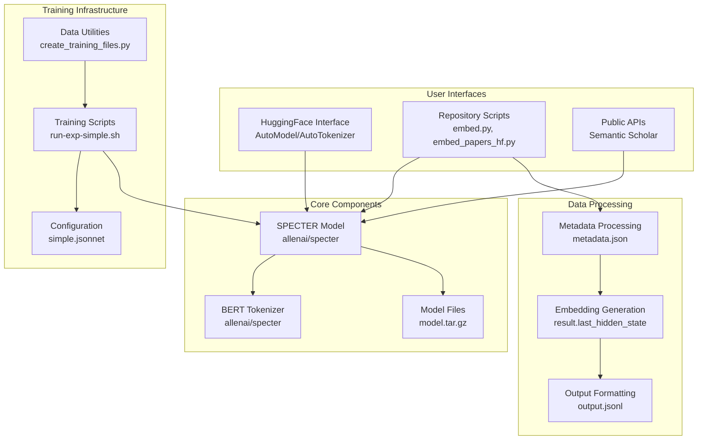
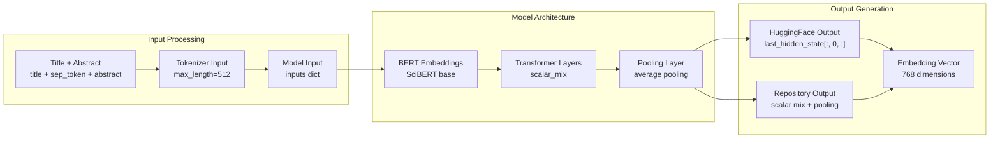
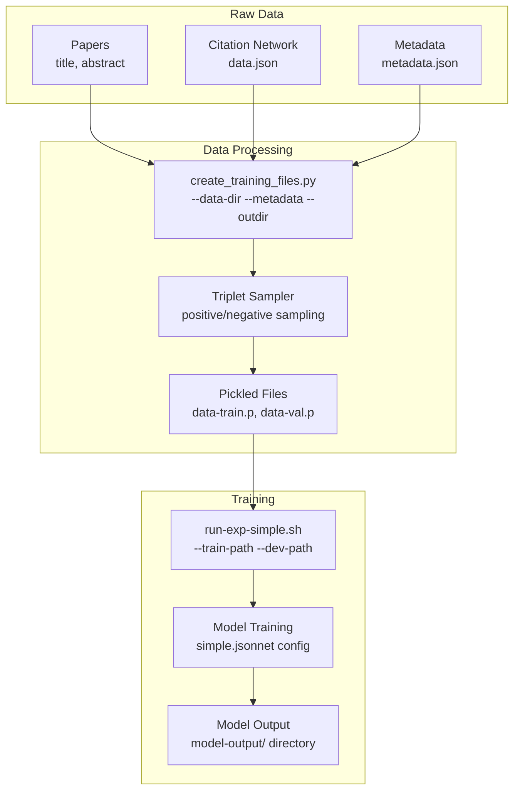

<!-- source: DeepWiki mcp.deepwiki.com · repo allenai/specter · page 1 Overview · fetched 2026-10-26 -->

# Overview

<details>
<summary>Relevant source files</summary>

The following files were used as context for generating this wiki page:

- [README.md](README.md)

</details>


This document provides a comprehensive overview of the SPECTER system, including its architecture, components, and interfaces. SPECTER (Document-level Representation Learning using Citation-informed Transformers) is a machine learning system that generates embeddings for scientific documents using citation relationships during training.

For detailed instructions on installation and setup, see [Installation & Setup](#2). For immediate usage examples, see [Quick Start](#3). For comprehensive usage documentation, see [User Guide](#4).

## Purpose and Scope

SPECTER generates vector representations (embeddings) of scientific documents by leveraging both textual content (title and abstract) and citation relationships. Unlike standard language models that only consider text, SPECTER incorporates citation networks during training to produce embeddings that capture semantic relationships between papers.

The system serves two primary functions:
- **Inference**: Generate embeddings for new scientific documents
- **Training**: Train custom models using citation-informed learning

## System Architecture

SPECTER provides multiple interfaces for different use cases, all built around a core transformer-based model architecture.

### High-Level Architecture



Sources: [README.md:1-220]()

### Core Model Components



Sources: [README.md:28-44](), [README.md:66-69]()

## Data Flow

### Inference Pipeline

The system processes scientific documents through a standardized pipeline regardless of the interface used:

| Stage | HuggingFace Interface | Repository Interface | Public API |
|-------|----------------------|---------------------|------------|
| Input Format | Python dict with title/abstract | `metadata.json` + `sample.ids` | HTTP request |
| Tokenization | `AutoTokenizer.from_pretrained('allenai/specter')` | Built-in tokenizer | Pre-processed |
| Model Loading | `AutoModel.from_pretrained('allenai/specter')` | `model.tar.gz` | Server-side |
| Embedding Extraction | `result.last_hidden_state[:, 0, :]` | Scalar mix + pooling | API response |
| Output Format | NumPy array | `output.jsonl` | JSON response |

### Training Data Flow



Sources: [README.md:149-196]()

## Interface Comparison

SPECTER provides three distinct interfaces, each optimized for different use cases:

### HuggingFace Interface
- **Entry Point**: `AutoModel.from_pretrained('allenai/specter')`
- **Script**: `scripts/embed_papers_hf.py`
- **Embedding Method**: CLS token from final layer
- **Use Case**: Python integration, batch processing
- **Performance**: Slightly higher than paper results

### Repository Interface  
- **Entry Point**: `scripts/embed.py`
- **Model Loading**: `model.tar.gz`
- **Embedding Method**: Scalar mix + average pooling
- **Use Case**: Reproducing paper results, custom configurations
- **Dependencies**: AllenNLP, custom environment

### Public API Interface
- **Entry Point**: Semantic Scholar API endpoints
- **Access**: HTTP requests
- **Use Case**: Pre-computed embeddings, production applications
- **Note**: Different model version than repository

Sources: [README.md:14-70](), [README.md:139-143]()

## Key Technical Specifications

| Component | Specification |
|-----------|--------------|
| Model Base | SciBERT (BERT-base) |
| Input Length | 512 tokens maximum |
| Embedding Dimension | 768 |
| Supported Formats | JSON, JSONL |
| Training Framework | AllenNLP, PyTorch Lightning |
| Inference Backend | PyTorch, HuggingFace Transformers |

## Training Approach

SPECTER uses citation-informed learning where:
- **Positive Examples**: Papers with direct citations (`count=5`)
- **Hard Negatives**: Papers with indirect citations (`count=1`) 
- **Easy Negatives**: Unrelated papers
- **Sampling Strategy**: Configurable via `--ratio_hard_negatives`

The training data structure in `data.json` follows this format:
```json
{
  "docid1": {
    "docid11": {"count": 1},
    "docid12": {"count": 5}
  }
}
```

Sources: [README.md:160-172]()

## Evaluation

SPECTER performance is measured using the SciDocs benchmark, which evaluates document-level representations across multiple tasks including classification, citation prediction, and recommendation.

For detailed evaluation procedures, see [Evaluation](#8).

Sources: [README.md:60-64](), [README.md:199-205]()

---

