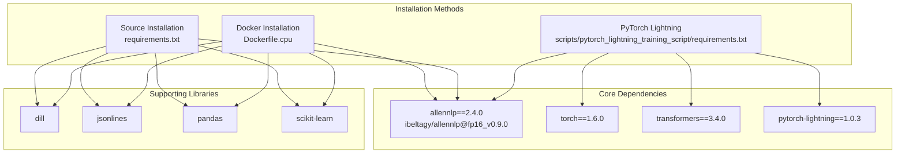
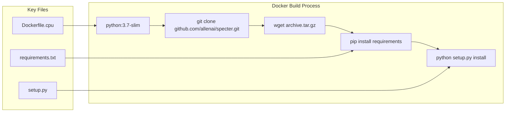

<!-- source: DeepWiki mcp.deepwiki.com · repo allenai/specter · page 2 Installation & Setup · fetched 2026-10-26 -->

# Installation & Setup

<details>
<summary>Relevant source files</summary>

The following files were used as context for generating this wiki page:

- [Dockerfile.cpu](Dockerfile.cpu)
- [requirements.txt](requirements.txt)
- [scripts/pytorch_lightning_training_script/requirements.txt](scripts/pytorch_lightning_training_script/requirements.txt)

</details>


This document provides comprehensive instructions for installing SPECTER and configuring the development environment. It covers multiple installation methods including Docker containers, pip installation, and source installation, along with dependency management and environment verification.

For information about using SPECTER after installation, see [Quick Start](#3). For training custom models, see [Training Models](#4.2).

## Prerequisites

SPECTER requires Python 3.7 and has specific dependency requirements due to its use of a custom AllenNLP fork with fp16 support. The system supports both CPU and GPU environments.

| Requirement | Version | Notes |
|-------------|---------|-------|
| Python | 3.7 | Required for compatibility with AllenNLP fork |
| PyTorch | 1.6.0 | Specific version required for training |
| CUDA | Optional | For GPU acceleration |
| Git | Latest | Required for custom AllenNLP installation |

## Installation Methods

SPECTER can be installed using three primary methods, each suited for different use cases:

### Installation Method Overview



Sources: [requirements.txt:1-8](), [Dockerfile.cpu:1-20](), [scripts/pytorch_lightning_training_script/requirements.txt:1-12]()

### Docker Installation (Recommended)

Docker provides the most reliable installation method with pre-configured dependencies:



The Docker installation process follows these steps from [Dockerfile.cpu:1-20]():

1. **Base Environment**: Uses `python:3.7-slim` as the base image
2. **System Dependencies**: Installs `git`, `wget`, and build tools
3. **Repository Setup**: Clones the SPECTER repository and downloads model artifacts
4. **Python Dependencies**: Installs AllenNLP 2.4.0 and requirements from `requirements.txt`
5. **Package Installation**: Runs `python setup.py install`

Sources: [Dockerfile.cpu:2-18]()

### Source Installation

For development or custom configurations, install from source:

#### Core Dependencies

The primary dependencies are specified in [requirements.txt:1-8]():

| Package | Version/Source | Purpose |
|---------|----------------|---------|
| `allennlp` | Custom fork: `ibeltagy/allennlp@fp16_v0.9.0` | Custom AllenNLP with fp16 support |
| `dill` | Latest | Serialization library |
| `jsonlines` | Latest | JSON Lines format support |
| `pandas` | Latest | Data manipulation |
| `scikit-learn` | Latest | Machine learning utilities |

#### PyTorch Lightning Training Setup

For training with PyTorch Lightning, additional dependencies are required from [scripts/pytorch_lightning_training_script/requirements.txt:1-12]():

| Package | Version | Purpose |
|---------|---------|---------|
| `torch` | 1.6.0 | PyTorch framework |
| `transformers` | 3.4.0 | HuggingFace Transformers |
| `pytorch-lightning` | 1.0.3 | Training framework |

Sources: [requirements.txt:1-8](), [scripts/pytorch_lightning_training_script/requirements.txt:1-12]()

## Dependency Management

SPECTER uses a custom AllenNLP fork that requires specific installation procedures:

### AllenNLP Fork Installation

The system requires a custom AllenNLP fork with fp16 and gradient accumulation support. Two versions are used depending on the installation method:

1. **Docker Installation**: Uses `allennlp==2.4.0` from [Dockerfile.cpu:14]()
2. **Source Installation**: Uses custom fork from [requirements.txt:2]()

### System Dependencies

For source installation, ensure the following system packages are installed:

```bash
# For CentOS/RHEL systems (referenced in comments)
sudo yum -y install gcc
sudo yum install python3-devel

# For Ubuntu/Debian systems
sudo apt-get install build-essential python3-dev
```

Sources: [scripts/pytorch_lightning_training_script/requirements.txt:7-8](), [Dockerfile.cpu:4-5]()

## Environment Setup

### GPU Environment

For GPU acceleration, ensure CUDA is available and PyTorch is installed with CUDA support. The system supports both CPU and GPU training configurations.

### Optional Dependencies

Additional components can be installed for enhanced functionality:

- **TensorBoard**: For training visualization with PyTorch Lightning
- **Cython**: For performance improvements during installation

Sources: [scripts/pytorch_lightning_training_script/requirements.txt:11-12](), [Dockerfile.cpu:11-12]()

## Verification

After installation, verify the setup by checking that core components are accessible:

1. **Python Environment**: Ensure Python 3.7 is active
2. **Package Installation**: Verify SPECTER package is importable
3. **Model Access**: Confirm access to pre-trained models
4. **Dependencies**: Check that AllenNLP and other dependencies are properly installed

The installation is complete when the system can successfully import SPECTER components and access the required model artifacts downloaded during setup.

Sources: [Dockerfile.cpu:8-9](), [Dockerfile.cpu:17-18]()

---

