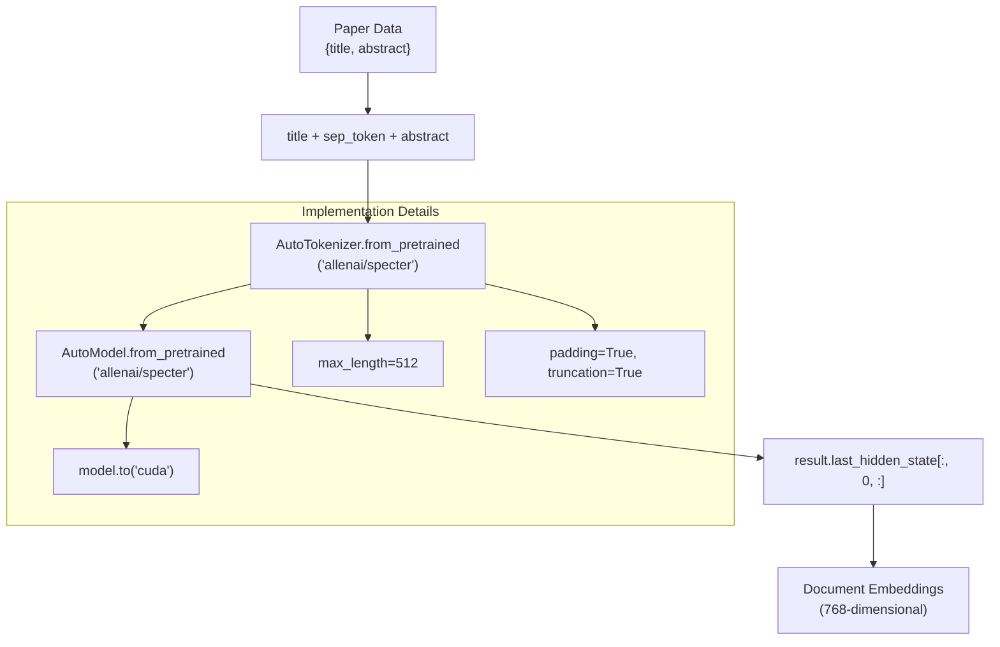
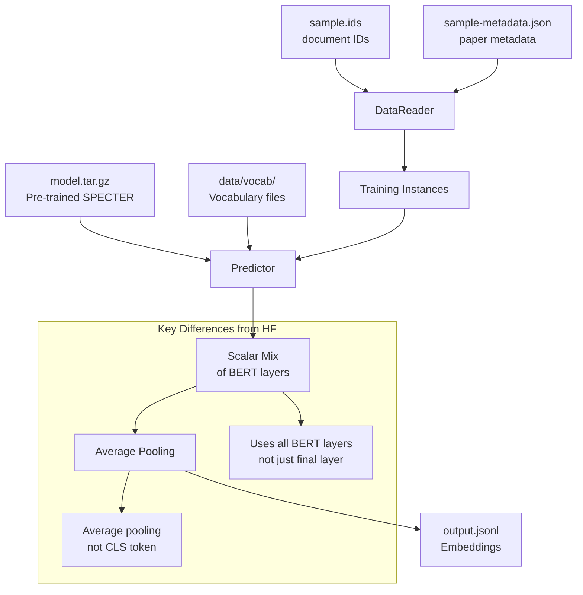
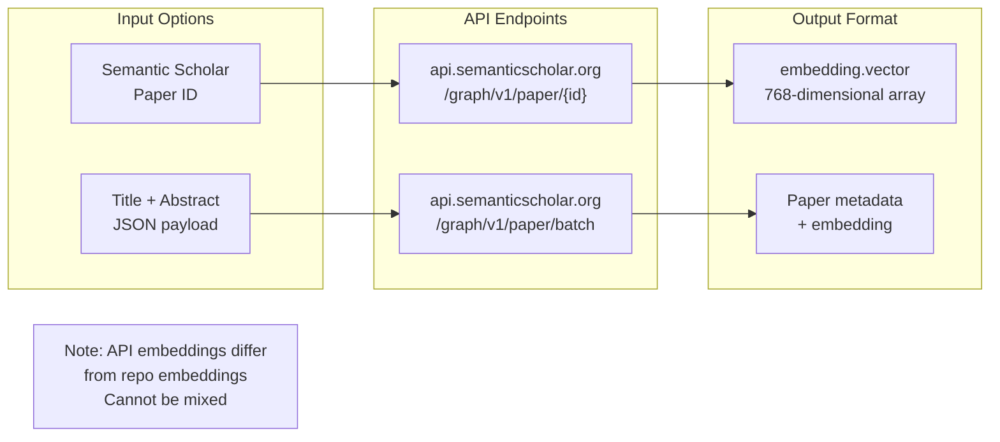

<!-- source: DeepWiki mcp.deepwiki.com · repo allenai/specter · page 3 Quick Start · fetched 2026-10-26 -->

# Quick Start

<details>
<summary>Relevant source files</summary>

The following files were used as context for generating this wiki page:

- [README.md](README.md)
- [data/sample-metadata.json](data/sample-metadata.json)
- [data/sample.ids](data/sample.ids)
- [scripts/embed_papers_hf.py](scripts/embed_papers_hf.py)

</details>


This page provides immediate working examples for generating scientific paper embeddings using SPECTER. It covers the three main interfaces available and demonstrates how to get embeddings for your papers with minimal setup.

For detailed configuration options and advanced usage, see [User Guide](#4). For training custom models, see [Training Models](#4.2). For understanding the underlying architecture, see [Architecture Reference](#6).

## Overview

SPECTER provides three distinct interfaces for generating document embeddings:

1. **HuggingFace Interface** - Most accessible, uses standard transformers library
2. **Repository Interface** - Original implementation with full feature set
3. **Public API Interface** - Pre-computed embeddings and on-demand generation

Each interface has different trade-offs in terms of setup complexity, performance characteristics, and output compatibility.

## Prerequisites

All interfaces require Python 3.7+ and basic dependencies. The specific requirements vary by interface:

| Interface | Key Requirements |
|-----------|-----------------|
| HuggingFace | `transformers==4.2+` |
| Repository | `allennlp==2.4.0`, `pytorch==1.6.0` |
| Public API | `requests` library |

## HuggingFace Interface

The HuggingFace interface provides the simplest way to generate embeddings using the standard transformers library.

### Basic Usage

```python
from transformers import AutoTokenizer, AutoModel

# Load model and tokenizer
tokenizer = AutoTokenizer.from_pretrained('allenai/specter')
model = AutoModel.from_pretrained('allenai/specter')

# Prepare paper data
papers = [
    {'title': 'BERT', 'abstract': 'We introduce a new language representation model called BERT'},
    {'title': 'Attention is all you need', 'abstract': 'The dominant sequence transduction models are based on complex recurrent or convolutional neural networks'}
]

# Concatenate title and abstract
title_abs = [d['title'] + tokenizer.sep_token + (d.get('abstract') or '') for d in papers]

# Generate embeddings
inputs = tokenizer(title_abs, padding=True, truncation=True, return_tensors="pt", max_length=512)
result = model(**inputs)
embeddings = result.last_hidden_state[:, 0, :]  # CLS token approach
```

### Batch Processing

For processing large datasets, use the provided batch script:

```bash
CUDA_VISIBLE_DEVICES=0 python scripts/embed_papers_hf.py \
--data-path data/sample-metadata.json \
--output embeddings.jsonl \
--batch-size 8
```

**HuggingFace Embedding Flow**



Sources: [README.md:24-58](), [scripts/embed_papers_hf.py:1-82]()

## Repository Interface

The repository interface uses the original SPECTER implementation with AllenNLP, providing the exact model architecture from the paper.

### Setup

1. Download the pre-trained model:
```bash
wget https://ai2-s2-research-public.s3-us-west-2.amazonaws.com/specter/archive.tar.gz
tar -xzvf archive.tar.gz
```

2. Install dependencies:
```bash
pip install -r requirements.txt
python setup.py install
```

### Usage

The repository interface requires two input files:

1. **IDs file** - One document ID per line (e.g., `data/sample.ids`)
2. **Metadata file** - JSON mapping IDs to paper data (e.g., `data/sample-metadata.json`)

```bash
python scripts/embed.py \
--ids data/sample.ids \
--metadata data/sample-metadata.json \
--model ./model.tar.gz \
--output-file output.jsonl \
--vocab-dir data/vocab/ \
--batch-size 16 \
--cuda-device 0
```

### Data Format Requirements

**Metadata JSON structure:**
```json
{
    "doc_id": {
        "title": "representation learning of scientific documents",
        "abstract": "we propose a new model for representing abstracts"
    }
}
```

**Repository Interface Architecture**



Sources: [README.md:66-137](), [data/sample-metadata.json:1-277](), [data/sample.ids:1-56]()

## Public API Interface

The Semantic Scholar API provides pre-computed embeddings and on-demand generation for papers in their corpus.

### Pre-computed Embeddings

```python
import requests

# Get pre-computed embedding for a paper
paper_id = "204e3073870fae3d05bcbc2f6a8e263d9b72e776"
url = f"https://api.semanticscholar.org/graph/v1/paper/{paper_id}?fields=embedding"

response = requests.get(url)
if response.status_code == 200:
    embedding = response.json()['embedding']['vector']
```

### On-demand Generation

For papers not in the corpus, use the embedding API:

```python
import requests

url = "https://api.semanticscholar.org/graph/v1/paper/batch"
headers = {"x-api-key": "YOUR_API_KEY"}

papers = [
    {"title": "Your Paper Title", "abstract": "Your paper abstract..."}
]

response = requests.post(url, json=papers, headers=headers)
embeddings = response.json()
```

**API Interface Comparison**



Sources: [README.md:139-143]()

## Interface Comparison

| Feature | HuggingFace | Repository | Public API |
|---------|-------------|------------|------------|
| **Setup Complexity** | Low | Medium | Minimal |
| **Embedding Method** | CLS token | Scalar mix + pooling | Various versions |
| **Batch Processing** | ✓ | ✓ | ✓ |
| **Offline Usage** | ✓ | ✓ | ✗ |
| **Exact Paper Results** | ✗ | ✓ | ✗ |
| **Custom Data** | ✓ | ✓ | Limited |

## Next Steps

- For production deployments, see [User Guide](#4)
- For custom training, see [Training Models](#4.2)  
- For evaluation benchmarks, see [Evaluation](#8)
- For understanding data formats, see [Data Formats](#5)

Sources: [README.md:1-220](), [scripts/embed_papers_hf.py:1-82](), [data/sample-metadata.json:1-277](), [data/sample.ids:1-56]()

---

