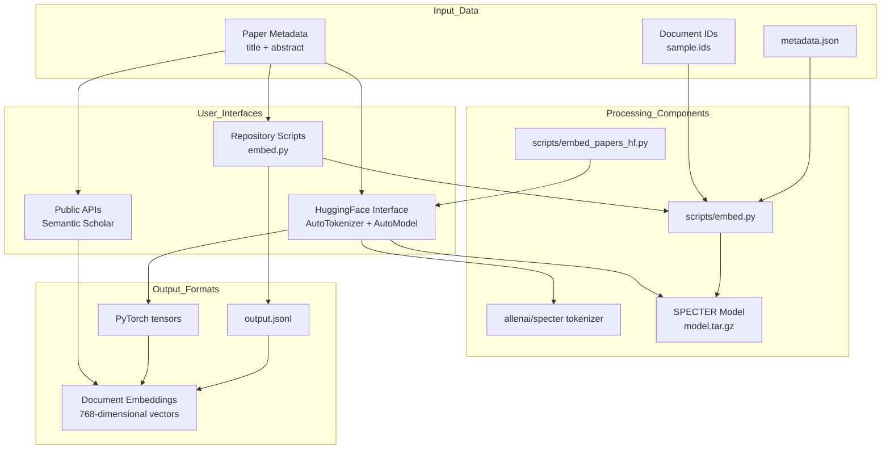
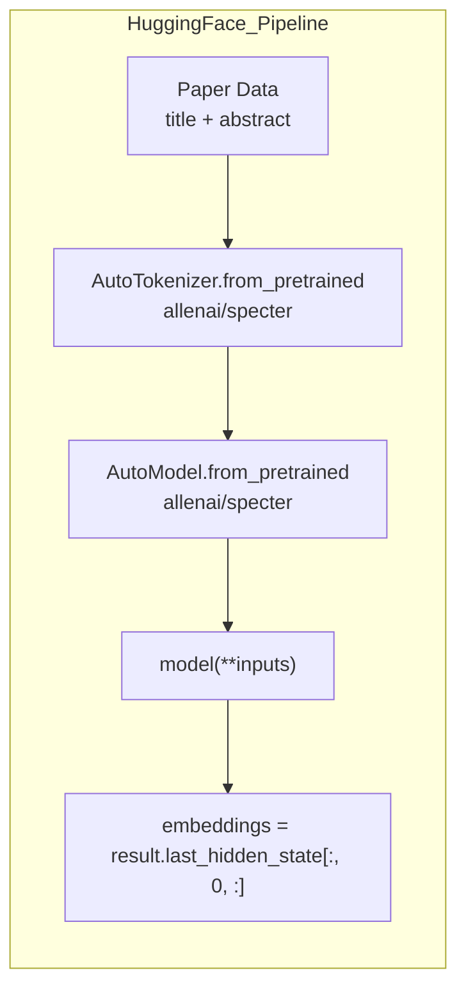
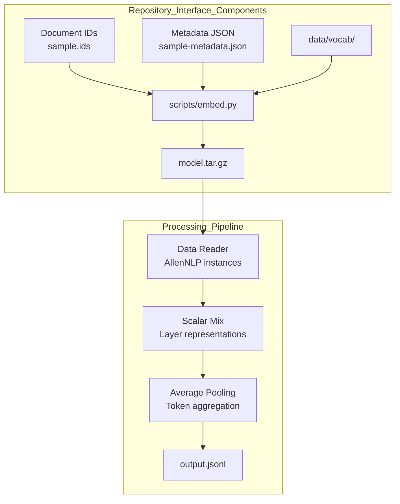
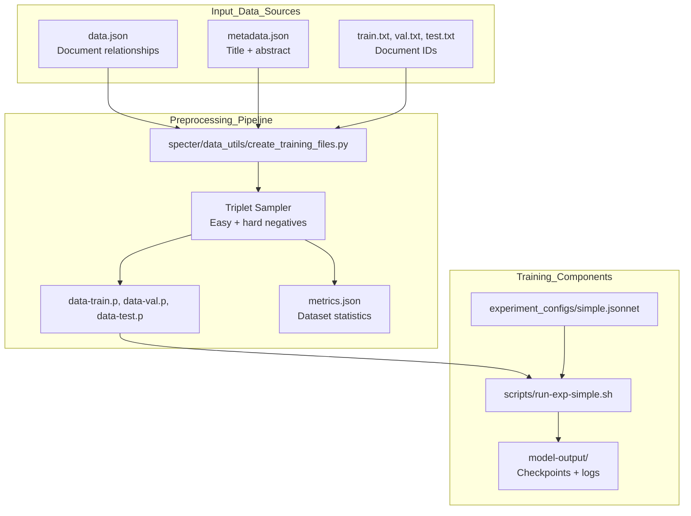

<!-- source: DeepWiki mcp.deepwiki.com · repo allenai/specter · page 4 User Guide · fetched 2026-10-26 -->

# User Guide

<details>
<summary>Relevant source files</summary>

The following files were used as context for generating this wiki page:

- [README.md](README.md)

</details>


This document provides comprehensive instructions for using SPECTER to generate scientific document embeddings and train custom models. It covers the three main interfaces for generating embeddings (HuggingFace, repository scripts, and public APIs) and provides detailed guidance for training your own SPECTER models.

For installation instructions, see [Installation & Setup](#2). For immediate working examples, see [Quick Start](#3). For technical details about SPECTER's architecture, see [Architecture Reference](#6).

## Overview of SPECTER Usage Patterns

SPECTER supports multiple usage patterns depending on your needs and technical requirements. The following diagram shows the main interfaces and their relationships:



**Sources: [README.md:22-147]()**

## Generating Embeddings

SPECTER provides three distinct interfaces for generating document embeddings, each optimized for different use cases and technical requirements.

### Interface Comparison

The following table summarizes the key differences between the three embedding interfaces:

| Feature | HuggingFace | Repository | Public APIs |
|---------|-------------|------------|-------------|
| **Ease of Use** | High | Medium | Highest |
| **Customization** | Medium | High | None |
| **Performance** | High | Medium | Highest |
| **Dependency Requirements** | Minimal | Full | None |
| **Batch Processing** | Yes | Yes | Limited |
| **Offline Usage** | Yes | Yes | No |

### HuggingFace Interface

The HuggingFace interface provides the most straightforward way to use SPECTER with minimal setup. It uses the `transformers` library and extracts embeddings from the `[CLS]` token.



**Basic Usage Pattern:**
```python
from transformers import AutoTokenizer, AutoModel

tokenizer = AutoTokenizer.from_pretrained('allenai/specter')
model = AutoModel.from_pretrained('allenai/specter')

# Format: title + SEP + abstract
title_abs = [d['title'] + tokenizer.sep_token + (d.get('abstract') or '') for d in papers]
inputs = tokenizer(title_abs, padding=True, truncation=True, return_tensors="pt", max_length=512)
result = model(**inputs)
embeddings = result.last_hidden_state[:, 0, :]
```

The HuggingFace interface includes a batch processing script at `scripts/embed_papers_hf.py` that handles large datasets efficiently:

```bash
CUDA_VISIBLE_DEVICES=0 python scripts/embed_papers_hf.py \
--data-path path/to/paper-metadata.json \
--output path/to/write/output.json \
--batch-size 8
```

**Sources: [README.md:24-58]()**

### Repository Interface

The original repository interface uses AllenNLP's implementation with scalar mixing of layers and average pooling. This approach provides more control over the embedding process but requires additional setup.



**Key Implementation Details:**
- Uses scalar mixing across all BERT layers rather than just the final layer
- Applies average pooling instead of using the `[CLS]` token directly
- Requires vocabulary files and model archives
- Outputs embeddings in JSONL format

**Command Structure:**
```bash
python scripts/embed.py \
--ids data/sample.ids \
--metadata data/sample-metadata.json \
--model ./model.tar.gz \
--output-file output.jsonl \
--vocab-dir data/vocab/ \
--batch-size 16 \
--cuda-device -1
```

**Sources: [README.md:66-137]()**

### Public APIs

The Semantic Scholar public APIs provide pre-computed embeddings and on-demand embedding services without requiring local model installation.

**Available API Endpoints:**
- Pre-computed embeddings for papers in the Semantic Scholar corpus
- On-demand embedding API for custom title/abstract pairs
- Bulk embedding retrieval for large datasets

**Important Note:** Public API embeddings are generated by a different version of SPECTER and cannot be mixed with locally generated embeddings within the same task.

**Sources: [README.md:139-143]()**

## Training Models

Training custom SPECTER models requires careful data preparation and configuration. The training process uses citation relationships to create positive and negative examples for contrastive learning.

### Data Preparation Workflow



### Data Format Requirements

The training data requires specific file formats and structures:

**data.json Structure:**
```json
{
  "docid1": {
    "docid11": {"count": 1}, 
    "docid12": {"count": 5},
    "docid13": {"count": 1}
  },
  "docid2": {
    "docid21": {"count": 1}
  }
}
```

**metadata.json Structure:**
```json
{
  "doc_id": {
    "title": "representation learning of scientific documents",
    "abstract": "we propose a new model for representing abstracts"
  }
}
```

**Citation Relationship Semantics:**
- `count=5`: Direct citation (positive examples)
- `count=1`: Citation of citation (hard negatives)
- No relationship: Easy negatives

**Sources: [README.md:160-172]()**

### Training Script Execution

The training process involves two main steps: data preprocessing and model training.

**Step 1: Create Training Files**
```bash
python specter/data_utils/create_training_files.py \
--data-dir data/training \
--metadata data/training/metadata.json \
--outdir data/preprocessed/
```

**Step 2: Run Training**
```bash
./scripts/run-exp-simple.sh -c experiment_configs/simple.jsonnet \
-s model-output/ --num-epochs 2 --batch-size 4 \
--train-path data/preprocessed/data-train.p \
--dev-path data/preprocessed/data-val.p \
--num-train-instances 55 --cuda-device -1
```

**Training Monitoring:**
- Model checkpoints and logs are stored in the output directory
- Progress can be monitored using TensorBoard: `tensorboard --logdir model-output/ --bind_all`
- The `metrics.json` file contains dataset statistics including the number of training instances

**Sources: [README.md:174-195]()**

### Configuration Management

Training configurations are managed through JSON configuration files that specify model architecture, training parameters, and data paths.

**Key Configuration Components:**
- Model architecture parameters
- Training hyperparameters (learning rate, batch size, epochs)
- Data input/output paths
- Evaluation metrics and validation settings

The configuration system allows for flexible experimentation with different model variants and training strategies.

**Sources: [README.md:186-189]()**

## Performance Considerations

### Model Performance Comparison

SPECTER provides different performance characteristics depending on the interface used:

| Interface | Avg SciDocs Score | Processing Speed | Memory Usage |
|-----------|-------------------|------------------|--------------|
| HuggingFace | 80.5 | Fast | Low |
| Repository | ~80.0 | Medium | Medium |
| Public API | N/A | Fastest | None |

### Batch Processing Recommendations

- **HuggingFace Interface**: Use batch sizes of 8-16 for optimal GPU utilization
- **Repository Interface**: Adjust batch size based on available memory
- **Large Datasets**: Use the provided batch processing scripts for efficient handling

**Sources: [README.md:57-64]()**

## Troubleshooting Common Issues

### Model Loading Issues
- Ensure correct transformers library version (`transformers==4.2` for HuggingFace)
- Verify model and vocabulary files are properly downloaded
- Check CUDA device availability and configuration

### Training Issues
- Verify `--num-train-instances` matches the value in `metrics.json`
- Ensure all required data files are present and properly formatted
- Monitor GPU memory usage during training

### Data Format Issues
- Validate JSON structure for metadata and data files
- Check document ID consistency across all files
- Ensure proper encoding for text fields

**Sources: [README.md:91-104](), [README.md:174-195]()**

---

