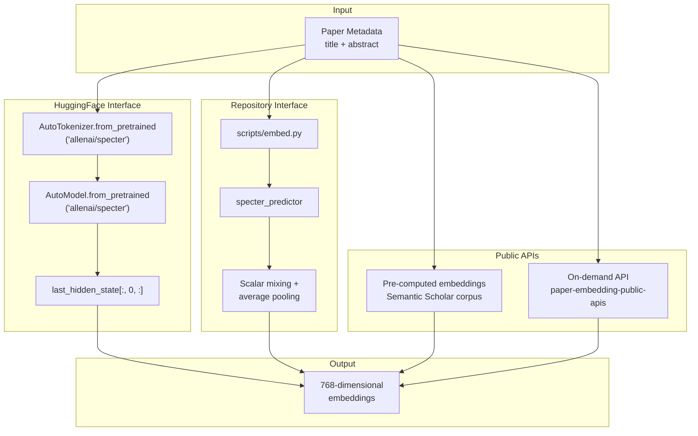
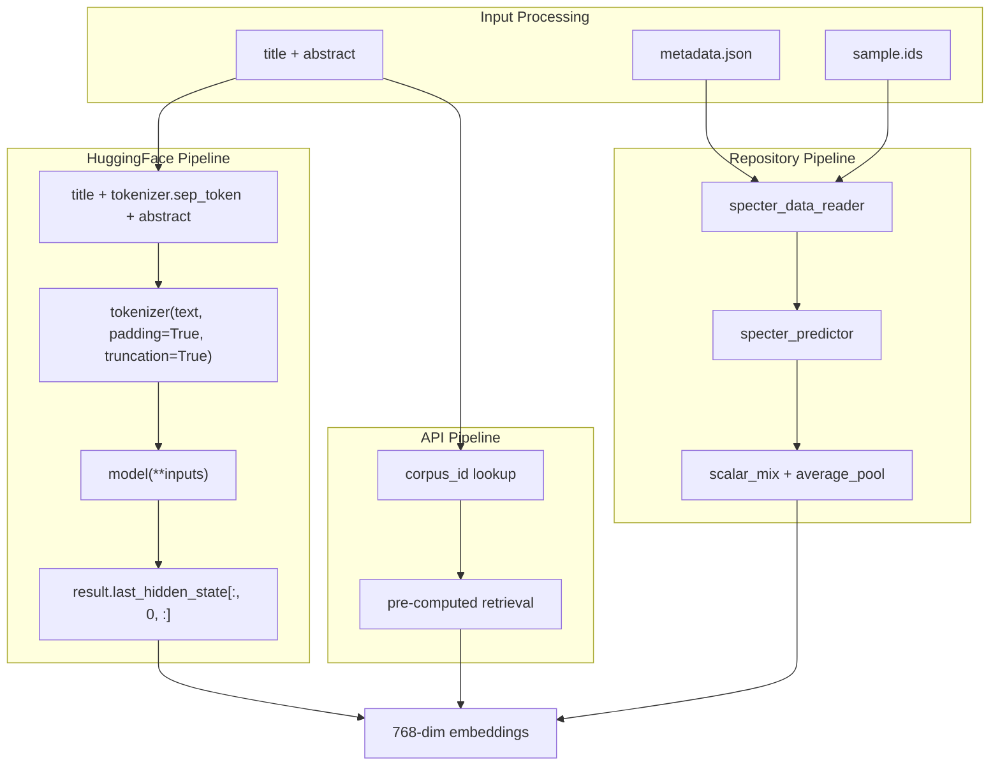

<!-- source: DeepWiki mcp.deepwiki.com · repo allenai/specter · page 4.1 Generating Embeddings · fetched 2026-10-26 -->

# Generating Embeddings

<details>
<summary>Relevant source files</summary>

The following files were used as context for generating this wiki page:

- [README.md](README.md)
- [scripts/embed.py](scripts/embed.py)
- [scripts/embed_papers_hf.py](scripts/embed_papers_hf.py)

</details>


This document provides an overview of the three main interfaces available for generating SPECTER embeddings from scientific papers. Each interface serves different use cases and has distinct technical implementations.

For detailed implementation guides for each interface, see:
- HuggingFace Interface: [4.1.1](#4.1.1)
- Repository Interface: [4.1.2](#4.1.2) 
- Public APIs: [4.1.3](#4.1.3)

For information about training custom models, see [Training Models](#4.2).

## Interface Overview

SPECTER provides three distinct approaches to generate paper embeddings, each with different technical foundations and use cases:



Sources: [README.md:1-219]()

## Technical Comparison

The three interfaces differ significantly in their technical implementation and embedding generation approach:

| Aspect | HuggingFace | Repository | Public APIs |
|--------|-------------|------------|-------------|
| **Model Loading** | `AutoModel.from_pretrained('allenai/specter')` | `model.tar.gz` archive | Pre-computed/API |
| **Tokenization** | `AutoTokenizer` with `sep_token` | `specter_data_reader` | N/A |
| **Embedding Method** | CLS token from final layer | Scalar mixing + average pooling | Different model version |
| **Input Format** | Python dict with title/abstract | JSON metadata + IDs file | Various API formats |
| **Batch Processing** | `scripts/embed_papers_hf.py` | `scripts/embed.py` | Bulk retrieval |
| **Dependencies** | `transformers==4.2` | AllenNLP + custom environment | HTTP client |

Sources: [README.md:24-143](), [scripts/embed_papers_hf.py:1-82](), [scripts/embed.py:1-69]()

## Data Flow Architecture

The following diagram shows how each interface processes input data to generate embeddings:



Sources: [README.md:28-44](), [README.md:124-136](), [scripts/embed_papers_hf.py:32-38](), [scripts/embed.py:37-50]()

## Key Technical Differences

### Embedding Generation Methods

The most significant technical difference lies in how embeddings are extracted:

**HuggingFace Interface:**
- Uses `result.last_hidden_state[:, 0, :]` to extract CLS token representation from the final transformer layer
- Follows standard BERT-style embedding extraction
- Simpler, more direct approach

**Repository Interface:**
- Uses scalar mixing across all transformer layers combined with average pooling
- More complex aggregation strategy as implemented in AllenNLP v0.9
- Original SPECTER paper implementation approach

Sources: [README.md:68-69]()

### Input Data Requirements

Each interface expects different input formats:

**HuggingFace Interface:**
```python
papers = [{'title': 'BERT', 'abstract': 'We introduce a new language representation model called BERT'}]
```

**Repository Interface:**
```python
# metadata.json format:
{
    'doc_id': {'title': 'representation learning of scientific documents',
               'abstract': 'we propose a new model for representing abstracts'}
}
```

**Public APIs:**
- Various API-specific formats
- Pre-computed embeddings for Semantic Scholar corpus papers
- On-demand embedding generation for arbitrary papers

Sources: [README.md:35-36](), [README.md:114-120](), [README.md:141-143]()

## Interface Selection Guide

Choose the appropriate interface based on your requirements:

| Use Case | Recommended Interface | Rationale |
|----------|----------------------|-----------|
| **Simple integration** | HuggingFace | Minimal dependencies, standard transformers API |
| **Exact paper reproduction** | Repository | Matches original SPECTER implementation |
| **Large-scale batch processing** | Repository | Optimized for bulk embedding generation |
| **Semantic Scholar papers** | Public APIs | Pre-computed embeddings available |
| **Production applications** | HuggingFace | Better maintained, more stable |
| **Research reproducibility** | Repository | Exact match to paper results |

Sources: [README.md:57-58](), [README.md:143]()

## Performance Considerations

The HuggingFace interface yields slightly higher average results than the repository interface, though both perform comparably on downstream tasks. The repository interface is required for exact reproduction of the original paper results.

Expected SciDocs performance from HuggingFace model: **80.5 average** across all tasks, with the repository interface producing results matching the original paper.

Sources: [README.md:57-64]()

---

