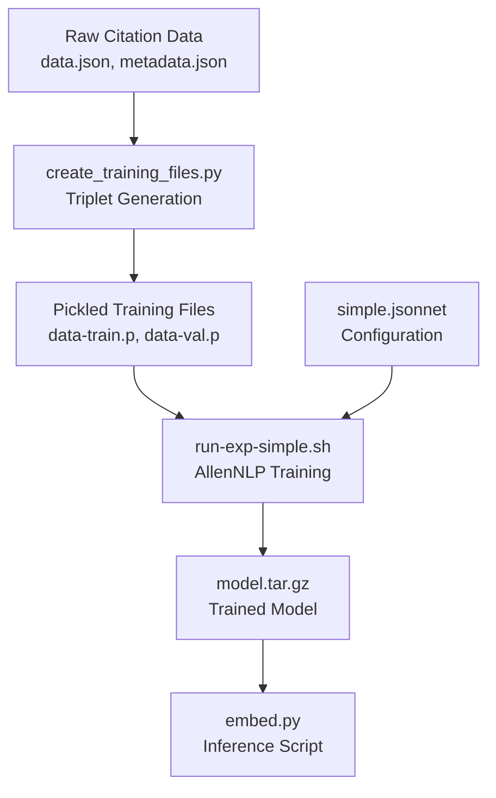
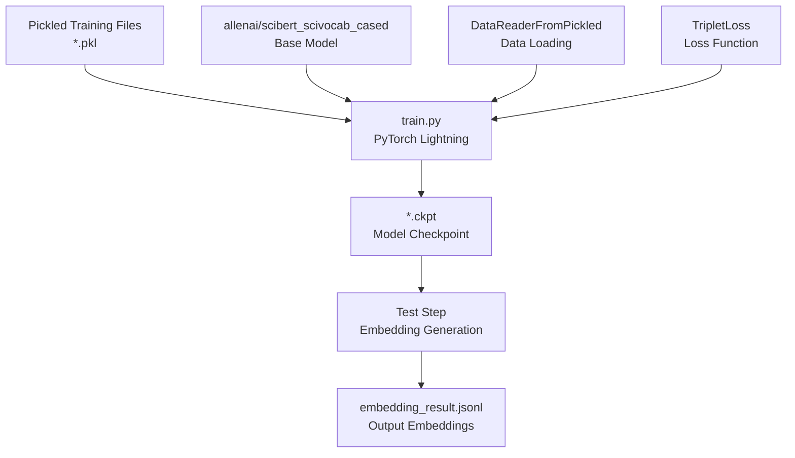
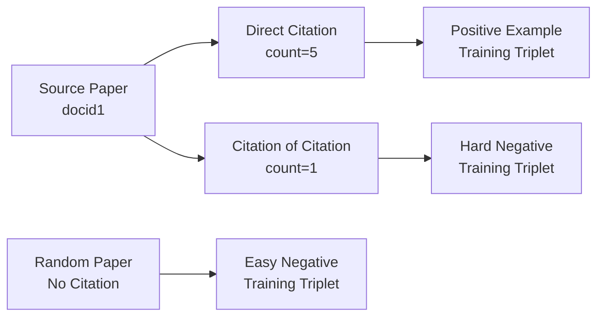
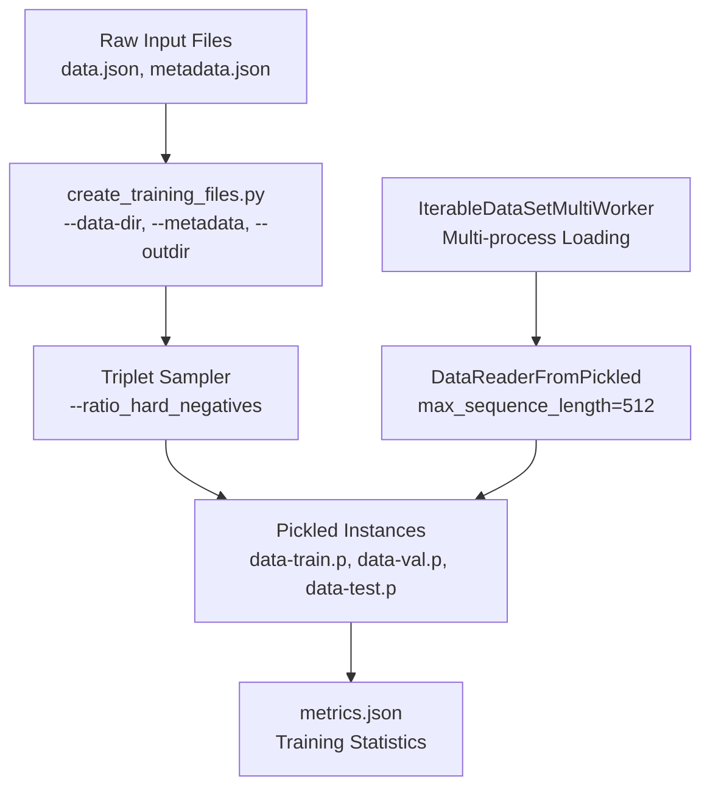
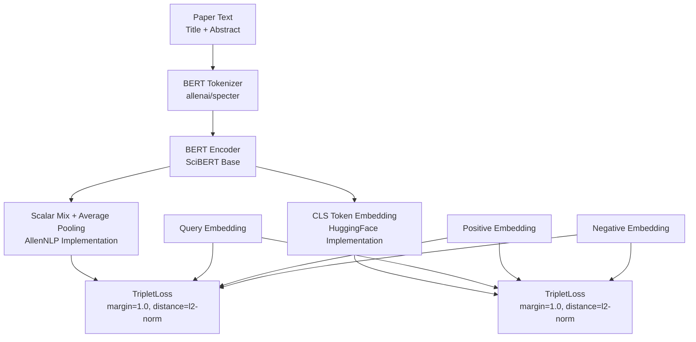
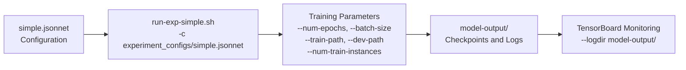
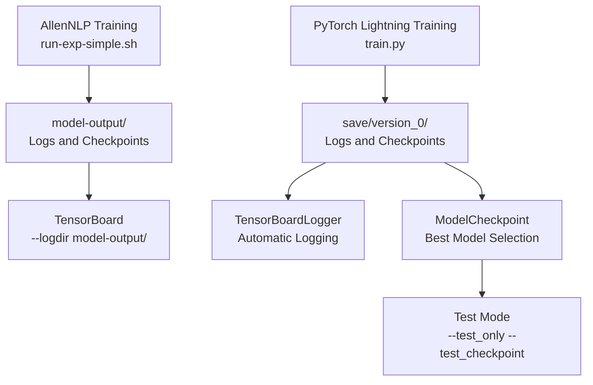

<!-- source: DeepWiki mcp.deepwiki.com · repo allenai/specter · page 4.2 Training Models · fetched 2026-10-26 -->

# Training Models

<details>
<summary>Relevant source files</summary>

The following files were used as context for generating this wiki page:

- [README.md](README.md)
- [scripts/pytorch_lightning_training_script/README.md](scripts/pytorch_lightning_training_script/README.md)
- [scripts/pytorch_lightning_training_script/train.py](scripts/pytorch_lightning_training_script/train.py)

</details>


This document covers the process of training custom SPECTER models from scratch using the provided training infrastructure. SPECTER supports two training approaches: the original AllenNLP-based implementation and a newer PyTorch Lightning implementation.

For information about using pre-trained models, see [Generating Embeddings](#4.1). For details about data preparation and preprocessing, see [Data Preparation](#4.2.1).

## Training Approaches

SPECTER provides two distinct training implementations with different frameworks and capabilities:

### AllenNLP Training Pipeline



**AllenNLP Training Pipeline**

The traditional training approach uses AllenNLP's training infrastructure with scalar mixing and average pooling for document embeddings.

Sources: [README.md:149-196](), [README.md:66-69]()

### PyTorch Lightning Training Pipeline



**PyTorch Lightning Training Pipeline**

The newer implementation uses PyTorch Lightning with HuggingFace Transformers, providing more modern training features and better GPU utilization.

Sources: [scripts/pytorch_lightning_training_script/train.py:1-599](), [scripts/pytorch_lightning_training_script/README.md:1-25]()

## Data Requirements

Training requires three types of input files with specific formats:

| File Type | Description | Format |
|-----------|-------------|---------|
| `data.json` | Document relationships and citation counts | Nested dict with paper IDs and citation counts |
| `metadata.json` | Paper metadata (title, abstract) | Dict mapping paper IDs to metadata |
| Train/Val/Test splits | Document IDs for each split | Text files with one ID per line |

### Citation Relationship Structure



**Citation-based Triplet Generation**

The training data uses citation relationships to generate triplets where direct citations (`count=5`) serve as positive examples, indirect citations (`count=1`) as hard negatives, and random papers as easy negatives.

Sources: [README.md:160-173]()

## Training Data Processing

The training pipeline converts raw citation data into preprocessed training instances through several stages:



**Data Processing Pipeline**

The `create_training_files.py` script processes raw citation data into training instances with configurable hard negative ratios.

Sources: [README.md:174-182](), [scripts/pytorch_lightning_training_script/train.py:63-137]()

## Model Architecture and Loss Function

Both training approaches use the same core model architecture with citation-informed triplet learning:



**Model Architecture Comparison**

The key difference between implementations is the pooling strategy: AllenNLP uses scalar mixing across layers with average pooling, while PyTorch Lightning uses the CLS token from the final layer.

Sources: [README.md:66-69](), [scripts/pytorch_lightning_training_script/train.py:253-306](), [scripts/pytorch_lightning_training_script/train.py:318-335]()

## Training Configuration

### AllenNLP Configuration

The AllenNLP training uses JSON configuration files with the following key parameters:



**AllenNLP Training Configuration**

Training parameters are specified through shell script arguments and configuration files.

Sources: [README.md:184-196]()

### PyTorch Lightning Configuration

The PyTorch Lightning implementation uses command-line arguments for configuration:

| Parameter | Description | Default |
|-----------|-------------|---------|
| `--train_file` | Path to training data pickle file | Required |
| `--dev_file` | Path to validation data pickle file | Required |
| `--test_file` | Path to test data pickle file | Required |
| `--batch_size` | Training batch size | 1 |
| `--num_epochs` | Number of training epochs | 1 |
| `--lr` | Learning rate | 2e-5 |
| `--grad_accum` | Gradient accumulation steps | 1 |

Sources: [scripts/pytorch_lightning_training_script/train.py:477-522]()

## Training Execution

### AllenNLP Training Command

```bash
./scripts/run-exp-simple.sh -c experiment_configs/simple.jsonnet \
-s model-output/ --num-epochs 2 --batch-size 4 \
--train-path data/preprocessed/data-train.p --dev-path data/preprocessed/data-val.p \
--num-train-instances 55 --cuda-device -1
```

### PyTorch Lightning Training Command

```bash
python scripts/pytorch_lightning_training_script/train.py \
--save_dir ./save --gpus 1 \
--train_file /path/to/train.pkl --dev_file /path/to/val.pkl --test_file /path/to/test.pkl \
--batch_size 2 --num_workers 0 --num_epochs 4 --grad_accum 256
```

### Training Monitoring

Both implementations support training monitoring through different mechanisms:



**Training Monitoring and Checkpointing**

Both implementations provide comprehensive logging and checkpointing capabilities for training monitoring and model selection.

Sources: [README.md:194-195](), [scripts/pytorch_lightning_training_script/train.py:570-594](), [scripts/pytorch_lightning_training_script/README.md:15-23]()

---

