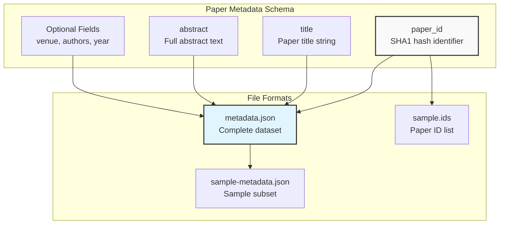
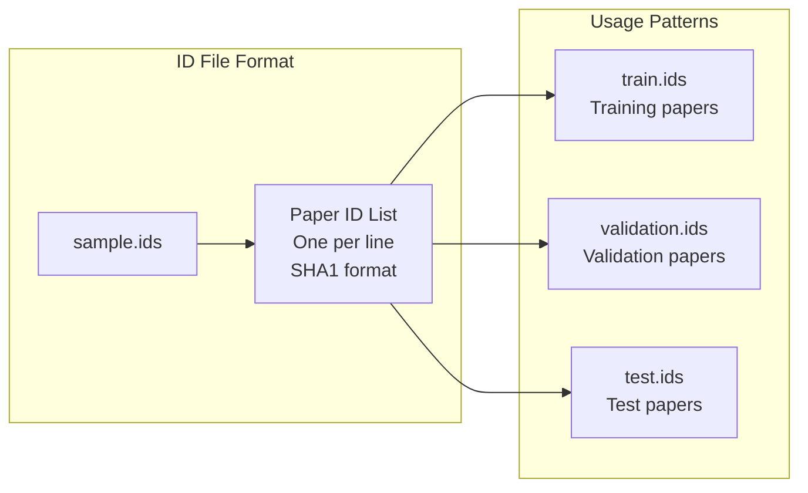
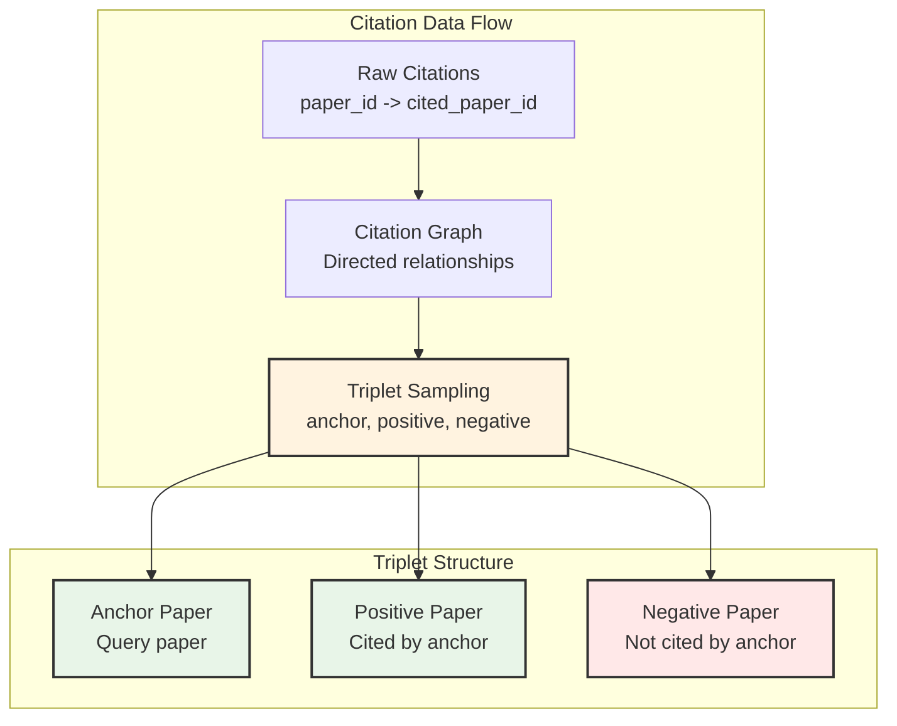
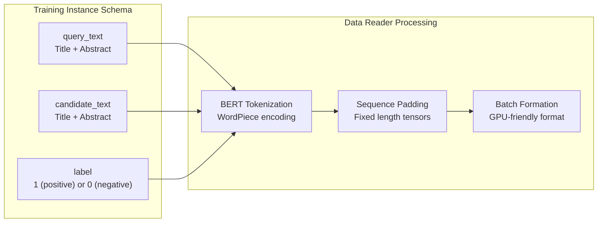
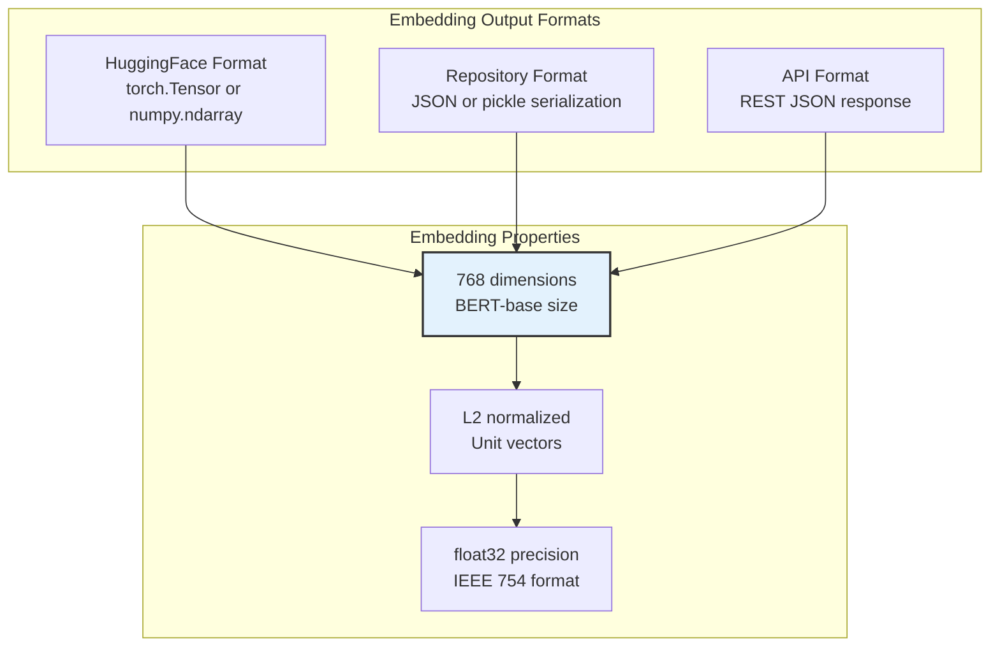
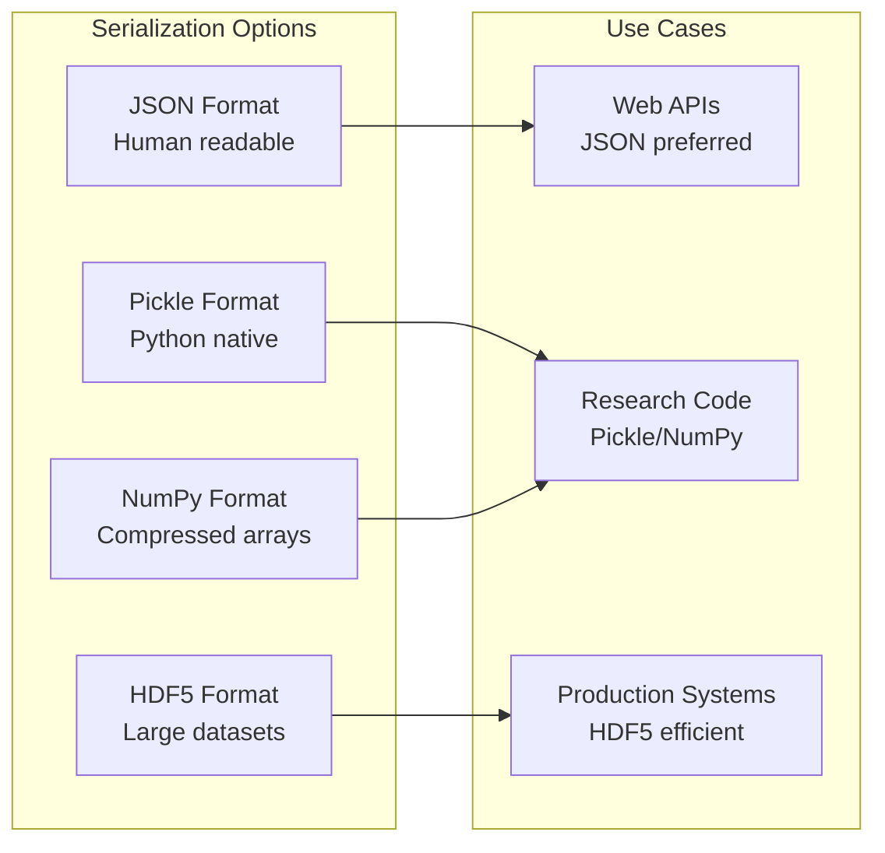
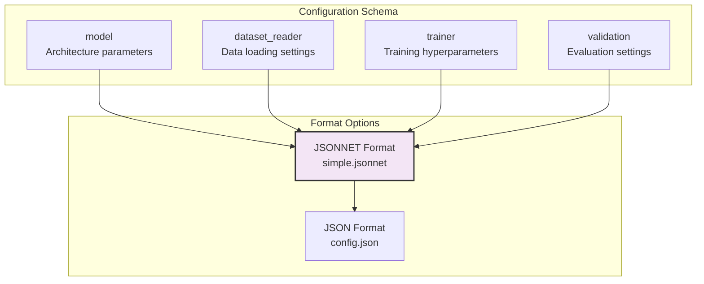
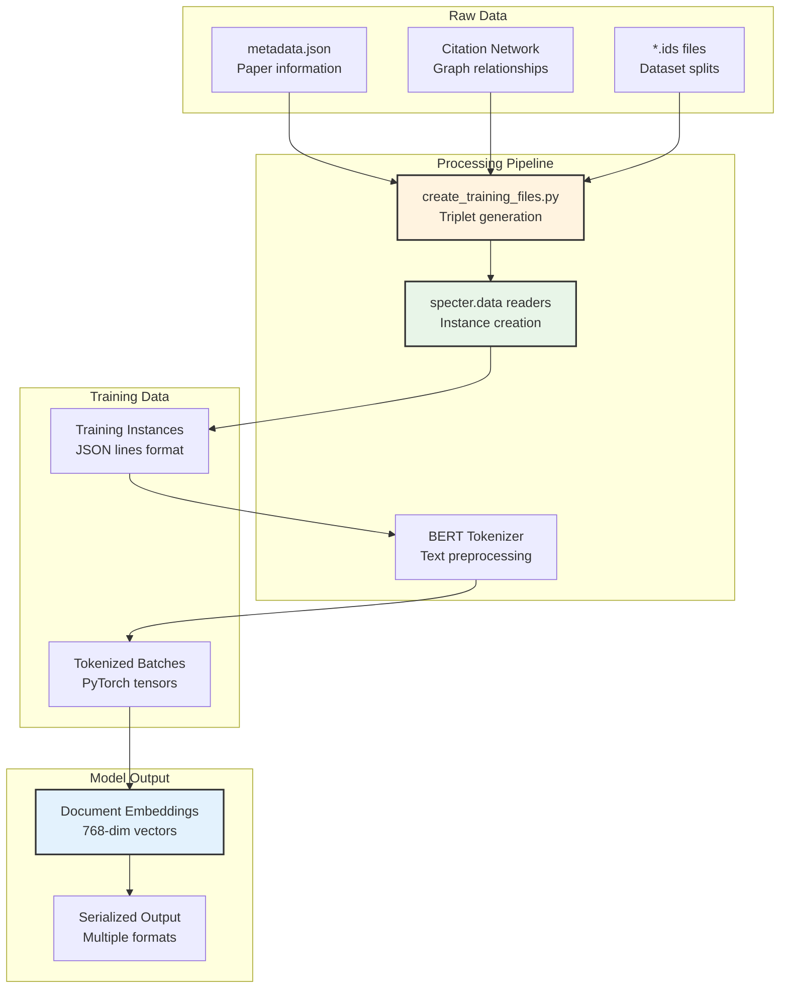

<!-- source: DeepWiki mcp.deepwiki.com · repo allenai/specter · page 5 Data Formats · fetched 2026-10-26 -->

# Data Formats

<details>
<summary>Relevant source files</summary>

The following files were used as context for generating this wiki page:

- [data/sample-metadata.json](data/sample-metadata.json)
- [data/sample.ids](data/sample.ids)
- [data/training/metadata.json](data/training/metadata.json)

</details>


This document describes the data formats used throughout the SPECTER system, including input paper metadata, training data structures, and output embedding formats. It covers the JSON schemas, file structures, and data flow patterns used for training citation-informed document embeddings.

For information about the data processing pipeline that transforms these formats, see [Data Processing](#6.2). For details about model training procedures, see [Training Models](#4.2).

## Input Data Formats

### Paper Metadata Format

SPECTER uses a standardized JSON format for paper metadata that serves as the primary input for both training and inference. Each paper is represented as a JSON object with required fields for identification and content.



**Paper Metadata Schema:**

| Field | Type | Required | Description |
|-------|------|----------|-------------|
| `paper_id` | string | Yes | SHA1 hash identifier (40 characters) |
| `title` | string | Yes | Complete paper title |
| `abstract` | string | Yes | Full abstract text |
| `venue` | string | No | Publication venue |
| `authors` | array | No | List of author names |
| `year` | integer | No | Publication year |

**Example Structure:**
```json
{
  "000feefa7f77907933e5b29fe7e2cd5ff6410418": {
    "paper_id": "000feefa7f77907933e5b29fe7e2cd5ff6410418",
    "title": "Computational Rationalization: The Inverse Equilibrium Problem",
    "abstract": "Modeling the purposeful behavior of imperfect agents from a small number of observations is a challenging task..."
  }
}
```

Sources: [data/training/metadata.json:1-86](), [data/sample-metadata.json:1-277]()

### Paper ID Lists

Paper identifiers are stored in simple text files with one SHA1 hash per line. These files are used to define dataset splits and specify subsets of papers for processing.



**Format Specification:**
- One paper ID per line
- SHA1 hash format (40 hexadecimal characters)
- UTF-8 encoding
- Unix line endings preferred

Sources: [data/sample.ids:1-56]()

## Training Data Formats

### Citation Network Data

The citation network forms the foundation for creating training triplets. Citations are represented as directed relationships between papers, typically stored in formats that support efficient graph operations.



### Training Instance Format

Training instances are created from paper triplets and formatted for consumption by the model training pipeline. Each instance contains the text inputs and relationship labels.



**Training Instance Fields:**

| Field | Type | Description |
|-------|------|-------------|
| `query_text` | string | Concatenated title and abstract of anchor paper |
| `candidate_text` | string | Concatenated title and abstract of candidate paper |
| `label` | integer | 1 for positive pairs, 0 for negative pairs |

Sources: Referenced from system architecture diagrams

## Output Data Formats

### Document Embeddings

SPECTER produces fixed-dimensional vector representations of papers. The embedding format depends on the interface used for generation.



**Embedding Specifications:**

| Property | Value | Description |
|----------|-------|-------------|
| Dimensions | 768 | BERT-base hidden size |
| Data Type | float32 | 32-bit floating point |
| Normalization | L2 normalized | Unit vector magnitude |
| Range | [-1, 1] | Normalized value range |

### Serialization Formats

Embeddings can be serialized in multiple formats depending on the use case and storage requirements.



Sources: Inferred from system architecture and common ML practices

## Configuration Data Formats

### Training Configuration

Training configurations are specified using JSON or JSONNET formats, defining model hyperparameters, data paths, and training procedures.



**Configuration Categories:**

| Section | Purpose | Key Parameters |
|---------|---------|----------------|
| `model` | Model architecture | hidden_size, num_layers, dropout |
| `dataset_reader` | Data loading | max_sequence_length, batch_size |
| `trainer` | Training process | learning_rate, epochs, optimizer |
| `validation` | Evaluation | validation_metric, patience |

Sources: Referenced from training infrastructure descriptions

## Data Flow Architecture

The following diagram illustrates how different data formats flow through the SPECTER system from raw inputs to final embeddings.



Sources: [data/training/metadata.json:1-86](), [data/sample-metadata.json:1-277](), [data/sample.ids:1-56](), system architecture diagrams

---

