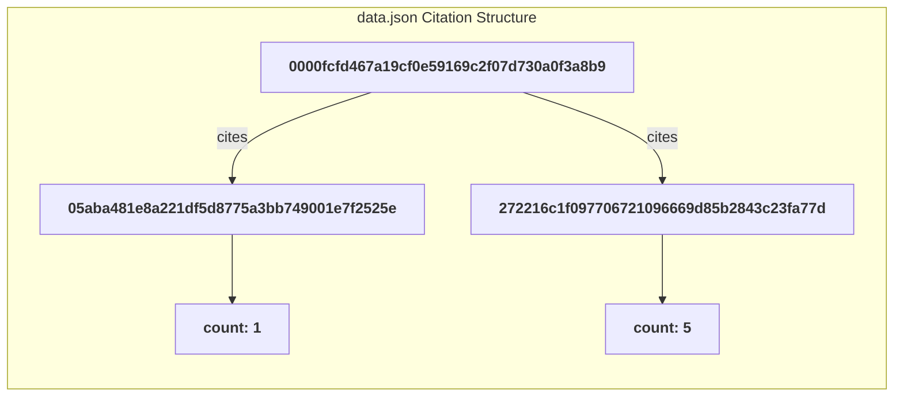
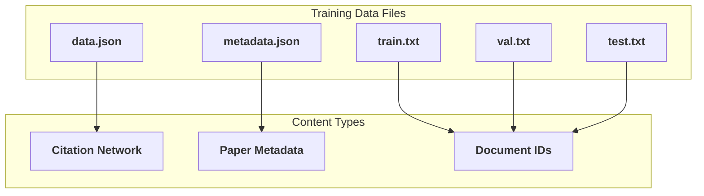
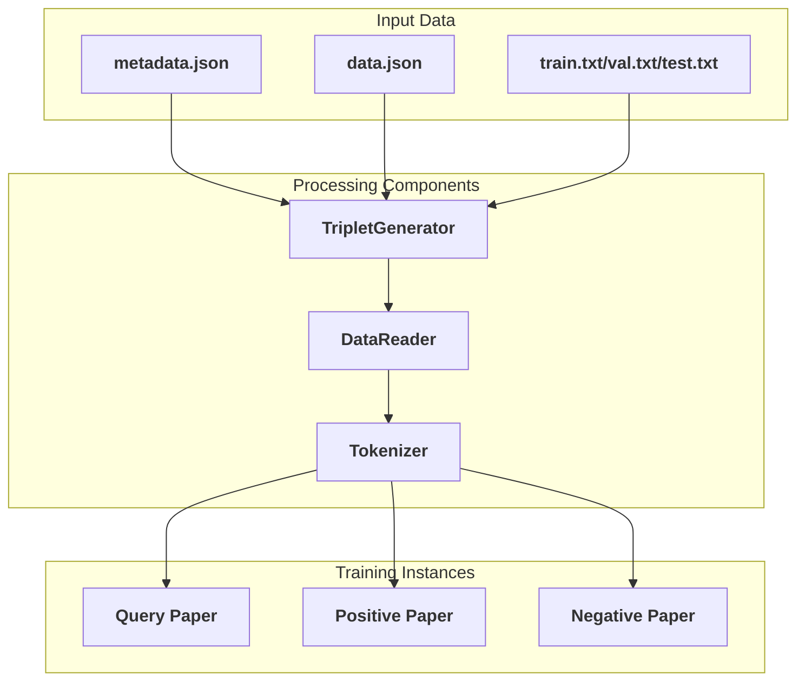

<!-- source: DeepWiki mcp.deepwiki.com · repo allenai/specter · page 5.1 Input Data · fetched 2026-10-26 -->

# Input Data

<details>
<summary>Relevant source files</summary>

The following files were used as context for generating this wiki page:

- [data/sample-metadata.json](data/sample-metadata.json)
- [data/sample.ids](data/sample.ids)
- [data/training/README.md](data/training/README.md)
- [data/training/data.json](data/training/data.json)

</details>


This document describes the input data formats used by SPECTER for training and inference. It covers the structure of paper metadata, citation relationships, and training data organization. For information about the data processing pipeline that transforms this input data, see [Data Processing](#6.2).

## Overview

SPECTER requires two primary types of input data:

1. **Paper Metadata**: Textual information about scientific papers including titles, abstracts, and identifiers
2. **Citation Relationships**: Network of citation links between papers with frequency counts
3. **Data Splits**: Organization of papers into training, validation, and test sets

The system processes these inputs to generate training instances for the citation-informed BERT model.

## Paper Metadata Format

Paper metadata is stored in JSON format with paper IDs as keys. Each paper entry contains textual fields used for embedding generation.

### Structure

```json
{
  "paper_id": {
    "title": "Paper Title",
    "abstract": "Paper abstract text...",
    "paper_id": "paper_id"
  }
}
```

### Example

The sample metadata demonstrates the expected format:

```mermaid
graph TD
    subgraph "metadata.json"
        A["`**00021eeee2bf4e06fec98941206f97083c38b54d**`"]
        B["`**title**: \"Opportunities and challenges for E-Commerce in Malaysia\"`"]
        C["`**abstract**: \"Numerous studies of E-Commerce have emphasized...\"`"]
        D["`**paper_id**: \"00021eeee2bf4e06fec98941206f97083c38b54d\"`"]
    end
    
    A --> B
    A --> C
    A --> D
```

**Sources:** [data/sample-metadata.json:1-219]()

### Field Descriptions

| Field | Type | Description |
|-------|------|-------------|
| `title` | string | Full title of the scientific paper |
| `abstract` | string | Paper abstract text used for semantic representation |
| `paper_id` | string | Unique identifier matching the JSON key |

## Citation Relationship Format

Citation relationships are stored as nested dictionaries representing the citation network structure.

### Structure

The citation data follows this hierarchical format:

```json
{
  "citing_paper_id": {
    "cited_paper_id": {
      "count": citation_frequency
    }
  }
}
```

### Citation Graph Representation



**Sources:** [data/training/data.json:1-1307](), [data/training/README.md:7-15]()

### Citation Count Significance

The `count` field indicates citation frequency:
- `count: 1` - Single citation relationship
- `count: 5` - Multiple citations (higher weight in training)

## Training Data Organization

Training data is organized into three components as described in the training directory structure.

### File Structure



**Sources:** [data/training/README.md:1-15]()

### Data Split Files

Training splits are stored as plain text files with one paper ID per line:

| File | Purpose | Format |
|------|---------|--------|
| `train.txt` | Training set paper IDs | One ID per line |
| `val.txt` | Validation set paper IDs | One ID per line |
| `test.txt` | Test set paper IDs | One ID per line |

### Sample ID List Format

```
00021eeee2bf4e06fec98941206f97083c38b54d
00027baa2a90e1a3d50c1da14882d518de6847f5
000c8d85037886c86de15290e5a8e9bae7b66103
```

**Sources:** [data/sample.ids:1-56]()

## Data Processing Pipeline

The input data flows through SPECTER's processing pipeline to create training instances.

### Data Flow Diagram



**Sources:** [data/training/README.md:1-15]()

### Input Validation Requirements

The system expects:
- Paper IDs to be consistent across all files
- All papers in split files to exist in metadata
- Citation relationships to reference valid paper IDs
- UTF-8 encoding for all text content

## Sample Data Characteristics

The provided sample data demonstrates typical SPECTER input:

### Metadata Coverage
- **Sample Size**: 219 papers across diverse domains
- **Title Length**: Varies from short technical titles to longer descriptive ones
- **Abstract Length**: Full abstracts providing semantic context
- **Domain Coverage**: Computer science, medicine, social sciences, natural sciences

### Citation Network Properties
- **Connectivity**: Sparse citation graph with selective relationships
- **Citation Counts**: Mix of single citations (count: 1) and multiple citations (count: 5)
- **Network Density**: Reflects real academic citation patterns

**Sources:** [data/sample-metadata.json:1-219](), [data/training/data.json:1-1307]()

---

