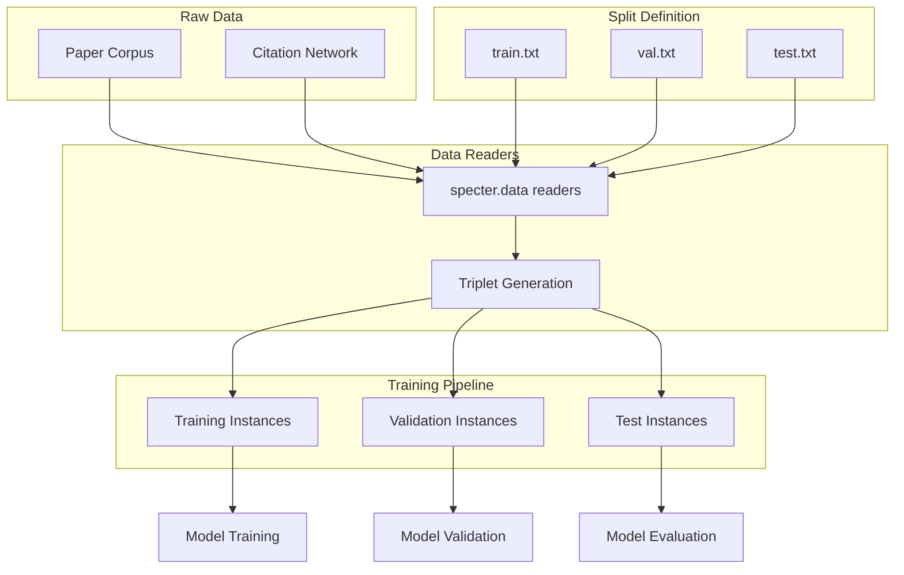
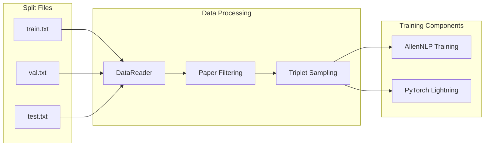

<!-- source: DeepWiki mcp.deepwiki.com · repo allenai/specter · page 5.2 Training Data Splits · fetched 2026-10-26 -->

# Training Data Splits

<details>
<summary>Relevant source files</summary>

The following files were used as context for generating this wiki page:

- [data/training/test.txt](data/training/test.txt)
- [data/training/train.txt](data/training/train.txt)
- [data/training/val.txt](data/training/val.txt)

</details>


This document describes the organization and format of SPECTER's training data splits. It covers the structure of the split files that define which papers are used for training, validation, and testing, and how these splits integrate with the training pipeline.

For information about the training process itself, see [Training Scripts](#4.2.2). For details about the input data format, see [Input Data](#5.1).

## Data Split Organization

SPECTER organizes its training data into three standard machine learning splits, each defined by a simple text file containing paper identifiers:

| Split | File | Purpose |
|-------|------|---------|
| Training | `data/training/train.txt` | Papers used for model training |
| Validation | `data/training/val.txt` | Papers used for hyperparameter tuning and early stopping |
| Test | `data/training/test.txt` | Papers used for final evaluation |

### Split File Format

Each split file follows a simple format where each line contains a single paper identifier:

```
0000fcfd467a19cf0e59169c2f07d730a0f3a8b9
0001c638511772a45944ca7cc8bc68a6380f4544
0003adcd7bfb44cf32f2aa45301ecb5d8a56c487
```

The identifiers are SHA1 hashes that uniquely identify papers in the training corpus. These hashes correspond to the paper IDs used in the metadata files and citation network data.

**Sources:** [data/training/train.txt:1-12](), [data/training/val.txt:1-2](), [data/training/test.txt:1-3]()

## Training Data Split Flow



**Sources:** [data/training/train.txt:1-12](), [data/training/val.txt:1-2](), [data/training/test.txt:1-3]()

## Split Integration with Training Components

The training data splits are consumed by SPECTER's data processing pipeline through several key components:

### Data Reader Integration

The split files are read by the data processing components to filter the training corpus:



### Split Statistics

Based on the file contents, the data splits contain:

| Split | Approximate Size | Purpose |
|-------|------------------|---------|
| Training | ~12 papers (sample) | Model parameter updates |
| Validation | ~2 papers (sample) | Hyperparameter tuning |
| Test | ~3 papers (sample) | Final evaluation |

*Note: The files shown contain only sample data. Full training datasets would contain thousands of papers.*

**Sources:** [data/training/train.txt:1-12](), [data/training/val.txt:1-2](), [data/training/test.txt:1-3]()

## Paper Identifier Format

The paper identifiers in the split files are 40-character SHA1 hashes that serve as unique identifiers for papers in the SPECTER corpus. These identifiers:

- Link to corresponding entries in the paper metadata files
- Are used to look up citation relationships in the citation network
- Enable consistent referencing across all training components

Example identifier format:
```
0000fcfd467a19cf0e59169c2f07d730a0f3a8b9
```

**Sources:** [data/training/train.txt:1-12](), [data/training/val.txt:1-2](), [data/training/test.txt:1-3]()

## Usage in Training Pipeline

The split files are consumed during the training data preparation phase:

1. **Data Loading**: The training scripts read the split files to determine which papers belong to each set
2. **Triplet Generation**: Citation relationships are filtered to only include papers within the appropriate split
3. **Instance Creation**: Training instances (triplets) are created only from papers in the training split
4. **Validation**: Model performance is evaluated on the validation split during training
5. **Testing**: Final evaluation uses the test split after training completion

This ensures proper separation between training, validation, and test data to avoid overfitting and provide reliable performance estimates.

**Sources:** [data/training/train.txt:1-12](), [data/training/val.txt:1-2](), [data/training/test.txt:1-3]()

---

