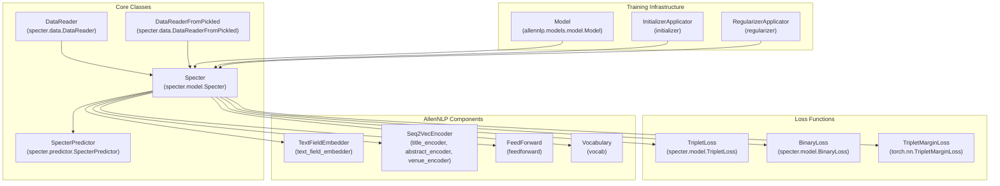
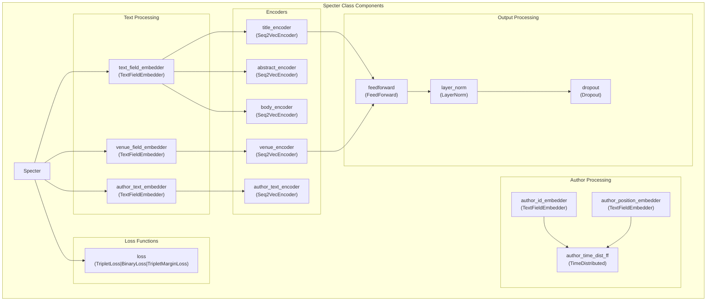
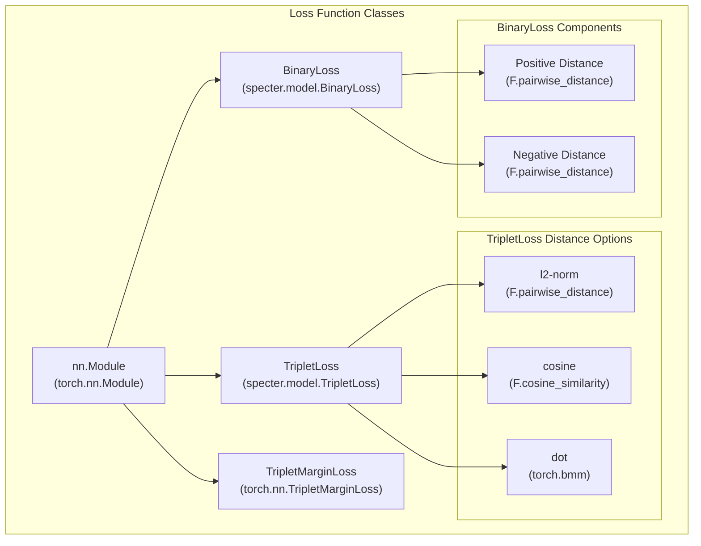
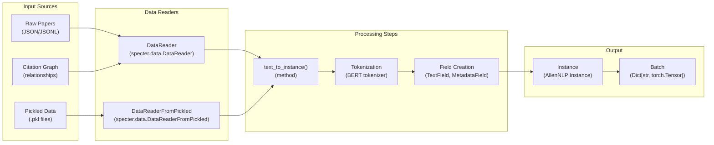
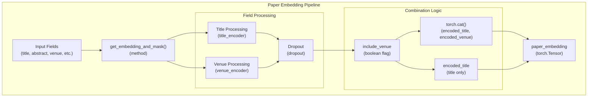
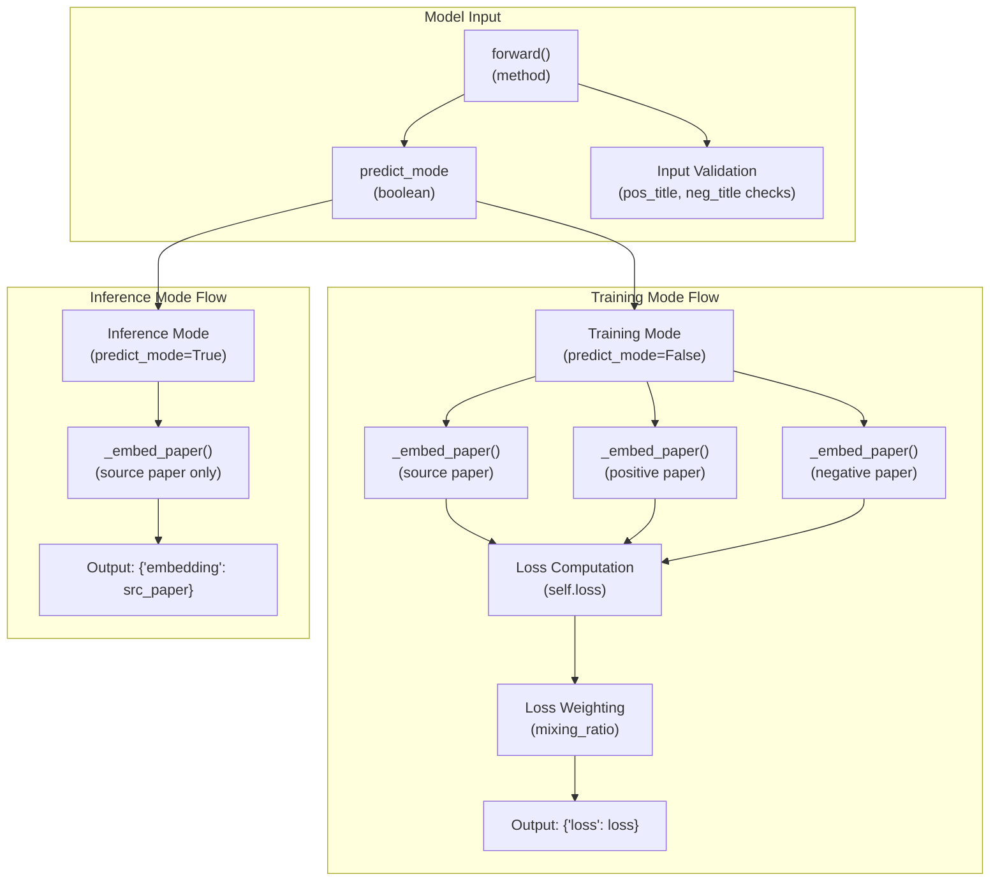

<!-- source: DeepWiki mcp.deepwiki.com · repo allenai/specter · page 6 Architecture Reference · fetched 2026-10-26 -->

# Architecture Reference

Relevant source files

The following files were used as context for generating this wiki page:

- [specter/__init__.py](specter/__init__.py)
- [specter/model.py](specter/model.py)

This document provides technical details about SPECTER's internal architecture and code components. It covers the core model implementation, loss functions, data processing pipeline, and prediction infrastructure at the code level.

For information about using SPECTER's interfaces, see [User Guide](#4). For training procedures, see [Training Models](#4.2). For data format specifications, see [Data Formats](#5).

## Core Architecture Overview

SPECTER's architecture consists of several key components implemented as Python classes that work together to create document embeddings from academic papers.

### Main Architecture Diagram

Sources: [specter/__init__.py:1-3](), [specter/model.py:111-142]()

## Model Components Architecture

The `Specter` class inherits from AllenNLP's `Model` class and implements the core paper embedding functionality through several specialized components.

### Specter Class Component Diagram

Sources: [specter/model.py:114-141](), [specter/model.py:147-202]()

### Key Methods and Data Flow

The `Specter` class implements several critical methods that define the data processing pipeline:

| Method | Purpose | Input | Output |
|--------|---------|-------|--------|
| `get_embedding_and_mask()` | Extract embeddings and masks from text fields | `text_field`, `embedder_type` | `embedded_`, `mask_` |
| `_embed_paper()` | Generate paper embeddings from components | `title`, `abstract`, `venue`, etc. | `paper_embedding` |
| `forward()` | Main forward pass for training/inference | All paper fields for source, positive, negative | `loss` or `embedding` |
| `decode()` | Post-process model output | `output_dict` | `output_dict` |

Sources: [specter/model.py:204-214](), [specter/model.py:216-244](), [specter/model.py:248-330](), [specter/model.py:332-334]()

## Loss Functions Architecture

SPECTER implements three different loss functions for training, each with specific distance metrics and use cases.

### Loss Function Class Hierarchy

Sources: [specter/model.py:30-84](), [specter/model.py:86-108](), [specter/model.py:158-163]()

### Loss Function Selection Logic

The loss function is selected in the `Specter` constructor based on the `loss_distance` parameter:

| loss_distance | Loss Class | Implementation |
|---------------|------------|----------------|
| `'l2-norm'` | `torch.nn.TripletMarginLoss` | PyTorch built-in with L2 distance |
| `'binary'` | `BinaryLoss` | Custom contrastive loss implementation |
| `'cosine'` | `TripletLoss` | Custom triplet loss with cosine similarity |
| `'dot'` | `TripletLoss` | Custom triplet loss with dot product |

Sources: [specter/model.py:158-163]()

## Data Processing Pipeline

The data processing pipeline transforms raw paper metadata into model-ready tensors through several specialized components.

### Data Reader Architecture

Sources: [specter/__init__.py:1-2](), [specter/data.py]()

### Paper Embedding Generation Flow

The `_embed_paper()` method processes individual papers through the following pipeline:

Sources: [specter/model.py:216-244]()

## Training vs Inference Mode Architecture

The `Specter` model operates in two distinct modes with different data flows and outputs.

### Mode Selection and Data Flow

Sources: [specter/model.py:248-330](), [specter/model.py:298-301](), [specter/model.py:304-325](), [specter/model.py:327-328]()

This architecture enables SPECTER to seamlessly switch between training (which requires positive and negative examples) and inference (which only processes single papers) modes while maintaining the same underlying embedding generation logic.

---

