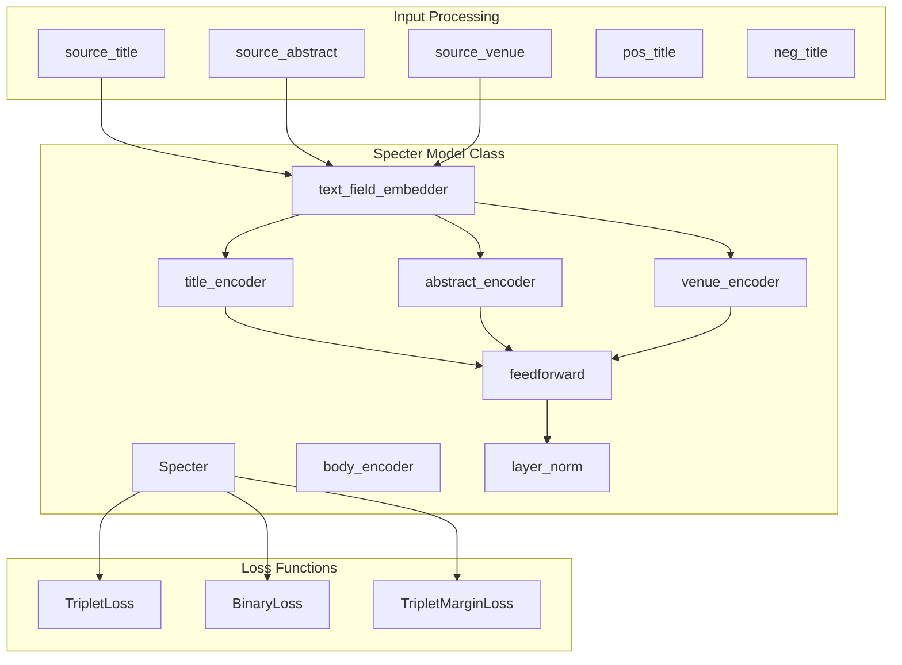
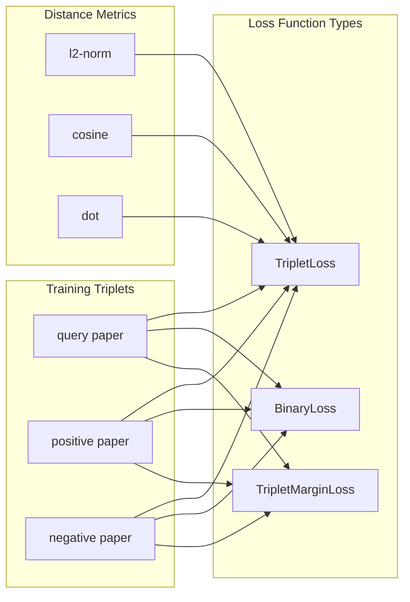
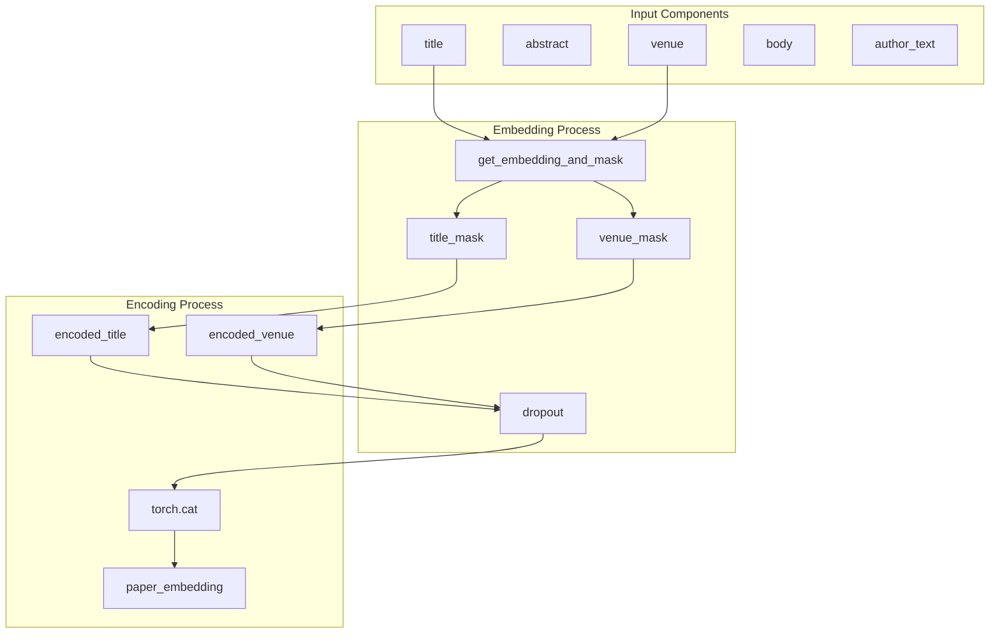
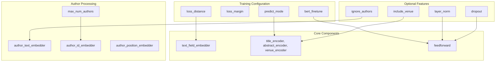

<!-- source: DeepWiki mcp.deepwiki.com · repo allenai/specter · page 6.1 Model Architecture · fetched 2026-10-26 -->

# Model Architecture

<details>
<summary>Relevant source files</summary>

The following files were used as context for generating this wiki page:

- [README.md](README.md)
- [specter/model.py](specter/model.py)

</details>


This document provides a technical overview of the SPECTER model architecture, including its core components, loss functions, and training methodology. The focus is on the internal structure and implementation details of the neural network model itself.

For information about data processing and triplet sampling, see [6.2](#6.2) and [6.3](#6.3). For details about the prediction pipeline, see [6.4](#6.4).

## Core Model Structure

The SPECTER model is implemented as a citation-informed transformer that learns document representations by leveraging citation relationships between scientific papers. The architecture consists of multiple encoders that process different components of a paper (title, abstract, venue) and combines them into a unified embedding.

### SPECTER Model Class Architecture



Sources: [specter/model.py:111-203]()

The main `Specter` class inherits from AllenNLP's `Model` base class and implements the core architecture through several key components:

| Component | Type | Purpose |
|-----------|------|---------|
| `text_field_embedder` | `TextFieldEmbedder` | Converts tokenized text to embeddings |
| `title_encoder` | `Seq2VecEncoder` | Encodes paper titles into fixed-size vectors |
| `abstract_encoder` | `Seq2VecEncoder` | Encodes paper abstracts into fixed-size vectors |
| `venue_encoder` | `Seq2VecEncoder` | Encodes venue information into fixed-size vectors |
| `feedforward` | `FeedForward` | Final projection layer for the combined representation |

## Loss Functions and Training Approach

SPECTER uses a triplet-based training approach where the model learns to place semantically similar papers closer together in the embedding space. The system implements three different loss functions for this purpose.

### Loss Function Implementation



Sources: [specter/model.py:30-108](), [specter/model.py:158-163]()

### TripletLoss Implementation

The `TripletLoss` class supports multiple distance metrics and implements the core triplet margin loss:

```python
# Key loss computation logic from TripletLoss.forward()
if self.distance == 'l2-norm':
    distance_positive = F.pairwise_distance(query, positive)
    distance_negative = F.pairwise_distance(query, negative)
    losses = F.relu(distance_positive - distance_negative + self.margin)
elif self.distance == 'cosine':
    distance_positive = F.cosine_similarity(query, positive)
    distance_negative = F.cosine_similarity(query, negative)
    losses = F.relu(-distance_positive + distance_negative + self.margin)
```

Sources: [specter/model.py:52-60]()

### BinaryLoss Implementation

The `BinaryLoss` class implements a contrastive loss approach that computes separate losses for positive and negative pairs:

```python
# BinaryLoss computation
distance_positive = F.pairwise_distance(query, positive)
distance_negative = F.pairwise_distance(query, negative)
return torch.pow(distance_positive, 2) + torch.pow(torch.clamp(self.margin - distance_negative, min=0.0), 2)
```

Sources: [specter/model.py:102-107]()

## Embedding Generation Process

The model generates embeddings through a multi-stage process that handles different paper components and combines them into a unified representation.

### Paper Embedding Pipeline



Sources: [specter/model.py:216-244]()

The `_embed_paper` method orchestrates the embedding generation process:

1. **Text Field Embedding**: Converts tokenized input to embeddings via `get_embedding_and_mask`
2. **Sequence Encoding**: Processes embeddings through `title_encoder` and `venue_encoder`
3. **Optional Dropout**: Applies dropout for regularization
4. **Concatenation**: Combines title and venue embeddings when `include_venue=True`

### Embedding vs CLS Token Approach

The SPECTER implementation uses a different approach than the HuggingFace version:

| Implementation | Approach | Description |
|---------------|----------|-------------|
| Repository Model | Scalar Mix + Average Pooling | Uses AllenNLP's scalar mix of all layers with average pooling |
| HuggingFace Model | CLS Token | Uses final layer representation of the `[CLS]` token |

Sources: [README.md:68-69]()

## Model Components and Configuration

The `Specter` model supports extensive configuration through its constructor parameters, allowing for different architectural choices and training strategies.

### Key Configuration Parameters



Sources: [specter/model.py:114-141]()

### Training vs Prediction Modes

The model operates in two distinct modes:

**Training Mode** (`predict_mode=False`):
- Requires positive and negative paper triplets
- Computes triplet loss between source, positive, and negative papers
- Returns loss value for gradient computation

**Prediction Mode** (`predict_mode=True`):
- Processes only the source paper
- Returns embedding vector for the input paper
- Used for inference and embedding generation

Sources: [specter/model.py:298-330]()

The `forward` method handles both modes by checking the availability of positive and negative examples and the `predict_mode` flag.

## Model Registration and Integration

The `Specter` class is registered with AllenNLP's model registry using the `@Model.register("specter")` decorator, enabling it to be instantiated from configuration files.

```python
@Model.register("specter")
class Specter(Model):
    # Model implementation
```

Sources: [specter/model.py:111-112]()

This registration allows the model to be configured and instantiated through AllenNLP's configuration system, supporting both training and inference workflows within the AllenNLP framework.

---

