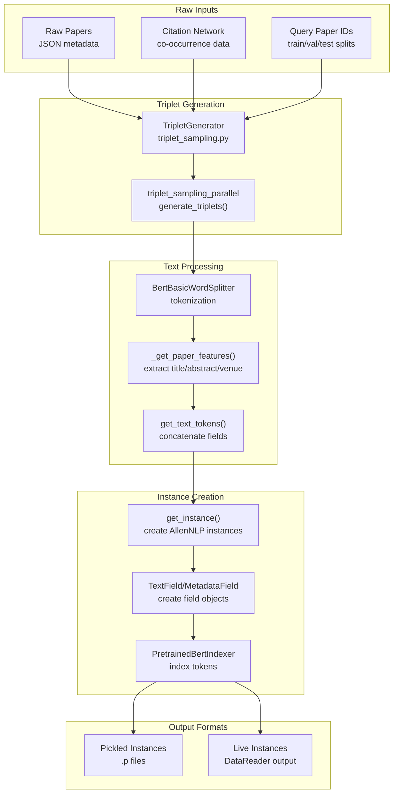
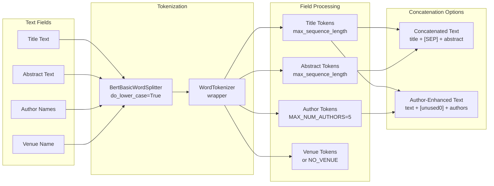
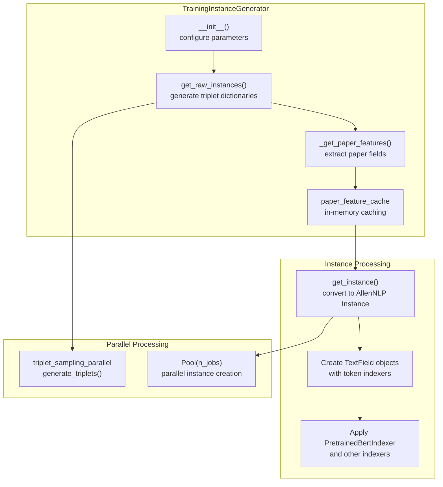
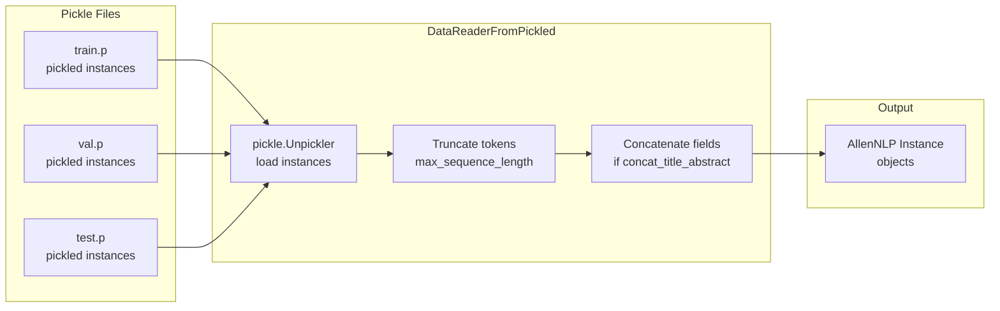
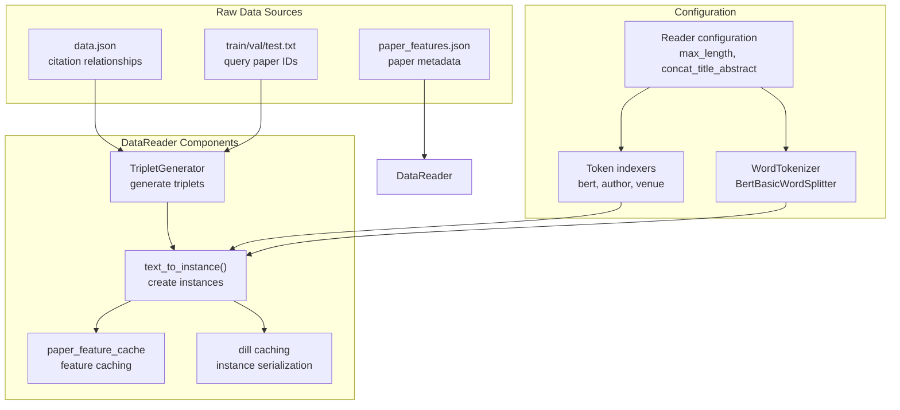

<!-- source: DeepWiki mcp.deepwiki.com · repo allenai/specter · page 6.2 Data Processing · fetched 2026-10-26 -->

# Data Processing

<details>
<summary>Relevant source files</summary>

The following files were used as context for generating this wiki page:

- [specter/data.py](specter/data.py)
- [specter/data_utils/create_training_files.py](specter/data_utils/create_training_files.py)

</details>


## Purpose and Scope

This document covers SPECTER's data processing pipeline, which transforms raw academic papers and citation relationships into training instances suitable for model training. The data processing system handles tokenization, field extraction, triplet generation, and instance creation for both training and inference scenarios.

For information about triplet sampling algorithms, see [Triplet Sampling](#6.3). For details about the model architecture that consumes these processed instances, see [Model Architecture](#6.1).

## Data Processing Pipeline Overview

SPECTER's data processing pipeline converts raw academic papers into structured training instances through several key stages:



*Data Processing Pipeline Overview*

Sources: [specter/data_utils/create_training_files.py:244-362](), [specter/data.py:114-483]()

## Raw Data Inputs

The data processing pipeline accepts several types of raw inputs:

| Input Type | Format | Description | Example Fields |
|------------|--------|-------------|----------------|
| Paper Metadata | JSON | Academic paper information | `paper_id`, `title`, `abstract`, `authors`, `venue`, `year` |
| Citation Network | JSON | Paper co-occurrence relationships | Query paper → list of cited papers with counts |
| Query IDs | Text files | Paper IDs for train/val/test splits | One paper ID per line |

The system expects paper metadata in a specific structure where each paper contains:

```json
{
  "paper_id": "unique_identifier",
  "title": "Paper Title",
  "abstract": "Paper abstract text",
  "authors": ["Author One", "Author Two"],
  "venue": "Conference/Journal Name",
  "year": 2023
}
```

Sources: [specter/data_utils/create_training_files.py:269-286](), [specter/data.py:231-271]()

## Tokenization and Field Processing

SPECTER uses BERT-based tokenization with specialized handling for different text fields:



*Text Processing and Tokenization Pipeline*

### Key Processing Functions

- **`_get_paper_features()`**: Extracts and tokenizes paper fields with caching
- **`get_text_tokens()`**: Concatenates title and abstract with `[SEP]` delimiter
- **`_get_author_field()`**: Processes author lists with position encoding

### Tokenization Configuration

```python
# Global tokenization parameters
bert_params = {
    "do_lowercase": "true",
    "pretrained_model": "data/scivocab_scivocab_uncased/vocab.txt",
    "use_starting_offsets": "true"
}
```

Sources: [specter/data_utils/create_training_files.py:46-50](), [specter/data_utils/create_training_files.py:120-131](), [specter/data.py:241-271]()

## Training Instance Generation

The `TrainingInstanceGenerator` class orchestrates the creation of training instances from raw data:



*Training Instance Generation Process*

### Instance Structure

Each training instance contains fields for query, positive, and negative papers:

| Field Type | Field Names | Purpose |
|------------|-------------|---------|
| Text Fields | `source_title`, `pos_title`, `neg_title` | Main text content |
| Text Fields | `source_abstract`, `pos_abstract`, `neg_abstract` | Abstract content (if not concatenated) |
| Text Fields | `source_venue`, `pos_venue`, `neg_venue` | Venue information |
| List Fields | `source_authors`, `pos_authors`, `neg_authors` | Author information |
| List Fields | `source_author_positions`, `pos_author_positions`, `neg_author_positions` | Author position encoding |
| Metadata Fields | `source_paper_id`, `pos_paper_id`, `neg_paper_id` | Paper identifiers |

Sources: [specter/data_utils/create_training_files.py:244-362](), [specter/data_utils/create_training_files.py:141-242]()

## Data Readers

SPECTER provides two main data reader classes for different use cases:

### DataReaderFromPickled

Reads pre-processed instances from pickle files created by `create_training_files.py`:



*Pickled Data Reader Architecture*

### DataReader

Generates instances on-the-fly from raw data:



*Live Data Reader Architecture*

### Key Differences

| Feature | DataReaderFromPickled | DataReader |
|---------|----------------------|------------|
| Speed | Fast (pre-processed) | Slower (on-demand) |
| Flexibility | Limited | High configuration options |
| Memory Usage | Lower | Higher (caching) |
| Use Case | Production training | Development/experimentation |

Sources: [specter/data.py:37-110](), [specter/data.py:114-483]()

## Configuration Options

The data processing system supports extensive configuration through various parameters:

### Text Processing Options

```python
# Key configuration parameters
max_sequence_length = 512  # Token truncation limit
concat_title_abstract = False  # Combine title and abstract
included_text_fields = 'title abstract'  # Fields to include
```

### Training Parameters

```python
# Triplet generation parameters
samples_per_query = 5  # Triplets per query paper
margin_fraction = 0.5  # Minimum margin for triplet selection
ratio_hard_negatives = 0.3  # Proportion of hard negative examples
```

### Performance Options

```python
# Parallel processing configuration
n_jobs = 1  # Parallel jobs for instance conversion
n_jobs_raw = 12  # Parallel jobs for triplet generation
use_paper_feature_cache = True  # Enable feature caching
```

### Token Indexer Configuration

The system uses specialized token indexers for different field types:

| Indexer Type | Namespace | Purpose |
|--------------|-----------|---------|
| `PretrainedBertIndexer` | `bert` | Main text fields |
| `SingleIdTokenIndexer` | `author` | Author names |
| `SingleIdTokenIndexer` | `author_positions` | Author positions |
| `SingleIdTokenIndexer` | `venue` | Venue names |

Sources: [specter/data_utils/create_training_files.py:489-523](), [specter/data.py:117-225]()

---

