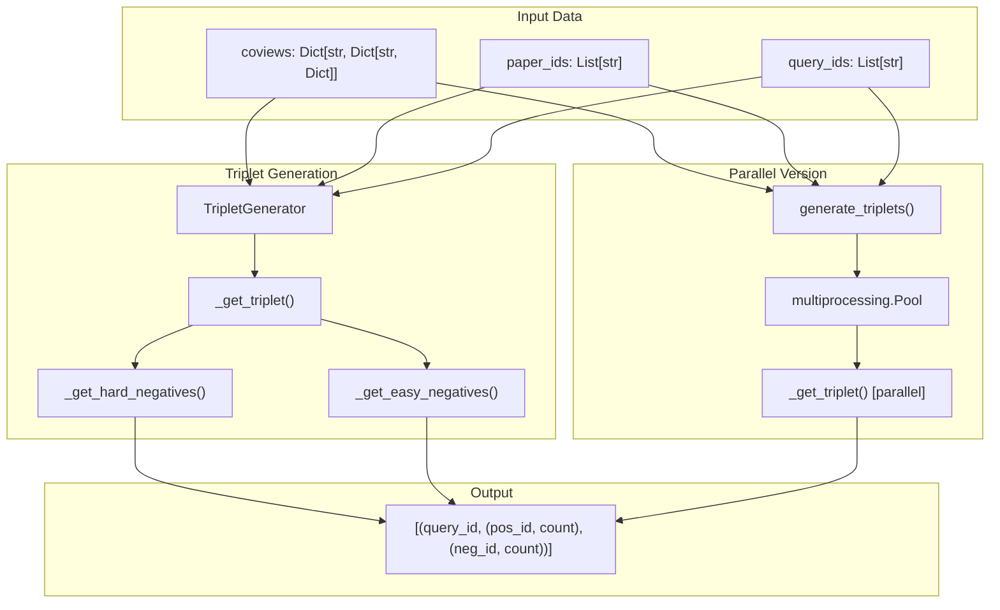
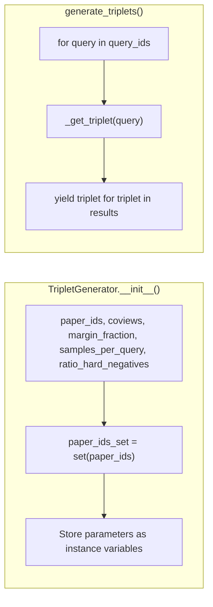
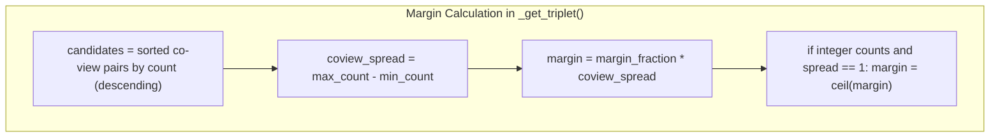
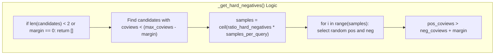
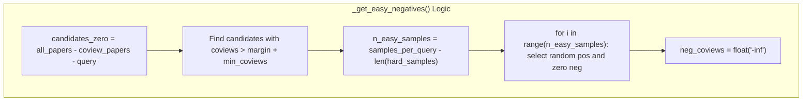
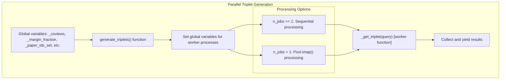
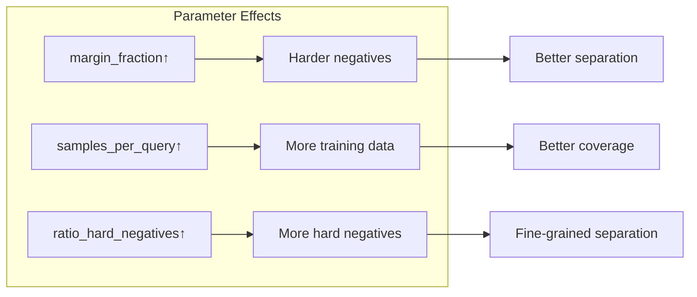
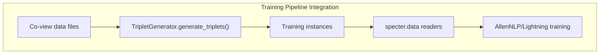

<!-- source: DeepWiki mcp.deepwiki.com · repo allenai/specter · page 6.3 Triplet Sampling · fetched 2026-10-26 -->

# Triplet Sampling

<details>
<summary>Relevant source files</summary>

The following files were used as context for generating this wiki page:

- [specter/data_utils/triplet_sampling.py](specter/data_utils/triplet_sampling.py)
- [specter/data_utils/triplet_sampling_parallel.py](specter/data_utils/triplet_sampling_parallel.py)

</details>


This document explains SPECTER's triplet sampling system, which generates positive and negative training examples from citation co-occurrence data. The triplet sampling module creates the training instances used to train SPECTER's citation-informed embeddings by leveraging co-view statistics between papers.

For information about the overall training pipeline, see [Training Models](#4.2). For details about data preparation and formats, see [Data Preparation](#4.2.1).

## Purpose and Architecture

SPECTER's triplet sampling system transforms citation co-occurrence data into training triplets of the form `(query_paper, positive_paper, negative_paper)`. The system uses co-view statistics to determine which papers are semantically similar (high co-views) versus dissimilar (low co-views) to create effective training examples.



Sources: [specter/data_utils/triplet_sampling.py:31-204](), [specter/data_utils/triplet_sampling_parallel.py:140-170]()

## Core Algorithm

The triplet sampling algorithm operates on co-view data where each query paper has a list of related papers with co-occurrence counts. The `TripletGenerator` class implements the core logic for generating training triplets.

### TripletGenerator Class

The `TripletGenerator` class takes several key parameters:

| Parameter | Type | Description |
|-----------|------|-------------|
| `paper_ids` | `List[str]` | All available paper IDs in the dataset |
| `coviews` | `Dict[str, List[Tuple[str, int]]]` | Co-view statistics for each paper |
| `margin_fraction` | `float` | Minimum margin between positive and negative co-view counts |
| `samples_per_query` | `int` | Number of training samples to generate per query |
| `ratio_hard_negatives` | `float` | Ratio of hard vs easy negative samples (default: 0.5) |



Sources: [specter/data_utils/triplet_sampling.py:34-57](), [specter/data_utils/triplet_sampling.py:80-107]()

### Margin Calculation

The algorithm calculates a margin based on the co-view distribution for each query paper:



Sources: [specter/data_utils/triplet_sampling.py:59-74]()

## Hard vs Easy Negatives

SPECTER's triplet sampling generates two types of negative examples to provide diverse training signals:

### Hard Negatives

Hard negatives are papers that have non-zero co-views with the query but fewer co-views than the positive examples. These provide challenging examples that help the model learn fine-grained distinctions.



Sources: [specter/data_utils/triplet_sampling.py:151-203]()

### Easy Negatives

Easy negatives are papers with zero co-views with the query. These provide clear negative examples and help ensure the model learns basic distinctions.



Sources: [specter/data_utils/triplet_sampling.py:109-149]()

## Parallel Implementation

The parallel version in `triplet_sampling_parallel.py` optimizes the triplet generation process for large datasets by using multiprocessing:



Sources: [specter/data_utils/triplet_sampling_parallel.py:36-170]()

The parallel implementation uses global variables to avoid pickling large data structures when passing them to worker processes:

- `_coviews`: Global co-view data dictionary
- `_margin_fraction`: Global margin fraction parameter
- `_paper_ids_set`: Global set of all paper IDs
- `_samples_per_query`: Global samples per query parameter
- `_ratio_hard_negatives`: Global hard negative ratio

## Configuration Parameters

The triplet sampling behavior is controlled by several key parameters:

| Parameter | Impact | Typical Values |
|-----------|---------|---------------|
| `margin_fraction` | Controls minimum separation between positive and negative examples | 0.1 - 0.5 |
| `samples_per_query` | Number of training instances per query paper | 5 - 20 |
| `ratio_hard_negatives` | Balance between hard and easy negatives | 0.5 (50/50 split) |



Sources: [specter/data_utils/triplet_sampling.py:37-50]()

## Integration with Training Pipeline

The triplet sampling system integrates with SPECTER's broader training pipeline through data readers and training scripts:



The output triplets have the format:
```
[query_id, (positive_id, positive_coviews), (negative_id, negative_coviews)]
```

Where `negative_coviews` is either a numeric value (for hard negatives) or `float('-inf')` (for easy negatives).

Sources: [specter/data_utils/triplet_sampling.py:80-107](), [specter/data_utils/triplet_sampling_parallel.py:140-170]()

---

