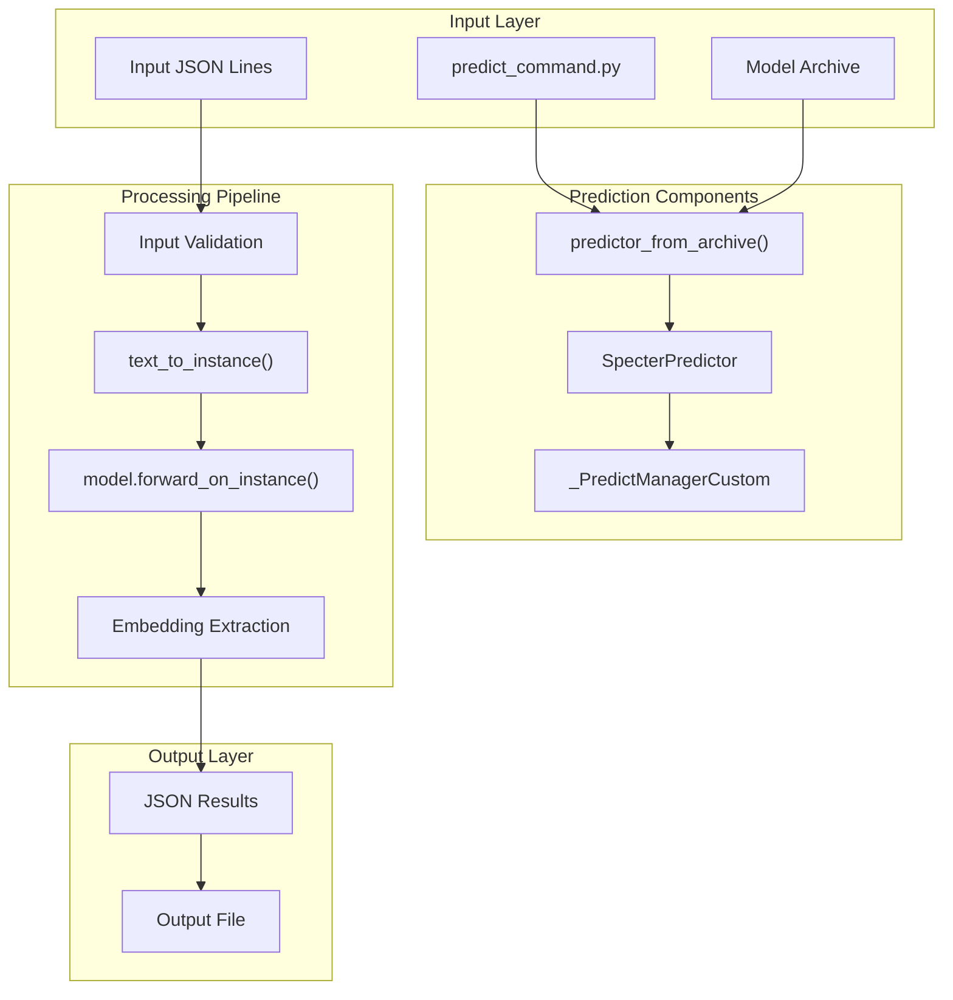
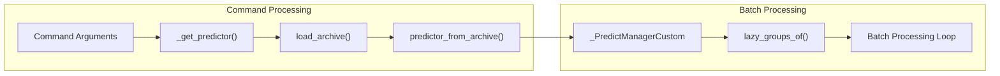
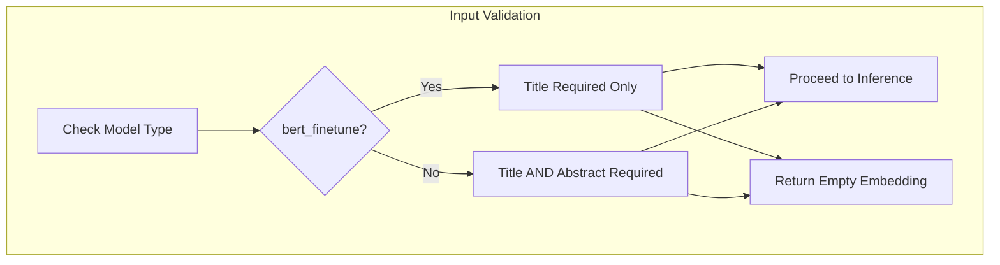
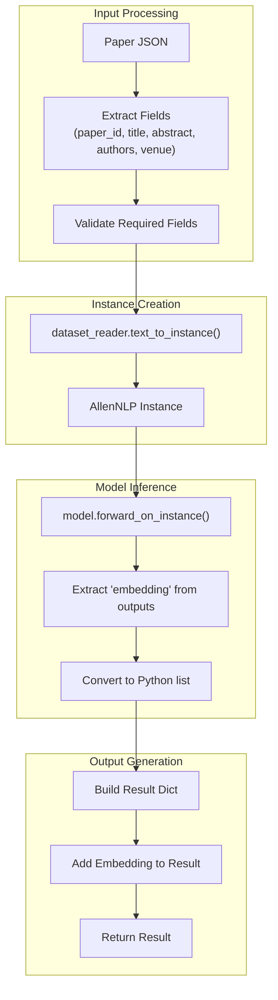
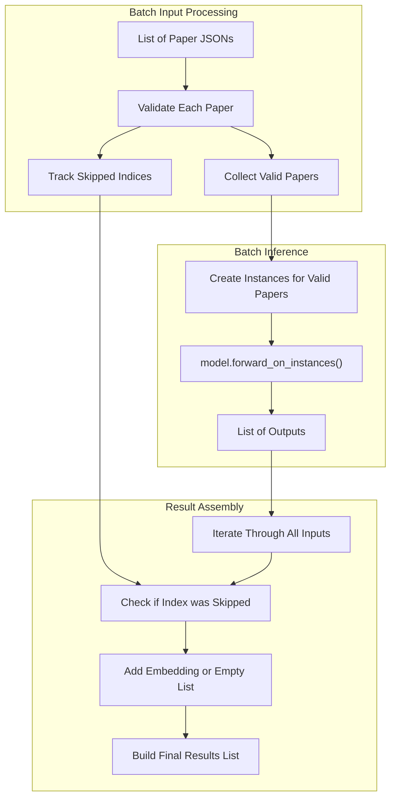
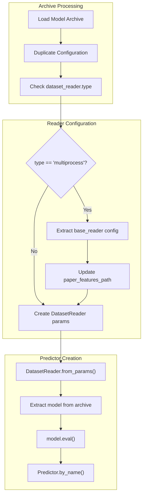

<!-- source: DeepWiki mcp.deepwiki.com · repo allenai/specter · page 6.4 Prediction Pipeline · fetched 2026-10-26 -->

# Prediction Pipeline

Relevant source files

The following files were used as context for generating this wiki page:

- [specter/predict_command.py](specter/predict_command.py)
- [specter/predictor.py](specter/predictor.py)

## Purpose and Scope

This document describes SPECTER's prediction pipeline architecture, which handles the generation of document embeddings during inference. The prediction pipeline takes trained SPECTER models and applies them to new scientific papers to produce vector representations.

This covers the inference-time components only. For information about model training, see [Training Models](#4.2). For details about the underlying model architecture that generates embeddings, see [Model Architecture](#6.1).

## Overview

The SPECTER prediction pipeline consists of two main components:

1. **Command-line prediction interface** - A custom AllenNLP command for batch processing papers
2. **Predictor class** - The core logic for generating embeddings from paper metadata

The pipeline supports both single-paper and batch processing modes, with built-in validation and error handling for missing or invalid paper metadata.

Sources: [specter/predict_command.py:1-226](), [specter/predictor.py:1-131]()

## Command-Line Prediction Interface

The prediction pipeline is accessible through a custom AllenNLP command implemented in `predict_command.py`. This command extends AllenNLP's built-in predict functionality with SPECTER-specific features.

### Key Components

| Component | Purpose | Key Methods |
|-----------|---------|-------------|
| `Predict` | Main command class | `add_subparser()` |
| `_PredictManagerCustom` | Batch processing with progress tracking | `run()` |
| `predictor_from_archive()` | Model loading with multiprocess reader support | N/A |

### Command Arguments

The prediction command accepts several arguments for customization:

- `archive_file` - Path to trained model archive
- `input_file` - JSON Lines file containing paper metadata
- `--output-file` - Optional output file path
- `--batch-size` - Batch processing size (default: 1)
- `--cuda-device` - GPU device ID (-1 for CPU)
- `--use-dataset-reader` - Use original dataset reader for instances

Sources: [specter/predict_command.py:29-67](), [specter/predict_command.py:143-156](), [specter/predict_command.py:158-172]()

## Predictor Architecture

The core prediction logic is implemented in the `SpecterPredictor` class, which is registered as `'specter_predictor'` in the AllenNLP predictor registry.

### SpecterPredictor Class Methods

| Method | Purpose | Input | Output |
|--------|---------|-------|--------|
| `predict_json()` | Single paper prediction | `JsonDict` paper metadata | `Dict` with embedding |
| `predict_batch_json()` | Batch paper prediction | `List[JsonDict]` papers | `List[JsonDict]` results |
| `dump_line()` | Serialize output | `JsonDict` outputs | JSON string |
| `load_line()` | Parse input line | `str` line | `JsonDict` paper |

### Input Validation Logic

The predictor implements different validation rules based on the model type:

Sources: [specter/predictor.py:28-36](), [specter/predictor.py:64-75]()

## Data Flow Through Prediction Pipeline

The prediction pipeline follows a structured data flow from raw paper metadata to final embeddings:

### Single Paper Prediction Flow

Sources: [specter/predictor.py:19-45]()

### Batch Processing Flow

The batch processing implementation optimizes performance by processing multiple papers simultaneously while handling validation failures gracefully:

Sources: [specter/predictor.py:48-100]()

## Model Archive Loading

The `predictor_from_archive()` function handles the complex process of loading SPECTER models from archived files, with special handling for multiprocess dataset readers.

### Archive Loading Process

Sources: [specter/predict_command.py:107-141]()

## Implementation Details

### Custom JSON Encoder

The prediction pipeline includes a custom JSON encoder to handle NumPy data types in the output:

The `NumpyEncoder` class in [specter/predictor.py:118-131]() handles conversion of NumPy integers, floats, and arrays to standard Python types for JSON serialization.

### Progress Tracking

The `_PredictManagerCustom` class extends AllenNLP's `_PredictManager` to provide progress tracking during batch processing:

- Calculates total batch count by reading input file
- Uses `tqdm` progress bars for batch processing
- Handles both dataset reader and JSON-only processing modes

Sources: [specter/predict_command.py:70-104]()

### Error Handling

The prediction pipeline implements robust error handling:

1. **Missing Fields**: Papers without required title/abstract fields receive empty embeddings
2. **Batch Processing**: Individual paper failures don't stop batch processing
3. **Reader Compatibility**: Automatic handling of multiprocess vs. standard dataset readers
4. **GPU Availability**: Automatic fallback to CPU if GPU is unavailable

Sources: [specter/predictor.py:51-78](), [specter/predict_command.py:125-135]()

---

