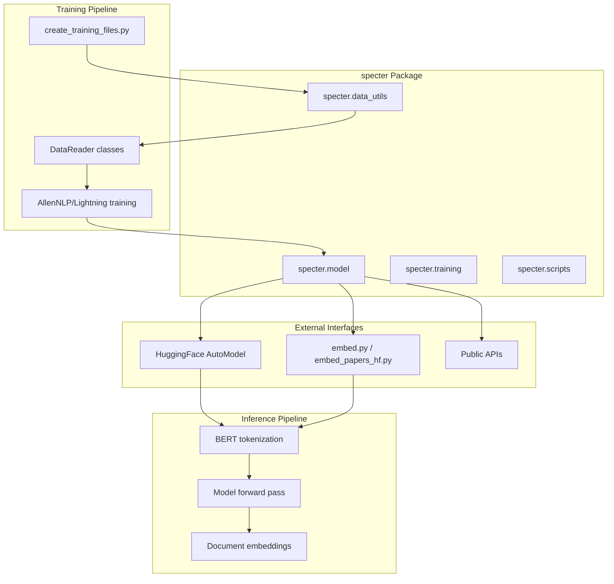
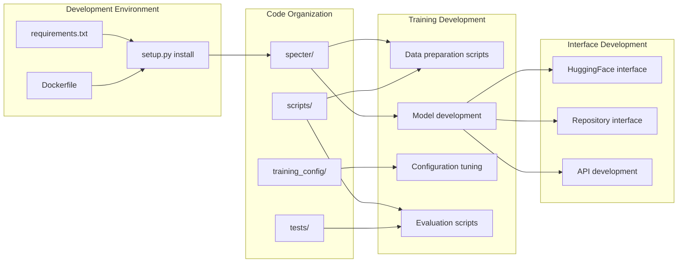
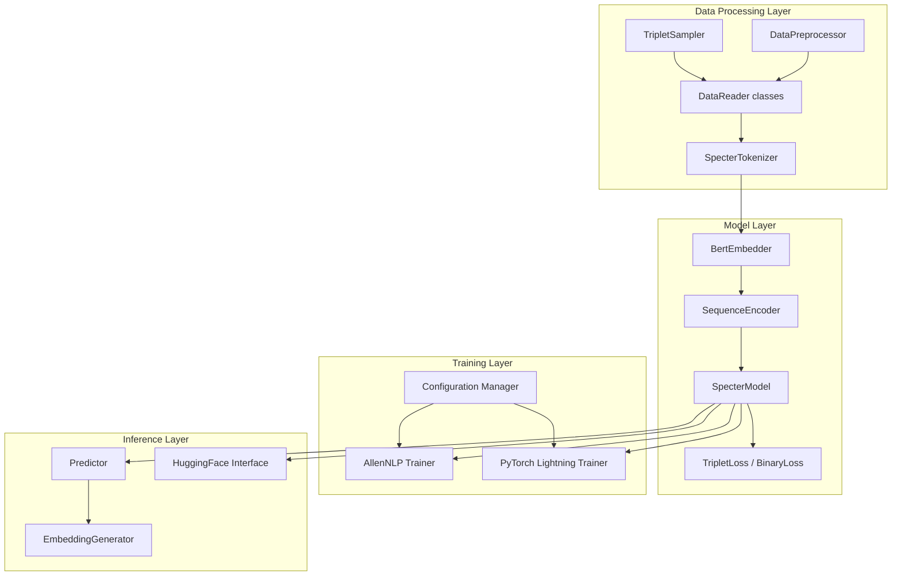
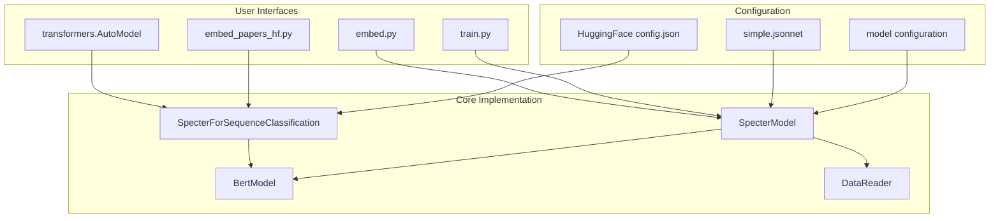

<!-- source: DeepWiki mcp.deepwiki.com · repo allenai/specter · page 7 Developer Guide · fetched 2026-10-26 -->

# Developer Guide

<details>
<summary>Relevant source files</summary>

The following files were used as context for generating this wiki page:

- [.gitignore](.gitignore)
- [setup.py](setup.py)
- [specter/data_utils/__init__.py](specter/data_utils/__init__.py)

</details>


This document provides technical guidance for developers who want to contribute to, extend, or understand the internal architecture of the SPECTER codebase. It covers the package structure, key components, development workflows, and contribution guidelines.

For information about using SPECTER as an end-user, see [User Guide](#4). For detailed architectural explanations, see [Architecture Reference](#6).

## System Architecture from Developer Perspective

The SPECTER system is organized around several key architectural layers that developers need to understand:

### Core Component Architecture



Sources: [setup.py:1-9](), [specter/data_utils/__init__.py:1]()

### Development Workflow Architecture



Sources: [setup.py:4-8](), [.gitignore:1-132]()

## Package Structure

The SPECTER codebase follows a modular architecture with clear separation between data processing, model implementation, training, and inference components.

### Main Package Organization

| Component | Purpose | Key Files |
|-----------|---------|-----------|
| `specter/` | Core package containing model and utilities | Main Python package |
| `specter/data_utils/` | Data processing and utilities | Data handling modules |
| `specter/model/` | Model architecture and implementations | Core model classes |
| `specter/training/` | Training-specific code | Training loops and utilities |
| `scripts/` | Command-line scripts and utilities | Entry points for common tasks |
| `training_config/` | Configuration files for training | JSONNET configurations |
| `tests/` | Unit tests and integration tests | Test suite |

Sources: [setup.py:8](), [specter/data_utils/__init__.py:1]()

### Key Python Modules

The package structure follows standard Python conventions with `__init__.py` files marking package boundaries:

- `specter/__init__.py` - Main package initialization
- `specter/data_utils/__init__.py` - Data utilities package
- `specter/model/__init__.py` - Model implementations
- `specter/training/__init__.py` - Training infrastructure

Sources: [specter/data_utils/__init__.py:1]()

## Core Components and Relationships

### Data Processing Components



Sources: [setup.py:1-9]()

### Interface Implementation Mapping



Sources: [setup.py:4-8]()

## Development Workflow

### Setting Up Development Environment

The development environment is configured through `setup.py` which defines the package structure and dependencies:

```python
# Package setup follows standard setuptools patterns
setuptools.setup(
    name='specter',
    version='0.0.1',
    url='https://github.com/allenai/specter',
    packages=setuptools.find_packages(),
)
```

Key development setup steps:
1. Install package in development mode: `pip install -e .`
2. Install dependencies from requirements files
3. Set up Docker environment for reproducible builds
4. Configure git hooks and pre-commit checks

Sources: [setup.py:4-9]()

### Code Organization Patterns

The codebase follows several organizational patterns:

- **Package-based organization**: Core functionality in `specter/` package
- **Separation of concerns**: Data processing, model, training, and inference in separate modules
- **Configuration-driven**: Training and model configurations in separate files
- **Script-based interfaces**: Command-line scripts for common operations

Sources: [setup.py:8](), [.gitignore:131-132]()

### Testing and Quality Assurance

The project includes comprehensive testing infrastructure:

- Unit tests for individual components
- Integration tests for end-to-end workflows
- Performance benchmarks using SciDocs
- Code quality checks and linting

Ignored files and directories are managed through `.gitignore` which excludes:
- Python bytecode and cache files
- Build artifacts and distribution files
- Development environment files
- IDE-specific files
- Test coverage reports

Sources: [.gitignore:1-132]()

## Extension Points

### Adding New Model Architectures

Developers can extend SPECTER by:

1. **Creating new model classes** inheriting from base model components
2. **Implementing custom loss functions** for specific training objectives
3. **Adding new data readers** for different input formats
4. **Extending tokenization** for domain-specific vocabularies

### Adding New Training Approaches

The training system supports multiple frameworks:

- **AllenNLP-based training** with configuration files
- **PyTorch Lightning training** with modular components
- **Custom training loops** for specialized requirements

### Adding New Inference Interfaces

New interfaces can be added by:

1. **Implementing new predictor classes** for different output formats
2. **Creating API endpoints** for web-based access
3. **Adding command-line utilities** for batch processing
4. **Integrating with external frameworks** like HuggingFace

Sources: [setup.py:1-9]()

## Contributing Guidelines

### Code Style and Standards

- Follow PEP 8 Python style guidelines
- Use type hints for function signatures
- Document classes and methods with docstrings
- Write unit tests for new functionality
- Update documentation for user-facing changes

### Development Process

1. **Fork the repository** and create feature branches
2. **Implement changes** following existing code patterns
3. **Add tests** for new functionality
4. **Update documentation** as needed
5. **Submit pull requests** with clear descriptions

### Build and Release Process

The package uses standard Python packaging:
- Version management through `setup.py`
- Distribution through PyPI
- Docker images for reproducible environments
- Continuous integration for automated testing

Sources: [setup.py:4-9](), [.gitignore:9-28]()

---

