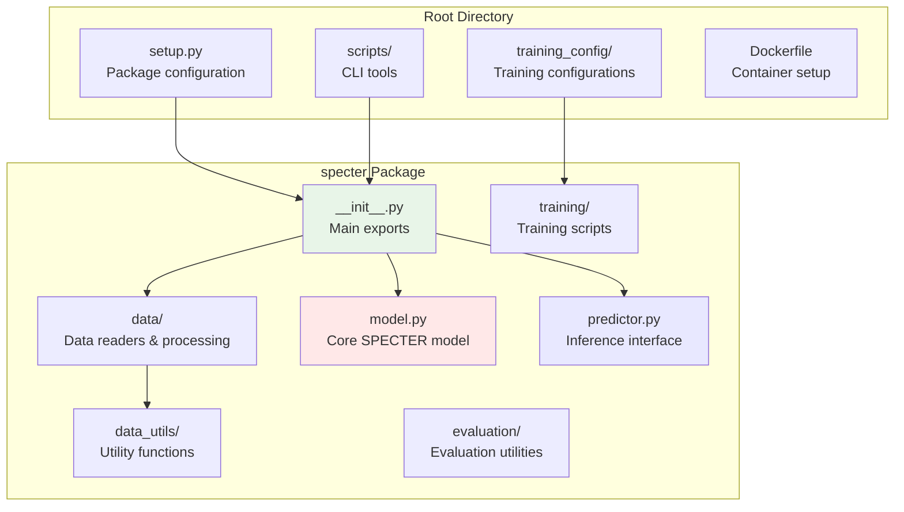
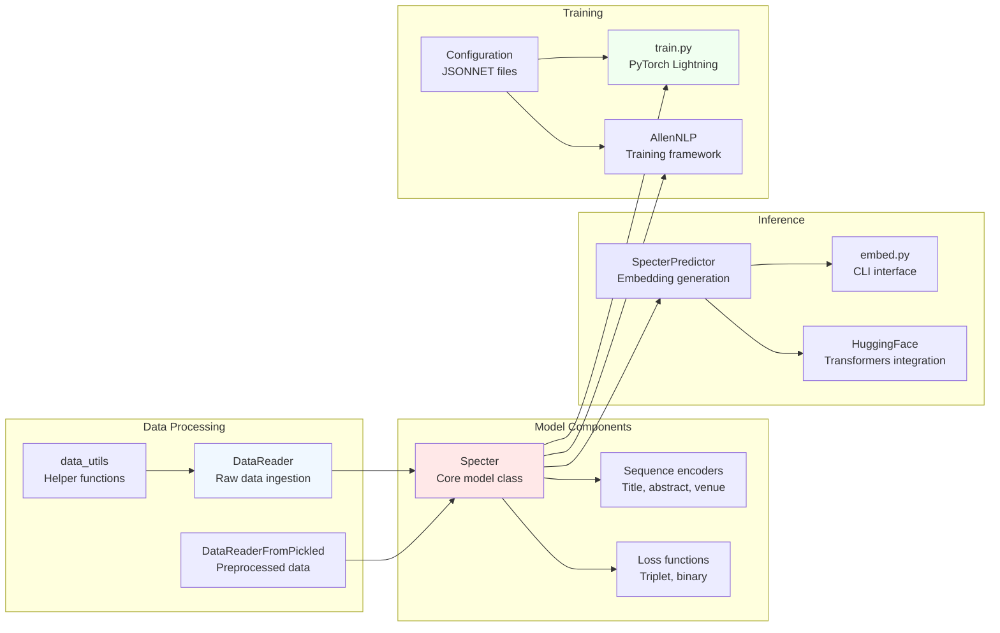
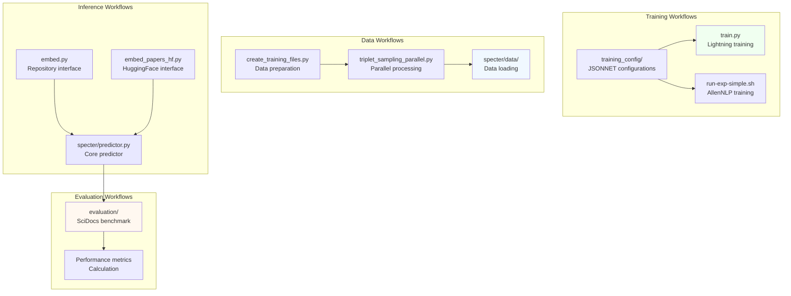

<!-- source: DeepWiki mcp.deepwiki.com · repo allenai/specter · page 7.1 Package Structure · fetched 2026-10-26 -->

# Package Structure

<details>
<summary>Relevant source files</summary>

The following files were used as context for generating this wiki page:

- [setup.py](setup.py)
- [specter/__init__.py](specter/__init__.py)
- [specter/data_utils/__init__.py](specter/data_utils/__init__.py)

</details>


This document describes the organization of the SPECTER codebase and its module hierarchy. It covers the Python package structure, key modules, and how the codebase is organized to support different use cases including training, inference, and evaluation.

For information about using SPECTER's various interfaces, see [Generating Embeddings](#4.1). For details about the model architecture and components, see [Model Architecture](#6.1).

## Overview

SPECTER is organized as a Python package with a clear separation of concerns across different modules. The package structure supports multiple access patterns: researchers can use the full repository implementation, developers can integrate via HuggingFace, and applications can access pre-computed embeddings through APIs.

## Top-Level Package Structure



The package follows a hierarchical structure where core functionality is exposed through the main `__init__.py` file, while specialized components are organized in dedicated subdirectories.

Sources: [setup.py:1-9](), [specter/__init__.py:1-3](), [specter/data_utils/__init__.py:1]()

## Core Module Exports

The main package exports are defined in the root `__init__.py` file, providing clean access to the most important classes:

| Export | Source Module | Purpose |
|--------|---------------|---------|
| `DataReaderFromPickled` | `specter.data` | Loading pre-processed training data |
| `DataReader` | `specter.data` | Reading raw training instances |
| `Specter` | `specter.model` | Core SPECTER model implementation |
| `SpecterPredictor` | `specter.predictor` | Inference interface |

Sources: [specter/__init__.py:1-3]()

## Module Responsibilities



Each module has a specific responsibility in the overall system architecture, supporting the separation between data processing, model implementation, inference, and training workflows.

Sources: [specter/__init__.py:1-3]()

## Package Configuration

The `setup.py` file defines the package metadata and dependencies:

```python
# Package name: 'specter'
# Version: '0.0.1'
# Auto-discovery of all Python packages
```

The package uses `setuptools.find_packages()` to automatically discover all Python modules in the directory structure, making it easy to add new submodules without manual configuration updates.

Sources: [setup.py:1-9]()

## Directory Structure Patterns



The directory structure is organized around distinct workflows, making it easy to understand which files are involved in each use case.

Sources: [setup.py:4-8](), [specter/__init__.py:1-3]()

## Import Hierarchy

The package is designed with a clear import hierarchy that minimizes circular dependencies:

1. **Foundation Layer**: `data_utils` and utility functions
2. **Data Layer**: `DataReader` and `DataReaderFromPickled` classes
3. **Model Layer**: `Specter` core model implementation
4. **Interface Layer**: `SpecterPredictor` and external interfaces

This hierarchy ensures that higher-level components can import lower-level ones without creating circular dependencies, supporting both the repository's internal organization and external package usage.

Sources: [specter/__init__.py:1-3](), [specter/data_utils/__init__.py:1]()

---

