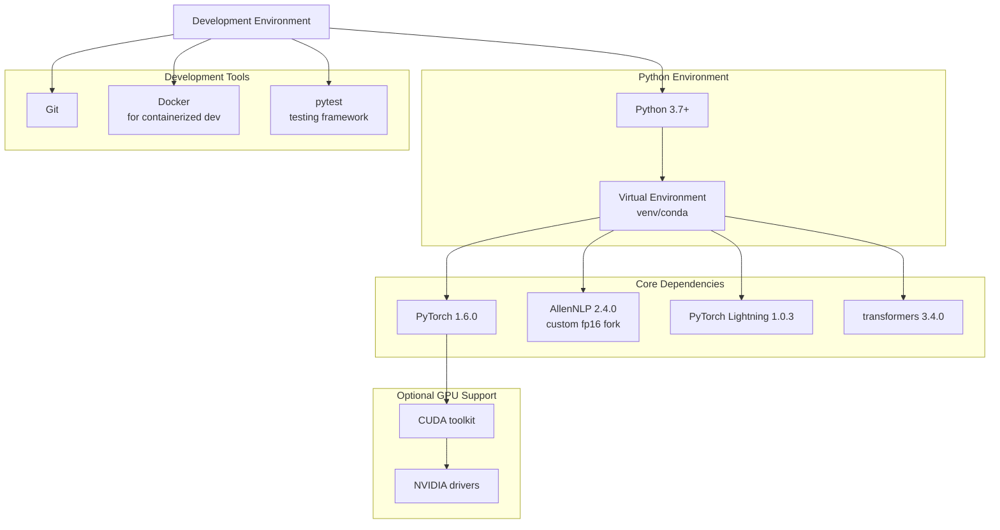
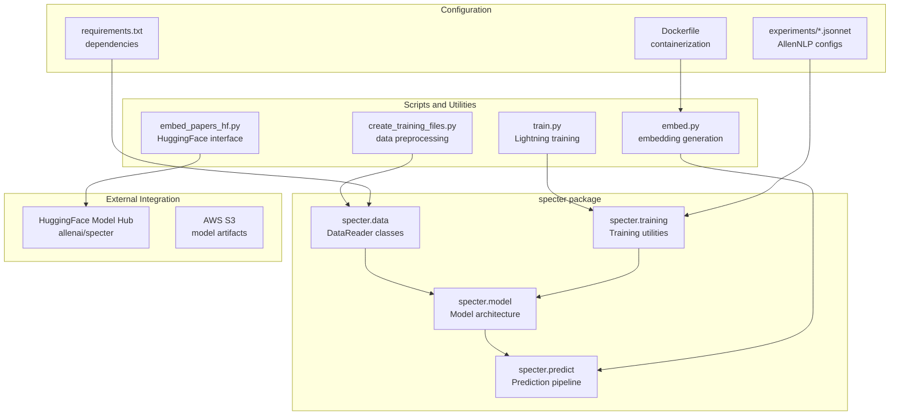
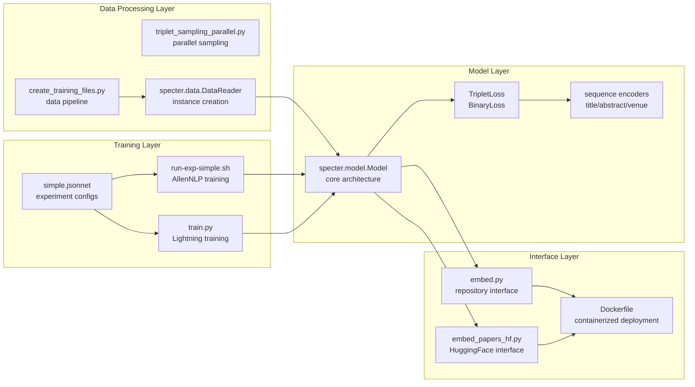
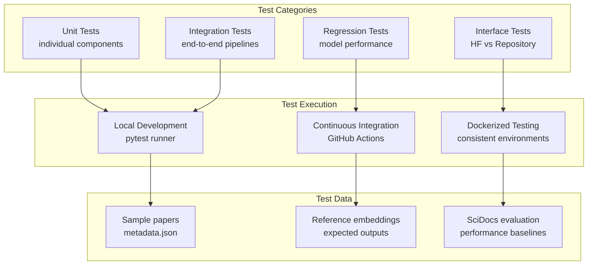
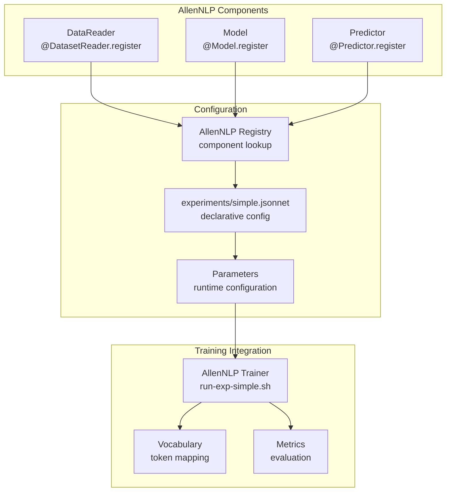
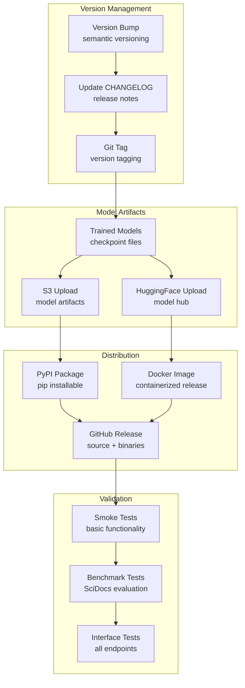

<!-- source: DeepWiki mcp.deepwiki.com · repo allenai/specter · page 7.2 Contributing · fetched 2026-10-26 -->

# Contributing

<details>
<summary>Relevant source files</summary>

The following files were used as context for generating this wiki page:

- [.gitignore](.gitignore)
- [LICENSE](LICENSE)

</details>


This document provides guidelines for contributing to the SPECTER project, including development environment setup, code organization, testing procedures, and submission guidelines. This covers the process for submitting bug fixes, feature enhancements, and documentation improvements to the SPECTER codebase.

For information about the overall package structure and module organization, see [Package Structure](#7.1). For installation instructions for end users, see [Installation & Setup](#2).

## Development Environment Setup

Setting up a development environment for SPECTER requires installing dependencies and configuring the proper Python environment for both the AllenNLP and PyTorch Lightning training frameworks.

### Prerequisites

The development environment requires Python 3.7+ and supports both CPU and GPU development. The project uses specific versions of key dependencies to ensure reproducibility.



### Installation for Development

Clone the repository and install in development mode to enable code changes to be immediately reflected:

```bash
git clone https://github.com/allenai/specter.git
cd specter
pip install -e .
```

The project includes a Docker setup for consistent development environments across different systems.

Sources: [.gitignore:104-111](), [LICENSE:1-202]()

## Code Organization and Architecture

The SPECTER codebase follows a modular architecture with clear separation between data processing, model components, training infrastructure, and user interfaces.

### Core Module Structure



### Development Workflow Components

The development workflow integrates multiple training frameworks and interfaces that contributors need to understand:



Sources: [.gitignore:131-132]()

## Testing and Quality Assurance

Contributors should ensure their changes maintain the existing functionality and performance characteristics of SPECTER across all supported interfaces.

### Testing Strategy



### Quality Checks

Before submitting contributions, run the following verification steps:

| Check Type | Command/Process | Purpose |
|------------|-----------------|---------|
| Code Style | `flake8`, `black` | Ensure consistent formatting |
| Type Hints | `mypy` | Verify type annotations |
| Unit Tests | `pytest tests/` | Validate individual components |
| Integration | `python embed.py` | Test embedding generation |
| HF Interface | `python embed_papers_hf.py` | Verify HuggingFace compatibility |
| Docker Build | `docker build -t specter .` | Ensure containerization works |

Sources: [.gitignore:40-52]()

## Submission Guidelines

### Contribution Process

```mermaid
graph LR
    subgraph "Preparation"
        Fork["Fork Repository<br/>github.com/allenai/specter"]
        Clone["Clone Fork<br/>git clone"]
        Branch["Create Feature Branch<br/>git checkout -b feature-name"]
    end
    
    subgraph "Development"
        Implement["Implement Changes<br/>code modifications"]
        Test["Run Tests<br/>pytest + manual testing"]
        Document["Update Documentation<br/>docstrings + README"]
    end
    
    subgraph "Submission"
        Commit["Commit Changes<br/>git commit -m 'description'"]
        Push["Push to Fork<br/>git push origin feature-name"]
        PR["Create Pull Request<br/>GitHub interface"]
    end
    
    subgraph "Review"
        CodeReview["Code Review<br/>maintainer feedback"]
        AddressChanges["Address Feedback<br/>additional commits"]
        Merge["Merge to Main<br/>maintainer action"]
    end
    
    Fork --> Clone
    Clone --> Branch
    Branch --> Implement
    Implement --> Test
    Test --> Document
    Document --> Commit
    Commit --> Push
    Push --> PR
    PR --> CodeReview
    CodeReview --> AddressChanges
    AddressChanges --> Merge
```



### Commit Message Format

Use descriptive commit messages that clearly indicate the type and scope of changes:

```
<type>(<scope>): <description>

[optional body]

[optional footer]
```

Types: `feat`, `fix`, `docs`, `style`, `refactor`, `test`, `chore`
Scopes: `model`, `data`, `training`, `inference`, `docker`, `hf`

### Pull Request Requirements

- All tests must pass
- Include unit tests for new functionality
- Update documentation for user-facing changes
- Maintain backward compatibility for public APIs
- Include performance benchmarks for model changes

Sources: [.gitignore:1-132](), [LICENSE:130-136]()

## Code Standards and Conventions

### Python Code Guidelines

Follow PEP 8 style guidelines with these project-specific conventions:

| Aspect | Standard | Example |
|--------|----------|---------|
| Line Length | 88 characters | `black` formatter default |
| Import Order | `isort` compatible | Standard, third-party, local |
| Type Hints | Required for public APIs | `def embed(text: str) -> np.ndarray:` |
| Docstrings | Google style | Triple quotes with Args/Returns |
| Class Names | PascalCase | `SpecterModel`, `DataReader` |
| Function Names | snake_case | `create_training_files`, `embed_papers` |

### AllenNLP Integration

When modifying AllenNLP components, maintain compatibility with the existing configuration system:



Sources: [.gitignore:9-28](), [LICENSE:47-64]()

## Release and Deployment

### Release Process



### Deployment Checklist

Before releasing new versions, ensure:

- [ ] All tests pass on supported Python versions
- [ ] Documentation is updated and accurate
- [ ] Model performance meets benchmarks
- [ ] HuggingFace integration works correctly
- [ ] Docker images build successfully
- [ ] API compatibility is maintained
- [ ] License headers are present

Sources: [LICENSE:178-202]()

---

