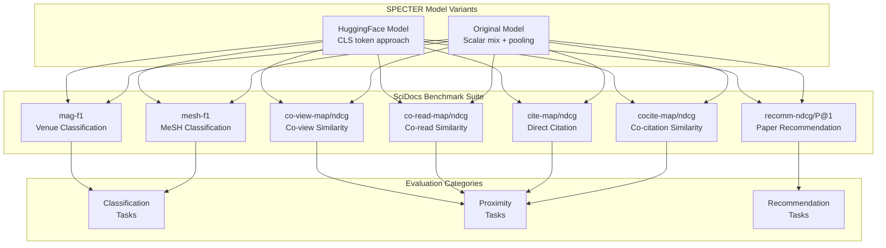
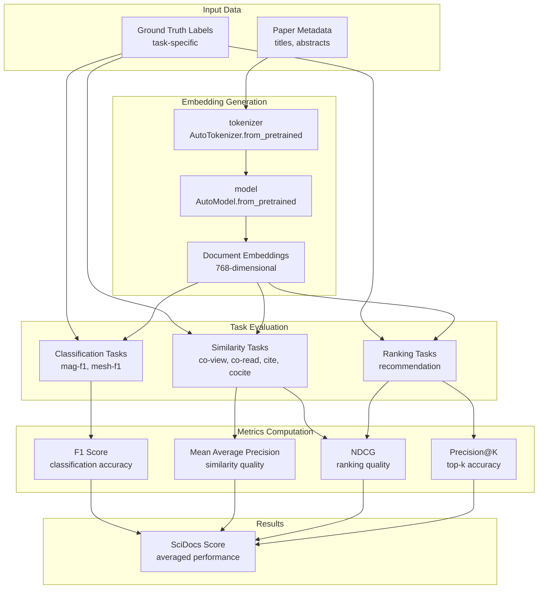
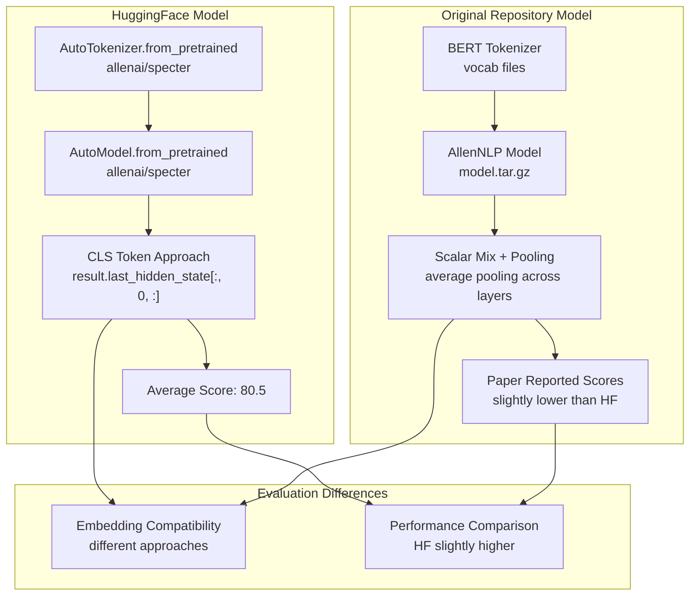

<!-- source: DeepWiki mcp.deepwiki.com · repo allenai/specter · page 8 Evaluation · fetched 2026-10-26 -->

# Evaluation

<details>
<summary>Relevant source files</summary>

The following files were used as context for generating this wiki page:

- [README.md](README.md)

</details>


This document covers the evaluation of SPECTER models using the SciDocs benchmark suite and other evaluation frameworks. It explains the available evaluation tasks, metrics, and procedures for assessing model performance on document-level representation learning tasks.

For information about training models, see [Training Models](#4.2). For details about model architecture, see [Model Architecture](#6.1).

## SciDocs Benchmark Overview

SPECTER models are primarily evaluated using the SciDocs benchmark, a comprehensive evaluation framework designed specifically for document-level representation learning tasks in the scientific domain. SciDocs consists of multiple evaluation tasks that assess different aspects of document understanding and similarity.

The benchmark evaluates models across several dimensions:
- **Classification Tasks**: Document categorization based on venue, field, and topic
- **Proximity Tasks**: Measuring similarity between documents based on citation relationships
- **Recommendation Tasks**: Evaluating document recommendation quality



Sources: [README.md:199-206]()

## Evaluation Tasks and Metrics

The SciDocs benchmark includes seven primary evaluation tasks, each measuring different aspects of document representation quality:

| Task | Metric | Description | HuggingFace Model Score |
|------|--------|-------------|-------------------------|
| **mag-f1** | F1 Score | Venue classification using Microsoft Academic Graph | 79.4 |
| **mesh-f1** | F1 Score | MeSH term classification for biomedical papers | 87.7 |
| **co-view-map** | Mean Average Precision | Papers viewed together similarity | 83.4 |
| **co-view-ndcg** | Normalized Discounted Cumulative Gain | Papers viewed together ranking | 91.4 |
| **co-read-map** | Mean Average Precision | Papers read together similarity | 85.1 |
| **co-read-ndcg** | Normalized Discounted Cumulative Gain | Papers read together ranking | 92.7 |
| **cite-map** | Mean Average Precision | Direct citation similarity | 92.0 |
| **cite-ndcg** | Normalized Discounted Cumulative Gain | Direct citation ranking | 96.6 |
| **cocite-map** | Mean Average Precision | Co-citation similarity | 88.0 |
| **cocite-ndcg** | Normalized Discounted Cumulative Gain | Co-citation ranking | 94.7 |
| **recomm-ndcg** | Normalized Discounted Cumulative Gain | Paper recommendation quality | 54.6 |
| **recomm-P@1** | Precision at 1 | Top recommendation accuracy | 20.9 |
| **Average** | - | Overall benchmark score | 80.5 |

Sources: [README.md:62-64]()

## Evaluation Pipeline

The evaluation process follows a structured pipeline that transforms document embeddings into task-specific performance metrics:



Sources: [README.md:28-44]()

## Running Evaluations

### Using Pre-computed Embeddings

The primary method for evaluation is through the external SciDocs repository, which provides the evaluation framework and pre-computed embeddings for comparison:

```bash
# Clone the SciDocs repository
git clone https://github.com/allenai/scidocs
cd scidocs

# Follow SciDocs instructions to run evaluation
# This requires pre-computed embeddings from SPECTER
```

### Generating Embeddings for Evaluation

To evaluate custom models or reproduce results, embeddings must be generated using one of the SPECTER interfaces:

**HuggingFace Interface:**
```python
from transformers import AutoTokenizer, AutoModel

tokenizer = AutoTokenizer.from_pretrained('allenai/specter')
model = AutoModel.from_pretrained('allenai/specter')

# Process evaluation dataset
# Generate embeddings using model(**inputs)
# Save embeddings for SciDocs evaluation
```

**Repository Interface:**
```bash
python scripts/embed.py \
--ids data/eval.ids \
--metadata data/eval-metadata.json \
--model ./model.tar.gz \
--output-file eval-embeddings.jsonl \
--vocab-dir data/vocab/ \
--batch-size 16
```

Sources: [README.md:47-55](), [README.md:124-137]()

## Model Comparison and Reproducibility

SPECTER provides two main model implementations with different embedding generation approaches:



### Key Differences

1. **Embedding Generation Method**:
   - HuggingFace: Uses final layer representation of `[CLS]` token
   - Original: Uses scalar mixing of all layers with average pooling

2. **Performance**:
   - HuggingFace model yields slightly higher average results (80.5)
   - Original model matches paper-reported scores

3. **Compatibility**:
   - Embeddings from different implementations cannot be mixed
   - Both perform similarly on downstream tasks

### Reproducing Exact Results

To reproduce the exact results reported in the SPECTER paper:

1. Use the original repository implementation with [scripts/embed.py]()
2. Download the original model weights from the provided archive
3. Generate embeddings using the AllenNLP-based approach
4. Use the SciDocs framework for evaluation

Sources: [README.md:57-69](), [README.md:143-148]()

## Public API Evaluation

The Semantic Scholar public APIs provide pre-computed SPECTER embeddings, but these come with important considerations for evaluation:

- **Version Differences**: Public API embeddings are from a different SPECTER model version
- **Incompatibility**: Cannot be mixed with repository-generated embeddings
- **Performance**: Similar performance on downstream tasks despite differences

For evaluation purposes, consistency in embedding generation method is crucial across all test documents.

Sources: [README.md:139-143]()