# Page: Overview

# Overview

<details>
<summary>Relevant source files</summary>

The following files were used as context for generating this wiki page:

- [README.md](README.md)

</details>


This document provides a comprehensive overview of the SPECTER system, including its architecture, components, and interfaces. SPECTER (Document-level Representation Learning using Citation-informed Transformers) is a machine learning system that generates embeddings for scientific documents using citation relationships during training.

For detailed instructions on installation and setup, see [Installation & Setup](#2). For immediate usage examples, see [Quick Start](#3). For comprehensive usage documentation, see [User Guide](#4).

## Purpose and Scope

SPECTER generates vector representations (embeddings) of scientific documents by leveraging both textual content (title and abstract) and citation relationships. Unlike standard language models that only consider text, SPECTER incorporates citation networks during training to produce embeddings that capture semantic relationships between papers.

The system serves two primary functions:
- **Inference**: Generate embeddings for new scientific documents
- **Training**: Train custom models using citation-informed learning

## System Architecture

SPECTER provides multiple interfaces for different use cases, all built around a core transformer-based model architecture.

### High-Level Architecture

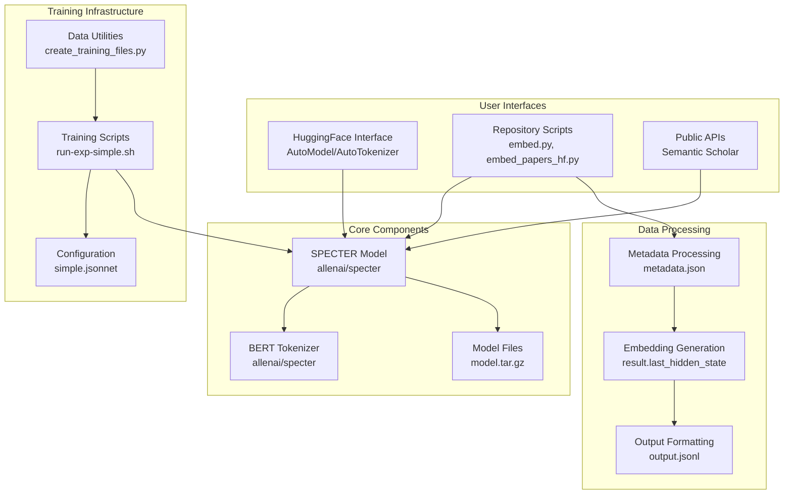

Sources: [README.md:1-220]()

### Core Model Components

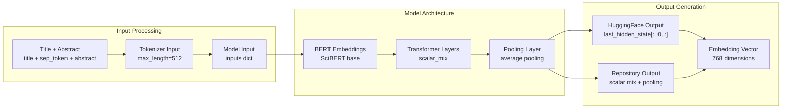

Sources: [README.md:28-44](), [README.md:66-69]()

## Data Flow

### Inference Pipeline

The system processes scientific documents through a standardized pipeline regardless of the interface used:

| Stage | HuggingFace Interface | Repository Interface | Public API |
|-------|----------------------|---------------------|------------|
| Input Format | Python dict with title/abstract | `metadata.json` + `sample.ids` | HTTP request |
| Tokenization | `AutoTokenizer.from_pretrained('allenai/specter')` | Built-in tokenizer | Pre-processed |
| Model Loading | `AutoModel.from_pretrained('allenai/specter')` | `model.tar.gz` | Server-side |
| Embedding Extraction | `result.last_hidden_state[:, 0, :]` | Scalar mix + pooling | API response |
| Output Format | NumPy array | `output.jsonl` | JSON response |

### Training Data Flow

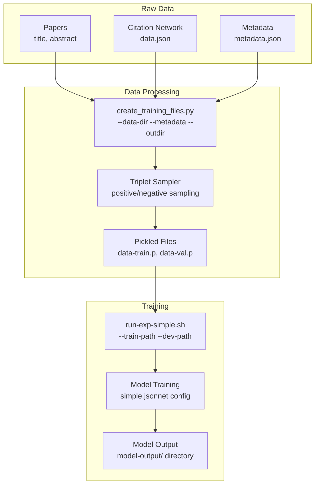

Sources: [README.md:149-196]()

## Interface Comparison

SPECTER provides three distinct interfaces, each optimized for different use cases:

### HuggingFace Interface
- **Entry Point**: `AutoModel.from_pretrained('allenai/specter')`
- **Script**: `scripts/embed_papers_hf.py`
- **Embedding Method**: CLS token from final layer
- **Use Case**: Python integration, batch processing
- **Performance**: Slightly higher than paper results

### Repository Interface  
- **Entry Point**: `scripts/embed.py`
- **Model Loading**: `model.tar.gz`
- **Embedding Method**: Scalar mix + average pooling
- **Use Case**: Reproducing paper results, custom configurations
- **Dependencies**: AllenNLP, custom environment

### Public API Interface
- **Entry Point**: Semantic Scholar API endpoints
- **Access**: HTTP requests
- **Use Case**: Pre-computed embeddings, production applications
- **Note**: Different model version than repository

Sources: [README.md:14-70](), [README.md:139-143]()

## Key Technical Specifications

| Component | Specification |
|-----------|--------------|
| Model Base | SciBERT (BERT-base) |
| Input Length | 512 tokens maximum |
| Embedding Dimension | 768 |
| Supported Formats | JSON, JSONL |
| Training Framework | AllenNLP, PyTorch Lightning |
| Inference Backend | PyTorch, HuggingFace Transformers |

## Training Approach

SPECTER uses citation-informed learning where:
- **Positive Examples**: Papers with direct citations (`count=5`)
- **Hard Negatives**: Papers with indirect citations (`count=1`) 
- **Easy Negatives**: Unrelated papers
- **Sampling Strategy**: Configurable via `--ratio_hard_negatives`

The training data structure in `data.json` follows this format:
```json
{
  "docid1": {
    "docid11": {"count": 1},
    "docid12": {"count": 5}
  }
}
```

Sources: [README.md:160-172]()

## Evaluation

SPECTER performance is measured using the SciDocs benchmark, which evaluates document-level representations across multiple tasks including classification, citation prediction, and recommendation.

For detailed evaluation procedures, see [Evaluation](#8).

Sources: [README.md:60-64](), [README.md:199-205]()

---

# Page: Installation & Setup

# Installation & Setup

<details>
<summary>Relevant source files</summary>

The following files were used as context for generating this wiki page:

- [Dockerfile.cpu](Dockerfile.cpu)
- [requirements.txt](requirements.txt)
- [scripts/pytorch_lightning_training_script/requirements.txt](scripts/pytorch_lightning_training_script/requirements.txt)

</details>


This document provides comprehensive instructions for installing SPECTER and configuring the development environment. It covers multiple installation methods including Docker containers, pip installation, and source installation, along with dependency management and environment verification.

For information about using SPECTER after installation, see [Quick Start](#3). For training custom models, see [Training Models](#4.2).

## Prerequisites

SPECTER requires Python 3.7 and has specific dependency requirements due to its use of a custom AllenNLP fork with fp16 support. The system supports both CPU and GPU environments.

| Requirement | Version | Notes |
|-------------|---------|-------|
| Python | 3.7 | Required for compatibility with AllenNLP fork |
| PyTorch | 1.6.0 | Specific version required for training |
| CUDA | Optional | For GPU acceleration |
| Git | Latest | Required for custom AllenNLP installation |

## Installation Methods

SPECTER can be installed using three primary methods, each suited for different use cases:

### Installation Method Overview

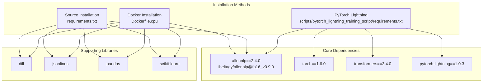

Sources: [requirements.txt:1-8](), [Dockerfile.cpu:1-20](), [scripts/pytorch_lightning_training_script/requirements.txt:1-12]()

### Docker Installation (Recommended)

Docker provides the most reliable installation method with pre-configured dependencies:

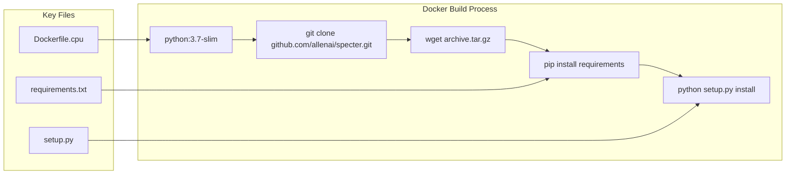

The Docker installation process follows these steps from [Dockerfile.cpu:1-20]():

1. **Base Environment**: Uses `python:3.7-slim` as the base image
2. **System Dependencies**: Installs `git`, `wget`, and build tools
3. **Repository Setup**: Clones the SPECTER repository and downloads model artifacts
4. **Python Dependencies**: Installs AllenNLP 2.4.0 and requirements from `requirements.txt`
5. **Package Installation**: Runs `python setup.py install`

Sources: [Dockerfile.cpu:2-18]()

### Source Installation

For development or custom configurations, install from source:

#### Core Dependencies

The primary dependencies are specified in [requirements.txt:1-8]():

| Package | Version/Source | Purpose |
|---------|----------------|---------|
| `allennlp` | Custom fork: `ibeltagy/allennlp@fp16_v0.9.0` | Custom AllenNLP with fp16 support |
| `dill` | Latest | Serialization library |
| `jsonlines` | Latest | JSON Lines format support |
| `pandas` | Latest | Data manipulation |
| `scikit-learn` | Latest | Machine learning utilities |

#### PyTorch Lightning Training Setup

For training with PyTorch Lightning, additional dependencies are required from [scripts/pytorch_lightning_training_script/requirements.txt:1-12]():

| Package | Version | Purpose |
|---------|---------|---------|
| `torch` | 1.6.0 | PyTorch framework |
| `transformers` | 3.4.0 | HuggingFace Transformers |
| `pytorch-lightning` | 1.0.3 | Training framework |

Sources: [requirements.txt:1-8](), [scripts/pytorch_lightning_training_script/requirements.txt:1-12]()

## Dependency Management

SPECTER uses a custom AllenNLP fork that requires specific installation procedures:

### AllenNLP Fork Installation

The system requires a custom AllenNLP fork with fp16 and gradient accumulation support. Two versions are used depending on the installation method:

1. **Docker Installation**: Uses `allennlp==2.4.0` from [Dockerfile.cpu:14]()
2. **Source Installation**: Uses custom fork from [requirements.txt:2]()

### System Dependencies

For source installation, ensure the following system packages are installed:

```bash
# For CentOS/RHEL systems (referenced in comments)
sudo yum -y install gcc
sudo yum install python3-devel

# For Ubuntu/Debian systems
sudo apt-get install build-essential python3-dev
```

Sources: [scripts/pytorch_lightning_training_script/requirements.txt:7-8](), [Dockerfile.cpu:4-5]()

## Environment Setup

### GPU Environment

For GPU acceleration, ensure CUDA is available and PyTorch is installed with CUDA support. The system supports both CPU and GPU training configurations.

### Optional Dependencies

Additional components can be installed for enhanced functionality:

- **TensorBoard**: For training visualization with PyTorch Lightning
- **Cython**: For performance improvements during installation

Sources: [scripts/pytorch_lightning_training_script/requirements.txt:11-12](), [Dockerfile.cpu:11-12]()

## Verification

After installation, verify the setup by checking that core components are accessible:

1. **Python Environment**: Ensure Python 3.7 is active
2. **Package Installation**: Verify SPECTER package is importable
3. **Model Access**: Confirm access to pre-trained models
4. **Dependencies**: Check that AllenNLP and other dependencies are properly installed

The installation is complete when the system can successfully import SPECTER components and access the required model artifacts downloaded during setup.

Sources: [Dockerfile.cpu:8-9](), [Dockerfile.cpu:17-18]()

---

# Page: Quick Start

# Quick Start

<details>
<summary>Relevant source files</summary>

The following files were used as context for generating this wiki page:

- [README.md](README.md)
- [data/sample-metadata.json](data/sample-metadata.json)
- [data/sample.ids](data/sample.ids)
- [scripts/embed_papers_hf.py](scripts/embed_papers_hf.py)

</details>


This page provides immediate working examples for generating scientific paper embeddings using SPECTER. It covers the three main interfaces available and demonstrates how to get embeddings for your papers with minimal setup.

For detailed configuration options and advanced usage, see [User Guide](#4). For training custom models, see [Training Models](#4.2). For understanding the underlying architecture, see [Architecture Reference](#6).

## Overview

SPECTER provides three distinct interfaces for generating document embeddings:

1. **HuggingFace Interface** - Most accessible, uses standard transformers library
2. **Repository Interface** - Original implementation with full feature set
3. **Public API Interface** - Pre-computed embeddings and on-demand generation

Each interface has different trade-offs in terms of setup complexity, performance characteristics, and output compatibility.

## Prerequisites

All interfaces require Python 3.7+ and basic dependencies. The specific requirements vary by interface:

| Interface | Key Requirements |
|-----------|-----------------|
| HuggingFace | `transformers==4.2+` |
| Repository | `allennlp==2.4.0`, `pytorch==1.6.0` |
| Public API | `requests` library |

## HuggingFace Interface

The HuggingFace interface provides the simplest way to generate embeddings using the standard transformers library.

### Basic Usage

```python
from transformers import AutoTokenizer, AutoModel

# Load model and tokenizer
tokenizer = AutoTokenizer.from_pretrained('allenai/specter')
model = AutoModel.from_pretrained('allenai/specter')

# Prepare paper data
papers = [
    {'title': 'BERT', 'abstract': 'We introduce a new language representation model called BERT'},
    {'title': 'Attention is all you need', 'abstract': 'The dominant sequence transduction models are based on complex recurrent or convolutional neural networks'}
]

# Concatenate title and abstract
title_abs = [d['title'] + tokenizer.sep_token + (d.get('abstract') or '') for d in papers]

# Generate embeddings
inputs = tokenizer(title_abs, padding=True, truncation=True, return_tensors="pt", max_length=512)
result = model(**inputs)
embeddings = result.last_hidden_state[:, 0, :]  # CLS token approach
```

### Batch Processing

For processing large datasets, use the provided batch script:

```bash
CUDA_VISIBLE_DEVICES=0 python scripts/embed_papers_hf.py \
--data-path data/sample-metadata.json \
--output embeddings.jsonl \
--batch-size 8
```

**HuggingFace Embedding Flow**

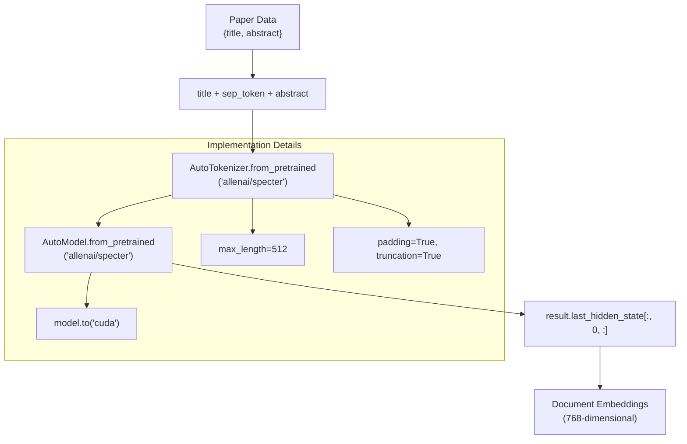

Sources: [README.md:24-58](), [scripts/embed_papers_hf.py:1-82]()

## Repository Interface

The repository interface uses the original SPECTER implementation with AllenNLP, providing the exact model architecture from the paper.

### Setup

1. Download the pre-trained model:
```bash
wget https://ai2-s2-research-public.s3-us-west-2.amazonaws.com/specter/archive.tar.gz
tar -xzvf archive.tar.gz
```

2. Install dependencies:
```bash
pip install -r requirements.txt
python setup.py install
```

### Usage

The repository interface requires two input files:

1. **IDs file** - One document ID per line (e.g., `data/sample.ids`)
2. **Metadata file** - JSON mapping IDs to paper data (e.g., `data/sample-metadata.json`)

```bash
python scripts/embed.py \
--ids data/sample.ids \
--metadata data/sample-metadata.json \
--model ./model.tar.gz \
--output-file output.jsonl \
--vocab-dir data/vocab/ \
--batch-size 16 \
--cuda-device 0
```

### Data Format Requirements

**Metadata JSON structure:**
```json
{
    "doc_id": {
        "title": "representation learning of scientific documents",
        "abstract": "we propose a new model for representing abstracts"
    }
}
```

**Repository Interface Architecture**

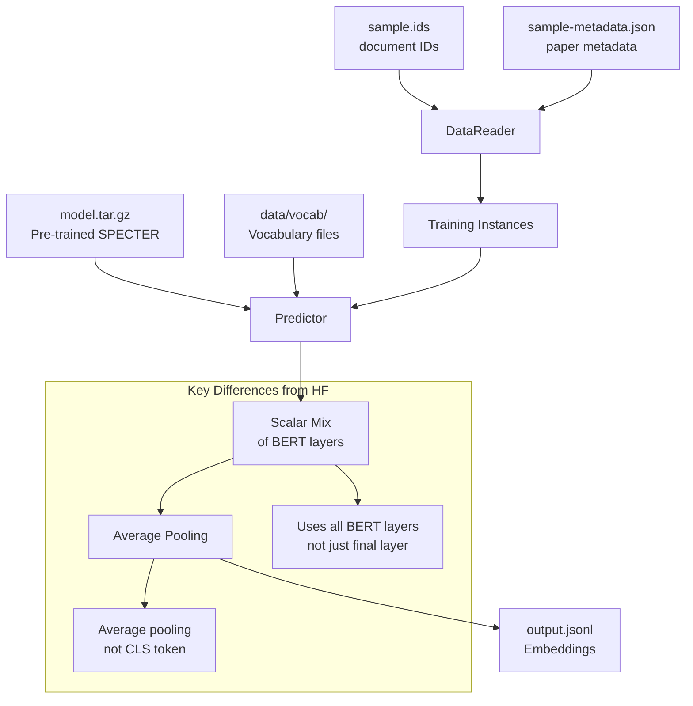

Sources: [README.md:66-137](), [data/sample-metadata.json:1-277](), [data/sample.ids:1-56]()

## Public API Interface

The Semantic Scholar API provides pre-computed embeddings and on-demand generation for papers in their corpus.

### Pre-computed Embeddings

```python
import requests

# Get pre-computed embedding for a paper
paper_id = "204e3073870fae3d05bcbc2f6a8e263d9b72e776"
url = f"https://api.semanticscholar.org/graph/v1/paper/{paper_id}?fields=embedding"

response = requests.get(url)
if response.status_code == 200:
    embedding = response.json()['embedding']['vector']
```

### On-demand Generation

For papers not in the corpus, use the embedding API:

```python
import requests

url = "https://api.semanticscholar.org/graph/v1/paper/batch"
headers = {"x-api-key": "YOUR_API_KEY"}

papers = [
    {"title": "Your Paper Title", "abstract": "Your paper abstract..."}
]

response = requests.post(url, json=papers, headers=headers)
embeddings = response.json()
```

**API Interface Comparison**

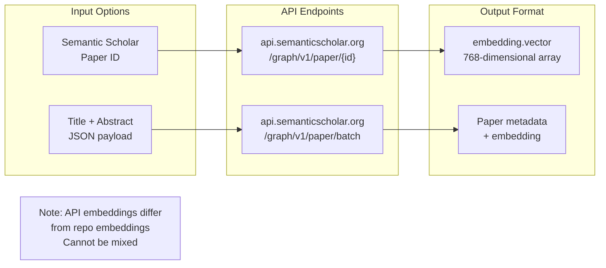

Sources: [README.md:139-143]()

## Interface Comparison

| Feature | HuggingFace | Repository | Public API |
|---------|-------------|------------|------------|
| **Setup Complexity** | Low | Medium | Minimal |
| **Embedding Method** | CLS token | Scalar mix + pooling | Various versions |
| **Batch Processing** | ✓ | ✓ | ✓ |
| **Offline Usage** | ✓ | ✓ | ✗ |
| **Exact Paper Results** | ✗ | ✓ | ✗ |
| **Custom Data** | ✓ | ✓ | Limited |

## Next Steps

- For production deployments, see [User Guide](#4)
- For custom training, see [Training Models](#4.2)  
- For evaluation benchmarks, see [Evaluation](#8)
- For understanding data formats, see [Data Formats](#5)

Sources: [README.md:1-220](), [scripts/embed_papers_hf.py:1-82](), [data/sample-metadata.json:1-277](), [data/sample.ids:1-56]()

---

# Page: User Guide

# User Guide

<details>
<summary>Relevant source files</summary>

The following files were used as context for generating this wiki page:

- [README.md](README.md)

</details>


This document provides comprehensive instructions for using SPECTER to generate scientific document embeddings and train custom models. It covers the three main interfaces for generating embeddings (HuggingFace, repository scripts, and public APIs) and provides detailed guidance for training your own SPECTER models.

For installation instructions, see [Installation & Setup](#2). For immediate working examples, see [Quick Start](#3). For technical details about SPECTER's architecture, see [Architecture Reference](#6).

## Overview of SPECTER Usage Patterns

SPECTER supports multiple usage patterns depending on your needs and technical requirements. The following diagram shows the main interfaces and their relationships:

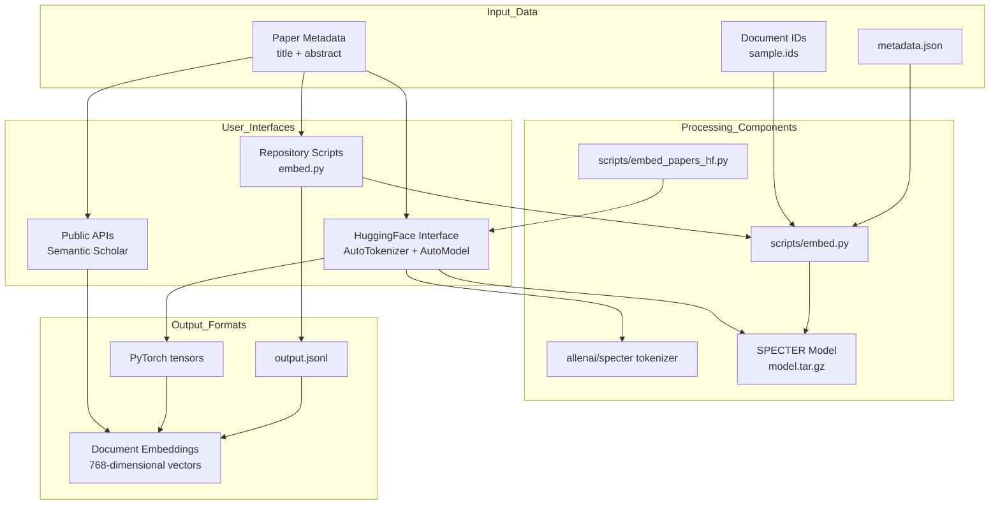

**Sources: [README.md:22-147]()**

## Generating Embeddings

SPECTER provides three distinct interfaces for generating document embeddings, each optimized for different use cases and technical requirements.

### Interface Comparison

The following table summarizes the key differences between the three embedding interfaces:

| Feature | HuggingFace | Repository | Public APIs |
|---------|-------------|------------|-------------|
| **Ease of Use** | High | Medium | Highest |
| **Customization** | Medium | High | None |
| **Performance** | High | Medium | Highest |
| **Dependency Requirements** | Minimal | Full | None |
| **Batch Processing** | Yes | Yes | Limited |
| **Offline Usage** | Yes | Yes | No |

### HuggingFace Interface

The HuggingFace interface provides the most straightforward way to use SPECTER with minimal setup. It uses the `transformers` library and extracts embeddings from the `[CLS]` token.

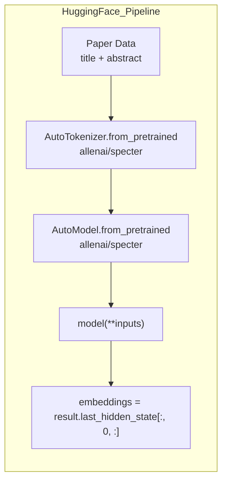

**Basic Usage Pattern:**
```python
from transformers import AutoTokenizer, AutoModel

tokenizer = AutoTokenizer.from_pretrained('allenai/specter')
model = AutoModel.from_pretrained('allenai/specter')

# Format: title + SEP + abstract
title_abs = [d['title'] + tokenizer.sep_token + (d.get('abstract') or '') for d in papers]
inputs = tokenizer(title_abs, padding=True, truncation=True, return_tensors="pt", max_length=512)
result = model(**inputs)
embeddings = result.last_hidden_state[:, 0, :]
```

The HuggingFace interface includes a batch processing script at `scripts/embed_papers_hf.py` that handles large datasets efficiently:

```bash
CUDA_VISIBLE_DEVICES=0 python scripts/embed_papers_hf.py \
--data-path path/to/paper-metadata.json \
--output path/to/write/output.json \
--batch-size 8
```

**Sources: [README.md:24-58]()**

### Repository Interface

The original repository interface uses AllenNLP's implementation with scalar mixing of layers and average pooling. This approach provides more control over the embedding process but requires additional setup.

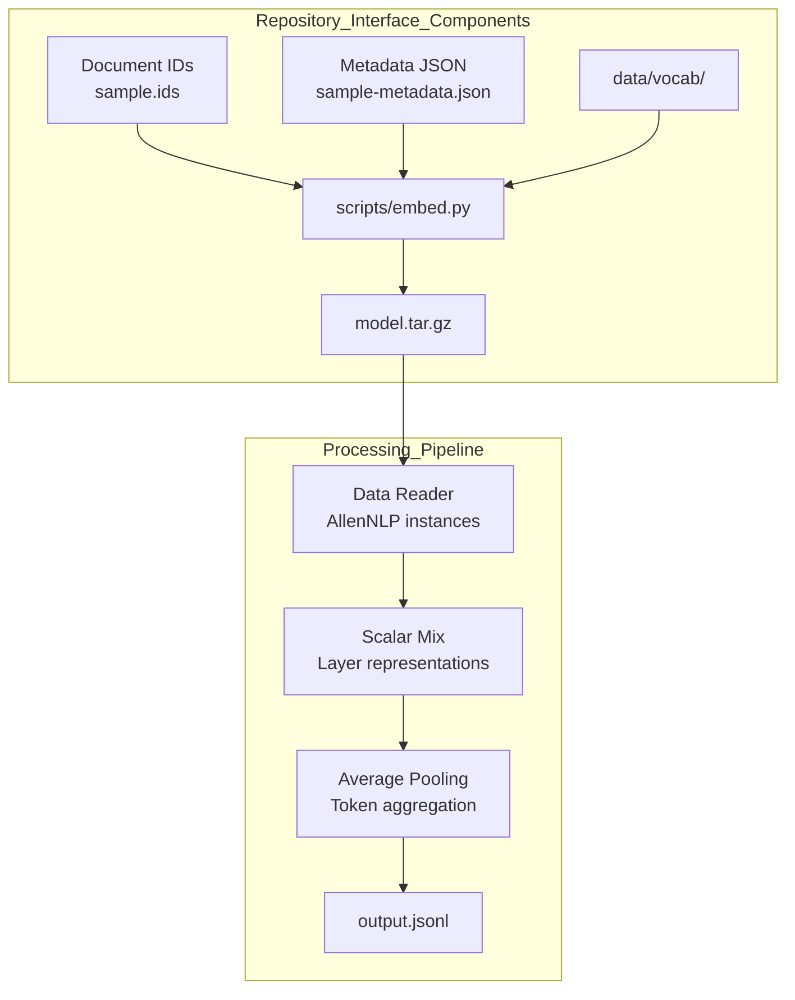

**Key Implementation Details:**
- Uses scalar mixing across all BERT layers rather than just the final layer
- Applies average pooling instead of using the `[CLS]` token directly
- Requires vocabulary files and model archives
- Outputs embeddings in JSONL format

**Command Structure:**
```bash
python scripts/embed.py \
--ids data/sample.ids \
--metadata data/sample-metadata.json \
--model ./model.tar.gz \
--output-file output.jsonl \
--vocab-dir data/vocab/ \
--batch-size 16 \
--cuda-device -1
```

**Sources: [README.md:66-137]()**

### Public APIs

The Semantic Scholar public APIs provide pre-computed embeddings and on-demand embedding services without requiring local model installation.

**Available API Endpoints:**
- Pre-computed embeddings for papers in the Semantic Scholar corpus
- On-demand embedding API for custom title/abstract pairs
- Bulk embedding retrieval for large datasets

**Important Note:** Public API embeddings are generated by a different version of SPECTER and cannot be mixed with locally generated embeddings within the same task.

**Sources: [README.md:139-143]()**

## Training Models

Training custom SPECTER models requires careful data preparation and configuration. The training process uses citation relationships to create positive and negative examples for contrastive learning.

### Data Preparation Workflow

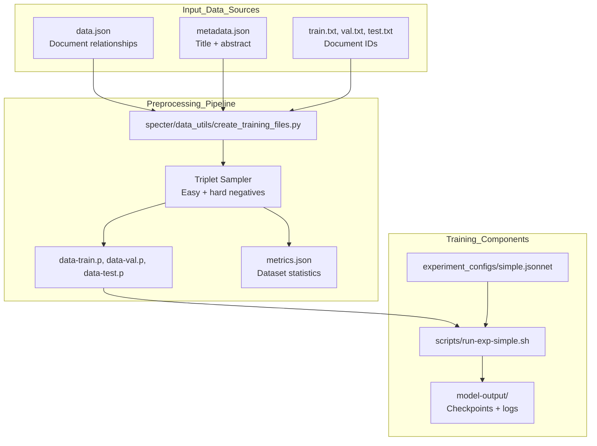

### Data Format Requirements

The training data requires specific file formats and structures:

**data.json Structure:**
```json
{
  "docid1": {
    "docid11": {"count": 1}, 
    "docid12": {"count": 5},
    "docid13": {"count": 1}
  },
  "docid2": {
    "docid21": {"count": 1}
  }
}
```

**metadata.json Structure:**
```json
{
  "doc_id": {
    "title": "representation learning of scientific documents",
    "abstract": "we propose a new model for representing abstracts"
  }
}
```

**Citation Relationship Semantics:**
- `count=5`: Direct citation (positive examples)
- `count=1`: Citation of citation (hard negatives)
- No relationship: Easy negatives

**Sources: [README.md:160-172]()**

### Training Script Execution

The training process involves two main steps: data preprocessing and model training.

**Step 1: Create Training Files**
```bash
python specter/data_utils/create_training_files.py \
--data-dir data/training \
--metadata data/training/metadata.json \
--outdir data/preprocessed/
```

**Step 2: Run Training**
```bash
./scripts/run-exp-simple.sh -c experiment_configs/simple.jsonnet \
-s model-output/ --num-epochs 2 --batch-size 4 \
--train-path data/preprocessed/data-train.p \
--dev-path data/preprocessed/data-val.p \
--num-train-instances 55 --cuda-device -1
```

**Training Monitoring:**
- Model checkpoints and logs are stored in the output directory
- Progress can be monitored using TensorBoard: `tensorboard --logdir model-output/ --bind_all`
- The `metrics.json` file contains dataset statistics including the number of training instances

**Sources: [README.md:174-195]()**

### Configuration Management

Training configurations are managed through JSON configuration files that specify model architecture, training parameters, and data paths.

**Key Configuration Components:**
- Model architecture parameters
- Training hyperparameters (learning rate, batch size, epochs)
- Data input/output paths
- Evaluation metrics and validation settings

The configuration system allows for flexible experimentation with different model variants and training strategies.

**Sources: [README.md:186-189]()**

## Performance Considerations

### Model Performance Comparison

SPECTER provides different performance characteristics depending on the interface used:

| Interface | Avg SciDocs Score | Processing Speed | Memory Usage |
|-----------|-------------------|------------------|--------------|
| HuggingFace | 80.5 | Fast | Low |
| Repository | ~80.0 | Medium | Medium |
| Public API | N/A | Fastest | None |

### Batch Processing Recommendations

- **HuggingFace Interface**: Use batch sizes of 8-16 for optimal GPU utilization
- **Repository Interface**: Adjust batch size based on available memory
- **Large Datasets**: Use the provided batch processing scripts for efficient handling

**Sources: [README.md:57-64]()**

## Troubleshooting Common Issues

### Model Loading Issues
- Ensure correct transformers library version (`transformers==4.2` for HuggingFace)
- Verify model and vocabulary files are properly downloaded
- Check CUDA device availability and configuration

### Training Issues
- Verify `--num-train-instances` matches the value in `metrics.json`
- Ensure all required data files are present and properly formatted
- Monitor GPU memory usage during training

### Data Format Issues
- Validate JSON structure for metadata and data files
- Check document ID consistency across all files
- Ensure proper encoding for text fields

**Sources: [README.md:91-104](), [README.md:174-195]()**

---

# Page: Generating Embeddings

# Generating Embeddings

<details>
<summary>Relevant source files</summary>

The following files were used as context for generating this wiki page:

- [README.md](README.md)
- [scripts/embed.py](scripts/embed.py)
- [scripts/embed_papers_hf.py](scripts/embed_papers_hf.py)

</details>


This document provides an overview of the three main interfaces available for generating SPECTER embeddings from scientific papers. Each interface serves different use cases and has distinct technical implementations.

For detailed implementation guides for each interface, see:
- HuggingFace Interface: [4.1.1](#4.1.1)
- Repository Interface: [4.1.2](#4.1.2) 
- Public APIs: [4.1.3](#4.1.3)

For information about training custom models, see [Training Models](#4.2).

## Interface Overview

SPECTER provides three distinct approaches to generate paper embeddings, each with different technical foundations and use cases:

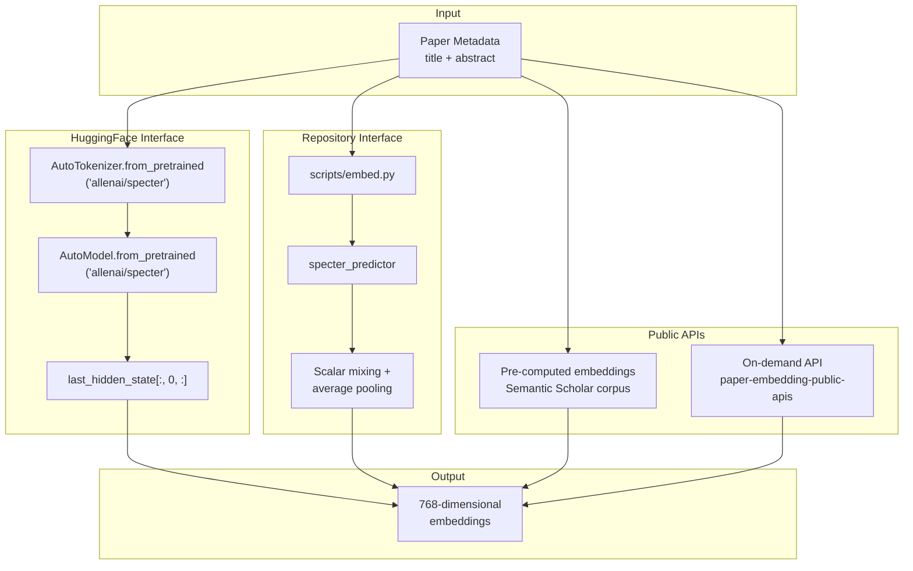

Sources: [README.md:1-219]()

## Technical Comparison

The three interfaces differ significantly in their technical implementation and embedding generation approach:

| Aspect | HuggingFace | Repository | Public APIs |
|--------|-------------|------------|-------------|
| **Model Loading** | `AutoModel.from_pretrained('allenai/specter')` | `model.tar.gz` archive | Pre-computed/API |
| **Tokenization** | `AutoTokenizer` with `sep_token` | `specter_data_reader` | N/A |
| **Embedding Method** | CLS token from final layer | Scalar mixing + average pooling | Different model version |
| **Input Format** | Python dict with title/abstract | JSON metadata + IDs file | Various API formats |
| **Batch Processing** | `scripts/embed_papers_hf.py` | `scripts/embed.py` | Bulk retrieval |
| **Dependencies** | `transformers==4.2` | AllenNLP + custom environment | HTTP client |

Sources: [README.md:24-143](), [scripts/embed_papers_hf.py:1-82](), [scripts/embed.py:1-69]()

## Data Flow Architecture

The following diagram shows how each interface processes input data to generate embeddings:

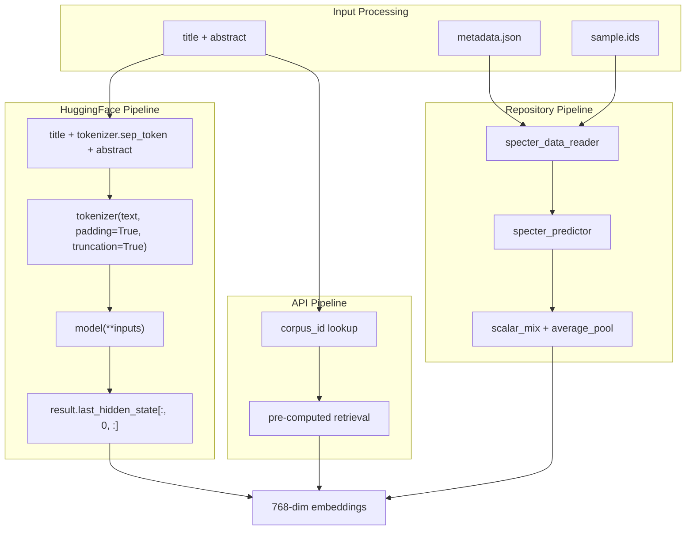

Sources: [README.md:28-44](), [README.md:124-136](), [scripts/embed_papers_hf.py:32-38](), [scripts/embed.py:37-50]()

## Key Technical Differences

### Embedding Generation Methods

The most significant technical difference lies in how embeddings are extracted:

**HuggingFace Interface:**
- Uses `result.last_hidden_state[:, 0, :]` to extract CLS token representation from the final transformer layer
- Follows standard BERT-style embedding extraction
- Simpler, more direct approach

**Repository Interface:**
- Uses scalar mixing across all transformer layers combined with average pooling
- More complex aggregation strategy as implemented in AllenNLP v0.9
- Original SPECTER paper implementation approach

Sources: [README.md:68-69]()

### Input Data Requirements

Each interface expects different input formats:

**HuggingFace Interface:**
```python
papers = [{'title': 'BERT', 'abstract': 'We introduce a new language representation model called BERT'}]
```

**Repository Interface:**
```python
# metadata.json format:
{
    'doc_id': {'title': 'representation learning of scientific documents',
               'abstract': 'we propose a new model for representing abstracts'}
}
```

**Public APIs:**
- Various API-specific formats
- Pre-computed embeddings for Semantic Scholar corpus papers
- On-demand embedding generation for arbitrary papers

Sources: [README.md:35-36](), [README.md:114-120](), [README.md:141-143]()

## Interface Selection Guide

Choose the appropriate interface based on your requirements:

| Use Case | Recommended Interface | Rationale |
|----------|----------------------|-----------|
| **Simple integration** | HuggingFace | Minimal dependencies, standard transformers API |
| **Exact paper reproduction** | Repository | Matches original SPECTER implementation |
| **Large-scale batch processing** | Repository | Optimized for bulk embedding generation |
| **Semantic Scholar papers** | Public APIs | Pre-computed embeddings available |
| **Production applications** | HuggingFace | Better maintained, more stable |
| **Research reproducibility** | Repository | Exact match to paper results |

Sources: [README.md:57-58](), [README.md:143]()

## Performance Considerations

The HuggingFace interface yields slightly higher average results than the repository interface, though both perform comparably on downstream tasks. The repository interface is required for exact reproduction of the original paper results.

Expected SciDocs performance from HuggingFace model: **80.5 average** across all tasks, with the repository interface producing results matching the original paper.

Sources: [README.md:57-64]()

---

# Page: HuggingFace Interface

# HuggingFace Interface

<details>
<summary>Relevant source files</summary>

The following files were used as context for generating this wiki page:

- [README.md](README.md)
- [scripts/embed_papers_hf.py](scripts/embed_papers_hf.py)

</details>


This document covers using SPECTER through the HuggingFace Transformers library for generating scientific document embeddings. This interface provides the most accessible way to use SPECTER with minimal setup requirements.

For information about the original repository implementation, see [Repository Interface](#4.1.2). For pre-computed embeddings and API access, see [Public APIs](#4.1.3).

## Overview

The HuggingFace interface provides access to SPECTER through the standard HuggingFace Transformers library. This integration was added in January 2021 and allows users to generate embeddings using familiar HuggingFace patterns with `AutoTokenizer` and `AutoModel`.

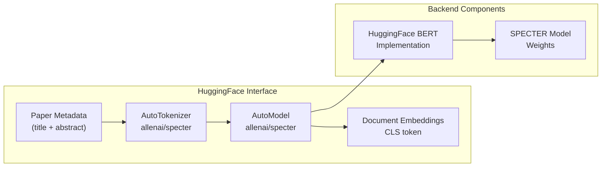

**HuggingFace Interface Architecture**

Sources: [README.md:14-69]()

## Basic Usage

### Installation

The HuggingFace interface requires the transformers library:

```bash
pip install --upgrade transformers==4.2
```

### Single Document Embedding

The basic pattern follows standard HuggingFace usage:

```python
from transformers import AutoTokenizer, AutoModel

# Load model and tokenizer
tokenizer = AutoTokenizer.from_pretrained('allenai/specter')
model = AutoModel.from_pretrained('allenai/specter')

# Prepare input
papers = [{'title': 'BERT', 'abstract': 'We introduce a new language representation model called BERT'}]

# Concatenate title and abstract
title_abs = [d['title'] + tokenizer.sep_token + (d.get('abstract') or '') for d in papers]

# Tokenize
inputs = tokenizer(title_abs, padding=True, truncation=True, return_tensors="pt", max_length=512)

# Generate embeddings
result = model(**inputs)
embeddings = result.last_hidden_state[:, 0, :]  # CLS token
```

Sources: [README.md:28-45]()

### Input Format

The HuggingFace interface expects paper metadata in the following format:

| Field | Type | Required | Description |
|-------|------|----------|-------------|
| `title` | string | Yes | Paper title |
| `abstract` | string | No | Paper abstract (can be empty) |

The title and abstract are concatenated with `tokenizer.sep_token` as separator.

## Batch Processing

For processing multiple papers efficiently, use the provided batch embedding script:

```bash
CUDA_VISIBLE_DEVICES=0 python scripts/embed_papers_hf.py \
--data-path path/to/paper-metadata.json \
--output path/to/write/output.json \
--batch-size 8
```

### Batch Processing Architecture

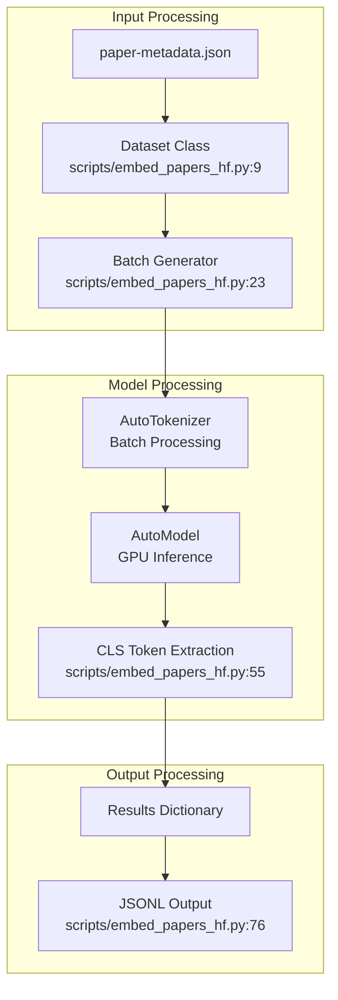

**Batch Processing Pipeline**

Sources: [scripts/embed_papers_hf.py:1-82](), [README.md:47-55]()

### Batch Script Components

The batch embedding script consists of two main classes:

| Class | Purpose | Key Methods |
|-------|---------|-------------|
| `Dataset` | Data loading and batch creation | `__init__`, `batches()` |
| `Model` | SPECTER model wrapper | `__call__` |

The `Dataset` class handles:
- Loading JSON metadata from [scripts/embed_papers_hf.py:16-18]()
- Creating batches in [scripts/embed_papers_hf.py:23-44]()
- Tokenization with padding and truncation

The `Model` class handles:
- Model loading and GPU placement in [scripts/embed_papers_hf.py:48-51]()
- Inference and CLS token extraction in [scripts/embed_papers_hf.py:53-55]()

## Architecture Details

### Model Representation Method

The HuggingFace interface uses a different approach for generating document representations compared to the original repository implementation:

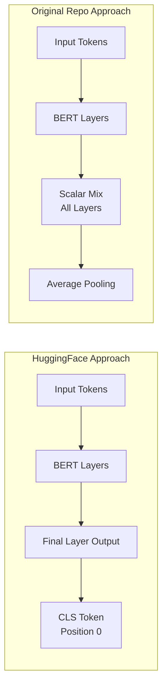

**Representation Method Comparison**

The HuggingFace model extracts the CLS token from the final layer (`result.last_hidden_state[:, 0, :]`), while the original repository uses scalar mixing across all layers followed by average pooling.

Sources: [README.md:68-69]()

### Performance Comparison

The HuggingFace model yields slightly higher average results than the original implementation:

| Metric | HuggingFace Result |
|--------|-------------------|
| mag-f1 | 79.4 |
| mesh-f1 | 87.7 |
| co-view-map | 83.4 |
| co-view-ndcg | 91.4 |
| co-read-map | 85.1 |
| co-read-ndcg | 92.7 |
| cite-map | 92.0 |
| cite-ndcg | 96.6 |
| cocite-map | 88.0 |
| cocite-ndcg | 94.7 |
| recomm-ndcg | 54.6 |
| recomm-P@1 | 20.9 |
| **Average** | **80.5** |

Sources: [README.md:60-64]()

## Code Structure

### Key Components

The HuggingFace interface relies on these main components:

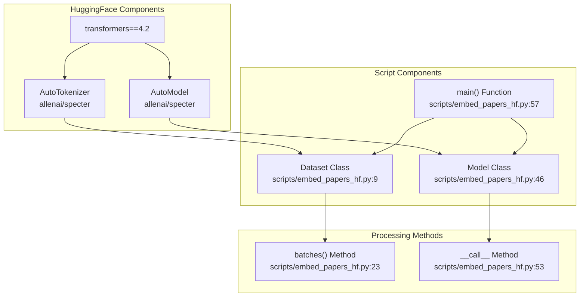

**HuggingFace Interface Code Architecture**

### Input/Output Format

The batch script expects and produces specific JSON formats:

**Input Format** (paper-metadata.json):
```json
{
  "paper_id": {
    "title": "Paper Title",
    "abstract": "Paper abstract text"
  }
}
```

**Output Format** (JSONL):
```json
{"paper_id": "paper_id", "embedding": [0.1, 0.2, ...]}
```

The output embeddings are 768-dimensional vectors corresponding to the BERT hidden size.

Sources: [scripts/embed_papers_hf.py:16-18](), [scripts/embed_papers_hf.py:72-78]()

## Usage Considerations

### Memory and Performance

- The HuggingFace interface loads the full model into memory
- GPU acceleration is recommended for batch processing
- Default batch size is 8 for the embedding script
- Maximum sequence length is 512 tokens

### Compatibility

- The HuggingFace model cannot be mixed with embeddings from other SPECTER implementations
- Results are comparable but not identical to the original repository implementation
- The model is compatible with standard HuggingFace ecosystem tools

Sources: [README.md:57-58](), [scripts/embed_papers_hf.py:11-14]()

---

# Page: Repository Interface

# Repository Interface

<details>
<summary>Relevant source files</summary>

The following files were used as context for generating this wiki page:

- [README.md](README.md)
- [scripts/embed.py](scripts/embed.py)

</details>


## Purpose and Scope

The Repository Interface provides access to SPECTER's original AllenNLP-based implementation for generating scientific document embeddings. This interface uses the complete repository codebase with custom data readers, predictors, and model architecture as originally developed for the SPECTER paper.

This document covers the repository's native embedding pipeline using `scripts/embed.py` and the AllenNLP framework. For information about the simplified HuggingFace interface, see [HuggingFace Interface](#4.1.1). For training custom models using this implementation, see [Training Scripts](#4.2.2).

## Overview

The Repository Interface provides the original SPECTER implementation that differs from the HuggingFace version in several key ways:

| Aspect | Repository Interface | HuggingFace Interface |
|--------|---------------------|----------------------|
| **Model Representation** | Scalar mix of layers + average pooling | [CLS] token final layer |
| **Framework** | AllenNLP | HuggingFace Transformers |
| **Setup Complexity** | Requires model download and vocab files | Simple pip install |
| **Customization** | Full access to training pipeline | Limited to inference |
| **Performance** | Original paper results | Slightly higher average results |

The repository interface maintains the exact implementation used in the original SPECTER paper research, ensuring reproducible results for scientific comparisons.

**Repository Interface Architecture**
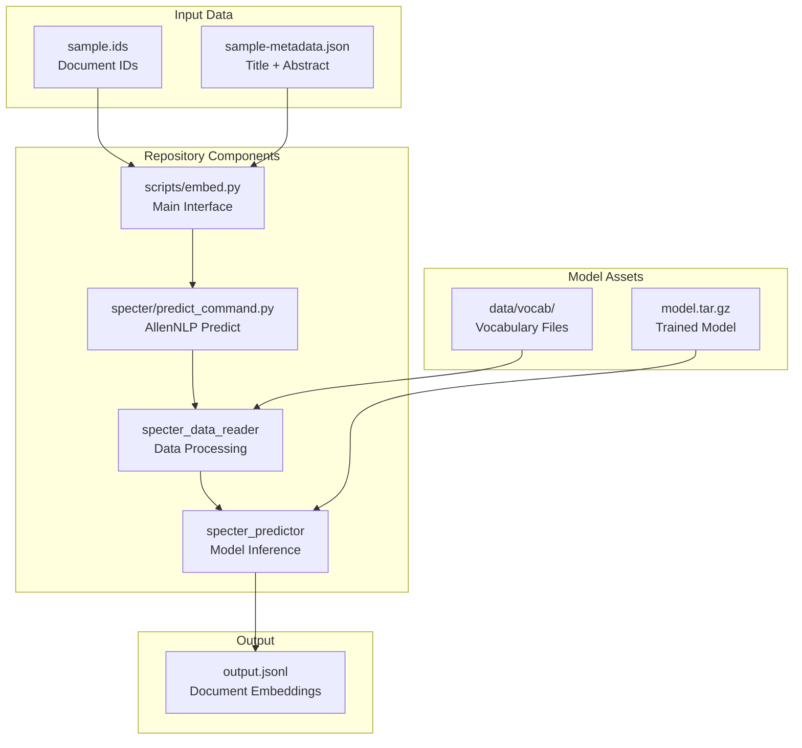

Sources: [README.md:66-137](), [scripts/embed.py:1-69]()

## Installation and Setup

### Prerequisites

The Repository Interface requires downloading the complete model archive and setting up the AllenNLP environment:

```bash
# Clone repository
git clone git@github.com:allenai/specter.git
cd specter

# Download model archive (833 MiB)
wget https://ai2-s2-research-public.s3-us-west-2.amazonaws.com/specter/archive.tar.gz
tar -xzvf archive.tar.gz

# Create conda environment
conda create --name specter python=3.7 setuptools
conda activate specter

# Install PyTorch with CUDA support (optional)
conda install pytorch cudatoolkit=10.1 -c pytorch

# Install dependencies
pip install -r requirements.txt
python setup.py install
```

### Required Files

After extraction, you will have these essential components:

| File/Directory | Purpose |
|---------------|---------|
| `model.tar.gz` | Pre-trained SPECTER model |
| `data/vocab/` | Vocabulary files for tokenization |
| `data/sample.ids` | Example document IDs |
| `data/sample-metadata.json` | Example metadata |

Sources: [README.md:71-104]()

## Data Preparation

### Input Data Format

The Repository Interface requires two input files:

**Document IDs File** (`*.ids`):
```
doc_id_1
doc_id_2
doc_id_3
```

**Metadata JSON File** (`*.json`):
```json
{
    "doc_id_1": {
        "title": "representation learning of scientific documents",
        "abstract": "we propose a new model for representing abstracts"
    },
    "doc_id_2": {
        "title": "attention is all you need",
        "abstract": "the dominant sequence transduction models are based on complex recurrent networks"
    }
}
```

### Data Processing Pipeline

**Data Processing Flow**
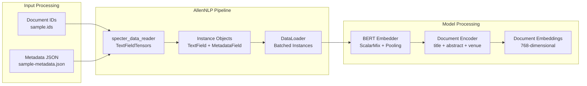

Sources: [README.md:111-120](), [scripts/embed.py:37]()

## Embedding Process

### Command Line Interface

The primary interface is through `scripts/embed.py`, which wraps the AllenNLP predict functionality:

```bash
python scripts/embed.py \
    --ids data/sample.ids \
    --metadata data/sample-metadata.json \
    --model ./model.tar.gz \
    --output-file output.jsonl \
    --vocab-dir data/vocab/ \
    --batch-size 16 \
    --cuda-device -1
```

### Parameter Configuration

| Parameter | Description | Default |
|-----------|-------------|---------|
| `--ids` | Path to document IDs file | Required |
| `--metadata` | Path to metadata JSON file | Required |
| `--model` | Path to model.tar.gz | Required |
| `--output-file` | Output embeddings file | Required |
| `--vocab-dir` | Vocabulary directory | `data/vocab/` |
| `--batch-size` | Inference batch size | `1` |
| `--cuda-device` | GPU device (-1 for CPU) | `0` |
| `--included-text-fields` | Fields to include | `abstract title` |

### Internal Processing

The `embed.py` script constructs AllenNLP overrides and executes the prediction pipeline:

```python
# Configuration overrides built by embed.py
overrides = {
    'model': {
        'predict_mode': 'true',
        'include_venue': 'false'
    },
    'dataset_reader': {
        'type': 'specter_data_reader',
        'predict_mode': 'true',
        'paper_features_path': args.metadata,
        'included_text_fields': args.included_text_fields
    },
    'vocabulary': {
        'directory_path': args.vocab_dir
    }
}
```

Sources: [scripts/embed.py:23-66]()

## Technical Architecture

### AllenNLP Components

**Component Interaction Diagram**
```mermaid
graph TB
    subgraph "AllenNLP Framework"
        predict_cmd["predict_command.py<br/>Main Entry Point"]
        reader["specter_data_reader<br/>DatasetReader"]
        predictor["specter_predictor<br/>Predictor"]
        model["specter_model<br/>Model"]
    end
    
    subgraph "Core Components"
        bert_embedder["BERT Embedder<br/>ScalarMix Implementation"]
        seq_encoder["Sequence Encoder<br/>title + abstract + venue"]
        pooler["Average Pooler<br/>Document Representation"]
    end
    
    subgraph "Configuration"
        vocab["Vocabulary<br/>Token Mappings"]
        config["Model Config<br/>Architecture Settings"]
    end
    
    predict_cmd --> reader
    predict_cmd --> predictor
    predictor --> model
    model --> bert_embedder
    bert_embedder --> seq_encoder
    seq_encoder --> pooler
    vocab --> reader
    config --> model
```

### Model Architecture Details

The Repository Interface uses a specific model architecture that differs from the HuggingFace implementation:

1. **BERT Embedder**: Uses AllenNLP's scalar mix of all BERT layers rather than just the final layer
2. **Sequence Encoder**: Processes title, abstract, and venue fields separately
3. **Pooling Strategy**: Average pooling over sequence length to create document representation
4. **Output Dimension**: 768-dimensional embeddings matching BERT-base

### Prediction Pipeline

**End-to-End Processing**
```mermaid
graph LR
    subgraph "Data Loading"
        ids["Document IDs"]
        meta["Metadata"]
        reader["DatasetReader"]
    end
    
    subgraph "Model Inference"
        instances["Instance Batch"]
        forward_pass["Model Forward"]
        embeddings["Raw Embeddings"]
    end
    
    subgraph "Post-Processing"
        detach["Tensor Detach"]
        serialize["JSON Serialization"]
        output["JSONL Output"]
    end
    
    ids --> reader
    meta --> reader
    reader --> instances
    instances --> forward_pass
    forward_pass --> embeddings
    embeddings --> detach
    detach --> serialize
    serialize --> output
```

Sources: [README.md:66-69](), [scripts/embed.py:39-58]()

## Output Format

### JSONL Structure

The Repository Interface outputs embeddings in JSONL format, with one JSON object per line:

```jsonl
{"doc_id": "doc_id_1", "embedding": [0.1, 0.2, ..., 0.768_values]}
{"doc_id": "doc_id_2", "embedding": [0.3, 0.4, ..., 0.768_values]}
```

### Processing Output

Each line contains:
- `doc_id`: String identifier matching input IDs
- `embedding`: List of 768 float values representing the document embedding

### Performance Characteristics

- **Embedding Dimension**: 768 (BERT-base)
- **Batch Processing**: Configurable batch size for GPU memory optimization
- **CPU/GPU Support**: Automatic device detection with `--cuda-device` parameter
- **Memory Usage**: Scales with batch size and sequence length

Sources: [README.md:134-137]()

## Error Handling and Troubleshooting

### Common Issues

| Issue | Solution |
|-------|----------|
| Missing vocabulary files | Ensure `data/vocab/` directory exists |
| CUDA out of memory | Reduce `--batch-size` parameter |
| Model not found | Verify `model.tar.gz` path and extraction |
| Metadata format errors | Check JSON syntax and required fields |

### Debugging

The script provides logging output for troubleshooting:

```bash
# Enable verbose logging
python scripts/embed.py [...] --verbose

# Monitor GPU usage
nvidia-smi

# Check output file
head -n 5 output.jsonl
```

Sources: [scripts/embed.py:62-63]()

---

# Page: Public APIs

# Public APIs

<details>
<summary>Relevant source files</summary>

The following files were used as context for generating this wiki page:

- [README.md](README.md)

</details>


This page covers using SPECTER through external public APIs provided by Semantic Scholar. These APIs allow you to retrieve pre-computed embeddings for papers in the Semantic Scholar corpus or generate embeddings on-demand without needing to run the model locally.

For information about using SPECTER directly through code interfaces, see [HuggingFace Interface](#4.1.1) and [Repository Interface](#4.1.2).

## Overview

The SPECTER public APIs provide two main access methods:

1. **Pre-computed Embeddings API**: Retrieve embeddings for papers already in the Semantic Scholar corpus
2. **On-demand Embedding API**: Generate embeddings for custom paper titles and abstracts

These APIs eliminate the need to download models, manage dependencies, or run inference locally, making SPECTER accessible for applications that need embeddings at scale.

## Public API Access Methods

```mermaid
graph TB
    subgraph "External Applications"
        WebApp["Web Applications"]
        MobileApp["Mobile Apps"]
        ResearchTool["Research Tools"]
        DataPipeline["Data Pipelines"]
    end
    
    subgraph "Public API Layer"
        PreComputed["Pre-computed Embeddings API<br/>semanticscholar.org/product/api"]
        OnDemand["On-demand Embedding API<br/>paper-embedding-public-apis"]
    end
    
    subgraph "Backend Infrastructure"
        S2Corpus["Semantic Scholar<br/>Paper Corpus"]
        SpecterModel["SPECTER Model<br/>Inference Service"]
        EmbeddingStore["Pre-computed<br/>Embedding Store"]
    end
    
    WebApp --> PreComputed
    MobileApp --> OnDemand
    ResearchTool --> PreComputed
    DataPipeline --> PreComputed
    
    PreComputed --> EmbeddingStore
    OnDemand --> SpecterModel
    
    EmbeddingStore --> S2Corpus
    SpecterModel --> S2Corpus
```

Sources: [README.md:139-143]()

## Pre-computed Embeddings API

The Semantic Scholar API provides access to pre-computed SPECTER embeddings for papers in their corpus. This is the most efficient method for retrieving embeddings for known papers.

### API Endpoint

The pre-computed embeddings are available through the Semantic Scholar API at:
- Base URL: `https://www.semanticscholar.org/product/api`

### Usage Pattern

```mermaid
graph LR
    subgraph "Client Application"
        ClientApp["Client Application"]
    end
    
    subgraph "Semantic Scholar API"
        APIEndpoint["API Endpoint<br/>semanticscholar.org/product/api"]
        PaperLookup["Paper Lookup Service"]
        EmbeddingRetrieval["Embedding Retrieval"]
    end
    
    subgraph "Data Storage"
        PaperDB["Paper Database"]
        EmbeddingDB["Pre-computed<br/>Embedding Database"]
    end
    
    ClientApp --> APIEndpoint
    APIEndpoint --> PaperLookup
    PaperLookup --> PaperDB
    APIEndpoint --> EmbeddingRetrieval
    EmbeddingRetrieval --> EmbeddingDB
```

Sources: [README.md:141]()

## On-demand Embedding API

For custom papers or papers not in the Semantic Scholar corpus, an on-demand embedding API is available that generates embeddings from paper titles and abstracts.

### API Repository

The on-demand embedding functionality is available through a dedicated repository:
- Repository: `allenai/paper-embedding-public-apis`

### Processing Flow

```mermaid
graph TB
    subgraph "Client Request"
        PaperInput["Paper Input<br/>title + abstract"]
    end
    
    subgraph "API Processing"
        APIGateway["API Gateway<br/>paper-embedding-public-apis"]
        TextProcessing["Text Processing<br/>tokenization + formatting"]
        ModelInference["SPECTER Model<br/>Inference"]
    end
    
    subgraph "Response"
        EmbeddingOutput["Embedding Vector<br/>768-dimensional"]
    end
    
    PaperInput --> APIGateway
    APIGateway --> TextProcessing
    TextProcessing --> ModelInference
    ModelInference --> EmbeddingOutput
```

Sources: [README.md:141]()

## Important Considerations

### Model Version Differences

The public APIs use a different version of the SPECTER model than the implementation in this repository. This has several implications:

| Aspect | Public APIs | Repository Implementation |
|--------|-------------|---------------------------|
| Model Version | Different SPECTER version | Original paper implementation |
| Embedding Compatibility | Cannot be mixed with repo embeddings | Compatible with paper results |
| Performance | Similar downstream performance | Exact paper reproduction |
| Use Case | Production applications | Research reproduction |

### Compatibility Warning

```mermaid
graph TB
    subgraph "Public API Embeddings"
        PublicEmbed["Public API<br/>Embeddings"]
        PublicModel["Different SPECTER<br/>Model Version"]
    end
    
    subgraph "Repository Embeddings"
        RepoEmbed["Repository<br/>Embeddings"]
        RepoModel["Original SPECTER<br/>Model Implementation"]
    end
    
    subgraph "Usage Constraints"
        NoMixing["⚠️ Cannot Mix<br/>Embeddings"]
        SeparateUse["Use Separately<br/>for Different Tasks"]
    end
    
    PublicEmbed --> NoMixing
    RepoEmbed --> NoMixing
    NoMixing --> SeparateUse
    
    PublicModel --> PublicEmbed
    RepoModel --> RepoEmbed
```

**Critical Note**: Embeddings from the public APIs cannot be mixed with embeddings generated by running the model from this repository. They are produced by different model versions and will not be compatible within the same downstream task.

Sources: [README.md:143-144]()

## API Selection Guide

### When to Use Pre-computed Embeddings API

- Papers are already in the Semantic Scholar corpus
- High-throughput applications requiring fast response times
- No need for custom paper processing
- Applications that benefit from Semantic Scholar's paper metadata

### When to Use On-demand Embedding API

- Custom papers not in Semantic Scholar corpus
- Need embeddings for proprietary or private papers
- Research with unpublished papers
- Applications requiring embeddings for dynamically generated content

### When to Use Local Implementation

- Need exact reproduction of paper results
- Require mixing embeddings with repository-generated embeddings
- Have specific model customization requirements
- Working with large batches where API rate limits are a concern

For local implementation options, see [HuggingFace Interface](#4.1.1) and [Repository Interface](#4.1.2).

Sources: [README.md:139-144]()

---

# Page: Training Models

# Training Models

<details>
<summary>Relevant source files</summary>

The following files were used as context for generating this wiki page:

- [README.md](README.md)
- [scripts/pytorch_lightning_training_script/README.md](scripts/pytorch_lightning_training_script/README.md)
- [scripts/pytorch_lightning_training_script/train.py](scripts/pytorch_lightning_training_script/train.py)

</details>


This document covers the process of training custom SPECTER models from scratch using the provided training infrastructure. SPECTER supports two training approaches: the original AllenNLP-based implementation and a newer PyTorch Lightning implementation.

For information about using pre-trained models, see [Generating Embeddings](#4.1). For details about data preparation and preprocessing, see [Data Preparation](#4.2.1).

## Training Approaches

SPECTER provides two distinct training implementations with different frameworks and capabilities:

### AllenNLP Training Pipeline

```mermaid
graph TD
    RawData["Raw Citation Data<br/>data.json, metadata.json"] --> CreateTraining["create_training_files.py<br/>Triplet Generation"]
    CreateTraining --> PickledData["Pickled Training Files<br/>data-train.p, data-val.p"]
    PickledData --> AllenNLPTrain["run-exp-simple.sh<br/>AllenNLP Training"]
    AllenNLPTrain --> ModelTar["model.tar.gz<br/>Trained Model"]
    
    Config["simple.jsonnet<br/>Configuration"] --> AllenNLPTrain
    
    ModelTar --> Embed["embed.py<br/>Inference Script"]
```

**AllenNLP Training Pipeline**

The traditional training approach uses AllenNLP's training infrastructure with scalar mixing and average pooling for document embeddings.

Sources: [README.md:149-196](), [README.md:66-69]()

### PyTorch Lightning Training Pipeline

```mermaid
graph TD
    PickledData["Pickled Training Files<br/>*.pkl"] --> PLTrain["train.py<br/>PyTorch Lightning"]
    PLTrain --> Checkpoint["*.ckpt<br/>Model Checkpoint"]
    
    SciBERT["allenai/scibert_scivocab_cased<br/>Base Model"] --> PLTrain
    
    DataReader["DataReaderFromPickled<br/>Data Loading"] --> PLTrain
    TripletLoss["TripletLoss<br/>Loss Function"] --> PLTrain
    
    Checkpoint --> TestStep["Test Step<br/>Embedding Generation"]
    TestStep --> EmbeddingOutput["embedding_result.jsonl<br/>Output Embeddings"]
```

**PyTorch Lightning Training Pipeline**

The newer implementation uses PyTorch Lightning with HuggingFace Transformers, providing more modern training features and better GPU utilization.

Sources: [scripts/pytorch_lightning_training_script/train.py:1-599](), [scripts/pytorch_lightning_training_script/README.md:1-25]()

## Data Requirements

Training requires three types of input files with specific formats:

| File Type | Description | Format |
|-----------|-------------|---------|
| `data.json` | Document relationships and citation counts | Nested dict with paper IDs and citation counts |
| `metadata.json` | Paper metadata (title, abstract) | Dict mapping paper IDs to metadata |
| Train/Val/Test splits | Document IDs for each split | Text files with one ID per line |

### Citation Relationship Structure

```mermaid
graph LR
    SourcePaper["Source Paper<br/>docid1"] --> DirectCite["Direct Citation<br/>count=5"]
    SourcePaper --> IndirectCite["Citation of Citation<br/>count=1"]
    
    DirectCite --> PositiveExample["Positive Example<br/>Training Triplet"]
    IndirectCite --> HardNegative["Hard Negative<br/>Training Triplet"]
    
    RandomPaper["Random Paper<br/>No Citation"] --> EasyNegative["Easy Negative<br/>Training Triplet"]
```

**Citation-based Triplet Generation**

The training data uses citation relationships to generate triplets where direct citations (`count=5`) serve as positive examples, indirect citations (`count=1`) as hard negatives, and random papers as easy negatives.

Sources: [README.md:160-173]()

## Training Data Processing

The training pipeline converts raw citation data into preprocessed training instances through several stages:

```mermaid
graph TD
    RawFiles["Raw Input Files<br/>data.json, metadata.json"] --> CreateFiles["create_training_files.py<br/>--data-dir, --metadata, --outdir"]
    
    CreateFiles --> TripletSampler["Triplet Sampler<br/>--ratio_hard_negatives"]
    TripletSampler --> PickledInstances["Pickled Instances<br/>data-train.p, data-val.p, data-test.p"]
    
    PickledInstances --> MetricsJSON["metrics.json<br/>Training Statistics"]
    
    DataReader["DataReaderFromPickled<br/>max_sequence_length=512"] --> PickledInstances
    IterableDataset["IterableDataSetMultiWorker<br/>Multi-process Loading"] --> DataReader
```

**Data Processing Pipeline**

The `create_training_files.py` script processes raw citation data into training instances with configurable hard negative ratios.

Sources: [README.md:174-182](), [scripts/pytorch_lightning_training_script/train.py:63-137]()

## Model Architecture and Loss Function

Both training approaches use the same core model architecture with citation-informed triplet learning:

```mermaid
graph TD
    Input["Paper Text<br/>Title + Abstract"] --> Tokenizer["BERT Tokenizer<br/>allenai/specter"]
    Tokenizer --> BERT["BERT Encoder<br/>SciBERT Base"]
    
    BERT --> ALLENPooling["Scalar Mix + Average Pooling<br/>AllenNLP Implementation"]
    BERT --> HFPooling["CLS Token Embedding<br/>HuggingFace Implementation"]
    
    ALLENPooling --> TripletLoss1["TripletLoss<br/>margin=1.0, distance=l2-norm"]
    HFPooling --> TripletLoss2["TripletLoss<br/>margin=1.0, distance=l2-norm"]
    
    QueryEmb["Query Embedding"] --> TripletLoss1
    PosEmb["Positive Embedding"] --> TripletLoss1
    NegEmb["Negative Embedding"] --> TripletLoss1
    
    QueryEmb --> TripletLoss2
    PosEmb --> TripletLoss2
    NegEmb --> TripletLoss2
```

**Model Architecture Comparison**

The key difference between implementations is the pooling strategy: AllenNLP uses scalar mixing across layers with average pooling, while PyTorch Lightning uses the CLS token from the final layer.

Sources: [README.md:66-69](), [scripts/pytorch_lightning_training_script/train.py:253-306](), [scripts/pytorch_lightning_training_script/train.py:318-335]()

## Training Configuration

### AllenNLP Configuration

The AllenNLP training uses JSON configuration files with the following key parameters:

```mermaid
graph LR
    Config["simple.jsonnet<br/>Configuration"] --> TrainScript["run-exp-simple.sh<br/>-c experiment_configs/simple.jsonnet"]
    
    TrainScript --> Params["Training Parameters<br/>--num-epochs, --batch-size<br/>--train-path, --dev-path<br/>--num-train-instances"]
    
    Params --> ModelOutput["model-output/<br/>Checkpoints and Logs"]
    ModelOutput --> TensorBoard["TensorBoard Monitoring<br/>--logdir model-output/"]
```

**AllenNLP Training Configuration**

Training parameters are specified through shell script arguments and configuration files.

Sources: [README.md:184-196]()

### PyTorch Lightning Configuration

The PyTorch Lightning implementation uses command-line arguments for configuration:

| Parameter | Description | Default |
|-----------|-------------|---------|
| `--train_file` | Path to training data pickle file | Required |
| `--dev_file` | Path to validation data pickle file | Required |
| `--test_file` | Path to test data pickle file | Required |
| `--batch_size` | Training batch size | 1 |
| `--num_epochs` | Number of training epochs | 1 |
| `--lr` | Learning rate | 2e-5 |
| `--grad_accum` | Gradient accumulation steps | 1 |

Sources: [scripts/pytorch_lightning_training_script/train.py:477-522]()

## Training Execution

### AllenNLP Training Command

```bash
./scripts/run-exp-simple.sh -c experiment_configs/simple.jsonnet \
-s model-output/ --num-epochs 2 --batch-size 4 \
--train-path data/preprocessed/data-train.p --dev-path data/preprocessed/data-val.p \
--num-train-instances 55 --cuda-device -1
```

### PyTorch Lightning Training Command

```bash
python scripts/pytorch_lightning_training_script/train.py \
--save_dir ./save --gpus 1 \
--train_file /path/to/train.pkl --dev_file /path/to/val.pkl --test_file /path/to/test.pkl \
--batch_size 2 --num_workers 0 --num_epochs 4 --grad_accum 256
```

### Training Monitoring

Both implementations support training monitoring through different mechanisms:

```mermaid
graph TD
    ALLENTraining["AllenNLP Training<br/>run-exp-simple.sh"] --> ALLENLogs["model-output/<br/>Logs and Checkpoints"]
    ALLENLogs --> TensorBoard1["TensorBoard<br/>--logdir model-output/"]
    
    PLTraining["PyTorch Lightning Training<br/>train.py"] --> PLLogs["save/version_0/<br/>Logs and Checkpoints"]
    PLLogs --> TensorBoard2["TensorBoardLogger<br/>Automatic Logging"]
    
    PLLogs --> ModelCheckpoint["ModelCheckpoint<br/>Best Model Selection"]
    ModelCheckpoint --> TestMode["Test Mode<br/>--test_only --test_checkpoint"]
```

**Training Monitoring and Checkpointing**

Both implementations provide comprehensive logging and checkpointing capabilities for training monitoring and model selection.

Sources: [README.md:194-195](), [scripts/pytorch_lightning_training_script/train.py:570-594](), [scripts/pytorch_lightning_training_script/README.md:15-23]()

---

# Page: Data Preparation

# Data Preparation

<details>
<summary>Relevant source files</summary>

The following files were used as context for generating this wiki page:

- [README.md](README.md)
- [data/training/README.md](data/training/README.md)
- [specter/data_utils/create_training_files.py](specter/data_utils/create_training_files.py)

</details>


This document covers the data preparation pipeline for training SPECTER models, including input data formats, triplet generation, and instance creation. The data preparation process transforms raw paper metadata and citation relationships into training instances suitable for AllenNLP-based training.

For information about running the actual training process, see [Training Scripts](#4.2.2). For details about configuration options, see [Configuration](#4.2.3).

## Overview

The data preparation pipeline converts raw academic paper data into training instances through a sophisticated triplet sampling process. The main entry point is the `create_training_files.py` script, which processes citation relationships to generate positive and negative training examples.

```mermaid
graph TD
    subgraph "Input Data"
        DataJSON["data.json<br/>Citation relationships"]
        MetadataJSON["metadata.json<br/>Paper metadata"]
        SplitFiles["train.txt, val.txt, test.txt<br/>Paper ID splits"]
    end
    
    subgraph "Processing Pipeline"
        TripletGen["triplet_sampling_parallel<br/>Generate triplets"]
        InstanceGen["TrainingInstanceGenerator<br/>Create raw instances"]
        FieldGen["get_instance()<br/>Create AllenNLP fields"]
    end
    
    subgraph "Output Data"
        TrainP["data-train.p<br/>Pickled training instances"]
        ValP["data-val.p<br/>Pickled validation instances"]
        TestP["data-test.p<br/>Pickled test instances"]
        MetricsJSON["metrics.json<br/>Instance counts"]
    end
    
    DataJSON --> TripletGen
    MetadataJSON --> InstanceGen
    SplitFiles --> TripletGen
    
    TripletGen --> InstanceGen
    InstanceGen --> FieldGen
    FieldGen --> TrainP
    FieldGen --> ValP
    FieldGen --> TestP
    FieldGen --> MetricsJSON
```

Sources: [specter/data_utils/create_training_files.py:1-524](), [README.md:149-193]()

## Input Data Requirements

The data preparation process requires three main input files with specific formats:

### Citation Relationship Data (data.json)

The `data.json` file contains a nested dictionary structure representing citation relationships between papers:

```json
{
  "docid1": {
    "docid11": {"count": 1},
    "docid12": {"count": 5},
    "docid13": {"count": 1}
  },
  "docid2": {
    "docid21": {"count": 1}
  }
}
```

The `count` values indicate relationship strength: `count=5` represents direct citations (positive examples), while `count=1` represents citation-of-citation relationships (hard negatives).

### Paper Metadata (metadata.json)

The metadata file maps paper IDs to their textual content:

```json
{
  "doc_id": {
    "title": "representation learning of scientific documents",
    "abstract": "we propose a new model for representing abstracts",
    "paper_id": "doc_id",
    "venue": "conference_name",
    "year": 2020,
    "authors": ["author1", "author2"]
  }
}
```

### Data Splits

Three text files contain paper IDs for training, validation, and test sets:
- `train.txt`: Training paper IDs (one per line)
- `val.txt`: Validation paper IDs (one per line)  
- `test.txt`: Test paper IDs (one per line)

Sources: [data/training/README.md:1-15](), [README.md:160-171]()

## Triplet Generation Process

The triplet generation process creates training examples by sampling positive and negative papers for each query paper. This process is handled by the `triplet_sampling_parallel` module.

```mermaid
graph TD
    subgraph "Triplet Sampling"
        QueryPaper["Query Paper<br/>(anchor)"]
        PositiveSampling["Positive Sampling<br/>count=5 citations"]
        NegativeSampling["Negative Sampling<br/>Hard: count=1<br/>Easy: no relationship"]
    end
    
    subgraph "Sampling Parameters"
        SamplesPerQuery["samples_per_query<br/>Default: 5"]
        MarginFraction["margin_fraction<br/>Default: 0.5"]
        RatioHardNeg["ratio_hard_negatives<br/>Default: 0.3"]
    end
    
    subgraph "Generated Triplets"
        Triplet1["(query, positive, negative)"]
        Triplet2["(query, positive, negative)"]
        TripletN["..."]
    end
    
    QueryPaper --> PositiveSampling
    QueryPaper --> NegativeSampling
    
    SamplesPerQuery --> PositiveSampling
    MarginFraction --> PositiveSampling
    RatioHardNeg --> NegativeSampling
    
    PositiveSampling --> Triplet1
    NegativeSampling --> Triplet1
    PositiveSampling --> Triplet2
    NegativeSampling --> Triplet2
    PositiveSampling --> TripletN
    NegativeSampling --> TripletN
```

The `TrainingInstanceGenerator` class orchestrates this process through its `get_raw_instances` method, which yields dictionaries containing the paper information for each triplet.

Sources: [specter/data_utils/create_training_files.py:244-362](), [specter/data_utils/create_training_files.py:25]()

## Instance Creation and Field Processing

The `get_instance` function transforms raw triplet data into AllenNLP `Instance` objects with properly tokenized and indexed fields.

```mermaid
graph LR
    subgraph "Raw Instance Data"
        QueryData["query_title<br/>query_abstract<br/>query_authors<br/>query_venue"]
        PosData["pos_title<br/>pos_abstract<br/>pos_authors<br/>pos_venue"]
        NegData["neg_title<br/>neg_abstract<br/>neg_authors<br/>neg_venue"]
    end
    
    subgraph "Text Processing"
        Tokenizer["BertBasicWordSplitter"]
        TitleAbstractConcat["get_text_tokens()<br/>Concatenate with [SEP]"]
        AuthorProcessing["Author field processing<br/>with [unused0] delimiter"]
    end
    
    subgraph "Field Creation"
        TextFields["TextField<br/>with PretrainedBertIndexer"]
        MetadataFields["MetadataField<br/>for paper IDs"]
        VenueFields["TextField<br/>with venue token indexer"]
    end
    
    subgraph "AllenNLP Instance"
        InstanceObj["Instance object<br/>with all fields"]
    end
    
    QueryData --> Tokenizer
    PosData --> Tokenizer
    NegData --> Tokenizer
    
    Tokenizer --> TitleAbstractConcat
    Tokenizer --> AuthorProcessing
    
    TitleAbstractConcat --> TextFields
    AuthorProcessing --> TextFields
    Tokenizer --> VenueFields
    
    TextFields --> InstanceObj
    MetadataFields --> InstanceObj
    VenueFields --> InstanceObj
```

### Key Processing Steps

1. **Tokenization**: Uses `BertBasicWordSplitter` with the SciBERT vocabulary
2. **Text Field Combination**: Optionally concatenates title and abstract with `[SEP]` token
3. **Author Processing**: Adds author information with `[unused0]` delimiter
4. **Sequence Length Limiting**: Truncates sequences to maximum length (default 512)
5. **Field Indexing**: Creates appropriate token indexers for different field types

The global configuration is set through the `set_values` function, which initializes tokenizers and indexers for multiprocessing efficiency.

Sources: [specter/data_utils/create_training_files.py:100-131](), [specter/data_utils/create_training_files.py:141-242]()

## Output Data Structure

The data preparation process generates pickled files containing AllenNLP instances and a metrics file tracking instance counts.

| File | Content | Usage |
|------|---------|--------|
| `data-train.p` | Training instances | Fed to AllenNLP DataLoader |
| `data-val.p` | Validation instances | Model evaluation during training |
| `data-test.p` | Test instances | Final model evaluation |
| `metrics.json` | Instance counts | Training configuration |

Each pickled file contains a stream of `Instance` objects with the following fields:

- `source_title`, `pos_title`, `neg_title`: Tokenized paper titles
- `source_abstract`, `pos_abstract`, `neg_abstract`: Tokenized abstracts (optional)
- `source_venue`, `pos_venue`, `neg_venue`: Venue information
- `source_authors`, `pos_authors`, `neg_authors`: Author information
- `source_paper_id`, `pos_paper_id`, `neg_paper_id`: Paper identifiers
- `data_source`: Source dataset identifier

Sources: [specter/data_utils/create_training_files.py:460-485]()

## Usage Example

To prepare training data, use the `create_training_files.py` script:

```bash
python specter/data_utils/create_training_files.py \
  --data-dir data/training \
  --metadata data/training/metadata.json \
  --outdir data/preprocessed/ \
  --njobs_raw 12 \
  --ratio_hard_negatives 0.3 \
  --samples_per_query 5 \
  --concat-title-abstract \
  --included-text-fields "title abstract"
```

### Key Parameters

- `--data-dir`: Directory containing `data.json` and split files
- `--metadata`: Path to metadata JSON file
- `--outdir`: Output directory for preprocessed files
- `--njobs_raw`: Parallel jobs for triplet generation (recommended: 10-15)
- `--ratio_hard_negatives`: Fraction of hard negative examples (default: 0.3)
- `--samples_per_query`: Training instances per query paper (default: 5)
- `--concat-title-abstract`: Whether to concatenate title and abstract
- `--included-text-fields`: Text fields to include in processing

The script outputs preprocessed files ready for training with the AllenNLP or PyTorch Lightning training scripts.

Sources: [specter/data_utils/create_training_files.py:489-524](), [README.md:174-193]()

---

# Page: Training Scripts

# Training Scripts

<details>
<summary>Relevant source files</summary>

The following files were used as context for generating this wiki page:

- [README.md](README.md)
- [scripts/pytorch_lightning_training_script/README.md](scripts/pytorch_lightning_training_script/README.md)
- [scripts/pytorch_lightning_training_script/train.py](scripts/pytorch_lightning_training_script/train.py)
- [scripts/run-exp-simple.sh](scripts/run-exp-simple.sh)

</details>


This document covers the training scripts available in SPECTER for training custom models from scratch. SPECTER provides two distinct training approaches: AllenNLP-based training and PyTorch Lightning-based training, each with different advantages and use cases.

For information about preparing training data, see [Data Preparation](#4.2.1). For details about training configuration parameters, see [Configuration](#4.2.3).

## Training Approaches Overview

SPECTER supports two training frameworks that implement the same core model architecture but use different training infrastructures:

| Approach | Script | Framework | Use Case |
|----------|--------|-----------|----------|
| AllenNLP | `scripts/run-exp-simple.sh` | AllenNLP 2.4.0 | Original implementation, research reproducibility |
| PyTorch Lightning | `scripts/pytorch_lightning_training_script/train.py` | PyTorch Lightning 1.0.3 | Modern training, easier debugging |

## AllenNLP Training Script

The AllenNLP training approach uses the original SPECTER implementation with the `run-exp-simple.sh` script as the entry point.

### Basic Usage

```bash
./scripts/run-exp-simple.sh -c experiment_configs/simple.jsonnet \
-s model-output/ --num-epochs 2 --batch-size 4 \
--train-path data/preprocessed/data-train.p \
--dev-path data/preprocessed/data-val.p \
--num-train-instances 55 --cuda-device -1
```

### Script Architecture

```mermaid
graph TB
    subgraph "run-exp-simple.sh"
        A[ArgumentParsing] --> B[EnvironmentSetup]
        B --> C[AllenNLPTrain]
    end
    
    subgraph "Environment Variables"
        D["TRAIN_PATH"] --> E["allennlp.run"]
        F["DEV_PATH"] --> E
        G["VOCAB_DIR"] --> E
        H["NUM_EPOCHS"] --> E
        I["BATCH_SIZE"] --> E
        J["CUDA_DEVICE"] --> E
        K["TRAINING_DATA_INSTANCES"] --> E
    end
    
    subgraph "AllenNLP Components"
        E --> L["specter.model"]
        E --> M["specter.data"]
        E --> N["experiment_configs/simple.jsonnet"]
    end
    
    C --> D
    C --> F
    C --> G
    C --> H
    C --> I
    C --> J
    C --> K
    
    style E fill:#f9f,stroke:#333,stroke-width:2px
    style N fill:#bbf,stroke:#333,stroke-width:2px
```

### Key Parameters

The script accepts numerous command-line arguments that control training behavior:

- `--config` / `-c`: Path to AllenNLP configuration file
- `--serialization-dir` / `-s`: Output directory for model checkpoints
- `--train-path`: Path to pickled training data
- `--dev-path`: Path to pickled validation data
- `--num-train-instances`: Number of training instances (required for proper scheduling)
- `--cuda-device`: GPU device ID (-1 for CPU)
- `--batch-size`: Training batch size
- `--num-epochs`: Number of training epochs

Sources: [scripts/run-exp-simple.sh:1-153](), [README.md:149-196]()

## PyTorch Lightning Training Script

The PyTorch Lightning approach provides a more modern training framework with the `train.py` script.

### Basic Usage

```bash
python scripts/pytorch_lightning_training_script/train.py \
--save_dir path/to/save --gpus 1 \
--train_file path/to/training_set \
--dev_file path/to/val_set \
--test_file path/to/test_set \
--batch_size 2 --num_workers 0 \
--num_epochs 4 --grad_accum 256
```

### Lightning Training Architecture

```mermaid
graph TB
    subgraph "train.py Entry Point"
        A[parse_args] --> B[Specter]
        B --> C[pl.Trainer]
        C --> D[trainer.fit]
    end
    
    subgraph "Specter Lightning Module"
        E[__init__] --> F[setup]
        F --> G[train_dataloader]
        G --> H[training_step]
        H --> I[validation_step]
        I --> J[configure_optimizers]
    end
    
    subgraph "Data Loading"
        K[DataReaderFromPickled] --> L[IterableDataSetMultiWorker]
        L --> M[ai2_to_transformers]
        M --> N[DataLoader]
    end
    
    subgraph "Model Components"
        O[AutoModel.from_pretrained] --> P[AutoTokenizer.from_pretrained]
        P --> Q[TripletLoss]
        Q --> R[AdamW]
    end
    
    B --> E
    D --> G
    G --> K
    E --> O
    H --> Q
    J --> R
    
    style B fill:#f9f,stroke:#333,stroke-width:2px
    style C fill:#bbf,stroke:#333,stroke-width:2px
    style K fill:#bfb,stroke:#333,stroke-width:2px
```

### Core Classes and Functions

The PyTorch Lightning script defines several key classes:

- `Specter`: Main Lightning module inheriting from `pl.LightningModule`
- `DataReaderFromPickled`: Data reader for pickled training instances
- `IterableDataSetMultiWorker`: Dataset wrapper for multi-worker data loading
- `TripletLoss`: Custom loss function for triplet learning
- `ai2_to_transformers`: Function converting AllenNLP instances to HuggingFace format

Sources: [scripts/pytorch_lightning_training_script/train.py:1-599](), [scripts/pytorch_lightning_training_script/README.md:1-25]()

## Training Data Flow

Both training approaches follow the same data processing pipeline but use different data loading mechanisms:

```mermaid
graph LR
    subgraph "Input Data"
        A[data-train.p] --> B[DataReaderFromPickled]
        C[data-val.p] --> B
    end
    
    subgraph "Data Processing"
        B --> D[_read]
        D --> E[unpickle_instances]
        E --> F[max_sequence_length_truncation]
        F --> G[token_processing]
    end
    
    subgraph "Model Input"
        G --> H[source_title_tokens]
        G --> I[pos_title_tokens]
        G --> J[neg_title_tokens]
    end
    
    subgraph "Training Step"
        H --> K[model_forward]
        I --> K
        J --> K
        K --> L[TripletLoss]
        L --> M[backward]
    end
    
    style B fill:#f9f,stroke:#333,stroke-width:2px
    style K fill:#bbf,stroke:#333,stroke-width:2px
    style L fill:#bfb,stroke:#333,stroke-width:2px
```

The data flow processes pickled training instances containing source, positive, and negative paper triplets. Each instance contains tokenized title and abstract fields that are processed through the model to generate embeddings for triplet loss calculation.

Sources: [scripts/pytorch_lightning_training_script/train.py:63-137](), [scripts/pytorch_lightning_training_script/train.py:170-200]()

## Model Training Configuration

### AllenNLP Configuration

The AllenNLP approach uses environment variables set by the shell script and read by the JSON configuration file:

- `TRAIN_PATH`: Training data path
- `DEV_PATH`: Validation data path  
- `VOCAB_DIR`: Vocabulary directory
- `BERT_MODEL`: BERT model type
- `BERT_VOCAB`: BERT vocabulary file
- `BERT_WEIGHTS`: BERT weights file
- `MAX_SEQ_LEN`: Maximum sequence length
- `INCLUDE_VENUE`: Whether to include venue information

### PyTorch Lightning Configuration

The Lightning approach uses command-line arguments parsed by `argparse`:

- `--checkpoint_path`: Path to pretrained model checkpoint
- `--lr`: Learning rate (default: 2e-5)
- `--weight_decay`: Weight decay for optimizer
- `--adam_epsilon`: Epsilon for Adam optimizer
- `--warmup_steps`: Linear warmup steps
- `--lr_scheduler`: Learning rate scheduler type
- `--grad_accum`: Gradient accumulation steps

Sources: [scripts/run-exp-simple.sh:128-146](), [scripts/pytorch_lightning_training_script/train.py:477-522]()

## Testing and Inference

### AllenNLP Testing

Testing with AllenNLP requires using the same script with a different configuration or using the inference scripts directly.

### PyTorch Lightning Testing

The Lightning script supports dedicated testing mode:

```bash
python train.py --save_dir ./save --gpus 1 --test_only true \
--test_checkpoint path/to/checkpoint.ckpt
```

During testing, the script generates embeddings for all test instances and saves them to `embedding_result.jsonl` in the output directory.

### Test Data Processing

```mermaid
graph TB
    subgraph "Test Mode"
        A[test_only_flag] --> B[load_from_checkpoint]
        B --> C[IterableDataSetMultiWorkerTestStep]
        C --> D[test_step]
    end
    
    subgraph "Test Step Processing"
        D --> E[model_forward]
        E --> F[source_embedding]
        F --> G[embedding_output_dict]
        G --> H[test_epoch_end]
    end
    
    subgraph "Output Generation"
        H --> I[convert_to_list]
        I --> J[save_to_jsonl]
        J --> K["embedding_result.jsonl"]
    end
    
    style B fill:#f9f,stroke:#333,stroke-width:2px
    style D fill:#bbf,stroke:#333,stroke-width:2px
    style K fill:#bfb,stroke:#333,stroke-width:2px
```

Sources: [scripts/pytorch_lightning_training_script/train.py:560-565](), [scripts/pytorch_lightning_training_script/train.py:458-475](), [scripts/pytorch_lightning_training_script/README.md:15-24]()

---

# Page: Configuration

# Configuration

<details>
<summary>Relevant source files</summary>

The following files were used as context for generating this wiki page:

- [experiment_configs/simple.jsonnet](experiment_configs/simple.jsonnet)

</details>


This document covers the configuration system for training SPECTER models, focusing on the structure and customization of training configurations. The primary configuration is defined in Jsonnet format and controls all aspects of model training including data reading, model architecture, and training parameters.

For information about running training scripts with these configurations, see [Training Scripts](#4.2.2). For details on preparing training data, see [Data Preparation](#4.2.1).

## Configuration Architecture

SPECTER uses AllenNLP's configuration system based on Jsonnet, which provides a flexible way to define training experiments through external variables and structured configuration objects.

### Configuration Flow Diagram

```mermaid
graph TB
    subgraph "External Variables"
        env_vars["Environment Variables<br/>TRAIN_PATH, DEV_PATH, etc."]
        shell_script["Shell Script<br/>run-exp-simple.sh"]
    end
    
    subgraph "Configuration Processing"
        jsonnet_config["simple.jsonnet<br/>Main Configuration"]
        allennlp_config["AllenNLP Config<br/>Processed JSON"]
    end
    
    subgraph "Training Components"
        dataset_reader["specter_data_reader_pickled<br/>Data Loading"]
        model_config["specter Model<br/>Architecture Definition"]
        trainer_config["AllenNLP Trainer<br/>Training Loop"]
        vocab_config["Vocabulary<br/>Token Mapping"]
    end
    
    env_vars --> jsonnet_config
    shell_script --> env_vars
    jsonnet_config --> allennlp_config
    
    allennlp_config --> dataset_reader
    allennlp_config --> model_config
    allennlp_config --> trainer_config
    allennlp_config --> vocab_config
    
    dataset_reader --> model_config
    model_config --> trainer_config
```

Sources: [experiment_configs/simple.jsonnet:1-186]()

## Configuration File Structure

The main configuration is defined in `simple.jsonnet` and consists of five primary sections:

| Section | Purpose | Key Components |
|---------|---------|----------------|
| `dataset_reader` | Data loading configuration | Reader type, tokenization, sequence length |
| `iterator` | Batch processing | Batch size, caching settings |
| `model` | Model architecture | Encoders, embedders, loss functions |
| `trainer` | Training parameters | Optimizer, learning rate, GPU settings |
| `vocabulary` | Token vocabulary | Vocabulary directory path |

### External Variable System

The configuration uses external variables for parameterization, allowing the same configuration to be used across different experiments:

```mermaid
graph LR
    subgraph "Script Variables"
        TRAIN_PATH["TRAIN_PATH<br/>Training data file"]
        DEV_PATH["DEV_PATH<br/>Validation data file"]
        BERT_VOCAB["BERT_VOCAB<br/>Vocabulary path"]
        BERT_MODEL["BERT_MODEL<br/>Model architecture"]
        BERT_WEIGHTS["BERT_WEIGHTS<br/>Pretrained weights"]
        NUM_EPOCHS["NUM_EPOCHS<br/>Training epochs"]
        BATCH_SIZE["BATCH_SIZE<br/>Batch size"]
        MAX_SEQ_LEN["MAX_SEQ_LEN<br/>Sequence length"]
        CUDA_DEVICE["CUDA_DEVICE<br/>GPU device"]
    end
    
    subgraph "Jsonnet Processing"
        extVar["std.extVar()<br/>Variable extraction"]
        stringToBool["stringToBool()<br/>Type conversion"]
        parseInt["std.parseInt()<br/>Type conversion"]
    end
    
    subgraph "Configuration Sections"
        dataset_reader_config["dataset_reader<br/>Configuration"]
        model_config["model<br/>Configuration"]
        trainer_config["trainer<br/>Configuration"]
    end
    
    TRAIN_PATH --> extVar
    DEV_PATH --> extVar
    BERT_VOCAB --> extVar
    BERT_MODEL --> extVar
    BERT_WEIGHTS --> extVar
    NUM_EPOCHS --> parseInt
    BATCH_SIZE --> extVar
    MAX_SEQ_LEN --> parseInt
    CUDA_DEVICE --> extVar
    
    extVar --> dataset_reader_config
    parseInt --> model_config
    stringToBool --> trainer_config
```

Sources: [experiment_configs/simple.jsonnet:6-21]()

## Dataset Reader Configuration

The dataset reader configuration controls how training data is processed:

```json
"dataset_reader": {
    "type": "specter_data_reader_pickled",
    "concat_title_abstract": true,
    "lazy": true,
    "max_sequence_length": MAX_SEQ_LEN,
    "token_indexers": {
        "bert": {
            "type": BERT_MODEL,
            "do_lowercase": true,
            "truncate_long_sequences": true
        }
    },
    "word_splitter": "bert-basic"
}
```

Key parameters:
- `type`: Specifies `specter_data_reader_pickled` for reading pickled training data
- `concat_title_abstract`: Combines title and abstract into single sequence
- `lazy`: Enables lazy loading for memory efficiency
- `max_sequence_length`: Controls maximum input sequence length
- `token_indexers`: Defines BERT tokenization strategy

Sources: [experiment_configs/simple.jsonnet:23-38]()

## Model Architecture Configuration

The model configuration defines the SPECTER architecture with multiple encoders and embedders:

### Model Component Diagram

```mermaid
graph TB
    subgraph "Text Processing"
        text_field_embedder["text_field_embedder<br/>BERT Token Embedder"]
        bert_embedder["bert TokenEmbedder<br/>BERT Model"]
    end
    
    subgraph "Content Encoders"
        title_encoder["title_encoder<br/>BOE Encoder"]
        abstract_encoder["abstract_encoder<br/>BOE Encoder"]
        venue_encoder["venue_encoder<br/>BOE Encoder"]
    end
    
    subgraph "Author Processing"
        author_id_embedder["author_id_embedder<br/>Token Embedder"]
        author_position_embedder["author_position_embedder<br/>Position Embedder"]
        author_feedforward["author_feedforward<br/>Feedforward Network"]
    end
    
    subgraph "Final Processing"
        feedforward["feedforward<br/>Final Feedforward"]
        loss_function["TripletLoss<br/>l2-norm distance"]
    end
    
    text_field_embedder --> bert_embedder
    bert_embedder --> title_encoder
    bert_embedder --> abstract_encoder
    bert_embedder --> venue_encoder
    
    author_id_embedder --> author_feedforward
    author_position_embedder --> author_feedforward
    
    title_encoder --> feedforward
    abstract_encoder --> feedforward
    venue_encoder --> feedforward
    author_feedforward --> feedforward
    
    feedforward --> loss_function
```

Sources: [experiment_configs/simple.jsonnet:44-140]()

### Key Model Parameters

| Parameter | Value | Purpose |
|-----------|-------|---------|
| `bert_finetune` | true | Enables BERT fine-tuning |
| `dropout` | 0.25 | Dropout rate for regularization |
| `embedding_layer_norm` | true | Layer normalization for embeddings |
| `loss_distance` | "l2-norm" | Distance metric for triplet loss |
| `loss_margin` | "1" | Margin for triplet loss |
| `ignore_authors` | true | Disables author information |
| `include_venue` | INCLUDE_VENUE | Venue information toggle |

Sources: [experiment_configs/simple.jsonnet:81-102]()

## Training Configuration

The trainer configuration controls the training process:

### Training Parameter Structure

```mermaid
graph TB
    subgraph "Optimization"
        optimizer["bert_adam<br/>AdamW Optimizer"]
        learning_rate["3e-5<br/>Learning Rate"]
        weight_decay["0.01<br/>Weight Decay"]
        grad_clipping["1<br/>Gradient Clipping"]
    end
    
    subgraph "Scheduling"
        lr_scheduler["slanted_triangular<br/>Learning Rate Scheduler"]
        cut_frac["0.1<br/>Cut Fraction"]
        num_epochs["NUM_EPOCHS<br/>Training Epochs"]
    end
    
    subgraph "Hardware"
        cuda_device["CUDA_DEVICE<br/>GPU Configuration"]
        batch_accumulation["32<br/>Gradient Accumulation"]
    end
    
    subgraph "Monitoring"
        validation_metric["-loss<br/>Validation Metric"]
        patience["5<br/>Early Stopping"]
        model_save_interval["10000<br/>Save Interval"]
    end
    
    optimizer --> learning_rate
    optimizer --> weight_decay
    optimizer --> grad_clipping
    
    lr_scheduler --> cut_frac
    lr_scheduler --> num_epochs
    
    cuda_device --> batch_accumulation
    
    validation_metric --> patience
    patience --> model_save_interval
```

Sources: [experiment_configs/simple.jsonnet:144-182]()

### Optimizer Configuration

The configuration uses `bert_adam` optimizer with specific parameter groups:

```json
"optimizer": {
    "type": "bert_adam",
    "lr": "3e-5",
    "max_grad_norm": 1,
    "parameter_groups": [
        [
            ["bias", "LayerNorm.bias", "LayerNorm.weight", "layer_norm.weight"],
            {"weight_decay": 0}
        ]
    ],
    "t_total": -1,
    "weight_decay": 0.01
}
```

This configuration:
- Uses BERT-specific AdamW optimizer
- Sets different weight decay for bias and LayerNorm parameters
- Implements gradient clipping with norm of 1
- Uses slanted triangular learning rate scheduling

Sources: [experiment_configs/simple.jsonnet:159-178]()

## Customization Guide

### Common Configuration Modifications

| Parameter | Location | Common Values | Purpose |
|-----------|----------|---------------|---------|
| `MAX_SEQ_LEN` | External variable | 128, 256, 512 | Control input sequence length |
| `BATCH_SIZE` | External variable | 8, 16, 32 | Adjust batch size for memory |
| `NUM_EPOCHS` | External variable | 5, 10, 20 | Set training duration |
| `BERT_WEIGHTS` | External variable | "bert-base-uncased", "allenai/scibert_scivocab_uncased" | Choose base model |
| `INCLUDE_VENUE` | External variable | true, false | Include venue information |

### Model Architecture Customization

To modify the model architecture, edit the `model` section:

1. **Encoder dimensions**: Modify `embedding_dim` in title_encoder, abstract_encoder, venue_encoder
2. **Feedforward layers**: Adjust `hidden_dims` and `num_layers` in feedforward configuration
3. **Dropout rates**: Change `dropout` values throughout the model
4. **Loss function**: Modify `loss_distance` and `loss_margin` parameters

### Training Parameter Tuning

Common training modifications:

1. **Learning rate**: Adjust `lr` in optimizer section
2. **Gradient accumulation**: Modify `gradient_accumulation_batch_size`
3. **Early stopping**: Change `patience` value
4. **Validation frequency**: Adjust `model_save_interval`

Sources: [experiment_configs/simple.jsonnet:1-186]()

---

# Page: Data Formats

# Data Formats

<details>
<summary>Relevant source files</summary>

The following files were used as context for generating this wiki page:

- [data/sample-metadata.json](data/sample-metadata.json)
- [data/sample.ids](data/sample.ids)
- [data/training/metadata.json](data/training/metadata.json)

</details>


This document describes the data formats used throughout the SPECTER system, including input paper metadata, training data structures, and output embedding formats. It covers the JSON schemas, file structures, and data flow patterns used for training citation-informed document embeddings.

For information about the data processing pipeline that transforms these formats, see [Data Processing](#6.2). For details about model training procedures, see [Training Models](#4.2).

## Input Data Formats

### Paper Metadata Format

SPECTER uses a standardized JSON format for paper metadata that serves as the primary input for both training and inference. Each paper is represented as a JSON object with required fields for identification and content.

```mermaid
graph TB
    subgraph "Paper Metadata Schema"
        PaperID["paper_id<br/>SHA1 hash identifier"]
        Title["title<br/>Paper title string"]
        Abstract["abstract<br/>Full abstract text"]
        Optional["Optional Fields<br/>venue, authors, year"]
    end
    
    subgraph "File Formats"
        MetadataJSON["metadata.json<br/>Complete dataset"]
        SampleJSON["sample-metadata.json<br/>Sample subset"]
        IDsFile["sample.ids<br/>Paper ID list"]
    end
    
    PaperID --> MetadataJSON
    Title --> MetadataJSON
    Abstract --> MetadataJSON
    Optional --> MetadataJSON
    
    MetadataJSON --> SampleJSON
    PaperID --> IDsFile
    
    style PaperID fill:#f9f9f9,stroke:#333,stroke-width:2px
    style MetadataJSON fill:#e1f5fe,stroke:#333,stroke-width:2px
```

**Paper Metadata Schema:**

| Field | Type | Required | Description |
|-------|------|----------|-------------|
| `paper_id` | string | Yes | SHA1 hash identifier (40 characters) |
| `title` | string | Yes | Complete paper title |
| `abstract` | string | Yes | Full abstract text |
| `venue` | string | No | Publication venue |
| `authors` | array | No | List of author names |
| `year` | integer | No | Publication year |

**Example Structure:**
```json
{
  "000feefa7f77907933e5b29fe7e2cd5ff6410418": {
    "paper_id": "000feefa7f77907933e5b29fe7e2cd5ff6410418",
    "title": "Computational Rationalization: The Inverse Equilibrium Problem",
    "abstract": "Modeling the purposeful behavior of imperfect agents from a small number of observations is a challenging task..."
  }
}
```

Sources: [data/training/metadata.json:1-86](), [data/sample-metadata.json:1-277]()

### Paper ID Lists

Paper identifiers are stored in simple text files with one SHA1 hash per line. These files are used to define dataset splits and specify subsets of papers for processing.

```mermaid
graph LR
    subgraph "ID File Format"
        IDFile["sample.ids"]
        IDList["Paper ID List<br/>One per line<br/>SHA1 format"]
    end
    
    subgraph "Usage Patterns"
        TrainSplit["train.ids<br/>Training papers"]
        ValSplit["validation.ids<br/>Validation papers"]
        TestSplit["test.ids<br/>Test papers"]
    end
    
    IDFile --> IDList
    IDList --> TrainSplit
    IDList --> ValSplit
    IDList --> TestSplit
```

**Format Specification:**
- One paper ID per line
- SHA1 hash format (40 hexadecimal characters)
- UTF-8 encoding
- Unix line endings preferred

Sources: [data/sample.ids:1-56]()

## Training Data Formats

### Citation Network Data

The citation network forms the foundation for creating training triplets. Citations are represented as directed relationships between papers, typically stored in formats that support efficient graph operations.

```mermaid
graph TB
    subgraph "Citation Data Flow"
        RawCitations["Raw Citations<br/>paper_id -> cited_paper_id"]
        CitationGraph["Citation Graph<br/>Directed relationships"]
        TripletSampling["Triplet Sampling<br/>anchor, positive, negative"]
    end
    
    subgraph "Triplet Structure"
        Anchor["Anchor Paper<br/>Query paper"]
        Positive["Positive Paper<br/>Cited by anchor"]
        Negative["Negative Paper<br/>Not cited by anchor"]
    end
    
    RawCitations --> CitationGraph
    CitationGraph --> TripletSampling
    TripletSampling --> Anchor
    TripletSampling --> Positive
    TripletSampling --> Negative
    
    style TripletSampling fill:#fff3e0,stroke:#333,stroke-width:2px
    style Anchor fill:#e8f5e8,stroke:#333,stroke-width:2px
    style Positive fill:#e8f5e8,stroke:#333,stroke-width:2px
    style Negative fill:#ffe8e8,stroke:#333,stroke-width:2px
```

### Training Instance Format

Training instances are created from paper triplets and formatted for consumption by the model training pipeline. Each instance contains the text inputs and relationship labels.

```mermaid
graph LR
    subgraph "Training Instance Schema"
        QueryText["query_text<br/>Title + Abstract"]
        CandidateText["candidate_text<br/>Title + Abstract"]
        Label["label<br/>1 (positive) or 0 (negative)"]
    end
    
    subgraph "Data Reader Processing"
        Tokenization["BERT Tokenization<br/>WordPiece encoding"]
        Padding["Sequence Padding<br/>Fixed length tensors"]
        Batching["Batch Formation<br/>GPU-friendly format"]
    end
    
    QueryText --> Tokenization
    CandidateText --> Tokenization
    Label --> Tokenization
    
    Tokenization --> Padding
    Padding --> Batching
```

**Training Instance Fields:**

| Field | Type | Description |
|-------|------|-------------|
| `query_text` | string | Concatenated title and abstract of anchor paper |
| `candidate_text` | string | Concatenated title and abstract of candidate paper |
| `label` | integer | 1 for positive pairs, 0 for negative pairs |

Sources: Referenced from system architecture diagrams

## Output Data Formats

### Document Embeddings

SPECTER produces fixed-dimensional vector representations of papers. The embedding format depends on the interface used for generation.

```mermaid
graph TB
    subgraph "Embedding Output Formats"
        HFEmbeddings["HuggingFace Format<br/>torch.Tensor or numpy.ndarray"]
        RepoEmbeddings["Repository Format<br/>JSON or pickle serialization"]
        APIEmbeddings["API Format<br/>REST JSON response"]
    end
    
    subgraph "Embedding Properties"
        Dimensions["768 dimensions<br/>BERT-base size"]
        Normalization["L2 normalized<br/>Unit vectors"]
        DataType["float32 precision<br/>IEEE 754 format"]
    end
    
    HFEmbeddings --> Dimensions
    RepoEmbeddings --> Dimensions
    APIEmbeddings --> Dimensions
    
    Dimensions --> Normalization
    Normalization --> DataType
    
    style Dimensions fill:#e3f2fd,stroke:#333,stroke-width:2px
```

**Embedding Specifications:**

| Property | Value | Description |
|----------|-------|-------------|
| Dimensions | 768 | BERT-base hidden size |
| Data Type | float32 | 32-bit floating point |
| Normalization | L2 normalized | Unit vector magnitude |
| Range | [-1, 1] | Normalized value range |

### Serialization Formats

Embeddings can be serialized in multiple formats depending on the use case and storage requirements.

```mermaid
graph LR
    subgraph "Serialization Options"
        JSON["JSON Format<br/>Human readable"]
        Pickle["Pickle Format<br/>Python native"]
        NPZ["NumPy Format<br/>Compressed arrays"]
        HDF5["HDF5 Format<br/>Large datasets"]
    end
    
    subgraph "Use Cases"
        WebAPI["Web APIs<br/>JSON preferred"]
        Research["Research Code<br/>Pickle/NumPy"]
        Production["Production Systems<br/>HDF5 efficient"]
    end
    
    JSON --> WebAPI
    Pickle --> Research
    NPZ --> Research
    HDF5 --> Production
```

Sources: Inferred from system architecture and common ML practices

## Configuration Data Formats

### Training Configuration

Training configurations are specified using JSON or JSONNET formats, defining model hyperparameters, data paths, and training procedures.

```mermaid
graph TB
    subgraph "Configuration Schema"
        ModelConfig["model<br/>Architecture parameters"]
        DataConfig["dataset_reader<br/>Data loading settings"]
        TrainConfig["trainer<br/>Training hyperparameters"]
        ValidationConfig["validation<br/>Evaluation settings"]
    end
    
    subgraph "Format Options"
        JSONNet["JSONNET Format<br/>simple.jsonnet"]
        JSON["JSON Format<br/>config.json"]
    end
    
    ModelConfig --> JSONNet
    DataConfig --> JSONNet
    TrainConfig --> JSONNet
    ValidationConfig --> JSONNet
    
    JSONNet --> JSON
    
    style JSONNet fill:#f3e5f5,stroke:#333,stroke-width:2px
```

**Configuration Categories:**

| Section | Purpose | Key Parameters |
|---------|---------|----------------|
| `model` | Model architecture | hidden_size, num_layers, dropout |
| `dataset_reader` | Data loading | max_sequence_length, batch_size |
| `trainer` | Training process | learning_rate, epochs, optimizer |
| `validation` | Evaluation | validation_metric, patience |

Sources: Referenced from training infrastructure descriptions

## Data Flow Architecture

The following diagram illustrates how different data formats flow through the SPECTER system from raw inputs to final embeddings.

```mermaid
graph TB
    subgraph "Raw Data"
        PaperMeta["metadata.json<br/>Paper information"]
        Citations["Citation Network<br/>Graph relationships"]
        PaperIDs["*.ids files<br/>Dataset splits"]
    end
    
    subgraph "Processing Pipeline"
        TripletGen["create_training_files.py<br/>Triplet generation"]
        DataReader["specter.data readers<br/>Instance creation"]
        Tokenizer["BERT Tokenizer<br/>Text preprocessing"]
    end
    
    subgraph "Training Data"
        TrainingInst["Training Instances<br/>JSON lines format"]
        TokenizedData["Tokenized Batches<br/>PyTorch tensors"]
    end
    
    subgraph "Model Output"
        Embeddings["Document Embeddings<br/>768-dim vectors"]
        SerializedEmb["Serialized Output<br/>Multiple formats"]
    end
    
    PaperMeta --> TripletGen
    Citations --> TripletGen
    PaperIDs --> TripletGen
    
    TripletGen --> DataReader
    DataReader --> TrainingInst
    
    TrainingInst --> Tokenizer
    Tokenizer --> TokenizedData
    
    TokenizedData --> Embeddings
    Embeddings --> SerializedEmb
    
    style TripletGen fill:#fff3e0,stroke:#333,stroke-width:2px
    style DataReader fill:#e8f5e8,stroke:#333,stroke-width:2px
    style Embeddings fill:#e3f2fd,stroke:#333,stroke-width:2px
```

Sources: [data/training/metadata.json:1-86](), [data/sample-metadata.json:1-277](), [data/sample.ids:1-56](), system architecture diagrams

---

# Page: Input Data

# Input Data

<details>
<summary>Relevant source files</summary>

The following files were used as context for generating this wiki page:

- [data/sample-metadata.json](data/sample-metadata.json)
- [data/sample.ids](data/sample.ids)
- [data/training/README.md](data/training/README.md)
- [data/training/data.json](data/training/data.json)

</details>


This document describes the input data formats used by SPECTER for training and inference. It covers the structure of paper metadata, citation relationships, and training data organization. For information about the data processing pipeline that transforms this input data, see [Data Processing](#6.2).

## Overview

SPECTER requires two primary types of input data:

1. **Paper Metadata**: Textual information about scientific papers including titles, abstracts, and identifiers
2. **Citation Relationships**: Network of citation links between papers with frequency counts
3. **Data Splits**: Organization of papers into training, validation, and test sets

The system processes these inputs to generate training instances for the citation-informed BERT model.

## Paper Metadata Format

Paper metadata is stored in JSON format with paper IDs as keys. Each paper entry contains textual fields used for embedding generation.

### Structure

```json
{
  "paper_id": {
    "title": "Paper Title",
    "abstract": "Paper abstract text...",
    "paper_id": "paper_id"
  }
}
```

### Example

The sample metadata demonstrates the expected format:

```mermaid
graph TD
    subgraph "metadata.json"
        A["`**00021eeee2bf4e06fec98941206f97083c38b54d**`"]
        B["`**title**: \"Opportunities and challenges for E-Commerce in Malaysia\"`"]
        C["`**abstract**: \"Numerous studies of E-Commerce have emphasized...\"`"]
        D["`**paper_id**: \"00021eeee2bf4e06fec98941206f97083c38b54d\"`"]
    end
    
    A --> B
    A --> C
    A --> D
```

**Sources:** [data/sample-metadata.json:1-219]()

### Field Descriptions

| Field | Type | Description |
|-------|------|-------------|
| `title` | string | Full title of the scientific paper |
| `abstract` | string | Paper abstract text used for semantic representation |
| `paper_id` | string | Unique identifier matching the JSON key |

## Citation Relationship Format

Citation relationships are stored as nested dictionaries representing the citation network structure.

### Structure

The citation data follows this hierarchical format:

```json
{
  "citing_paper_id": {
    "cited_paper_id": {
      "count": citation_frequency
    }
  }
}
```

### Citation Graph Representation

```mermaid
graph LR
    subgraph "data.json Citation Structure"
        A["`**0000fcfd467a19cf0e59169c2f07d730a0f3a8b9**`"]
        B["`**05aba481e8a221df5d8775a3bb749001e7f2525e**`"]
        C["`**272216c1f097706721096669d85b2843c23fa77d**`"]
        D["`**count: 1**`"]
        E["`**count: 5**`"]
    end
    
    A -->|"cites"| B
    A -->|"cites"| C
    B --> D
    C --> E
```

**Sources:** [data/training/data.json:1-1307](), [data/training/README.md:7-15]()

### Citation Count Significance

The `count` field indicates citation frequency:
- `count: 1` - Single citation relationship
- `count: 5` - Multiple citations (higher weight in training)

## Training Data Organization

Training data is organized into three components as described in the training directory structure.

### File Structure

```mermaid
graph TB
    subgraph "Training Data Files"
        A["`**data.json**`"]
        B["`**metadata.json**`"]
        C["`**train.txt**`"]
        D["`**val.txt**`"]
        E["`**test.txt**`"]
    end
    
    subgraph "Content Types"
        F["`**Citation Network**`"]
        G["`**Paper Metadata**`"]
        H["`**Document IDs**`"]
    end
    
    A --> F
    B --> G
    C --> H
    D --> H
    E --> H
```

**Sources:** [data/training/README.md:1-15]()

### Data Split Files

Training splits are stored as plain text files with one paper ID per line:

| File | Purpose | Format |
|------|---------|--------|
| `train.txt` | Training set paper IDs | One ID per line |
| `val.txt` | Validation set paper IDs | One ID per line |
| `test.txt` | Test set paper IDs | One ID per line |

### Sample ID List Format

```
00021eeee2bf4e06fec98941206f97083c38b54d
00027baa2a90e1a3d50c1da14882d518de6847f5
000c8d85037886c86de15290e5a8e9bae7b66103
```

**Sources:** [data/sample.ids:1-56]()

## Data Processing Pipeline

The input data flows through SPECTER's processing pipeline to create training instances.

### Data Flow Diagram

```mermaid
flowchart TD
    subgraph "Input Data"
        A["`**metadata.json**`"]
        B["`**data.json**`"]
        C["`**train.txt/val.txt/test.txt**`"]
    end
    
    subgraph "Processing Components"
        D["`**TripletGenerator**`"]
        E["`**DataReader**`"]
        F["`**Tokenizer**`"]
    end
    
    subgraph "Training Instances"
        G["`**Query Paper**`"]
        H["`**Positive Paper**`"]
        I["`**Negative Paper**`"]
    end
    
    A --> D
    B --> D
    C --> D
    D --> E
    E --> F
    F --> G
    F --> H
    F --> I
```

**Sources:** [data/training/README.md:1-15]()

### Input Validation Requirements

The system expects:
- Paper IDs to be consistent across all files
- All papers in split files to exist in metadata
- Citation relationships to reference valid paper IDs
- UTF-8 encoding for all text content

## Sample Data Characteristics

The provided sample data demonstrates typical SPECTER input:

### Metadata Coverage
- **Sample Size**: 219 papers across diverse domains
- **Title Length**: Varies from short technical titles to longer descriptive ones
- **Abstract Length**: Full abstracts providing semantic context
- **Domain Coverage**: Computer science, medicine, social sciences, natural sciences

### Citation Network Properties
- **Connectivity**: Sparse citation graph with selective relationships
- **Citation Counts**: Mix of single citations (count: 1) and multiple citations (count: 5)
- **Network Density**: Reflects real academic citation patterns

**Sources:** [data/sample-metadata.json:1-219](), [data/training/data.json:1-1307]()

---

# Page: Training Data Splits

# Training Data Splits

<details>
<summary>Relevant source files</summary>

The following files were used as context for generating this wiki page:

- [data/training/test.txt](data/training/test.txt)
- [data/training/train.txt](data/training/train.txt)
- [data/training/val.txt](data/training/val.txt)

</details>


This document describes the organization and format of SPECTER's training data splits. It covers the structure of the split files that define which papers are used for training, validation, and testing, and how these splits integrate with the training pipeline.

For information about the training process itself, see [Training Scripts](#4.2.2). For details about the input data format, see [Input Data](#5.1).

## Data Split Organization

SPECTER organizes its training data into three standard machine learning splits, each defined by a simple text file containing paper identifiers:

| Split | File | Purpose |
|-------|------|---------|
| Training | `data/training/train.txt` | Papers used for model training |
| Validation | `data/training/val.txt` | Papers used for hyperparameter tuning and early stopping |
| Test | `data/training/test.txt` | Papers used for final evaluation |

### Split File Format

Each split file follows a simple format where each line contains a single paper identifier:

```
0000fcfd467a19cf0e59169c2f07d730a0f3a8b9
0001c638511772a45944ca7cc8bc68a6380f4544
0003adcd7bfb44cf32f2aa45301ecb5d8a56c487
```

The identifiers are SHA1 hashes that uniquely identify papers in the training corpus. These hashes correspond to the paper IDs used in the metadata files and citation network data.

**Sources:** [data/training/train.txt:1-12](), [data/training/val.txt:1-2](), [data/training/test.txt:1-3]()

## Training Data Split Flow

```mermaid
graph TD
    subgraph "Raw Data"
        Papers["Paper Corpus"]
        Citations["Citation Network"]
    end
    
    subgraph "Split Definition"
        TrainTxt["train.txt"]
        ValTxt["val.txt"]
        TestTxt["test.txt"]
    end
    
    subgraph "Data Readers"
        DataReader["specter.data readers"]
        TripletGen["Triplet Generation"]
    end
    
    subgraph "Training Pipeline"
        TrainSet["Training Instances"]
        ValSet["Validation Instances"]
        TestSet["Test Instances"]
    end
    
    Papers --> DataReader
    Citations --> DataReader
    
    TrainTxt --> DataReader
    ValTxt --> DataReader
    TestTxt --> DataReader
    
    DataReader --> TripletGen
    TripletGen --> TrainSet
    TripletGen --> ValSet
    TripletGen --> TestSet
    
    TrainSet --> Training["Model Training"]
    ValSet --> Validation["Model Validation"]
    TestSet --> Evaluation["Model Evaluation"]
```

**Sources:** [data/training/train.txt:1-12](), [data/training/val.txt:1-2](), [data/training/test.txt:1-3]()

## Split Integration with Training Components

The training data splits are consumed by SPECTER's data processing pipeline through several key components:

### Data Reader Integration

The split files are read by the data processing components to filter the training corpus:

```mermaid
graph LR
    subgraph "Split Files"
        TrainFile["train.txt"]
        ValFile["val.txt"]
        TestFile["test.txt"]
    end
    
    subgraph "Data Processing"
        Reader["DataReader"]
        Filter["Paper Filtering"]
        Triplets["Triplet Sampling"]
    end
    
    subgraph "Training Components"
        AllenNLP["AllenNLP Training"]
        Lightning["PyTorch Lightning"]
    end
    
    TrainFile --> Reader
    ValFile --> Reader
    TestFile --> Reader
    
    Reader --> Filter
    Filter --> Triplets
    Triplets --> AllenNLP
    Triplets --> Lightning
```

### Split Statistics

Based on the file contents, the data splits contain:

| Split | Approximate Size | Purpose |
|-------|------------------|---------|
| Training | ~12 papers (sample) | Model parameter updates |
| Validation | ~2 papers (sample) | Hyperparameter tuning |
| Test | ~3 papers (sample) | Final evaluation |

*Note: The files shown contain only sample data. Full training datasets would contain thousands of papers.*

**Sources:** [data/training/train.txt:1-12](), [data/training/val.txt:1-2](), [data/training/test.txt:1-3]()

## Paper Identifier Format

The paper identifiers in the split files are 40-character SHA1 hashes that serve as unique identifiers for papers in the SPECTER corpus. These identifiers:

- Link to corresponding entries in the paper metadata files
- Are used to look up citation relationships in the citation network
- Enable consistent referencing across all training components

Example identifier format:
```
0000fcfd467a19cf0e59169c2f07d730a0f3a8b9
```

**Sources:** [data/training/train.txt:1-12](), [data/training/val.txt:1-2](), [data/training/test.txt:1-3]()

## Usage in Training Pipeline

The split files are consumed during the training data preparation phase:

1. **Data Loading**: The training scripts read the split files to determine which papers belong to each set
2. **Triplet Generation**: Citation relationships are filtered to only include papers within the appropriate split
3. **Instance Creation**: Training instances (triplets) are created only from papers in the training split
4. **Validation**: Model performance is evaluated on the validation split during training
5. **Testing**: Final evaluation uses the test split after training completion

This ensures proper separation between training, validation, and test data to avoid overfitting and provide reliable performance estimates.

**Sources:** [data/training/train.txt:1-12](), [data/training/val.txt:1-2](), [data/training/test.txt:1-3]()

---

# Page: Architecture Reference

# Architecture Reference

<details>
<summary>Relevant source files</summary>

The following files were used as context for generating this wiki page:

- [specter/__init__.py](specter/__init__.py)
- [specter/model.py](specter/model.py)

</details>


This document provides technical details about SPECTER's internal architecture and code components. It covers the core model implementation, loss functions, data processing pipeline, and prediction infrastructure at the code level.

For information about using SPECTER's interfaces, see [User Guide](#4). For training procedures, see [Training Models](#4.2). For data format specifications, see [Data Formats](#5).

## Core Architecture Overview

SPECTER's architecture consists of several key components implemented as Python classes that work together to create document embeddings from academic papers.

### Main Architecture Diagram

```mermaid
graph TB
    subgraph "Core Classes"
        Specter["Specter<br/>(specter.model.Specter)"]
        SpecterPredictor["SpecterPredictor<br/>(specter.predictor.SpecterPredictor)"]
        DataReader["DataReader<br/>(specter.data.DataReader)"]
        DataReaderFromPickled["DataReaderFromPickled<br/>(specter.data.DataReaderFromPickled)"]
    end
    
    subgraph "Loss Functions"
        TripletLoss["TripletLoss<br/>(specter.model.TripletLoss)"]
        BinaryLoss["BinaryLoss<br/>(specter.model.BinaryLoss)"]
        TripletMarginLoss["TripletMarginLoss<br/>(torch.nn.TripletMarginLoss)"]
    end
    
    subgraph "AllenNLP Components"
        TextFieldEmbedder["TextFieldEmbedder<br/>(text_field_embedder)"]
        Seq2VecEncoder["Seq2VecEncoder<br/>(title_encoder, abstract_encoder, venue_encoder)"]
        FeedForward["FeedForward<br/>(feedforward)"]
        Vocabulary["Vocabulary<br/>(vocab)"]
    end
    
    subgraph "Training Infrastructure"
        Model["Model<br/>(allennlp.models.model.Model)"]
        InitializerApplicator["InitializerApplicator<br/>(initializer)"]
        RegularizerApplicator["RegularizerApplicator<br/>(regularizer)"]
    end
    
    DataReader --> Specter
    DataReaderFromPickled --> Specter
    Specter --> SpecterPredictor
    
    Specter --> TripletLoss
    Specter --> BinaryLoss
    Specter --> TripletMarginLoss
    
    Specter --> TextFieldEmbedder
    Specter --> Seq2VecEncoder
    Specter --> FeedForward
    Specter --> Vocabulary
    
    Model --> Specter
    InitializerApplicator --> Specter
    RegularizerApplicator --> Specter
```

Sources: [specter/__init__.py:1-3](), [specter/model.py:111-142]()

## Model Components Architecture

The `Specter` class inherits from AllenNLP's `Model` class and implements the core paper embedding functionality through several specialized components.

### Specter Class Component Diagram

```mermaid
graph TB
    subgraph "Specter Class Components"
        Specter["Specter"]
        
        subgraph "Text Processing"
            text_field_embedder["text_field_embedder<br/>(TextFieldEmbedder)"]
            venue_field_embedder["venue_field_embedder<br/>(TextFieldEmbedder)"]
            author_text_embedder["author_text_embedder<br/>(TextFieldEmbedder)"]
        end
        
        subgraph "Encoders"
            title_encoder["title_encoder<br/>(Seq2VecEncoder)"]
            abstract_encoder["abstract_encoder<br/>(Seq2VecEncoder)"]
            venue_encoder["venue_encoder<br/>(Seq2VecEncoder)"]
            body_encoder["body_encoder<br/>(Seq2VecEncoder)"]
            author_text_encoder["author_text_encoder<br/>(Seq2VecEncoder)"]
        end
        
        subgraph "Author Processing"
            author_id_embedder["author_id_embedder<br/>(TextFieldEmbedder)"]
            author_position_embedder["author_position_embedder<br/>(TextFieldEmbedder)"]
            author_time_dist_ff["author_time_dist_ff<br/>(TimeDistributed)"]
        end
        
        subgraph "Output Processing"
            feedforward["feedforward<br/>(FeedForward)"]
            layer_norm["layer_norm<br/>(LayerNorm)"]
            dropout["dropout<br/>(Dropout)"]
        end
        
        subgraph "Loss Functions"
            loss["loss<br/>(TripletLoss|BinaryLoss|TripletMarginLoss)"]
        end
    end
    
    Specter --> text_field_embedder
    Specter --> venue_field_embedder
    Specter --> author_text_embedder
    
    text_field_embedder --> title_encoder
    text_field_embedder --> abstract_encoder
    venue_field_embedder --> venue_encoder
    text_field_embedder --> body_encoder
    author_text_embedder --> author_text_encoder
    
    title_encoder --> feedforward
    venue_encoder --> feedforward
    
    feedforward --> layer_norm
    layer_norm --> dropout
    
    author_id_embedder --> author_time_dist_ff
    author_position_embedder --> author_time_dist_ff
    
    Specter --> loss
```

Sources: [specter/model.py:114-141](), [specter/model.py:147-202]()

### Key Methods and Data Flow

The `Specter` class implements several critical methods that define the data processing pipeline:

| Method | Purpose | Input | Output |
|--------|---------|-------|--------|
| `get_embedding_and_mask()` | Extract embeddings and masks from text fields | `text_field`, `embedder_type` | `embedded_`, `mask_` |
| `_embed_paper()` | Generate paper embeddings from components | `title`, `abstract`, `venue`, etc. | `paper_embedding` |
| `forward()` | Main forward pass for training/inference | All paper fields for source, positive, negative | `loss` or `embedding` |
| `decode()` | Post-process model output | `output_dict` | `output_dict` |

Sources: [specter/model.py:204-214](), [specter/model.py:216-244](), [specter/model.py:248-330](), [specter/model.py:332-334]()

## Loss Functions Architecture

SPECTER implements three different loss functions for training, each with specific distance metrics and use cases.

### Loss Function Class Hierarchy

```mermaid
graph TB
    subgraph "Loss Function Classes"
        nn_Module["nn.Module<br/>(torch.nn.Module)"]
        
        TripletLoss["TripletLoss<br/>(specter.model.TripletLoss)"]
        BinaryLoss["BinaryLoss<br/>(specter.model.BinaryLoss)"]
        TripletMarginLoss["TripletMarginLoss<br/>(torch.nn.TripletMarginLoss)"]
        
        subgraph "TripletLoss Distance Options"
            l2_norm["l2-norm<br/>(F.pairwise_distance)"]
            cosine["cosine<br/>(F.cosine_similarity)"]
            dot["dot<br/>(torch.bmm)"]
        end
        
        subgraph "BinaryLoss Components"
            contrastive_pos["Positive Distance<br/>(F.pairwise_distance)"]
            contrastive_neg["Negative Distance<br/>(F.pairwise_distance)"]
        end
    end
    
    nn_Module --> TripletLoss
    nn_Module --> BinaryLoss
    nn_Module --> TripletMarginLoss
    
    TripletLoss --> l2_norm
    TripletLoss --> cosine
    TripletLoss --> dot
    
    BinaryLoss --> contrastive_pos
    BinaryLoss --> contrastive_neg
```

Sources: [specter/model.py:30-84](), [specter/model.py:86-108](), [specter/model.py:158-163]()

### Loss Function Selection Logic

The loss function is selected in the `Specter` constructor based on the `loss_distance` parameter:

| loss_distance | Loss Class | Implementation |
|---------------|------------|----------------|
| `'l2-norm'` | `torch.nn.TripletMarginLoss` | PyTorch built-in with L2 distance |
| `'binary'` | `BinaryLoss` | Custom contrastive loss implementation |
| `'cosine'` | `TripletLoss` | Custom triplet loss with cosine similarity |
| `'dot'` | `TripletLoss` | Custom triplet loss with dot product |

Sources: [specter/model.py:158-163]()

## Data Processing Pipeline

The data processing pipeline transforms raw paper metadata into model-ready tensors through several specialized components.

### Data Reader Architecture

```mermaid
graph LR
    subgraph "Input Sources"
        raw_papers["Raw Papers<br/>(JSON/JSONL)"]
        pickled_data["Pickled Data<br/>(.pkl files)"]
        citation_graph["Citation Graph<br/>(relationships)"]
    end
    
    subgraph "Data Readers"
        DataReader["DataReader<br/>(specter.data.DataReader)"]
        DataReaderFromPickled["DataReaderFromPickled<br/>(specter.data.DataReaderFromPickled)"]
    end
    
    subgraph "Processing Steps"
        text_to_instance["text_to_instance()<br/>(method)"]
        tokenization["Tokenization<br/>(BERT tokenizer)"]
        field_creation["Field Creation<br/>(TextField, MetadataField)"]
    end
    
    subgraph "Output"
        instance["Instance<br/>(AllenNLP Instance)"]
        batch["Batch<br/>(Dict[str, torch.Tensor])"]
    end
    
    raw_papers --> DataReader
    pickled_data --> DataReaderFromPickled
    citation_graph --> DataReader
    
    DataReader --> text_to_instance
    DataReaderFromPickled --> text_to_instance
    
    text_to_instance --> tokenization
    tokenization --> field_creation
    field_creation --> instance
    instance --> batch
```

Sources: [specter/__init__.py:1-2](), [specter/data.py]()

### Paper Embedding Generation Flow

The `_embed_paper()` method processes individual papers through the following pipeline:

```mermaid
graph TD
    subgraph "Paper Embedding Pipeline"
        input_fields["Input Fields<br/>(title, abstract, venue, etc.)"]
        
        get_embedding_and_mask["get_embedding_and_mask()<br/>(method)"]
        
        subgraph "Field Processing"
            title_processing["Title Processing<br/>(title_encoder)"]
            venue_processing["Venue Processing<br/>(venue_encoder)"]
            dropout_layer["Dropout<br/>(dropout)"]
        end
        
        subgraph "Combination Logic"
            include_venue_check["include_venue<br/>(boolean flag)"]
            concatenation["torch.cat()<br/>(encoded_title, encoded_venue)"]
            title_only["encoded_title<br/>(title only)"]
        end
        
        paper_embedding["paper_embedding<br/>(torch.Tensor)"]
    end
    
    input_fields --> get_embedding_and_mask
    get_embedding_and_mask --> title_processing
    get_embedding_and_mask --> venue_processing
    
    title_processing --> dropout_layer
    venue_processing --> dropout_layer
    
    dropout_layer --> include_venue_check
    include_venue_check --> concatenation
    include_venue_check --> title_only
    
    concatenation --> paper_embedding
    title_only --> paper_embedding
```

Sources: [specter/model.py:216-244]()

## Training vs Inference Mode Architecture

The `Specter` model operates in two distinct modes with different data flows and outputs.

### Mode Selection and Data Flow

```mermaid
graph TB
    subgraph "Model Input"
        forward_method["forward()<br/>(method)"]
        predict_mode_flag["predict_mode<br/>(boolean)"]
        input_validation["Input Validation<br/>(pos_title, neg_title checks)"]
    end
    
    subgraph "Training Mode Flow"
        training_mode["Training Mode<br/>(predict_mode=False)"]
        embed_source["_embed_paper()<br/>(source paper)"]
        embed_positive["_embed_paper()<br/>(positive paper)"]
        embed_negative["_embed_paper()<br/>(negative paper)"]
        loss_computation["Loss Computation<br/>(self.loss)"]
        loss_weighting["Loss Weighting<br/>(mixing_ratio)"]
        training_output["Output: {'loss': loss}"]
    end
    
    subgraph "Inference Mode Flow"
        inference_mode["Inference Mode<br/>(predict_mode=True)"]
        embed_source_only["_embed_paper()<br/>(source paper only)"]
        inference_output["Output: {'embedding': src_paper}"]
    end
    
    forward_method --> predict_mode_flag
    forward_method --> input_validation
    
    predict_mode_flag --> training_mode
    predict_mode_flag --> inference_mode
    
    training_mode --> embed_source
    training_mode --> embed_positive
    training_mode --> embed_negative
    embed_source --> loss_computation
    embed_positive --> loss_computation
    embed_negative --> loss_computation
    loss_computation --> loss_weighting
    loss_weighting --> training_output
    
    inference_mode --> embed_source_only
    embed_source_only --> inference_output
```

Sources: [specter/model.py:248-330](), [specter/model.py:298-301](), [specter/model.py:304-325](), [specter/model.py:327-328]()

This architecture enables SPECTER to seamlessly switch between training (which requires positive and negative examples) and inference (which only processes single papers) modes while maintaining the same underlying embedding generation logic.

---

# Page: Model Architecture

# Model Architecture

<details>
<summary>Relevant source files</summary>

The following files were used as context for generating this wiki page:

- [README.md](README.md)
- [specter/model.py](specter/model.py)

</details>


This document provides a technical overview of the SPECTER model architecture, including its core components, loss functions, and training methodology. The focus is on the internal structure and implementation details of the neural network model itself.

For information about data processing and triplet sampling, see [6.2](#6.2) and [6.3](#6.3). For details about the prediction pipeline, see [6.4](#6.4).

## Core Model Structure

The SPECTER model is implemented as a citation-informed transformer that learns document representations by leveraging citation relationships between scientific papers. The architecture consists of multiple encoders that process different components of a paper (title, abstract, venue) and combines them into a unified embedding.

### SPECTER Model Class Architecture

```mermaid
graph TB
    subgraph "Specter Model Class"
        SpecterModel["Specter"]
        TextFieldEmbedder["text_field_embedder"]
        TitleEncoder["title_encoder"]
        AbstractEncoder["abstract_encoder"]
        VenueEncoder["venue_encoder"]
        BodyEncoder["body_encoder"]
        Feedforward["feedforward"]
        LayerNorm["layer_norm"]
    end
    
    subgraph "Input Processing"
        SourceTitle["source_title"]
        SourceAbstract["source_abstract"]
        SourceVenue["source_venue"]
        PosTitle["pos_title"]
        NegTitle["neg_title"]
    end
    
    subgraph "Loss Functions"
        TripletLoss["TripletLoss"]
        BinaryLoss["BinaryLoss"]
        TripletMarginLoss["TripletMarginLoss"]
    end
    
    SourceTitle --> TextFieldEmbedder
    SourceAbstract --> TextFieldEmbedder
    SourceVenue --> TextFieldEmbedder
    
    TextFieldEmbedder --> TitleEncoder
    TextFieldEmbedder --> AbstractEncoder
    TextFieldEmbedder --> VenueEncoder
    
    TitleEncoder --> Feedforward
    AbstractEncoder --> Feedforward
    VenueEncoder --> Feedforward
    
    Feedforward --> LayerNorm
    
    SpecterModel --> TripletLoss
    SpecterModel --> BinaryLoss
    SpecterModel --> TripletMarginLoss
```

Sources: [specter/model.py:111-203]()

The main `Specter` class inherits from AllenNLP's `Model` base class and implements the core architecture through several key components:

| Component | Type | Purpose |
|-----------|------|---------|
| `text_field_embedder` | `TextFieldEmbedder` | Converts tokenized text to embeddings |
| `title_encoder` | `Seq2VecEncoder` | Encodes paper titles into fixed-size vectors |
| `abstract_encoder` | `Seq2VecEncoder` | Encodes paper abstracts into fixed-size vectors |
| `venue_encoder` | `Seq2VecEncoder` | Encodes venue information into fixed-size vectors |
| `feedforward` | `FeedForward` | Final projection layer for the combined representation |

## Loss Functions and Training Approach

SPECTER uses a triplet-based training approach where the model learns to place semantically similar papers closer together in the embedding space. The system implements three different loss functions for this purpose.

### Loss Function Implementation

```mermaid
graph LR
    subgraph "Loss Function Types"
        TripletLoss["TripletLoss"]
        BinaryLoss["BinaryLoss"]
        TripletMarginLoss["TripletMarginLoss"]
    end
    
    subgraph "Distance Metrics"
        L2Norm["l2-norm"]
        Cosine["cosine"]
        Dot["dot"]
    end
    
    subgraph "Training Triplets"
        Query["query paper"]
        Positive["positive paper"]
        Negative["negative paper"]
    end
    
    Query --> TripletLoss
    Positive --> TripletLoss
    Negative --> TripletLoss
    
    L2Norm --> TripletLoss
    Cosine --> TripletLoss
    Dot --> TripletLoss
    
    Query --> BinaryLoss
    Positive --> BinaryLoss
    Negative --> BinaryLoss
    
    Query --> TripletMarginLoss
    Positive --> TripletMarginLoss
    Negative --> TripletMarginLoss
```

Sources: [specter/model.py:30-108](), [specter/model.py:158-163]()

### TripletLoss Implementation

The `TripletLoss` class supports multiple distance metrics and implements the core triplet margin loss:

```python
# Key loss computation logic from TripletLoss.forward()
if self.distance == 'l2-norm':
    distance_positive = F.pairwise_distance(query, positive)
    distance_negative = F.pairwise_distance(query, negative)
    losses = F.relu(distance_positive - distance_negative + self.margin)
elif self.distance == 'cosine':
    distance_positive = F.cosine_similarity(query, positive)
    distance_negative = F.cosine_similarity(query, negative)
    losses = F.relu(-distance_positive + distance_negative + self.margin)
```

Sources: [specter/model.py:52-60]()

### BinaryLoss Implementation

The `BinaryLoss` class implements a contrastive loss approach that computes separate losses for positive and negative pairs:

```python
# BinaryLoss computation
distance_positive = F.pairwise_distance(query, positive)
distance_negative = F.pairwise_distance(query, negative)
return torch.pow(distance_positive, 2) + torch.pow(torch.clamp(self.margin - distance_negative, min=0.0), 2)
```

Sources: [specter/model.py:102-107]()

## Embedding Generation Process

The model generates embeddings through a multi-stage process that handles different paper components and combines them into a unified representation.

### Paper Embedding Pipeline

```mermaid
graph TB
    subgraph "Input Components"
        Title["title"]
        Abstract["abstract"]
        Venue["venue"]
        Body["body"]
        Authors["author_text"]
    end
    
    subgraph "Embedding Process"
        GetEmbedding["get_embedding_and_mask"]
        TitleMask["title_mask"]
        VenueMask["venue_mask"]
        Dropout["dropout"]
    end
    
    subgraph "Encoding Process"
        TitleEncoded["encoded_title"]
        VenueEncoded["encoded_venue"]
        Concatenate["torch.cat"]
        FinalEmbedding["paper_embedding"]
    end
    
    Title --> GetEmbedding
    Venue --> GetEmbedding
    
    GetEmbedding --> TitleMask
    GetEmbedding --> VenueMask
    
    TitleMask --> TitleEncoded
    VenueMask --> VenueEncoded
    
    TitleEncoded --> Dropout
    VenueEncoded --> Dropout
    
    Dropout --> Concatenate
    Concatenate --> FinalEmbedding
```

Sources: [specter/model.py:216-244]()

The `_embed_paper` method orchestrates the embedding generation process:

1. **Text Field Embedding**: Converts tokenized input to embeddings via `get_embedding_and_mask`
2. **Sequence Encoding**: Processes embeddings through `title_encoder` and `venue_encoder`
3. **Optional Dropout**: Applies dropout for regularization
4. **Concatenation**: Combines title and venue embeddings when `include_venue=True`

### Embedding vs CLS Token Approach

The SPECTER implementation uses a different approach than the HuggingFace version:

| Implementation | Approach | Description |
|---------------|----------|-------------|
| Repository Model | Scalar Mix + Average Pooling | Uses AllenNLP's scalar mix of all layers with average pooling |
| HuggingFace Model | CLS Token | Uses final layer representation of the `[CLS]` token |

Sources: [README.md:68-69]()

## Model Components and Configuration

The `Specter` model supports extensive configuration through its constructor parameters, allowing for different architectural choices and training strategies.

### Key Configuration Parameters

```mermaid
graph TB
    subgraph "Core Components"
        TextFieldEmbedder["text_field_embedder"]
        Encoders["title_encoder, abstract_encoder, venue_encoder"]
        Feedforward["feedforward"]
    end
    
    subgraph "Training Configuration"
        LossDistance["loss_distance"]
        LossMargin["loss_margin"]
        PredictMode["predict_mode"]
        BertFinetune["bert_finetune"]
    end
    
    subgraph "Optional Features"
        IncludeVenue["include_venue"]
        IgnoreAuthors["ignore_authors"]
        LayerNorm["layer_norm"]
        Dropout["dropout"]
    end
    
    subgraph "Author Processing"
        AuthorTextEmbedder["author_text_embedder"]
        AuthorIdEmbedder["author_id_embedder"]
        AuthorPositionEmbedder["author_position_embedder"]
        MaxNumAuthors["max_num_authors"]
    end
    
    LossDistance --> TextFieldEmbedder
    PredictMode --> Encoders
    BertFinetune --> Feedforward
    
    IncludeVenue --> Encoders
    LayerNorm --> Feedforward
    Dropout --> Feedforward
    
    IgnoreAuthors --> AuthorTextEmbedder
    MaxNumAuthors --> AuthorIdEmbedder
```

Sources: [specter/model.py:114-141]()

### Training vs Prediction Modes

The model operates in two distinct modes:

**Training Mode** (`predict_mode=False`):
- Requires positive and negative paper triplets
- Computes triplet loss between source, positive, and negative papers
- Returns loss value for gradient computation

**Prediction Mode** (`predict_mode=True`):
- Processes only the source paper
- Returns embedding vector for the input paper
- Used for inference and embedding generation

Sources: [specter/model.py:298-330]()

The `forward` method handles both modes by checking the availability of positive and negative examples and the `predict_mode` flag.

## Model Registration and Integration

The `Specter` class is registered with AllenNLP's model registry using the `@Model.register("specter")` decorator, enabling it to be instantiated from configuration files.

```python
@Model.register("specter")
class Specter(Model):
    # Model implementation
```

Sources: [specter/model.py:111-112]()

This registration allows the model to be configured and instantiated through AllenNLP's configuration system, supporting both training and inference workflows within the AllenNLP framework.

---

# Page: Data Processing

# Data Processing

<details>
<summary>Relevant source files</summary>

The following files were used as context for generating this wiki page:

- [specter/data.py](specter/data.py)
- [specter/data_utils/create_training_files.py](specter/data_utils/create_training_files.py)

</details>


## Purpose and Scope

This document covers SPECTER's data processing pipeline, which transforms raw academic papers and citation relationships into training instances suitable for model training. The data processing system handles tokenization, field extraction, triplet generation, and instance creation for both training and inference scenarios.

For information about triplet sampling algorithms, see [Triplet Sampling](#6.3). For details about the model architecture that consumes these processed instances, see [Model Architecture](#6.1).

## Data Processing Pipeline Overview

SPECTER's data processing pipeline converts raw academic papers into structured training instances through several key stages:

```mermaid
graph TD
    subgraph "Raw Inputs"
        Papers["Raw Papers<br/>JSON metadata"]
        Citations["Citation Network<br/>co-occurrence data"]
        QueryIds["Query Paper IDs<br/>train/val/test splits"]
    end
    
    subgraph "Triplet Generation"
        TripletGen["TripletGenerator<br/>triplet_sampling.py"]
        TripletParallel["triplet_sampling_parallel<br/>generate_triplets()"]
    end
    
    subgraph "Text Processing"
        Tokenizer["BertBasicWordSplitter<br/>tokenization"]
        FieldExtractor["_get_paper_features()<br/>extract title/abstract/venue"]
        TextCombiner["get_text_tokens()<br/>concatenate fields"]
    end
    
    subgraph "Instance Creation"
        InstanceGen["get_instance()<br/>create AllenNLP instances"]
        FieldCreator["TextField/MetadataField<br/>create field objects"]
        TokenIndexer["PretrainedBertIndexer<br/>index tokens"]
    end
    
    subgraph "Output Formats"
        PickledInstances["Pickled Instances<br/>.p files"]
        LiveInstances["Live Instances<br/>DataReader output"]
    end
    
    Papers --> TripletGen
    Citations --> TripletGen
    QueryIds --> TripletGen
    TripletGen --> TripletParallel
    
    TripletParallel --> Tokenizer
    Tokenizer --> FieldExtractor
    FieldExtractor --> TextCombiner
    TextCombiner --> InstanceGen
    InstanceGen --> FieldCreator
    FieldCreator --> TokenIndexer
    
    TokenIndexer --> PickledInstances
    TokenIndexer --> LiveInstances
```

*Data Processing Pipeline Overview*

Sources: [specter/data_utils/create_training_files.py:244-362](), [specter/data.py:114-483]()

## Raw Data Inputs

The data processing pipeline accepts several types of raw inputs:

| Input Type | Format | Description | Example Fields |
|------------|--------|-------------|----------------|
| Paper Metadata | JSON | Academic paper information | `paper_id`, `title`, `abstract`, `authors`, `venue`, `year` |
| Citation Network | JSON | Paper co-occurrence relationships | Query paper → list of cited papers with counts |
| Query IDs | Text files | Paper IDs for train/val/test splits | One paper ID per line |

The system expects paper metadata in a specific structure where each paper contains:

```json
{
  "paper_id": "unique_identifier",
  "title": "Paper Title",
  "abstract": "Paper abstract text",
  "authors": ["Author One", "Author Two"],
  "venue": "Conference/Journal Name",
  "year": 2023
}
```

Sources: [specter/data_utils/create_training_files.py:269-286](), [specter/data.py:231-271]()

## Tokenization and Field Processing

SPECTER uses BERT-based tokenization with specialized handling for different text fields:

```mermaid
graph LR
    subgraph "Text Fields"
        Title["Title Text"]
        Abstract["Abstract Text"]
        Authors["Author Names"]
        Venue["Venue Name"]
    end
    
    subgraph "Tokenization"
        BertTokenizer["BertBasicWordSplitter<br/>do_lower_case=True"]
        WordTokenizer["WordTokenizer<br/>wrapper"]
    end
    
    subgraph "Field Processing"
        TitleTokens["Title Tokens<br/>max_sequence_length"]
        AbstractTokens["Abstract Tokens<br/>max_sequence_length"]
        AuthorTokens["Author Tokens<br/>MAX_NUM_AUTHORS=5"]
        VenueTokens["Venue Tokens<br/>or NO_VENUE"]
    end
    
    subgraph "Concatenation Options"
        ConcatTitleAbstract["Concatenated Text<br/>title + [SEP] + abstract"]
        AuthorDelimited["Author-Enhanced Text<br/>text + [unused0] + authors"]
    end
    
    Title --> BertTokenizer
    Abstract --> BertTokenizer
    Authors --> BertTokenizer
    Venue --> BertTokenizer
    
    BertTokenizer --> WordTokenizer
    WordTokenizer --> TitleTokens
    WordTokenizer --> AbstractTokens
    WordTokenizer --> AuthorTokens
    WordTokenizer --> VenueTokens
    
    TitleTokens --> ConcatTitleAbstract
    AbstractTokens --> ConcatTitleAbstract
    TitleTokens --> AuthorDelimited
    AuthorTokens --> AuthorDelimited
```

*Text Processing and Tokenization Pipeline*

### Key Processing Functions

- **`_get_paper_features()`**: Extracts and tokenizes paper fields with caching
- **`get_text_tokens()`**: Concatenates title and abstract with `[SEP]` delimiter
- **`_get_author_field()`**: Processes author lists with position encoding

### Tokenization Configuration

```python
# Global tokenization parameters
bert_params = {
    "do_lowercase": "true",
    "pretrained_model": "data/scivocab_scivocab_uncased/vocab.txt",
    "use_starting_offsets": "true"
}
```

Sources: [specter/data_utils/create_training_files.py:46-50](), [specter/data_utils/create_training_files.py:120-131](), [specter/data.py:241-271]()

## Training Instance Generation

The `TrainingInstanceGenerator` class orchestrates the creation of training instances from raw data:

```mermaid
graph TD
    subgraph "TrainingInstanceGenerator"
        Constructor["__init__()<br/>configure parameters"]
        RawInstances["get_raw_instances()<br/>generate triplet dictionaries"]
        PaperFeatures["_get_paper_features()<br/>extract paper fields"]
        Cache["paper_feature_cache<br/>in-memory caching"]
    end
    
    subgraph "Instance Processing"
        GetInstance["get_instance()<br/>convert to AllenNLP Instance"]
        CreateFields["Create TextField objects<br/>with token indexers"]
        TokenIndexing["Apply PretrainedBertIndexer<br/>and other indexers"]
    end
    
    subgraph "Parallel Processing"
        TripletParallel["triplet_sampling_parallel<br/>generate_triplets()"]
        MultiProcessing["Pool(n_jobs)<br/>parallel instance creation"]
    end
    
    Constructor --> RawInstances
    RawInstances --> PaperFeatures
    PaperFeatures --> Cache
    Cache --> GetInstance
    GetInstance --> CreateFields
    CreateFields --> TokenIndexing
    
    RawInstances --> TripletParallel
    GetInstance --> MultiProcessing
```

*Training Instance Generation Process*

### Instance Structure

Each training instance contains fields for query, positive, and negative papers:

| Field Type | Field Names | Purpose |
|------------|-------------|---------|
| Text Fields | `source_title`, `pos_title`, `neg_title` | Main text content |
| Text Fields | `source_abstract`, `pos_abstract`, `neg_abstract` | Abstract content (if not concatenated) |
| Text Fields | `source_venue`, `pos_venue`, `neg_venue` | Venue information |
| List Fields | `source_authors`, `pos_authors`, `neg_authors` | Author information |
| List Fields | `source_author_positions`, `pos_author_positions`, `neg_author_positions` | Author position encoding |
| Metadata Fields | `source_paper_id`, `pos_paper_id`, `neg_paper_id` | Paper identifiers |

Sources: [specter/data_utils/create_training_files.py:244-362](), [specter/data_utils/create_training_files.py:141-242]()

## Data Readers

SPECTER provides two main data reader classes for different use cases:

### DataReaderFromPickled

Reads pre-processed instances from pickle files created by `create_training_files.py`:

```mermaid
graph LR
    subgraph "Pickle Files"
        TrainPickle["train.p<br/>pickled instances"]
        ValPickle["val.p<br/>pickled instances"]
        TestPickle["test.p<br/>pickled instances"]
    end
    
    subgraph "DataReaderFromPickled"
        Unpickler["pickle.Unpickler<br/>load instances"]
        TruncateTokens["Truncate tokens<br/>max_sequence_length"]
        ConcatFields["Concatenate fields<br/>if concat_title_abstract"]
    end
    
    subgraph "Output"
        AllenNLPInstances["AllenNLP Instance<br/>objects"]
    end
    
    TrainPickle --> Unpickler
    ValPickle --> Unpickler
    TestPickle --> Unpickler
    
    Unpickler --> TruncateTokens
    TruncateTokens --> ConcatFields
    ConcatFields --> AllenNLPInstances
```

*Pickled Data Reader Architecture*

### DataReader

Generates instances on-the-fly from raw data:

```mermaid
graph TD
    subgraph "Raw Data Sources"
        PaperFeatures["paper_features.json<br/>paper metadata"]
        DataFile["data.json<br/>citation relationships"]
        QueryFile["train/val/test.txt<br/>query paper IDs"]
    end
    
    subgraph "DataReader Components"
        TripletGen["TripletGenerator<br/>generate triplets"]
        PaperCache["paper_feature_cache<br/>feature caching"]
        TextToInstance["text_to_instance()<br/>create instances"]
        Caching["dill caching<br/>instance serialization"]
    end
    
    subgraph "Configuration"
        TokenIndexers["Token indexers<br/>bert, author, venue"]
        Tokenizer["WordTokenizer<br/>BertBasicWordSplitter"]
        Config["Reader configuration<br/>max_length, concat_title_abstract"]
    end
    
    PaperFeatures --> DataReader
    DataFile --> TripletGen
    QueryFile --> TripletGen
    TripletGen --> TextToInstance
    TextToInstance --> PaperCache
    
    Config --> TokenIndexers
    Config --> Tokenizer
    TokenIndexers --> TextToInstance
    Tokenizer --> TextToInstance
    
    TextToInstance --> Caching
```

*Live Data Reader Architecture*

### Key Differences

| Feature | DataReaderFromPickled | DataReader |
|---------|----------------------|------------|
| Speed | Fast (pre-processed) | Slower (on-demand) |
| Flexibility | Limited | High configuration options |
| Memory Usage | Lower | Higher (caching) |
| Use Case | Production training | Development/experimentation |

Sources: [specter/data.py:37-110](), [specter/data.py:114-483]()

## Configuration Options

The data processing system supports extensive configuration through various parameters:

### Text Processing Options

```python
# Key configuration parameters
max_sequence_length = 512  # Token truncation limit
concat_title_abstract = False  # Combine title and abstract
included_text_fields = 'title abstract'  # Fields to include
```

### Training Parameters

```python
# Triplet generation parameters
samples_per_query = 5  # Triplets per query paper
margin_fraction = 0.5  # Minimum margin for triplet selection
ratio_hard_negatives = 0.3  # Proportion of hard negative examples
```

### Performance Options

```python
# Parallel processing configuration
n_jobs = 1  # Parallel jobs for instance conversion
n_jobs_raw = 12  # Parallel jobs for triplet generation
use_paper_feature_cache = True  # Enable feature caching
```

### Token Indexer Configuration

The system uses specialized token indexers for different field types:

| Indexer Type | Namespace | Purpose |
|--------------|-----------|---------|
| `PretrainedBertIndexer` | `bert` | Main text fields |
| `SingleIdTokenIndexer` | `author` | Author names |
| `SingleIdTokenIndexer` | `author_positions` | Author positions |
| `SingleIdTokenIndexer` | `venue` | Venue names |

Sources: [specter/data_utils/create_training_files.py:489-523](), [specter/data.py:117-225]()

---

# Page: Triplet Sampling

# Triplet Sampling

<details>
<summary>Relevant source files</summary>

The following files were used as context for generating this wiki page:

- [specter/data_utils/triplet_sampling.py](specter/data_utils/triplet_sampling.py)
- [specter/data_utils/triplet_sampling_parallel.py](specter/data_utils/triplet_sampling_parallel.py)

</details>


This document explains SPECTER's triplet sampling system, which generates positive and negative training examples from citation co-occurrence data. The triplet sampling module creates the training instances used to train SPECTER's citation-informed embeddings by leveraging co-view statistics between papers.

For information about the overall training pipeline, see [Training Models](#4.2). For details about data preparation and formats, see [Data Preparation](#4.2.1).

## Purpose and Architecture

SPECTER's triplet sampling system transforms citation co-occurrence data into training triplets of the form `(query_paper, positive_paper, negative_paper)`. The system uses co-view statistics to determine which papers are semantically similar (high co-views) versus dissimilar (low co-views) to create effective training examples.

```mermaid
graph TB
    subgraph "Input Data"
        CoviewData["coviews: Dict[str, Dict[str, Dict]]"]
        PaperIds["paper_ids: List[str]"]
        QueryIds["query_ids: List[str]"]
    end
    
    subgraph "Triplet Generation"
        TripletGenerator["TripletGenerator"]
        GetTriplet["_get_triplet()"]
        HardNeg["_get_hard_negatives()"]
        EasyNeg["_get_easy_negatives()"]
    end
    
    subgraph "Output"
        Triplets["[(query_id, (pos_id, count), (neg_id, count))]"]
    end
    
    subgraph "Parallel Version"
        ParallelFunc["generate_triplets()"]
        ParallelGet["_get_triplet() [parallel]"]
        Pool["multiprocessing.Pool"]
    end
    
    CoviewData --> TripletGenerator
    PaperIds --> TripletGenerator
    QueryIds --> TripletGenerator
    
    TripletGenerator --> GetTriplet
    GetTriplet --> HardNeg
    GetTriplet --> EasyNeg
    
    HardNeg --> Triplets
    EasyNeg --> Triplets
    
    CoviewData --> ParallelFunc
    PaperIds --> ParallelFunc
    QueryIds --> ParallelFunc
    ParallelFunc --> Pool
    Pool --> ParallelGet
    ParallelGet --> Triplets
```

Sources: [specter/data_utils/triplet_sampling.py:31-204](), [specter/data_utils/triplet_sampling_parallel.py:140-170]()

## Core Algorithm

The triplet sampling algorithm operates on co-view data where each query paper has a list of related papers with co-occurrence counts. The `TripletGenerator` class implements the core logic for generating training triplets.

### TripletGenerator Class

The `TripletGenerator` class takes several key parameters:

| Parameter | Type | Description |
|-----------|------|-------------|
| `paper_ids` | `List[str]` | All available paper IDs in the dataset |
| `coviews` | `Dict[str, List[Tuple[str, int]]]` | Co-view statistics for each paper |
| `margin_fraction` | `float` | Minimum margin between positive and negative co-view counts |
| `samples_per_query` | `int` | Number of training samples to generate per query |
| `ratio_hard_negatives` | `float` | Ratio of hard vs easy negative samples (default: 0.5) |

```mermaid
graph LR
    subgraph "TripletGenerator.__init__()"
        Input["paper_ids, coviews, margin_fraction, samples_per_query, ratio_hard_negatives"]
        PaperSet["paper_ids_set = set(paper_ids)"]
        Store["Store parameters as instance variables"]
    end
    
    subgraph "generate_triplets()"
        QueryLoop["for query in query_ids"]
        GetTriplet["_get_triplet(query)"]
        YieldResults["yield triplet for triplet in results"]
    end
    
    Input --> PaperSet
    PaperSet --> Store
    QueryLoop --> GetTriplet
    GetTriplet --> YieldResults
```

Sources: [specter/data_utils/triplet_sampling.py:34-57](), [specter/data_utils/triplet_sampling.py:80-107]()

### Margin Calculation

The algorithm calculates a margin based on the co-view distribution for each query paper:

```mermaid
graph TB
    subgraph "Margin Calculation in _get_triplet()"
        Candidates["candidates = sorted co-view pairs by count (descending)"]
        Spread["coview_spread = max_count - min_count"]
        Margin["margin = margin_fraction * coview_spread"]
        IntCheck["if integer counts and spread == 1: margin = ceil(margin)"]
    end
    
    Candidates --> Spread
    Spread --> Margin
    Margin --> IntCheck
```

Sources: [specter/data_utils/triplet_sampling.py:59-74]()

## Hard vs Easy Negatives

SPECTER's triplet sampling generates two types of negative examples to provide diverse training signals:

### Hard Negatives

Hard negatives are papers that have non-zero co-views with the query but fewer co-views than the positive examples. These provide challenging examples that help the model learn fine-grained distinctions.

```mermaid
graph TB
    subgraph "_get_hard_negatives() Logic"
        CheckCandidates["if len(candidates) < 2 or margin == 0: return []"]
        FindHardNeg["Find candidates with coviews < (max_coviews - margin)"]
        CalcSamples["samples = ceil(ratio_hard_negatives * samples_per_query)"]
        GenerateLoop["for i in range(samples): select random pos and neg"]
        ValidateMargin["pos_coviews > neg_coviews + margin"]
    end
    
    CheckCandidates --> FindHardNeg
    FindHardNeg --> CalcSamples
    CalcSamples --> GenerateLoop
    GenerateLoop --> ValidateMargin
```

Sources: [specter/data_utils/triplet_sampling.py:151-203]()

### Easy Negatives

Easy negatives are papers with zero co-views with the query. These provide clear negative examples and help ensure the model learns basic distinctions.

```mermaid
graph TB
    subgraph "_get_easy_negatives() Logic"
        ZeroCandidates["candidates_zero = all_papers - coview_papers - query"]
        FindPositives["Find candidates with coviews > margin + min_coviews"]
        CalcEasy["n_easy_samples = samples_per_query - len(hard_samples)"]
        GenerateEasy["for i in range(n_easy_samples): select random pos and zero neg"]
        AppendInf["neg_coviews = float('-inf')"]
    end
    
    ZeroCandidates --> FindPositives
    FindPositives --> CalcEasy
    CalcEasy --> GenerateEasy
    GenerateEasy --> AppendInf
```

Sources: [specter/data_utils/triplet_sampling.py:109-149]()

## Parallel Implementation

The parallel version in `triplet_sampling_parallel.py` optimizes the triplet generation process for large datasets by using multiprocessing:

```mermaid
graph TB
    subgraph "Parallel Triplet Generation"
        GlobalVars["Global variables: _coviews, _margin_fraction, _paper_ids_set, etc."]
        MainFunc["generate_triplets() function"]
        SetGlobals["Set global variables for worker processes"]
        
        subgraph "Processing Options"
            Sequential["n_jobs == 1: Sequential processing"]
            Parallel["n_jobs > 1: Pool.imap() processing"]
        end
        
        WorkerFunc["_get_triplet(query) [worker function]"]
        Results["Collect and yield results"]
    end
    
    GlobalVars --> MainFunc
    MainFunc --> SetGlobals
    SetGlobals --> Sequential
    SetGlobals --> Parallel
    Sequential --> WorkerFunc
    Parallel --> WorkerFunc
    WorkerFunc --> Results
```

Sources: [specter/data_utils/triplet_sampling_parallel.py:36-170]()

The parallel implementation uses global variables to avoid pickling large data structures when passing them to worker processes:

- `_coviews`: Global co-view data dictionary
- `_margin_fraction`: Global margin fraction parameter
- `_paper_ids_set`: Global set of all paper IDs
- `_samples_per_query`: Global samples per query parameter
- `_ratio_hard_negatives`: Global hard negative ratio

## Configuration Parameters

The triplet sampling behavior is controlled by several key parameters:

| Parameter | Impact | Typical Values |
|-----------|---------|---------------|
| `margin_fraction` | Controls minimum separation between positive and negative examples | 0.1 - 0.5 |
| `samples_per_query` | Number of training instances per query paper | 5 - 20 |
| `ratio_hard_negatives` | Balance between hard and easy negatives | 0.5 (50/50 split) |

```mermaid
graph LR
    subgraph "Parameter Effects"
        MarginFraction["margin_fraction↑"] --> HarderNeg["Harder negatives"]
        SamplesPerQuery["samples_per_query↑"] --> MoreData["More training data"]
        RatioHard["ratio_hard_negatives↑"] --> MoreHard["More hard negatives"]
    end
    
    HarderNeg --> BetterSep["Better separation"]
    MoreData --> BetterCoverage["Better coverage"]
    MoreHard --> FineSep["Fine-grained separation"]
```

Sources: [specter/data_utils/triplet_sampling.py:37-50]()

## Integration with Training Pipeline

The triplet sampling system integrates with SPECTER's broader training pipeline through data readers and training scripts:

```mermaid
graph TB
    subgraph "Training Pipeline Integration"
        CoviewFiles["Co-view data files"]
        TripletSampling["TripletGenerator.generate_triplets()"]
        TrainingData["Training instances"]
        DataReaders["specter.data readers"]
        TrainingLoop["AllenNLP/Lightning training"]
    end
    
    CoviewFiles --> TripletSampling
    TripletSampling --> TrainingData
    TrainingData --> DataReaders
    DataReaders --> TrainingLoop
```

The output triplets have the format:
```
[query_id, (positive_id, positive_coviews), (negative_id, negative_coviews)]
```

Where `negative_coviews` is either a numeric value (for hard negatives) or `float('-inf')` (for easy negatives).

Sources: [specter/data_utils/triplet_sampling.py:80-107](), [specter/data_utils/triplet_sampling_parallel.py:140-170]()

---

# Page: Prediction Pipeline

# Prediction Pipeline

<details>
<summary>Relevant source files</summary>

The following files were used as context for generating this wiki page:

- [specter/predict_command.py](specter/predict_command.py)
- [specter/predictor.py](specter/predictor.py)

</details>


## Purpose and Scope

This document describes SPECTER's prediction pipeline architecture, which handles the generation of document embeddings during inference. The prediction pipeline takes trained SPECTER models and applies them to new scientific papers to produce vector representations.

This covers the inference-time components only. For information about model training, see [Training Models](#4.2). For details about the underlying model architecture that generates embeddings, see [Model Architecture](#6.1).

## Overview

The SPECTER prediction pipeline consists of two main components:

1. **Command-line prediction interface** - A custom AllenNLP command for batch processing papers
2. **Predictor class** - The core logic for generating embeddings from paper metadata

The pipeline supports both single-paper and batch processing modes, with built-in validation and error handling for missing or invalid paper metadata.

```mermaid
graph TD
    subgraph "Input Layer"
        CLI["predict_command.py"]
        Archive["Model Archive"]
        InputFile["Input JSON Lines"]
    end
    
    subgraph "Prediction Components"
        PredictorFactory["predictor_from_archive()"]
        SpecterPredictor["SpecterPredictor"]
        PredictManager["_PredictManagerCustom"]
    end
    
    subgraph "Processing Pipeline"
        Validation["Input Validation"]
        InstanceCreation["text_to_instance()"]
        ModelForward["model.forward_on_instance()"]
        EmbeddingExtraction["Embedding Extraction"]
    end
    
    subgraph "Output Layer"
        Results["JSON Results"]
        OutputFile["Output File"]
    end
    
    CLI --> PredictorFactory
    Archive --> PredictorFactory
    PredictorFactory --> SpecterPredictor
    SpecterPredictor --> PredictManager
    
    InputFile --> Validation
    Validation --> InstanceCreation
    InstanceCreation --> ModelForward
    ModelForward --> EmbeddingExtraction
    EmbeddingExtraction --> Results
    Results --> OutputFile
```

Sources: [specter/predict_command.py:1-226](), [specter/predictor.py:1-131]()

## Command-Line Prediction Interface

The prediction pipeline is accessible through a custom AllenNLP command implemented in `predict_command.py`. This command extends AllenNLP's built-in predict functionality with SPECTER-specific features.

### Key Components

| Component | Purpose | Key Methods |
|-----------|---------|-------------|
| `Predict` | Main command class | `add_subparser()` |
| `_PredictManagerCustom` | Batch processing with progress tracking | `run()` |
| `predictor_from_archive()` | Model loading with multiprocess reader support | N/A |

### Command Arguments

The prediction command accepts several arguments for customization:

- `archive_file` - Path to trained model archive
- `input_file` - JSON Lines file containing paper metadata
- `--output-file` - Optional output file path
- `--batch-size` - Batch processing size (default: 1)
- `--cuda-device` - GPU device ID (-1 for CPU)
- `--use-dataset-reader` - Use original dataset reader for instances

```mermaid
graph LR
    subgraph "Command Processing"
        Args["Command Arguments"]
        GetPredictor["_get_predictor()"]
        LoadArchive["load_archive()"]
        CreatePredictor["predictor_from_archive()"]
    end
    
    subgraph "Batch Processing"
        PredictManager["_PredictManagerCustom"]
        LazyGroups["lazy_groups_of()"]
        BatchProcessing["Batch Processing Loop"]
    end
    
    Args --> GetPredictor
    GetPredictor --> LoadArchive
    LoadArchive --> CreatePredictor
    CreatePredictor --> PredictManager
    PredictManager --> LazyGroups
    LazyGroups --> BatchProcessing
```

Sources: [specter/predict_command.py:29-67](), [specter/predict_command.py:143-156](), [specter/predict_command.py:158-172]()

## Predictor Architecture

The core prediction logic is implemented in the `SpecterPredictor` class, which is registered as `'specter_predictor'` in the AllenNLP predictor registry.

### SpecterPredictor Class Methods

| Method | Purpose | Input | Output |
|--------|---------|-------|--------|
| `predict_json()` | Single paper prediction | `JsonDict` paper metadata | `Dict` with embedding |
| `predict_batch_json()` | Batch paper prediction | `List[JsonDict]` papers | `List[JsonDict]` results |
| `dump_line()` | Serialize output | `JsonDict` outputs | JSON string |
| `load_line()` | Parse input line | `str` line | `JsonDict` paper |

### Input Validation Logic

The predictor implements different validation rules based on the model type:

```mermaid
graph TD
    subgraph "Input Validation"
        CheckModel["Check Model Type"]
        BertFinetune{"bert_finetune?"}
        TitleOnly["Title Required Only"]
        TitleAndAbstract["Title AND Abstract Required"]
        ValidationFailed["Return Empty Embedding"]
        ValidationPassed["Proceed to Inference"]
    end
    
    CheckModel --> BertFinetune
    BertFinetune -->|Yes| TitleOnly
    BertFinetune -->|No| TitleAndAbstract
    TitleOnly --> ValidationPassed
    TitleAndAbstract --> ValidationPassed
    TitleOnly --> ValidationFailed
    TitleAndAbstract --> ValidationFailed
```

Sources: [specter/predictor.py:28-36](), [specter/predictor.py:64-75]()

## Data Flow Through Prediction Pipeline

The prediction pipeline follows a structured data flow from raw paper metadata to final embeddings:

### Single Paper Prediction Flow

```mermaid
graph TD
    subgraph "Input Processing"
        InputPaper["Paper JSON"]
        ExtractFields["Extract Fields<br/>(paper_id, title, abstract, authors, venue)"]
        ValidateFields["Validate Required Fields"]
    end
    
    subgraph "Instance Creation"
        TextToInstance["dataset_reader.text_to_instance()"]
        CreateInstance["AllenNLP Instance"]
    end
    
    subgraph "Model Inference"
        ModelForward["model.forward_on_instance()"]
        ExtractEmbedding["Extract 'embedding' from outputs"]
        ToList["Convert to Python list"]
    end
    
    subgraph "Output Generation"
        BuildResult["Build Result Dict"]
        AddEmbedding["Add Embedding to Result"]
        ReturnResult["Return Result"]
    end
    
    InputPaper --> ExtractFields
    ExtractFields --> ValidateFields
    ValidateFields --> TextToInstance
    TextToInstance --> CreateInstance
    CreateInstance --> ModelForward
    ModelForward --> ExtractEmbedding
    ExtractEmbedding --> ToList
    ToList --> BuildResult
    BuildResult --> AddEmbedding
    AddEmbedding --> ReturnResult
```

Sources: [specter/predictor.py:19-45]()

### Batch Processing Flow

The batch processing implementation optimizes performance by processing multiple papers simultaneously while handling validation failures gracefully:

```mermaid
graph TD
    subgraph "Batch Input Processing"
        BatchInput["List of Paper JSONs"]
        ValidateBatch["Validate Each Paper"]
        CollectValid["Collect Valid Papers"]
        TrackSkipped["Track Skipped Indices"]
    end
    
    subgraph "Batch Inference"
        CreateInstances["Create Instances for Valid Papers"]
        BatchForward["model.forward_on_instances()"]
        BatchOutputs["List of Outputs"]
    end
    
    subgraph "Result Assembly"
        IterateInputs["Iterate Through All Inputs"]
        CheckSkipped["Check if Index was Skipped"]
        AddEmbedding["Add Embedding or Empty List"]
        BuildResults["Build Final Results List"]
    end
    
    BatchInput --> ValidateBatch
    ValidateBatch --> CollectValid
    ValidateBatch --> TrackSkipped
    CollectValid --> CreateInstances
    CreateInstances --> BatchForward
    BatchForward --> BatchOutputs
    BatchOutputs --> IterateInputs
    TrackSkipped --> CheckSkipped
    IterateInputs --> CheckSkipped
    CheckSkipped --> AddEmbedding
    AddEmbedding --> BuildResults
```

Sources: [specter/predictor.py:48-100]()

## Model Archive Loading

The `predictor_from_archive()` function handles the complex process of loading SPECTER models from archived files, with special handling for multiprocess dataset readers.

### Archive Loading Process

```mermaid
graph TD
    subgraph "Archive Processing"
        LoadArchive["Load Model Archive"]
        DuplicateConfig["Duplicate Configuration"]
        CheckReaderType["Check dataset_reader.type"]
    end
    
    subgraph "Reader Configuration"
        MultiprocessReader{"type == 'multiprocess'?"}
        ExtractBaseReader["Extract base_reader config"]
        UpdatePaperFeatures["Update paper_features_path"]
        CreateReaderParams["Create DatasetReader params"]
    end
    
    subgraph "Predictor Creation"
        CreateReader["DatasetReader.from_params()"]
        GetModel["Extract model from archive"]
        SetModelEval["model.eval()"]
        CreatePredictor["Predictor.by_name()"]
    end
    
    LoadArchive --> DuplicateConfig
    DuplicateConfig --> CheckReaderType
    CheckReaderType --> MultiprocessReader
    MultiprocessReader -->|Yes| ExtractBaseReader
    MultiprocessReader -->|No| CreateReaderParams
    ExtractBaseReader --> UpdatePaperFeatures
    UpdatePaperFeatures --> CreateReaderParams
    CreateReaderParams --> CreateReader
    CreateReader --> GetModel
    GetModel --> SetModelEval
    SetModelEval --> CreatePredictor
```

Sources: [specter/predict_command.py:107-141]()

## Implementation Details

### Custom JSON Encoder

The prediction pipeline includes a custom JSON encoder to handle NumPy data types in the output:

The `NumpyEncoder` class in [specter/predictor.py:118-131]() handles conversion of NumPy integers, floats, and arrays to standard Python types for JSON serialization.

### Progress Tracking

The `_PredictManagerCustom` class extends AllenNLP's `_PredictManager` to provide progress tracking during batch processing:

- Calculates total batch count by reading input file
- Uses `tqdm` progress bars for batch processing
- Handles both dataset reader and JSON-only processing modes

Sources: [specter/predict_command.py:70-104]()

### Error Handling

The prediction pipeline implements robust error handling:

1. **Missing Fields**: Papers without required title/abstract fields receive empty embeddings
2. **Batch Processing**: Individual paper failures don't stop batch processing
3. **Reader Compatibility**: Automatic handling of multiprocess vs. standard dataset readers
4. **GPU Availability**: Automatic fallback to CPU if GPU is unavailable

Sources: [specter/predictor.py:51-78](), [specter/predict_command.py:125-135]()

---

# Page: Developer Guide

# Developer Guide

<details>
<summary>Relevant source files</summary>

The following files were used as context for generating this wiki page:

- [.gitignore](.gitignore)
- [setup.py](setup.py)
- [specter/data_utils/__init__.py](specter/data_utils/__init__.py)

</details>


This document provides technical guidance for developers who want to contribute to, extend, or understand the internal architecture of the SPECTER codebase. It covers the package structure, key components, development workflows, and contribution guidelines.

For information about using SPECTER as an end-user, see [User Guide](#4). For detailed architectural explanations, see [Architecture Reference](#6).

## System Architecture from Developer Perspective

The SPECTER system is organized around several key architectural layers that developers need to understand:

### Core Component Architecture

```mermaid
graph TB
    subgraph "specter Package"
        DataUtils["specter.data_utils"]
        Model["specter.model"]
        Training["specter.training"]
        Scripts["specter.scripts"]
    end
    
    subgraph "External Interfaces"
        HFInterface["HuggingFace AutoModel"]
        RepoInterface["embed.py / embed_papers_hf.py"]
        APIInterface["Public APIs"]
    end
    
    subgraph "Training Pipeline"
        TripletGen["create_training_files.py"]
        DataReaders["DataReader classes"]
        TrainingLoop["AllenNLP/Lightning training"]
    end
    
    subgraph "Inference Pipeline"
        Tokenization["BERT tokenization"]
        ModelInference["Model forward pass"]
        EmbeddingOutput["Document embeddings"]
    end
    
    DataUtils --> DataReaders
    DataReaders --> TrainingLoop
    TrainingLoop --> Model
    
    Model --> HFInterface
    Model --> RepoInterface
    Model --> APIInterface
    
    TripletGen --> DataUtils
    
    HFInterface --> Tokenization
    RepoInterface --> Tokenization
    Tokenization --> ModelInference
    ModelInference --> EmbeddingOutput
```

Sources: [setup.py:1-9](), [specter/data_utils/__init__.py:1]()

### Development Workflow Architecture

```mermaid
graph LR
    subgraph "Development Environment"
        DevSetup["setup.py install"]
        Dependencies["requirements.txt"]
        Docker["Dockerfile"]
    end
    
    subgraph "Code Organization"
        CorePackage["specter/"]
        ScriptsDir["scripts/"]
        ConfigDir["training_config/"]
        TestsDir["tests/"]
    end
    
    subgraph "Training Development"
        DataPrep["Data preparation scripts"]
        ModelDev["Model development"]
        ConfigDev["Configuration tuning"]
        Evaluation["Evaluation scripts"]
    end
    
    subgraph "Interface Development"
        HFDev["HuggingFace interface"]
        RepoDev["Repository interface"]
        APIDev["API development"]
    end
    
    DevSetup --> CorePackage
    Dependencies --> DevSetup
    Docker --> DevSetup
    
    CorePackage --> DataPrep
    CorePackage --> ModelDev
    ConfigDir --> ConfigDev
    
    ModelDev --> HFDev
    ModelDev --> RepoDev
    ModelDev --> APIDev
    
    ScriptsDir --> DataPrep
    ScriptsDir --> Evaluation
    TestsDir --> Evaluation
```

Sources: [setup.py:4-8](), [.gitignore:1-132]()

## Package Structure

The SPECTER codebase follows a modular architecture with clear separation between data processing, model implementation, training, and inference components.

### Main Package Organization

| Component | Purpose | Key Files |
|-----------|---------|-----------|
| `specter/` | Core package containing model and utilities | Main Python package |
| `specter/data_utils/` | Data processing and utilities | Data handling modules |
| `specter/model/` | Model architecture and implementations | Core model classes |
| `specter/training/` | Training-specific code | Training loops and utilities |
| `scripts/` | Command-line scripts and utilities | Entry points for common tasks |
| `training_config/` | Configuration files for training | JSONNET configurations |
| `tests/` | Unit tests and integration tests | Test suite |

Sources: [setup.py:8](), [specter/data_utils/__init__.py:1]()

### Key Python Modules

The package structure follows standard Python conventions with `__init__.py` files marking package boundaries:

- `specter/__init__.py` - Main package initialization
- `specter/data_utils/__init__.py` - Data utilities package
- `specter/model/__init__.py` - Model implementations
- `specter/training/__init__.py` - Training infrastructure

Sources: [specter/data_utils/__init__.py:1]()

## Core Components and Relationships

### Data Processing Components

```mermaid
graph TD
    subgraph "Data Processing Layer"
        DataReader["DataReader classes"]
        TripletSampler["TripletSampler"]
        Tokenizer["SpecterTokenizer"]
        Preprocessor["DataPreprocessor"]
    end
    
    subgraph "Model Layer"
        SpecterModel["SpecterModel"]
        BertEmbedder["BertEmbedder"]
        SequenceEncoder["SequenceEncoder"]
        LossFunction["TripletLoss / BinaryLoss"]
    end
    
    subgraph "Training Layer"
        Trainer["AllenNLP Trainer"]
        LightningTrainer["PyTorch Lightning Trainer"]
        ConfigManager["Configuration Manager"]
    end
    
    subgraph "Inference Layer"
        Predictor["Predictor"]
        EmbeddingGenerator["EmbeddingGenerator"]
        HFInterface["HuggingFace Interface"]
    end
    
    DataReader --> Tokenizer
    TripletSampler --> DataReader
    Preprocessor --> DataReader
    
    Tokenizer --> BertEmbedder
    BertEmbedder --> SequenceEncoder
    SequenceEncoder --> SpecterModel
    SpecterModel --> LossFunction
    
    SpecterModel --> Trainer
    SpecterModel --> LightningTrainer
    ConfigManager --> Trainer
    ConfigManager --> LightningTrainer
    
    SpecterModel --> Predictor
    Predictor --> EmbeddingGenerator
    SpecterModel --> HFInterface
```

Sources: [setup.py:1-9]()

### Interface Implementation Mapping

```mermaid
graph TB
    subgraph "User Interfaces"
        HFAutoModel["transformers.AutoModel"]
        EmbedScript["embed.py"]
        EmbedHFScript["embed_papers_hf.py"]
        TrainScript["train.py"]
    end
    
    subgraph "Core Implementation"
        SpecterForSequenceClassification["SpecterForSequenceClassification"]
        SpecterModel["SpecterModel"]
        BertModel["BertModel"]
        DataReader["DataReader"]
    end
    
    subgraph "Configuration"
        SimpleConfig["simple.jsonnet"]
        HFConfig["HuggingFace config.json"]
        ModelConfig["model configuration"]
    end
    
    HFAutoModel --> SpecterForSequenceClassification
    EmbedScript --> SpecterModel
    EmbedHFScript --> SpecterForSequenceClassification
    TrainScript --> SpecterModel
    
    SpecterForSequenceClassification --> BertModel
    SpecterModel --> BertModel
    SpecterModel --> DataReader
    
    SimpleConfig --> SpecterModel
    HFConfig --> SpecterForSequenceClassification
    ModelConfig --> SpecterModel
```

Sources: [setup.py:4-8]()

## Development Workflow

### Setting Up Development Environment

The development environment is configured through `setup.py` which defines the package structure and dependencies:

```python
# Package setup follows standard setuptools patterns
setuptools.setup(
    name='specter',
    version='0.0.1',
    url='https://github.com/allenai/specter',
    packages=setuptools.find_packages(),
)
```

Key development setup steps:
1. Install package in development mode: `pip install -e .`
2. Install dependencies from requirements files
3. Set up Docker environment for reproducible builds
4. Configure git hooks and pre-commit checks

Sources: [setup.py:4-9]()

### Code Organization Patterns

The codebase follows several organizational patterns:

- **Package-based organization**: Core functionality in `specter/` package
- **Separation of concerns**: Data processing, model, training, and inference in separate modules
- **Configuration-driven**: Training and model configurations in separate files
- **Script-based interfaces**: Command-line scripts for common operations

Sources: [setup.py:8](), [.gitignore:131-132]()

### Testing and Quality Assurance

The project includes comprehensive testing infrastructure:

- Unit tests for individual components
- Integration tests for end-to-end workflows
- Performance benchmarks using SciDocs
- Code quality checks and linting

Ignored files and directories are managed through `.gitignore` which excludes:
- Python bytecode and cache files
- Build artifacts and distribution files
- Development environment files
- IDE-specific files
- Test coverage reports

Sources: [.gitignore:1-132]()

## Extension Points

### Adding New Model Architectures

Developers can extend SPECTER by:

1. **Creating new model classes** inheriting from base model components
2. **Implementing custom loss functions** for specific training objectives
3. **Adding new data readers** for different input formats
4. **Extending tokenization** for domain-specific vocabularies

### Adding New Training Approaches

The training system supports multiple frameworks:

- **AllenNLP-based training** with configuration files
- **PyTorch Lightning training** with modular components
- **Custom training loops** for specialized requirements

### Adding New Inference Interfaces

New interfaces can be added by:

1. **Implementing new predictor classes** for different output formats
2. **Creating API endpoints** for web-based access
3. **Adding command-line utilities** for batch processing
4. **Integrating with external frameworks** like HuggingFace

Sources: [setup.py:1-9]()

## Contributing Guidelines

### Code Style and Standards

- Follow PEP 8 Python style guidelines
- Use type hints for function signatures
- Document classes and methods with docstrings
- Write unit tests for new functionality
- Update documentation for user-facing changes

### Development Process

1. **Fork the repository** and create feature branches
2. **Implement changes** following existing code patterns
3. **Add tests** for new functionality
4. **Update documentation** as needed
5. **Submit pull requests** with clear descriptions

### Build and Release Process

The package uses standard Python packaging:
- Version management through `setup.py`
- Distribution through PyPI
- Docker images for reproducible environments
- Continuous integration for automated testing

Sources: [setup.py:4-9](), [.gitignore:9-28]()

---

# Page: Package Structure

# Package Structure

<details>
<summary>Relevant source files</summary>

The following files were used as context for generating this wiki page:

- [setup.py](setup.py)
- [specter/__init__.py](specter/__init__.py)
- [specter/data_utils/__init__.py](specter/data_utils/__init__.py)

</details>


This document describes the organization of the SPECTER codebase and its module hierarchy. It covers the Python package structure, key modules, and how the codebase is organized to support different use cases including training, inference, and evaluation.

For information about using SPECTER's various interfaces, see [Generating Embeddings](#4.1). For details about the model architecture and components, see [Model Architecture](#6.1).

## Overview

SPECTER is organized as a Python package with a clear separation of concerns across different modules. The package structure supports multiple access patterns: researchers can use the full repository implementation, developers can integrate via HuggingFace, and applications can access pre-computed embeddings through APIs.

## Top-Level Package Structure

```mermaid
graph TB
    subgraph "specter Package"
        init["__init__.py<br/>Main exports"]
        data["data/<br/>Data readers & processing"]
        model["model.py<br/>Core SPECTER model"]
        predictor["predictor.py<br/>Inference interface"]
        data_utils["data_utils/<br/>Utility functions"]
        training["training/<br/>Training scripts"]
        evaluation["evaluation/<br/>Evaluation utilities"]
    end
    
    subgraph "Root Directory"
        setup["setup.py<br/>Package configuration"]
        scripts["scripts/<br/>CLI tools"]
        config["training_config/<br/>Training configurations"]
        docker["Dockerfile<br/>Container setup"]
    end
    
    setup --> init
    scripts --> init
    config --> training
    
    init --> data
    init --> model
    init --> predictor
    
    data --> data_utils
    
    style init fill:#e8f5e8
    style model fill:#ffe8e8
    style predictor fill:#e8e8ff
```

The package follows a hierarchical structure where core functionality is exposed through the main `__init__.py` file, while specialized components are organized in dedicated subdirectories.

Sources: [setup.py:1-9](), [specter/__init__.py:1-3](), [specter/data_utils/__init__.py:1]()

## Core Module Exports

The main package exports are defined in the root `__init__.py` file, providing clean access to the most important classes:

| Export | Source Module | Purpose |
|--------|---------------|---------|
| `DataReaderFromPickled` | `specter.data` | Loading pre-processed training data |
| `DataReader` | `specter.data` | Reading raw training instances |
| `Specter` | `specter.model` | Core SPECTER model implementation |
| `SpecterPredictor` | `specter.predictor` | Inference interface |

Sources: [specter/__init__.py:1-3]()

## Module Responsibilities

```mermaid
graph LR
    subgraph "Data Processing"
        DataReader["DataReader<br/>Raw data ingestion"]
        DataReaderFromPickled["DataReaderFromPickled<br/>Preprocessed data"]
        data_utils["data_utils<br/>Helper functions"]
    end
    
    subgraph "Model Components"
        Specter["Specter<br/>Core model class"]
        encoders["Sequence encoders<br/>Title, abstract, venue"]
        losses["Loss functions<br/>Triplet, binary"]
    end
    
    subgraph "Inference"
        SpecterPredictor["SpecterPredictor<br/>Embedding generation"]
        embed_scripts["embed.py<br/>CLI interface"]
        hf_interface["HuggingFace<br/>Transformers integration"]
    end
    
    subgraph "Training"
        train_scripts["train.py<br/>PyTorch Lightning"]
        allennlp_training["AllenNLP<br/>Training framework"]
        configs["Configuration<br/>JSONNET files"]
    end
    
    DataReader --> Specter
    DataReaderFromPickled --> Specter
    data_utils --> DataReader
    
    Specter --> encoders
    Specter --> losses
    
    Specter --> SpecterPredictor
    SpecterPredictor --> embed_scripts
    SpecterPredictor --> hf_interface
    
    Specter --> train_scripts
    Specter --> allennlp_training
    configs --> train_scripts
    configs --> allennlp_training
    
    style DataReader fill:#f0f8ff
    style Specter fill:#ffe8e8
    style SpecterPredictor fill:#e8e8ff
    style train_scripts fill:#f0fff0
```

Each module has a specific responsibility in the overall system architecture, supporting the separation between data processing, model implementation, inference, and training workflows.

Sources: [specter/__init__.py:1-3]()

## Package Configuration

The `setup.py` file defines the package metadata and dependencies:

```python
# Package name: 'specter'
# Version: '0.0.1'
# Auto-discovery of all Python packages
```

The package uses `setuptools.find_packages()` to automatically discover all Python modules in the directory structure, making it easy to add new submodules without manual configuration updates.

Sources: [setup.py:1-9]()

## Directory Structure Patterns

```mermaid
graph TB
    subgraph "Training Workflows"
        train_configs["training_config/<br/>JSONNET configurations"]
        train_scripts["train.py<br/>Lightning training"]
        allennlp_scripts["run-exp-simple.sh<br/>AllenNLP training"]
    end
    
    subgraph "Data Workflows"
        data_prep["create_training_files.py<br/>Data preparation"]
        triplet_sampling["triplet_sampling_parallel.py<br/>Parallel processing"]
        data_readers["specter/data/<br/>Data loading"]
    end
    
    subgraph "Inference Workflows"
        embed_py["embed.py<br/>Repository interface"]
        embed_hf["embed_papers_hf.py<br/>HuggingFace interface"]
        predictor["specter/predictor.py<br/>Core predictor"]
    end
    
    subgraph "Evaluation Workflows"
        scidocs["evaluation/<br/>SciDocs benchmark"]
        metrics["Performance metrics<br/>Calculation"]
    end
    
    train_configs --> train_scripts
    train_configs --> allennlp_scripts
    
    data_prep --> triplet_sampling
    triplet_sampling --> data_readers
    
    embed_py --> predictor
    embed_hf --> predictor
    
    predictor --> scidocs
    scidocs --> metrics
    
    style train_scripts fill:#f0fff0
    style data_readers fill:#f0f8ff
    style predictor fill:#e8e8ff
    style scidocs fill:#fff8f0
```

The directory structure is organized around distinct workflows, making it easy to understand which files are involved in each use case.

Sources: [setup.py:4-8](), [specter/__init__.py:1-3]()

## Import Hierarchy

The package is designed with a clear import hierarchy that minimizes circular dependencies:

1. **Foundation Layer**: `data_utils` and utility functions
2. **Data Layer**: `DataReader` and `DataReaderFromPickled` classes
3. **Model Layer**: `Specter` core model implementation
4. **Interface Layer**: `SpecterPredictor` and external interfaces

This hierarchy ensures that higher-level components can import lower-level ones without creating circular dependencies, supporting both the repository's internal organization and external package usage.

Sources: [specter/__init__.py:1-3](), [specter/data_utils/__init__.py:1]()

---

# Page: Contributing

# Contributing

<details>
<summary>Relevant source files</summary>

The following files were used as context for generating this wiki page:

- [.gitignore](.gitignore)
- [LICENSE](LICENSE)

</details>


This document provides guidelines for contributing to the SPECTER project, including development environment setup, code organization, testing procedures, and submission guidelines. This covers the process for submitting bug fixes, feature enhancements, and documentation improvements to the SPECTER codebase.

For information about the overall package structure and module organization, see [Package Structure](#7.1). For installation instructions for end users, see [Installation & Setup](#2).

## Development Environment Setup

Setting up a development environment for SPECTER requires installing dependencies and configuring the proper Python environment for both the AllenNLP and PyTorch Lightning training frameworks.

### Prerequisites

The development environment requires Python 3.7+ and supports both CPU and GPU development. The project uses specific versions of key dependencies to ensure reproducibility.

```mermaid
graph TB
    Dev["Development Environment"]
    
    subgraph "Python Environment"
        Python37["Python 3.7+"]
        VirtualEnv["Virtual Environment<br/>venv/conda"]
    end
    
    subgraph "Core Dependencies"
        PyTorch["PyTorch 1.6.0"]
        AllenNLP["AllenNLP 2.4.0<br/>custom fp16 fork"]
        Lightning["PyTorch Lightning 1.0.3"] 
        Transformers["transformers 3.4.0"]
    end
    
    subgraph "Development Tools"
        Git["Git"]
        Docker["Docker<br/>for containerized dev"]
        TestFramework["pytest<br/>testing framework"]
    end
    
    subgraph "Optional GPU Support"
        CUDA["CUDA toolkit"]
        CUDADrivers["NVIDIA drivers"]
    end
    
    Dev --> Python37
    Python37 --> VirtualEnv
    VirtualEnv --> PyTorch
    VirtualEnv --> AllenNLP
    VirtualEnv --> Lightning
    VirtualEnv --> Transformers
    
    Dev --> Git
    Dev --> Docker
    Dev --> TestFramework
    
    PyTorch --> CUDA
    CUDA --> CUDADrivers
```

### Installation for Development

Clone the repository and install in development mode to enable code changes to be immediately reflected:

```bash
git clone https://github.com/allenai/specter.git
cd specter
pip install -e .
```

The project includes a Docker setup for consistent development environments across different systems.

Sources: [.gitignore:104-111](), [LICENSE:1-202]()

## Code Organization and Architecture

The SPECTER codebase follows a modular architecture with clear separation between data processing, model components, training infrastructure, and user interfaces.

### Core Module Structure

```mermaid
graph TB
    subgraph "specter package"
        DataModule["specter.data<br/>DataReader classes"]
        ModelModule["specter.model<br/>Model architecture"]
        PredictModule["specter.predict<br/>Prediction pipeline"]
        TrainingModule["specter.training<br/>Training utilities"]
    end
    
    subgraph "Scripts and Utilities"
        EmbedScript["embed.py<br/>embedding generation"]
        EmbedHF["embed_papers_hf.py<br/>HuggingFace interface"]
        TrainScript["train.py<br/>Lightning training"]
        CreateTraining["create_training_files.py<br/>data preprocessing"]
    end
    
    subgraph "Configuration"
        JSONNet["experiments/*.jsonnet<br/>AllenNLP configs"]
        Requirements["requirements.txt<br/>dependencies"]
        Dockerfile["Dockerfile<br/>containerization"]
    end
    
    subgraph "External Integration"
        HFIntegration["HuggingFace Model Hub<br/>allenai/specter"]
        S3Artifacts["AWS S3<br/>model artifacts"]
    end
    
    DataModule --> ModelModule
    ModelModule --> PredictModule
    TrainingModule --> ModelModule
    
    EmbedScript --> PredictModule
    EmbedHF --> HFIntegration
    TrainScript --> TrainingModule
    CreateTraining --> DataModule
    
    JSONNet --> TrainingModule
    Requirements --> DataModule
    Dockerfile --> EmbedScript
```

### Development Workflow Components

The development workflow integrates multiple training frameworks and interfaces that contributors need to understand:

```mermaid
graph LR
    subgraph "Data Processing Layer"
        TripletSampling["triplet_sampling_parallel.py<br/>parallel sampling"]
        DataReaders["specter.data.DataReader<br/>instance creation"]
        Preprocessing["create_training_files.py<br/>data pipeline"]
    end
    
    subgraph "Model Layer"
        SpecterModel["specter.model.Model<br/>core architecture"]
        LossFunctions["TripletLoss<br/>BinaryLoss"]
        Encoders["sequence encoders<br/>title/abstract/venue"]
    end
    
    subgraph "Training Layer"
        AllenNLPTrain["run-exp-simple.sh<br/>AllenNLP training"]
        LightningTrain["train.py<br/>Lightning training"]
        ConfigFiles["simple.jsonnet<br/>experiment configs"]
    end
    
    subgraph "Interface Layer"
        RepoInterface["embed.py<br/>repository interface"]
        HFInterface["embed_papers_hf.py<br/>HuggingFace interface"]
        Dockerized["Dockerfile<br/>containerized deployment"]
    end
    
    Preprocessing --> DataReaders
    DataReaders --> SpecterModel
    SpecterModel --> LossFunctions
    LossFunctions --> Encoders
    
    ConfigFiles --> AllenNLPTrain
    ConfigFiles --> LightningTrain
    AllenNLPTrain --> SpecterModel
    LightningTrain --> SpecterModel
    
    SpecterModel --> RepoInterface
    SpecterModel --> HFInterface
    RepoInterface --> Dockerized
    HFInterface --> Dockerized
```

Sources: [.gitignore:131-132]()

## Testing and Quality Assurance

Contributors should ensure their changes maintain the existing functionality and performance characteristics of SPECTER across all supported interfaces.

### Testing Strategy

```mermaid
graph TB
    subgraph "Test Categories"
        UnitTests["Unit Tests<br/>individual components"]
        IntegrationTests["Integration Tests<br/>end-to-end pipelines"]
        RegressionTests["Regression Tests<br/>model performance"]
        InterfaceTests["Interface Tests<br/>HF vs Repository"]
    end
    
    subgraph "Test Execution"
        LocalTesting["Local Development<br/>pytest runner"]
        CITesting["Continuous Integration<br/>GitHub Actions"]
        DockerTesting["Dockerized Testing<br/>consistent environments"]
    end
    
    subgraph "Test Data"
        SampleData["Sample papers<br/>metadata.json"]
        TestEmbeddings["Reference embeddings<br/>expected outputs"]
        BenchmarkData["SciDocs evaluation<br/>performance baselines"]
    end
    
    UnitTests --> LocalTesting
    IntegrationTests --> LocalTesting
    RegressionTests --> CITesting
    InterfaceTests --> DockerTesting
    
    LocalTesting --> SampleData
    CITesting --> TestEmbeddings
    DockerTesting --> BenchmarkData
```

### Quality Checks

Before submitting contributions, run the following verification steps:

| Check Type | Command/Process | Purpose |
|------------|-----------------|---------|
| Code Style | `flake8`, `black` | Ensure consistent formatting |
| Type Hints | `mypy` | Verify type annotations |
| Unit Tests | `pytest tests/` | Validate individual components |
| Integration | `python embed.py` | Test embedding generation |
| HF Interface | `python embed_papers_hf.py` | Verify HuggingFace compatibility |
| Docker Build | `docker build -t specter .` | Ensure containerization works |

Sources: [.gitignore:40-52]()

## Submission Guidelines

### Contribution Process

```mermaid
graph LR
    subgraph "Preparation"
        Fork["Fork Repository<br/>github.com/allenai/specter"]
        Clone["Clone Fork<br/>git clone"]
        Branch["Create Feature Branch<br/>git checkout -b feature-name"]
    end
    
    subgraph "Development"
        Implement["Implement Changes<br/>code modifications"]
        Test["Run Tests<br/>pytest + manual testing"]
        Document["Update Documentation<br/>docstrings + README"]
    end
    
    subgraph "Submission"
        Commit["Commit Changes<br/>git commit -m 'description'"]
        Push["Push to Fork<br/>git push origin feature-name"]
        PR["Create Pull Request<br/>GitHub interface"]
    end
    
    subgraph "Review"
        CodeReview["Code Review<br/>maintainer feedback"]
        AddressChanges["Address Feedback<br/>additional commits"]
        Merge["Merge to Main<br/>maintainer action"]
    end
    
    Fork --> Clone
    Clone --> Branch
    Branch --> Implement
    Implement --> Test
    Test --> Document
    Document --> Commit
    Commit --> Push
    Push --> PR
    PR --> CodeReview
    CodeReview --> AddressChanges
    AddressChanges --> Merge
```

### Commit Message Format

Use descriptive commit messages that clearly indicate the type and scope of changes:

```
<type>(<scope>): <description>

[optional body]

[optional footer]
```

Types: `feat`, `fix`, `docs`, `style`, `refactor`, `test`, `chore`
Scopes: `model`, `data`, `training`, `inference`, `docker`, `hf`

### Pull Request Requirements

- All tests must pass
- Include unit tests for new functionality
- Update documentation for user-facing changes
- Maintain backward compatibility for public APIs
- Include performance benchmarks for model changes

Sources: [.gitignore:1-132](), [LICENSE:130-136]()

## Code Standards and Conventions

### Python Code Guidelines

Follow PEP 8 style guidelines with these project-specific conventions:

| Aspect | Standard | Example |
|--------|----------|---------|
| Line Length | 88 characters | `black` formatter default |
| Import Order | `isort` compatible | Standard, third-party, local |
| Type Hints | Required for public APIs | `def embed(text: str) -> np.ndarray:` |
| Docstrings | Google style | Triple quotes with Args/Returns |
| Class Names | PascalCase | `SpecterModel`, `DataReader` |
| Function Names | snake_case | `create_training_files`, `embed_papers` |

### AllenNLP Integration

When modifying AllenNLP components, maintain compatibility with the existing configuration system:

```mermaid
graph TB
    subgraph "AllenNLP Components"
        DataReader["DataReader<br/>@DatasetReader.register"]
        Model["Model<br/>@Model.register"]
        Predictor["Predictor<br/>@Predictor.register"]
    end
    
    subgraph "Configuration"
        JSONNetConfig["experiments/simple.jsonnet<br/>declarative config"]
        Registry["AllenNLP Registry<br/>component lookup"]
        Params["Parameters<br/>runtime configuration"]
    end
    
    subgraph "Training Integration"
        Trainer["AllenNLP Trainer<br/>run-exp-simple.sh"]
        Vocabulary["Vocabulary<br/>token mapping"]
        Metrics["Metrics<br/>evaluation"]
    end
    
    DataReader --> Registry
    Model --> Registry
    Predictor --> Registry
    
    Registry --> JSONNetConfig
    JSONNetConfig --> Params
    Params --> Trainer
    
    Trainer --> Vocabulary
    Trainer --> Metrics
```

Sources: [.gitignore:9-28](), [LICENSE:47-64]()

## Release and Deployment

### Release Process

```mermaid
graph TB
    subgraph "Version Management"
        VersionBump["Version Bump<br/>semantic versioning"]
        ChangeLog["Update CHANGELOG<br/>release notes"]
        TagRelease["Git Tag<br/>version tagging"]
    end
    
    subgraph "Model Artifacts"
        TrainedModel["Trained Models<br/>checkpoint files"]
        S3Upload["S3 Upload<br/>model artifacts"]
        HFUpload["HuggingFace Upload<br/>model hub"]
    end
    
    subgraph "Distribution"
        PyPIPackage["PyPI Package<br/>pip installable"]
        DockerImage["Docker Image<br/>containerized release"]
        GitHubRelease["GitHub Release<br/>source + binaries"]
    end
    
    subgraph "Validation"
        SmokeTests["Smoke Tests<br/>basic functionality"]
        BenchmarkTests["Benchmark Tests<br/>SciDocs evaluation"]
        InterfaceTests["Interface Tests<br/>all endpoints"]
    end
    
    VersionBump --> ChangeLog
    ChangeLog --> TagRelease
    TagRelease --> TrainedModel
    
    TrainedModel --> S3Upload
    TrainedModel --> HFUpload
    
    S3Upload --> PyPIPackage
    HFUpload --> DockerImage
    PyPIPackage --> GitHubRelease
    DockerImage --> GitHubRelease
    
    GitHubRelease --> SmokeTests
    SmokeTests --> BenchmarkTests
    BenchmarkTests --> InterfaceTests
```

### Deployment Checklist

Before releasing new versions, ensure:

- [ ] All tests pass on supported Python versions
- [ ] Documentation is updated and accurate
- [ ] Model performance meets benchmarks
- [ ] HuggingFace integration works correctly
- [ ] Docker images build successfully
- [ ] API compatibility is maintained
- [ ] License headers are present

Sources: [LICENSE:178-202]()

---

# Page: Evaluation

# Evaluation

<details>
<summary>Relevant source files</summary>

The following files were used as context for generating this wiki page:

- [README.md](README.md)

</details>


This document covers the evaluation of SPECTER models using the SciDocs benchmark suite and other evaluation frameworks. It explains the available evaluation tasks, metrics, and procedures for assessing model performance on document-level representation learning tasks.

For information about training models, see [Training Models](#4.2). For details about model architecture, see [Model Architecture](#6.1).

## SciDocs Benchmark Overview

SPECTER models are primarily evaluated using the SciDocs benchmark, a comprehensive evaluation framework designed specifically for document-level representation learning tasks in the scientific domain. SciDocs consists of multiple evaluation tasks that assess different aspects of document understanding and similarity.

The benchmark evaluates models across several dimensions:
- **Classification Tasks**: Document categorization based on venue, field, and topic
- **Proximity Tasks**: Measuring similarity between documents based on citation relationships
- **Recommendation Tasks**: Evaluating document recommendation quality

```mermaid
graph TB
    subgraph "SciDocs Benchmark Suite"
        MAG["mag-f1<br/>Venue Classification"]
        MESH["mesh-f1<br/>MeSH Classification"]
        COVIEW["co-view-map/ndcg<br/>Co-view Similarity"]
        COREAD["co-read-map/ndcg<br/>Co-read Similarity"]
        CITE["cite-map/ndcg<br/>Direct Citation"]
        COCITE["cocite-map/ndcg<br/>Co-citation Similarity"]
        RECOMM["recomm-ndcg/P@1<br/>Paper Recommendation"]
    end
    
    subgraph "Evaluation Categories"
        CLASSIFICATION["Classification<br/>Tasks"]
        PROXIMITY["Proximity<br/>Tasks"]
        RECOMMENDATION["Recommendation<br/>Tasks"]
    end
    
    subgraph "SPECTER Model Variants"
        HF["HuggingFace Model<br/>CLS token approach"]
        ORIG["Original Model<br/>Scalar mix + pooling"]
    end
    
    MAG --> CLASSIFICATION
    MESH --> CLASSIFICATION
    
    COVIEW --> PROXIMITY
    COREAD --> PROXIMITY
    CITE --> PROXIMITY
    COCITE --> PROXIMITY
    
    RECOMM --> RECOMMENDATION
    
    HF --> MAG
    HF --> MESH
    HF --> COVIEW
    HF --> COREAD
    HF --> CITE
    HF --> COCITE
    HF --> RECOMM
    
    ORIG --> MAG
    ORIG --> MESH
    ORIG --> COVIEW
    ORIG --> COREAD
    ORIG --> CITE
    ORIG --> COCITE
    ORIG --> RECOMM
```

Sources: [README.md:199-206]()

## Evaluation Tasks and Metrics

The SciDocs benchmark includes seven primary evaluation tasks, each measuring different aspects of document representation quality:

| Task | Metric | Description | HuggingFace Model Score |
|------|--------|-------------|-------------------------|
| **mag-f1** | F1 Score | Venue classification using Microsoft Academic Graph | 79.4 |
| **mesh-f1** | F1 Score | MeSH term classification for biomedical papers | 87.7 |
| **co-view-map** | Mean Average Precision | Papers viewed together similarity | 83.4 |
| **co-view-ndcg** | Normalized Discounted Cumulative Gain | Papers viewed together ranking | 91.4 |
| **co-read-map** | Mean Average Precision | Papers read together similarity | 85.1 |
| **co-read-ndcg** | Normalized Discounted Cumulative Gain | Papers read together ranking | 92.7 |
| **cite-map** | Mean Average Precision | Direct citation similarity | 92.0 |
| **cite-ndcg** | Normalized Discounted Cumulative Gain | Direct citation ranking | 96.6 |
| **cocite-map** | Mean Average Precision | Co-citation similarity | 88.0 |
| **cocite-ndcg** | Normalized Discounted Cumulative Gain | Co-citation ranking | 94.7 |
| **recomm-ndcg** | Normalized Discounted Cumulative Gain | Paper recommendation quality | 54.6 |
| **recomm-P@1** | Precision at 1 | Top recommendation accuracy | 20.9 |
| **Average** | - | Overall benchmark score | 80.5 |

Sources: [README.md:62-64]()

## Evaluation Pipeline

The evaluation process follows a structured pipeline that transforms document embeddings into task-specific performance metrics:

```mermaid
graph TD
    subgraph "Input Data"
        PAPERS["Paper Metadata<br/>titles, abstracts"]
        LABELS["Ground Truth Labels<br/>task-specific"]
    end
    
    subgraph "Embedding Generation"
        TOKENIZE["tokenizer<br/>AutoTokenizer.from_pretrained"]
        EMBED["model<br/>AutoModel.from_pretrained"]
        VECTORS["Document Embeddings<br/>768-dimensional"]
    end
    
    subgraph "Task Evaluation"
        CLASSIFY["Classification Tasks<br/>mag-f1, mesh-f1"]
        SIMILARITY["Similarity Tasks<br/>co-view, co-read, cite, cocite"]
        RANKING["Ranking Tasks<br/>recommendation"]
    end
    
    subgraph "Metrics Computation"
        F1["F1 Score<br/>classification accuracy"]
        MAP["Mean Average Precision<br/>similarity quality"]
        NDCG["NDCG<br/>ranking quality"]
        PRECISION["Precision@K<br/>top-k accuracy"]
    end
    
    subgraph "Results"
        SCIDOCS["SciDocs Score<br/>averaged performance"]
    end
    
    PAPERS --> TOKENIZE
    TOKENIZE --> EMBED
    EMBED --> VECTORS
    LABELS --> CLASSIFY
    LABELS --> SIMILARITY
    LABELS --> RANKING
    
    VECTORS --> CLASSIFY
    VECTORS --> SIMILARITY
    VECTORS --> RANKING
    
    CLASSIFY --> F1
    SIMILARITY --> MAP
    SIMILARITY --> NDCG
    RANKING --> NDCG
    RANKING --> PRECISION
    
    F1 --> SCIDOCS
    MAP --> SCIDOCS
    NDCG --> SCIDOCS
    PRECISION --> SCIDOCS
```

Sources: [README.md:28-44]()

## Running Evaluations

### Using Pre-computed Embeddings

The primary method for evaluation is through the external SciDocs repository, which provides the evaluation framework and pre-computed embeddings for comparison:

```bash
# Clone the SciDocs repository
git clone https://github.com/allenai/scidocs
cd scidocs

# Follow SciDocs instructions to run evaluation
# This requires pre-computed embeddings from SPECTER
```

### Generating Embeddings for Evaluation

To evaluate custom models or reproduce results, embeddings must be generated using one of the SPECTER interfaces:

**HuggingFace Interface:**
```python
from transformers import AutoTokenizer, AutoModel

tokenizer = AutoTokenizer.from_pretrained('allenai/specter')
model = AutoModel.from_pretrained('allenai/specter')

# Process evaluation dataset
# Generate embeddings using model(**inputs)
# Save embeddings for SciDocs evaluation
```

**Repository Interface:**
```bash
python scripts/embed.py \
--ids data/eval.ids \
--metadata data/eval-metadata.json \
--model ./model.tar.gz \
--output-file eval-embeddings.jsonl \
--vocab-dir data/vocab/ \
--batch-size 16
```

Sources: [README.md:47-55](), [README.md:124-137]()

## Model Comparison and Reproducibility

SPECTER provides two main model implementations with different embedding generation approaches:

```mermaid
graph TB
    subgraph "HuggingFace Model"
        HF_TOKENIZER["AutoTokenizer.from_pretrained<br/>allenai/specter"]
        HF_MODEL["AutoModel.from_pretrained<br/>allenai/specter"]
        HF_EMBED["CLS Token Approach<br/>result.last_hidden_state[:, 0, :]"]
        HF_SCORE["Average Score: 80.5"]
    end
    
    subgraph "Original Repository Model"
        ORIG_TOKENIZER["BERT Tokenizer<br/>vocab files"]
        ORIG_MODEL["AllenNLP Model<br/>model.tar.gz"]
        ORIG_EMBED["Scalar Mix + Pooling<br/>average pooling across layers"]
        ORIG_SCORE["Paper Reported Scores<br/>slightly lower than HF"]
    end
    
    subgraph "Evaluation Differences"
        COMPAT["Embedding Compatibility<br/>different approaches"]
        RESULTS["Performance Comparison<br/>HF slightly higher"]
    end
    
    HF_TOKENIZER --> HF_MODEL
    HF_MODEL --> HF_EMBED
    HF_EMBED --> HF_SCORE
    
    ORIG_TOKENIZER --> ORIG_MODEL
    ORIG_MODEL --> ORIG_EMBED
    ORIG_EMBED --> ORIG_SCORE
    
    HF_SCORE --> RESULTS
    ORIG_SCORE --> RESULTS
    
    HF_EMBED --> COMPAT
    ORIG_EMBED --> COMPAT
```

### Key Differences

1. **Embedding Generation Method**:
   - HuggingFace: Uses final layer representation of `[CLS]` token
   - Original: Uses scalar mixing of all layers with average pooling

2. **Performance**:
   - HuggingFace model yields slightly higher average results (80.5)
   - Original model matches paper-reported scores

3. **Compatibility**:
   - Embeddings from different implementations cannot be mixed
   - Both perform similarly on downstream tasks

### Reproducing Exact Results

To reproduce the exact results reported in the SPECTER paper:

1. Use the original repository implementation with [scripts/embed.py]()
2. Download the original model weights from the provided archive
3. Generate embeddings using the AllenNLP-based approach
4. Use the SciDocs framework for evaluation

Sources: [README.md:57-69](), [README.md:143-148]()

## Public API Evaluation

The Semantic Scholar public APIs provide pre-computed SPECTER embeddings, but these come with important considerations for evaluation:

- **Version Differences**: Public API embeddings are from a different SPECTER model version
- **Incompatibility**: Cannot be mixed with repository-generated embeddings
- **Performance**: Similar performance on downstream tasks despite differences

For evaluation purposes, consistency in embedding generation method is crucial across all test documents.

Sources: [README.md:139-143]()