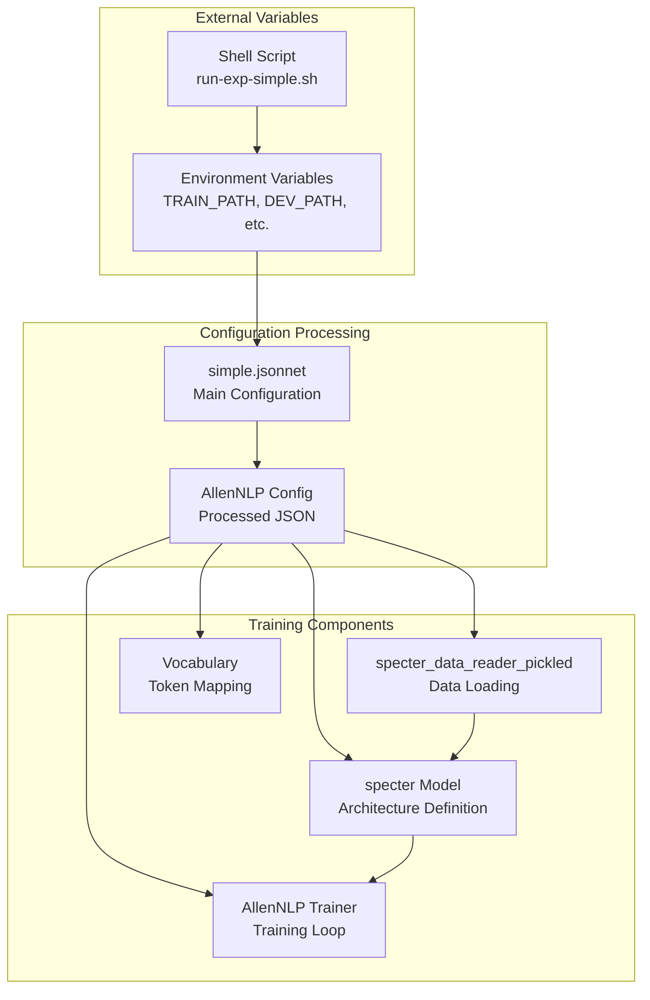
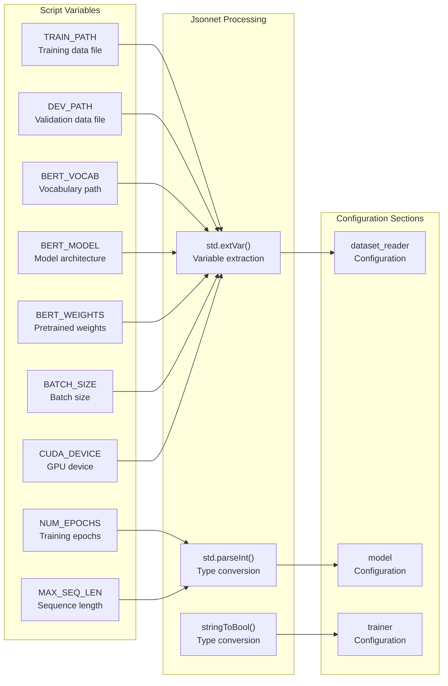
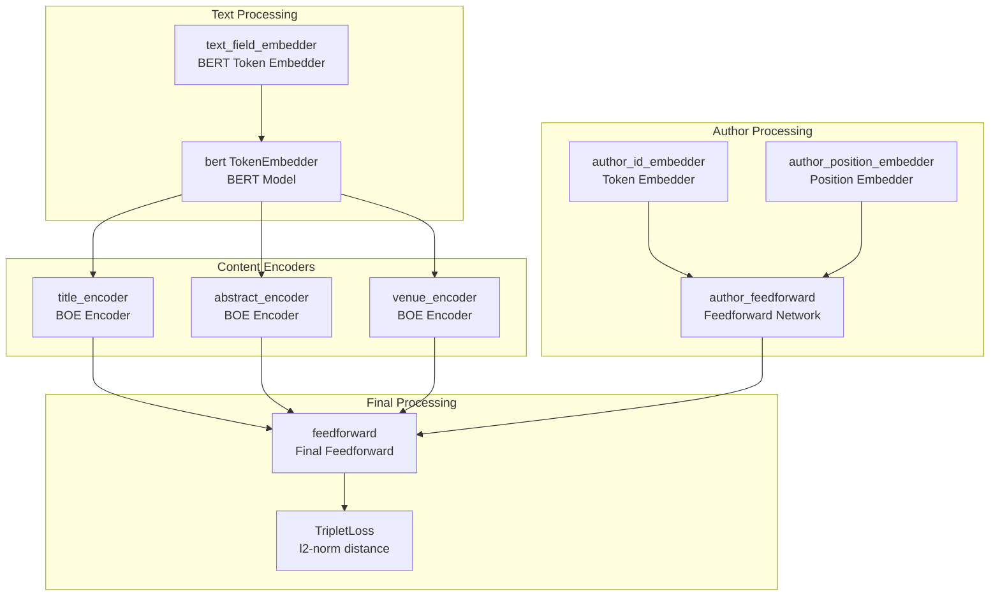
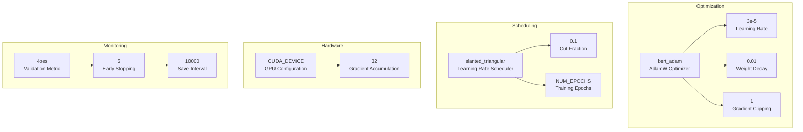

<!-- source: DeepWiki mcp.deepwiki.com · repo allenai/specter · extra page Configuration · fetched 2026-10-26 -->

# Configuration

<details>
<summary>Relevant source files</summary>

The following files were used as context for generating this wiki page:

- [experiment_configs/simple.jsonnet](experiment_configs/simple.jsonnet)

</details>


This document covers the configuration system for training SPECTER models, focusing on the structure and customization of training configurations. The primary configuration is defined in Jsonnet format and controls all aspects of model training including data reading, model architecture, and training parameters.

For information about running training scripts with these configurations, see [Training Scripts](#4.2.2). For details on preparing training data, see [Data Preparation](#4.2.1).

## Configuration Architecture

SPECTER uses AllenNLP's configuration system based on Jsonnet, which provides a flexible way to define training experiments through external variables and structured configuration objects.

### Configuration Flow Diagram



Sources: [experiment_configs/simple.jsonnet:1-186]()

## Configuration File Structure

The main configuration is defined in `simple.jsonnet` and consists of five primary sections:

| Section | Purpose | Key Components |
|---------|---------|----------------|
| `dataset_reader` | Data loading configuration | Reader type, tokenization, sequence length |
| `iterator` | Batch processing | Batch size, caching settings |
| `model` | Model architecture | Encoders, embedders, loss functions |
| `trainer` | Training parameters | Optimizer, learning rate, GPU settings |
| `vocabulary` | Token vocabulary | Vocabulary directory path |

### External Variable System

The configuration uses external variables for parameterization, allowing the same configuration to be used across different experiments:



Sources: [experiment_configs/simple.jsonnet:6-21]()

## Dataset Reader Configuration

The dataset reader configuration controls how training data is processed:

```json
"dataset_reader": {
    "type": "specter_data_reader_pickled",
    "concat_title_abstract": true,
    "lazy": true,
    "max_sequence_length": MAX_SEQ_LEN,
    "token_indexers": {
        "bert": {
            "type": BERT_MODEL,
            "do_lowercase": true,
            "truncate_long_sequences": true
        }
    },
    "word_splitter": "bert-basic"
}
```

Key parameters:
- `type`: Specifies `specter_data_reader_pickled` for reading pickled training data
- `concat_title_abstract`: Combines title and abstract into single sequence
- `lazy`: Enables lazy loading for memory efficiency
- `max_sequence_length`: Controls maximum input sequence length
- `token_indexers`: Defines BERT tokenization strategy

Sources: [experiment_configs/simple.jsonnet:23-38]()

## Model Architecture Configuration

The model configuration defines the SPECTER architecture with multiple encoders and embedders:

### Model Component Diagram



Sources: [experiment_configs/simple.jsonnet:44-140]()

### Key Model Parameters

| Parameter | Value | Purpose |
|-----------|-------|---------|
| `bert_finetune` | true | Enables BERT fine-tuning |
| `dropout` | 0.25 | Dropout rate for regularization |
| `embedding_layer_norm` | true | Layer normalization for embeddings |
| `loss_distance` | "l2-norm" | Distance metric for triplet loss |
| `loss_margin` | "1" | Margin for triplet loss |
| `ignore_authors` | true | Disables author information |
| `include_venue` | INCLUDE_VENUE | Venue information toggle |

Sources: [experiment_configs/simple.jsonnet:81-102]()

## Training Configuration

The trainer configuration controls the training process:

### Training Parameter Structure



Sources: [experiment_configs/simple.jsonnet:144-182]()

### Optimizer Configuration

The configuration uses `bert_adam` optimizer with specific parameter groups:

```json
"optimizer": {
    "type": "bert_adam",
    "lr": "3e-5",
    "max_grad_norm": 1,
    "parameter_groups": [
        [
            ["bias", "LayerNorm.bias", "LayerNorm.weight", "layer_norm.weight"],
            {"weight_decay": 0}
        ]
    ],
    "t_total": -1,
    "weight_decay": 0.01
}
```

This configuration:
- Uses BERT-specific AdamW optimizer
- Sets different weight decay for bias and LayerNorm parameters
- Implements gradient clipping with norm of 1
- Uses slanted triangular learning rate scheduling

Sources: [experiment_configs/simple.jsonnet:159-178]()

## Customization Guide

### Common Configuration Modifications

| Parameter | Location | Common Values | Purpose |
|-----------|----------|---------------|---------|
| `MAX_SEQ_LEN` | External variable | 128, 256, 512 | Control input sequence length |
| `BATCH_SIZE` | External variable | 8, 16, 32 | Adjust batch size for memory |
| `NUM_EPOCHS` | External variable | 5, 10, 20 | Set training duration |
| `BERT_WEIGHTS` | External variable | "bert-base-uncased", "allenai/scibert_scivocab_uncased" | Choose base model |
| `INCLUDE_VENUE` | External variable | true, false | Include venue information |

### Model Architecture Customization

To modify the model architecture, edit the `model` section:

1. **Encoder dimensions**: Modify `embedding_dim` in title_encoder, abstract_encoder, venue_encoder
2. **Feedforward layers**: Adjust `hidden_dims` and `num_layers` in feedforward configuration
3. **Dropout rates**: Change `dropout` values throughout the model
4. **Loss function**: Modify `loss_distance` and `loss_margin` parameters

### Training Parameter Tuning

Common training modifications:

1. **Learning rate**: Adjust `lr` in optimizer section
2. **Gradient accumulation**: Modify `gradient_accumulation_batch_size`
3. **Early stopping**: Change `patience` value
4. **Validation frequency**: Adjust `model_save_interval`

Sources: [experiment_configs/simple.jsonnet:1-186]()

---

