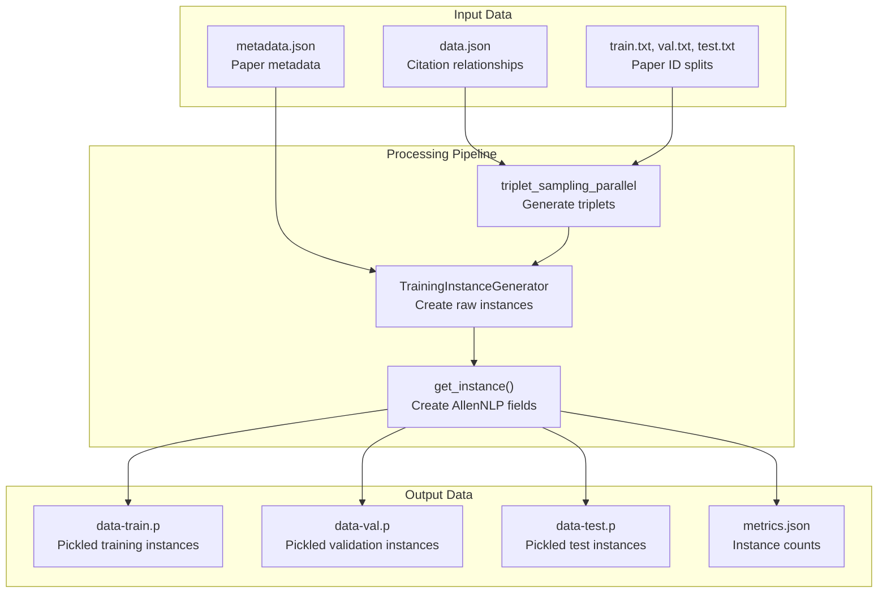
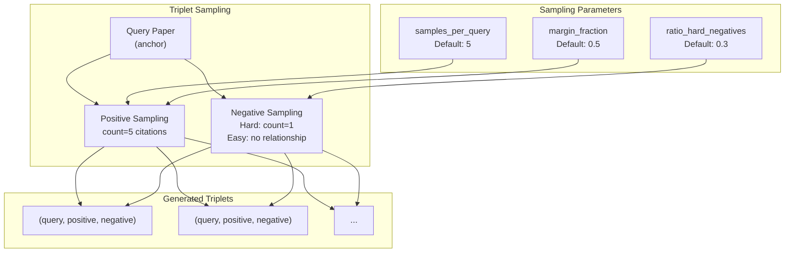
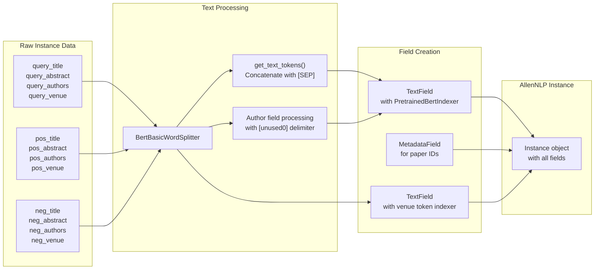

<!-- source: DeepWiki mcp.deepwiki.com · repo allenai/specter · extra page Data Preparation · fetched 2026-10-26 -->

# Data Preparation

<details>
<summary>Relevant source files</summary>

The following files were used as context for generating this wiki page:

- [README.md](README.md)
- [data/training/README.md](data/training/README.md)
- [specter/data_utils/create_training_files.py](specter/data_utils/create_training_files.py)

</details>


This document covers the data preparation pipeline for training SPECTER models, including input data formats, triplet generation, and instance creation. The data preparation process transforms raw paper metadata and citation relationships into training instances suitable for AllenNLP-based training.

For information about running the actual training process, see [Training Scripts](#4.2.2). For details about configuration options, see [Configuration](#4.2.3).

## Overview

The data preparation pipeline converts raw academic paper data into training instances through a sophisticated triplet sampling process. The main entry point is the `create_training_files.py` script, which processes citation relationships to generate positive and negative training examples.



Sources: [specter/data_utils/create_training_files.py:1-524](), [README.md:149-193]()

## Input Data Requirements

The data preparation process requires three main input files with specific formats:

### Citation Relationship Data (data.json)

The `data.json` file contains a nested dictionary structure representing citation relationships between papers:

```json
{
  "docid1": {
    "docid11": {"count": 1},
    "docid12": {"count": 5},
    "docid13": {"count": 1}
  },
  "docid2": {
    "docid21": {"count": 1}
  }
}
```

The `count` values indicate relationship strength: `count=5` represents direct citations (positive examples), while `count=1` represents citation-of-citation relationships (hard negatives).

### Paper Metadata (metadata.json)

The metadata file maps paper IDs to their textual content:

```json
{
  "doc_id": {
    "title": "representation learning of scientific documents",
    "abstract": "we propose a new model for representing abstracts",
    "paper_id": "doc_id",
    "venue": "conference_name",
    "year": 2020,
    "authors": ["author1", "author2"]
  }
}
```

### Data Splits

Three text files contain paper IDs for training, validation, and test sets:
- `train.txt`: Training paper IDs (one per line)
- `val.txt`: Validation paper IDs (one per line)  
- `test.txt`: Test paper IDs (one per line)

Sources: [data/training/README.md:1-15](), [README.md:160-171]()

## Triplet Generation Process

The triplet generation process creates training examples by sampling positive and negative papers for each query paper. This process is handled by the `triplet_sampling_parallel` module.



The `TrainingInstanceGenerator` class orchestrates this process through its `get_raw_instances` method, which yields dictionaries containing the paper information for each triplet.

Sources: [specter/data_utils/create_training_files.py:244-362](), [specter/data_utils/create_training_files.py:25]()

## Instance Creation and Field Processing

The `get_instance` function transforms raw triplet data into AllenNLP `Instance` objects with properly tokenized and indexed fields.



### Key Processing Steps

1. **Tokenization**: Uses `BertBasicWordSplitter` with the SciBERT vocabulary
2. **Text Field Combination**: Optionally concatenates title and abstract with `[SEP]` token
3. **Author Processing**: Adds author information with `[unused0]` delimiter
4. **Sequence Length Limiting**: Truncates sequences to maximum length (default 512)
5. **Field Indexing**: Creates appropriate token indexers for different field types

The global configuration is set through the `set_values` function, which initializes tokenizers and indexers for multiprocessing efficiency.

Sources: [specter/data_utils/create_training_files.py:100-131](), [specter/data_utils/create_training_files.py:141-242]()

## Output Data Structure

The data preparation process generates pickled files containing AllenNLP instances and a metrics file tracking instance counts.

| File | Content | Usage |
|------|---------|--------|
| `data-train.p` | Training instances | Fed to AllenNLP DataLoader |
| `data-val.p` | Validation instances | Model evaluation during training |
| `data-test.p` | Test instances | Final model evaluation |
| `metrics.json` | Instance counts | Training configuration |

Each pickled file contains a stream of `Instance` objects with the following fields:

- `source_title`, `pos_title`, `neg_title`: Tokenized paper titles
- `source_abstract`, `pos_abstract`, `neg_abstract`: Tokenized abstracts (optional)
- `source_venue`, `pos_venue`, `neg_venue`: Venue information
- `source_authors`, `pos_authors`, `neg_authors`: Author information
- `source_paper_id`, `pos_paper_id`, `neg_paper_id`: Paper identifiers
- `data_source`: Source dataset identifier

Sources: [specter/data_utils/create_training_files.py:460-485]()

## Usage Example

To prepare training data, use the `create_training_files.py` script:

```bash
python specter/data_utils/create_training_files.py \
  --data-dir data/training \
  --metadata data/training/metadata.json \
  --outdir data/preprocessed/ \
  --njobs_raw 12 \
  --ratio_hard_negatives 0.3 \
  --samples_per_query 5 \
  --concat-title-abstract \
  --included-text-fields "title abstract"
```

### Key Parameters

- `--data-dir`: Directory containing `data.json` and split files
- `--metadata`: Path to metadata JSON file
- `--outdir`: Output directory for preprocessed files
- `--njobs_raw`: Parallel jobs for triplet generation (recommended: 10-15)
- `--ratio_hard_negatives`: Fraction of hard negative examples (default: 0.3)
- `--samples_per_query`: Training instances per query paper (default: 5)
- `--concat-title-abstract`: Whether to concatenate title and abstract
- `--included-text-fields`: Text fields to include in processing

The script outputs preprocessed files ready for training with the AllenNLP or PyTorch Lightning training scripts.

Sources: [specter/data_utils/create_training_files.py:489-524](), [README.md:174-193]()

---

