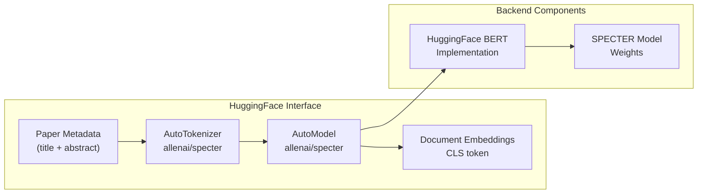
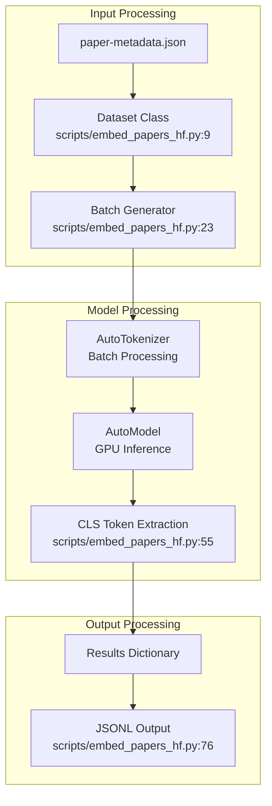
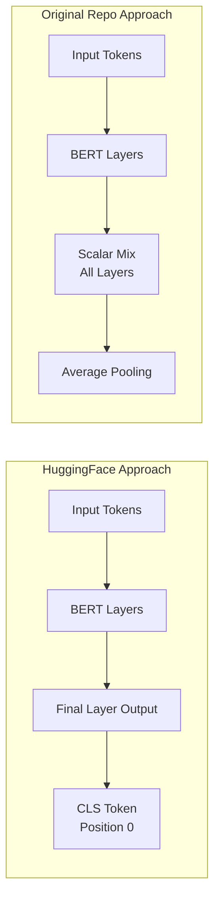
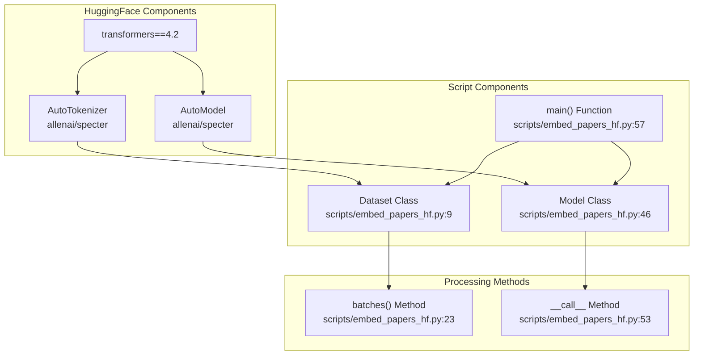

<!-- source: DeepWiki mcp.deepwiki.com · repo allenai/specter · extra page HuggingFace Interface · fetched 2026-10-26 -->

# HuggingFace Interface

<details>
<summary>Relevant source files</summary>

The following files were used as context for generating this wiki page:

- [README.md](README.md)
- [scripts/embed_papers_hf.py](scripts/embed_papers_hf.py)

</details>


This document covers using SPECTER through the HuggingFace Transformers library for generating scientific document embeddings. This interface provides the most accessible way to use SPECTER with minimal setup requirements.

For information about the original repository implementation, see [Repository Interface](#4.1.2). For pre-computed embeddings and API access, see [Public APIs](#4.1.3).

## Overview

The HuggingFace interface provides access to SPECTER through the standard HuggingFace Transformers library. This integration was added in January 2021 and allows users to generate embeddings using familiar HuggingFace patterns with `AutoTokenizer` and `AutoModel`.



**HuggingFace Interface Architecture**

Sources: [README.md:14-69]()

## Basic Usage

### Installation

The HuggingFace interface requires the transformers library:

```bash
pip install --upgrade transformers==4.2
```

### Single Document Embedding

The basic pattern follows standard HuggingFace usage:

```python
from transformers import AutoTokenizer, AutoModel

# Load model and tokenizer
tokenizer = AutoTokenizer.from_pretrained('allenai/specter')
model = AutoModel.from_pretrained('allenai/specter')

# Prepare input
papers = [{'title': 'BERT', 'abstract': 'We introduce a new language representation model called BERT'}]

# Concatenate title and abstract
title_abs = [d['title'] + tokenizer.sep_token + (d.get('abstract') or '') for d in papers]

# Tokenize
inputs = tokenizer(title_abs, padding=True, truncation=True, return_tensors="pt", max_length=512)

# Generate embeddings
result = model(**inputs)
embeddings = result.last_hidden_state[:, 0, :]  # CLS token
```

Sources: [README.md:28-45]()

### Input Format

The HuggingFace interface expects paper metadata in the following format:

| Field | Type | Required | Description |
|-------|------|----------|-------------|
| `title` | string | Yes | Paper title |
| `abstract` | string | No | Paper abstract (can be empty) |

The title and abstract are concatenated with `tokenizer.sep_token` as separator.

## Batch Processing

For processing multiple papers efficiently, use the provided batch embedding script:

```bash
CUDA_VISIBLE_DEVICES=0 python scripts/embed_papers_hf.py \
--data-path path/to/paper-metadata.json \
--output path/to/write/output.json \
--batch-size 8
```

### Batch Processing Architecture



**Batch Processing Pipeline**

Sources: [scripts/embed_papers_hf.py:1-82](), [README.md:47-55]()

### Batch Script Components

The batch embedding script consists of two main classes:

| Class | Purpose | Key Methods |
|-------|---------|-------------|
| `Dataset` | Data loading and batch creation | `__init__`, `batches()` |
| `Model` | SPECTER model wrapper | `__call__` |

The `Dataset` class handles:
- Loading JSON metadata from [scripts/embed_papers_hf.py:16-18]()
- Creating batches in [scripts/embed_papers_hf.py:23-44]()
- Tokenization with padding and truncation

The `Model` class handles:
- Model loading and GPU placement in [scripts/embed_papers_hf.py:48-51]()
- Inference and CLS token extraction in [scripts/embed_papers_hf.py:53-55]()

## Architecture Details

### Model Representation Method

The HuggingFace interface uses a different approach for generating document representations compared to the original repository implementation:



**Representation Method Comparison**

The HuggingFace model extracts the CLS token from the final layer (`result.last_hidden_state[:, 0, :]`), while the original repository uses scalar mixing across all layers followed by average pooling.

Sources: [README.md:68-69]()

### Performance Comparison

The HuggingFace model yields slightly higher average results than the original implementation:

| Metric | HuggingFace Result |
|--------|-------------------|
| mag-f1 | 79.4 |
| mesh-f1 | 87.7 |
| co-view-map | 83.4 |
| co-view-ndcg | 91.4 |
| co-read-map | 85.1 |
| co-read-ndcg | 92.7 |
| cite-map | 92.0 |
| cite-ndcg | 96.6 |
| cocite-map | 88.0 |
| cocite-ndcg | 94.7 |
| recomm-ndcg | 54.6 |
| recomm-P@1 | 20.9 |
| **Average** | **80.5** |

Sources: [README.md:60-64]()

## Code Structure

### Key Components

The HuggingFace interface relies on these main components:



**HuggingFace Interface Code Architecture**

### Input/Output Format

The batch script expects and produces specific JSON formats:

**Input Format** (paper-metadata.json):
```json
{
  "paper_id": {
    "title": "Paper Title",
    "abstract": "Paper abstract text"
  }
}
```

**Output Format** (JSONL):
```json
{"paper_id": "paper_id", "embedding": [0.1, 0.2, ...]}
```

The output embeddings are 768-dimensional vectors corresponding to the BERT hidden size.

Sources: [scripts/embed_papers_hf.py:16-18](), [scripts/embed_papers_hf.py:72-78]()

## Usage Considerations

### Memory and Performance

- The HuggingFace interface loads the full model into memory
- GPU acceleration is recommended for batch processing
- Default batch size is 8 for the embedding script
- Maximum sequence length is 512 tokens

### Compatibility

- The HuggingFace model cannot be mixed with embeddings from other SPECTER implementations
- Results are comparable but not identical to the original repository implementation
- The model is compatible with standard HuggingFace ecosystem tools

Sources: [README.md:57-58](), [scripts/embed_papers_hf.py:11-14]()

---

