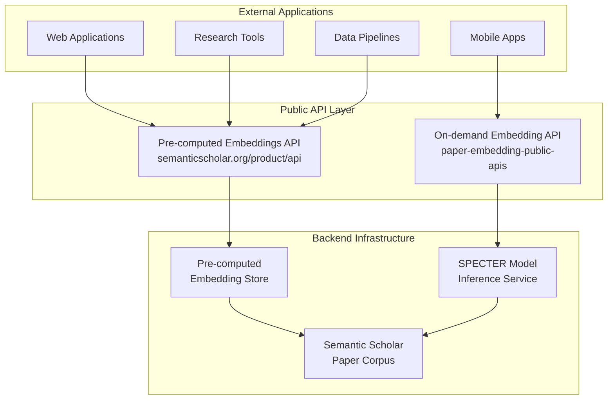
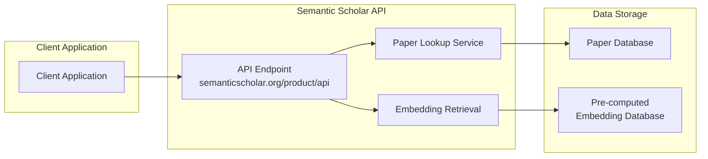
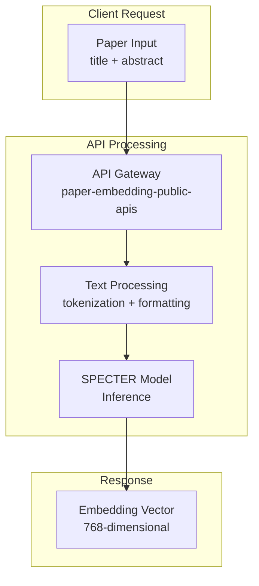
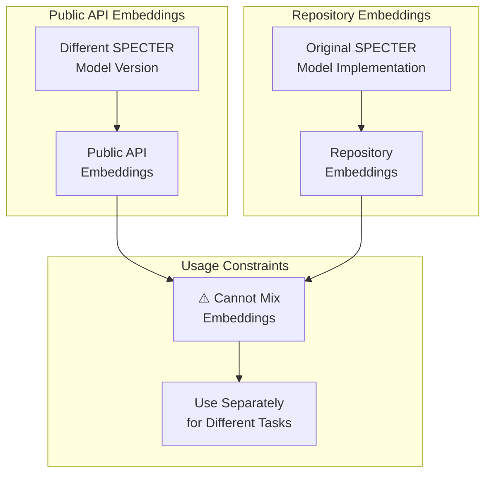

<!-- source: DeepWiki mcp.deepwiki.com · repo allenai/specter · extra page Public APIs · fetched 2026-10-26 -->

# Public APIs

Relevant source files

The following files were used as context for generating this wiki page:

- [README.md](README.md)

This page covers using SPECTER through external public APIs provided by Semantic Scholar. These APIs allow you to retrieve pre-computed embeddings for papers in the Semantic Scholar corpus or generate embeddings on-demand without needing to run the model locally.

For information about using SPECTER directly through code interfaces, see [HuggingFace Interface](#4.1.1) and [Repository Interface](#4.1.2).

## Overview

The SPECTER public APIs provide two main access methods:

1. **Pre-computed Embeddings API**: Retrieve embeddings for papers already in the Semantic Scholar corpus
2. **On-demand Embedding API**: Generate embeddings for custom paper titles and abstracts

These APIs eliminate the need to download models, manage dependencies, or run inference locally, making SPECTER accessible for applications that need embeddings at scale.

## Public API Access Methods

Sources: [README.md:139-143]()

## Pre-computed Embeddings API

The Semantic Scholar API provides access to pre-computed SPECTER embeddings for papers in their corpus. This is the most efficient method for retrieving embeddings for known papers.

### API Endpoint

The pre-computed embeddings are available through the Semantic Scholar API at:
- Base URL: `https://www.semanticscholar.org/product/api`

### Usage Pattern

Sources: [README.md:141]()

## On-demand Embedding API

For custom papers or papers not in the Semantic Scholar corpus, an on-demand embedding API is available that generates embeddings from paper titles and abstracts.

### API Repository

The on-demand embedding functionality is available through a dedicated repository:
- Repository: `allenai/paper-embedding-public-apis`

### Processing Flow

Sources: [README.md:141]()

## Important Considerations

### Model Version Differences

The public APIs use a different version of the SPECTER model than the implementation in this repository. This has several implications:

| Aspect | Public APIs | Repository Implementation |
|--------|-------------|---------------------------|
| Model Version | Different SPECTER version | Original paper implementation |
| Embedding Compatibility | Cannot be mixed with repo embeddings | Compatible with paper results |
| Performance | Similar downstream performance | Exact paper reproduction |
| Use Case | Production applications | Research reproduction |

### Compatibility Warning

**Critical Note**: Embeddings from the public APIs cannot be mixed with embeddings generated by running the model from this repository. They are produced by different model versions and will not be compatible within the same downstream task.

Sources: [README.md:143-144]()

## API Selection Guide

### When to Use Pre-computed Embeddings API

- Papers are already in the Semantic Scholar corpus
- High-throughput applications requiring fast response times
- No need for custom paper processing
- Applications that benefit from Semantic Scholar's paper metadata

### When to Use On-demand Embedding API

- Custom papers not in Semantic Scholar corpus
- Need embeddings for proprietary or private papers
- Research with unpublished papers
- Applications requiring embeddings for dynamically generated content

### When to Use Local Implementation

- Need exact reproduction of paper results
- Require mixing embeddings with repository-generated embeddings
- Have specific model customization requirements
- Working with large batches where API rate limits are a concern

For local implementation options, see [HuggingFace Interface](#4.1.1) and [Repository Interface](#4.1.2).

Sources: [README.md:139-144]()

---

