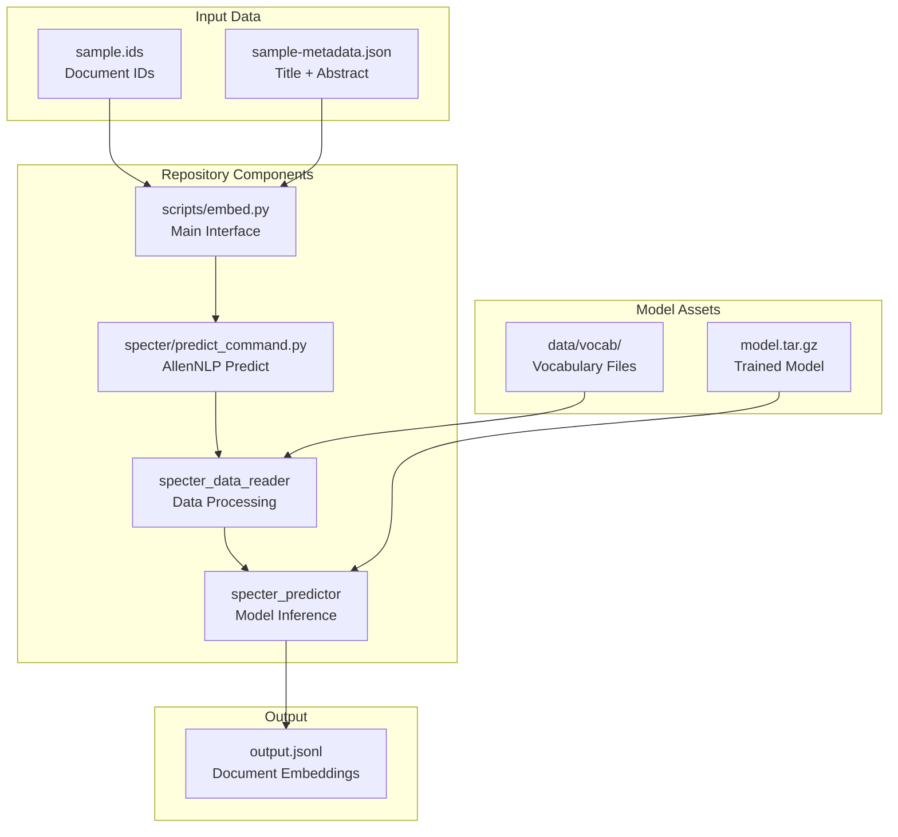
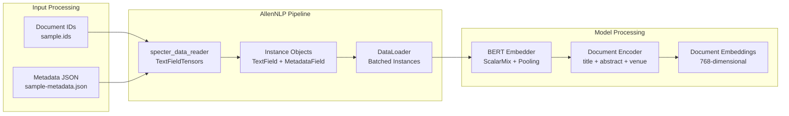
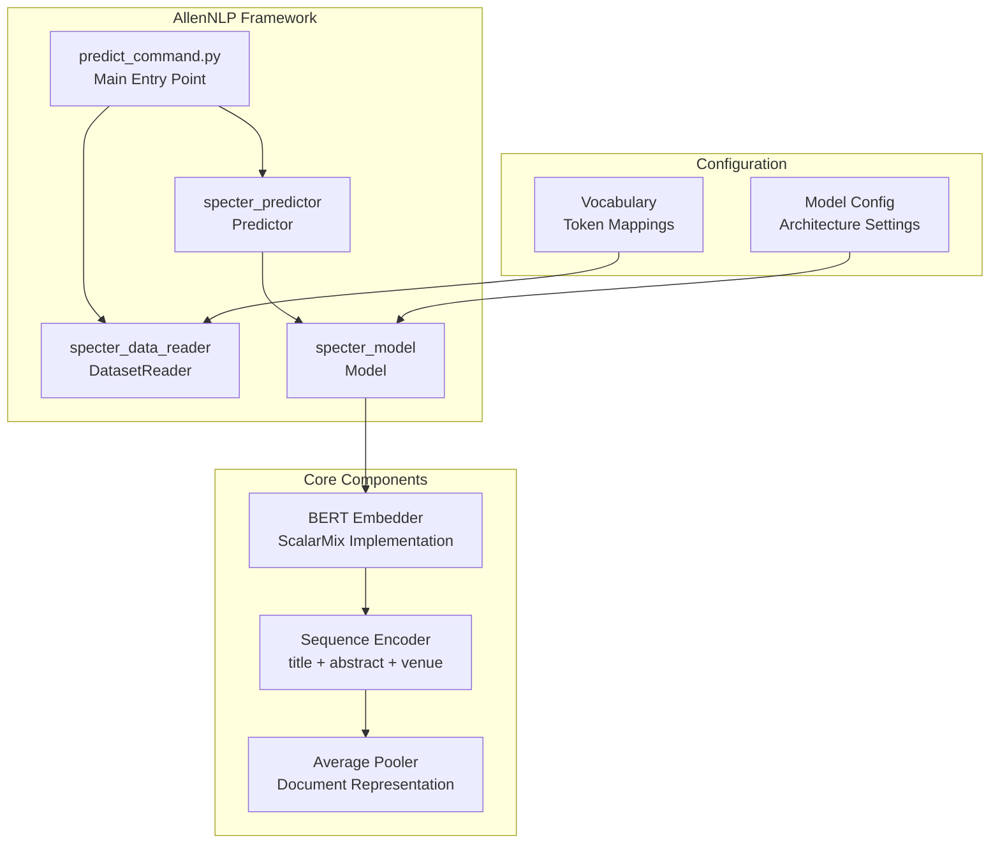
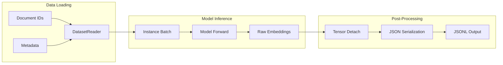

<!-- source: DeepWiki mcp.deepwiki.com · repo allenai/specter · extra page Repository Interface · fetched 2026-10-26 -->

# Repository Interface

<details>
<summary>Relevant source files</summary>

The following files were used as context for generating this wiki page:

- [README.md](README.md)
- [scripts/embed.py](scripts/embed.py)

</details>


## Purpose and Scope

The Repository Interface provides access to SPECTER's original AllenNLP-based implementation for generating scientific document embeddings. This interface uses the complete repository codebase with custom data readers, predictors, and model architecture as originally developed for the SPECTER paper.

This document covers the repository's native embedding pipeline using `scripts/embed.py` and the AllenNLP framework. For information about the simplified HuggingFace interface, see [HuggingFace Interface](#4.1.1). For training custom models using this implementation, see [Training Scripts](#4.2.2).

## Overview

The Repository Interface provides the original SPECTER implementation that differs from the HuggingFace version in several key ways:

| Aspect | Repository Interface | HuggingFace Interface |
|--------|---------------------|----------------------|
| **Model Representation** | Scalar mix of layers + average pooling | [CLS] token final layer |
| **Framework** | AllenNLP | HuggingFace Transformers |
| **Setup Complexity** | Requires model download and vocab files | Simple pip install |
| **Customization** | Full access to training pipeline | Limited to inference |
| **Performance** | Original paper results | Slightly higher average results |

The repository interface maintains the exact implementation used in the original SPECTER paper research, ensuring reproducible results for scientific comparisons.

**Repository Interface Architecture**


Sources: [README.md:66-137](), [scripts/embed.py:1-69]()

## Installation and Setup

### Prerequisites

The Repository Interface requires downloading the complete model archive and setting up the AllenNLP environment:

```bash
# Clone repository
git clone git@github.com:allenai/specter.git
cd specter

# Download model archive (833 MiB)
wget https://ai2-s2-research-public.s3-us-west-2.amazonaws.com/specter/archive.tar.gz
tar -xzvf archive.tar.gz

# Create conda environment
conda create --name specter python=3.7 setuptools
conda activate specter

# Install PyTorch with CUDA support (optional)
conda install pytorch cudatoolkit=10.1 -c pytorch

# Install dependencies
pip install -r requirements.txt
python setup.py install
```

### Required Files

After extraction, you will have these essential components:

| File/Directory | Purpose |
|---------------|---------|
| `model.tar.gz` | Pre-trained SPECTER model |
| `data/vocab/` | Vocabulary files for tokenization |
| `data/sample.ids` | Example document IDs |
| `data/sample-metadata.json` | Example metadata |

Sources: [README.md:71-104]()

## Data Preparation

### Input Data Format

The Repository Interface requires two input files:

**Document IDs File** (`*.ids`):
```
doc_id_1
doc_id_2
doc_id_3
```

**Metadata JSON File** (`*.json`):
```json
{
    "doc_id_1": {
        "title": "representation learning of scientific documents",
        "abstract": "we propose a new model for representing abstracts"
    },
    "doc_id_2": {
        "title": "attention is all you need",
        "abstract": "the dominant sequence transduction models are based on complex recurrent networks"
    }
}
```

### Data Processing Pipeline

**Data Processing Flow**


Sources: [README.md:111-120](), [scripts/embed.py:37]()

## Embedding Process

### Command Line Interface

The primary interface is through `scripts/embed.py`, which wraps the AllenNLP predict functionality:

```bash
python scripts/embed.py \
    --ids data/sample.ids \
    --metadata data/sample-metadata.json \
    --model ./model.tar.gz \
    --output-file output.jsonl \
    --vocab-dir data/vocab/ \
    --batch-size 16 \
    --cuda-device -1
```

### Parameter Configuration

| Parameter | Description | Default |
|-----------|-------------|---------|
| `--ids` | Path to document IDs file | Required |
| `--metadata` | Path to metadata JSON file | Required |
| `--model` | Path to model.tar.gz | Required |
| `--output-file` | Output embeddings file | Required |
| `--vocab-dir` | Vocabulary directory | `data/vocab/` |
| `--batch-size` | Inference batch size | `1` |
| `--cuda-device` | GPU device (-1 for CPU) | `0` |
| `--included-text-fields` | Fields to include | `abstract title` |

### Internal Processing

The `embed.py` script constructs AllenNLP overrides and executes the prediction pipeline:

```python
# Configuration overrides built by embed.py
overrides = {
    'model': {
        'predict_mode': 'true',
        'include_venue': 'false'
    },
    'dataset_reader': {
        'type': 'specter_data_reader',
        'predict_mode': 'true',
        'paper_features_path': args.metadata,
        'included_text_fields': args.included_text_fields
    },
    'vocabulary': {
        'directory_path': args.vocab_dir
    }
}
```

Sources: [scripts/embed.py:23-66]()

## Technical Architecture

### AllenNLP Components

**Component Interaction Diagram**


### Model Architecture Details

The Repository Interface uses a specific model architecture that differs from the HuggingFace implementation:

1. **BERT Embedder**: Uses AllenNLP's scalar mix of all BERT layers rather than just the final layer
2. **Sequence Encoder**: Processes title, abstract, and venue fields separately
3. **Pooling Strategy**: Average pooling over sequence length to create document representation
4. **Output Dimension**: 768-dimensional embeddings matching BERT-base

### Prediction Pipeline

**End-to-End Processing**


Sources: [README.md:66-69](), [scripts/embed.py:39-58]()

## Output Format

### JSONL Structure

The Repository Interface outputs embeddings in JSONL format, with one JSON object per line:

```jsonl
{"doc_id": "doc_id_1", "embedding": [0.1, 0.2, ..., 0.768_values]}
{"doc_id": "doc_id_2", "embedding": [0.3, 0.4, ..., 0.768_values]}
```

### Processing Output

Each line contains:
- `doc_id`: String identifier matching input IDs
- `embedding`: List of 768 float values representing the document embedding

### Performance Characteristics

- **Embedding Dimension**: 768 (BERT-base)
- **Batch Processing**: Configurable batch size for GPU memory optimization
- **CPU/GPU Support**: Automatic device detection with `--cuda-device` parameter
- **Memory Usage**: Scales with batch size and sequence length

Sources: [README.md:134-137]()

## Error Handling and Troubleshooting

### Common Issues

| Issue | Solution |
|-------|----------|
| Missing vocabulary files | Ensure `data/vocab/` directory exists |
| CUDA out of memory | Reduce `--batch-size` parameter |
| Model not found | Verify `model.tar.gz` path and extraction |
| Metadata format errors | Check JSON syntax and required fields |

### Debugging

The script provides logging output for troubleshooting:

```bash
# Enable verbose logging
python scripts/embed.py [...] --verbose

# Monitor GPU usage
nvidia-smi

# Check output file
head -n 5 output.jsonl
```

Sources: [scripts/embed.py:62-63]()

---

