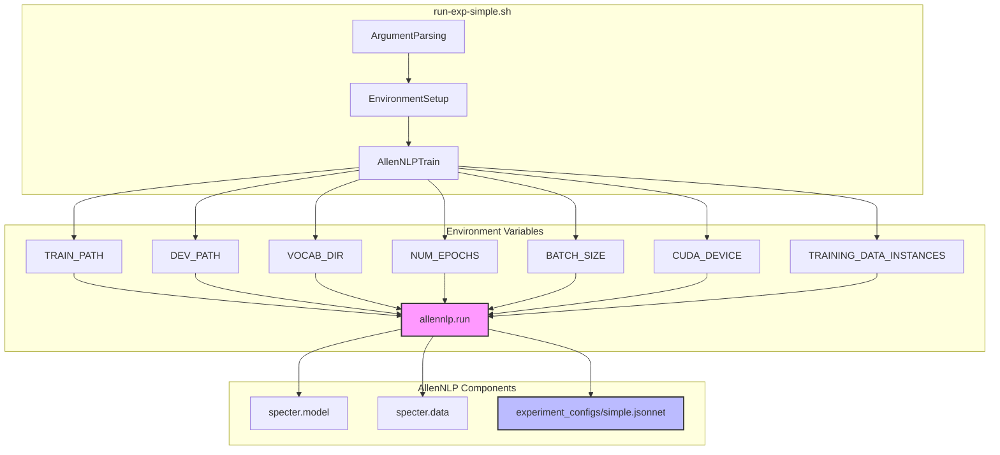
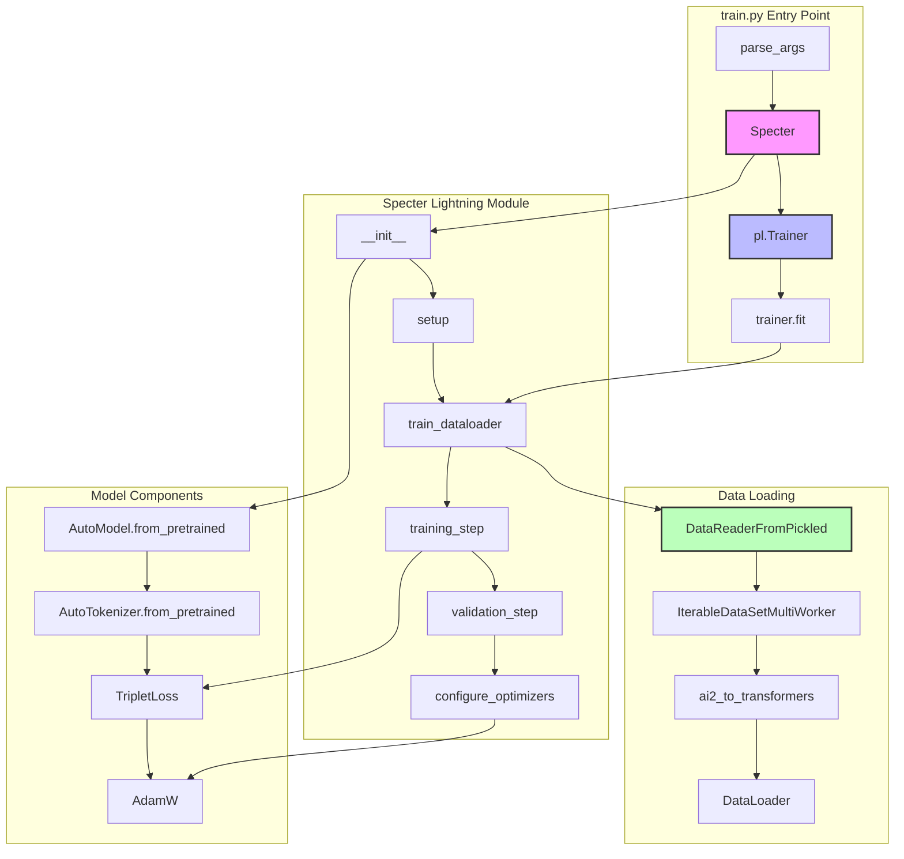
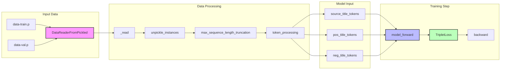
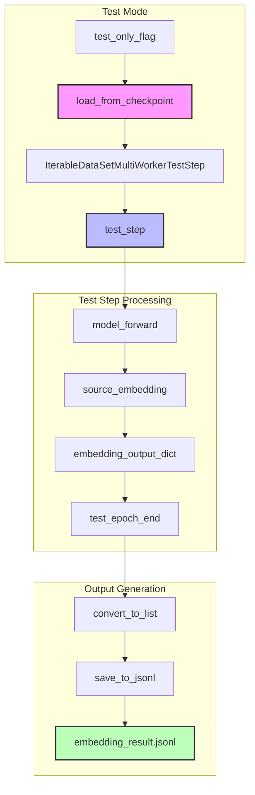

<!-- source: DeepWiki mcp.deepwiki.com · repo allenai/specter · extra page Training Scripts · fetched 2026-10-26 -->

# Training Scripts

<details>
<summary>Relevant source files</summary>

The following files were used as context for generating this wiki page:

- [README.md](README.md)
- [scripts/pytorch_lightning_training_script/README.md](scripts/pytorch_lightning_training_script/README.md)
- [scripts/pytorch_lightning_training_script/train.py](scripts/pytorch_lightning_training_script/train.py)
- [scripts/run-exp-simple.sh](scripts/run-exp-simple.sh)

</details>


This document covers the training scripts available in SPECTER for training custom models from scratch. SPECTER provides two distinct training approaches: AllenNLP-based training and PyTorch Lightning-based training, each with different advantages and use cases.

For information about preparing training data, see [Data Preparation](#4.2.1). For details about training configuration parameters, see [Configuration](#4.2.3).

## Training Approaches Overview

SPECTER supports two training frameworks that implement the same core model architecture but use different training infrastructures:

| Approach | Script | Framework | Use Case |
|----------|--------|-----------|----------|
| AllenNLP | `scripts/run-exp-simple.sh` | AllenNLP 2.4.0 | Original implementation, research reproducibility |
| PyTorch Lightning | `scripts/pytorch_lightning_training_script/train.py` | PyTorch Lightning 1.0.3 | Modern training, easier debugging |

## AllenNLP Training Script

The AllenNLP training approach uses the original SPECTER implementation with the `run-exp-simple.sh` script as the entry point.

### Basic Usage

```bash
./scripts/run-exp-simple.sh -c experiment_configs/simple.jsonnet \
-s model-output/ --num-epochs 2 --batch-size 4 \
--train-path data/preprocessed/data-train.p \
--dev-path data/preprocessed/data-val.p \
--num-train-instances 55 --cuda-device -1
```

### Script Architecture



### Key Parameters

The script accepts numerous command-line arguments that control training behavior:

- `--config` / `-c`: Path to AllenNLP configuration file
- `--serialization-dir` / `-s`: Output directory for model checkpoints
- `--train-path`: Path to pickled training data
- `--dev-path`: Path to pickled validation data
- `--num-train-instances`: Number of training instances (required for proper scheduling)
- `--cuda-device`: GPU device ID (-1 for CPU)
- `--batch-size`: Training batch size
- `--num-epochs`: Number of training epochs

Sources: [scripts/run-exp-simple.sh:1-153](), [README.md:149-196]()

## PyTorch Lightning Training Script

The PyTorch Lightning approach provides a more modern training framework with the `train.py` script.

### Basic Usage

```bash
python scripts/pytorch_lightning_training_script/train.py \
--save_dir path/to/save --gpus 1 \
--train_file path/to/training_set \
--dev_file path/to/val_set \
--test_file path/to/test_set \
--batch_size 2 --num_workers 0 \
--num_epochs 4 --grad_accum 256
```

### Lightning Training Architecture



### Core Classes and Functions

The PyTorch Lightning script defines several key classes:

- `Specter`: Main Lightning module inheriting from `pl.LightningModule`
- `DataReaderFromPickled`: Data reader for pickled training instances
- `IterableDataSetMultiWorker`: Dataset wrapper for multi-worker data loading
- `TripletLoss`: Custom loss function for triplet learning
- `ai2_to_transformers`: Function converting AllenNLP instances to HuggingFace format

Sources: [scripts/pytorch_lightning_training_script/train.py:1-599](), [scripts/pytorch_lightning_training_script/README.md:1-25]()

## Training Data Flow

Both training approaches follow the same data processing pipeline but use different data loading mechanisms:



The data flow processes pickled training instances containing source, positive, and negative paper triplets. Each instance contains tokenized title and abstract fields that are processed through the model to generate embeddings for triplet loss calculation.

Sources: [scripts/pytorch_lightning_training_script/train.py:63-137](), [scripts/pytorch_lightning_training_script/train.py:170-200]()

## Model Training Configuration

### AllenNLP Configuration

The AllenNLP approach uses environment variables set by the shell script and read by the JSON configuration file:

- `TRAIN_PATH`: Training data path
- `DEV_PATH`: Validation data path  
- `VOCAB_DIR`: Vocabulary directory
- `BERT_MODEL`: BERT model type
- `BERT_VOCAB`: BERT vocabulary file
- `BERT_WEIGHTS`: BERT weights file
- `MAX_SEQ_LEN`: Maximum sequence length
- `INCLUDE_VENUE`: Whether to include venue information

### PyTorch Lightning Configuration

The Lightning approach uses command-line arguments parsed by `argparse`:

- `--checkpoint_path`: Path to pretrained model checkpoint
- `--lr`: Learning rate (default: 2e-5)
- `--weight_decay`: Weight decay for optimizer
- `--adam_epsilon`: Epsilon for Adam optimizer
- `--warmup_steps`: Linear warmup steps
- `--lr_scheduler`: Learning rate scheduler type
- `--grad_accum`: Gradient accumulation steps

Sources: [scripts/run-exp-simple.sh:128-146](), [scripts/pytorch_lightning_training_script/train.py:477-522]()

## Testing and Inference

### AllenNLP Testing

Testing with AllenNLP requires using the same script with a different configuration or using the inference scripts directly.

### PyTorch Lightning Testing

The Lightning script supports dedicated testing mode:

```bash
python train.py --save_dir ./save --gpus 1 --test_only true \
--test_checkpoint path/to/checkpoint.ckpt
```

During testing, the script generates embeddings for all test instances and saves them to `embedding_result.jsonl` in the output directory.

### Test Data Processing



Sources: [scripts/pytorch_lightning_training_script/train.py:560-565](), [scripts/pytorch_lightning_training_script/train.py:458-475](), [scripts/pytorch_lightning_training_script/README.md:15-24]()

---

