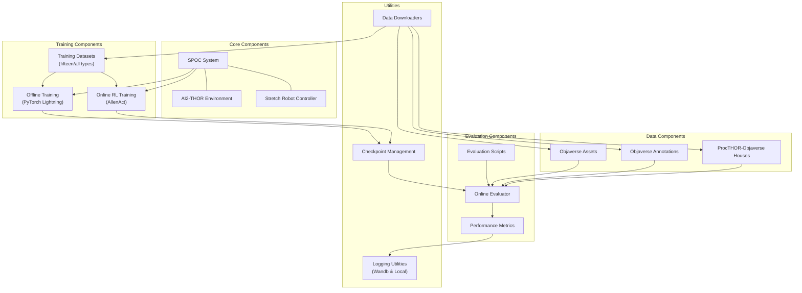
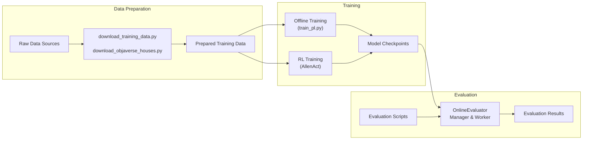
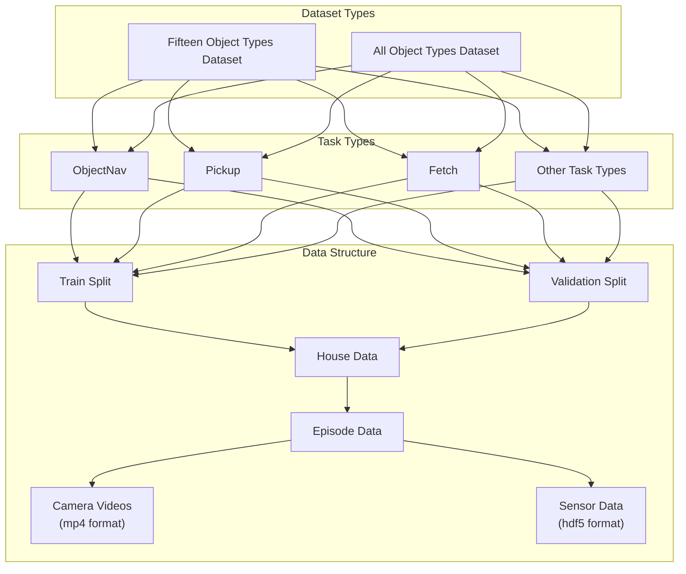

<!-- source: DeepWiki mcp.deepwiki.com · repo allenai/spoc-robot-training · page 1 Overview · fetched 2026-10-26 -->

# Overview

<details>
<summary>Relevant source files</summary>

The following files were used as context for generating this wiki page:

- [README.md](README.md)
- [how_to_use_data.ipynb](how_to_use_data.ipynb)
- [spoc-robot-training/version.py](spoc-robot-training/version.py)

</details>


This document provides an introduction to the SPOC (Simulation for Navigation and Manipulation) system, explaining its purpose, capabilities, and high-level architecture. SPOC is a comprehensive framework for training and evaluating robot navigation and manipulation agents in simulated environments, designed to enable effective transfer to real-world robots.

For detailed information about specific aspects of SPOC, refer to the relevant sections of this wiki:
- For system architecture details, see [System Architecture](#2)
- For training pipeline information, see [Training Pipeline](#3)
- For evaluation system details, see [Evaluation System](#4)

## What is SPOC?

SPOC (Simulation for Navigation and Manipulation) is an end-to-end system that enables training robotic agents to perform navigation and manipulation tasks in simulated environments, with the goal of transferring these capabilities to real-world robots. The system imitates shortest paths in simulation to provide efficient training data for tasks such as object navigation, pick-up, and fetch operations.

As described in the repository's name and documentation, SPOC focuses on "Imitating Shortest Paths in Simulation" to enable "Effective Navigation and Manipulation in the Real World."

Sources: [README.md:1-8]()

## System Purpose and Capabilities

SPOC supports a comprehensive range of robotic tasks through both training and evaluation pipelines:

- **Training capabilities**:
  - Offline training using PyTorch Lightning
  - Online reinforcement learning training using AllenAct
  - Support for various dataset mixtures and custom models

- **Evaluation capabilities**:
  - Online evaluation in simulated environments
  - Comprehensive metrics for assessing agent performance
  - Support for pretrained models

- **Environment and simulation**:
  - Based on AI2-THOR environment
  - Realistic simulation of the Stretch robot
  - Integration with Objaverse objects and ProcTHOR houses

Sources: [README.md:23-116]()

## System Architecture Overview



The SPOC system architecture consists of several interconnected components that work together to enable training and evaluation of robotic agents. The core components provide the simulation environment and robot control, while the training and evaluation components handle the machine learning aspects of the system.

Sources: [README.md:8-22](), [README.md:23-106]()

## Training and Evaluation Pipeline



The training and evaluation pipeline in SPOC starts with data preparation, proceeds through model training (either offline or reinforcement learning), and concludes with evaluation of the trained models. The system provides scripts for downloading and preparing data, training models, and evaluating their performance.

Sources: [README.md:23-33](), [README.md:104-106](), [README.md:108-167]()

## Supported Tasks and Action Space

SPOC supports a variety of robotic tasks, including:

- Navigation to objects (ObjectNav)
- Picking up objects (Pickup)
- Fetching objects (Fetch)
- And other task types

The robot's action space includes:

| Action Category | Actions | Description |
|-----------------|---------|-------------|
| Base Movement | `move_ahead`, `move_back` | Move the robot base forward/backward |
| Base Rotation | `rotate_left`, `rotate_right`, `rotate_left_small`, `rotate_right_small` | Rotate the robot base in different increments |
| Arm Movement | `move_arm_up`, `move_arm_down`, `move_arm_out`, `move_arm_in` (and small variants) | Control the robot arm along different axes |
| Wrist Control | `wrist_open`, `wrist_close` | Rotate the wrist clockwise/counterclockwise |
| Task Control | `end`, `sub_done`, `pickup`, `dropoff` | Complete tasks, sub-tasks, or manipulate objects |

Sources: [README.md:79-102]()

## Data Formats and Processing



The SPOC system uses a structured dataset format that includes video data from navigation and manipulation cameras, as well as various sensor readings stored in HDF5 format. The dataset is organized by house ID and episode number, with separate directories for training and validation splits.

Key sensors include:
- Navigation and manipulation camera frames
- Object bounding boxes
- Agent location and orientation
- Task-specific metrics and status indicators
- Arm proprioceptive information

Sources: [README.md:26-78]()

## Downloading and Setup

To use SPOC, you need to:

1. Set up the Python environment:
   ```bash
   pip install -r requirements.txt
   pip install --extra-index-url https://ai2thor-pypi.allenai.org ai2thor==0+5d0ab8ab8760eb584c5ae659c2b2b951cab23246
   ```

2. Download necessary data:
   - Training data: `python -m scripts.download_training_data --save_dir /your/local/save/dir --types fifteen`
   - Objaverse assets and annotations:
     ```bash
     python -m objathor.dataset.download_annotations --version 2023_07_28 --path /path/to/objaverse_assets
     python -m objathor.dataset.download_assets --version 2023_07_28 --path /path/to/objaverse_assets
     ```
   - ProcTHOR-Objaverse houses: `python -m scripts.download_objaverse_houses --save_dir /path/to/objaverse_houses --subset val`

3. Set environment variables:
   ```bash
   export OBJAVERSE_HOUSES_DIR=/path/to/objaverse_houses
   export OBJAVERSE_DATA_DIR=/path/to/objaverse_assets
   ```

The system also supports Docker-based setup for containerized environments.

Sources: [README.md:10-21](), [README.md:25-33](), [README.md:120-163]()

## Versioning

SPOC follows semantic versioning principles, with the current version being 0.1.0 as indicated in the version file.

Sources: [spoc-robot-training/version.py:1-11]()

---

