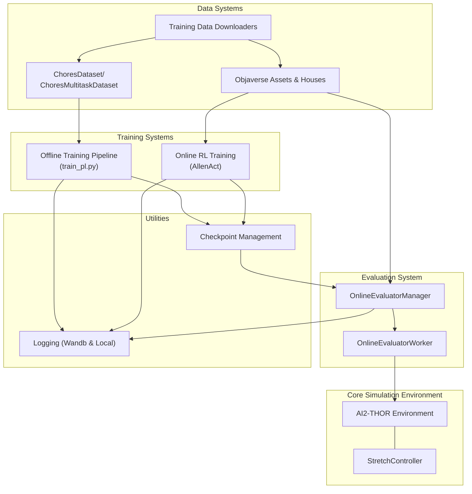
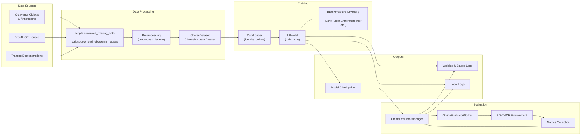
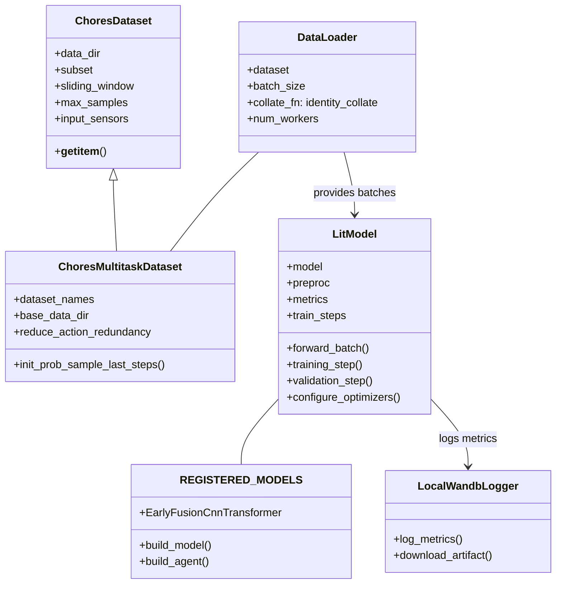
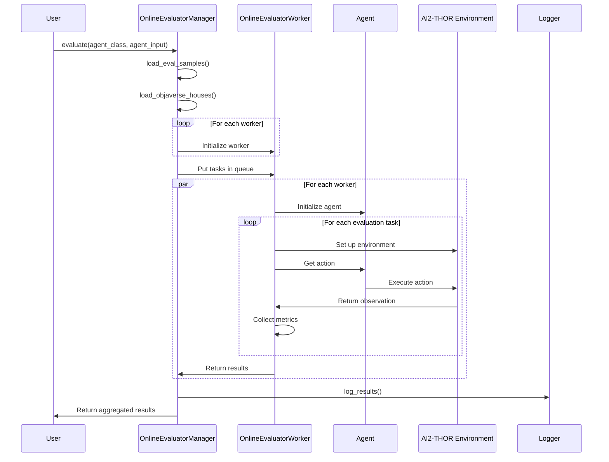

<!-- source: DeepWiki mcp.deepwiki.com · repo allenai/spoc-robot-training · page 2 System Architecture · fetched 2026-10-26 -->

# System Architecture

<details>
<summary>Relevant source files</summary>

The following files were used as context for generating this wiki page:

- [README.md](README.md)
- [TRAINING_README.md](TRAINING_README.md)
- [how_to_use_data.ipynb](how_to_use_data.ipynb)
- [online_evaluation/online_evaluator.py](online_evaluation/online_evaluator.py)
- [training/offline/train_pl.py](training/offline/train_pl.py)

</details>


This document provides a comprehensive overview of the SPOC (Simulation for Navigation and Manipulation) system architecture, explaining how the main components interact to enable effective robot navigation and manipulation in both simulated and real environments. The architecture is designed to support both offline training from demonstration data and online reinforcement learning approaches.

For an introduction to the SPOC system and its capabilities, see [Overview](#1). For details on setting up the system, see [Setup and Installation](#8).

## Core System Components

The SPOC system architecture consists of several interconnected components that work together for training and evaluating robotic agents.



Sources: [README.md:8-8](), [online_evaluation/online_evaluator.py:190-190](), [training/offline/train_pl.py:75-75]()

The core components include:

1. **Simulation Environment**: Built on AI2-THOR, providing a realistic 3D environment where the Stretch robot can navigate and interact with objects.

2. **Training Systems**: Two training approaches supported:
   - **Offline Training Pipeline**: Uses PyTorch Lightning for supervised learning from demonstrations.
   - **Online RL Training**: Uses AllenAct for reinforcement learning in simulation.

3. **Evaluation System**: The `OnlineEvaluatorManager` coordinates multiple `OnlineEvaluatorWorker` instances to evaluate trained models in parallel.

4. **Data Systems**: Handles dataset management, including downloading and preprocessing training data.

5. **Utilities**: Common utilities used across the system, including checkpoint management and logging.

## Data Flow Architecture

The following diagram illustrates how data flows through the SPOC system during training and evaluation:



Sources: [README.md:26-53](), [training/offline/train_pl.py:320-345](), [online_evaluation/online_evaluator.py:404-588]()

Key data flows:

1. **Input Data**: Includes Objaverse objects, ProcTHOR houses, and training demonstrations.

2. **Data Processing**: Downloaded data is preprocessed and loaded into dataset classes (`ChoresDataset`, `ChoresMultitaskDataset`).

3. **Training Pipeline**: Datasets are fed into DataLoaders, which provide batches to the training model (`LitModel`).

4. **Model Checkpoints**: Trained models are saved as checkpoints, which can be loaded for evaluation.

5. **Evaluation Pipeline**: The `OnlineEvaluatorManager` loads model checkpoints and coordinates workers to evaluate models in simulation environments.

6. **Logging**: Results from both training and evaluation are logged locally or to Weights & Biases.

## Training System Architecture

The training system in SPOC supports both offline training from demonstrations and online reinforcement learning.



Sources: [training/offline/train_pl.py:75-317](), [TRAINING_README.md:12-38]()

The key components of the training system include:

1. **LitModel**: The PyTorch Lightning module that encapsulates the training logic, including forward pass, optimization, and metric calculation.

2. **REGISTERED_MODELS**: A registry of available model architectures, each with methods for building models and agents.

3. **Dataset Classes**: `ChoresDataset` and `ChoresMultitaskDataset` for loading and preprocessing training data.

4. **DataLoader**: Uses `identity_collate` to create batches of training data for the model.

5. **Logging**: Both Weights & Biases and local logging are supported for tracking training progress.

## Evaluation System Architecture

The evaluation system uses an `OnlineEvaluatorManager` to coordinate multiple workers for parallel evaluation.



Sources: [online_evaluation/online_evaluator.py:190-644]()

Key components of the evaluation system:

1. **OnlineEvaluatorManager**: Manages the evaluation process, including distributing tasks to workers and aggregating results.

2. **OnlineEvaluatorWorker**: Executes evaluation tasks in simulation environments and collects metrics.

3. **Agent**: The trained model being evaluated, which receives observations and returns actions.

4. **AI2-THOR Environment**: The simulation environment where the agent operates.

5. **Logger**: Records evaluation results, either locally or to Weights & Biases.

## Component Interactions

The following diagram illustrates how the different components of the SPOC system interact with each other during training and evaluation:

```mermaid
graph TB
    subgraph "Training Pipeline"
        TRAIN_SCRIPT["training.offline.train_pl"]
        DATASET_MIXTURES["training.offline.dataset_mixtures"]
        CHORES_DATASET["training.offline.chores_dataset"]
        MODEL_REGISTRY["architecture.models.transformer_models"]
        CHECKPOINT_UTILS["training.offline.train_utils.get_latest_local_ckpt_pth"]
    end

    subgraph "Evaluation Pipeline"
        ONLINE_EVAL["training.offline.online_eval"]
        EVALUATOR_MANAGER["online_evaluation.online_evaluator.OnlineEvaluatorManager"]
        EVALUATOR_WORKER["online_evaluation.online_evaluator_worker.OnlineEvaluatorWorker"]
        EVAL_TYPES["online_evaluation.online_evaluation_types_and_utils"]
    end

    subgraph "Environment"
        AI2THOR["AI2-THOR"]
        STRETCH_CONTROLLER["StretchController"]
        TASK_REGISTRY["tasks.REGISTERED_TASKS"]
    end

    subgraph "Utilities"
        LOGGING_UTILS["online_evaluation.local_logging_utils.LocalWandbLogger"]
        DOWNLOAD_SCRIPTS["scripts.download_training_data
        scripts.download_objaverse_houses"]
    end

    TRAIN_SCRIPT --> DATASET_MIXTURES: gets dataset mixture
    DATASET_MIXTURES --> CHORES_DATASET: configures dataset
    TRAIN_SCRIPT --> MODEL_REGISTRY: loads model
    TRAIN_SCRIPT --> CHECKPOINT_UTILS: loads/saves checkpoints
    TRAIN_SCRIPT --> LOGGING_UTILS: logs metrics
    
    ONLINE_EVAL --> EVALUATOR_MANAGER: initializes
    EVALUATOR_MANAGER --> EVALUATOR_WORKER: distributes tasks
    EVALUATOR_WORKER --> EVAL_TYPES: processes samples
    EVALUATOR_WORKER --> AI2THOR: runs simulation
    EVALUATOR_WORKER --> STRETCH_CONTROLLER: controls robot
    EVALUATOR_MANAGER --> TASK_REGISTRY: gets task definitions
    
    DOWNLOAD_SCRIPTS --> CHORES_DATASET: provides data
    DOWNLOAD_SCRIPTS --> EVALUATOR_MANAGER: provides evaluation data
    
    EVALUATOR_MANAGER --> LOGGING_UTILS: logs results
```

Sources: [training/offline/train_pl.py:1-494](), [online_evaluation/online_evaluator.py:1-644](), [TRAINING_README.md:1-181]()

## System Workflow

### Training Workflow

The training workflow involves the following steps:

1. **Data Preparation**:
   - Download training data using `scripts.download_training_data`
   - Preprocess the dataset using `scripts.preprocess_dataset`

2. **Model Configuration**:
   - Select model architecture from `REGISTERED_MODELS`
   - Configure model parameters and training hyperparameters

3. **Training Execution**:
   - Initialize `LitModel` with the selected model
   - Create data loaders for training and validation data
   - Execute training using PyTorch Lightning Trainer
   - Periodically validate model performance
   - Save model checkpoints

### Evaluation Workflow

The evaluation workflow involves the following steps:

1. **Data Preparation**:
   - Download Objaverse assets and annotations
   - Download ProcTHOR-Objaverse houses

2. **Model Loading**:
   - Load a trained model checkpoint

3. **Evaluation Execution**:
   - Initialize `OnlineEvaluatorManager`
   - Configure evaluation parameters (task types, number of workers, etc.)
   - Distribute evaluation tasks to `OnlineEvaluatorWorker` instances
   - Execute evaluation in simulation environments
   - Collect and aggregate metrics
   - Log results

## Conclusion

The SPOC system architecture is designed to support the full lifecycle of robot navigation and manipulation research, from data collection and preprocessing to model training and evaluation. The modular design allows for flexibility in experiment configuration, and the parallel evaluation system enables efficient assessment of model performance.

For details on the training pipeline, see [Training Pipeline](#3). For information about the evaluation system, see [Evaluation System](#4).

Sources: [README.md:1-184](), [training/offline/train_pl.py:1-494](), [online_evaluation/online_evaluator.py:1-644](), [TRAINING_README.md:1-181]()

---

