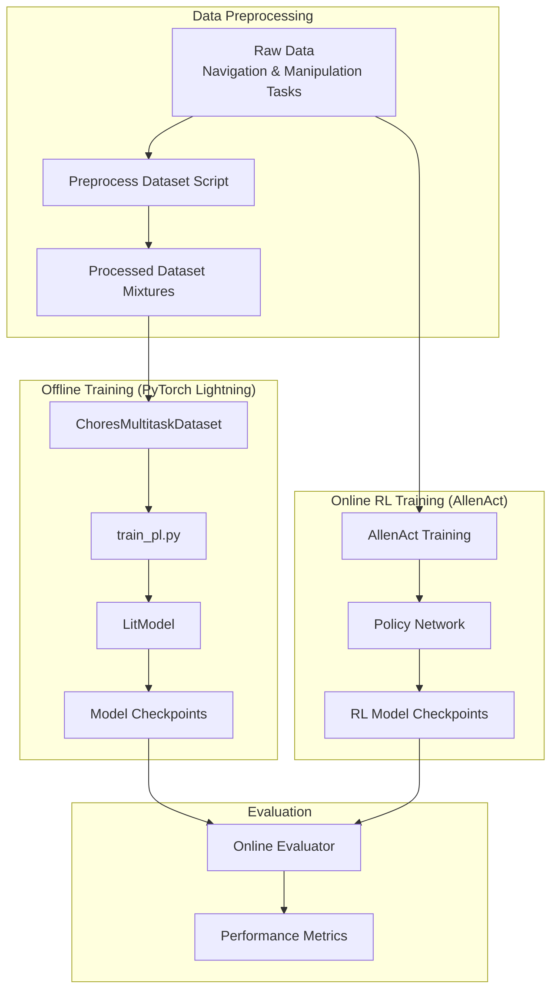
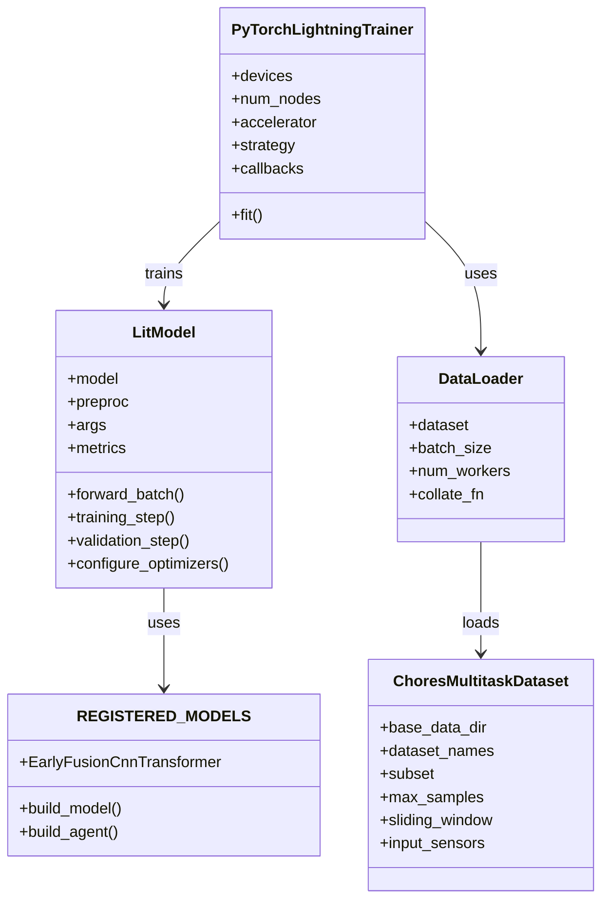
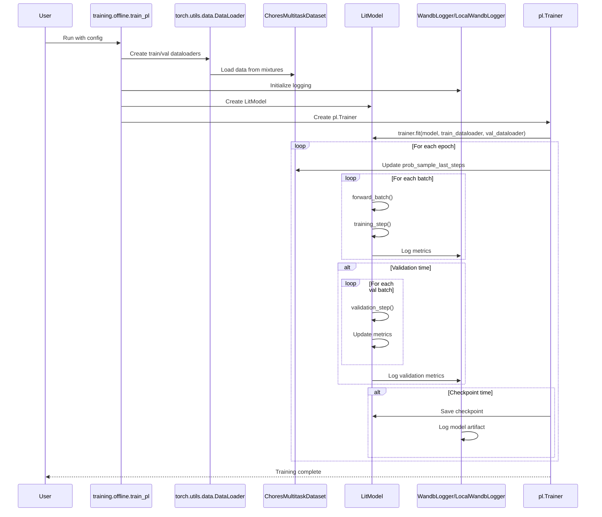
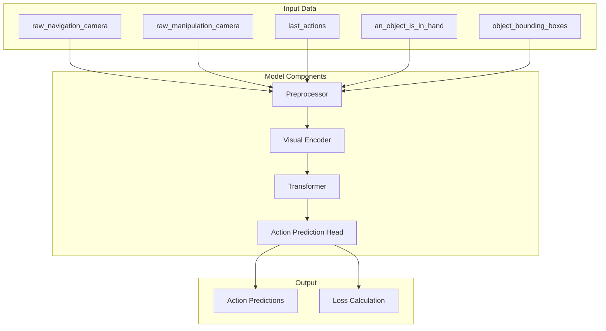

<!-- source: DeepWiki mcp.deepwiki.com · repo allenai/spoc-robot-training · page 3 Training Pipeline · fetched 2026-10-26 -->

# Training Pipeline

<details>
<summary>Relevant source files</summary>

The following files were used as context for generating this wiki page:

- [TRAINING_README.md](TRAINING_README.md)
- [training/offline/train_pl.py](training/offline/train_pl.py)

</details>


The SPOC-Robot-Training repository provides a comprehensive training pipeline for teaching robots to perform navigation and manipulation tasks. This document explains the architecture and components of the training pipeline, including both offline training using PyTorch Lightning and online reinforcement learning (RL) training using AllenAct.

For information about evaluating trained models, see [Evaluation System](#4).

## Training Pipeline Overview

The SPOC training pipeline supports two primary training approaches:

1. **Offline Training**: Supervised learning from demonstration data using PyTorch Lightning
2. **Online RL Training**: Reinforcement learning in simulation using AllenAct

These approaches can be used independently or complementarily depending on the task requirements.



Sources:
- [training/offline/train_pl.py]()
- [TRAINING_README.md]()

## Data Preprocessing

Before training, raw data must be preprocessed to create metadata for the dataset. The preprocessing step generates necessary files for the training pipeline.

```bash
python -m scripts.preprocess_dataset --dataset_lists DATASETNAMES --dataset_path /data/datasets
```

This generates `house_id_to_sub_house_id_train.json` and `house_id_to_sub_house_id_val.json` files for each dataset.

Sources:
- [TRAINING_README.md:1-10]()

## Offline Training with PyTorch Lightning

The offline training pipeline uses PyTorch Lightning for training models based on demonstration data. It supports various model architectures, dataset mixtures, and configurable training parameters.

### Training Process Architecture



Sources:
- [training/offline/train_pl.py:75-272]()
- [training/offline/train_pl.py:324-345]()

### Configuration Options

The offline training pipeline supports numerous configuration options that can be specified via command-line arguments:

| Parameter | Description | Default |
| --- | --- | --- |
| `--model` | Model architecture | EarlyFusionCnnTransformer |
| `--model_version` | Model size/variant | small_3 |
| `--dataset_version` | Dataset mixture to use | object_nav_v0.3 |
| `--data_dir` | Data directory | /data/datasets |
| `--output_dir` | Results directory | /data/results |
| `--max_samples` | Maximum training samples | 100000 |
| `--eval_max_samples` | Maximum evaluation samples | 1600 |
| `--eval_every` | Evaluation frequency (steps) | 500 |
| `--save_every` | Checkpoint saving frequency (steps) | 2000 |
| `--per_gpu_batch` | Batch size per GPU | 16 |
| `--lr` | Learning rate | 0.0001 |
| `--sliding_window` | Context window size | 50 |
| `--precision` | Training precision | 32-true or 16-mixed |

Sources:
- [training/offline/train_pl.py:24-66]()

### Running Offline Training

To run offline training, use the `train_pl.py` script with the desired configuration:

```bash
python -m training.offline.train_pl --dataset_version DATASET_NAME --eval_every 50 --precision PRECISION_TYPE --input_sensors LIST_OF_SENSORS --per_gpu_batch PER_GPU_BATCH_SIZE --sliding_window 50 --model MODEL_NAME --model_version base --lr BASE_LEARNING_RATE
```

Example with detailed parameters:

```bash
python -m training.offline.train_pl --max_samples 10000 --eval_max_samples 1600 --eval_every 500 --save_every 2000 --model_version siglip_base_3 --sliding_window 4 --per_gpu_batch 3 --lr 0.0002 --data_dir /data/datasets --dataset_version CHORES --model EarlyFusionCnnTransformer --input_sensors raw_navigation_camera raw_manipulation_camera last_actions an_object_is_in_hand --precision 16-mixed --loss action --max_epochs 100 --resume_local --output_dir /path/to/save/logs --num_nodes 1
```

Sources:
- [TRAINING_README.md:12-38]()

### Training Pipeline Flow



Sources:
- [training/offline/train_pl.py:348-470]()

### Logging and Checkpointing

The training pipeline supports two logging approaches:

1. **Weights & Biases (wandb)**: For online tracking of experiments
   ```bash
   --wandb_logging True --wandb_entity_name ENTITY --wandb_project_name PROJECT
   ```

2. **Local Logging**: For offline tracking
   ```bash
   --wandb_logging False --output_dir /path/to/save/logs
   ```

Checkpoints are automatically saved every `save_every` steps and can be used to resume training or for evaluation.

Sources:
- [TRAINING_README.md:41-60]()
- [training/offline/train_pl.py:413-419]()

## Online RL Training with AllenAct

The repository also supports online reinforcement learning training using the AllenAct framework. This approach trains agents through interaction with the environment rather than from demonstration data.

### Running Online RL Training

To train an RL agent:

```bash
python -m allenact.main training/online/siglip_vitb_gru_rgb_augment_objectnav
```

Results are saved to the `experiment_output` directory. Wandb logging can be enabled via environment variables:

```bash
export WANDB_PROJECT=YOUR_WANDB_PROJECT_NAME
export WANDB_ENTITY=YOUR_WANDB_ENTITY_NAME
python -m allenact.main training/online/siglip_vitb_gru_rgb_augment_objectnav --callbacks wandb_logging_callback
```

Sources:
- [TRAINING_README.md:106-129]()

## Dataset Mixtures

The training pipeline supports training on multiple datasets simultaneously by defining dataset mixtures. Mixtures are defined in `training/offline/dataset_mixtures.py` and can be specified during training.

Example of defining and using a dataset mixture:

1. Define a mixture in `dataset_mixtures.py`:
   ```python
   TWO_TASK_MIX = ['ObjectNavType', 'ObjectNavDescription']
   ```

2. Use the mixture during training:
   ```bash
   --dataset_version TWO_TASK_MIX
   ```

This allows for multi-task learning across different dataset types.

Sources:
- [TRAINING_README.md:38]()
- [training/offline/train_pl.py:327]()

## Dataset and Model Architecture Integration



Sources:
- [training/offline/train_pl.py:139-141]()
- [TRAINING_README.md:93-101]()

## Creating Custom Models

To extend the training pipeline with custom models:

1. Define a new model class in `architecture/models/transformer_models` that includes:
   - A class for the model architecture
   - A `forward(self, model_inputs, actions)` method that returns a dictionary with "logits" and "loss"
   - A class method `build_model` that returns the model and preprocessor
   - A class method `build_agent` for online evaluation

2. Register the model in `architecture/models/transformer_models/__init__.py`

3. Implement the `Agent` class for caching inputs during online evaluation

Models can then be selected during training using the `--model` argument.

Sources:
- [TRAINING_README.md:89-104]()

## Pretrained Models

The repository provides pretrained models that can be downloaded and evaluated:

```bash
python -m scripts.download_trained_ckpt --save_dir /path/to/local/checkpoints --ckpt_ids SigLIP-ViTb-3-CHORES-S
```

Available models include:
- DINOv2-ViTs-3-CHORES-S
- SigLIP-ViTb-3-CHORES-L/S
- SigLIP-ViTb-3-CHORESNav-L/S
- SigLIP-ViTb-3-double-det-CHORES-L/S

These models can be evaluated using the online evaluation system.

Sources:
- [TRAINING_README.md:140-180]()

## Related Pages

- For detailed information about the offline training approach, see [Offline Training with PyTorch Lightning](#3.1)
- For details on online RL training, see [Online RL Training](#3.2)
- For information about custom models and dataset mixtures, see [Custom Models and Dataset Mixtures](#3.3)
- For evaluation of trained models, see [Evaluation System](#4)

---

