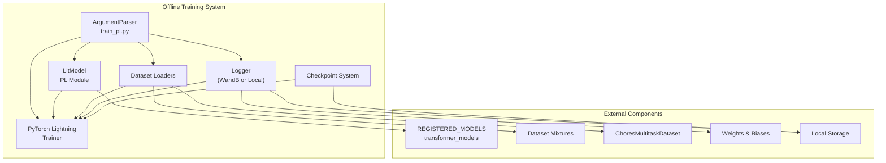
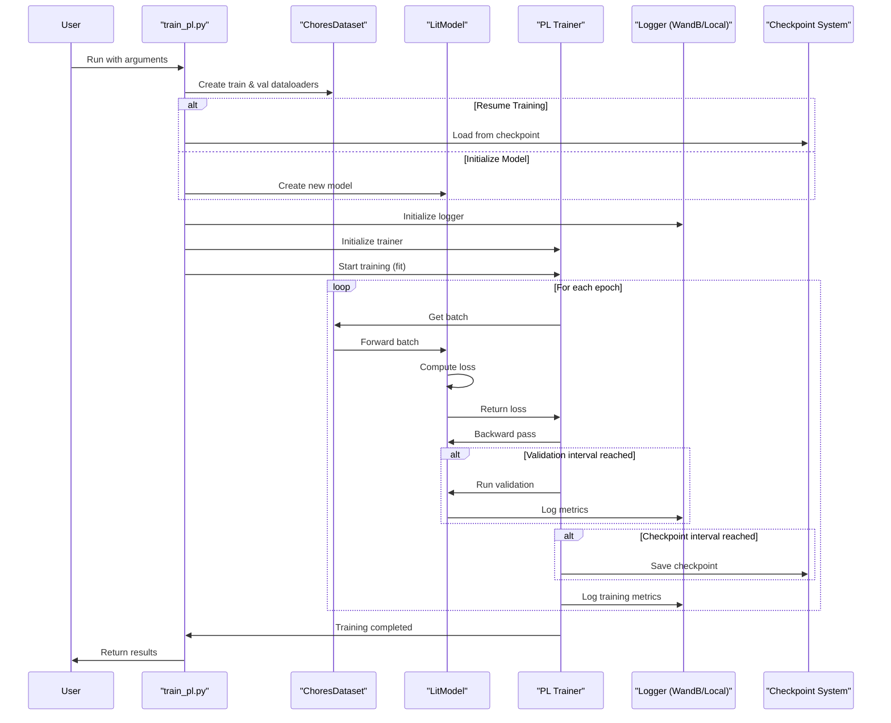
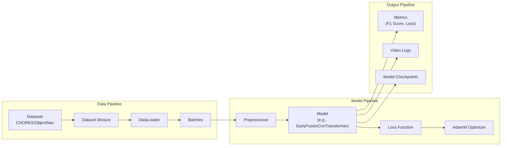

<!-- source: DeepWiki mcp.deepwiki.com · repo allenai/spoc-robot-training · page 3.1 Offline Training with PyTorch Lightning · fetched 2026-10-26 -->

# Offline Training with PyTorch Lightning

<details>
<summary>Relevant source files</summary>

The following files were used as context for generating this wiki page:

- [TRAINING_README.md](TRAINING_README.md)
- [training/offline/train_pl.py](training/offline/train_pl.py)
- [training/offline/train_utils.py](training/offline/train_utils.py)

</details>


This document describes the offline training system implemented in the SPOC-Robot-Training repository using PyTorch Lightning. The offline training system is used to train models on pre-collected datasets, as opposed to the online reinforcement learning approach covered in [Online RL Training](#3.2).

## Purpose and Scope

The offline training pipeline enables training of multi-task robotic models through imitation learning (behavioral cloning) on datasets of demonstration trajectories. It supports various model architectures, dataset mixtures, and training configurations.

Sources: [training/offline/train_pl.py:1-493]()

## System Architecture



Sources: [training/offline/train_pl.py:24-66](), [training/offline/train_pl.py:75-317](), [training/offline/train_pl.py:348-470]()

## Training Process Flow



Sources: [training/offline/train_pl.py:348-470](), [training/offline/train_pl.py:143-174](), [training/offline/train_pl.py:221-246]()

## Key Components

### 1. LitModel Class

The `LitModel` class is a PyTorch Lightning module that handles the model training process. It:

- Creates the model and preprocessor
- Defines training and validation logic
- Computes metrics
- Logs results and videos
- Handles checkpoint saving/loading

```python
class LitModel(pl.LightningModule):
    def __init__(self, args):
        # Initialize model and preprocessor
        # Configure metrics
        
    def training_step(self, batch, batch_idx):
        # Process batch
        # Compute loss
        # Log metrics
        
    def validation_step(self, batch, batch_idx):
        # Process batch
        # Compute metrics
```

Sources: [training/offline/train_pl.py:75-317]()

### 2. Data Loading

The system uses `ChoresMultitaskDataset` for loading data from various datasets. It supports:

- Multiple dataset mixtures
- Sliding window approach for sequential data
- Various input sensors
- Batch collation and preprocessing

```python
def get_dataloader(subset: str, args):
    dataset = ChoresMultitaskDataset(
        base_data_dir=args.data_dir,
        dataset_names=get_mixture_by_name(args.dataset_version),
        subset=subset,
        max_samples=args.max_samples if subset == "train" else args.eval_max_samples,
        sliding_window=args.sliding_window,
        input_sensors=args.input_sensors,
        reduce_action_redundancy=args.reduce_action_redundancy if subset == "train" else False,
    )
    
    return DataLoader(...)
```

Sources: [training/offline/train_pl.py:324-345]()

### 3. Logging System

The training system supports two logging backends:

- **Weights & Biases (WandB)**: For online experiment tracking
- **Local WandB Logger**: For offline experiment tracking with WandB-compatible format

The logging system captures:
- Metrics (loss, F1 scores, etc.)
- Videos of agent behavior
- Model checkpoints

Sources: [training/offline/train_pl.py:375-397](), [training/offline/train_pl.py:99-131]()

### 4. Checkpoint Management

The system includes functionality for:

- Saving model checkpoints at regular intervals
- Loading from local or remote checkpoints
- Resuming training from a checkpoint
- Initializing a model from an existing checkpoint

```python
# Checkpoint callback
checkpoint_callback = pl.callbacks.ModelCheckpoint(
    dirpath=args.exp_dir,
    filename="checkpoint_{train_steps:.0f}",
    save_top_k=-1,
    verbose=True,
    every_n_train_steps=args.save_every,
)
```

Sources: [training/offline/train_pl.py:413-419](), [training/offline/train_utils.py:6-60]()

## Configuration Options

The training script supports many configuration options through command-line arguments:

| Category | Options | Description |
|----------|---------|-------------|
| **Model** | `--model`, `--model_version` | Model architecture and version |
| **Dataset** | `--dataset_version`, `--data_dir`, `--max_samples`, `--eval_max_samples` | Dataset configuration |
| **Training** | `--lr`, `--max_epochs`, `--per_gpu_batch`, `--sliding_window` | Training hyperparameters |
| **Logging** | `--wandb_logging`, `--wandb_project_name`, `--wandb_entity_name` | Logging configuration |
| **Checkpointing** | `--save_every`, `--resume`, `--resume_local`, `--init_model` | Checkpoint handling |
| **Input** | `--input_sensors` | List of sensor inputs to use |
| **Hardware** | `--precision`, `--num_nodes` | Hardware utilization settings |

Sources: [training/offline/train_pl.py:24-66]()

## Usage Guide

### Basic Training Command

To train a model using the PyTorch Lightning system:

```bash
python -m training.offline.train_pl \
    --model EarlyFusionCnnTransformer \
    --model_version siglip_base_3 \
    --dataset_version CHORES \
    --per_gpu_batch 3 \
    --lr 0.0002 \
    --sliding_window 4 \
    --input_sensors raw_navigation_camera raw_manipulation_camera last_actions an_object_is_in_hand \
    --precision 16-mixed \
    --wandb_logging True \
    --wandb_entity_name ENTITY \
    --wandb_project_name PROJECT
```

### Training with Multiple Datasets

To train on multiple datasets, define a mixture in `training/offline/dataset_mixtures.py` and reference it:

```bash
python -m training.offline.train_pl \
    --dataset_version TWO_TASK_MIX \
    # other arguments as above
```

### Resuming Training

To resume training from the latest local checkpoint:

```bash
python -m training.offline.train_pl \
    --resume_local \
    # other arguments as above
```

To resume from a specific WandB checkpoint:

```bash
python -m training.offline.train_pl \
    --resume \
    --run_id RUN_ID \
    --step STEP \
    # other arguments as above
```

Sources: [TRAINING_README.md:12-62]()

## Data and Model Flow



Sources: [training/offline/train_pl.py:139-174](), [training/offline/train_pl.py:268-272](), [training/offline/train_pl.py:413-419]()

## Metrics and Evaluation

During training, the system computes and logs the following metrics:

1. **Loss**: Action prediction loss and any custom losses defined by the model
2. **F1 Scores**:
   - Weighted F1 score across all action classes
   - Macro F1 score across all action classes 
   - Per-action F1 scores

Validation is performed at regular intervals (defined by `--eval_every`), allowing tracking of model performance throughout training.

Sources: [training/offline/train_pl.py:176-196](), [training/offline/train_pl.py:221-266]()

## Integration with Other Systems

The offline training system integrates with several other components of the SPOC framework:

1. **Model Architecture**: Uses models defined in `architecture/models/transformer_models`
2. **Dataset Mixtures**: Leverages dataset mixtures defined in `training/offline/dataset_mixtures.py`
3. **Online Evaluation**: Trained models can be evaluated using the [Online Evaluator](#4.1)
4. **Logging Utilities**: Uses both WandB and local logging systems

To customize the training process, users can:
- Create custom models (see [Custom Models and Dataset Mixtures](#3.3))
- Define new dataset mixtures
- Configure training hyperparameters

Sources: [training/offline/train_pl.py:17-21](), [TRAINING_README.md:89-101]()

---

