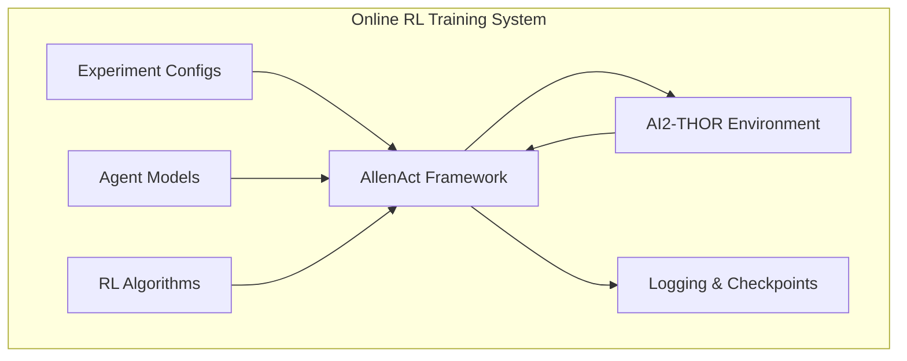
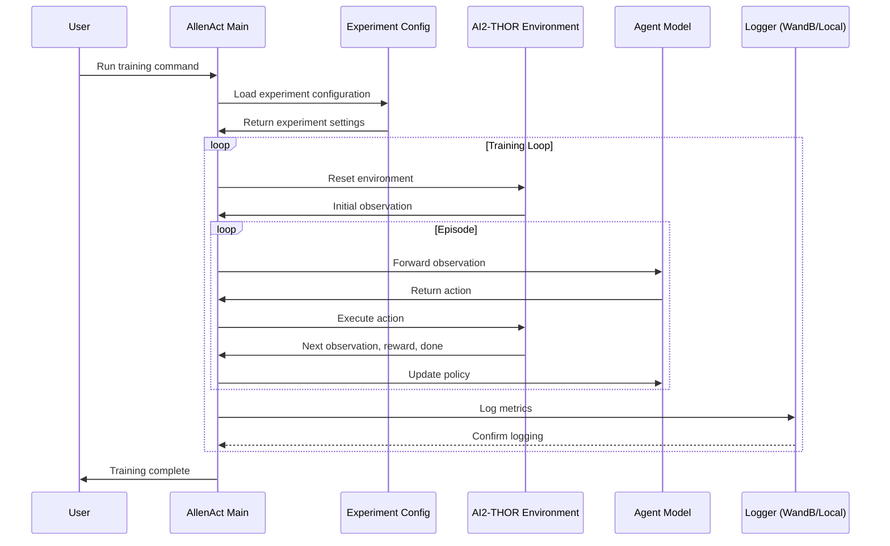
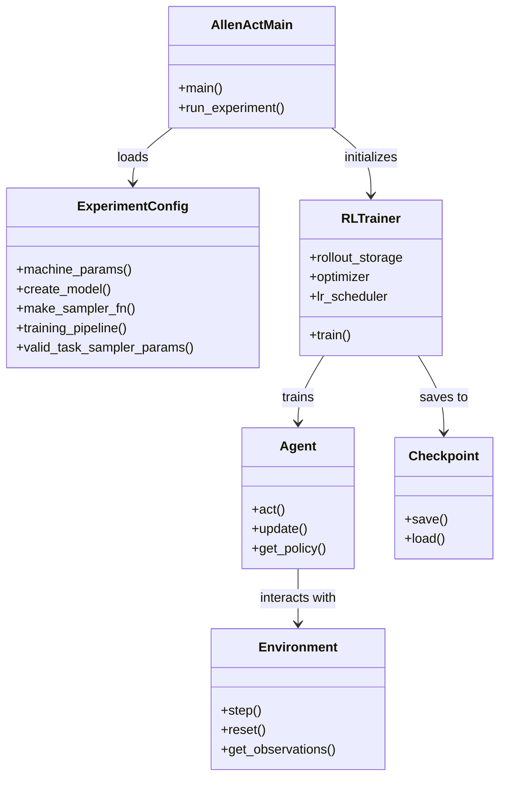
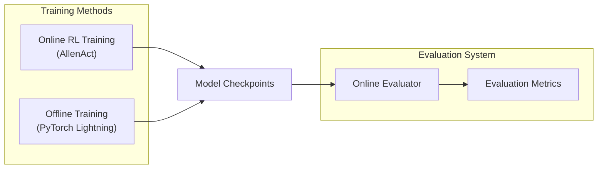

<!-- source: DeepWiki mcp.deepwiki.com · repo allenai/spoc-robot-training · page 3.2 Online RL Training · fetched 2026-10-26 -->

# Online RL Training

<details>
<summary>Relevant source files</summary>

The following files were used as context for generating this wiki page:

- [TRAINING_README.md](TRAINING_README.md)

</details>


This document explains the online reinforcement learning (RL) training system in the SPOC (Simulation for Navigation and Manipulation) framework. Online RL refers to the process where the agent learns through direct interaction with the environment, collecting new experiences and updating its policy accordingly. For information about offline training methods, see [Offline Training with PyTorch Lightning](#3.1).

## Overview

The online RL training system in SPOC uses [AllenAct](https://allenact.org/), a modular and flexible framework for embodied AI research. This approach allows agents to learn navigation and manipulation policies directly through trial and error in simulated environments, as opposed to learning from pre-collected datasets in offline training.



Sources: [TRAINING_README.md:107-129]()

## Environment Setup

Before training, you need to set up the necessary environment variables pointing to the required datasets:

```
export OBJAVERSE_DATA_DIR=/path/to/objaverse_assets
export OBJAVERSE_HOUSES_DIR=/path/to/objaverse_houses
```

You can optionally set up Weights & Biases for experiment tracking:

```
export WANDB_PROJECT=YOUR_WANDB_PROJECT_NAME
export WANDB_ENTITY=YOUR_WANDB_ENTITY_NAME
```

Sources: [TRAINING_README.md:108-113](), [TRAINING_README.md:124-128]()

## Training Process

The online RL training process involves running an experiment configuration that defines the environment, agent architecture, and learning algorithm.

### Training Workflow



Sources: [TRAINING_README.md:114-119]()

### Running Training

To train a model using the online RL system, use the AllenAct main module with the specific experiment configuration:

```
python -m allenact.main training/online/siglip_vitb_gru_rgb_augment_objectnav
```

The results will be saved to the `experiment_output` directory by default.

To enable Weights & Biases logging:

```
python -m allenact.main training/online/siglip_vitb_gru_rgb_augment_objectnav --callbacks wandb_logging_callback
```

Sources: [TRAINING_README.md:114-129]()

## System Architecture

The online RL training system integrates several components within the SPOC framework:



Sources: [TRAINING_README.md:114-129]()

## Experiment Configurations

The experiment configurations define the environment, model architecture, and training pipeline. In the SPOC repository, configurations are stored in the `training/online/` directory.

A typical configuration contains:

1. Environment parameters (AI2-THOR settings)
2. Model architecture (e.g., SigLIP vision encoder with GRU)
3. RL algorithm settings (e.g., PPO parameters)
4. Training pipeline configuration (learning rate, epochs, etc.)
5. Evaluation parameters

The example configuration mentioned in the documentation is `siglip_vitb_gru_rgb_augment_objectnav`, which uses a SigLIP vision transformer backbone with a GRU policy for object navigation tasks.

Sources: [TRAINING_README.md:118](), [TRAINING_README.md:134]()

## Evaluation

### Evaluating Trained Models

To evaluate a trained model from the online RL system:

```
python -m allenact.main training/online/siglip_vitb_gru_rgb_augment_objectnav -c /path/to/checkpoint --eval
```

The checkpoint can be found in the `experiment_output` directory after training.

Sources: [TRAINING_README.md:132-137]()

### Integration with Online Evaluator

The models trained using the online RL system can also be evaluated using the general Online Evaluator component of SPOC, allowing for consistent comparison with models trained through offline methods.



Sources: [TRAINING_README.md:64-86]()

## Comparison with Offline Training

The following table highlights the key differences between online RL training and offline training approaches in SPOC:

| Feature | Online RL Training | Offline Training |
|---------|------------------|-----------------|
| Framework | AllenAct | PyTorch Lightning |
| Learning Method | Reinforcement Learning | Supervised Learning (typically Behavioral Cloning) |
| Data Source | Generated during training through environment interaction | Pre-collected datasets |
| Update Frequency | Continuous (online) | Batch-based |
| Exploration | Agent explores environment directly | N/A (follows demonstration data) |
| Primary Config File | Experiment config in `training/online/` | Arguments to `train_pl.py` |
| Command Structure | `python -m allenact.main training/online/config` | `python -m training.offline.train_pl [args]` |

Sources: [TRAINING_README.md:12-38](), [TRAINING_README.md:107-129]()

## Summary

The Online RL Training component provides a reinforcement learning approach to training navigation and manipulation agents in the SPOC framework. It leverages the AllenAct framework to implement training workflows where agents learn directly from interaction with the AI2-THOR environment. This approach complements the offline training methodology, offering an alternative way to develop robust policies for embodied AI tasks.

Key benefits of the online RL approach include:
- Learning from direct environment interaction rather than fixed datasets
- Natural exploration of the environment
- No requirement for pre-collected demonstration data
- Potentially discovering strategies not present in demonstration data

For evaluation of models trained with either approach, see [Online Evaluator](#4.1) for details on the common evaluation framework.

Sources: [TRAINING_README.md:107-137]()

---

