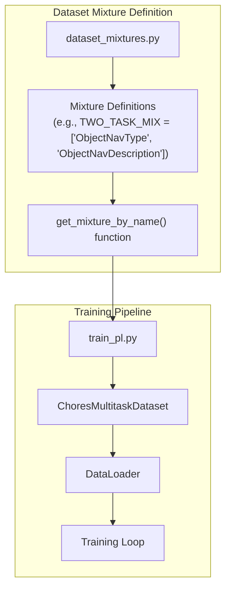
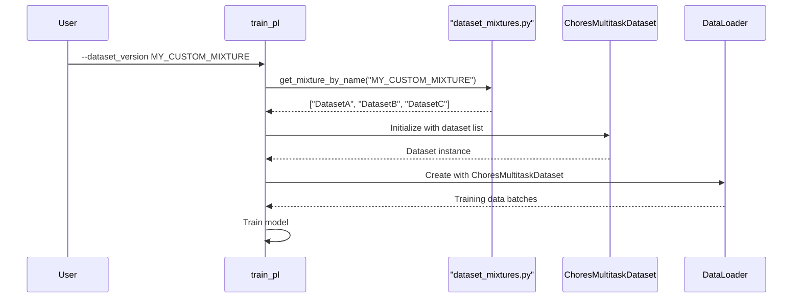
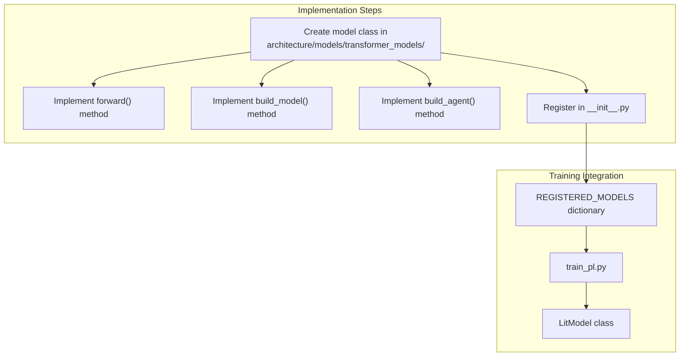
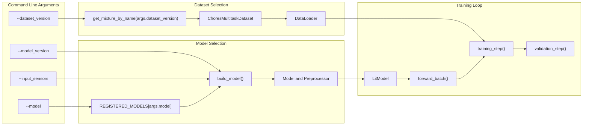

<!-- source: DeepWiki mcp.deepwiki.com · repo allenai/spoc-robot-training · page 3.3 Custom Models and Dataset Mixtures · fetched 2026-10-26 -->

# Custom Models and Dataset Mixtures

<details>
<summary>Relevant source files</summary>

The following files were used as context for generating this wiki page:

- [TRAINING_README.md](TRAINING_README.md)
- [training/offline/train_pl.py](training/offline/train_pl.py)

</details>


## Purpose and Scope

This document details how to create custom models and work with dataset mixtures in the SPOC robot training system. It covers the process of defining new neural network architectures and combining multiple datasets for training. For information about offline training specifically, see [Offline Training with PyTorch Lightning](#3.1), and for online RL training, see [Online RL Training](#3.2).

## Dataset Mixtures

Dataset mixtures allow you to train models on combinations of different datasets simultaneously, which can improve generalization across task types and environments.

### Defining Dataset Mixtures

Dataset mixtures are defined in `training/offline/dataset_mixtures.py` as simple lists of dataset names.



To create a new dataset mixture:

1. Open `training/offline/dataset_mixtures.py`
2. Define a new constant with a list of dataset names:
   ```python
   MY_CUSTOM_MIXTURE = ['DatasetA', 'DatasetB', 'DatasetC']
   ```

Sources: [training/offline/train_pl.py:20-20](), [training/offline/train_pl.py:327-335]()

### Using Dataset Mixtures

To use a dataset mixture in training, specify it with the `--dataset_version` argument:

```bash
python -m training.offline.train_pl --dataset_version MY_CUSTOM_MIXTURE
```

The training script dynamically loads the specified mixture:



During training, metrics are tracked for the combined performance across all datasets in the mixture.

Sources: [training/offline/train_pl.py:324-345](), [TRAINING_README.md:38-39]()

## Custom Models

The SPOC system allows defining custom neural network architectures to experiment with different approaches to visual navigation and manipulation.

### Model Requirements

Custom models must adhere to specific requirements:

1. A model class with appropriate implementation
2. A `forward()` method calculating loss and returning a dictionary with "actions_logits" and "loss"
3. A `build_model()` class method for initialization
4. A `build_agent()` class method for online evaluation
5. Registration in the model registry

### Creating a Custom Model



To create a custom model:

1. Create a new file in `architecture/models/transformer_models/`
2. Implement a model class with required methods
3. Register the model in `architecture/models/transformer_models/__init__.py`

Sources: [training/offline/train_pl.py:17-17](), [training/offline/train_pl.py:80-85](), [TRAINING_README.md:89-105]()

### Required Model Methods

Your custom model should implement these key methods:

| Method | Purpose | Parameters |
|--------|---------|------------|
| `forward()` | Process inputs and compute loss | `model_inputs, actions=None` |
| `build_model()` | Initialize model and preprocessor | `model_version, input_sensors, loss, ckpt_pth=None` |
| `build_agent()` | Create agent for evaluation | `model_version, input_sensors, loss, device, sampling="greedy", ckpt_path=None` |

The `forward()` method should return a dictionary with at least:
- `actions_logits`: Predicted action logits
- `loss`: Training loss (when `actions` is provided)

Sources: [TRAINING_README.md:96-100](), [training/offline/train_pl.py:139-141]()

## Integration with Training Pipeline

The following diagram shows how custom models and dataset mixtures are integrated into the training pipeline:



### Training Configuration

When training with custom models and dataset mixtures, these key arguments are available:

| Argument | Description | Example |
|----------|-------------|---------|
| `--model` | Model architecture name | `--model EarlyFusionCnnTransformer` |
| `--model_version` | Model variant (size/architecture) | `--model_version base` |
| `--dataset_version` | Dataset mixture name | `--dataset_version TWO_TASK_MIX` |
| `--input_sensors` | Input modalities | `--input_sensors raw_navigation_camera raw_manipulation_camera` |
| `--loss` | Loss function type | `--loss action` |

Sources: [training/offline/train_pl.py:24-66](), [training/offline/train_pl.py:80-85]()

### Complete Example

Here's a complete example of training a custom model on a dataset mixture:

```bash
python -m training.offline.train_pl \
  --model EarlyFusionCnnTransformer \
  --model_version siglip_base_3 \
  --dataset_version CHORES \
  --input_sensors raw_navigation_camera raw_manipulation_camera last_actions an_object_is_in_hand \
  --loss action \
  --per_gpu_batch 3 \
  --lr 0.0002 \
  --precision 16-mixed \
  --max_epochs 100
```

Sources: [TRAINING_README.md:34-36](), [training/offline/train_pl.py:473-493]()

## Debugging and Monitoring

The training system logs metrics for each dataset in the mixture, which helps identify if the model is learning effectively across all tasks. During training, you can monitor:

- Per-action F1 scores
- Overall F1 scores (weighted and macro)
- Loss values for each dataset
- Training frames processed

The system also logs sample videos showing model predictions alongside ground truth actions, helpful for debugging custom model behavior.

Sources: [training/offline/train_pl.py:151-169](), [training/offline/train_pl.py:98-131]()

---

