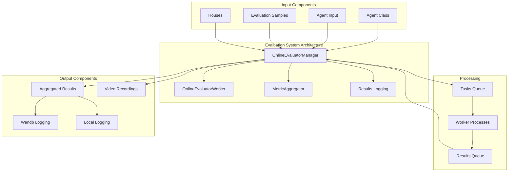
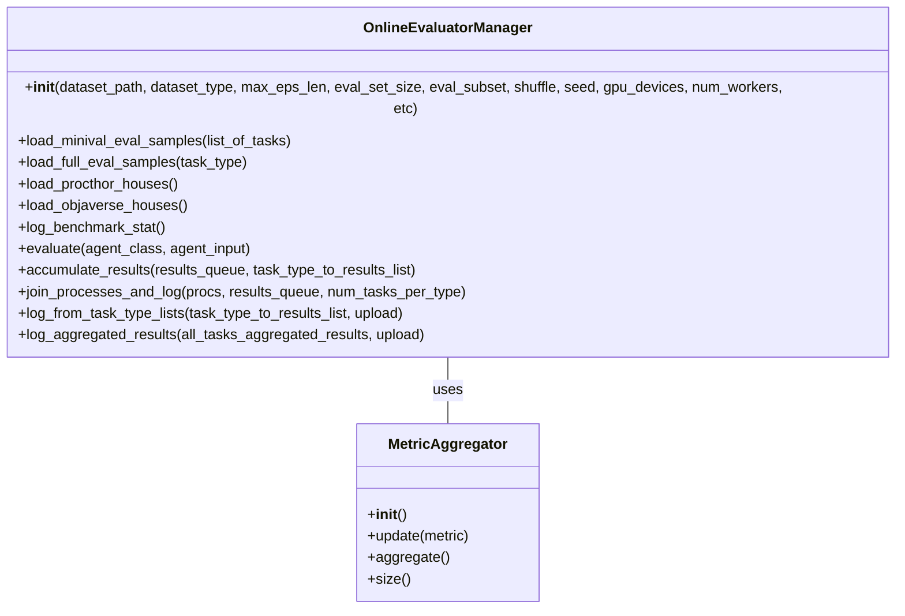
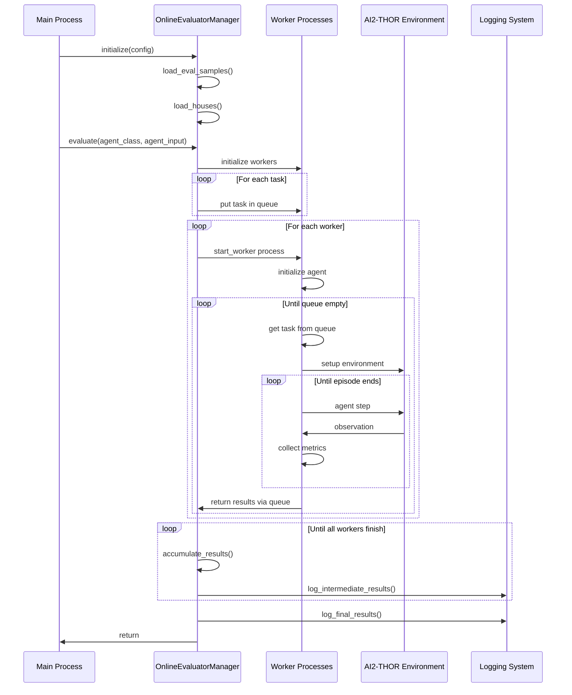
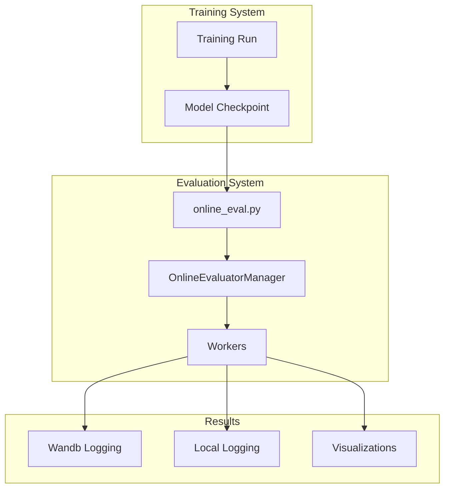
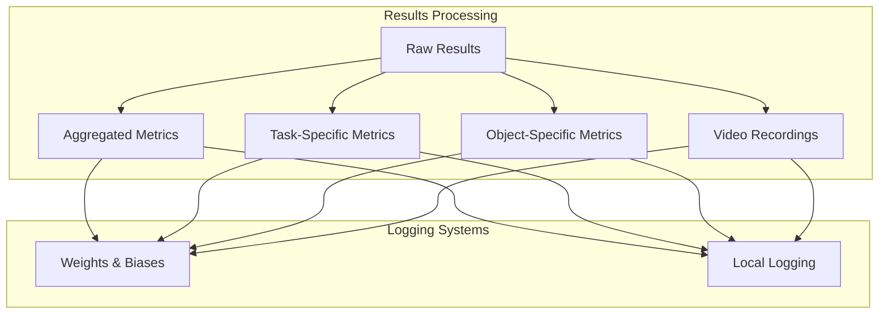

<!-- source: DeepWiki mcp.deepwiki.com · repo allenai/spoc-robot-training · page 4 Evaluation System · fetched 2026-10-26 -->

# Evaluation System

<details>
<summary>Relevant source files</summary>

The following files were used as context for generating this wiki page:

- [online_evaluation/online_evaluator.py](online_evaluation/online_evaluator.py)
- [training/offline/online_eval.py](training/offline/online_eval.py)

</details>


## Purpose and Scope

The Evaluation System is a core component of the SPOC (Simulation for Navigation and Manipulation) framework, designed to assess the performance of trained models on a variety of robotic tasks in simulated environments. This document covers the architecture, workflow, and usage of the evaluation system.

For information about running evaluations using specific scripts and command-line interfaces, see [Running Evaluations](#4.2). For details about the models being evaluated, see [Training Pipeline](#3).

Sources: [online_evaluation/online_evaluator.py:1-644]()

## Architecture Overview

The evaluation system is built around a manager-worker architecture that enables parallel evaluation across multiple environments and tasks. The system supports evaluation on different task types, with customizable metrics and visualization capabilities.



Sources: [online_evaluation/online_evaluator.py:190-644](), [training/offline/online_eval.py:16-200]()

## Core Components

### OnlineEvaluatorManager

The `OnlineEvaluatorManager` class is the central coordinator of the evaluation process. It is responsible for:

1. Loading evaluation samples and houses
2. Initializing worker processes across available GPUs
3. Managing task distribution
4. Collecting and aggregating results
5. Logging metrics and visualizations



Sources: [online_evaluation/online_evaluator.py:190-644]()

### Metrics Collection and Aggregation

The evaluation system uses the `MetricAggregator` class to collect and process metrics from individual evaluation runs. Common metrics include:

| Metric Category | Description | Examples |
|----------------|-------------|----------|
| Task Success | Measures whether the task was completed successfully | Success rate |
| Efficiency | Measures how efficiently the task was completed | Episode length, time to completion |
| Extra Metrics | Task-specific measurements | Object-specific success rates, room visitation rates |

Sources: [online_evaluation/online_evaluator.py:79-91](), [online_evaluation/online_evaluator.py:93-97]()

## Evaluation Workflow

The following diagram illustrates the complete workflow of the evaluation system:



Sources: [online_evaluation/online_evaluator.py:404-487](), [online_evaluation/online_evaluator.py:511-587]()

## Usage and Integration

The evaluation system is typically used through the `online_eval.py` script, which handles the setup of the evaluation manager and the loading of trained models.

### Configuration Parameters

The evaluation system can be configured with numerous parameters:

| Parameter | Description | Default |
|-----------|-------------|---------|
| dataset_path | Path to dataset | "/data/datasets" |
| dataset_type | Type of dataset | "" |
| max_eps_len | Maximum episode length | -1 (unlimited) |
| eval_set_size | Number of samples to evaluate | 200 |
| eval_subset | Subset to evaluate on | "minival" |
| shuffle | Whether to shuffle evaluation samples | False |
| gpu_devices | List of GPU devices to use | All available GPUs |
| num_workers | Number of parallel workers | Required parameter |
| house_set | Type of houses to use | "procthor" |
| input_sensors | List of input sensors for the agent | ["raw_navigation_camera", "raw_manipulation_camera"] |
| benchmark_revision | Benchmark revision to use | "chores-small" |

Sources: [training/offline/online_eval.py:16-59](), [online_evaluation/online_evaluator.py:191-236]()

### Integration with Training

The evaluation system is tightly integrated with the training pipeline, as it loads trained models and evaluates them. The typical integration flow is:



Sources: [training/offline/online_eval.py:86-199]()

## Results Processing and Visualization

The evaluation system generates several types of outputs:

1. **Aggregated Metrics**: Overall performance statistics across all evaluation samples
2. **Task-Specific Metrics**: Breakdown of performance by task type
3. **Object-Specific Metrics**: Performance metrics for different object types
4. **Visualizations**: Video recordings of agent behavior during evaluation

These results are logged either to Weights & Biases (for online tracking) or to a local logging system.



Sources: [online_evaluation/online_evaluator.py:100-187](), [online_evaluation/online_evaluator.py:588-643]()

## Implementation Details

### Parallel Evaluation

The evaluation system uses Python's multiprocessing module to distribute evaluation tasks across multiple processes and GPUs:

```python
# Create processes for each worker
for worker_id in self.workers:
    proc = mp.Process(
        target=start_worker,
        args=(
            self.workers[worker_id],
            agent_class,
            agent_input,
            worker_to_gpu[worker_id],
            tasks_queue,
            results_queue,
        ),
    )
    procs.append(proc)
    proc.start()
```

Sources: [online_evaluation/online_evaluator.py:473-486]()

### Results Collection

Results are collected asynchronously from worker processes through a results queue and accumulated until all evaluations are complete:

```python
def accumulate_results(self, results_queue, task_type_to_results_list):
    new_found_results = 0
    while True:
        try:
            task_metrics_video_info = results_queue.get(timeout=10)
        except EmptyQueueError:
            # No more results to read for now - exit
            break

        if task_metrics_video_info is None:
            self.num_ended_workers += 1
            continue

        metrics_info, video_info = task_metrics_video_info
        task_type = metrics_info["task_type"]

        new_found_results += 1
        task_type_to_results_list[task_type].append(task_metrics_video_info)

    return new_found_results
```

Sources: [online_evaluation/online_evaluator.py:490-509]()

## Summary

The evaluation system provides a comprehensive framework for assessing the performance of trained models in simulated environments. By supporting parallel evaluation across multiple tasks and environments, it enables efficient evaluation of model capabilities. The system's integration with both Weights & Biases and local logging systems provides flexibility in how results are tracked and analyzed.

---

