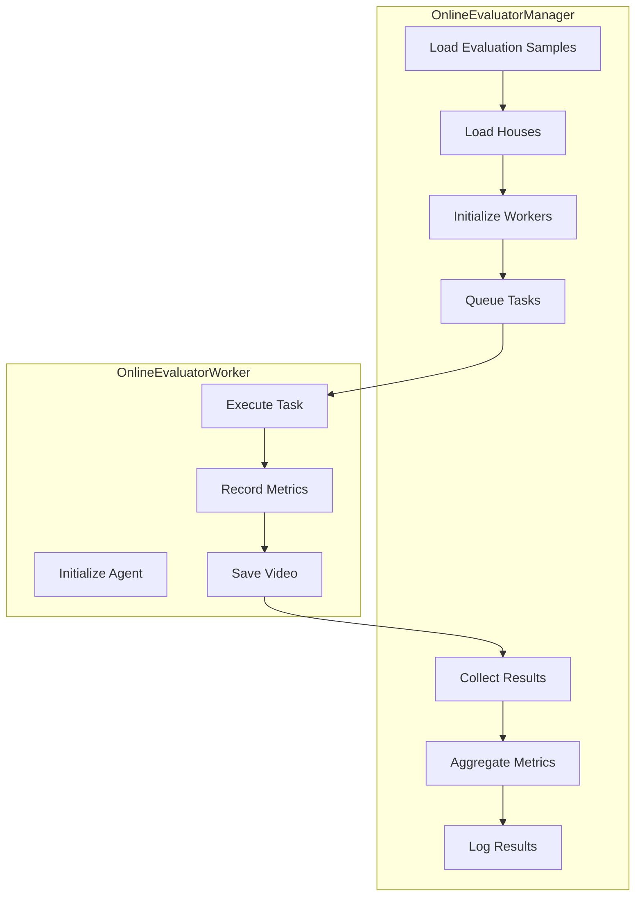
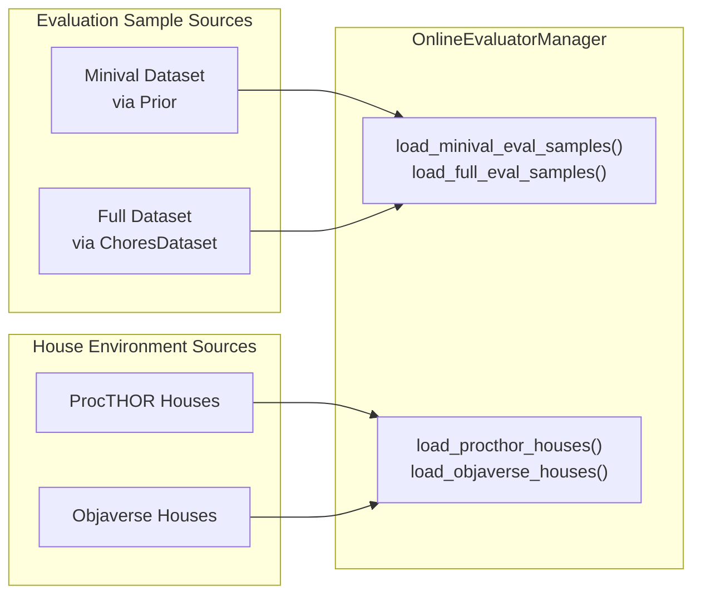
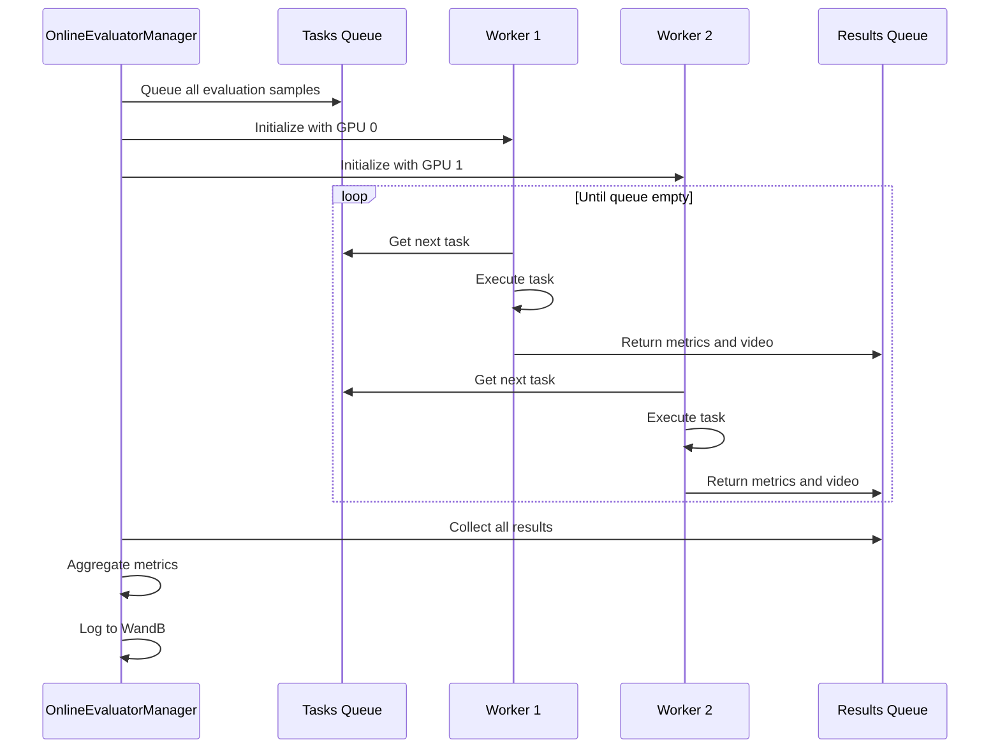
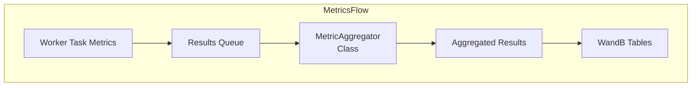
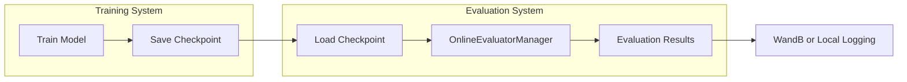

<!-- source: DeepWiki mcp.deepwiki.com · repo allenai/spoc-robot-training · page 4.1 Online Evaluator · fetched 2026-10-26 -->

# Online Evaluator

<details>
<summary>Relevant source files</summary>

The following files were used as context for generating this wiki page:

- [online_evaluation/online_evaluator.py](online_evaluation/online_evaluator.py)
- [training/offline/online_eval.py](training/offline/online_eval.py)

</details>


The Online Evaluator is a comprehensive system for evaluating trained agent models within the SPOC (Simulation for Navigation and Manipulation) framework. It provides parallel evaluation capabilities across multiple simulated environments, collecting performance metrics and visual recordings to assess model effectiveness on navigation and manipulation tasks.

For information about running specific evaluations with command-line scripts, see [Running Evaluations](#4.2). For details about available pretrained models, see [Pretrained Models](#4.3).

## System Overview

The Online Evaluator implements a manager-worker architecture to efficiently distribute evaluation tasks across multiple processes and GPUs. It interfaces with trained models, the AI2-THOR environment, and the Stretch robot controller to execute and assess agent performance on specified tasks.



Sources: [online_evaluation/online_evaluator.py:190-255](). [online_evaluation/online_evaluator.py:404-409]()

## Architecture Components

The Online Evaluator consists of two primary components:

1. **OnlineEvaluatorManager**: Orchestrates the entire evaluation process, managing workers and aggregating results
2. **OnlineEvaluatorWorker**: Executes individual evaluation tasks in parallel processes

```mermaid
classDiagram
    class OnlineEvaluatorManager {
        +__init__(dataset_path, dataset_type, max_eps_len, etc)
        +load_minival_eval_samples()
        +load_full_eval_samples()
        +load_procthor_houses()
        +load_objaverse_houses()
        +evaluate(agent_class, agent_input)
        +accumulate_results()
        +log_from_task_type_lists()
        +log_aggregated_results()
    }
    
    class OnlineEvaluatorWorker {
        +__init__(gpu_device, houses, max_eps_len, etc)
        +execute_task()
        +collect_metrics()
        +generate_video()
    }
    
    class MetricAggregator {
        +update(metric)
        +aggregate()
        +size()
    }
    
    OnlineEvaluatorManager --> OnlineEvaluatorWorker : manages
    OnlineEvaluatorManager --> MetricAggregator : uses
    OnlineEvaluatorWorker --> "Agent" : controls
```

Sources: [online_evaluation/online_evaluator.py:190-644](). [online_evaluation/online_evaluator.py:79-91]()

## Evaluation Process

### 1. Sample and House Loading

The OnlineEvaluatorManager loads evaluation samples and simulated houses needed for evaluation:

- **Evaluation Samples**: Can be loaded from:
  - Minival datasets (benchmark evaluations)
  - Full datasets (complete evaluation)
  
- **House Environments**: Can be loaded from:
  - ProcTHOR houses (procedurally generated environments)
  - Objaverse houses (houses populated with Objaverse objects)



Sources: [online_evaluation/online_evaluator.py:275-328](). [online_evaluation/online_evaluator.py:329-397]()

### 2. Worker Management

The manager initializes worker processes and distributes evaluation tasks:

1. **Worker Initialization**: Creates worker processes assigned to specific GPUs
2. **Task Queue**: Fills a task queue with evaluation samples
3. **Parallel Execution**: Workers process tasks from the queue independently
4. **Results Collection**: Results are collected through a separate queue



Sources: [online_evaluation/online_evaluator.py:404-488](). [online_evaluation/online_evaluator.py:511-587]()

### 3. Metrics Collection and Aggregation

The system collects various metrics from worker evaluations and aggregates them:

1. **Metric Collection**: Workers record metrics during task execution
2. **Aggregation**: The `MetricAggregator` class accumulates and averages metrics
3. **Logging**: Results are formatted and logged to WandB (or local alternative)



Sources: [online_evaluation/online_evaluator.py:79-91](). [online_evaluation/online_evaluator.py:100-187]()

## Configuration Options

The OnlineEvaluatorManager accepts various configuration parameters to customize the evaluation process:

| Parameter | Description | Default |
|-----------|-------------|---------|
| `dataset_path` | Path to dataset directory | `/data/datasets` |
| `dataset_type` | Type of dataset to use | `"object_nav_v0.3"` |
| `max_eps_len` | Maximum episode length (-1 for unlimited) | `-1` |
| `eval_set_size` | Number of evaluation samples to use | `200` |
| `eval_subset` | Dataset subset to use ("val", "minival", "train") | `"val"` |
| `shuffle` | Whether to shuffle evaluation samples | `True` |
| `gpu_devices` | List of GPU devices to use | `None` |
| `outdir` | Output directory for results | `/data/results/online_evaluation/OnlineEval-default` |
| `table_size` | Maximum number of videos to record | `200` |
| `house_set` | Type of houses to use ("procthor", "objaverse") | `"procthor"` |
| `num_workers` | Number of parallel worker processes | `1` |
| `benchmark_revision` | Benchmark version to use | `"chores-small"` |

Sources: [online_evaluation/online_evaluator.py:191-236](). [training/offline/online_eval.py:16-61]()

## Running an Evaluation

The main entry point for evaluation is the `evaluate` method of the `OnlineEvaluatorManager`:

```python
evaluator = OnlineEvaluatorManager(**eval_args)
evaluator.evaluate(agent_class, agent_input)
```

The method requires:
- `agent_class`: The model class to evaluate
- `agent_input`: Dictionary of agent initialization parameters

The evaluation process:
1. Initializes worker processes
2. Queues evaluation tasks
3. Collects and aggregates results
4. Logs results to WandB or locally

Sources: [online_evaluation/online_evaluator.py:404-488](). [training/offline/online_eval.py:198-199]()

## Integration with Training Pipeline

The Online Evaluator integrates with the training pipeline through the `online_eval.py` script, which:

1. Loads a trained model checkpoint
2. Configures the evaluator
3. Runs evaluation on specified tasks
4. Logs results to WandB or locally



Sources: [training/offline/online_eval.py:86-209]()

## Logging and Visualization

The Online Evaluator provides comprehensive logging capabilities:

### Metrics Logging

- **Task-level metrics**: Success rate, episode length, etc.
- **Object-level metrics**: Performance by object type
- **Aggregated metrics**: Overall performance across tasks

### Visual Logging

- **Video recordings**: Recordings of agent behavior
- **Topdown views**: Overhead visualizations of environment

All logs are uploaded to WandB (or stored locally) and organized into tables:
- `VideoTable/{task_type}`: Videos of agent behavior
- `PerObjectType/{task_type}`: Metrics broken down by object type
- `AggregatedResults/{task_type}`: Overall metrics for each task type
- `FullAggregatedResults`: Combined metrics across all task types

Sources: [online_evaluation/online_evaluator.py:100-187](). [online_evaluation/online_evaluator.py:588-644]()

## Handling Multiple Task Types

The Online Evaluator supports evaluating multiple task types in a single run:

1. Each task type is loaded separately
2. Samples are filtered by task type
3. Results are collected and aggregated by task type
4. Final results combine metrics across all task types

This allows for comprehensive evaluation of models across various navigation and manipulation tasks.

Sources: [online_evaluation/online_evaluator.py:54-76](). [training/offline/online_eval.py:168-177]()

---

