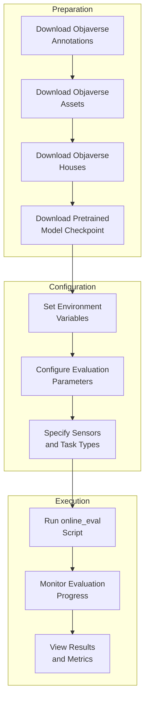
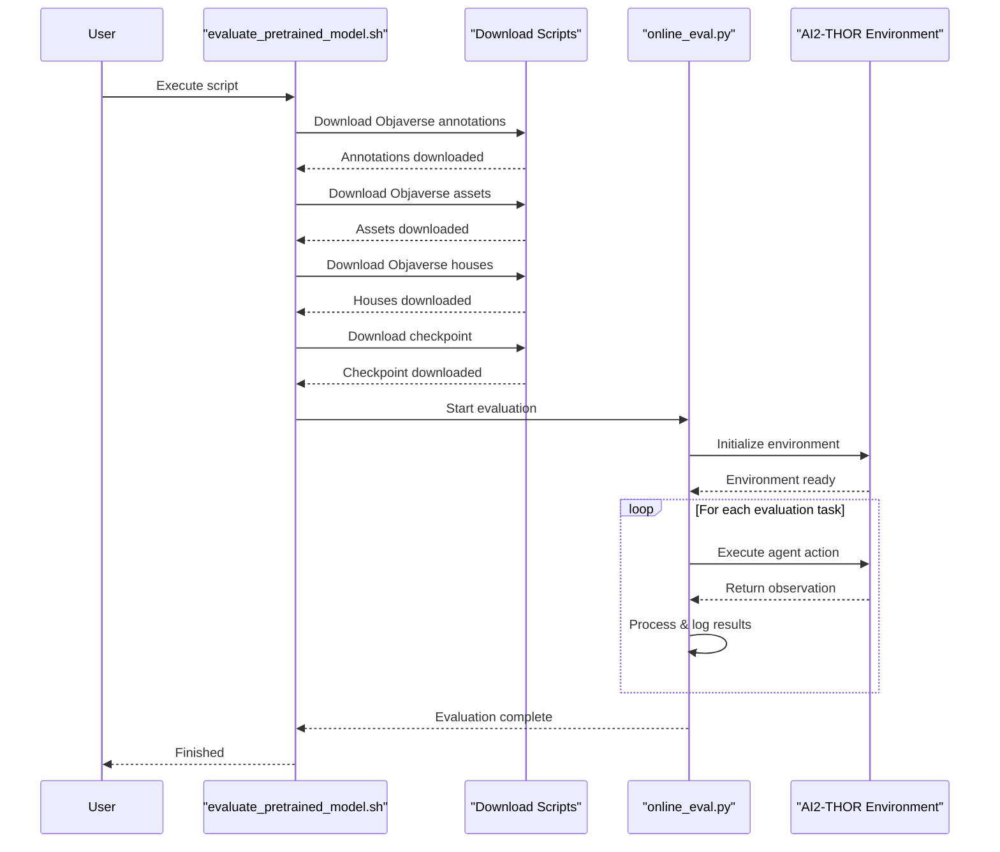

<!-- source: DeepWiki mcp.deepwiki.com · repo allenai/spoc-robot-training · page 4.2 Running Evaluations · fetched 2026-10-26 -->

# Running Evaluations

<details>
<summary>Relevant source files</summary>

The following files were used as context for generating this wiki page:

- [TRAINING_README.md](TRAINING_README.md)
- [scripts/eval_pretrained_model.sh](scripts/eval_pretrained_model.sh)

</details>


This document provides detailed instructions for running evaluations on trained models within the SPOC (Simulation for Navigation and Manipulation) system. It covers the process of preparing the necessary data, downloading pretrained models, configuring evaluation parameters, and executing evaluation runs. For information about the underlying evaluation system components, see [Online Evaluator](#4.1). For details about the available pretrained models, see [Pretrained Models](#4.3).

## Evaluation Workflow Overview

Before diving into specific commands, it's helpful to understand the overall evaluation process:



Sources: [TRAINING_README.md:64-86](), [scripts/eval_pretrained_model.sh:1-41]()

## Preparing for Evaluation

Before running an evaluation, you need to ensure all required data and model checkpoints are available:

### 1. Setting Environment Variables

Define the base directories for Objaverse assets and houses:

```bash
export OBJAVERSE_DATA_BASE_DIR="objaverse_assets"
export OBJAVERSE_HOUSES_BASE_DIR="objaverse_houses"
export OBJAVERSE_DATA_DIR="objaverse_assets/2023_07_28"
export OBJAVERSE_HOUSES_DIR="objaverse_houses/houses_2023_07_28"
export CKPT_DIR="pretrained_models"
export PYTHONPATH="./"
```

Sources: [scripts/eval_pretrained_model.sh:1-6]()

### 2. Downloading Required Data

#### Downloading Objaverse Annotations and Assets

```bash
# Download annotations
python -m objathor.dataset.download_annotations --version 2023_07_28 --path $OBJAVERSE_DATA_BASE_DIR

# Download assets
python -m objathor.dataset.download_assets --version 2023_07_28 --path $OBJAVERSE_DATA_BASE_DIR
```

Sources: [scripts/eval_pretrained_model.sh:9-19]()

#### Downloading Objaverse Houses

```bash
python scripts/download_objaverse_houses.py --save_dir $OBJAVERSE_HOUSES_BASE_DIR --subset val
```

Sources: [scripts/eval_pretrained_model.sh:21-26]()

### 3. Downloading Pretrained Models

You can download specific pretrained models using the `download_trained_ckpt` script:

```bash
python -m scripts.download_trained_ckpt --save_dir $CKPT_DIR --ckpt_ids SigLIP-ViTb-3-CHORES-S
```

Omitting the `--ckpt_ids` parameter will download all available pretrained models:
- `DINOv2-ViTs-3-CHORES-S`
- `SigLIP-ViTb-3-CHORES-L`
- `SigLIP-ViTb-3-CHORES-S`
- `SigLIP-ViTb-3-CHORESNav-L`
- `SigLIP-ViTb-3-CHORESNav-S`
- `SigLIP-ViTb-3-double-det-CHORES-L`
- `SigLIP-ViTb-3-double-det-CHORES-S`

Sources: [TRAINING_README.md:140-148](), [scripts/eval_pretrained_model.sh:28-33]()

## Running Online Evaluations

The `online_eval` script is used to perform online evaluations of trained models. Here's the basic structure of the evaluation command:

```mermaid
classDiagram
    class "OnlineEvalCommand" {
        +training.offline.online_eval
        +Required Parameters
        +Optional Parameters
        +Input Sensors Configuration
        +Output Configuration
    }
    
    class "RequiredParameters" {
        +--eval_subset: Evaluation dataset subset
        +--output_basedir: Directory for output logs
        +--task_type: Type of task to evaluate
        +--input_sensors: List of input sensors
        +--house_set: House dataset to use
    }
    
    class "OptionalParameters" {
        +--shuffle: Shuffle evaluation tasks
        +--test_augmentation: Apply test-time augmentation
        +--num_workers: Number of evaluation workers
        +--gpu_devices: List of GPU IDs to use
    }
    
    class "CheckpointSpecification" {
        +--wandb_logging: Whether to use wandb logging
        +--training_run_id: ID of training run
        +--ckptStep: Checkpoint step to load (optional)
        +--local_checkpoint_dir: Directory with checkpoints
    }
    
    "OnlineEvalCommand" --> "RequiredParameters"
    "OnlineEvalCommand" --> "OptionalParameters"
    "OnlineEvalCommand" --> "CheckpointSpecification"
```

Sources: [TRAINING_README.md:64-86]()

### Basic Command Structure

```bash
python -m training.offline.online_eval [parameters]
```

### Key Parameters

| Parameter | Description | Example |
|-----------|-------------|---------|
| `--eval_subset` | Dataset subset to evaluate on | `minival` |
| `--output_basedir` | Directory to save evaluation logs | `/path/to/save/logs` |
| `--task_type` | Type of task to evaluate | `CHORES`, `CHORESNav`, `ObjectNavType` |
| `--input_sensors` | List of sensors to use as input | `raw_navigation_camera raw_manipulation_camera last_actions an_object_is_in_hand` |
| `--house_set` | House dataset to use | `objaverse` |
| `--num_workers` | Number of parallel evaluation workers | `10` |
| `--gpu_devices` | List of GPU IDs to use | `0 1` |
| `--training_run_id` | ID of the training run | `SigLIP-ViTb-3-CHORES-S` |
| `--ckptStep` | Specific checkpoint step to load (optional) | `1000` |
| `--shuffle` | Shuffle evaluation tasks (flag) | - |
| `--test_augmentation` | Apply test-time augmentation (flag) | - |

Sources: [TRAINING_README.md:66-71](), [scripts/eval_pretrained_model.sh:36-41]()

### Checkpoint Loading Options

#### Using Local Checkpoints

```bash
--wandb_logging False --training_run_id TRAINING_ID --ckptStep STEP_NUMBER --local_checkpoint_dir /path/to/local/checkpoints/
```

#### Using Weights & Biases (Wandb) Checkpoints

```bash
--wandb_logging True --wandb_entity_name WANDB_ENTITY_NAME --wandb_project_name WANDB_PROJECT_NAME --training_run_id TRAINING_ID
```

Sources: [TRAINING_README.md:76-86]()

## Model Input Configurations

Depending on the model you're evaluating, you'll need to configure the appropriate input sensors. There are two main configurations:

### 1. Models Without Detection

```bash
--input_sensors raw_navigation_camera raw_manipulation_camera last_actions an_object_is_in_hand
```

### 2. Models With Detection

```bash
--input_sensors raw_navigation_camera raw_manipulation_camera last_actions an_object_is_in_hand nav_task_relevant_object_bbox manip_task_relevant_object_bbox nav_accurate_object_bbox manip_accurate_object_bbox
```

Sources: [TRAINING_README.md:152-168]()

## Complete Evaluation Example

The repository provides a complete evaluation script that handles all the necessary steps:

```bash
bash scripts/evaluate_pretrained_model.sh
```

This script:
1. Sets up environment variables
2. Downloads Objaverse annotations and assets if not already present
3. Downloads Objaverse houses if not already present
4. Downloads the `SigLIP-ViTb-3-double-det-CHORES-S` checkpoint if not already present
5. Runs evaluation on the minival subset for ObjectNavType tasks



Sources: [scripts/eval_pretrained_model.sh:1-41](), [TRAINING_README.md:176-180]()

Here's the complete example command from the script:

```bash
python -m training.offline.online_eval --shuffle --eval_subset minival --output_basedir tmp_log \
 --test_augmentation --task_type ObjectNavType \
 --input_sensors raw_navigation_camera raw_manipulation_camera last_actions an_object_is_in_hand \
 nav_task_relevant_object_bbox manip_task_relevant_object_bbox nav_accurate_object_bbox manip_accurate_object_bbox \
 --house_set objaverse --wandb_logging False --num_workers 10 \
 --gpu_devices 0 1 --training_run_id SigLIP-ViTb-3-double-det-CHORES-S --local_checkpoint_dir $CKPT_DIR
```

Sources: [scripts/eval_pretrained_model.sh:36-41]()

---

