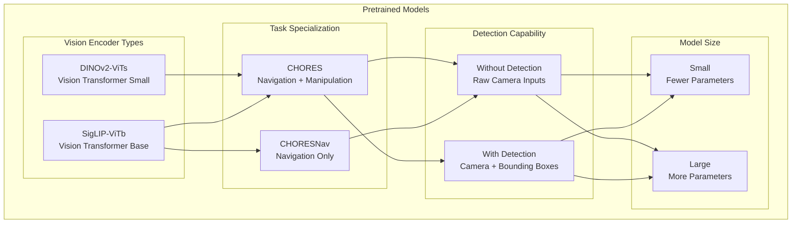
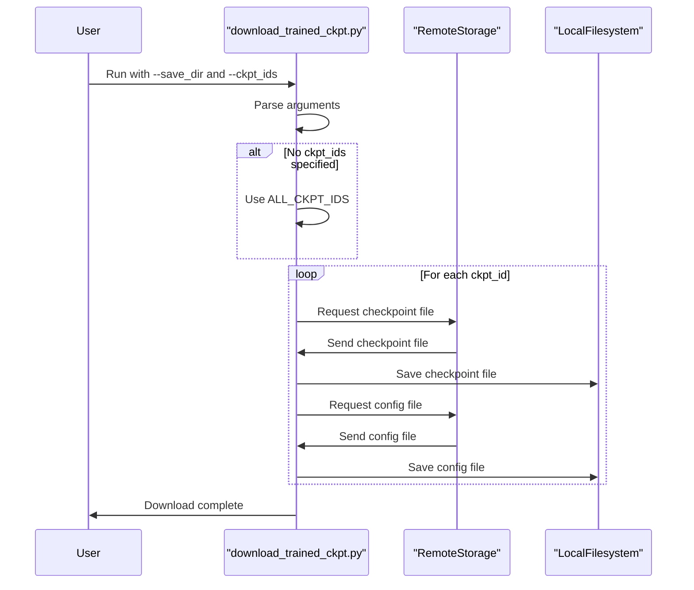
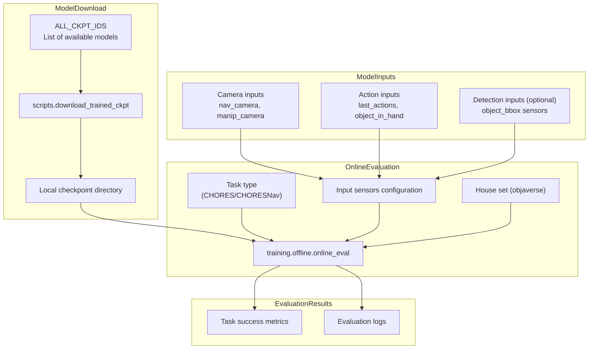
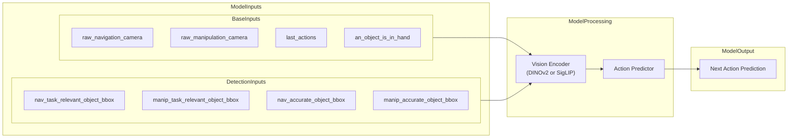

<!-- source: DeepWiki mcp.deepwiki.com · repo allenai/spoc-robot-training · page 4.3 Pretrained Models · fetched 2026-10-26 -->

# Pretrained Models

<details>
<summary>Relevant source files</summary>

The following files were used as context for generating this wiki page:

- [TRAINING_README.md](TRAINING_README.md)
- [scripts/download_trained_ckpt.py](scripts/download_trained_ckpt.py)

</details>


This document provides information about the pretrained models available for the SPOC system, including which models are available, how to download them, and how to use them for evaluation. For information about training your own models, see [Training Pipeline](#3).

## Available Pretrained Models

The SPOC system provides several pretrained models for robotic navigation and manipulation tasks within the CHORES benchmark. These models vary in architecture, training data, and detection capabilities.

| Model ID | Architecture | Training Data | Detection | Size |
|----------|-------------|--------------|-----------|------|
| DINOv2-ViTs-3-CHORES-S | DINOv2 ViT Small | CHORES | No | Small |
| SigLIP-ViTb-3-CHORES-L | SigLIP ViT Base | CHORES | No | Large |
| SigLIP-ViTb-3-CHORES-S | SigLIP ViT Base | CHORES | No | Small |
| SigLIP-ViTb-3-CHORESNav-L | SigLIP ViT Base | CHORESNav | No | Large |
| SigLIP-ViTb-3-CHORESNav-S | SigLIP ViT Base | CHORESNav | No | Small |
| SigLIP-ViTb-3-double-det-CHORES-L | SigLIP ViT Base | CHORES | Yes | Large |
| SigLIP-ViTb-3-double-det-CHORES-S | SigLIP ViT Base | CHORES | Yes | Small |

The naming convention follows the pattern:
- Architecture (DINOv2-ViTs or SigLIP-ViTb)
- Version (-3-)
- Training dataset (CHORES or CHORESNav)
- Model size (S for Small, L for Large)
- Detection capability (double-det indicates models that use detection)

"CHORES" models are trained on the full CHORES benchmark (navigation and manipulation tasks), while "CHORESNav" models focus specifically on navigation tasks.

Sources: [scripts/download_trained_ckpt.py:7-15]()

## Model Architecture Overview



Sources: [TRAINING_README.md:140-148]()

## Downloading Pretrained Models

To download the pretrained models, use the `scripts.download_trained_ckpt` script:

```bash
python -m scripts.download_trained_ckpt --save_dir /path/to/local/checkpoints --ckpt_ids SigLIP-ViTb-3-CHORES-S
```

To download all available models, omit the `--ckpt_ids` parameter:

```bash
python -m scripts.download_trained_ckpt --save_dir /path/to/local/checkpoints
```

The download process will create a directory structure with each model directory containing:
- `checkpoint_final.ckpt`: The model weights
- `config.yaml`: The model configuration file

Sources: [TRAINING_README.md:142-148](), [scripts/download_trained_ckpt.py:17-39]()

## Download Process Workflow



Sources: [scripts/download_trained_ckpt.py:18-38]()

## Using Pretrained Models for Evaluation

After downloading the models, you can evaluate them using the `training.offline.online_eval` script. There are two types of models:

1. **Models without detection**: These use only raw camera inputs
2. **Models with detection**: These use both raw camera inputs and object bounding boxes

### Evaluating Models Without Detection

```bash
python -m training.offline.online_eval --shuffle --eval_subset minival --output_basedir /path/to/save/logs \
 --test_augmentation --task_type TASK_TYPE \
 --input_sensors raw_navigation_camera raw_manipulation_camera last_actions an_object_is_in_hand \
 --house_set objaverse --wandb_logging False --num_workers NUM_WORKERS \
 --gpu_devices LIST_OF_GPU_IDS --training_run_id TRAINING_ID --local_checkpoint_dir /path/to/local/checkpoints
```

Replace:
- `TASK_TYPE`: Specific task or one of `CHORES` or `CHORESNAV`
- `NUM_WORKERS`: Number of evaluation workers
- `LIST_OF_GPU_IDS`: List of GPU IDs to use (e.g., "0,1,2")
- `TRAINING_ID`: Model ID such as `SigLIP-ViTb-3-CHORES-S`

Sources: [TRAINING_README.md:153-158]()

### Evaluating Models With Detection

```bash
python -m training.offline.online_eval --shuffle --eval_subset minival --output_basedir /path/to/save/logs \
 --test_augmentation --task_type TASK_TYPE \
 --input_sensors raw_navigation_camera raw_manipulation_camera last_actions an_object_is_in_hand \
 nav_task_relevant_object_bbox manip_task_relevant_object_bbox nav_accurate_object_bbox manip_accurate_object_bbox \
 --house_set objaverse --wandb_logging False --num_workers NUM_WORKERS \
 --gpu_devices LIST_OF_GPU_IDS --training_run_id TRAINING_ID --local_checkpoint_dir /path/to/local/checkpoints
```

The key difference is the additional input sensors that provide bounding box information for the relevant objects in the environment.

Sources: [TRAINING_README.md:162-168]()

### Quick Evaluation Script

For convenience, you can use the provided evaluation script:

```bash
bash scripts/evaluate_pretrained_model.sh
```

This script downloads Objaverse assets, Objaverse houses, and the pretrained model `SigLIP-ViTb-3-double-det-CHORES-S`, and then evaluates the model on the minival set.

Sources: [TRAINING_README.md:177-179]()

## Evaluation System Architecture



Sources: [TRAINING_README.md:153-168](), [scripts/download_trained_ckpt.py:41-69]()

## Model Input-Output Structure



Sources: [TRAINING_README.md:153-168]()

## Performance Considerations

When choosing a pretrained model, consider these trade-offs:

1. **Model size**: Larger models (L) generally perform better but require more computational resources.
2. **Detection capability**: Models with detection capability (double-det) have better performance for manipulation tasks but require additional preprocessing for bounding box extraction.
3. **Task specialization**: CHORES models are general-purpose for both navigation and manipulation, while CHORESNav models are specialized for navigation tasks.

For most use cases, the `SigLIP-ViTb-3-double-det-CHORES-S` model provides a good balance of performance and resource requirements, as it's pre-configured in the evaluation script.

Sources: [TRAINING_README.md:170-173]()

---

