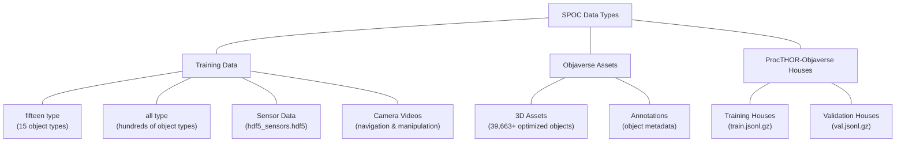
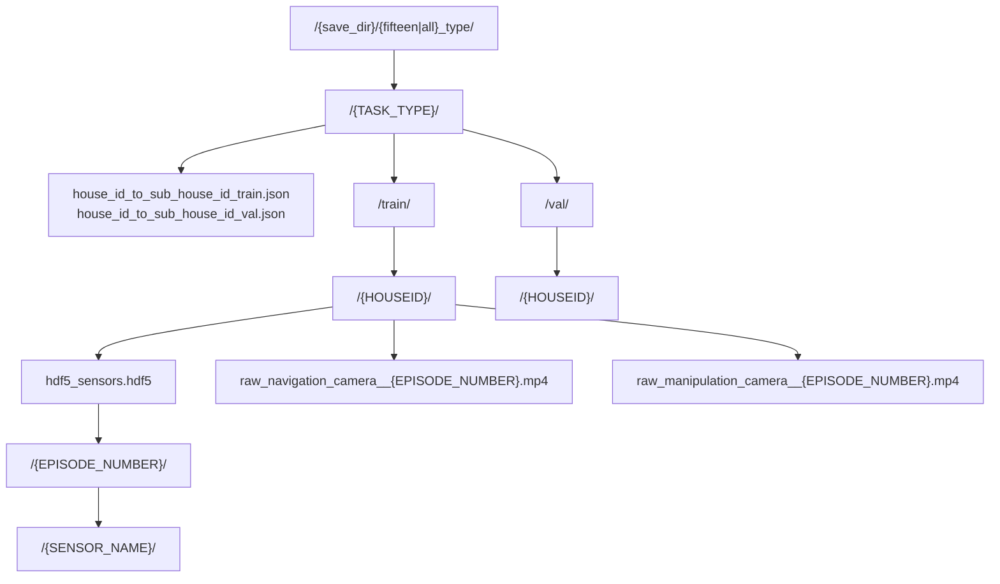
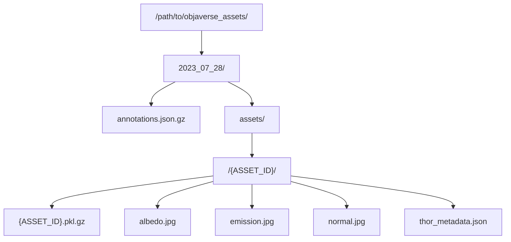
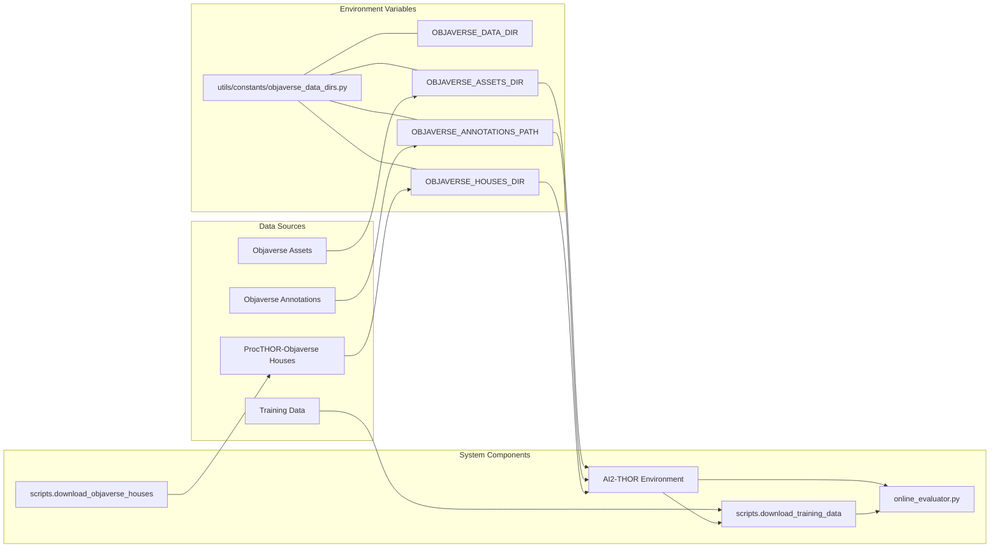
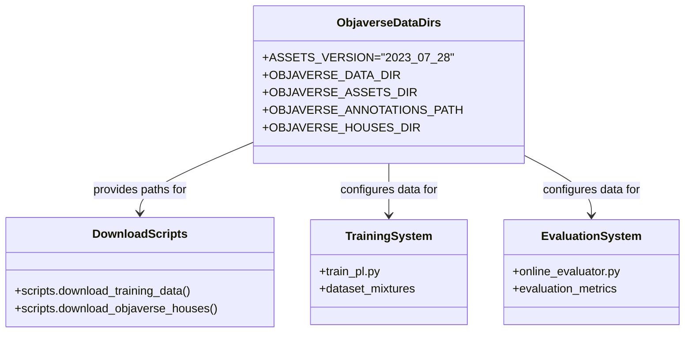

<!-- source: DeepWiki mcp.deepwiki.com · repo allenai/spoc-robot-training · page 5 Data Management · fetched 2026-10-26 -->

# Data Management

<details>
<summary>Relevant source files</summary>

The following files were used as context for generating this wiki page:

- [README.md](README.md)
- [how_to_use_data.ipynb](how_to_use_data.ipynb)
- [utils/constants/objaverse_data_dirs.py](utils/constants/objaverse_data_dirs.py)

</details>


## Purpose and Scope

This document describes the data management aspects of the SPOC (Simulation for Navigation and Manipulation) system. It covers the different types of data used for training and evaluation, how to download and organize them, the format of the data, and how environment variables are configured to locate these data resources.

For information on how this data is used in training models, see [Training Pipeline](#3). For details on evaluation with these datasets, see [Evaluation System](#4).

## Data Types Overview

### SPOC Data Types



Sources: [README.md:25-52]()

## Training Data

The SPOC system uses two main variants of training data:

1. **"fifteen" type**: Contains data for the agent navigating and fetching one of fifteen possible object types.
2. **"all" type**: Contains data for the agent navigating and fetching any object type (of many hundreds).

### Downloading Training Data

You can download the training data using the following command:

```bash
python -m scripts.download_training_data --save_dir /your/local/save/dir --types fifteen
```

To download the "all" type training data, change `fifteen` to `all`. By default, this downloads data for all 10 task types (ObjectNav, Pickup, Fetch, etc.). If you want to download data for specific task types, use the `--task_types` flag.

Sources: [README.md:25-33]()

### Training Data Structure

Once downloaded, the training data follows this directory structure:



Sources: [README.md:34-52]()

### Sensor Definitions

The training data includes various sensors captured during agent trajectories:

| Sensor Name | Definition |
|-------------|------------|
| `an_object_is_in_hand` | Boolean indicating if an object is currently held |
| `house_index` | Index of the house in the dataset |
| `hypothetical_task_success` | Whether the task would be successful if the agent ended now |
| `last_action_is_random` | Whether the most recent action was chosen randomly |
| `last_action_str` | String representation of the last action performed |
| `last_action_success` | Whether the last action was successful |
| `last_agent_location` | Agent's location in world coordinates |
| `manip_accurate_object_bbox` | Target object's bounding box in manipulation camera (method 1) |
| `manip_task_relevant_object_bbox` | Target object's bounding box in manipulation camera (method 2) |
| `minimum_l2_target_distance` | Minimum Euclidean distance to target object/location |
| `minimum_visible_target_alignment` | Minimum turn angle needed to center object in navigation camera |
| `nav_accurate_object_bbox` | Target object's bounding box in navigation camera (method 1) |
| `nav_task_relevant_object_bbox` | Target object's bounding box in navigation camera (method 2) |
| `relative_arm_location_metadata` | Proprioceptive information about arm location |
| `room_current_seen` | Whether current room has been seen before |
| `rooms_seen` | Count of rooms visited by the agent |
| `templated_task_spec` | Dictionary of task information for natural language description |
| `visible_target_4m_count` | Count of targets visible within 4 meters |

Sources: [README.md:58-78]()

## Objaverse Assets and Annotations

Objaverse assets are optimized 3D objects used in the simulation environments. Along with the assets, annotations provide metadata about these objects.

### Downloading Objaverse Assets and Annotations

To download the optimized Objaverse assets and annotations:

```bash
python -m objathor.dataset.download_annotations --version 2023_07_28 --path /path/to/objaverse_assets
python -m objathor.dataset.download_assets --version 2023_07_28 --path /path/to/objaverse_assets
```

Sources: [README.md:125-128]()

### Objaverse Data Structure

This creates the following directory structure:



Sources: [README.md:131-143]()

## ProcTHOR-Objaverse Houses

ProcTHOR-Objaverse houses are pre-built simulation environments used for training and evaluation. These houses contain placements of Objaverse objects within procedurally generated floor plans.

### Downloading ProcTHOR-Objaverse Houses

To download the ProcTHOR-Objaverse houses:

```bash
python -m scripts.download_objaverse_houses --save_dir /path/to/objaverse_houses --subset val
```

This downloads the validation set of houses as `/path/to/objaverse_houses/val.jsonl.gz`. You can change `val` to `train` to download the training set of houses.

Sources: [README.md:147-151]()

## Data Flow in SPOC System

### Code-to-Data Relationships



Sources: [README.md:109-168](), [utils/constants/objaverse_data_dirs.py:1-36]()

## Environment Configuration

### Data Path Configuration System



To use the downloaded data, set the following environment variables:

```bash
export OBJAVERSE_HOUSES_DIR=/path/to/objaverse_houses
export OBJAVERSE_DATA_DIR=/path/to/objaverse_assets
```

These variables are used throughout the codebase to locate the necessary data files. The system defines default paths, but setting these environment variables ensures the data is correctly located.

The relevant environment variables and their default values are defined in [utils/constants/objaverse_data_dirs.py:1-36](). Key constants include:

- `ASSETS_VERSION`: The version of Objaverse assets (currently "2023_07_28").
- `OBJAVERSE_DATA_DIR`: The directory containing Objaverse data, defaults to `~/.objathor-assets`.
- `OBJAVERSE_ASSETS_DIR`: The directory containing Objaverse assets, defaults to `$OBJAVERSE_DATA_DIR/assets`.
- `OBJAVERSE_ANNOTATIONS_PATH`: The path to the Objaverse annotations file, defaults to `$OBJAVERSE_DATA_DIR/annotations.json.gz`.
- `OBJAVERSE_HOUSES_DIR`: The directory containing ProcTHOR-Objaverse houses, no default.

Sources: [utils/constants/objaverse_data_dirs.py:1-36]()

## Working with the Data

You can see usage examples for the downloaded data in the provided jupyter notebook (`how_to_use_data.ipynb`).

For information on using the data for training, see the [Training Pipeline](#3) wiki page.
For information on evaluation using the downloaded data, see the [Evaluation System](#4) wiki page.

---

