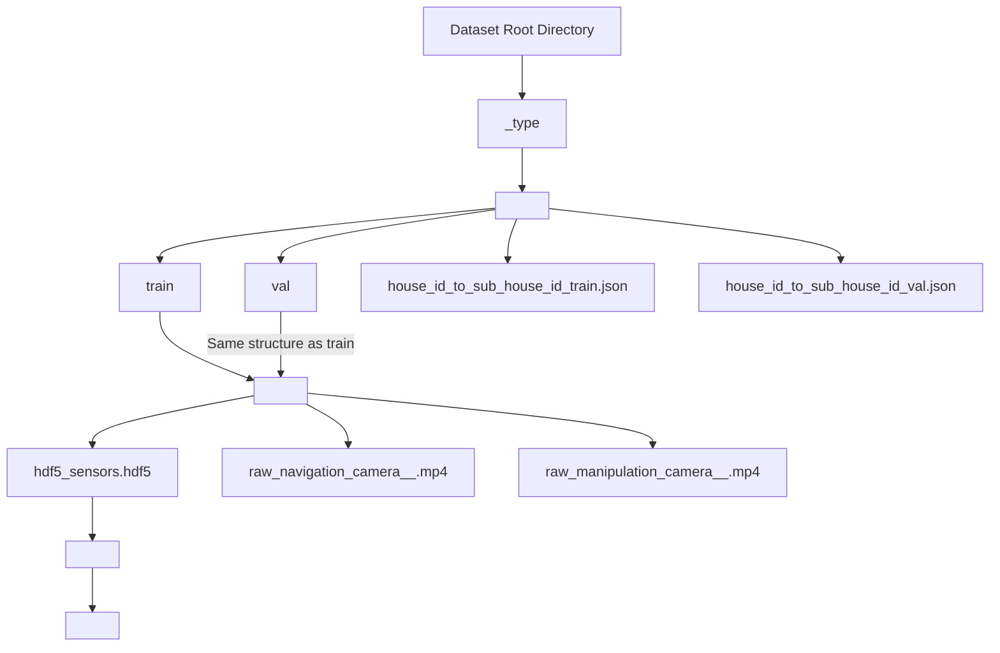
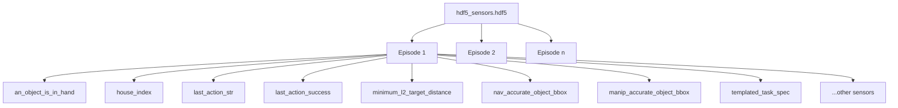
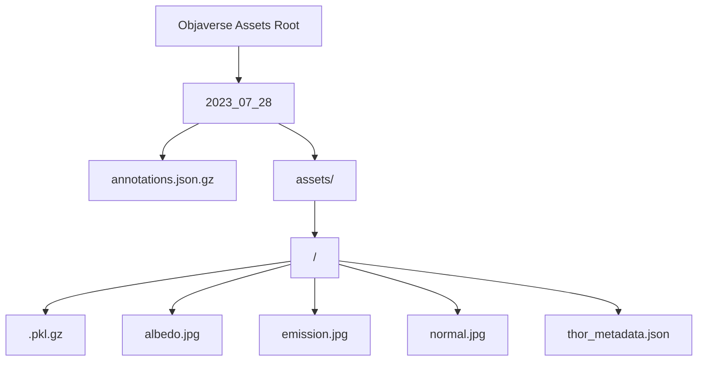
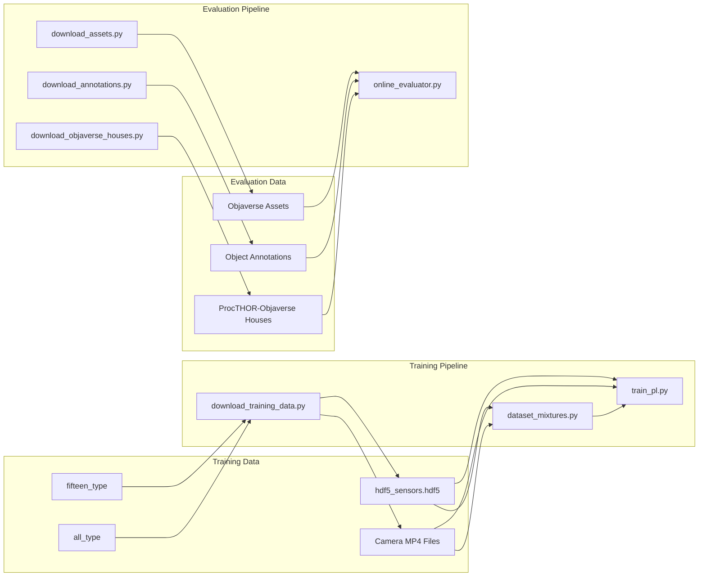
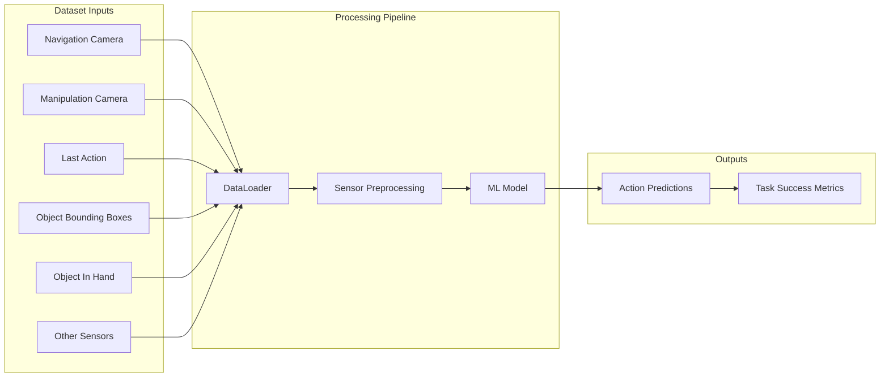

<!-- source: DeepWiki mcp.deepwiki.com · repo allenai/spoc-robot-training · page 5.1 Dataset Structure · fetched 2026-10-26 -->

# Dataset Structure

<details>
<summary>Relevant source files</summary>

The following files were used as context for generating this wiki page:

- [README.md](README.md)
- [how_to_use_data.ipynb](how_to_use_data.ipynb)

</details>


## Purpose and Scope

This document provides a detailed overview of the dataset structures used in the SPOC (Simulation for Navigation and Manipulation) system. It covers the organization of training datasets, sensor data formats, and the evaluation datasets. For information about downloading and using these datasets, see [Downloading and Using Data](#5.2).

## Training Dataset Overview

The SPOC system uses two primary types of training datasets:

1. **Fifteen Type**: Contains data where the agent navigates and fetches one of fifteen possible object types.
2. **All Type**: Contains data where the agent navigates to and fetches any object type (from hundreds of possibilities).

Each dataset contains trajectory data from various task types (e.g., ObjectNav, Pickup, Fetch) across multiple simulated houses.

### Directory Structure

The training datasets follow a standardized hierarchical structure:



**Training Dataset Directory Structure**

Sources: [README.md:36-52](). 

## Sensor Data

The dataset includes two primary types of sensor data:

1. **Video Recordings**: Stored as MP4 files for both navigation and manipulation cameras
2. **Non-visual Sensor Data**: Stored in HDF5 format containing various sensor readings

### HDF5 Sensor Data Structure

The HDF5 file contains multiple sensors organized by episode number and sensor name:



**HDF5 Sensor Data Organization**

Sources: [README.md:54-78]().

### Sensor Definitions

| Sensor Name | Definition |
|-------------|------------|
| `an_object_is_in_hand` | Boolean indicator if object is currently held |
| `house_index` | Index of house in dataset |
| `hypothetical_task_success` | Boolean indicating if task would be successful if agent issued "done" |
| `last_action_is_random` | Boolean indicating if most recent action was randomly chosen |
| `last_action_str` | String representation of last action performed |
| `last_action_success` | Boolean indicating if last action was successful |
| `last_agent_location` | Agent's location in world coordinate frame |
| `manip_accurate_object_bbox` | Bounding box for target object in manipulation camera (simulation method 1) |
| `manip_task_relevant_object_bbox` | Bounding box for target object in manipulation camera (simulation method 2) |
| `minimum_l2_target_distance` | Minimum Euclidean distance to target object/location |
| `minimum_visible_target_alignment` | Minimum degree needed to center object in navigation camera frame |
| `nav_accurate_object_bbox` | Bounding box for target object in navigation camera (simulation method 1) |
| `nav_task_relevant_object_bbox` | Bounding box for target object in navigation camera (simulation method 2) |
| `relative_arm_location_metadata` | Arm proprioceptive data in agent's coordinate frame |
| `room_current_seen` | Boolean indicating if current room has been seen before |
| `rooms_seen` | Count of rooms visited by agent |
| `templated_task_spec` | Dictionary of task information for generating natural language description |
| `visible_target_4m_count` | Count of targets visible within 4-meter radius |

Sources: [README.md:58-78]().

## Evaluation Dataset Structure

The evaluation datasets consist of:

1. **Objaverse Assets and Annotations**: 3D object models with metadata
2. **ProcTHOR-Objaverse Houses**: Procedurally generated houses populated with Objaverse objects

### Objaverse Assets Structure



**Objaverse Assets Directory Structure**

Sources: [README.md:130-143]().

### ProcTHOR-Objaverse Houses

The ProcTHOR-Objaverse houses are stored as compressed JSONL files:

```
/path/to/objaverse_houses/
    train.jsonl.gz  # Training houses
    val.jsonl.gz    # Validation houses
```

Sources: [README.md:147-152]().

## Data Flow in Training and Evaluation

The following diagram illustrates how data flows through the SPOC system during training and evaluation:



**Data Flow in SPOC System**

Sources: [README.md:25-34](), [README.md:109-163]().

## Data Processing Flow

The following diagram shows how sensor data from the dataset is processed during training and evaluation:



**Data Processing Flow**

Sources: [README.md:54-78]().

## Environment Variables and Data Access

To access the datasets, the following environment variables need to be set:

```
OBJAVERSE_HOUSES_DIR=/path/to/objaverse_houses
OBJAVERSE_DATA_DIR=/path/to/objaverse_assets
```

These variables point to the locations of the ProcTHOR-Objaverse houses and Objaverse assets respectively, allowing the system to locate and load the necessary data during training and evaluation.

Sources: [README.md:156-160]().

---

