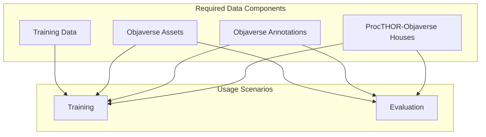
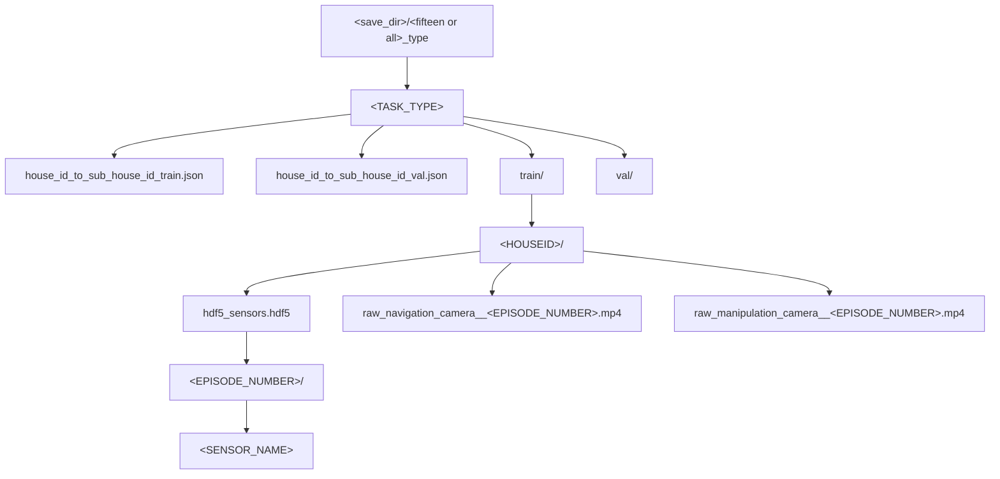
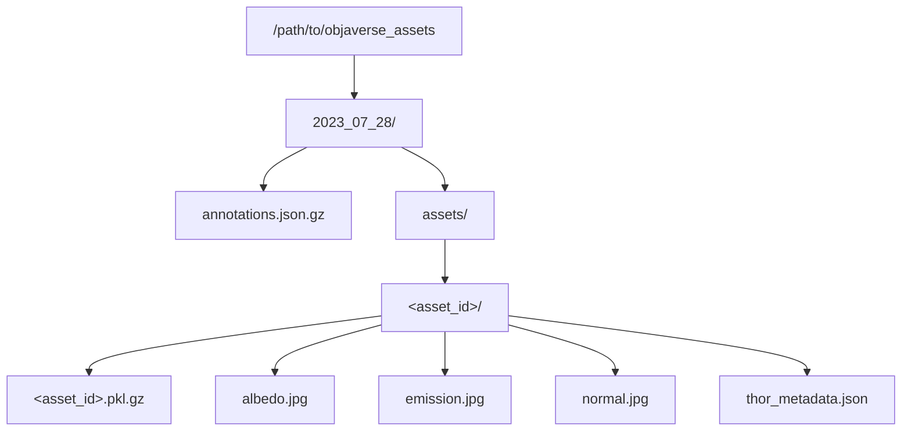
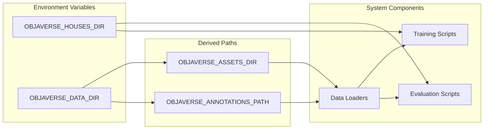
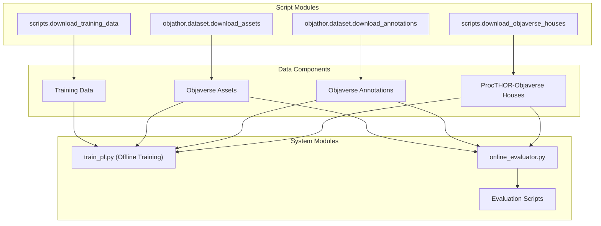

<!-- source: DeepWiki mcp.deepwiki.com · repo allenai/spoc-robot-training · page 5.2 Downloading and Using Data · fetched 2026-10-26 -->

# Downloading and Using Data

<details>
<summary>Relevant source files</summary>

The following files were used as context for generating this wiki page:

- [README.md](README.md)
- [how_to_use_data.ipynb](how_to_use_data.ipynb)
- [utils/constants/objaverse_data_dirs.py](utils/constants/objaverse_data_dirs.py)

</details>


This page provides detailed instructions for downloading and setting up the various datasets and assets required by the SPOC system. It covers downloading training data, Objaverse assets, annotations, and ProcTHOR-Objaverse houses. For information about the dataset structure itself, see [Dataset Structure](#5.1).

## Data Components Overview

The SPOC system requires several data components to function properly:

1. **Training Data** - Task-specific datasets for training models
2. **Objaverse Assets** - 3D objects used in environments
3. **Objaverse Annotations** - Metadata about the 3D objects
4. **ProcTHOR-Objaverse Houses** - Procedurally generated house environments



Sources: [README.md:25-32](), [README.md:118-123]()

## Downloading Training Data

The SPOC system offers two types of training data: `fifteen` and `all`.

- `fifteen`: Agent navigates and fetches one of fifteen possible object types
- `all`: Agent navigates and fetches any object type (of many hundreds)

Use the following command to download training data:

```bash
python -m scripts.download_training_data --save_dir /your/local/save/dir --types fifteen
```

Change `fifteen` to `all` to download the more comprehensive dataset. By default, this will download data for all 10 task types (ObjectNav, Pickup, Fetch, etc.). To download only specific task types, use the `--task_types` flag.

Sources: [README.md:25-32]()

## Training Data Structure

After downloading, your data will be organized as follows:



The `hdf5_sensors.hdf5` files contain all sensor values that are not camera frames, while the `.mp4` files contain videos of the agent's trajectories in the environments.

Sources: [README.md:35-52]()

## Downloading Objaverse Assets and Annotations

These assets provide the 3D objects used in environments. To download:

1. Choose a directory to store assets and annotations (e.g., `/path/to/objaverse_assets`)
2. Run the following commands:

```bash
python -m objathor.dataset.download_annotations --version 2023_07_28 --path /path/to/objaverse_assets
python -m objathor.dataset.download_assets --version 2023_07_28 --path /path/to/objaverse_assets
```

This creates the following directory structure:



Sources: [README.md:123-143](), [utils/constants/objaverse_data_dirs.py:1-36]()

## Downloading ProcTHOR-Objaverse Houses

To download the ProcTHOR-Objaverse houses, which serve as environments for training and evaluation:

```bash
python -m scripts.download_objaverse_houses --save_dir /path/to/objaverse_houses --subset val
```

This will download the validation set of houses to `/path/to/objaverse_houses/val.jsonl.gz`. You can change `val` to `train` to download the training set.

Sources: [README.md:147-152]()

## Setting Environment Variables

After downloading all required data, you need to set the following environment variables:

```bash
export OBJAVERSE_HOUSES_DIR=/path/to/objaverse_houses
export OBJAVERSE_DATA_DIR=/path/to/objaverse_assets
```

These environment variables allow the system to locate your data during training and evaluation.



The system automatically derives additional paths from these variables:
- `OBJAVERSE_ASSETS_DIR`: Set to `OBJAVERSE_DATA_DIR/2023_07_28/assets`
- `OBJAVERSE_ANNOTATIONS_PATH`: Set to `OBJAVERSE_DATA_DIR/2023_07_28/annotations.json.gz`

Sources: [README.md:155-161](), [utils/constants/objaverse_data_dirs.py:4-30]()

## Data Component Interactions

The following diagram illustrates how the different data components interact with the SPOC system during training and evaluation:



Sources: [README.md:104-166]()

## Using the Downloaded Data

After downloading all required components and setting the environment variables, you can:

1. **Run training** with the downloaded training data (see [Offline Training with PyTorch Lightning](#3.1))
2. **Perform evaluation** using the ProcTHOR-Objaverse houses and Objaverse assets (see [Running Evaluations](#4.2))
3. **Explore the data** using the provided example Jupyter notebook at `how_to_use_data.ipynb`

The `how_to_use_data.ipynb` notebook provides examples of how to access and use the downloaded data programmatically.

### Data Validation

You can verify your data setup is correct by checking the following paths exist:

| Environment Variable | Expected Path Content |
|----------------------|----------------------|
| `OBJAVERSE_HOUSES_DIR` | Contains `val.jsonl.gz` and/or `train.jsonl.gz` |
| `OBJAVERSE_DATA_DIR` | Contains `2023_07_28/` directory |
| `OBJAVERSE_DATA_DIR/2023_07_28/assets` | Contains asset directories (e.g., `000074a334c541878360457c672b6c2e/`) |
| `OBJAVERSE_DATA_DIR/2023_07_28/annotations.json.gz` | Compressed annotations file |

Sources: [README.md:163-164](), [utils/constants/objaverse_data_dirs.py:19-29]()

---

